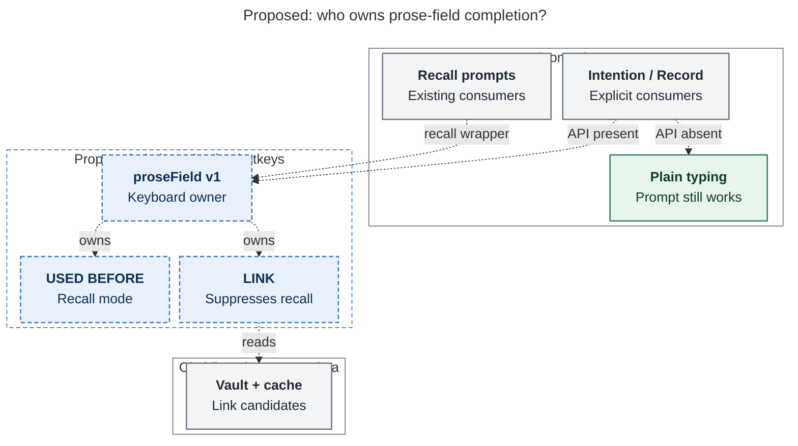
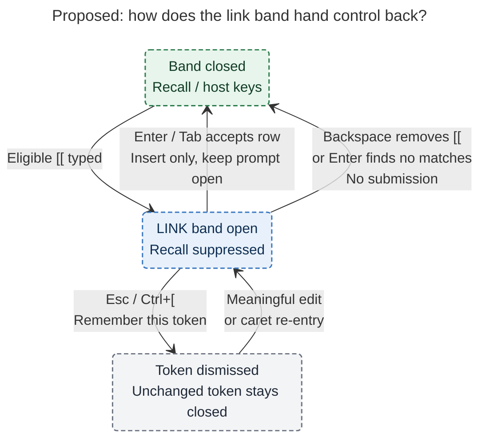

# Diagram proposals: Wikilink completion in Bob's prose prompts — consolidated design

Proposals for the swarm linker, not a report. Each diagram restates only what the source
report says.

```yaml
source: research:202611/prose_prompt_wikilink_completion/prose_prompt_wikilink_completion__final.md
producer: research.5o.image
check: "mmdc 12.0.0 with the PDF-mirroring config rendered 2 of 2 Mermaid diagrams; retained Puppeteer --no-sandbox flags"
```

## controller-ownership

```yaml
anchor: |-
  arbiter (the recall band) lives in nav-hotkeys. One controller owning both
question: |-
  How do existing and new prompts share completion, recall and candidate data while retaining a plain-typing fallback?
illustrates: |-
  One proseField controller in bob-navigation-hotkeys owns both band modes, serves existing recall and explicit card consumers, and reads Obsidian metadata for link candidates.
caption: One controller owns recall and link modes; existing prompts use a wrapper, new cards feature-detect it, and missing support preserves plain typing.
review: "536.316×1119 px, fit 79.8%; question, source and visual checks passed; 1 revision, 2 look rounds"
```



## band-lifecycle

```yaml
anchor: |-
  does not re-pop until a meaningful edit or caret re-entry. No cooldown
question: |-
  How does the link band return control without submitting a query or immediately reopening a dismissed token?
illustrates: |-
  The link band inserts without submitting, consumes zero-match Enter, and remembers an Esc-dismissed token until a meaningful edit or caret re-entry.
caption: Link acceptance keeps the prompt open; Esc remembers the dismissed token, and meaningful editing or caret re-entry can reopen completion.
review: "582.609×710 px, fit 100.0%; question, source and visual checks passed; 1 revision, 2 look rounds"
```


