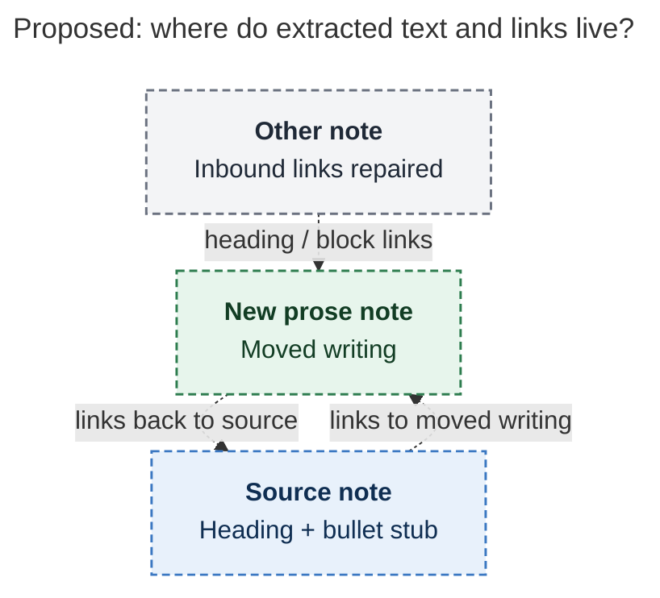
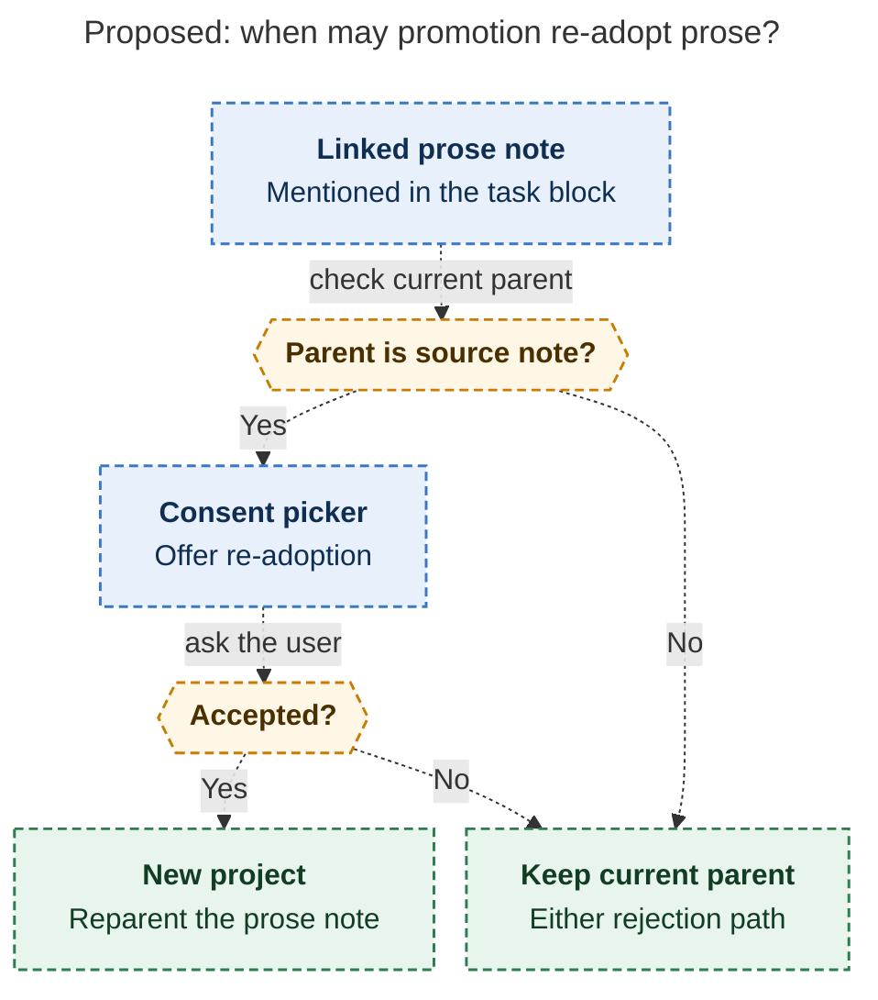

# Diagram proposals: Renaming `article` to `prose`: section extraction and the road to reversible projects

Proposals for the swarm linker, not a report. Each diagram restates only what the source
report says.

```yaml
source: research:202611/prose_rename_and_section_extraction/prose_rename_and_section_extraction__final.md
producer: research.6i.image
check: "mmdc 12.0.0 (pinned npx, Puppeteer --no-sandbox) with the PDF-mirroring config rendered 2 of 2 Mermaid diagrams"
```

## extraction-placement

```yaml
anchor: |-
  heading preserves the structural slot, document order, and a landing for inbound links
question: |-
  After extraction, where do the writing and its links live?
illustrates: |-
  Extraction keeps the heading and a single bullet stub in the source while repairing source-local links, subtree links back to the source, and third-party inbound links.
caption: Extraction keeps a heading and bullet stub in the source while repairing links to moved writing, back to source, and from other notes.
review: "460.953x494 px, fit 100.0%; question, source trace and visual checks passed; 2 revisions; 2 look rounds"
```



## re-adoption

```yaml
anchor: |-
  the task block whose current `parent` is the source note are offered in an explicit
question: |-
  When may task promotion re-adopt a prose note?
illustrates: |-
  On task-to-project promotion, the direct-sibling rule limits which linked prose notes reach the explicit consent picker, and accepted notes reparent under the new project.
caption: Task-to-project promotion re-adopts a linked prose note only when its parent is the task’s residence and the user accepts.
review: "497.609x914 px, fit 97.7%; question, source trace and visual checks passed; 0 revisions; 1 look round"
```


