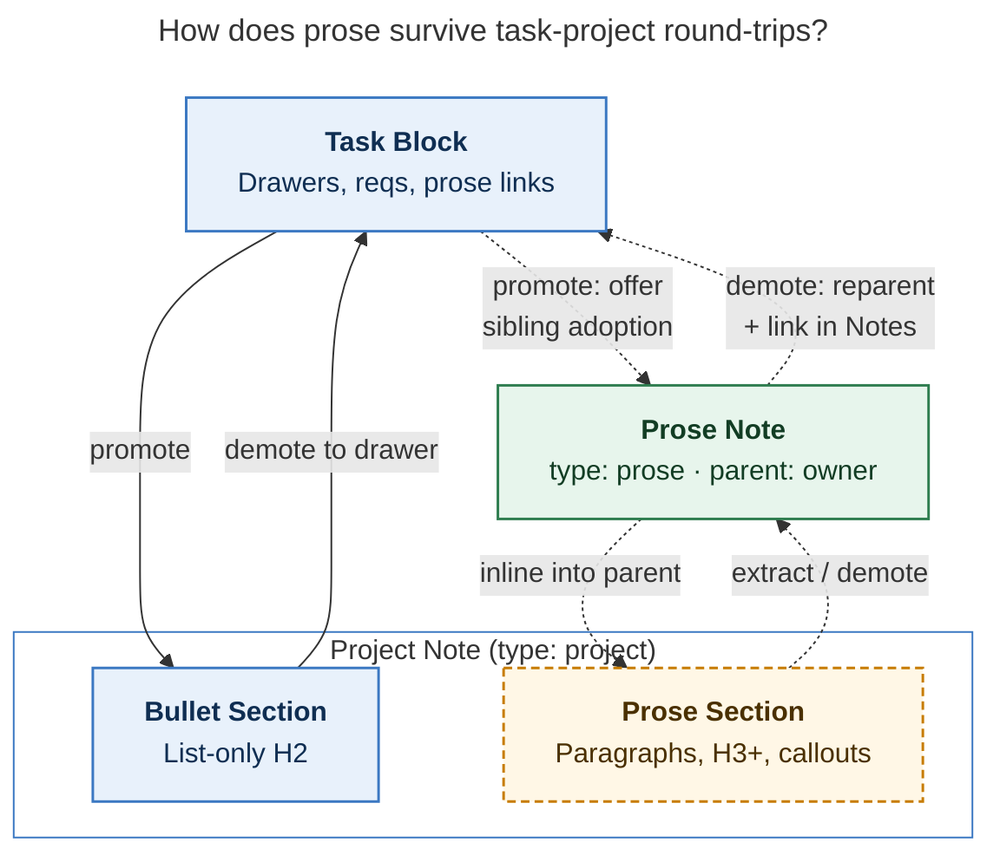

# Renaming `article` Notes, Implicit Prose Sections, and Reversible Task–Project Conversions

_Independent research report (`gem`) · 2026-11-26 · Evidence from `bob-cli`, `bob-plugins`, `bob-mac-capture`, governing SASE decisions, and read-only inspection of `~/bob`._

> **Bottom Line.** Renaming `type: "[[article]]"` to a generic prose type is the right move: after six weeks, `~/bob` has only **1** `[[article]]` note (`sase_blog_contents.md`) versus **39** `[[notebook]]` and **213** `[[record]]` notes, and `"article"` collides conceptually with web articles in `bob ref` and `~/bob/articles.md`. After testing 25+ alternatives against `~/bob` filenames, `bob` subcommands, `bob ref` kinds, and Bob's glossary conventions, **`prose`** (`type: "[[prose]]"`, `bob prose`, `prose.base`, `## Prose`, **"Prose Note"** / **"prose section"**) is the best name — with **`page`** (`type: "[[page]]"`, `bob pages`, `pages.base`) as the strongest countable runner-up.
>
> However, generalizing `article` into a universal prose type requires **six concrete adjustments** to the design: (1) flip `section_numbers` to default `false`; (2) detect prose sections implicitly by content for extraction and reversal without auto-formatting inside live project notes; (3) make section conversion **bidirectional** (`extract` + `inline`) in **Rust** (`bob-cli`), not JS; (4) add a shared `## Prose` (`> [!prose]`) host catalog via `host_catalog`; (5) preserve prose on Project → Task demotion by **extracting/reparenting to the grandparent + linking in `- **Notes**`** (never stuffing multi-paragraph prose into task bullets); and (6) fix the unrelated **existing blockers** in `bob-navigation-hotkeys`'s project reversal (status-grouped `## Tasks`, `## Notebooks`/`## Albums` catalogs, and req/subtask asymmetry) before expecting lossless round-trips.

---

## 1. Current State Verified in the Codebase and Vault

Read-only inspection of `~/bob`, `bob-cli`, `bob-plugins`, and `bob-mac-capture` established the baseline facts this analysis rests on.

### 1.1 Vault Usage and Taxonomy (`~/bob`)

Across non-archive, non-dated root and album notes in `~/bob` (`type:` frontmatter distribution):

| `type:` frontmatter | Count | Structural role in Bob | Holds `#task`? |
| --- | ---: | --- | --- |
| *(untyped)* | 791 | Legacy Zorg notes, indexes, untyped drafts | No (except stray) |
| `"[[record]]"` | 213 | Single schema-backed entity inside an album folder | No |
| `"[[day]]"` | 200 | Daily notes and period notes (week/quarter/year/all_time) | Only `^gtd` & Event Tasks |
| `"[[project]]"` | 102 | Finite outcome with `^prj`, `## Tasks`, bullet drawers, catalogs | Yes |
| `"[[notebook]]"` | 39 | Bullet-only knowledge collection (`[created::]`, `##` sections) | No |
| `"[[area]]"` | 18 | Ongoing sphere of responsibility, `## Tasks`, catalogs | Yes |
| `"[[ref]]"` | 13 (+`ref/`) | External reading material with managed `## Highlights` | No (v2 reading task in owner) |
| `"[[album]]"` | 6 | Schema definition + `[!records]` index for one record folder | No |
| **`"[[article]]"`** | **1** | **`sase_blog_contents.md`** (child of `[[sase_blog]]`) | **No** |
| `"[[mail]]"` / `"[[done]]"` / `"[[bank_month]]"` | *(folder-scoped)* | Gmail threads, archived tasks, monthly bank statements | Archived / none |

Real examples in `~/bob` confirm why `article` is underused and why prose sections matter right now:

- **`job_2026.md`** (`type: "[[project]]"`) contains `## Why I left Google?` — 31 lines of prose combining a `> [!quote]` callout, bold lead-in paragraphs (`**One-liner**`, `**If they probe**`, `**Rules:**`, `**Sources:**`), and nested bullets. Nobody would call that an "article", yet it is unmistakably a prose section inside a project, and it currently **blocks** Project → Task reversal.
- **`sase_blog.md`** (`type: "[[project]]"`) has `sase_blog_contents.md` (`type: "[[article]]"`) as a child note, linked manually under `## Contents` (`Draft: [[sase_blog_contents]]`), alongside untyped prose drafts (`why_sase.md`, `sase_blog_0_legacy_notes.md`), a `## Projects` catalog, and a `## Albums` catalog.
- **`bob_projects.md`** (`type: "[[project]]"`) has `### Future Work` inside `## Project Notes`, which also fails reversal because `###` is not a list item.
- **`~/bob/articles.md`** already exists as a Zorg-migrated reference index (`[[ref]] notes for articles live here`), and `bob ref` / `bob-mac-capture` already use `Article` (`RouteHint::Article`, `web_article`, `RefsModel.swift: case .article`) to mean external web articles clipped into Highlights.

### 1.2 Where `"article"` Currently Lives Across the Repositories

The blast radius of renaming `article` is surprisingly compact and cleanly bounded:

| Repository / Location | Exact references found |
| --- | --- |
| **`bob-cli`** | `src/native/articles/*` (pure core, CLI, vault discovery, inbound links, layout, outline, render); `src/native.rs` & `src/runner.rs` (`bob articles`, `bob nightly` step); `src/native/projects/scan.rs:364` (`frontmatter_is_article`); `src/native/capture/sections.rs:363` (`destination_is_article` for de-numbered heading matching); `src/native/records/schema.rs:15,19` (`RESERVED_RECORD_IDS` / `ALBUM_RESERVED_RECORD_IDS`); `src/native/catalog/table.rs` (`"article-note"`, `articles-list`, `articles-outline`, suppressed `format`/`adopt`); `docs/articles.md`, `docs/_meta/contracts.yml`, `docs/_meta/url_contract.txt`, `docs/reference/cli/`. |
| **`bob-plugins`** | `plugins/bob-articles/*` (entire plugin, ~1,200 LOC, no custom `data.json` or hotkeys in `~/bob`); `plugins/bob-navigation-hotkeys/src/208-parent-note-picker-model.js:23` (`PARENT_RULE_NON_RECORD_TYPES`); `plugins/bob-ledger-tools/src/242d-plugin-album-entrypoints.js:14` (`ALBUM_SCHEMA_ENTRY_NON_RECORD_TYPES`); `plugins/bob-command-mode/src/{040-catalog,160-sheet-rank,170-sheet}.js` (`article-note`, `"Format this article"`, `"Outline this article"`). Notably, `bob-navigation-hotkeys/src/190-summary-modals.js` does **not** recognize `article` yet (it falls through to `kind: "plain"`). |
| **`bob-mac-capture`** | **Zero references** to Obsidian `type: "[[article]]"`. All `article` hits (`RefsModel.swift`, `RefsRanking.swift`, `RefsCaption.swift`) belong to Bob Refs' web-article kind. |
| **`~/bob` & config** | `article.md`, `articles.base`, `type.md`, `_templates/new_article.md`, `sase_blog_contents.md`, `AGENTS.md` (line 15), `.obsidian/community-plugins.json`, and `~/.config/bob/config.yml` (`plugins.sync`). |

### 1.3 Governing Decisions and Rules Checked

Per `AGENTS.md`, `roster:decisions` and `cli_rules.md` were consulted:

- **`cli_rules.md`**: Never hard-rename or remove a CLI command; the old spelling (`bob articles`) becomes a **permanent hidden alias** with byte-identical behavior and no deprecation output. Help, diagnostics, logs, and commit subjects print only the canonical path.
- **`decisions:bob-cli-releases-ride-a-daily-train`**: Any CLI or JSON contract break (e.g., `schema_version` bump from `1` → `2` or changing refusal code `not-article` → `not-prose`) must be marked with `!` in the Conventional Commit subject; never edit `Cargo.toml` versions or `CHANGELOG.md`.
- **`decisions:notebook-routes-write-notes`**: Establishes Bob's clean separation between task-free knowledge notes (`notebook`) and task-holding homes (`area`, `project`), plus the shared `host_catalog` pattern (`> [!notebooks]`, owned bytes, user-owned position). Note that `src/native/notebooks/rules.rs:372` already explicitly distinguishes notebooks from prose: `"stray top-level paragraph; keep prose in the preamble or nested under a note"`.
- **`decisions:drawers-keep-their-names`**: Bold task drawers (`- **Title**`) round-trip byte-for-byte with eligible `## Title` project sections; structural H2 names are closed and reserved.
- **`decisions:task-reqs-are-met-with-their-task`**: Promotion moves the requirement boundary one level (`- [ ] req` → `## Tasks` row; loose notes + `NOTES` drawer → `## Notes`).
- **`decisions:unblocked-tasks-are-offered`**: Potentially surprising cross-task/cross-note side effects are offered explicitly rather than silently guessed.

---

## 2. Naming Analysis: Evaluating `prose` and Its Best Alternatives

Why did `article` fail to generalize? Two reasons:
1. **Implied polish and length.** "Article" sounds like a finished, publishable essay or blog post. It creates psychological friction against applying it to interview talking points (`Why I left Google?`), a 15-line design rationale, a decision memo, a personal letter, or a rough explanation.
2. **Active vocabulary collision.** `~/bob/articles.md`, `bob ref` (`RouteHint::Article`, `web_article`), and `bob-mac-capture` (`RefsModel.Case.article`) all already use "article" for external web reading material.

### 2.1 Evaluation Criteria

A strong Bob note-type name needs to satisfy seven tests:

1. **Semantic breadth** — fits a 2-paragraph talking-points sheet (`Why I left Google?`), an engineering RFC/design doc, a blog post (`sase_blog_contents`), a manifesto, or a letter.
2. **Orthogonal contrast with `notebook` and `record`** — makes Bob's task-free content triad immediately intuitive:
   - `notebook` = bulleted outline of discrete items
   - `record` (in `album`) = structured schema fields + notes about one entity
   - `<new type>` = continuous written prose (paragraphs, headings, quotes, callouts)
3. **Zero collisions in `~/bob`, `bob` CLI, `bob ref`, and `bob-plugins`** — verified directly against existing root files (`docs.md`, `text.md`, `body.md`, `books.md`, `chapters.md`, `sections.md`, `manuals.md`, `log.md`, `journal.md`, `articles.md`), `ref_type` folders (`lib/docs/`, `lib/papers/`, `lib/blogs/`), and glossary terms (`sheet`, `leaf`, `copy`, `dossier`, `brief`).
4. **Section-modifier ergonomics** — reads cleanly in `"<X> section"`, `"Extract section to <X>"`, and `"Inline <X> into section"`.
5. **Singular/plural & CLI ergonomics** — works cleanly in `type: "[[<X>]]"`, `bob <cmd>`, `<X>.base`, `## <Catalog>`, `_templates/new_<X>.md`, and UI counters.
6. **Bob Glossary consistency** — fits Bob's established `<X> Note` naming family (`Area Note`, `Project Note`, `Notebook`, `Album Note`, `Record Note`, `Reference Note`, `Period Note`, `Mail Note`).
7. **Plain-English Bob aesthetic** — grounded, concise, unpretentious (not ornate or academic).

### 2.2 Candidate Comparison Matrix

| Candidate | `type:` / CLI / Base / Catalog | Section phrase | Verified collisions | Verdict |
| --- | --- | --- | --- | --- |
| **`prose`** *(user's idea)* | `[[prose]]` · `bob prose` · `prose.base` · `## Prose` | **"prose section"** ✨ | **None user-facing** (only internal JS helper `proseField` in `bob-navigation-hotkeys`) | **#1 Winner.** Exact structural contrast to `notebook` (bullets) and `record` (fields); matches Bob's mass-noun precedent (`mail` → `mail.base`, "mail note") and Glossary `<X> Note` pattern ("Prose Note"); best section adjective by far. Only downside: uncountable (say "prose note" / "3 prose notes", never "a prose"). |
| **`page`** | `[[page]]` · `bob pages` · `pages.base` · `## Pages` | "page section" *(weak)* | Conceptual overlap with PDF pages (`ref-pdf-page`, `#### Page N`) and Dataview "pages"; no file collision | **#2 Strongest countable runner-up.** Clean 4-letter countable noun; completes the physical stationery trio (`notebook`, `album`, `page`); great for "Extract section to page". Loses on self-explanation (why isn't a notebook a page?) and PDF-page ambiguity. |
| **`doc`** | `[[doc]]` · `bob docs` · `docs.base` · `## Docs` | "doc section" *(clunky)* | **Severe in this vault:** `~/bob/docs.md` exists (Google Docs); `lib/docs/` & `ref_type: docs`; Bob Refs `Doc` badge; repo `docs/` | **Rejected due to collisions.** Semantically broad and countable, which makes it tempting in the abstract — but in Bryan's actual vault and `bob ref`, `docs` is already taken three times over. |
| **`writeup`** | `[[writeup]]` · `bob writeups` · `writeups.base` · `## Writeups` | "writeup section" *(clunky)* | None | **#3 Distant runner-up.** Accurate for specs and `Why I left Google?`, countable and collision-free, but awkward compound spelling (`writeup` vs `write-up`) and wrong tone for essays, blog posts, or letters. |
| **`draft`** | `[[draft]]` · `bob drafts` · `drafts.base` | "draft section" | Collides with Gmail drafts (`bob gmail`) | **Rejected.** Implies temporary/unfinished; wrong for permanent reference prose, manifestos, or published posts. |
| **`memo`** / **`brief`** | `[[memo]]` / `[[brief]]` | "memo section" | `brief` collides with `bob periods brief` | **Rejected.** Implies short internal notes; excludes long-form blog posts and deep design docs. |
| **`essay`** / **`piece`** / **`post`** | `[[essay]]` / `[[piece]]` / `[[post]]` | awkward | `post` collides with `POST` walk tier | **Rejected.** `essay` is *narrower* than `article`; `piece` is too vague; `post` is blog-only. |
| **`paper`** | `[[paper]]` · `bob papers` | "paper section" | Collides with `lib/papers/`, `ref_type: papers`, Refs `Paper` | **Rejected.** Heavy collision with `bob ref`. |
| **`text`** / **`body`** | `[[text]]` / `[[body]]` | "text section" | **Direct vault collisions:** `~/bob/text.md`, `~/bob/text/`, `~/bob/body.md` (top-level Area!) | **Rejected.** Hard filename collisions. |
| **`sheet`** / **`leaf`** / **`copy`** / **`dossier`** | — | awkward | **Bob glossary/UI collisions:** Command/Record Sheet, Leaf Project, Copy Chip, Episode Dossier | **Rejected.** All four already have technical meanings in Bob. |
| **`folio`** / **`tract`** / **`scroll`** / **`manuscript`** / **`composition`** / **`monograph`** | — | ornate / awkward | None | **Rejected.** Too literary/archaic for a 20-line talking-points note; clashes with Bob's plain-English naming (`area`, `project`, `notebook`, `record`). |
| **`writing`** / **`longform`** | `[[writing]]` / `[[longform]]` | "writing section" | None | **Rejected.** `writing` is a clunky gerund mass noun (`bob writings`?); `longform` excludes short prose like `Why I left Google?`. |
| **`note`** | `[[note]]` · `bob notes` | "note section" | Collides with Obsidian's universal "note", `## Notes`, notebook bullets, `_templates/new_note.md` | **Rejected.** Completely overloaded. |

### 2.3 Verdict on the Name

Bryan's initial instinct (**`prose`**) beats every alternative once you check actual vault collisions and the dual requirement ("file type **and** prose sections"):

- **`prose`** uniquely names **what is inside** (prose vs. bullets vs. structured fields), has **zero** user-facing collisions in `~/bob`, `bob-cli`, `bob ref`, or `bob-mac-capture`, produces the only genuinely natural section phrase (**"prose section"**), and fits Bob's existing `mail` mass-noun precedent (`type: "[[mail]]"`, `mail.base`, `bob-mail`, "mail note") and Glossary `<X> Note` pattern (**Prose Note**).
- **If countability turns out to be a hard dealbreaker for Bryan** (wanting to say "a page" / "3 pages" instead of "a prose note" / "3 prose notes"), choose **`page`** (`type: "[[page]]"`, `bob pages`, `pages.base`, `## Pages`) as the clean fallback — accepting that "prose section" remains the informal name for the inline form while "page" names the standalone file.

The rest of this report uses **`prose`** as the canonical name; every architectural design below applies identically if `page` is chosen instead.

---

## 3. Critique of the Overall Plan and Justified Requirement Adjustments

**Overall verdict: Yes — this is a strong, cohesive idea, and the instinct to unify standalone prose notes, inline prose sections, and Task ↔ Project reversibility is architecturally sound.**

In fact, `~/bob` already proves the need: `sase_blog.md` and `job_2026.md` both mix task tracking with prose, and `src/native/notebooks/rules.rs` explicitly pushes prose *out* of notebooks. Without a low-friction generic prose type and a section-extraction workflow, prose ends up stranded in untyped root notes (`why_sase.md`) or trapped inside project sections (`## Why I left Google?`) where it permanently breaks Project → Task reversal.

**However, implementing the prompt literally without adjustments would hit six serious traps.** Each justified adjustment is called out explicitly below.

### Adjustment A1 — Flip `section_numbers` default from `true` to `false`

Today (`src/native/articles/marker.rs:244`, `docs/articles.md:16`), `section_numbers` defaults to `true`, so saving any `[[article]]` note automatically stamps `1.` / `1.1` / `1.1.1` onto every heading.

That made sense when the type meant *long-form essays and design specs*. It is the **wrong default** for *"any file that needs to contain prose"*:

- Extracting `## Why I left Google?` (with `### One-liner`, `### If they probe`, `### Rules`) and having save silently rewrite it to `## 1. One-liner` / `## 2. If they probe` / `## 3. Rules` will feel invasive and make people hesitate to adopt the type — recreating the exact adoption friction that left `[[article]]` at 1 file.
- Flipping the default to **`section_numbers: false`** means every prose note still gets the universal benefits on day one — clean layout formatting (F1, F5–F8, F10, F11), calm reading typography (`40rem` measure, optional serif), heading-link protection, Bases indexing, and section/note conversion — while numbered sections become a one-line frontmatter opt-in (`section_numbers: true`) backed by a `Toggle section numbers` command (and optionally a `new_numbered_prose` template or flag).
- Migration cost: adding `section_numbers: true` to the **1** existing file (`sase_blog_contents.md`).

### Adjustment A2 — Define "implicitly use this type" for classification & extraction, NOT in-place formatting inside project notes

The prompt asks to *"allow for sections ('prose sections'?) to implicitly use this type as well"*. Be very careful about **which** `prose` behaviors should apply implicitly to a `##` section inside a Project or Area note:

| `prose` behavior | Apply implicitly to a prose section inside a Project/Area note? | Why |
| --- | --- | --- |
| **Classification (bullet section vs. prose section)** | **Yes — implicit by content, zero syntax markers.** | Any non-structural `##` section containing ≥1 non-list block (paragraph, `###`+ heading, blockquote/callout, top-level code fence, table, thematic break) is implicitly a prose section. No HTML comments, tags, or special headings needed. |
| **Section → Prose Note extraction keymap** | **Yes — works on ANY non-structural `##` section** (prose *or* bullet!). | Letting the keymap also extract a bullet section lets Bryan start in bullets and graduate to a prose note without first typing a dummy paragraph. |
| **Refusal of `#task` / `^prj` / `^ref` inside extracted prose** | **Yes.** | Preserves Bob's core invariant: tasks live in `## Tasks` of areas/projects, never inside prose notes. |
| **Auto-formatting / auto-numbering on save inside the project note** | **No.** | Project notes rely on tight `## Tasks` chip lines, status groups, and `[!projects]`/`[!notebooks]`/`[!albums]` catalogs. Auto-formatting inside a live project note risks layout interference and auto-numbering would clash with structural `##` headings. Run the prose formatter on the extracted note at extraction time (and on save once standalone). |
| **Mixed serif/40rem CSS inside one section of a project note** | **No (optional subtle cue only).** | Mixing serif/narrow measure inside one `##` of a sans-serif project note is visually jarring in Live Preview. Reserve the reading look for standalone prose notes. |

### Adjustment A3 — Make section conversion bidirectional (`extract` + `inline`) and own the engine in Rust (`bob-cli`)

The prompt mentions converting a section into a prose note. To make the workflow genuinely reversible (and undoable after changing your mind days later), build **both directions** together:

- **`bob prose extract NOTE --section <HEADING>`** (Section → Standalone Prose Note)
- **`bob prose inline NOTE`** (Standalone Prose Note → Parent's `##` Section)

Crucially, **do not implement the Markdown transformation and link-rewriting logic in `bob-navigation-hotkeys` JS**. `bob-navigation-hotkeys` is already 5.7 MB across 100+ JS fragments and requires duplicated twin parsers to stay aligned with Rust. Putting `extract` and `inline` in Rust (`src/native/prose/`) — matching `bob notebooks create` and `bob articles format` — gives:
- One source of truth for Markdown region scanning, heading shifting, and link rewriting;
- `--dry-run` diffs, `--format json` plans, SHA-256 preimage guards, and atomic multi-file writes via `vault_rewrite` / `host_catalog`;
- First-class CLI and agent usability (`bob prose extract job_2026 -s "Why I left Google?"`);
- Direct reuse by Project ↔ Task conversion later, with Obsidian plugins staying thin modals/keymaps.

### Adjustment A4 — Give areas and projects a generated `## Prose` (`> [!prose]`) catalog + first-class picker support

Look at `sase_blog.md`: Bob already maintains machine-owned `## Projects` (`> [!projects]`), `## Notebooks` (`> [!notebooks]`), `## Albums` (`> [!albums]`), and `## Areas` (`> [!areas]`) catalogs via one shared engine (`src/native/host_catalog`). Yet `sase_blog_contents.md` had to be linked by hand in a non-bullet `## Contents` section (`Draft: [[sase_blog_contents]]`) — which itself breaks project reversal!

When you extract `## Why I left Google?` from `job_2026.md`, what should stay behind in `job_2026.md`?
- **Bad option (1-line stub section):** Leaving `## Why I left Google?\n\n- [[job_2026_why_i_left_google]]` clutters the parent note and goes stale whenever the prose note is renamed or reparented via `Ctrl+Shift+-`.
- **Better option (generated `## Prose` catalog):** Remove the extracted `##` section cleanly and let `bob prose extract` / `bob prose sync` update a machine-owned `## Prose` (`> [!prose]`) callout on the parent area/project in the same guarded transaction — identical to `bob notebooks create` / `bob notebooks sync`:

```markdown
## Prose

> [!prose]
>
> - **[[job_2026_why_i_left_google|Why I left Google?]]**
```

This keeps parent notes tidy, self-heals on rename/reparent, gives agents and git full visibility, and drops cleanly during Project → Task reversal. (Also add `"PROSE"` to `DRAWER_RESERVED_KEYS` / `DRAWER_STRUCTURAL_H2_KEYS`, `prose_section_generated` to `src/native/capture/sections.rs`, and `Prose` presentation/icons to `bob-navigation-hotkeys`'s `<ctrl+=>` child note picker and `note_catalog`.)

### Adjustment A5 — How prose actually makes Tasks ↔ Projects reversible (the real data model)

This is the most important architectural clarification in this report.

**Core constraint:** A `#task` bullet block inside `## Tasks` **cannot losslessly hold inline prose**. Indenting multi-paragraph prose, `###` subheadings, callouts, tables, and fenced code blocks under a task bullet breaks Markdown list structure, Obsidian's Outline/section navigation, `bob-cli` task block scanners (`task_block_end`, `task archive`, `task move`, `task reconcile`, `task tidy`), and `## Tasks` readability. Nor can YAML `parent:` point to a `#task` block — Bob's entire parent graph (`Ctrl+-`, `Ctrl+=`, `projects`, `notebooks`, `albums`, `areas`) is file-to-file.

Therefore, **standalone prose notes are the lossless bridge across Task ↔ Project boundaries**, as shown below:



*Caption: Bullet sections round-trip directly with task drawers, while inline prose sections and child prose notes survive project demotion by extracting/reparenting to the grandparent note and linking under the restored task's `- **Notes**` drawer; promoting the task back offers to adopt those sibling prose notes.* *(Measured with `mmdc 12.0.0` PDF config: 605 × 480 px, 100% fit.)*

Trace the full round-trip:

1. **Project → Task demotion** (e.g., demoting `job_2026.md` into a `^job-2026` task in `job.md`):
   - **Bullet sections** (`## Notes`, `## API Design`) → task drawers (`- **Notes**`, `- **API Design**`), as today.
   - **Implicit prose sections** (`## Why I left Google?`) → auto-extracted (after preview) via `bob prose extract` directly under the **grandparent** (`parent: "[[job]]"`), creating `job_2026_why_i_left_google.md`, with `- [[job_2026_why_i_left_google|Why I left Google?]]` appended under the restored task's `- **Notes**` drawer.
   - **Existing child prose notes** (`parent: "[[job_2026]]"`) → reparented to `parent: "[[job]]"` (moving into `job.md`'s `## Prose` catalog) and linked under the restored task's `- **Notes**` drawer.
   - **Result:** Zero words lost, zero Markdown corruption, all inbound links preserved, frontmatter preserved.
2. **Task → Project promotion** (promoting `^job-2026` back into `job_2026.md`):
   - Find any `type: "[[prose]]"` notes linked inside the source task block whose **current `parent`** is the source task's own file (`job.md`). (This direct-sibling rule guarantees that mentioning `[[sase_blog_contents]]` from a task in `dev.md` can **never** steal it from `sase_blog.md`!)
   - Offer those candidate prose notes in an explicit consent checklist (matching `decisions:unblocked-tasks-are-offered`): selected notes reparent to `parent: "[[job_2026]]"` and enter `job_2026.md`'s `## Prose` catalog (and remove redundant bare-link bullets from `## Notes`).
   - Any adopted prose note can then be inlined back into a `##` prose section with one keymap press whenever desired.
3. **Why NOT a managed `📝 **PROSE:**` task child line or `parent_task:` frontmatter field?**
   - Adding task-owned files forces new invariants across `bob task archive` (prose notes must never archive into `done/`), `bob task move` (`Ctrl+Shift+M`), `bob task merge`, `bob task split`, `bob task tidy`, `task_block_layout`, and 4 JS drawer twins. Keeping prose notes as ordinary children of their area/project with plain links in `- **Notes**` + opt-in sibling adoption on promotion avoids all of that machinery while losing nothing except whether a prose note started inline or standalone.

### Adjustment A6 — Call out the OTHER blockers to lossless Task ↔ Project reversal found in the code

Prose is necessary for reversible tasks/projects, **not sufficient**. Reading `bob-navigation-hotkeys/src/{111-project-seed-reqs,210-rename-and-line-context,212-project-conversion,665-plugin-project-conversion}.js` uncovered **five additional concrete blockers** that currently prevent real projects from reversing:

1. **Status-grouped `## Tasks` breaks reversal today (`210-rename-and-line-context.js:680-700`).** `splitProjectNoteForReversal` stops only at `#{1,2}` (`PROJECT_SECTION_BOUNDARY_HEADER_RE`) and requires every non-blank line inside `## Tasks` to match `PROJECT_LIST_ITEM_RE`. That means the chip bar (`[⚪ 0 open] · ...`) and `### Next & In Progress` / `### Blocked` / `### Done & Canceled` headings written by `bob task reconcile` across 88 notes **all fail reversal** with `Section "Tasks" has content that is not a list item`.
2. **Only `> [!projects]` catalogs are skipped (`212-project-conversion.js:65-143`).** `> [!notebooks]` and `> [!albums]` (and future `> [!prose]`) callouts are not skipped by `skipGeneratedProjectsCatalog`, so any project with a notebook or album catalog fails reversal.
3. **Non-prose child notes still trigger hard refusal (`665-plugin-project-conversion.js:63-69`).** Beyond prose children, a project can have child `notebook`, `album`, `ref`, `project`, or untyped notes. Notebooks and albums can use the same reparent-to-grandparent + link rule as prose notes; v2 `ref` notes derive `parent:` from their reading task's residence; sub-projects (`type: "[[project]]"`) should stay refused (or require explicit reparenting to grandparent) because flattening sub-projects into nested bullets destroys project boundaries.
4. **Requirements ↔ `## Tasks` asymmetry.** Forward promotion (`111-project-seed-reqs.js`) converts `- [ ] req` → `- [ ] #task req [created::]`. Reverse conversion (`210-rename-and-line-context.js`) converts `## Tasks` rows into nested `- [ ] #task` subtasks rather than back into `- [ ] req` requirements. Clean round-tripping needs a rule: convert plain `## Tasks` rows (no inbound block links, no logs/deps/schedules/lanes) back to `- [ ]` requirements, keeping `- [ ] #task` only for rows that have live task identity/metadata.
5. **Project-only frontmatter and `done_tasks:` archives.** Keys like `theme:`/`task_type:`, `offclock:`, `offclock_types:`, `ready_cap:`, `root: true`, and `done_tasks: "[[done/...]]"` have no representation on a task line; reversal should explicitly preview/warn when any non-default project metadata or archive link would be dropped or orphaned.

---

## 4. Detailed Implementation Design

### 4.1 Phase 1 — Rename `article` → `prose` and Flip `section_numbers` Default

Ship a clean, zero-downtime rename across `bob-cli`, `bob-plugins`, and `~/bob`:

#### `bob-cli`
1. **Frontmatter recognition (`src/native/projects/scan.rs`):**
   - Replace `frontmatter_is_article` with `frontmatter_is_prose`.
   - **Transition window:** Accept both `[[prose]]` and legacy `[[article]]` during Phase 1 rollout so older vaults/checkouts keep working; `adopt` always writes canonical `type: "[[prose]]"`. Once `~/bob` is migrated across hosts, drop legacy `[[article]]` matching in a tiny follow-up commit (freeing `"article"` if Bryan ever creates a web-article album later).
2. **Reserved record types (`src/native/records/schema.rs`):**
   - Add `"prose"` to `RESERVED_RECORD_IDS` and `ALBUM_RESERVED_RECORD_IDS` (keep `"article"` until legacy matching is dropped).
3. **Module & CLI (`src/native/articles/` → `src/native/prose/`, `src/runner.rs`):**
   - Canonical command: `bob prose` (`list` default, `format`, `adopt`, `outline`) in the Vault help section, alphabetically ordered.
   - **Permanent hidden alias (`cli_rules.md`):** Keep `bob articles` as a hidden alias routing to the exact same handler with zero deprecation output.
   - Update `bob nightly` step label to `prose` (still report-only `format -a -c`).
   - Flip `section_numbers` default in `marker.rs` from `true` → `false` (explicit `section_numbers: true` enables `N1–N9` numbering; `section_numbers: false` or omitted keeps headings unnumbered and runs layout/link safety `F1, F5–F8, F10–F11`).
   - Bump `ProsePlan` JSON `schema_version` from `1` → `2` (updating refusal code `not-article` → `not-prose`, summary key `articles` → `prose`, notices `"Article formatted"` → `"Prose note formatted"`, `"Adopted as an article"` → `"Adopted as a prose note"`). Mark the Conventional Commit with `!` per `decisions:bob-cli-releases-ride-a-daily-train`.
4. **Capture & catalog integration:**
   - `src/native/capture/sections.rs`: rename `destination_is_article` → `destination_is_prose`; keep de-numbered heading identity matching active (harmless when unnumbered, essential when `section_numbers: true`).
   - `src/native/catalog/table.rs`: update slot `"article-note"` → `"prose-note"`, entries `prose-list` / `prose-outline`, suppressed `prose format` / `prose adopt`.
   - `src/native/note_catalog/mod.rs`: add explicit `NoteKindKey::Prose` so pickers and completions recognize prose notes directly.
5. **Docs & memory:**
   - Move `docs/articles.md` → `docs/prose.md` (with redirect/contract updates in `docs/_meta/contracts.yml`, `docs/_meta/url_contract.txt`, `docs/README.md`, `docs/reference/vault-format.md`, `docs/reference/cli/`).
   - Add a `Prose Note` strand to `sase/memory/glossary/` (via `/sase_memory_write`).

#### `bob-plugins`
1. **Rename `plugins/bob-articles/` → `plugins/bob-prose/`** (ID `bob-prose`, display name **Bob Prose**):
   - Safe and cheap now because `~/bob` has no `bob-articles/data.json` overrides and no bound hotkeys.
   - Update commands: `format-prose` (**Format prose note**), `convert-to-prose` (**Convert note to prose note…**), plus a new `toggle-section-numbers` (**Toggle section numbers**) command so opting into `section_numbers: true` is instant.
   - Update CSS classes `.bob-article` / `.bob-article-serif` → `.bob-prose` / `.bob-prose-serif` (and `proseTypeface` setting).
   - Update `PROSE_PLAN_SCHEMA_VERSION = 2` and call `bob prose <action> --stdin <path> -f json`.
2. **Update sibling plugins:**
   - `bob-navigation-hotkeys/src/208-parent-note-picker-model.js`: add `"prose"` to `PARENT_RULE_NON_RECORD_TYPES`.
   - `bob-navigation-hotkeys/src/190-summary-modals.js`: add `isProseType` and `PROSE_PRESENTATION` (e.g. Lucide `file-text` or `book-open`, label `"Prose"`) so `<ctrl+=>` child picker and `Ctrl+Shift+-` parent picker show prose notes cleanly.
   - `bob-ledger-tools/src/242d-plugin-album-entrypoints.js`: add `"prose"` to `ALBUM_SCHEMA_ENTRY_NON_RECORD_TYPES`.
   - `bob-command-mode/src/{040-catalog,160-sheet-rank,170-sheet}.js`: point to `bob-prose:format-prose`, `prose-outline`, and `prose-note`.

#### `~/bob` and `~/.config/bob/config.yml` (after `bob` & plugins deploy)
1. Rename `article.md` → `prose.md` (updating description to cover any prose note, short or long, with opt-in `section_numbers: true`).
2. Rename `articles.base` → `prose.base` (filter `note.type == link("prose")`, view `📝 Prose`).
3. Rename `_templates/new_article.md` → `_templates/new_prose.md` (`type: "[[prose]]"`, `template: "[[new_prose]]"`).
4. Update `type.md` (`## Prose ([[prose.base]])`), `sase_blog_contents.md` (`type: "[[prose]]"` + `section_numbers: true`), and `~/bob/AGENTS.md`.
5. Update `~/.config/bob/config.yml` (`plugins.sync`: `bob-articles` → `bob-prose`), run `bob plugins sync`, enable `bob-prose` and remove `bob-articles` in `.obsidian/community-plugins.json`, and remove `.obsidian/plugins/bob-articles/`.

---

### 4.2 Phase 2 — Host Catalog (`## Prose`), Implicit Prose Sections, and Bidirectional Extract/Inline

#### A. Host Catalog (`bob prose sync`, `## Prose` / `> [!prose]`)
Reuse `src/native/host_catalog` (the exact engine powering `## Notebooks`, `## Albums`, `## Projects`, and `## Areas`):
- `PROSE` region spec: `## Prose` heading + `> [!prose]` callout, placed before `## Tasks` (alongside `## Notebooks` and `## Albums`).
- Scope: area and project notes list their descendant prose notes down to the next root parent (or direct children on the owner — matching `notebooks`/`albums` rules). Rows render as `- **[[stem|Title]]**` (plus optional ` — summary` when `summary:` exists; never store counts/dates/mtimes).
- Section protection: add `prose_section_generated` refusal in `src/native/capture/sections.rs`, and add `"PROSE"` to `DRAWER_RESERVED_KEYS` and `DRAWER_STRUCTURAL_H2_KEYS` (Rust + 4 JS twins).
- Wire `prose sync` into `bob nightly` (or keep `prose format -a -c` report-only while `prose sync` updates catalogs, matching `notebooks` / `albums`).

#### B. Implicit Prose Section Classifier (Shared Pure Function in Rust)
Given an Area or Project note, enumerate all top-level non-structural `##` sections (outside frontmatter/fences/comments):
- Exclude structural H2 keys (`TASKS`, `PROJECTS`, `NOTEBOOKS`, `ALBUMS`, `AREAS`, `PROSE`, `POMODOROS`, `EVENTS`, `HIGHLIGHTS`, `SNOOZED`).
- Classify each remaining `##` section:
  - **`Bullet`**: every non-blank line in the body is a list item (at any indent) outside fenced code, with no `###`+ headings, no callouts/blockquotes, no bare paragraphs, no top-level code fences, no tables.
  - **`Prose`**: contains at least one non-list block (paragraph, `###`+ heading, blockquote/callout, top-level code fence, table, thematic break).
  - **Refusal flag**: record whether the section contains any `#task` checkbox line or `^prj` / `^ref` block anchor.

#### C. `bob prose extract` (Section → Standalone Prose Note)
```text
bob prose extract NOTE -s SECTION [-i ID] [-t TITLE] [-d] [-w] [-f human|json] [-o]
```
1. **Locate section:** Resolve exact or unique case-folded `##` heading in `NOTE` (which must be an Area or Project note; reject structural headings).
2. **Validate:** Refuse if the section contains `#task` checkboxes, `^prj`/`^ref` anchors, or conflict markers. Refuse if target filename `<parent_stem>_<slug>.md` already exists.
3. **Transform body:**
   - Remove the `## Heading` line; store heading text as frontmatter `title:`.
   - Shift every nested heading inside the section body up by 1 level (`###` → `##`, `####` → `###`, ..., `######` → `#####`, clamping at `#`).
   - Rewrite internal links: `[[#OtherSection]]` / `[[#^parent-block]]` → `[[<parent_stem>#OtherSection]]` / `[[<parent_stem>#^parent-block]]`; links to headings/blocks that moved stay local (`[[#Sub]]`, `[[#^moved-id]]`).
   - Build frontmatter: `parent: "[[<parent_stem>]]"`, `template: "[[new_prose]]"`, `type: "[[prose]]"`, `title: "<Heading>"`, `created: <now>`.
   - Run the prose layout formatter (`section_numbers: false`) over the new file.
4. **Update parent & vault:**
   - Remove the extracted `##` section from `NOTE` (normalizing surrounding blank lines cleanly).
   - Update affected host `## Prose` catalogs via `host_catalog`.
   - Rewrite vault-wide inbound links targeting `<parent>#<Heading>`, `<parent>#<Heading>#<Sub>`, and `<parent>#^<moved-block-id>` to point at the new prose note.
   - Apply all edits in one guarded transaction (SHA-256 preimages + rollback on conflict).

#### D. `bob prose inline` (Standalone Prose Note → Parent's `##` Section)
```text
bob prose inline NOTE [-s SECTION] [-d] [-w] [-f human|json]
```
1. **Validate:**
   - `NOTE` must be a valid `prose` note with a single resolvable `parent` that is an Area or Project note.
   - Refuse if `NOTE` has any child notes of its own (`parent: "[[NOTE]]"`).
   - Refuse if `NOTE` has custom frontmatter keys beyond `{parent, template, type, title, created, section_numbers, summary}` (prevents silent metadata loss).
   - Compute section heading from `title:` (fallback: humanized stem with `<parent_stem>_` prefix stripped). Refuse if reserved or if `parent` already has a `##` heading with the same case-folded title.
   - Compute heading shift: if the note has headings with minimum level `min_lvl` and maximum level `max_lvl`, `shift = 3 - min_lvl` (so top headings become `###` under `## <Title>`). **Refuse if `max_lvl + shift > 6`** rather than emitting invalid `#######` headings.
   - Check for `^block-id` collisions between `NOTE` and `parent`; refuse if any collide.
2. **Transform & write:**
   - If `section_numbers: true`, strip bob-owned numbers from headings first (using `N6`) and refresh internal heading links.
   - Shift headings down by `shift`; rewrite links targeting `parent` (`[[<parent>#X]]` → `[[#X]]`); rewrite vault-wide inbound links (`[[<stem>]]` → `[[<parent>#<Title>|<Title>]]`, `[[<stem>#Sub]]` → `[[<parent>#<Title>#Sub]]`, `[[<stem>#^id]]` → `[[<parent>#^id]]`).
   - Append `## <Title>\n\n<body>` to `parent`, update host `## Prose` catalogs, commit atomically, and move `NOTE` to trash / delete only after all writes succeed.

#### E. Obsidian UX & Keymap (`bob-navigation-hotkeys`)
Mirror the proven ergonomics of `create-project-note-from-task` (`Ctrl+Shift+Alt+N` — bidirectional toggle) and `create-notebook-here` (`NotebookCreateModal`):
- **One bidirectional command** (e.g., `toggle-prose-section-note` — **Extract section to prose note / Inline prose note into parent**, suggested free chord **`Ctrl+Shift+E`**, verified unused in `~/bob/.obsidian/hotkeys.json` and `bob-plugins`):
  - When cursor is inside a non-structural `##` section of an Area or Project note → opens a lightweight preview modal pre-filled with the suggested filename (`<parent>_<slug>.md`) and title, showing the dry-run summary (links rewritten, heading shift) from `bob prose extract --dry-run -f json`, and commits via `bob prose extract -w` on `Enter`, opening the new prose note.
  - When active file is a `type: "[[prose]]"` note → opens a preview modal from `bob prose inline --dry-run -f json` showing the target parent section, heading shift, and inbound link count, and commits via `bob prose inline -w` on `Enter`, focusing the newly inlined `##` heading in the parent note.

---

### 4.3 Phase 3 — Lossless (Minimal-Loss) Task ↔ Project Reversibility

Once Phase 2 is in place, complete the Task ↔ Project reversibility arc (ideally migrating the conversion planner itself to Rust `bob projects promote` / `bob projects demote` so Obsidian stops maintaining 1,500+ lines of fragile JS conversion code):

1. **Fix existing reversal bugs first:**
   - Teach Project → Task reversal to flatten `## Tasks` status-group subheadings (`### Next & In Progress`, `### Blocked`, `### Done & Canceled`) and skip the `## Tasks` chip summary line.
   - Skip all generated host catalogs (`> [!projects]`, `> [!notebooks]`, `> [!albums]`, `> [!prose]`) and their headings when empty.
2. **Integrate prose into Project → Task demotion:**
   - Auto-extract implicit prose sections directly under `grandparent` (`bob prose extract` targeting `grandparent`) and reparent direct child prose notes to `grandparent`, appending `- [[stem|Title]]` bullets under the restored task's `- **Notes**` drawer — all previewed in one confirmation dialog before any write.
3. **Integrate prose into Task → Project promotion:**
   - Scan the source task block for links to `type: "[[prose]]"` notes whose current `parent` is the source note (direct siblings). Offer them in a consent picker to reparent under the new project and enter its `## Prose` catalog.
4. **Close the remaining non-prose reversibility gaps:**
   - Apply the same reparent-to-grandparent + link rule to child `notebook` and `album` notes.
   - Convert plain `## Tasks` rows without backlinks/logs/deps/schedules back into `- [ ]` task requirements on demotion (keeping `#task` only when task-level identity or metadata would otherwise be lost).
   - Explicitly warn before dropping non-default project frontmatter (`task_type`, `offclock`, `ready_cap`, `root: true`) or orphaning a `done_tasks:` archive.

---

## 5. Risks, Trade-offs, and Open Decisions

| Risk / Trade-off | Impact | Mitigation |
| --- | --- | --- |
| **Uncountable grammar of `prose`** | CLI/UI copy must say `"prose note"` / `"3 prose notes"` instead of `"a page"` / `"3 pages"`. | Acceptable and already idiomatic in Bob (`mail note`, `area note`, `project note`, `record note`); if Bryan strongly prefers a countable noun, substitute `page` (`bob pages`, `pages.base`, `## Pages`) with zero architectural change. |
| **Changing `section_numbers` default breaks expectation for numbered-first authors** | New prose notes won't auto-number until opted in. | One-command `Toggle section numbers` in `bob-prose`, plus explicit `section_numbers: true` on `sase_blog_contents.md` (and optional `_templates/new_numbered_prose.md`). |
| **Heading depth overflow on `inline`** | A prose note using `#` through `######` cannot shift down under `##` without exceeding H6. | Hard refusal with exact offending line numbers before any write; never silently corrupt headings. |
| **Plugin rename (`bob-articles` → `bob-prose`) requires manual `config.yml` & `community-plugins.json` step** | `bob plugins sync` doesn't auto-prune removed plugin IDs. | Document the 3-step vault cutover checklist; zero settings/hotkeys to migrate because `bob-articles` currently has no `data.json` or hotkey bindings in `~/bob`. |
| **Implicit prose classification edge cases** | A bullet section with one stray unwrapped paragraph or a `###` subheading (like `bob_projects.md`'s `## Project Notes` → `### Future Work`) classifies as `Prose` rather than `Bullet`. | That is actually *correct* — `splitProjectNoteForReversal` already cannot turn `### Future Work` into a task drawer! Previewing the classification during demotion lets Bryan either extract it as prose or turn the `###` into a bullet first. |

---

## 6. Recommended Solution

Proceed in **three decoupled, independently useful phases**:

1. **Phase 1 — Rename `article` → `prose` and generalize defaults (immediate, ~1 small epic):**
   - Adopt **`prose`** as the canonical note type (`type: "[[prose]]"`, `prose.md`, `prose.base`, `_templates/new_prose.md`, `bob prose` with permanent hidden `bob articles` alias, `bob-prose` plugin, `ProsePlan` v2 marked with `!`).
   - Flip `section_numbers` default to **`false`** (adding `section_numbers: true` to `sase_blog_contents.md` and a `Toggle section numbers` command in `bob-prose`).
   - Add `Prose` as a first-class note kind in `note_catalog` and `bob-navigation-hotkeys`'s child/parent pickers.
2. **Phase 2 — `## Prose` host catalog + Rust-owned `extract` / `inline` + `Ctrl+Shift+E` keymap (immediately useful on its own):**
   - Add `bob prose sync` (`## Prose` / `> [!prose]` via `host_catalog`) and reserve `"PROSE"` as a structural H2.
   - Implement implicit bullet-vs-prose section classification plus `bob prose extract` and `bob prose inline` in Rust with full heading shifting, depth-overflow guards, and vault-wide link repair.
   - Bind one bidirectional Obsidian keymap (`Ctrl+Shift+E`) with dry-run preview modals to convert any non-structural `##` section into a standalone prose note and inline it back into its parent.
3. **Phase 3 — Reversible Task ↔ Project conversion:**
   - Fix the existing reversal blockers (`## Tasks` status-group subheadings/chip bars, `> [!notebooks]`/`> [!albums]`/`> [!prose]` catalogs, req/subtask round-trip).
   - Wire `extract` and grandparent reparenting into Project → Task demotion (linking prose notes under `- **Notes**`), and add opt-in sibling prose adoption to Task → Project promotion — delivering zero-content-loss prose round-trips without polluting task bullets or complicating `bob task archive`/`move`.
