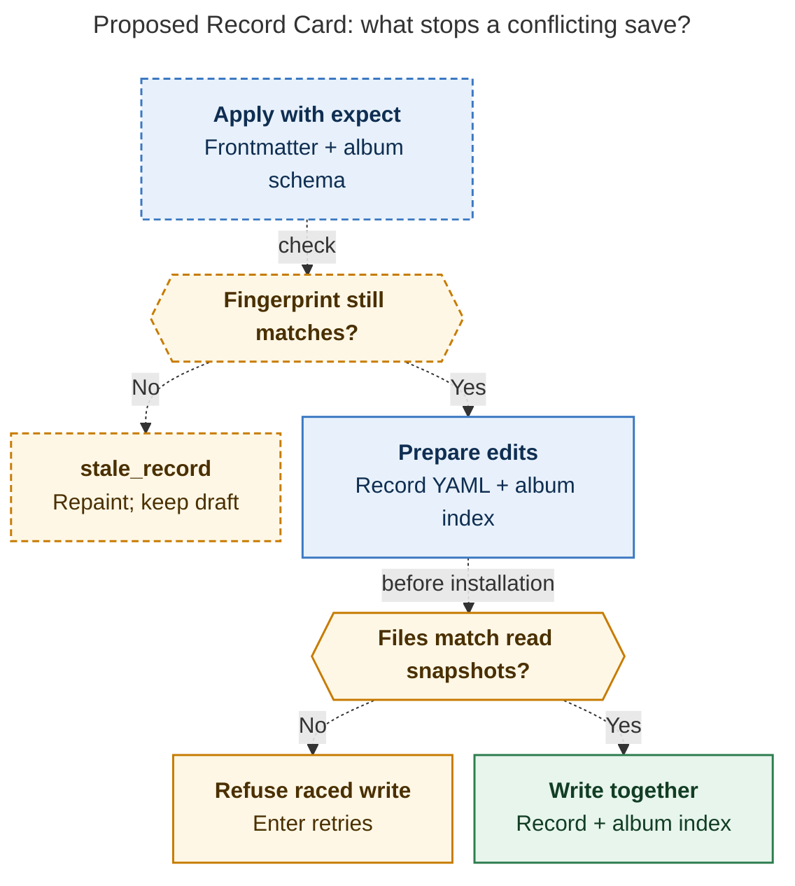
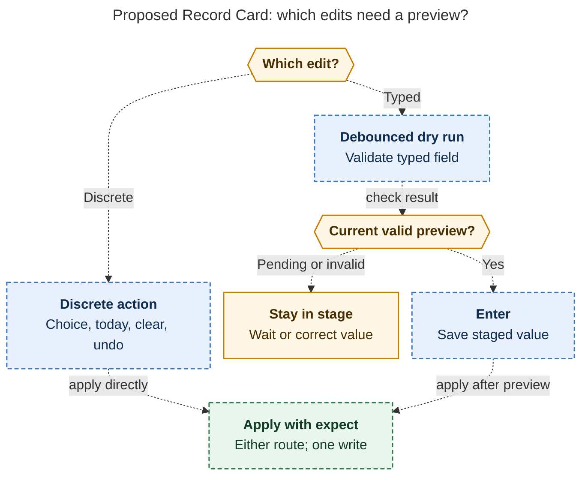

# Diagram proposals: Record Card: a value card for record notes, under the H1

Proposals for the swarm linker, not a report. Each diagram restates only what the source
report says.

```yaml
source: research:202611/record_card/record_card__final.md
producer: research.55.image
check: "mmdc 12.0.0 with --no-sandbox and the PDF-mirroring config rendered 2 of 2 Mermaid diagrams"
```

## save-guards

```yaml
anchor: |-
  rebuilt in the same `write_staged_files_guarded` batch, preimage guards on both files,
question: |-
  Why does saving need both an expected fingerprint and file preimage guards?
illustrates: |-
  The proposed expect fingerprint and existing preimage-guarded batch have separate refusal paths before the record and album index are written together.
caption: The proposed fingerprint rejects stale frontmatter/schema edits; existing preimage guards reject changed files before writing the record and album index together.
review: "575.266x986 px, fit 90.5%; reader-question, source-trace, labels, arrowheads, crossings, and visual checks passed; 1 revision"
```



## apply-paths

```yaml
anchor: |-
  for discrete picks** (choice pick, `t` today, clear, undo) with previews only for typed
question: |-
  Which Record Card edits need a preview before applying?
illustrates: |-
  The proposed Record Card directly applies discrete picks and previews typed stages, with either path guarded by expect for one gesture per write.
caption: Discrete actions apply directly; typed changes need a current valid preview. Either route sends an expected frontmatter/schema fingerprint.
review: "616.76x962 px, fit 92.8%; reader-question, source-trace, labels, arrowheads, crossings, and visual checks passed; 1 revision"
```


