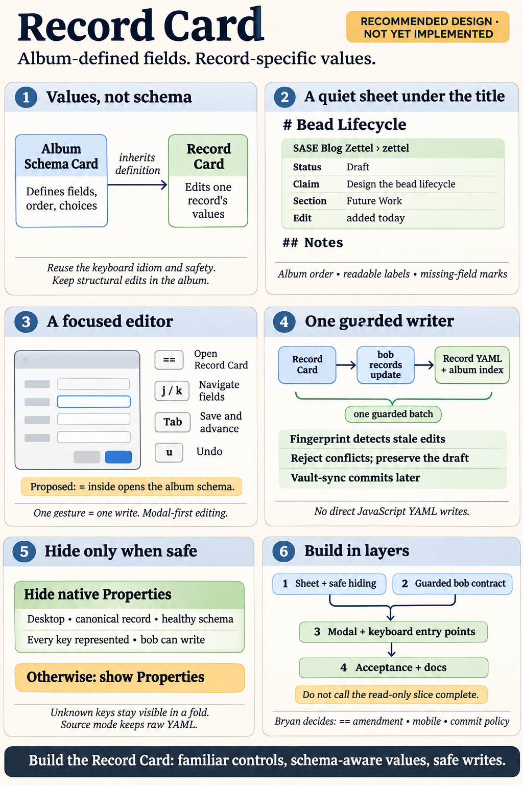
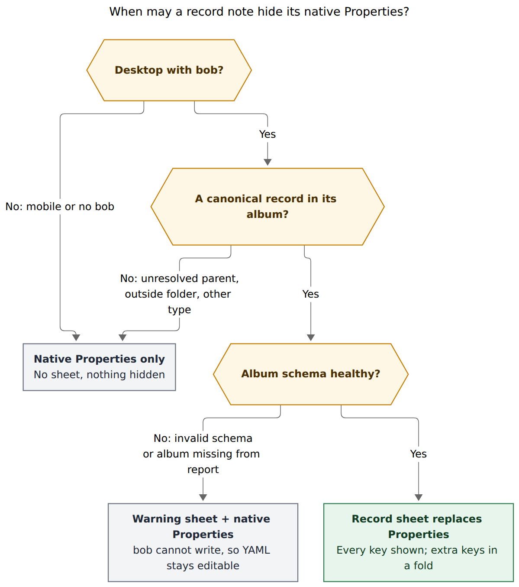
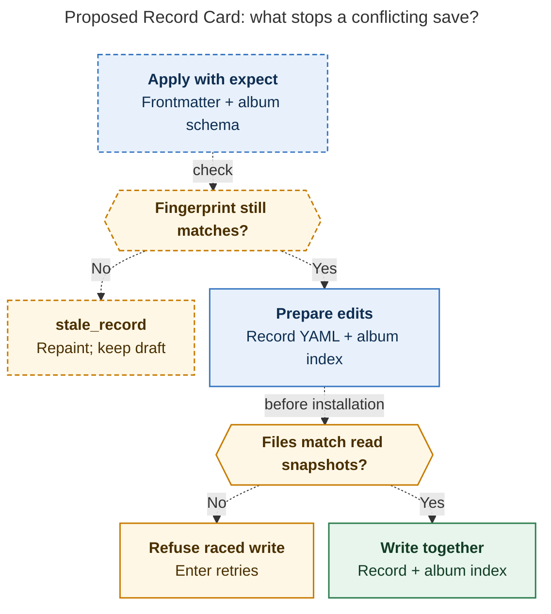
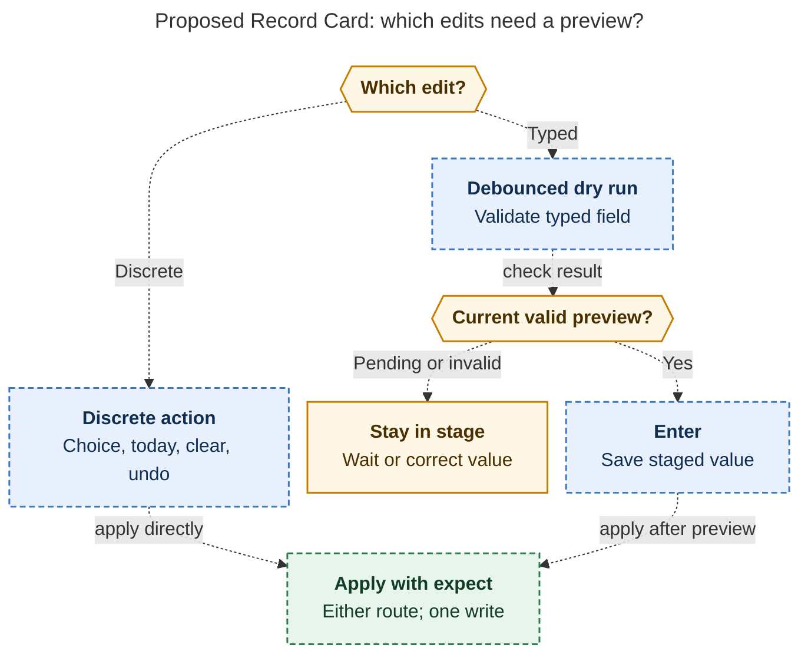

# Record Card: a value card for record notes, under the H1

> **Research query:** What is the best way to render a schema card in record notes for
> the fields that correspond to the parent album's fields — under the H1 and above
> `## Notes`, hiding the frontmatter in its favor, with as close to full parity as is
> possible/desirable with the album and `~/bob/bank.md` schema cards (editable field
> values, the `==` keymap, excellent keyboard navigation)? Lead an intuitive, reliable,
> and beautiful design, critique whether this is a good idea, call out any
> justified requirement adjustments, and end with a recommended solution.



## Bottom line

**Build it — all five researchers and the lead agree.** Record notes are the last
surface where Bob shows record data in the wrong vocabulary: the album index, the Mac
Record Card, `bob records show`, and the `[!records]` callout all say `✍️ Draft` and
`🔮 Future Work`, while the note itself shows Obsidian's raw Properties rows
(`status: draft`, `section: future`, a linked `type: record`, an ISO `created`). Editing
those rows is schema-blind, leaves the album's `[!records]` index stale, and
re-serializes the whole frontmatter — the exact hazard the plugins already route around.

But the request's noun needs one correction, and every researcher independently made
it ([adjustment 1](#requirement-adjustments)): **this is not a second Schema Card.** The album Schema Card and the bank Setup card
edit a *definition* (fields, choices, labels, bounds). A record note holds one
*instance* of that definition — flat values. Cloning the schema editor onto a record
would offer gestures (add field, reorder, relabel choices) that mutate the album, and
bob would refuse the resulting YAML (`record_unknown_field`). Parity should mean the
same chrome, session discipline, keyboard idiom, and writer safety — not the same
targets.

Recommended shape, in one paragraph: a **[record sheet](#the-record-sheet-in-the-note)** rendered as header chrome after
the first H1 (the exact slot the album header, bank Setup header, and subscription strip
already use), showing this record's values in album order with bob's labels; a
keyboard-first **[Record Card](#the-record-card-modal)** modal in the Task Card idiom for editing, with one staged
gesture per write; **`bob records update` as the only writer**, extended additively with
a per-record read and a [guarded JSON envelope](#the-bob-contract) (`expect` fingerprint + inverse ops);
native Properties hidden **only** when the sheet covers every key and bob can write
([fail-open everywhere else](#hiding-native-properties)); and **`==` on a record opens the Record Card** — amending
the [`album_only` decision that shipped this morning](#what-moved-since-the-swarm-snapshots).

## Why native Properties is the wrong surface

The consensus case:

- **Wrong vocabulary:** raw choice keys, ISO timestamps, a linked `type: record` that
  tells Bryan nothing.
- **Schema-blind editing:** no choice picker, required marks, bounds, or URL checks;
  typing `Ready` instead of `ready` silently creates an invalid record; `+ Add property`
  invites `record_unknown_field`.
- **Stale index:** a Properties edit never refreshes the album's `[!records]` callout.
- **Serialization hazard:** every Properties save re-serializes the whole frontmatter
  (the reason the plugins already forbid `processFrontMatter`).
- **Identity one click from an accident:** `parent`, `type`, `title`, `created` are
  Bob-owned plumbing, not facts about the restaurant.
- **The parts already exist.** Header placement (`241v`/`248c`/`241hg`), surface-scoped
  property hiding (`styles.css`), the writer-agnostic guarded session (`242aa`), the
  card scaffolding (hint strip, Esc ladder, Enter latch, YAML excursion `242e`), a
  writer that already span-edits YAML and rebuilds the index atomically, and a value
  vocabulary the Mac Record Card already established. This is composition, not
  invention.

mus alone argued the cost/benefit of hiding is inverted on records (flat scalars render
fine natively, unlike the album's nested mapping). That is true as far as it goes — and
it is why the hide must be *earned* by a complete replacement and must fail open — but
the four problems above are about editing semantics and index freshness, not rendering,
and they stand.

## Requirement adjustments

Explicit and consolidated. Each adjusts the original request; reject any by name.

1. **"Schema card" → "Record Card" (modal) plus "record sheet" (in-note).** The modal
   edits *values*; "Schema Card" stays reserved for the album definition. The name
   Record Card deliberately matches the Mac Capture surface that already walks these
   same fields — one concept, two clients. (Rejected names: "Record details" (cdx),
   "Record Fields Card" (gem) — same semantics, weaker reuse of the existing term.)
2. **"Hide the frontmatter" → "hide it only when the replacement is complete."**
   Fail-open rule in the figure under [Hiding native Properties](#hiding-native-properties). Non-schema keys are never dropped: legacy/unknown
   keys appear in a read-only fold with `y` to YAML.
3. **`parent`, `type`, `title`, `created` are not editable rows in v1.** Parent becomes
   the breadcrumb, type is implicit, title is the H1 (not repeated), created is a quiet
   footer. Title rename is a v2 bob operation (filename rule: it must rewrite `title:`,
   the H1, the filename, inbound links, and the index alias together).
4. **`==` on a record opens the Record Card**, amending the [shipped `album_only`
   behavior](#what-moved-since-the-swarm-snapshots). From inside the Record Card, a single `=` climbs to the parent album's
   Schema Card. `N==`, Source mode, insert/visual, and non-record notes keep reindent.
5. **Writes go through bob only.** No `processFrontMatter`, no JS YAML serializer, no
   JS re-implementation of validation.
6. **"Full parity" excludes what doesn't transfer:** arrangement (schema owns field
   order), the Emoji Slot (values carry no emoji), structural gestures (add
   field/choice), and loud confirm saves (invalid values refuse outright). It **adds**
   record-specific speed: digits pick a choice, `t` sets today, `Tab` saves-and-advances
   (Mac Record Card parity), and the card opens on the first missing required field.
7. **Notes stay in `## Notes`.** The card edits fields; dated note appends keep flowing
   through capture and `bob records update -n`.

## The design

### The record sheet in the note

Header chrome mounted after the first H1 — Live Preview via the shared
`notebookHeaderLiveAnchor` CM6 widget slot, Reading view via the post-processor — never
document bytes, never Source mode, read-only summary in embeds/hover popovers. The
`bead_lifecycle` example:

```text
# Bead Lifecycle
┃ 📇 SASE Blog Zettel › zettel                                    ⊞ Edit   ▾
┃
┃   Status     ✍️ Draft
┃   Claim      Bead triage/lifecycle needs to be thoroughly designed in v2.
┃   Section    🔮 Future Work
┃
┃   added today, 7:55 AM
## Notes
```

Visual rules (merged; cld's spec is the most complete and is adopted):

- Album-header family: 8 px radius, 2 px start border in the root-area hue, 1 px border
  at 30 % hue mix, `font-interface` — but **quieter** (≈4 % tint vs the album's 8 %): an
  album note is a hub; a record's job is its Notes, so the sheet reads as a nameplate,
  not a banner.
- A `dl` grid: muted UI-small labels left, values right **in the note's text font** —
  prose like a claim reads as writing against chrome-like labels. That contrast does
  most of the "beautiful" work.
- Values by kind: choice chips with emoji + label (never the choice census — only the
  selected value); dates as `Aug 8, 2025 · 1y ago`; URLs middle-truncated as real
  anchors; links as Obsidian internal links with hover preview; numbers in tabular
  numerals (subscriptions' `amount` through the money formatter); lists as chips.
- States that must never be confused: valid value / hand-typed non-choice (raw value in
  monospace with an amber `not a Status choice` tag) / missing required (amber pill) /
  schema broken (warning sheet, Properties left visible) / saving (row shimmer, 600 ms
  accent flash, none under reduced motion). Empty optional is `—` or a ghost chip —
  distinguishable from "failed to load".
- Required `*` is quiet until staged-empty; fields render in album declaration order;
  unknown-choice and unknown-key states paint as lint with bob's message, never
  silently.
- Narrow panes (~375 px): labels stack above values; verified light and dark, as the
  album acceptance does.
- Accessibility: `role="group"` with a per-noun label, chips as buttons with
  `aria-haspopup` and names like `Status: Draft. Change status`, visible focus rings,
  textual state marks beside color.

### Hiding native Properties



Rendered size: 798.71 × 904 px; fit scale: 81.7%. Mermaid CLI 12.0.0, PDF-mirroring
config. (Carried over from the cld report, with the canonical-type check added.)

**Caption:** Native Properties hides only when the sheet shows every key and bob can
write every field; mobile, non-canonical types, unresolved parents, and broken schemas
all fail open. Source mode always shows raw YAML.

Mechanics follow the album precedent: a surface class on the view's own container
(child combinators so embeds and popovers keep theirs), removed on file switch, type
change, mode switch, unload, and plugin disable. The worst failure mode is that raw
rows reappear. The gate checks canonical `type: "[[record]]"` (or a report-resolved
legacy noun) — not `albumSchemaEntryKindOf`, whose fallback would classify
`bank/2026-11.md` as a record. Frontmatter keys map to: breadcrumb (`parent`), implicit
(`type`), H1 (`title`), footer (`created`), sheet rows (schema fields), ghost chips
(empty optionals), and a read-only `N other properties ▸` fold (`lid`, `source_*`,
`recur_id`, `zorg_id`, …).

### The Record Card modal

Task Card / Schema Card idiom: title line, subtitle (album › noun · path), selectable
rows, status rule, contextual hint strip, `⋯` All actions with a button for every key, a
live region, desktop gate. Opens on the first missing required field, else the first
field. Stages one field at a time; stages validate as you type through the debounced
dry run and paint bob's message (and the index consequence: `✍️ Draft → ✅ Ready ·
moves to the ✅ Ready group`) in the status rule.

| Mode | Key | Action |
| --- | --- | --- |
| Browse | `j`/`k`, `↓`/`↑` | Move between fields (ghost rows for empty optionals included). |
| Browse | `Enter` | Open the selected field's stage. |
| Browse | `1`–`9` | On a choices row: pick that choice and save (Task Card digit parity). |
| Browse | `t` | On a date row: set today and save. |
| Browse | `Ctrl+D` | Clear the selected optional field; required fields refuse with a teaching line. |
| Browse | `u` / `Ctrl+Z` | Undo the last save via bob's inverse ops. |
| Browse | `y` / `Ctrl+E` | YAML excursion to that field's line in Source mode, with the Done guard (generalize `242e`). |
| Browse | `=` | Climb to the parent album's Schema Card (add a missing choice two keys from `==`). |
| Stage | `Enter` | Save (latched until a current preview, for typed stages). |
| Stage | `Tab` / `Shift+Tab` | Save if changed, open the next/previous field's stage — the fast fill-out path. |
| Any | `Esc` (`Ctrl+[`, `q` outside inputs) | Ladder: menu → stage → card. Typing in inputs never triggers navigation letters; IME composition never applies. |

Stages by kind: choices as a filterable pick list (emoji, labels, counts, current
ringed); suggest text as a combobox over the full ranked folder values with bob's
near-duplicate warning; date accepting `today`/`t`, `yesterday`, ISO; number with
min/max hints; URL validated by bob's rules; link via the note suggester accepting
`[[wikilink]]` or bare names; lists as structured values in the envelope (never
comma-joined strings). Explicitly-empty optional clears the key; empty required
refuses. Defaults belong to creation — an update never silently refills a cleared
field (cdx).

Entry points: `==` (amended `248m` target), the sheet's `⊞ Edit` and row/chip/ghost
clicks, palette **Edit record** (new; **Edit album schema** keeps resolving the
parent), `Ctrl+Shift+P` on record notes (extend `551` — records hold no tasks, so the
chord is idle there today), and Command Mode's Vault row.

### The bob contract

Additive, `schema_version` 1, per cli_rules:

```text
bob records show TYPE [STEM] [-b DIR] [-f human|json]
bob records update TYPE STEM [-b DIR] [-d] [-f human|json] [-i FILE] [-n TEXT]... [-o] [-s KEY=VALUE]...
```

1. **Per-record read** (`show TYPE STEM`): today's schema payload plus a `record`
   object — `path`, `title`, `created`, `fingerprint`, `properties[]` in the exact
   shape `update` already emits plus per-key 1-based `line`, `other[]` (non-schema keys
   with lines), `findings[]` (per-note `records check` diagnostics), and uncapped
   ranked suggest values. It must return a typed diagnostic for a broken parent rather
   than impersonating an empty record, and must never write, repair, or commit.
2. **Envelope mode** (`update -i FILE`, `-` = stdin; conflicts with `-s`/`-n`):
   `{ "schema_version": 1, "expect": "sha256:…", "ops": [{ "op": "field.set", "key":
   "status", "value": "ready" }, { "op": "field.unset", "key": "url" }] }` — values as
   typed JSON (strings, numbers, string arrays for lists), argv never built from
   labels.
3. **Fingerprint**: semantic hash of the parsed frontmatter mapping + the album
   `schema_fingerprint`; mismatch refuses with `error.code: "stale_record"` and returns
   current `properties[]` so the card repaints in one call, draft kept, never a silent
   rebase.
4. **Result additions**: `fingerprint_before/after`, `inverse_ops`, `group_before/
   after` + a `consequence` string, typed nullable `error`
   (`stale_record`, `record_invalid_value`, `record_required_empty`,
   `record_unknown_field`) carrying `field`. Exit codes stay 0/2/1.

The write path itself is already right: span-preserving YAML edits, the album index
rebuilt in the same `write_staged_files_guarded` batch, preimage guards on both files,
no lock, no commit. One plugin duty carries over from the album card: save every open
pane of the record *and* its album before applying, detecting divergent unsaved buffers
rather than letting the last-saved pane win (cdx). [The save-guards
diagram](#figure-save-guards) shows the separate refusal paths of the proposed `expect`
fingerprint and the existing preimage guards before the record and album index are
written together.

<div id="figure-save-guards">



_The proposed fingerprint rejects stale frontmatter/schema edits; existing preimage guards reject changed files before writing the record and album index together._

</div>

### Reliability rules

Merged from the five reports.

| Situation | Behavior |
| --- | --- |
| Unsaved body edits in the record's pane | Session saves panes first; bob edits only YAML spans; the editor reloads in place. |
| Concurrent edit (another host, Source mode, Bases cell) | Fingerprint mismatch → stale refusal, nothing written, card repaints with draft kept. |
| `bob albums sync` races a save | Preimage guard refuses one side; Enter retries. |
| Non-record types (`bank_month`, `reference`, …) | No sheet, no hide, `==` reindents — canonical type gate. |
| Broken album schema / unresolved parent | Warning sheet, native Properties stay, card read-only with lint and the YAML path (the `242d` teaching messages, never guessing). |
| Plugin disabled/unloaded mid-anything | Surface class removed, Properties return; a started apply settles and reports; late async responses ignored. |
| metadataCache lag after a save | Optimistically push the applied state into the sheet until the vault `changed` event catches up (gem). |
| Mobile | Fail open (see the figure under [Hiding native Properties](#hiding-native-properties)); phase 3 states its mobile answer explicitly — recommend read-only sheet if Bryan never edits records on mobile, else native Properties ([open question 2](#open-questions-for-bryan)). |
| Popout windows | Main-window listeners only, matching the shipped `248m` / bob-vim-surround scope. |
| Presentation writes | Rendering, navigating, expanding, and canceling must be byte-neutral — verified by hash in acceptance (cdx). |

Bases cells (`sase_blog_zettel.base`) still edit raw keys and bypass the index; the
fingerprint makes that safe for the card but the hazard predates this feature and is
tracked separately.

## Lead resolutions of the five disagreements

**1. Editing surface: modal-first, not in-card stages (gem/mus/cdx over grk).**
grk proposed expanding edit stages inside the in-note widget itself. Three reports
independently flagged why that is hard: a CM6 widget is rebuilt on every doc change (a
save that rewrites the note loses focus and caret), interactive inputs fight Vim for
keys, and neither the album nor bank card does it. v1: the sheet is a glance surface
whose rows, chips, and buttons *dispatch* to the Record Card modal; pointer quick-picks
(a choice chip opening a native Obsidian `Menu`) ride phase 3 as sugar over the same
write path. grk's in-card staging can be revisited once the model is proven.

**2. Writer contract: the envelope is worth it (cdx/cld/grk/gem over mus).**
mus called the `-i` envelope scope creep and wanted `-s K=V` + dry-run only. But the
guarded session the plugin already runs on (`242aa`) is built around an `expect`
fingerprint, matching previews, and inverse-op Undo; without them the record wrapper
would be a different, weaker machine, and a dry run plus a later independent update can
each be internally safe while still overwriting a value changed in between (cdx's
race). The envelope is a modest additive extension of one verb — cld verified the
dry-run JSON already returns typed `properties[]` with `before`/`display`/`state`.
Fingerprint semantics: a semantic hash of the parsed frontmatter mapping plus the album
`schema_fingerprint` — body bytes excluded, so typing under `## Notes` never stales a
status change (cld). cdx's whole-file token is the stricter fallback if implementation
finds semantic hashing uncertain. `-s`/`-n` stay for humans and agents.

**3. Per-record read: extend `show`, don't add a noun.** The card needs a fingerprint,
per-key line numbers, non-schema keys, findings, and full (uncapped) suggest values.
cld's `bob records show TYPE [STEM]` is an additive optional positional on the existing
verb; cdx and gem proposed a new `records inspect`. Prefer extending `show` (fewer
nouns, per cli_rules); fall back to `inspect` only if overloading `show`'s schema
payload proves awkward in implementation. The payload spec is the same either way.

**4. Commit granularity: keep the capture-like discipline (cld over grk/gem/cdx).**
grk, gem, and cdx assumed album parity: maintenance lock plus one scoped commit per
gesture. The verified current behavior is the opposite — `records update` writes a
guarded staged batch and lets vault-sync commit — and it is right for records: value
edits are everyday verdicts (`status: liked`, `visited: today`), not rare structural
changes, and per-edit commits would fill history with noise. The `expect` guard plus
preimage-guarded installs provide the safety without a lock. **This is a deliberate
deviation from the album card; [Bryan can veto it](#open-questions-for-bryan)** if he wants audit-grade history for
record edits.

**5. Hide scope: whole block, fail-open, with a fold (cld/gem/cdx over mus).** mus
wanted the identity rows (`parent`/`type`/`title`/`created`) to stay visible in native
Properties. But the card chrome already represents all four (breadcrumb, implicit, H1,
footer), a half-hidden Properties block with a dangling header and `+ Add property` is
the worst of both worlds (gem), and mus's underlying safety concern — never hide the
only edit path — is answered by the fail-open rule, `y` excursions, and untouched Source
mode. One nuance from gem survives: if an unknown key is present and the card can only
lint it, the hide may keep that row visible (or fold it in the card) — data invisibility
is never acceptable.

Smaller calls: **one gesture = one write** (grk/cld; reject gem's batched `Ctrl+Enter`
multi-field draft — "a status change and a claim rewrite are two facts"); **direct apply
for discrete picks** (choice pick, `t` today, clear, undo) with previews only for typed
stages — a 0.41–0.44 s dry-run round-trip (cld's measurement) tells the user nothing
when they picked `✅ Ready` from a closed list, and apply-with-`expect` is its own
guard; **empty optionals compress to one ghost-chip row** (`＋ Year ＋ Service …`,
cld/gem) rather than full rows (grk) — the chips still name every declared field, so
nothing is hidden, while a sparse movie stays three lines tall; empty *required* fields
always get a full row with a missing pill, and the card opens on the first one;
**default expanded** with per-session collapse (grk/cld/gem/cdx over mus's
collapsed-by-default summary) — the card *is* the note's facts, and a 3–7 field record
fits above the fold with `## Notes` still visible; **subscriptions dock, not stack**
(cld/grk): the existing charge-timeline strip (`241hg`) becomes the sheet's trailing
band so `subscriptions/*.md` shows one cohesive card — two same-anchor widgets from two
fragments have no guaranteed order (gem's priority split is the fallback if docking
proves invasive). [The apply-paths diagram](#figure-apply-paths) separates the proposed
routes: discrete picks apply directly, typed stages first need a current preview, and
either route applies with `expect` as one write.

<div id="figure-apply-paths">



_Discrete actions apply directly; typed changes need a current valid preview. Either route sends an expected frontmatter/schema fingerprint._

</div>

## Phases

1. **Record sheet + fail-open hide** (bob-plugins `bob-ledger-tools`; medium;
   no bob changes — paints from `metadataCache` joined to the cached album report, no
   subprocess on open). New fragments modeled on `241v`/`248c`, subscription-strip
   docking, the fold, embeds/popovers, 375 px light/dark. `⊞ Edit` stays hidden until
   phase 3 so no dead control ships. **Do not close the request on this slice** —
   "easy to edit" is the point, and Properties will have disappeared.
2. **[bob contract](#the-bob-contract)** (bob-cli; small/medium; parallel with 1): `show TYPE STEM`,
   `update -i` with `expect`/`inverse_ops`/`consequence`, docs
   (`docs/records.md`, `json-outputs.md`), CLI tests for stale, invalid, no-op, lists,
   CRLF/BOM preservation, and the index rebuilt in the same write.
3. **[Record Card](#the-record-card-modal) + entry points** (bob-plugins; medium/large): modal over a thin
   `createGuardedUpdateSession` wrapper (two-path apply), stages by kind, keymap, Undo,
   YAML excursion, sheet pointer affordances, `==` record target in `248m` (plus the
   plan's docs lines and the decision supersede), `Ctrl+Shift+P` in
   navigation-hotkeys, `edit-record` palette command, Command Mode. Reuse the card
   shell and session; do not fork the ~8.5k-line album stack.
4. **Acceptance + docs**: real-Obsidian CDP walkthrough (model:
   `obsidian-album-ui-e2e.cjs`) over a zettel, a sparse movie, a migrated restaurant
   (legacy keys), a subscription, a missing-required record, and a broken-parent
   record; writer e2e against real bob in a scratch vault; plugin docs page
   cross-linked from `albums.md`. Candidate decision records (Bryan + the memory-write
   flow): *"Record values are edited through bob; native Properties hides only when the
   sheet is complete"* and the `==` records amendment.

Acceptance highlights: no subprocess on note open; hide only in the green
branch of the figure under [Hiding native Properties](#hiding-native-properties); hiding never drops data; `==` opens with no reindent and no undo entry while
`3==`, Source mode, and non-records keep reindent; a status pick rewrites only the
`status:` span and the `[!records]` callout in one write with all other bytes
identical; stale/invalid/required-empty each refuse with nothing written; `u` restores
value and regrouping; keyboard-only end-to-end with a button for every key; plugin
disable restores Properties; light/dark at 375 px.

## Open questions for Bryan

1. **`==` on records** — confirm amending the `album_only` decision that shipped this
   morning, so `==` opens the record's own card and `=` inside climbs to the album
   schema. Unanimous recommendation, but it reverses a decision you made.
2. **Mobile** — do you edit records on mobile (at the restaurant, after the movie)? If
   not: read-only sheet everywhere, native Properties hidden on desktop only. The
   answer is worth a decision record either way, since it touches the desktop-only
   precedent.
3. **Commit granularity** — the lead recommends keeping record edits commit-free
   (capture-like, vault-sync commits later), unlike album schema edits. Veto if you
   want one scoped commit per record gesture.
4. **Provenance keys** (`lid`, `source_*`, `recur_id`, `zorg_id`) — still useful? A
   one-time cleanup would shrink the fold to nothing for most records.
5. **Inline title** — record notes show both the filename-derived inline title
   (`bead_lifecycle`) and the H1 (`Bead Lifecycle`); hiding Properties does not remove
   the duplicate. Suppressing it on record surfaces is a separate, optional polish
   decision (it is also the rename affordance).

## What moved since the swarm snapshots

From the lead's verification pass. All five reports were researched against bob-plugins `1b74ad5`. Since then:

- **The `==` keymap has landed** (bob-plugins `2b61e76`, "feat(ledger-tools): open album
  Schema and bank Setup with Vim =="). It shipped the plan's **`album_only`** decision:
  `248m-plugin-schema-double-equals.js` exists, and `schemaDoubleEqualsTargetKind`
  returns only `"bank"`, `"album"`, or `null` — records fall through to Vim reindent.
  The record target is therefore no longer coordination with in-flight work; it is a
  small **amendment to shipped code** with a clean extension point (one new return value
  in the target function, one dispatch branch, gate rules unchanged), plus a supersede
  note on `plan:202611/double_equals_schema_keymap.md`'s records decision.
- **`bob records update` verified** (bob-cli `f692478`, `src/native/records/cli.rs`): it
  installs through `write_staged_files_guarded` (record + album index in one preimage-
  guarded batch) and takes **no maintenance lock and makes no commit** — vault-sync
  commits later. cld's account is correct; grk and gem described proposed, not current,
  behavior. This matters for the [commit-granularity resolution](#lead-resolutions-of-the-five-disagreements).
- **`bob records show` takes only a TYPE** (`cli.rs::run_show`): it reports a schema and
  common values, never a single record. The per-record read is genuinely new surface.
- **The loose kind resolver confirmed** (`242d-plugin-album-entrypoints.js:21–37`):
  `albumSchemaEntryKindOf` classifies *any* type outside a short exclusion list as
  `"record"` — `bank/2026-11.md` (`type: "[[bank_month]]"`) would qualify. The record
  gate (for `==`, the sheet mount, and the hide) must check canonical
  `type: "[[record]]"` (or a legacy noun that resolves through the album report), never
  this resolver alone.
- The screenshot (`~/tmp/screenshots/20261117_101208.png`) shows exactly what the
  reports describe: `bead_lifecycle` with seven raw Properties rows, then an H1
  duplicating `title:`, an empty gap, and an empty `## Notes` — while the album's own
  Linked-mentions row below already renders `🔮 Future Work · Bead triage/…` in bob's
  vocabulary.

## Provenance

The lead's own restatement of the request and inputs, as it opened the
consolidated report:

> Start rendering a schema card in record notes for the fields
> corresponding to the parent album's fields — under the H1, above `## Notes`, hiding
> the frontmatter in favor of the card, with as much parity with the album and
> `~/bob/bank.md` schema cards as is possible/desirable (editable values, the `==`
> keymap, excellent keyboard navigation). Lead the design; critique the plan; adjust
> requirements where justified; end with a recommended solution.
>
> Consolidated from five independent reports (`cdx`, `cld`, `grk`, `mus`, `gem`, all
> 2026-11-17, in this directory) plus the lead's own verification pass the same
> afternoon.

Consolidated 2026-11-17 by the lead researcher from the five sibling reports in this
directory — `record_card__cdx.md`, `record_card__cld.md`, `record_card__grk.md`
(figures `record_note_value_card__grk_*.png`), `record_card__mus.md`,
`record_card__gem.md` — each written independently against bob-cli `f692478` and
bob-plugins `1b74ad5`, plus the lead's own verification: the screenshot
(`20261117_101208.png`); bob-plugins at `2b61e76` (`248m` landed `album_only`;
`242d:21–37` loose kind fallback); bob-cli `src/native/records/cli.rs` (`run_show`
TYPE-only; `execute_update` → `write_staged_files_guarded`, no lock/commit); and an
audited read of `plan:202611/double_equals_schema_keymap.md`. The Properties-hide figure under
[Hiding native Properties](#hiding-native-properties) was re-rendered with `@mermaid-js/mermaid-cli@12.0.0` under the research PDF-mirroring
config and visually reviewed.
