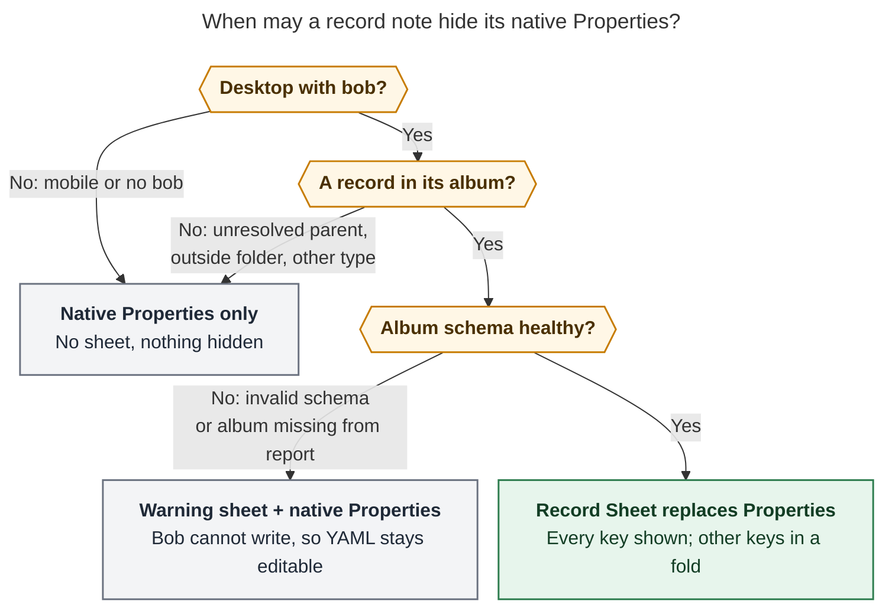
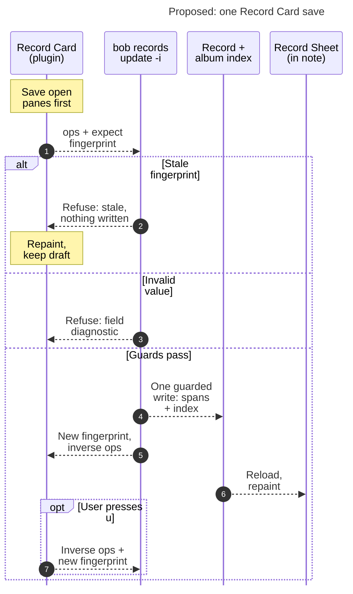

# Record notes: a Record Sheet under the H1 and a Record Card for edits

> **Research query:** Bryan wants a schema card in every record note, built from the
> parent album's fields. It should sit under the H1 and above `## Notes`, and it should
> replace the frontmatter rows. It should match the album and `bank.md` schema cards as
> closely as makes sense: editable values, the in-flight `==` keymap
> (`plan:202611/double_equals_schema_keymap.md`), and excellent keyboard navigation.
> Lead the design so it is intuitive, reliable, and beautiful. Critique the plan,
> adjust requirements where justified (call each adjustment out), and end with a
> recommended solution.

## Bottom line

**Build it.** It fixes the last place where Bob shows record data in the wrong
vocabulary, and Bob is the right writer for it. Every other record surface shows bob's
labels: the album index, the Mac Record Card, `bob records show`, and the `[!records]`
callout. The record note itself still shows Obsidian's raw Properties rows:
`status draft`, `section future`, a linked `type: record`, and an ISO `created` string.
Editing those rows is schema-blind. It also never refreshes the album's `[!records]`
index, which shows that same status and those facets.

I would ship it as **two surfaces backed by one bob writer**. That is what the album and
bank designs already are.

1. **Record Sheet** (in the note, under the H1). A quiet, hue-accented label/value
   sheet. It shows choice labels with emoji, formatted dates, and links. Empty optional
   fields collapse into one row of dashed `＋ Field` chips. `created` moves to a footer,
   and non-schema keys sit in a fold. It paints instantly from Obsidian's metadata cache
   plus the album report the plugin already caches, so opening a note starts no
   subprocess. Clicking a choice chip opens a native menu of choices. Clicking any other
   row opens the Record Card on that field.
2. **Record Card** (modal, Task Card idiom). The keyboard-first editor. `==`,
   `Ctrl+Shift+P`, the **⊞ Edit** button, the palette, and Command Mode all open it.
   Keys: `j`/`k` move between fields, `Enter` edits, digits pick a choice, `Tab` saves
   and moves to the next field, `Ctrl+D` clears, `u` undoes, `y` jumps to YAML, and `=`
   climbs to the album's Schema Card.
3. **One writer: `bob records update`**, which already edits YAML spans in place and
   rebuilds the album index in the same guarded write. It needs four small additions
   ([details](#the-bob-contract)): a JSON envelope `-i` with an `expect` fingerprint,
   inverse ops for Undo, an index-consequence line, and a per-record read
   (`bob records show TYPE STEM`).
4. **Hide the native Properties block only when the sheet can show every key and bob can
   write every field.** Fall back to native Properties in every other case: mobile, a
   broken schema, an unresolved parent, or a record outside its album folder.
   [Figure 1](#figure-hide-rule) shows the rule.

The [requirement adjustments](#requirement-adjustments) matter most. The parity target
is a *pair*: the album has a header panel plus a Schema Card. The `==` decision for
records must flip from `album_only` to "open this record's card". `title`, `parent`,
`type`, and `created` are not editable fields in v1. Arrangement and the Emoji Slot do
not transfer to record values.

## What I verified

| Fact | Evidence |
| --- | --- |
| The screenshot shows Obsidian's native Properties on `sase_blog_zettel/bead_lifecycle.md`. It has seven rows with raw stored keys (`status: draft`, `section: future`), a linked `type: record`, and an ISO `created`. | `~/tmp/screenshots/20261117_101208.png`; the note's bytes |
| The album header renders after the H1 as a hue-tinted card: breadcrumb, `＋ zettel`, `⊞ Schema`, a `▾ Zettel · 3 fields · dated notes` summary, and per-field choice chips with counts. The album's `record` row is hidden. | `~/tmp/screenshots/20261117_095057.png`; `docs/albums.md` in bob-plugins |
| The Live Preview headers (album, notebook, subscription) are CM6 widgets at the end of the first H1 line (`notebookHeaderLiveAnchor`). Reading view inserts them after the H1 through a markdown post-processor. | `241v-plugin-album-header.js`, `241g-plugin-notebook-header-live.js`, `241hg-plugin-bank-subscription-header.js` |
| Property hiding is a CSS rule scoped by a surface class: `.bob-album-header-surface .metadata-property[data-property-key="record"]` and the bank equivalent for `bank`. | `bob-ledger-tools/styles.css` around lines 8516 and 9728 |
| The guarded update session is writer-agnostic: "Album and bank sessions are thin wrappers over this controller." It covers preview keyed by revision, `expect`, and vault generation, saving open editors first, the lock wait, and staged inverse-op Undo. | `242aa-plugin-guarded-update-session.js` header |
| The album card stack is large: about 8.5k lines across fragments `241u`–`242e`. Bank Setup is about 5k. | `wc -l` on those fragments |
| `bob records update TYPE STEM -s K=V -d -f json` already returns `properties[]` for every field: `key`, `label`, `value`, `display` (choice emoji and label, for example `✍️ Draft`), `before`/`before_display`, and `state` (`set`/`default`/`missing`/`invalid`/`none`). Invalid input refuses with typed `invalid[]` (`record_invalid_value`, `record_unknown_field`). | Ran it on `bead_lifecycle`, `movies/9`, and an eat record; `RecordPropertyState` in `src/native/records/plan.rs` |
| `records update` has no `expect` guard, no JSON envelope, and no inverse ops. It guards on-disk preimages only at install time (`write_staged_files_guarded`). It takes no maintenance lock and makes no commit; vault-sync commits later. | `src/native/records/cli.rs::execute_update`; `docs/vault-git-sync.md` |
| A record update dry run takes 0.41–0.44 s on apollo, `bob records show eat -f json` about 0.5 s, and `bob albums list -f json` about 0.5 s. | `time` and `/usr/bin/time` runs |
| The vault has 6 albums and 186 `[[record]]` notes, all with `## Notes`. Field kinds in use: choices, text (with and without suggest), date, number, url, and a list text field (`subscriptions.match`). | `bob albums list -f json`; a scan of the record folders |
| **Non-schema keys are common.** 90–92 eat records carry `lid`, `source_group`, `source_note`, `source_anchors`, `source_dates`, and `source_lines`. All 15 podcasts carry `zorg_id` plus `source_*`. 20 subscriptions carry `recur_id`. | Frontmatter scan against each album's field list |
| **The `type` check is looser than "record".** `albumSchemaEntryKindOf` returns `"record"` for any type outside a short exclusion list. `bank/2026-11.md` (`type: "[[bank_month]]"`) would classify as a record. | `242d-plugin-album-entrypoints.js`; vault type census |
| The `==` plan's `records` decision was answered **`album_only`**: on a record, `==` keeps Vim's reindent. That plan is being implemented now (agent `ek--code`). | `plan:202611/double_equals_schema_keymap.md` (audited read) and its frontmatter |
| The `Ctrl+Shift+P` fallback opens the Schema Card "on album notes only where the Task Card has no target". | `bob-navigation-hotkeys/src/551-plugin-album-schema-fallback.js` |
| The plugins deliberately avoid `processFrontMatter`, because it re-serializes the YAML block and rewrites wikilinks in other keys. | `bob-navigation-hotkeys/src/211-parent-frontmatter-plan.js` header |
| The Mac Record Card already sets the visual vocabulary for a record's fields: a label column, then a value with the choice emoji (`Status ✍️ Draft`, `Section 🔁 Agent turn`), plus `⇥ next field`. | `~/tmp/screenshots/20261117_075955.png`; `plan:202611/mac_record_card.md` |
| An earlier album-schema report flagged this exact gap as the "higher-frequency" follow-up: "record notes show raw choice keys (`status: to_try`) in their own Properties panel". | `research/202611/album_record_schema_ux/album_record_schema_ux__cld.md`, item R7 |

## Is this a good idea?

Yes, and for more reasons than looks.

- **Records currently show the wrong vocabulary.** A zettel's section is
  `🔮 Future Work` everywhere Bob shows it, and `future` in the one place Bryan sees it
  most.
- **Native Properties edits are unsafe for records.**
  - Typing `Ready` instead of `ready` silently creates an invalid record.
  - There is no choice picker, no required mark, no number bounds, and no URL check.
  - The album's `[!records]` index (status groups, `section`/`claim` facets) goes stale
    until the next `bob albums sync`.
  - Every Properties save re-serializes the frontmatter, the hazard the plugins already
    route around.
- **The plumbing keys (`parent`, `type`, `title`, `created`) are one click from an
  accident.** They are Bob-owned identity, not facts about the restaurant.
- **The parts already exist.** These are the album header placement code, the
  surface-scoped CSS hide, the writer-agnostic guarded session, the card scaffolding
  (hint strip, status rule, Esc ladder, live region, YAML excursion), and a bob writer
  that already returns display-resolved, typed property states. This is composition,
  not invention.

The costs are real, and the design below is shaped by them:

- **Hiding Properties removes Obsidian's generic edit path.** That covers the provenance
  keys and the mobile app (bob does not run there). Hence the
  [fail-open rule](#figure-hide-rule) and the read-only "other properties" fold.
- **Edits pay a subprocess round-trip** (about 0.45 s per bob call) where native
  Properties was instant. Hence no subprocess on paint, direct apply for discrete picks,
  and a saving shimmer.
- **It is another surface to maintain.** Cloning the album card's ~8.5k lines would be a
  mistake. The record wrapper should reuse the session and card shell, not fork them.

### Alternatives I rejected

| Approach | Verdict | Why |
| --- | --- | --- |
| Restyle native Properties to show labels (DOM patch or `::after` tricks) | Rejected | There is no property-widget API. A MutationObserver patch is fragile, and editing would stay schema-blind and leave the index stale. The album research reached the same verdict. |
| Fold native Properties and add the sheet beside it | Rejected | Two surfaces would show the same fact in two spellings (`draft` beside `✍️ Draft`), and the raw one stays editable. |
| Inline-editable sheet only (Notion-style, no modal) | Partly adopted | Pointer quick-picks for choices go in. Full keyboard editing inside a CM6 widget does not: the widget is rebuilt on every doc change, so a save that rewrites the note loses focus and caret. It also fights Vim for keys. The modal avoids both, exactly as the album card does. |
| Plugin writes through `processFrontMatter` / `vault.process` | Rejected | The `[!records]` index stays stale, validation drifts from Rust, and YAML is re-serialized. The album decision ("bob, and only bob") applies at least as strongly to values. |
| Metadata Menu, Bases, or another third-party property editor | Rejected | These are unaware of album schemas, add a dependency, and still leave the index stale. |
| Move the fields into the body (inline `key::` fields or a fenced block) | Rejected | This reverses the accepted record format and creates a second source of truth. |
| Read-only sheet first, editor second | Adopted as sequencing | The sheet can ship before the bob contract lands. See [phases](#phases). |

## Requirement adjustments

Each adjustment is deliberate; reject any of them by name.

1. **"Schema card" becomes a pair: the in-note Record Sheet plus the modal Record
   Card.** The album "schema card" is already two things: the in-note header panel and
   the `⊞ Schema` modal. Bank Setup is the panel plus `⊞ Edit`. Parity means matching
   the pair. The modal is named **Record Card** because the Mac Capture panel already
   calls this record-fields surface the Record Card. One concept, one name, two clients.
   It edits *values*, not the schema, so "Schema Card" would mislead.
2. **"Hide the frontmatter" becomes "hide it only when the replacement is complete".**
   The native Properties block hides only on desktop, and only for a canonical record
   whose parent resolves to an album that is healthy in the report. The record must
   also sit in that album's folder. Anything else fails open. Non-schema keys are not
   dropped: they appear in a read-only `N other properties ▸` fold with `y` to YAML.
3. **`title`, `parent`, `type`, and `created` are not editable rows in v1.**
   - The H1 already shows the title, so the sheet does not repeat it.
   - `parent` becomes the album breadcrumb.
   - `created` becomes a quiet footer.
   - `type` is implicit.
   - Title rename is a v2 bob operation. It must rewrite `title:`, the H1, and the index
     alias together; today, editing the H1 alone silently drifts from `title:`.
4. **`==` on a record opens that record's Record Card, reversing the `album_only`
   answer.** That answer made sense while records had no card of their own. Now `==`
   means "edit what I'm on" everywhere. From the Record Card, `=` climbs to the album's
   Schema Card, so "add a missing choice" is still two keys away. The gate must test
   for **canonical** `type: "[[record]]"` (or a legacy noun type that resolves through
   the report), not `albumSchemaEntryKindOf() === "record"`. The looser test would
   swallow `==` on `bank/2026-11.md` and any other unusually typed note.
5. **`Ctrl+Shift+P` on a record note opens the Record Card.** Today the fallback serves
   album notes only. Records hold no tasks, so the Task Card never has a target there,
   and the chord stays "properties of what I'm on".
6. **Writes go through bob, not Obsidian.** This is non-negotiable for reliability: the
   index must update in the same write, and validation stays in Rust.
7. **"Full parity" excludes three features that don't transfer:**
   - arrangement (`Alt+J/K`, Move to…, drag), because the schema owns field order;
   - the Emoji Slot, because values have no emoji (choice emoji are schema, and `=`
     reaches that card);
   - "loud" amber confirm saves, because bob refuses invalid values outright and every
   valid value edit is quiet.

   It **adds** record-specific speed:
   - digits pick a choice;
   - `Tab` saves and moves to the next field (Mac Record Card parity);
   - the card opens on the first missing required field;
   - `t` sets today on date fields.
8. **No per-edit Git commit.** Album edits make one scoped commit because schema changes
   are rare and structural. Record edits behave like capture and `bob records update`
   today: an atomic write, then vault-sync commits. This keeps the history from filling
   with `status: liked` commits.
9. **Mobile keeps native Properties.** bob cannot run there, so hiding the only write
   path would be a regression. The sheet is skipped on mobile, unless Bryan says he
   never edits records on mobile; then a read-only sheet is fine.

## Design

### Where each frontmatter key goes

| Key | Today (native Properties) | Proposed |
| --- | --- | --- |
| `title` | Text row | The H1 (unchanged). Not repeated in the sheet. |
| `parent` | Link row | Sheet header: `📇 SASE Blog Zettel › zettel`. The album link has hover preview. |
| `type` | Link row (`record`) | Hidden. "This is a record" is what the sheet itself says. |
| Schema fields | Raw rows | Sheet rows in schema order, rendered [by kind](#values-by-kind). |
| Empty optional fields | Absent | One row of dashed `＋ Year` `＋ Service` … chips (entry points). |
| `created` | ISO string row | Footer: `added today, 7:55 AM` / `added Nov 8, 2025`. |
| Other keys (`lid`, `source_*`, `recur_id`, `zorg_id`, …) | Rows | Footer fold `6 other properties ▸`, read-only `key: value` lines, `y` to YAML. |

### The Record Sheet

Placement: a widget at the end of the first H1 line, through the shared
`notebookHeaderLiveAnchor` (Live Preview), and after the H1 element (Reading view).
That puts it below the H1 and above `## Notes`, or above any intro text between them.
With no H1, it sits at the top of the body, the same fallback the album header uses.
Source mode never draws it.

**A typical zettel** (desktop, Live Preview):

```text
bead_lifecycle                                         ← Obsidian inline title (unchanged)

# Bead Lifecycle
┃ 📇 SASE Blog Zettel › zettel                                    ⊞ Edit   ▾
┃
┃   Status     ✍️ Draft
┃   Claim      Bead triage/lifecycle needs to be thoroughly designed in v2.
┃   Section    🔮 Future Work
┃
┃   added today, 7:55 AM
## Notes
```

**A sparse movie.** Empty optionals teach instead of sprawling:

```text
# 9
┃ 🎬 Movies › movie                                               ⊞ Edit   ▾
┃
┃   Status     🔖 To watch
┃   ＋ Year  ＋ Service  ＋ Recommended by  ＋ Verdict  ＋ Watched on  ＋ Url
┃
┃   added Nov 9
```

**A migrated restaurant.** It has a link value and provenance keys:

```text
# 1950s originals
┃ 🍽️ Restaurants › restaurant                                     ⊞ Edit   ▾
┃
┃   Status     💚 Liked
┃   Category   Burgers + Dogs
┃   Location   Westwood
┃   Visited    Aug 8, 2025 · 1y ago
┃   ＋ Url
┃
┃   added Nov 8, 2025                                 6 other properties ▸
```

**Collapsed** (`▾`; per session, keyed by album, never written to the note). The
collapsed line is the record's own index row: the group chip, then the facets.

```text
# Bead Lifecycle
┃ 📇 SASE Blog Zettel › ✍️ Draft · 🔮 Future Work · Bead triage/lifecycle needs…      ▸
```

**States the sheet must never confuse:**

| State | Paint |
| --- | --- |
| Value is a valid choice | Chip with emoji and label. |
| Value not in choices (hand-typed `Ready`) | The raw value in monospace with an amber `not a Status choice` tag. Picking a choice repairs it. |
| Required field empty | An amber `missing` pill in the row. The card opens with this row selected. |
| Album report not loaded yet (cold start) | A skeleton built from metadata-cache values, with labels resolving in place. Native Properties never flashes on, then off. |
| Album schema invalid or album missing from the report | A one-line warning sheet (`SASE Blog Zettel's schema has errors · open album`), with native Properties **left visible** because bob cannot write. |
| Saving | A shimmer on the edited row. On success, the value flashes an accent underline for 600 ms (no flash with reduced motion). |

#### Values by kind

| Kind | Render | Pointer |
| --- | --- | --- |
| choices | Pill: emoji and label (`✍️ Draft`) | Click opens a native Obsidian `Menu` of choices. The current one is checked; picking saves. |
| text | Prose in the note's text font. Long values clamp at 4 lines with `more`. | Row click opens the card on that field. Text stays selectable; a drag-select does not open anything. |
| text + suggest | Same as text | Same; the card's stage lists bob's ranked values. |
| date | `Aug 8, 2025 · 1y ago` (shared age formatting) | The menu offers Today, Yesterday, Clear, and Pick…, which opens the card stage. |
| number | Tabular numerals. Subscriptions' `amount` uses the existing money formatter through a formatter hook. | Opens the card stage. |
| url | `↗ example.com/…` (middle-truncated); the full URL in the tooltip | Click opens the URL; `✎` on the row edits it. |
| link | An Obsidian internal link showing the alias (`cranford` for `[[nj_towns#^…\|cranford]]`), with hover preview | Click follows the link; `✎` edits it. |
| list | Chips (`GOOGLE *AUDIBLE AU` `GOOGLE AUDIBLE AUD`) | Opens the card stage. |

#### Visual spec

- **Same family as the album header:**
  - 8 px radius;
  - a 2 px `border-inline-start` in the root-area hue (`notebookHostHueName` walks
    record → album → owner → root);
  - a 1 px border at 30 % hue mix;
  - `font-interface`.
- **Quieter than the album header:** a 4 % tint instead of 8 %. An album note is a hub;
  a record's job is its Notes, so the sheet reads as a nameplate, not a banner.
- **Grid:** a `dl` with `grid-template-columns: minmax(6.5em, max-content) 1fr`,
  `column-gap: 1.1em`, `row-gap: .3em`.
  - Labels (`dt`): UI font, `--font-ui-small`, `--text-muted`, weight 500.
  - Values (`dd`): the note's text font. Prose such as a claim then reads like writing,
    against chrome-like labels. That contrast does most of the "beautiful" work.
- **Chips:** the album's choice-chip pill without the count. Ghost chips use a dashed
  border and `--text-faint`, and brighten on hover/focus.
- **Footer:** `--font-ui-smaller`, `--text-faint`.
- **Header:** the album emoji and link in muted UI text, `›`, the noun. On the right,
  the `⊞ Edit` ghost button (tooltip `Edit record · ==` in Live Preview) and `▾`.
- **Narrow panes:** a container query below about 28 em stacks each label above its
  value. Verified at 375 px in light and dark themes, as the album acceptance does.
- **Accessibility:**
  - the sheet is `role="group"` with `aria-label="Zettel fields"`;
  - chips are buttons with `aria-haspopup="menu"` and names like
    `Status: Draft. Change status`;
  - there is a visible focus ring.
- **Embeds and hover previews:** only the collapsed one-line summary, with no edit
  controls.
- **Subscriptions:** the existing charge-timeline strip (`241hg`) also anchors after the
  H1. Two widgets at the same position from two extensions have no guaranteed order, so
  the strip docks as the sheet's footer band. The result is one card per note.

### Hiding native Properties

<div id="figure-hide-rule">



_Figure 1. Native Properties hides only when the sheet can show every key and bob can
write every field; every other case fails open. Source mode always shows raw YAML._

</div>

Mechanics follow the album precedent:

- A surface class (`bob-record-sheet-surface`) goes on the view's
  `.markdown-source-view` / `.markdown-preview-view` while a healthy sheet is painted.
- The CSS hides that view's **own** top-level metadata container through child
  combinators, so embedded notes and hover popovers keep theirs.
- The class is removed on file switch, type change, unload, and plugin disable.
- The worst failure mode is that the raw rows reappear. Data is never hidden that the
  sheet is not showing.

### The Record Card

A modal in the Task Card / Schema Card idiom: a title line, a subtitle, selectable rows,
a status rule, a contextual hint strip, `⋯` All actions, and a live region.

```text
╭──────────────────────────────────────────────────────────────────────────╮
│ 📇 Bead Lifecycle                                                        │
│ SASE Blog Zettel › zettel · sase_blog_zettel/bead_lifecycle.md           │
│                                                                          │
│ ▌Status *     ✍️ Draft                                                    │
│  Claim *      Bead triage/lifecycle needs to be thoroughly designed…     │
│  Section      🔮 Future Work                                              │
│ ──────────────────────────────────────────────────────────────────────── │
│ Saved · u undo                                         ← status rule     │
│ ⏎ edit  1–6 pick  ⌃D clear  y YAML  = album schema  u undo  esc  ⋯       │
╰──────────────────────────────────────────────────────────────────────────╯
```

`Enter` on **Status** opens the choice stage. The highlighted choice previews its
consequence before any write:

```text
│ Status *                                              type to filter     │
│   1  🌱 Seed        0                                                     │
│   2  ✍️ Draft       4   current                                           │
│ ▌ 3  ✅ Ready       0                                                     │
│   4  📌 Placed      0                                                     │
│   5  ⏭️ Later       0                                                     │
│   6  ✂️ Cut         0                                                     │
│ ──────────────────────────────────────────────────────────────────────── │
│ ✍️ Draft → ✅ Ready · moves to the ✅ Ready group in the index            │
│ ⏎ save   ⇥ save & next   esc back                                        │
```

The other stages:

- **Text with suggestions:** an input plus bob's ranked values with counts, and a final
  `＋ use “Bur” as a new category` row.
- **Date:** an input accepting `today`/`t`, `yesterday`, ISO, and `M/D`, plus Today,
  Yesterday, and Clear presets. A live line reads
  `→ Mon Nov 16, 2026 · 1 day ago` before Enter.
- **Number:** shows the schema's min/max hint.
- **URL:** previews the domain.
- **Link:** uses Obsidian's note suggester.
- **List:** comma-separated input in v1 (bob already accepts it); a chip editor later.

Every stage validates as you type through a debounced bob dry run (250 ms, the guarded
session default) and paints bob's message in the status rule.

#### Keymap

| Mode | Key | Action |
| --- | --- | --- |
| Browse | `j`/`k`, `↓`/`↑` | Move between fields. Empty optional fields are rows here (`＋ Year`). |
| Browse | `Enter` | Open the selected field's stage. |
| Browse | `1`–`9` | On a choices row, pick that choice and save. This mirrors the Task Card's priority digits. |
| Browse | `t` | On a date row, set today and save. Shown only when a date row is selected. |
| Browse | `Ctrl+D` | Clear the selected optional field. Required fields refuse with a teaching line (`Status is required`). |
| Browse | `u` (also `Ctrl+Z`) | Undo the last save through bob's inverse ops. `u` matches the album card, `Ctrl+Z` the bank card. |
| Browse | `y` (also `Ctrl+E`) | YAML excursion to that field's line in Source mode, with the album card's **Done** button. |
| Browse | `=` | Open the parent album's Schema Card with this field selected, for example to add a missing choice. |
| Browse | `⋯` | All actions. Every key has a visible button equivalent. |
| Stage | `Enter` | Save. Then return as described by the stack rule below. |
| Stage | `Tab` / `Shift+Tab` | Save if changed, then open the next or previous field's stage. This is Mac Record Card parity and the fast fill-out path for a new record. |
| Stage | `↑`/`↓`, typing | Move in choices or suggestions; typing filters. |
| Any | `Esc` (also `Ctrl+[`, and `q` outside inputs) | Ladder: close All actions, then the stage, then the card. |

**Stack rule.** One rule decides where you land after a save: *a save pops one level.*

- From the note, `==` opens the card. A stage opened inside the card returns to the card
  after a save.
- From the sheet, clicking a row opens that field's stage directly. A save returns you to
  the note, and the card closes.

`Esc` pops the same way. The card stays open across saves made from browse mode, as the
album card does. Schema edits and record fill-outs both come in bursts.

**Opening position.** If a required field is missing, its row starts selected and the
hint reads `⏎ fill Category · 1 of 2 missing`. Otherwise the first field starts
selected.

**Speed.** The card paints at once from the sheet model. It makes one bob read at open
to get the fingerprint and authoritative states. A pick made before that read returns
latches, just as the album card latches Enter on a pending preview.

#### Entry points

- **`==`** (Vim normal mode, Live Preview, canonical record note). This extends the
  in-flight bridge's target function to return `"record"`.
- **`Ctrl+Shift+P`** on a record note. This extends `551-plugin-album-schema-fallback.js`
  through a new ledger API, `openRecordCard`.
- **The sheet's `⊞ Edit` button**, plus row clicks, chip menus, and ghost chips.
- **The palette command** **Edit record** (`edit-record`). **Edit album schema** keeps
  resolving a record to its album.
- **Command Mode's** Vault row.

#### Parity matrix

| Album Schema Card / Bank Setup feature | Record Card |
| --- | --- |
| Panel under H1, expanded by default, `▾` per-session collapse, root hue | **Same** (collapse keyed by album) |
| Hide the one property row the panel replaces | **Adapted:** hide the whole block under the [fail-open rule](#figure-hide-rule) |
| `⊞ Schema` / `⊞ Edit`, palette, Command Mode, `Ctrl+Shift+P`, `==` | **Same** (plus row clicks and chip menus) |
| Task Card idiom: title, subtitle, selectable rows | **Same** |
| Hint strip of valid keys, `⋯` All actions, button equivalents, live region | **Same** |
| Live dry-run consequence in the status rule | **Same** for typed stages; discrete picks apply directly ([why](#the-bob-contract)) |
| `expect` fingerprint and stale refusal that keeps the draft | **Same** (needs bob) |
| `u` / `Ctrl+Z` Undo through inverse ops | **Same** (needs bob) |
| `y` / `Ctrl+E` YAML excursion with Done | **Same** |
| Close during save finishes, with a Notice | **Same** |
| Lock-busy wait (up to 10 min) | **Inert:** record writes take no maintenance lock. The code path stays shared. |
| Arrange (`Alt+J/K`, Move to…, drag) | **Not applicable:** the schema owns field order |
| Emoji Slot | **Not applicable:** values carry no emoji. Use `=` for the schema. |
| Loud amber second-Enter saves | **Not applicable:** invalid values refuse; valid edits are quiet |
| One scoped commit per gesture | **Differs:** atomic write, vault-sync commits |
| Mobile: read-only summary | **Differs:** mobile keeps native Properties |

### The bob contract

The plugin never writes the record and never re-implements value validation. bob is
already close; it needs four **additive** changes. All are schema version 1 and follow
`cli_rules`: short aliases, alphabetical options, no renames.

```text
bob records show TYPE [STEM] [-b DIR] [-f human|json]
bob records update TYPE STEM [-b DIR] [-d] [-f human|json] [-i FILE] [-n TEXT]... [-o] [-s KEY=VALUE]...
```

1. **Per-record read: `bob records show TYPE STEM`.** It keeps today's schema payload and
   adds a `record` object:
   - `path`, `title`, and `created`;
   - `fingerprint`;
   - `properties[]`, in the exact shape `update` already emits, plus each key's 1-based
     `line`;
   - `other[]` (non-schema keys with `line` and display value);
   - `findings[]`.

   With a stem, `top_values` for suggest fields may extend past 5, so the text stage
   has enough to rank. Today the card could get most of this from a no-op
   `update -d -f json`. A read verb is the honest contract, and it is the place the
   fingerprint comes from.
2. **Envelope mode: `bob records update TYPE STEM -i FILE`** (`-i -` or no `-i` means
   stdin, as `albums update` does). It conflicts with `-s` and `-n`, and the command
   catalog excludes it, as it does for `albums update`.

   ```json
   { "schema_version": 1, "expect": "sha256:…",
     "ops": [ { "op": "field.set", "field": "status", "value": "ready" },
              { "op": "field.unset", "field": "url" } ] }
   ```

   Values are typed JSON: strings, numbers, and string arrays for list fields. Argv is
   never built from labels.
3. **Record fingerprint.** `sha256:` over the parsed frontmatter mapping's semantic
   content: all keys, typed values, and formatting excluded. Body bytes are excluded,
   so typing under `## Notes` never stales a status change. A mismatch refuses with
   `error.code: "stale_record"` and returns the current `properties[]`, so the card
   repaints without a second call.
4. **Result additions:**
   - `fingerprint_before` / `fingerprint_after`;
   - `inverse_ops` (`field.set` with the before value, or `field.unset` when the field
     was absent; semantic Undo, where quoting may normalize);
   - `group_before` / `group_after` and a `consequence` string
     (`moves to the ✅ Ready group in the index`);
   - a typed nullable `error` (`stale_record`, `record_invalid_value`,
     `record_required_empty`, `record_unknown_field`), each carrying `field`.

   Exit codes stay 0 / 2 / 1.

The write path is unchanged and already right: span-preserving YAML edits, an album
index rebuilt in the same `write_staged_files_guarded` batch, preimage guards on both
files, and no lock or commit. One plugin-side duty carries over from the album card:
**save every open pane of the record *and* of its album before applying**, because bob
writes both.

**Deliberate deviation from the guarded session.** The album session requires a matching
successful preview before any apply. For records, that costs a 0.45 s round-trip that
tells the user nothing new when they pick `✅ Ready` from a list. Apply with `expect` is
its own guard: it validates, then writes atomically or refuses with nothing written. So
the record wrapper uses two paths:

- **Previews** for typed stages, where live validation helps.
- **Direct apply** for discrete picks (choice, today, clear, undo).

It reuses everything else in `createGuardedUpdateSession`.

<div id="figure-record-save">



_Figure 2. Every save is one guarded bob write of the record and its album index. A
stale or invalid edit writes nothing, and Undo replays bob's inverse ops on the same
path._

</div>

### Reliability rules and edge cases

| Situation | Behavior |
| --- | --- |
| The record is open with unsaved body edits | The session saves the pane first. bob edits only YAML spans, so the body survives and the editor reloads in place. |
| A second pane shows the same record or its album | Both repaint, from metadata-cache `changed` (the sheet) and the album report refresh (the index). |
| A concurrent edit from another host (vault-sync pull) or in Source mode | The fingerprint mismatches, the save refuses as stale with nothing written, and the card repaints fresh values with the draft kept. |
| `bob albums sync` (nightly) races a save | The existing preimage guard refuses one side. The card shows the refusal, and Enter retries. |
| `type: "[[bank_month]]"`, `"[[reference]]"`, or any non-record type | No sheet, no hide, and `==` keeps reindent. The gate checks canonical `[[record]]`, or a legacy noun type that resolves through the report. |
| The 2 legacy `[[restaurant]]` files under `.bob/ref-sources/` | Not in an album folder, so native Properties stays (rule 2). |
| A broken album schema | The warning sheet shows, native Properties stays visible, and the card opens read-only with lint and the YAML path. |
| Plugin disabled or reloading | The surface class is removed and native Properties returns. |
| Editor undo (`u` in the note) right after a card save | An acceptance test should check whether Obsidian puts the external reload in history. If it does, that undo is just a raw frontmatter edit, the same as today; the card's `u` remains the supported Undo. |
| Obsidian Bases cells (`sase_blog_zettel.base`) | These still edit raw keys and bypass the index. This design does not change that. It is a known, separate hazard worth a task bead. |
| H1 edited by hand so it differs from `title:` | Out of scope for v1. v2 shows a quiet `H1 and title differ · sync` hint and adds the title op. |

## Recommended solution

Build the **Record Sheet + Record Card** pair on the album/bank pattern, with bob as the
only writer and a fail-open hide.

### Phases

1. **bob contract** (bob-cli; small/medium; can run in parallel with phase 2):
   - `records show TYPE STEM` per-record read with `line`, `other[]`, and the
     fingerprint;
   - the `records update -i` envelope with `expect`, `inverse_ops`, the consequence,
     and typed errors;
   - docs in `docs/records.md` and `json-outputs.md`;
   - CLI tests for stale, invalid, no-op, list values, CRLF/BOM preservation, and the
     index rebuilt in the same write.
2. **Record Sheet** (bob-plugins `bob-ledger-tools`; medium; no bob changes):
   - pure model, DOM, and host fragments for Live Preview and Reading;
   - the fail-open hide, the other-properties fold, and created footer;
   - subscription strip docking, collapse, embeds/popovers, and light/dark at 375 px.

   It ships read-only first. `⊞ Edit` stays hidden until phase 3 lands, so no dead
   control appears.
3. **Record Card** (bob-plugins; medium/large):
   - a modal over a thin `createGuardedUpdateSession` wrapper with the two paths above;
   - stages by kind, the keymap, the stack rule, Undo, and the YAML excursion
     (generalize `242e`);
   - sheet row clicks and choice/date menus;
   - entry points: the `==` record target (after the in-flight `==` phase lands),
     `Ctrl+Shift+P` in navigation-hotkeys, `edit-record`, and Command Mode.

   Reuse the card shell and hint-strip catalog rather than forking `241y*`.
4. **Acceptance and docs:**
   - a real-Obsidian CDP walkthrough modeled on `obsidian-album-ui-e2e.cjs`;
   - a writer e2e against real bob in a scratch vault;
   - plugin docs (a `docs/records.md` page in bob-plugins, cross-linked from
     `albums.md`).

   Candidate decision record, which needs Bryan and the memory-write flow: *"Record
   values are edited through bob; native Properties hides only when the sheet is
   complete."*

### Acceptance checklist

- No subprocess runs when a record note is opened or painted. The sheet paints from the
  metadata cache and the cached album report.
- Native Properties hides only in the green branch of
  [Figure 1](#figure-hide-rule). Every other branch, including `bank/2026-11.md`, shows
  it unchanged.
- Hiding never drops data. Every frontmatter key appears in the sheet, the footer, or the
  fold.
- `==` on a record opens its card with no reindent and no undo entry. `3==`, Source mode,
  and non-record notes keep reindent.
- A status pick through `==`, a digit, or the chip menu rewrites only the `status:` span
  and the `[!records]` callout, in one write. All other bytes stay identical.
- A stale fingerprint, an invalid value, and an empty required field each refuse with
  nothing written and a clear status rule.
- `u` restores the previous value, and the index regroups back.
- The flow works keyboard-only from `==` to close, and every key has a button.
- It works in light and dark at 375 px, and plugin disable restores native Properties.

## Open questions for Bryan

1. **`==` on records:** confirm reversing the `album_only` answer, so `==` opens the
   record's own card and `=` inside it climbs to the album schema. This is my strongest
   recommendation, but it overrides a decision you made.
2. **Mobile:** do you edit records on mobile? If not, the sheet can render read-only
   there too. Native Properties would still hide only on desktop.
3. **Provenance keys** (`lid`, `source_*`, `recur_id`, `zorg_id`): are they still
   useful? If not, a one-time `bob records` cleanup would shrink the fold to nothing for
   most records.
4. **Inline title:** record notes show both `bead_lifecycle` (Obsidian's inline title,
   the filename) and `# Bead Lifecycle`. Should record notes hide the inline title,
   since the H1 is the display title? I left it alone, because it is also the rename
   affordance.
5. **Card after a click-save:** under the stack rule, a click-opened stage closes the
   card on save. If you would rather the card always stay open, the rule becomes "saves
   never close".

## Provenance

Independent `__cld` report, 2026-11-17, written on apollo in workspace `bob-cli_14`.
bob-cli was at `f6924787` and bob-plugins at `1b74ad5`.

- **Inputs:**
  - screenshots `20261117_101208.png` (the record note), `20261117_095057.png` (the
    album header), and `20261117_075955.png` (the Mac Record Card);
  - `plan:202611/double_equals_schema_keymap.md` and
    `plan:202611/mac_record_card.md` (audited reads; I saw the plan's
    `answer: album_only` frontmatter while grepping the plans sidecar);
  - the `cli_rules` memory and glossary `Record Note` / `Album Note` (audited reads);
  - the prior research `album_record_schema_ux` (consolidated report and its `__cld`
    item R7).
- **Code read:**
  - bob-plugins `docs/albums.md` and `docs/task-card.md`, plus the `bob-ledger-tools.md`
    Bank Setup line;
  - fragments `241v`, `241g`, `241hg`, `241y-…-card-dom`, `242aa`, and `242d`, and
    `styles.css`;
  - navigation-hotkeys `551` and `211`;
  - bob-cli `docs/records.md`, `src/native/records/{cli,plan}.rs`, and
    `docs/vault-git-sync.md`.
- **Commands run (all read-only):**
  - `bob records show eat|sase_blog_zettel [-f json]`;
  - `bob records update … -d -f json` on three records, including invalid-value probes;
  - `bob albums list -f json` and `bob records check -f json`;
  - a frontmatter key census and a vault-wide `type:` census.
- **Figures:** rendered with `@mermaid-js/mermaid-cli` 12.0.0 using the PDF-mirroring
  config. Figure 1 is 786 × 880 px (fit 83.0 %); Figure 2 is 591 × 942 px (fit 94.8 %).
  I checked both PNGs visually.
- I did not open, read, or consult any other researcher's report from this swarm.
