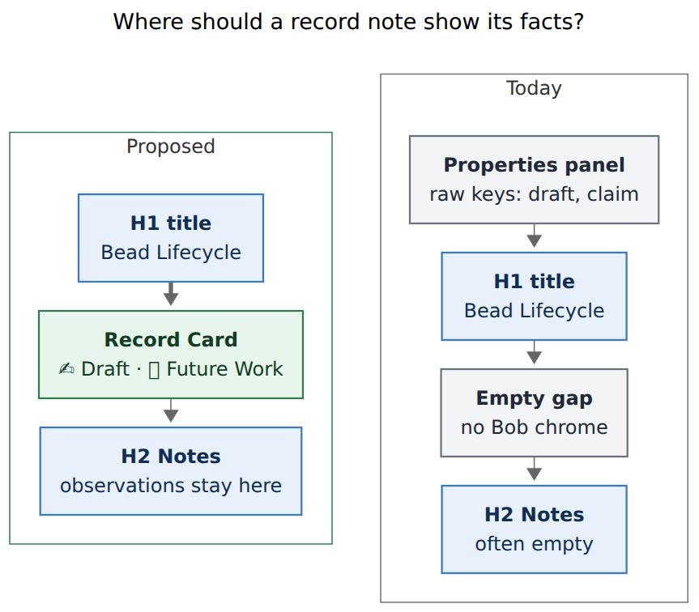
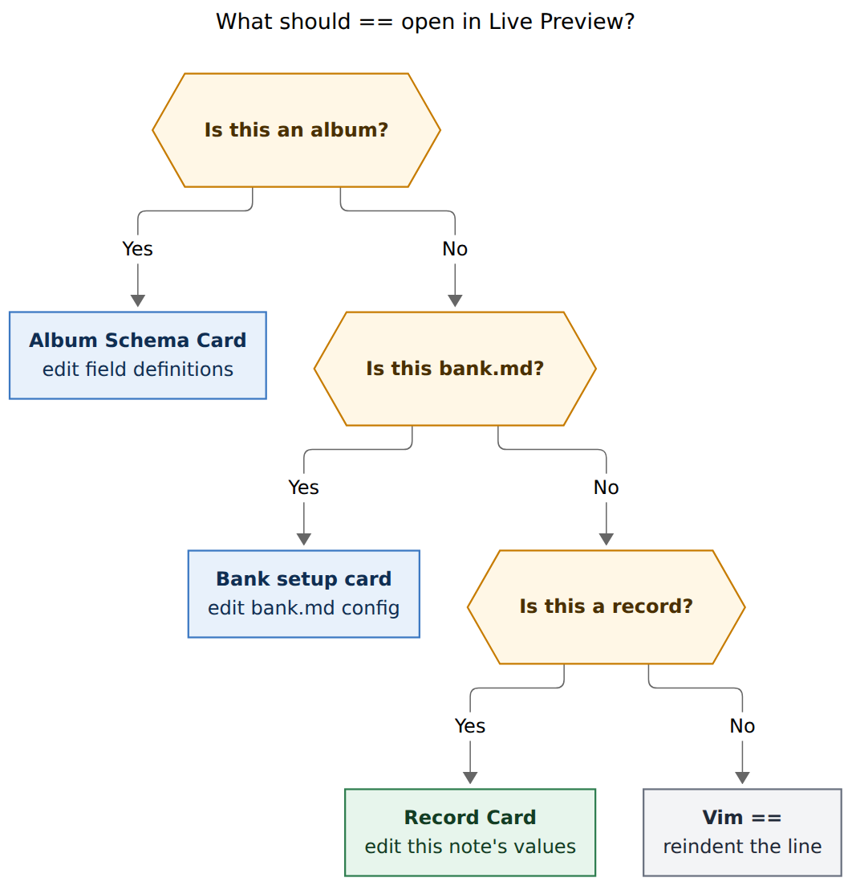
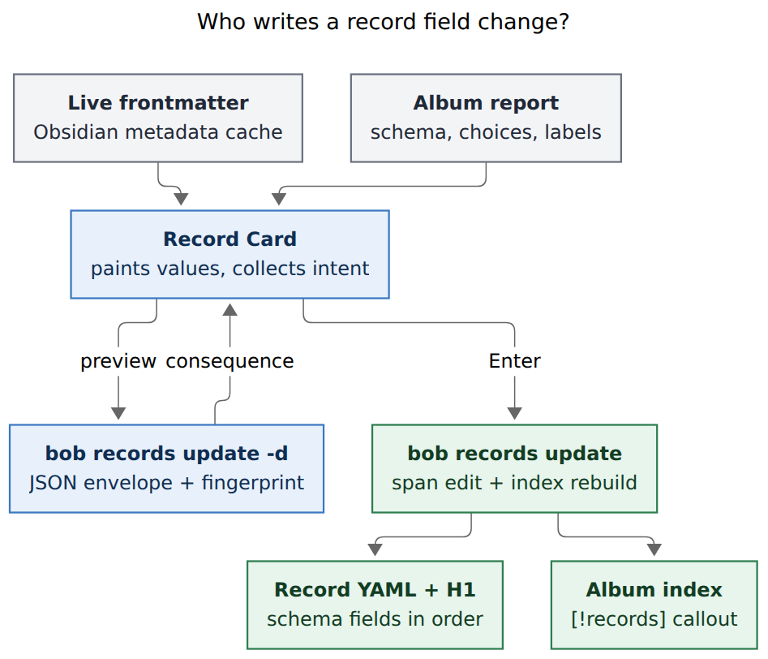

# A Record Card under the H1, not a second Schema Card

> **Research query:** How should record notes render a schema card for the parent album's fields, under the H1 and above `## Notes`, hiding native frontmatter in favor of a card with album/bank parity (edit, `==`, keyboard navigation), designed so it is intuitive, reliable, and beautiful? Critique the plan, adjust requirements where justified, and recommend a solution.

## Bottom line

**Yes — build this. It is the right next surface, and it is overdue.** Do not clone the album Schema Card onto record notes.

The album Schema Card edits a *contract* (field definitions, choice labels, required flags) that lives in the album's nested `record:` mapping. A record note holds *one instance* of that contract: flat YAML values (`status: draft`, `section: future`). Those are different jobs. The November 12 schema-UX research already named this follow-up and parked it: "no per-record value editor (noted by cld as the higher-frequency follow-up — it should not grow this task)." This request *is* that follow-up.

Recommended shape:

1. **Name it the Record Card.** Same chrome family as the album header / Schema Card and the bank.md Setup card. Different payload: current values, in album field order, with Bob's emoji labels.
2. **Paint it as Live Preview / Reading chrome after the first H1**, the same CodeMirror widget and post-processor slot album and bank headers already use. `## Notes` stays authored body underneath.
3. **Hide the whole Properties panel on record notes** in those views, scoped to a record surface class. Do not add `cssclasses` to 186 record files. Source mode keeps YAML.
4. **Edit values through `bob records update`**, extended with a JSON envelope, fingerprint, dry-run consequence, and inverse ops. The plugin never writes YAML.
5. **Reopen the in-flight `==` records decision.** `==` on a record should open *this* card, not the parent album's Schema Card, and not Vim reindent.

That is a good idea. Cloning add-field / reorder / choice-add onto a record is not.

## What the screenshot actually shows

Verified against `~/tmp/screenshots/20261117_101208.png` and the bytes of `sase_blog_zettel/bead_lifecycle.md`.

The note is a healthy canonical record:

```yaml
parent: "[[sase_blog_zettel]]"
type: "[[record]]"
title: "Bead Lifecycle"
status: draft
claim: "Bead triage/lifecycle needs to be thoroughly designed in v2."
section: future
created: 2026-11-17T07:55:39-0500
```

```markdown
# Bead Lifecycle

## Notes
```

Obsidian Live Preview currently spends the viewport on:

| Region | What you see | What Bob knows |
| --- | --- | --- |
| Properties (above the editor) | `parent`, `type`, `title`, `status: draft`, `claim`, `section: future`, `created` | Choice keys, not `✍️ Draft` / `🔮 Future Work` |
| H1 | Bead Lifecycle | Same string as `title:` |
| Dead zone | A blinking cursor on a blank line | Nothing |
| H2 Notes | Empty section | The observations home |
| Linked mentions | The album index row already showing `🔮 Future Work · Bead triage…` | The facts, elsewhere |

The status bar even counts `7 properties`. Those seven rows *are* the note. The body is a title and a hole.

This is not the album problem. On `sase_blog_zettel.md` (screenshot `20261117_095057.png`), Properties still shows `parent` / `type` / `summary` / `emoji` / `created` / `index_facets`, and a Bob header under the H1 paints the schema as chips: **Status\*** with every choice and usage count, **Claim\*** as `text`, **Section** with thirteen emoji chips. The nested `record:` mapping is hidden. That header is a *definition* view. Putting the same definition view on `bead_lifecycle.md` would tell Bryan what a Zettel *can* be, while he is looking at one that already *is*.

Capture already speaks the value language. The Mac Record Card on `20261117_075955.png` shows the same zettel as:

- **Status** `✍️ Draft`
- **Claim** the sentence
- **Section** `🔁 Agent turn`
- footer `← next field · ⏎ accept · Esc back to draft`

The in-note card should look like a calmer, persistent sibling of that card, not like the album's choice census.



Rendered size: 574 × 505 px; fit scale: 100%. Mermaid CLI 12.0.0, PDF-mirroring config.

**Caption:** Today the facts sit in native Properties above the title, and the body is an empty gap over Notes. The Record Card belongs under the H1, speaking Bob's labels, with Notes remaining the observations home.

## Critique: is this a good idea?

**Yes, with a sharper object.** The request as written is slightly the wrong noun ("schema card") aimed at the right place (under the H1) for the right reason (Properties is the wrong surface).

### Why the feature earns its keep

Record notes are a facts-plus-notes object. Capture, `bob records new|update`, the generated `[!records]` index, and Bases already treat the YAML fields as the record. Opening the note itself currently demotes those facts to Obsidian's generic property widgets and leaves the body empty. That is a daily tax on ~186 notes (104 restaurants, 28 subscriptions, 23 shows, 15 podcasts, 12 movies, 4 zettels, counted in `~/bob` today).

Three loops from the earlier record-notes research still matter:

- **Capture** already walks fields in the Mac Record Card.
- **Verdict** (change `to_try` → `liked`, fill `visited`, move a zettel from `draft` to `ready`) happens *on the record note*, and today that means fighting Properties or dropping to Source YAML.
- **Lookup** is the album index and Bases; the note itself should still *read* as the same object.

A Record Card closes the verdict loop in the same chrome family Bryan already uses for album schemas and bank setup. That is intuitive. It is also the only way "hide the frontmatter" is honest: something prettier and stricter has to replace the panel.

### Why cloning the album Schema Card would be a bad idea

The album / bank cards are *structure editors*:

| Gesture on album Schema Card / bank Setup | Makes sense on a record? |
| --- | --- |
| Add field / add choice / add category | No — that mutates the album or `bank.md` |
| Reorder fields, `Alt+J/K`, ghost placement | No — order is the album's |
| Relabel a choice, emoji slot | No — labels are shared across the folder |
| Toggle required / suggest | No |
| `y` jump to YAML line | Yes, to *this record's* field span |
| Preview → Enter → scoped commit → `u` Undo | Yes, for a value change |
| Keyboard selection, hint strip, `Esc` stack | Yes |
| `==` in Vim normal mode, Live Preview | Yes, once this card exists |

Parity should mean **session, chrome, keyboard, writer discipline**, not **the same targets**. A record that offered `+ field` would invite Bryan to fork one zettel's schema. Bob would then refuse the unknown key (`record_unknown_field` in `records/check.rs`). Beautiful UI that writes illegal YAML is worse than Properties.

### Why native Properties is the wrong editor even though the values are flat

Album `record:` and bank `bank:` are nested mappings, so Properties cannot render them (unknown JSON widget, hide-the-row is a safety feature). Record fields *are* flat scalars. Properties can show them. It still should not be the editor:

- Choice keys display as `draft` / `future`, not `✍️ Draft` / `🔮 Future Work`.
- `suggest` fields get a dumb text box, not the album's existing values.
- Dates and URLs get generic widgets, not Bob's `today` / bounds / http(s) rules.
- `+ Add property` is a footgun: unknown keys are `record_unknown_field`.
- Restaurant notes also carry `lid`, `source_group`, `source_note`, `source_anchors`, `source_dates`, `source_lines` — legacy noise that the album schema's `legacy:` list allows and that Properties dumps into the same list as `status`.
- Editing any property re-serializes the whole frontmatter. The plugin contract already forbids `processFrontMatter` for that reason (album and bank research both measured this).

Hiding the panel is justified only because the replacement is schema-aware.

### The in-flight `==` plan is right for albums and bank, and incomplete for records

`plan:202611/double_equals_schema_keymap.md` (WIP, decided `records = album_only`) maps `==` to the button that already exists: ⊞ Schema on albums, ⊞ Edit on `bank.md`. Records keep Vim's line reindent because "the ⊞ Schema button you asked to mirror appears only on album notes." That premise dies the moment a record has its own card.

The rejected alternative `records_too` is still the wrong reopen: it would open the *parent album's Schema Card* from a record, which is what the palette command **Edit album schema** already does via `albumSchemaEntryKindOf` → parent resolution. From `bead_lifecycle.md`, that would edit the Zettel *schema* (thirteen section chips, dated-notes flag) while Bryan is staring at one draft. `==` on a record should edit that draft.

Ctrl+Shift+P is already album-only (`551-plugin-album-schema-fallback.js` returns `not-direct-album` unless `target.kind === "album"`). Record notes are an idle chord. Overloading them to the Record Card matches the existing mnemonic: the chord edits the properties of what you are on.

## Requirement adjustments (called out)

These change the request. Each is a tightening, not a new product.

1. **Call it a Record Card, not a Schema Card.** Keep the visual family. Reserve "Schema Card" for album field *definitions*. Mixing the names will make `==`, the palette, and docs lie.
2. **The card shows instance values, in album declaration order, with Bob display labels.** It does not list every choice with usage counts unless that field is in an edit stage.
3. **Hide the entire Properties panel on record notes in Live Preview and Reading**, via a pane-scoped surface class (the album/bank pattern). Do not write `cssclasses: [bob-record]` into every record. Do not hide Properties on album notes or `bank.md` further in this work. Source mode keeps YAML; the card does not render there.
4. **Do not put `parent`, `type`, `title`, or `created` on the card as ordinary editable rows.** `type` is always `[[record]]`. `title` is the H1. `parent` is a breadcrumb to the album. `created` is a muted caption. Title rename implies a filename change (docs/records.md filename rule, collision refusal) and is a v2 gesture. Parent change is a move between albums and is out of v1.
5. **Do not paint legacy keys** (`lid`, `source_*`, …). They remain in YAML, allowed by the album `legacy:` list, hidden with the Properties panel.
6. **Do not clone schema-structure gestures** (add/reorder/relabel fields or choices). Those stay on the album Schema Card. A record that needs a new field is a schema edit on the album.
7. **`==` on a record opens this Record Card.** Amend `plan:202611/double_equals_schema_keymap.md` with a third target, `record`, instead of `album_only` or `records_too`. Counted `N==`, Source mode, insert/visual, and non-record notes keep Vim reindent.
8. **Every write goes through `bob records update`.** Extend that existing verb with a JSON ops envelope (`-i` / stdin), an `expect` fingerprint, dry-run consequences, inverse ops for `u`, and the same editor-save-then-apply session the album/bank cards already use. Do not add a second writer. Do not let the plugin `processFrontMatter`.
9. **Notes stay in `## Notes`.** The card does not grow a notes textarea. Capture and `bob records update -n` already append dated bullets when the album opts in. An empty Notes section under the card is correct, not a failure.
10. **Merge the subscriptions record header strip into this card** as a specialized trailing region (money line, 12-dot timeline, finding sentence). Two stacked headers on `subscriptions/*.md` would be uglier than Properties.
11. **Mobile stays read-only**, matching album Schema Card and bank Setup. No subprocess writes.
12. **Ctrl+Shift+P on a record note, when the Task Card has no target, opens the Record Card.** Palette **Edit album schema** from a record continues to resolve the parent album. Add a separate **Edit record** command.

## What already exists (do not rebuild it)

Verified in this checkout and the linked `bob-plugins` tree.

**Placement engine.** Album headers and bank Setup headers are report-driven widgets. They never rewrite Markdown. Live Preview: a `Decoration.widget` at the end of the first H1 line (`241v-plugin-album-header.js`, `notebookHeaderLiveAnchor`). Reading: insert the node after the first `h1` (`albumHeaderReadingAnchor`). Bank Setup copies that slot verbatim (`248c-plugin-bank-setup-hosts.js`: "after the first H1 exactly where the album header mounts"). Subscriptions already paint a *record-note* header in that same slot (`241hg-plugin-bank-subscription-header.js`). A Record Card is a new model in an old hole.

**Chrome hide.** Album: `.bob-album-header-surface .metadata-property[data-property-key="record"]`. Bank: `.bob-bank-setup-surface .metadata-property[data-property-key="bank"]`. Record notes have no nested mapping to hide; hide `.metadata-container` on `.bob-record-card-surface` instead. Cleanup on type change, file switch, and unload, as the album/bank research already required.

**Schema data.** `bob albums list -f json` already carries ordered `fields[]` with label, kind, flags, choices, `filled`, `line`, `schema_fingerprint`. The plugin already caches that report (`241l` / `241m`). Live values come from `metadataCache.frontmatter` on the open file — the same cache album entry points already read for `parent:`.

**Value writer.** `bob records update TYPE STEM -s KEY=VALUE` already span-edits YAML, preserves untouched keys and body bytes, rebuilds the album `[!records]` index, supports `--dry-run`, and returns `properties[]` with `label`, `display`, `before_display`, and `state` (`src/native/records/{plan,render,cli}.rs`). What it lacks for a card session: JSON stdin, fingerprint `expect`, inverse ops, and a title/parent policy. Those are additive extensions of one verb, not a new noun.

**Value UI language.** Mac Capture's Record Card (`docs/reference/mac-capture/capture-previews.md`) already paints emoji, title, path, note count, choice displays, capsules for unset fields, More-for-optionals, and `before → after` on updates. `bob capture-complete -F` already walks missing fields and suggests choice/date/suggest values. Reuse that grammar. Do not invent a third field widget set.

**Keyboard card idiom.** Album Schema Card and bank Setup card already own: selection, stages, hint strip, `Esc` stack, auto-preview, Enter latch, `u` Undo, live region, desktop gate, YAML excursion. Record Card should mixin-share session and arrange-less navigation, not copy 2k lines.

## Recommended design

### Surface

One always-expanded header card under the H1 in Live Preview and Reading.

```
📇  sase_blog › SASE Blog Zettel          created 17 Nov 2026
    Zettel · 3 fields · 1 missing

    Status *    ✍️ Draft
    Claim  *    Bead triage/lifecycle needs to be thoroughly designed in v2.
    Section     🔮 Future Work

    ⊞ Edit   y YAML
```

Visual rules, copied from the album/bank family and then slimmed for values:

- Root-area accent (`--bob-album-accent` / hue data attribute), 8px radius, 2px start border, quiet wash. Same type ramp as `.bob-album-header` (`font-ui-small`, interface font).
- Breadcrumb uses resolved album and area links, like the album header, not the raw `[[sase_blog_zettel]]` property widget.
- One row per declared field, album order. Label on the left (required as a quiet `*`), value on the right.
- Choices show **only the selected chip** (emoji + label). Empty required: dashed missing chip. Empty optional: muted `—`, or folded under **More** when an album has more than four optionals (capture Record Card already does this).
- Long text (`claim`) truncates to two lines in the header; the edit stage shows the full string.
- Links and URLs are real anchors. Dates show the ISO value plus a relative gloss (`today`, `3d ago`) from Bob, not a guessed local calendar.
- Invalid values (wrong choice key, bad date) paint as lint on that row with Bob's message, not as a silent raw string.
- Unknown extra keys: one lint line, `y` jumps to YAML. No editor for them.
- Collapse is unnecessary for zettels (3 fields) and restaurants (5). If a future album grows past ~8 fields, add a session-only fold keyed by path, like album schema chips. Default remains expanded: this card *is* the note's facts.

The H1 stays the human title. The card does not repeat it as a field. `## Notes` stays immediately below. That fills the screenshot's dead zone without inventing a new heading.

### Editing

Two layers, matching album/bank, sized for a much smaller object:

**Glance (always on).** The header above is navigable: `j/k` or arrows move rows, `Enter` or click stages that field, `==` focuses the card and selects the first missing required (else the first field). This is the "rendered under the H1" requirement. A modal-only editor would leave the body empty again.

**Stage (in-card, not a second window by default).** Staging a field expands in place:

- Choices: the choice cloud from the album schema (the same chips the album card shows for that field), current selection ringed. Type-to-filter. Enter applies.
- Suggest text: input plus `bob records show` / capture-complete candidates.
- Date: `YYYY-MM-DD`, with `today` / `yesterday` as first-class candidates (the records contract already accepts them).
- Number: typed input honoring `min`/`max`.
- URL / link / text: a single input. URL validates http(s)+host. Link accepts `[[wikilink]]` or a bare note name.
- List fields: chips plus add; a repeated `-s` on update replaces the list in request order (existing contract).
- Optional clear: `Ctrl+D` or empty Enter on an optional field sends `KEY=` (existing "explicitly empty optional removes its key"). Empty required is refused.

A **⊞ Edit** button and the **Edit record** palette command open the same card in a Task-Card-sized modal for people who want the full hint strip and to keep the cursor in Notes. The modal is the same model, not a second editor. On a three-field zettel the in-card stage is enough; on a seven-field movie it is still enough. The modal exists for keyboard parity with album/bank and for `==` when the header is off-screen.

Session rules, copied from the Schema Card because they earned their keep:

- One gesture, one dry-run, one Enter, one scoped commit.
- Previews run as you type; there is no Preview button.
- Status rule names the before → after in Bob's display labels (`✍️ Draft → ✅ Ready`), plus whether the album index will rewrite.
- `u` previews Undo via inverse ops; a stale fingerprint repaints rather than silently rebasing.
- `Esc` cancels the stage, then blurs the card, then (in the modal) closes.
- `y` closes and jumps to that field's YAML line in Source mode, with a Done control that returns only when `bob records check` on that file is clean enough to reopen.
- Typing in inputs never fires navigation letters. Composition never applies.

Do not keep the card open across a burst of five field edits by batching them into one commit unless Bryan asks. The album decision `commit_granularity = gesture` already chose honest history. A zettel status change and a claim rewrite are two facts.

### `==` and other entry points



Rendered size: 707 × 736 px; fit scale: 92.3%. Mermaid CLI 12.0.0, PDF-mirroring config.

**Caption:** `==` already has a home on album notes and `bank.md`. Once records have a card, they join that map; they do not steal the album Schema Card, and they do not keep silent reindent.

Implement as a third target in the in-flight `248m-plugin-schema-double-equals.js` fragment, not a second keydown bridge. `schemaDoubleEqualsTargetKind` grows `"record"`. Acting calls `openRecordCard({ filePath })`, the same function the header button uses. Gate rules (Live Preview, lone pending `=`, no count, no register, capture-phase `<Esc>`) stay shared.

Other entries:

| Entry | Record note | Album note |
| --- | --- | --- |
| Header button | ⊞ Edit → Record Card | ⊞ Schema → Schema Card |
| `==` (Vim, LP, normal) | Record Card | Schema Card |
| Ctrl+Shift+P, no task | Record Card | Schema Card |
| Palette | **Edit record** / **Edit album schema** (parent) | **Edit album schema** |
| Command Mode Vault row | Edit record | Edit album schema |

### Writer



Rendered size: 630 × 542 px; fit scale: 100%. Mermaid CLI 12.0.0, PDF-mirroring config.

**Caption:** The plugin paints from live frontmatter plus the album report and never serializes YAML. `bob records update` already span-edits and rebuilds the index; the card needs a fingerprint and inverse ops on that same verb.

Additive CLI (cli_rules: nest under `records`, alphabetical options, short aliases, JSON additive, never rename the command):

```text
bob records update TYPE STEM [-b DIR] [-d] [-f human|json] [-i FILE] [-n TEXT] [-o] [-s KEY=VALUE]
```

`-i` takes the card envelope:

```json
{
  "schema_version": 1,
  "expect": "sha256:…",
  "ops": [{ "op": "field.set", "key": "status", "value": "ready" }]
}
```

`expect` hashes the record's frontmatter bytes plus the album `schema_fingerprint`, so a schema change on the album or a Source-mode edit of the record both refuse as stale. Dry-run returns the existing `properties[]` plus inverse ops and the planned album-index diff. Apply takes the maintenance lock, span-edits only listed keys, rebuilds `[!records]` when grouping/facets change, one scoped commit (`records: update sase_blog_zettel/bead_lifecycle.md (status)`). `u` replays inverse ops on the same path.

Keep `-s` / `-n` for humans and agents. The card uses `-i`. No-op remains byte-identical, no commit.

Fingerprint and inverse ops are the actual bob-cli work. Everything else the writer already does.

### What the card refuses

Teach, do not guess:

- Kind / required / choice-set changes → "Edit the album schema (`==` on the album)."
- Unknown keys → YAML (`y`).
- Title / filename → v2 rename flow; H1 edits in the body stay body edits until then.
- Parent / album move → out of v1.
- Empty required → existing `required-empty` refusal.
- Cross-host stale → existing stale-note pattern.

## Beauty notes (the part that is easy to underspecify)

The album Schema Card is dense on purpose: it is a map of a contract. A record is a *filled form*. If the Record Card shows every unused section chip, `bead_lifecycle.md` becomes a copy of `sase_blog_zettel.md` and the H1 disappears under chrome.

Keep:

- Selected-value chips, not the census.
- Claim as readable prose, not a YAML scalar in a monospace box.
- One missing-required mark that `==` can land on. The screenshot's zettel is complete; a restaurant with empty `visited` should feel unfinished without shouting.
- Quiet created caption. No one comes here to admire a timestamp.
- Light/dark and ~375 px: rows wrap label-above-value rather than truncating emoji chips.
- The card's height for a 3–5 field album should fit above the fold with Notes still visible. If it does not, the design failed; folding is a last resort.

Restaurant notes are the stress test: five schema fields plus a pile of legacy keys. After the hide, the card shows Status / Category / Location / Visited / URL. That is the first time `eat/787_coffee.md` will look like a restaurant instead of a migration artifact.

## Sequencing

Three slices. Do not wait for the `==` plan to land before slice A; do coordinate the records target with whoever owns `248m`.

1. **Slice A — glance + hide (plugin only, medium).** Record header widget after H1, values from metadataCache + album report, Properties panel hidden on the record surface, subscription strip merged, Reading + Live Preview, Source untouched, mobile read-only. Fixtures: zettel (choices + long text), restaurant (suggest + date + url + legacy noise), subscription (existing strip), empty optional, missing required, invalid choice, plugin disable restores Properties.
2. **Slice B — writer envelope (bob-cli, medium).** `bob records update -i`, fingerprint, inverse ops, stale refusal, editor-save ordering, index rebuild unchanged. `-s` remains. JSON additive.
3. **Slice C — editor + keys (plugin, medium).** In-card stages, modal twin, hint strip, `==` record target, palette, Ctrl+Shift+P fallback, Undo, YAML Done. Reuse album update session machinery; do not fork it.

Slice A alone already beats the screenshot. Do not close the request on A: "easy to edit" is the point, and Properties will have disappeared.

## Open questions for Bryan

1. **In-card stage vs always-modal.** Recommendation: in-card for glance+edit, modal as the `==` / palette twin of the same model. If you would rather every edit happen in the Task Card idiom and the header stay read-only, say so before slice C. Read-only header + modal still beats Properties; it is less "the facts live in the note."
2. **Ctrl+Shift+P on records.** Recommendation: open the Record Card. The album Schema Card remains one palette command away. If you use that chord on records today for something else, keep it idle.
3. **Title rename in v1.** Recommendation: no. H1 and `title:` can already drift; a casual card edit that also renames `bead_lifecycle.md` is a surprise. A later `bob records rename` can own it.
4. **More-for-optionals threshold.** Capture folds unset optionals. For a five-field restaurant, showing `Visited —` and `URL —` is better than hiding the fact that they exist (90 of 92 restaurants once had empty `visited`). Recommendation: always show declared fields; use More only above eight.

## Provenance

Independent swarm report, 2026-11-17, researcher `grk`. Did not read peer reports from this swarm.

Primary evidence this turn:

- Screenshot `~/tmp/screenshots/20261117_101208.png` (record note Properties + empty Notes).
- Screenshot `~/tmp/screenshots/20261117_095057.png` (album Schema header under H1, Properties still visible).
- Screenshot `~/tmp/screenshots/20261117_075955.png` (Mac Record Card value language).
- Vault bytes: `sase_blog_zettel.md`, `sase_blog_zettel/bead_lifecycle.md`, `eat.md`, `eat/787_coffee.md`, `movies.md`, `bank.md`.
- `docs/records.md` (note shape, field kinds, `bob records update` span semantics).
- `docs/reference/mac-capture/capture-previews.md` (Record Card).
- `plan:202611/double_equals_schema_keymap.md` (`records = album_only`).
- `plan:202611/album_schema_render_and_edit.md` / `album_schema_card_editor.md` (card idiom, per-record value editor explicitly out of scope).
- Audited `research:202611/album_record_schema_ux/album_record_schema_ux.md` (hide nested mapping; park per-record value editor).
- Plugin fragments: `241v`, `241x`, `241y*`, `241ye`, `242d`, `248c`, `248k`, `241hg`, `551-plugin-album-schema-fallback.js`, `styles.css` album/bank hides.
- `src/native/records/{cli,plan,render,check}.rs` (update plan JSON, identity keys, unknown-field lint).
- Vault inventory: 6 albums, ~186 record notes.

Figures rendered with `@mermaid-js/mermaid-cli@12.0.0` and the research PDF-mirroring config.
