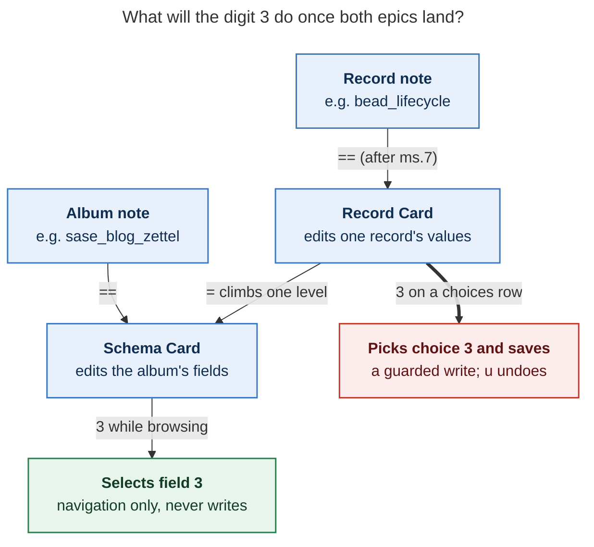
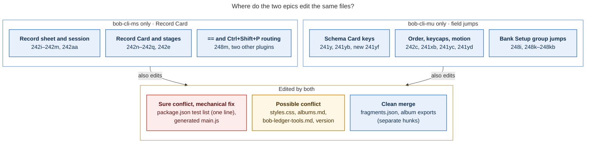

# Do bob-cli-ms and bob-cli-mu conflict?

> **Question:** Do the `bob-cli-ms` epic (Record Card) and the `bob-cli-mu` epic (Schema
> Card field jumps) conflict, and should you be worried?
>
> **Checked on 2026-11-17 against:** both epic plans and both endorsed research reports;
> bob-plugins `master` at `60b5602`; and the uncommitted diffs of the two phases running
> right now, `bob-cli-ms.4` and `bob-cli-mu.1`.

## Bottom line

**You don't need to worry.** Nothing should break. The two epics build different cards
and share very few files. There is **one design choice** to settle, ideally before
`bob-cli-ms.5` starts:

> Once both land, **`3` means two different things one keystroke apart.** On the Record
> Card it **picks choice 3 and saves**. On the Schema Card it **jumps to field 3**. Each
> endorsed research report gives the Record Card's digits its own meaning.

Everything else is routine merge friction. The agents' normal rebase and rebuild handle
it, and the `bob plugins sync` deploy guard covers deploy order.

| Area                | Verdict            | Why                                                                                                                                                                                                            |
| ------------------- | ------------------ | -------------------------------------------------------------------------------------------------------------------------------------------------------------------------------------------------------------- |
| Key handlers        | 🟢 No conflict     | mu adds `⇧J`/`⇧K`/`1`–`9` only to `AlbumSchemaCardModal`. The plan builds the Record Card as its own modal on `albumSchemaCardModalBase()`, which is plain Obsidian `Modal`, so it inherits none of mu's keys. |
| Writers and bob-cli | 🟢 No conflict     | mu never writes and changes no bob-cli code. ms's bob-cli phases already landed (`99005975`, `48a3116d`).                                                                                                      |
| CSS                 | 🟢 No conflict yet | mu scopes every rule to `.bob-album-schema-dialog`, and only the Schema Card sets that class. The landed record sheet uses no `bob-album-schema-*` class (0 matches in `242i`–`242k`).                         |
| `==` routing        | 🟡 One stale line  | mu's acceptance list says a record note's `==` "opens the same card with the same keys." ms.7 changes that to open the Record Card. This is harmless if mu lands first, which is likely.                       |
| Digit meaning       | 🟠 Decide          | [Section 1](#1-the-one-real-conflict-what-3-means)                                                                                                                                                             |
| Shared files        | 🟡 Merge friction  | One certain same-line conflict (`package.json`) plus the generated `main.js`. A rebase plus `npm run build` fixes both.                                                                                        |
| Deploys             | 🟢 Guarded         | Both epics deploy `bob-ledger-tools`. `bob plugins sync` refuses to overwrite another checkout's unlanded build, and the bob-plugins AGENTS.md says to wait for it and never pass `-F`.                        |

## 1. The one real conflict: what `3` means

_A record note's `==` opens the Record Card, where `3` saves a value. A single `=` then
opens the Schema Card, where `3` only moves the selection._

| Key                    | Schema Card (mu)                                                                                                            | Record Card (ms)                                                                        |
| ---------------------- | --------------------------------------------------------------------------------------------------------------------------- | --------------------------------------------------------------------------------------- |
| `1`–`9`                | Select field N in painted order. **Never writes.**                                                                          | On a choices row, **pick choice N and save**.                                           |
| `⇧J` / `⇧K`            | Next / previous field                                                                                                       | Unbound                                                                                 |
| `j` / `k`              | Fine walk over every row and chip                                                                                           | Move between fields; every row is a field                                               |
| What the research says | Field-jump report: _"A future Record Card should call the same field-jump helpers so `2` means the same field everywhere."_ | Record Card report's key table: _"pick that choice and save (Task Card digit parity)."_ |

You endorsed both reports in full. In the field-jump epic you also answered **no** to
the `field_number_record` decision, the decisions strand that would have made "digits
are field numbers" a rule for "the future Record Card." So no memory rule settles the
question either way.

**How much it matters:** not much. A stray digit on the Record Card makes one guarded,
uncommitted write, and `u` undoes it. But both cards use the same `bob-key-card` chrome
and sit one `=` apart, so habits from one will carry over to the other.

**Recommendation:** keep Task Card parity on the Record Card, and make the difference
explicit.

- Every Record Card row is already a field, so `j`/`k` already steps between fields.
  Picking a status with one key is the card's main speed win, and it matches the Task
  Card, the other card that edits values.
- Also bind `⇧J`/`⇧K` on the Record Card as field steps (aliases of `j`/`k`). Then the
  part of the Schema Card habit that can carry over does.
- Note on `bob-cli-ms.5` (not started yet) that the field-jump report's "Record Card
  should reuse field-jump helpers" line no longer applies. That way no later agent tries
  to make one card match the other.

If you would rather have one rule everywhere ("a digit always means field N"), change
ms.5's key table, again before ms.5 starts.

## 2. Where the code touches

_Every key handler, writer, and router belongs to one epic. Only build, test, style, and
docs files are shared, and only one of them is a certain textual conflict._

| Shared file                                      | bob-cli-ms                                         | bob-cli-mu                                           | Expected merge                                                       |
| ------------------------------------------------ | -------------------------------------------------- | ---------------------------------------------------- | -------------------------------------------------------------------- |
| `package.json` `test:unit`                       | Registers record tests (ms.4–ms.6)                 | Registers the field-jump and bank tests (mu.1, mu.3) | **Certain conflict.** The whole list is one line. Keep both entries. |
| `plugins/bob-ledger-tools/main.js`               | Rebuilt                                            | Rebuilt (already in mu.1's diff)                     | Certain conflict. Rerun `npm run build` after the rebase.            |
| `manifest.json` version                          | `1.129.0` → `1.130.0` (ms.4's diff)                | The plan says nothing about a version bump           | Possible clash on the number. Take the next free minor version.      |
| `styles.css`                                     | Record Card and Properties-hide rules (ms.5, ms.7) | Dialog-scoped keycaps and spacing (mu.2)             | Likely clean unless both add rules at the end of the file.           |
| `docs/albums.md`, `docs/bob-ledger-tools.md`     | `==` paragraph and record sections (ms.7)          | Key and Setup paragraphs (mu.1–mu.3)                 | Different paragraphs; likely clean.                                  |
| `src/fragments.json`, `src/352-exports-album.js` | New record fragments and exports                   | New `241yf` fragment and painted-order exports       | Clean. The edits are in separate hunks in the two live diffs.        |

**One thing to watch.** If ms.5 adds the `bob-album-schema-dialog` class to the Record
Card to reuse Schema Card styles, mu.2's keycap gutter and transparent-row rules would
apply there too. The plan says to reuse the `bob-key-card` chrome, not that class, so
this is unlikely.

## 3. When they can collide

| Window | bob-cli-ms                   | bob-cli-mu                    | Files both may edit                           |
| ------ | ---------------------------- | ----------------------------- | --------------------------------------------- |
| Now    | ms.4 running (write session) | mu.1 running (keys and order) | `package.json` line, `main.js`, exports       |
| Next   | ms.5 (Record Card shell)     | mu.2 and mu.3 in parallel     | `package.json`, `main.js`, `styles.css`, docs |
| Later  | ms.6, ms.7, land             | Likely done                   | None                                          |

mu has three short phases. ms has three large or medium phases left, and they run in
strict sequence. mu will most likely land before ms.7 changes `==`, which is why the
stale acceptance line is harmless. If mu's land agent ends up running after ms.7, it
should expect "`==` on a record opens the Record Card." That is not a regression.

## What to do

1. **Pick the Record Card digit rule** before `bob-cli-ms.5` starts (recommendation
   above), and record it on that bead.
2. **Nothing else.** The agents' rebase and rebuild flow absorbs the merge friction, and
   the sync guard keeps deploys in order.

_Out of scope, for awareness:_ the `em--code` agent is planning a change to the record
`## Notes` section. Its bead read of `bob-cli-ms` was logged with the reason "avoid
conflicting with the epic."

## Evidence

- **Plans:** `plan:202611/record_card.md` (Settled design 9, the Record Card key table,
  and the `record-card` and `record-entry` phases);
  `plan:202611/schema_card_field_jumps.md` (Scope facts, The one rule, Acceptance).
- **Research:**
  `research:202611/schema_card_field_jump_design/schema_card_field_jump_design.md`
  (verified facts: "A future Record Card should call the same field-jump helpers");
  `research:202611/record_card/record_card.md` (key table: "Task Card digit parity").
- **Code (bob-plugins `60b5602`, `plugins/bob-ledger-tools/src/`):**
  - `241y-plugin-album-schema-card-dom.js:3`: `albumSchemaCardModalBase()` returns
    Obsidian `Modal`.
  - `241y-plugin-album-schema-card.js:3`, `:820`, `:887`: `AlbumSchemaCardModal`, its
    `schemaOnKeyDown`, and the only `bob-album-schema-dialog` class setter, together
    with `241yc-plugin-album-schema-card-regions.js:902`.
  - `242i`–`242k`: zero `bob-album-schema` references.
- **Live work:** the uncommitted diffs of `bob-cli-ms.4` and `bob-cli-mu.1`. ms.4 edits
  `242aa`, `242i`, `242k`, lifecycle, exports, and `fragments.json`, and bumps the
  version. mu.1 edits `241xb`, `241y`, `241yb`, `241yc`, `241yd`, `242c`, exports,
  `fragments.json`, `package.json`, `docs/albums.md`, and `main.js`. The files they
  share: `fragments.json` and `352-exports-album.js`, in separate hunks.
- **Agents:** `sase agent list` at the time of writing showed ms.4 and mu.1 running and
  ms.5–7, mu.2–3, and both land agents waiting.
