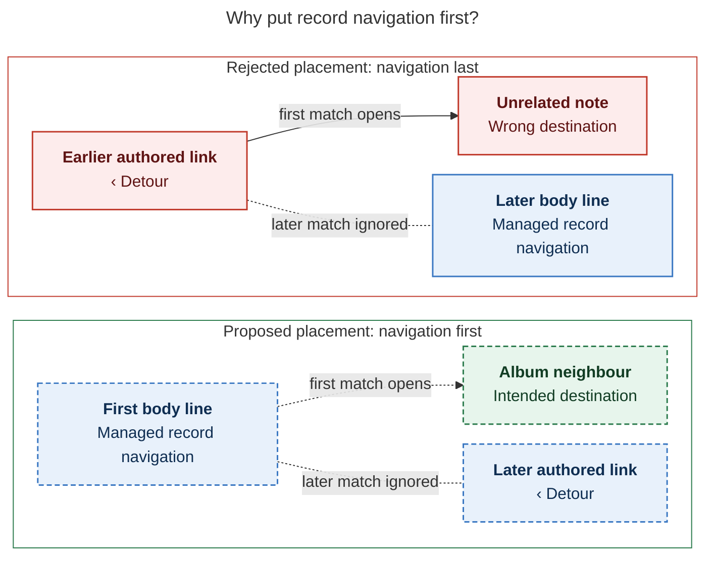

# Diagram proposals: Record nav ring

Proposals for the swarm linker, not a report. Each diagram restates only what the source
report says.

```yaml
source: research:202611/record_nav_ring/record_nav_ring__final.md
producer: research.5b.image
check: "mmdc 12.0.0 with Puppeteer --no-sandbox and the PDF-mirroring config rendered 1 of 1 Mermaid diagrams; invalid syntax correctly exited nonzero"
```

## first-match-placement

```yaml
anchor: |-
  A bottom-of-body nav line loses to any earlier authored link whose alias
question: |-
  Why does putting navigation first prevent a detour?
illustrates: |-
  First-match-wins scanning makes a bottom-of-body nav line lose to an earlier authored ‹ Detour link, while first-body placement makes the managed walk win.
caption: "For [n (Previous), an earlier matching link hijacks bottom navigation; putting the managed line first keeps the jump inside the album."
review: "730.484x672 px, fit 89.4%; PNG question, labels, arrowheads, crossings, reading direction and source checks passed; 0 revisions; unique body-paragraph anchor verified"
```


