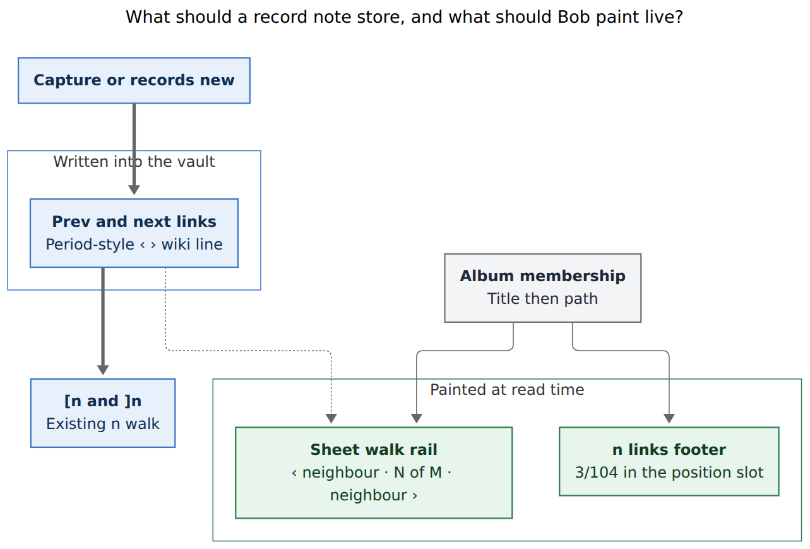
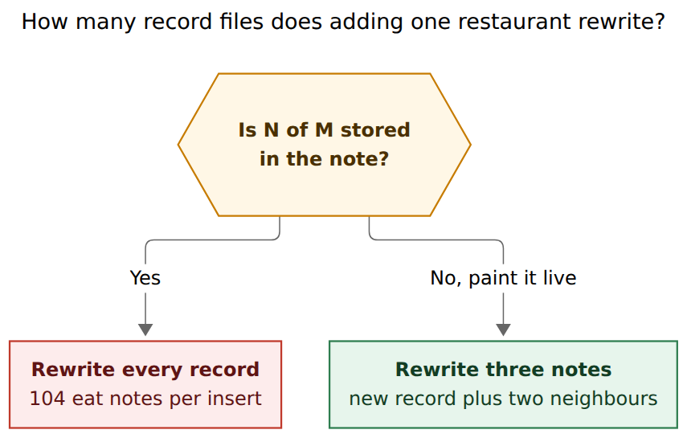
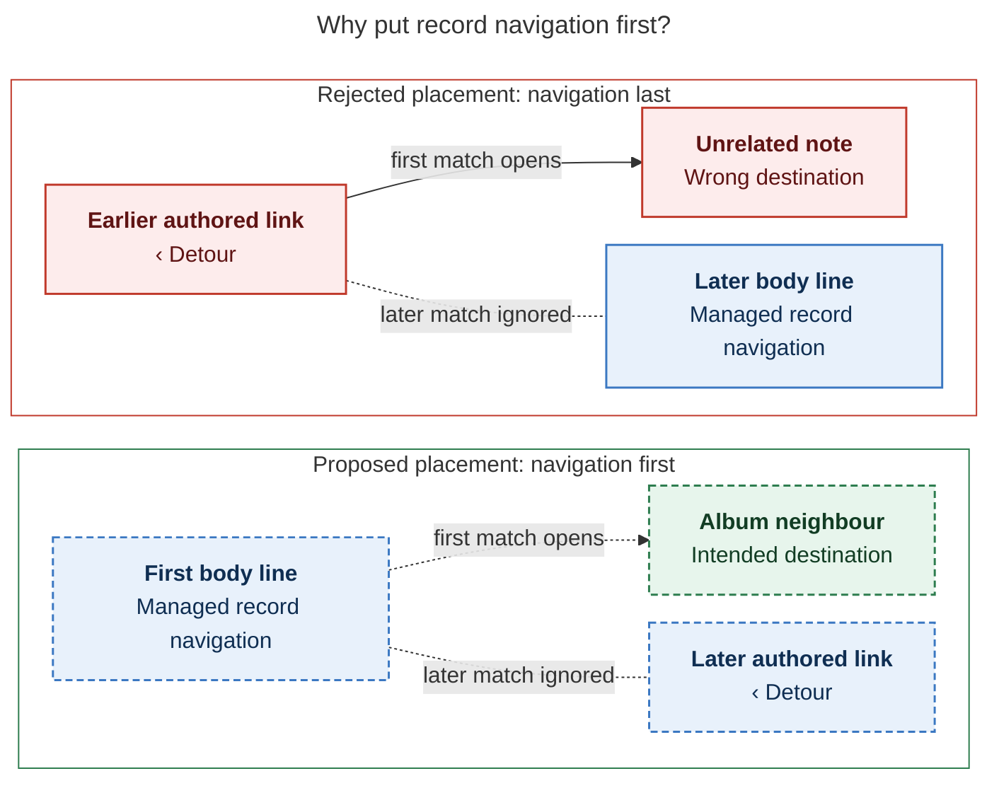

# Record nav ring: a cycling ‹ › walk over every album, with `N of M` painted live

> **Research query:** What is the best way to automatically add `<` and `>` links to
> every record note, pointing to the previous and next record in its album as a cycling
> alphabetical walk that works with the `[n` / `]n` keymaps (so a two-record album's
> links both point to the other record), with `N of M` position text rendered near
> them? Is this a good idea, would a different approach be better, and which
> requirement adjustments and recommended solution make the feature intuitive,
> reliable, and beautiful?


## Bottom line

**Build it.** All five researchers independently reached the same top-line judgment:
record notes are currently islands — the album's `[!records]` index is the only way to
move between them — and a cycling alphabetical walk that `[n` / `]n` can follow is the
missing compass on a surface that already has a catalog, a sheet, and a walk family
that does nothing on record notes today. The feature reuses a navigation grammar
Bryan already knows from period notes, so it costs almost nothing to learn.

The recommended shape, resolving
[the reports' disagreements](#the-disagreements-and-how-i-resolved-them):

1. **bob writes one period-style nav line as each record's first body line**, in the
   grammar `[n` / `]n` already follow — no key or matcher changes:

   ```markdown
   [[eat/pho_house|‹ Pho House]] · [[eat|↑ Eat]] · [[eat/ramen_nagi|Ramen Nagi ›]]
   ```

2. **The ring cycles** over the whole album in the existing `title_order` (lowercase
   title, then path). Two records point at each other in both directions, exactly as
   requested. One record gets only the `↑ Album` link — no self-links.
3. **`N of M` is painted live, never written into Markdown.** The record sheet gains a
   quiet walk rail (`‹ Pho House   📺 Eat · 3 of 104   Ramen Nagi ›`) and the `n`
   links footer gains `3/104` in its position slot. This is the one deliberate change
   to [the request as written](#requirement-adjustments), and the
   [single most consequential call](#store-links-and-paint-the-count) in this design.
4. **Capture and `records new` stage the new record plus its two neighbours in the
   same guarded transaction** that already rebuilds the album index; **`bob albums
   sync` [repairs drift](#albums-sync-repairs-rather-than-records-tidy)**, which the
   plugin's existing watcher already debounces within ~3 s of any member create,
   delete, rename, or title edit, and nightly backstops.
5. **One plugin safety fix is mandatory:** `]n` / `[n` must never *create* a note
   inside an album folder. Today a dangling link would silently create a ghost record
   (see the [ghost guard](#plugin-changes-in-bob-plugins)).

[Phase 1](#rollout) (bob-cli alone) delivers working `[n` / `]n` / `[[` / `]]` and a
correct footer compass on every record with today's deployed plugins, because the
written labels already match the shipped matcher. Phase 2 (bob-plugins) adds the ghost
guard, the rail, and the live count.



**Caption:** Bob writes the period-style ‹ › wiki line into each record so the
existing `n` walk can follow durable links; position text (`N of M`) is a live
projection from album membership, painted on the record sheet rail and in the `n`
links footer, so no count is ever stored in a note.

## Ground truth all five reports agree on

Verified against source in this pass.

- **The `[n` / `]n` contract needs no change.** `open-prev-link` / `open-next-link`
  scan the active note's body top-to-bottom, skipping YAML frontmatter and fenced
  code, and open the **first** link whose rendered label matches: prev = exact `prev`
  or starts with `‹`/`<`; next = exact `next` or starts **or ends** with `›`/`>`.
  `[[` / `]]` repeat the `n` family. A one-line `‹ prev · next ›` pair resolves both
  directions correctly from the same line.
- **The period-note precedent is exact.** Week/quarter/year notes already carry
  `[[2026/2026-W44|‹ W44]] · [[2026/2026-Q4|↑ 2026-Q4]] · [[2026/2026-W46|W46 ›]]`,
  and `docs/periods.md` states the governing principle for counts: *"No number is
  ever written into Markdown."* The difference: calendar neighbours never reshuffle;
  album neighbours do on every insert, delete, and retitle. That asymmetry drives the
  whole design.
- **Albums already own a deterministic order and a transactional writer.**
  `title_order` (lowercase title, then path; title falls back to the humanized stem)
  sorts index rows; capture and `records new|update` rebuild the album index in the
  same guarded, preimage-checked transaction as the record write; `bob albums sync`
  repairs derived state and is already invoked by nightly **and** by the plugin's
  album data service, which registers vault `create`/`modify`/`delete`/`rename`
  events and debounces a sync 3000 ms after member changes.
- **Record notes are sparse by contract.** No H1 (the sheet renders the title); an
  empty body ends right after the closing `---`; the sheet mounts at the first body
  line when no heading exists. A vault census (cld) found zero records with an H1 and
  no competing first-line content. The record fingerprint hashes frontmatter only —
  *"Body bytes, YAML formatting, and key order"* never affect it — so a body nav line
  can never stale the Record Card's `expect`.
- **Scale:** 6 albums, 192 records (eat 104, subscriptions 28, tv 23, podcasts 15,
  movies 12, sase_blog_zettel 10). Records arrive in bursts (34 in one day observed).
  Multi-host vault-sync conflicts on hub notes are a documented reality
  (`_conflicts/sync_conflicts.md`), so rewrite radius is a real cost, not a
  theoretical one.

## The disagreements and how I resolved them

The five reports span a full spectrum. This table is the heart of the consolidation:

| Question | cdx | cld | grk | mus | gem | Ruling |
| --- | --- | --- | --- | --- | --- | --- |
| What is written to the note? | links + count (callout) | links only | links only | links + count | nothing | **Links only** |
| Where? | top (after legacy H1) | first body line | first body line | **last** body line | n/a | **First body line** |
| Labels | titled `‹ Title` | titled + `↑ Album` | titled + `↑ Album` | bare `‹` / `›` | titled (virtual) | **Titled + `↑ Album`** |
| `N of M` | stored in callout | painted live | painted live | stored in line | painted live | **Painted live** |
| Repair owner | albums sync | albums sync | records tidy | albums sync | n/a | **albums sync** |
| M = 1 | `1 of 1`, no links | `↑ Album` only | no line | no line | disabled arrows | **`↑ Album` only** |
| Collation | keep `title_order` | keep `title_order` | keep `title_order` | keep `title_order` | `Intl.Collator` natural | **Keep `title_order` in v1** |

### Store links and paint the count

_Versus gem's "write nothing" and cdx/mus's "write everything."_

gem's fully-virtual design (a plugin resolver, zero bytes written) is internally
consistent and its bug-hunting was excellent, but it fails the request on its own
terms: the request asks for **links in the notes**, and the honest version of this
walk — proven by period notes — is that the bytes in the note *are* the walk. A
virtual walk requires teaching `[n` / `]n` a special record-note code path, and goes
silent in Source mode, on mobile without the plugin, in git, on GitHub, and in any
other editor. Durable links are also what make the feature degrade gracefully: raw
Markdown remains a tappable pager everywhere.

At the other end, cdx and mus write `N of M` into every note. cdx priced this
honestly: adding one restaurant to `eat` rewrites **all 104 notes** (new denominators
and shifted ordinals), deleting one rewrites every survivor, and a burst day of 34
captures approaches 3.5k file writes. Each rewrite of a note open on another host is
a potential `_conflicts/` copy, and every record's git history fills with counter
noise. Three of five reports independently rejected this, and the vault's own period
notes already encode the principle: positions are painted, never stored. The Walker
Footer's glossary contract says the same thing — positions are queue membership,
read-only projections.

**Ruling: write the two neighbour links (plus the `↑` hub), paint the count.** Churn
per event, in notes rewritten (cld's table, verified arithmetic):

| Event | Links only | Links + stored `N of M` |
| --- | ---: | ---: |
| Create a record | 3 | M (eat: 105) |
| Delete a record | 2 | M − 1 |
| Title edit, order unchanged | 2 | 2 |
| Title edit that reorders | ≤ 5 | up to M |
| Status or field edit | 0 | 0 |



**Caption:** Storing `N of M` in every note makes one insert rewrite the whole eat
folder; storing only the neighbour links keeps the same insert at three files.

The accepted trade: Source mode, GitHub, and plugin-less mobile see the titled arrows
but no count. The count is orientation chrome; the links are the durable artifact.

### First body line rather than last

_Versus mus: first body line, not last._

mus argued position is "functionally free" because the scanner covers the whole body.
**That is backwards, and verified so:** the scanner is first-match-wins, top to
bottom. A bottom-of-body nav line loses to any earlier authored link whose alias
happens to start with `<`/`‹` or end with `>`/`›` (cdx's harness experiment showed
exactly this hijack with an unrelated `‹ Detour` link). The first body line is the
only position that *guarantees* the managed walk wins. mus's real motive — avoiding
collision with the record sheet — is already handled: the sheet mounts at that exact
anchor, and the plugin restyles the nav line as the sheet's rail rather than drawing
a second control. [The placement-comparison diagram](#figure-first-match-placement)
traces both scans side by side: an earlier `‹ Detour` link hijacks a bottom nav line,
while a first-line nav line wins.

<div id="figure-first-match-placement">



_For [n (Previous), an earlier matching link hijacks bottom navigation; putting the managed line first keeps the jump inside the album._

</div>

### Titled arrows rather than bare glyphs

_Versus mus: titled arrows, not bare glyphs._

Verified: `linksWalkerFooterLabel` strips `[‹<>›]` from any non-`prev`/`next` label
and returns the remainder **without a stem fallback**, so bare `[[eat/a|‹]]` renders
blank footer arms (`‹  ·  ›`). Bare glyphs also have no accessible name and read as
broken HTML in external renderers. Titled labels cost two neighbour-label rewrites
per retitle — cheap — and make the footer, hover previews, and raw Markdown all name
the destination. Two label-sanitization rules are mandatory, derived from the
verified matcher: the **prev** label must not *end* with `›`/`>` (else the prev link,
sitting first on the line, would answer `]n`), and the **next** label must not
*start* with `‹`/`<`. Reuse the index's alias sanitizer (drop `|[]#^`), fall back to
the humanized stem if sanitization empties a title. Fix the footer's empty-label
fallback bug anyway (gem's one-line patch) so hand-authored bare arrows elsewhere in
the vault stop rendering blank buttons.

The `↑ Album` hub link rides in the middle: it matches neither direction's pattern
(verified), rhymes exactly with period notes, gives Source mode and mobile the up-hop
the sheet breadcrumb provides on desktop, and gives the painted count a natural seat.

### Albums sync repairs rather than records tidy

_Versus grk: `bob albums sync` repairs, not `bob records tidy`._

grk's objection — albums sync's documented contract is "indexes and owner catalogs",
and extending it to record bodies smears that boundary — is principled but loses on
operational facts I verified: the plugin's album data service **already** fires a
debounced `bob albums sync` on exactly the right triggers (member create, delete,
rename, and any member frontmatter change, title included). Routing repair through
albums sync means a record deleted or retitled in Obsidian heals its neighbours
within ~3 seconds **with zero new trigger code**, where the tidy route would wait for
nightly. One command owning all derived album state is also the simpler contract to
document. The blast-radius change is real and must be stated in `docs/records.md`
and the decision record. grk's sequencing insight stands regardless: tidy must strip
a redundant H1 **before** nav ensure runs, and both tidy's "redundant H1" and
"empty body" probes must learn to skip the nav line.

### Keep title order and defer the collation upgrade

_Versus gem: keep `title_order`; defer the collation upgrade._

gem is right that `to_lowercase()` ordering has quirks: `Part 10` sorts before
`Part 2`, `É` sorts after `z`, and 15 eat titles cluster under "The …". But adopting
`Intl.Collator` natural/accent-insensitive order *only in the walk* would make the
walk disagree with the `[!records]` index, and implementing it twice (Rust writer, JS
painter) is the drift risk this design must avoid most. **Pin one contract** —
Unicode lowercase of the frontmatter title, empty title → humanized stem, tie-break
on exact path bytes — extracted into one shared Rust helper, with the same test
vectors copied into the plugin's suite. Upgrading collation later is a deliberate,
separate decision that reorders every album and must move the index and the walk
together.

### A line rather than a callout

_Versus cdx: a line, not a callout._

cdx's `[!record-nav]` callout brings real machinery (region planner, H2-less
insertion mode, duplicate healing) for marginal gain. The one-line form is the
documented `[n` / `]n` idiom, matches period notes byte-for-byte in spirit, is
lighter in Source mode, and is trivially recognizable by grammar (1 or 3 wikilinks
separated by ` · `, targeting `<album>` and `<album>/*` with arrow labels). cdx's
*state machinery* survives the format change: per-record `current` / `missing` /
`stale` / `damaged` states, with `damaged` (a nav-like line with extra prose, or two
nav lines) **reported and never rewritten** — bob never clobbers what might be
Bryan's text; deleting the damaged line heals it on the next sync.

## Requirement adjustments

Explicit call-outs:

1. **Labels are `‹ Title` / `Title ›` (U+2039/203A), never bare ASCII `<` / `>`.**
   The matcher accepts both families; bob writes only the typographic form. Bare
   arrows keep walking forever; writers normalize them on next touch.
2. **`N of M` is live chrome, not vault bytes.** The biggest change from the request
   as written, for the churn and conflict reasons
   [above](#store-links-and-paint-the-count).
3. **"Alphabetical" is defined as the album-wide `title_order`** — flat, ignoring
   the index's status groups (walking group order would turn a status edit into a
   neighbour rewrite and make the walk a status tour, not A–Z).
4. **M = 1 writes no self-links** — just `[[album|↑ Album]]`; the sheet may show
   `1 of 1`. M = 2 cycles both ways, exactly as the request specified.
5. **The nav line owns the first-body-line position** and is a managed region: bob
   owns its content; a recognized line Bryan moved is rewritten where it sits; a line
   is inserted only when none exists.
6. **New safety rule: `]n` / `[n` never create a note inside an album folder.**
   Verified: today's missing-target path runs the open-or-create flow and the footer
   even advertises creation (`+`, "creates it"). After an Obsidian-side delete, that
   would mint an empty ghost record. The plugin refuses, shows a quiet
   "record walk is syncing" notice, and lets the already-scheduled sync repair.
7. **Accepted cost: O(3–5) sibling rewrites per membership/title change**, instead of
   the O(M) a stored count demands. A ~192-note one-time backfill commit, then steady
   state.

## The specification

### Bytes

First body line, one blank line after the closing `---`, one blank line before any
following content:

```text
[[<album>/<prev-stem>|‹ <prev-title>]] · [[<album>|↑ <album-title>]] · [[<album>/<next-stem>|<next-title> ›]]
```

| Members | Line |
| --- | --- |
| M ≥ 3 | Full form; immediate alphabetical neighbours, wrapping at both ends |
| M = 2 | Same shape; both arms target the other record |
| M = 1 | `[[<album>|↑ <album-title>]]` only |
| M = 0 | Nothing (no records exist) |

Ring math for ordered members `R[0..M)`: `position = i + 1`,
`prev = R[(i + M − 1) % M]`, `next = R[(i + 1) % M]`.

**Membership** = the same structural set the `[!records]` index counts: immediate
Markdown children of the album folder, including readable-but-invalid records (the
index shows them; skipping them would desync walk from index). Excluded: nested
descendants, non-Markdown, `.base` files, the album note itself. `M` always equals
the index tally — an invariant worth a test. An unreadable member or identity
conflict holds nav generation for that album with a diagnostic rather than publishing
a smaller, apparently-healthy ring (cdx's rule); healthy albums proceed
independently.

### Writers

| Path | Behaviour |
| --- | --- |
| Capture / `bob records new` | Plan the ring from the same overlay used for the index (folder slice + staged postimages); stage the new record's line and only the neighbours whose line changes (normally 2); guard every preimage; one commit. Bulk capture plans once from the final overlay, one write per file. |
| `bob records update` (title change) | Re-plan; up to 4 neighbour edits (old slot + new slot) plus own labels. |
| `bob records update` (fields/notes) | No nav edits. Its `## Notes` insertion lands **after** the nav line. |
| `bob albums sync` (nightly + 3 s watcher) | Repair every `missing`/`stale` line in one scoped commit; `-d` previews diffs; repeat run is a byte-identical no-op. |
| `bob records tidy` | Strip redundant H1 first, then ensure nav; skip the nav line in the empty-body probe; never remove it. |
| `bob records check` | `record_walk_stale` / `record_walk_damaged` warnings (never blocking errors), hint `bob albums sync`. |
| Backfill | One reviewed `bob albums sync -d`, then one scoped ~192-note commit. |

### Reports and protocols

All additive; no new CLI commands.

- `bob albums list|check -f json`: per-album `walk: {state, order: [stem…], counts}`
  plus capability `record_walk_v1` for the plugin to gate on.
- `bob records show TYPE STEM`: `record.walk: {position, total, prev, next, state}`;
  the human card adds `3 of 104 · ‹ Pho House · Ramen Nagi ›`.
- Capture / `records new` dry-run and JSON: `walk_files[]` (`path`, `before`,
  `after`) beside `album_files`, so previews never conceal sibling rewrites. The
  capture protocol grows additively; Bob Mac Capture stays a thin client and may
  ignore the field.

### Rendering

The beautiful part.

**Record sheet rail** (desktop Reading + Live Preview): the plugin recognizes the
canonical line and docks it as the sheet's walk rail, suppressing the raw line's
rendering (raw Markdown returns when the cursor enters it in Live Preview):

```text
‹ Pho House           📺 Eat · 3 of 104           Ramen Nagi ›
```

- Three slots: prev title left (muted, hover preview), centre = album link + count in
  tabular numerals, next title right. Ellipsize titles before compressing the count.
- A hairline position track in the album owner's root-area hue, thumb at N/M, reads
  "a third of the way through" without counting (cld). Never a progress/completion
  meter: `N of M` is a location in a title-ordered ring, nothing more.
- Wrap cue: on row 1 the prev arm, and on row M the next arm, shows a faint `↺` with
  tooltip "Wraps to <Title> (1 of 104)". You see the wrap before you take it.
- Narrow panes collapse to `‹ 3/104 ›`; a collapsed sheet keeps the rail (collapse
  hides facts, not navigation). Clicks route through the `[n` / `]n` commands so jump
  history, `<C-o>`, and bracket repeat behave identically to the keys.
- Accessibility: real link elements, ≥32 px targets, visible focus ring, accessible
  names like "Previous record: Pho House, 2 of 104 in Eat", `tabular-nums`,
  `prefers-reduced-motion` respected.

**`n` links footer** on a record with a healthy ring: position slot gains `3/104`;
arms keep today's `‹ Pho House · Ramen Nagi ›`. (`N of M` prose on the rail, `N/M`
compact in the footer — the exact split lane walks already use.)

**Count integrity:** the plugin computes N/M synchronously from `metadataCache`
using the pinned sort contract (works offline and on mobile, no subprocess), then
**cross-checks that the computed neighbours match the written links**; on mismatch it
paints a muted `⟳` instead of a number while the already-debounced sync lands. A
wrong number is never shown (cld's rule).

**Mobile / Source / no plugin:** the raw line is a correct, tappable pager with
titled destinations. No count — by design.

### Plugin changes in bob-plugins

1. **Ghost guard (mandatory):** when a `[n`/`]n`/footer/rail target inside an album
   folder does not exist, refuse creation, notify, request a sync.
2. **Footer fallback fix:** empty-after-stripping labels fall back to the target
   stem.
3. Rail + footer meter + cross-check, gated on `record_walk_v1`.
4. Refresh correctness (gem's finds, to verify during implementation): include the
   nav state in the sheet's widget signature, and hook vault `create`/`delete`/
   `rename` plus sibling metadata changes into the sheet/footer refresh paths so the
   count updates in one tick without waiting for the CLI round-trip.

No matcher changes. No new bracket family. No `bob walks` schema change. No Mac
Capture work.

## Failure modes

| Failure | Handling |
| --- | --- |
| Record deleted/renamed in Obsidian | Neighbours dangle ≤ ~3 s on desktop (watcher sync); ghost guard covers the gap; nightly backstops mobile/plugin-less edits. |
| Two hosts create adjacent records | Both rewrite one neighbour's line → one `_conflicts/` copy, same class as the album index already survives; next sync regenerates. Optional later: teach vault-sync that nav-line-only conflicts are regenerable. |
| Hand-edited nav line | `damaged`: reported, bytes left alone; delete the line to heal. |
| Unreadable member / identity conflict | Hold that album's nav with a diagnostic; never publish a partial ring. |
| Stale plugin snapshot | Cross-check paints `⟳`, never a wrong number; async responses are generation-checked against the source path. |
| Record moved out of its album | Existing `record_outside_album` finding; bob does not edit non-members. |
| Open editor on a rewritten neighbour | Disk reloads stay out of undo history (existing nav-hotkeys behaviour); only 2–5 files touched, never M. |

## Rollout

1. **bob-cli (shippable alone; keys work immediately with deployed plugins).** Pure
   `albums/walk.rs` module (ring, grammar, sanitizer, plan) + writer integration +
   sync repair + check findings + `records show`/JSON + tidy/Notes-insertion/renderer
   interplay + docs (`docs/records.md` "Record walk" section, JSON outputs, plugin
   reference examples) + backfill. Ship through the normal daily release train; mark
   nothing breaking (all JSON additive).
2. **bob-plugins.** Ghost guard, footer fix, rail, meter, cross-check; `bob plugins
   sync` to deploy.
3. **Later, explicitly out of v1:** counted `N]n` jumps, `]}`/`[{` status-group
   jumps, collation upgrade (index + walk together), regenerable-conflict class,
   session history, custom sort UI.

A decision record should land with phase 1 — e.g. *record walks store links, never
counts* (walk = `title_order` ring; first-body-line managed line; `N of M` painted;
albums sync repairs record nav lines; managed record jumps never create notes).
Route it through the memory-write flow at implementation time.

**Tests worth pinning** (merged from all five): ring invariants on random member
sets (`next^M(x) = x`, `prev(next(x)) = x`, positions form a permutation, M = index
tally); golden lines for M = 1/2/3; titles ending in `›`/`>` and sanitized-empty
titles; duplicate titles; adjacent records created in one bulk capture; a neighbour
preimage race refusing the transaction; BOM/CRLF preservation; second sync as a
byte-identical no-op; tidy and `## Notes` insertion with a nav line present; plugin
fixtures for the one-line two-direction resolve, the hijack case (earlier `< oops`
link must lose to the first-line nav), the ghost-guard refusal, and the cross-check
`⟳` state; a real-Obsidian walkthrough covering a two-record album, wrap, a missing
destination, and a frontmatter-only record.

## Open questions for Bryan

Preference calls, not blockers:

1. **Singleton line:** `↑ Album` alone (recommended — uniform placement, mobile
   up-hop) or no line at all (grk/mus's cleaner-bytes position)?
2. **Footer copy:** bare `3/104` (recommended) or `Eat 3/104` when album context
   helps?
3. **Collation appetite:** live with `Part 10 < Part 2` / "The …" clustering / `É`
   after `z` indefinitely, or should a joint index+walk collation upgrade go on the
   roadmap now? (Changes the shared key once, reorders every album, own decision.)

## Method and inputs

Lead consolidation, 2026-11-18. Inputs: five independent reports (`__cdx`, `__cld`,
`__grk`, `__mus`, `__gem`, in this directory) plus my own verification pass over
bob-cli (`aea85529`) and the linked bob-plugins checkout. Every load-bearing code claim
in this report was re-verified against source; the
[evidence appendix](#evidence-appendix) lists the citations.

### Where each report landed

- **cld** supplies the backbone (hybrid links-written/count-painted, the churn table,
  the cross-check rule, the label sanitizer, A1–A6 adjustments) — adopted nearly
  whole.
- **grk** supplies the period-note kinship argument, the paint-vs-write figures
  (carried over above), and the tidy-ordering insight; its records-tidy repair home
  is overruled by the verified 3 s watcher.
- **cdx** supplies the strictest reliability thinking — membership invariants,
  damaged-state semantics, the acceptance-test matrix — adopted; its persisted-count
  callout is overruled on churn.
- **mus** supplies the normalize-on-read compatibility stance and transaction
  discipline; its bottom placement and bare glyphs are overruled on verified scanner
  and footer behaviour ("position is functionally free" is incorrect: first match
  wins, top to bottom).
- **gem** supplies the sharpest plugin bug-finds (blank footer labels, sheet
  signature/vault-event refresh gaps, delete-guard backlink accounting) and the
  honest collation critique — all adopted — while its zero-bytes architecture is
  overruled because the links themselves are the requested, durable artifact.

## Evidence appendix

Verified this pass.

- Matcher: `bob-plugins:plugins/bob-navigation-hotkeys/src/680-plugin-link-parse.js:5-13`.
- Scan order (top-to-bottom, frontmatter/fences skipped, first match wins):
  `670-plugin-project-files.js:794-836`; command entry `:151`.
- Missing target runs the create path: `670:171` → `640-plugin-notes-and-task-move.js:314,364,380`;
  footer advertises creation: `124-links-walker-footer.js:60-80`.
- Footer blank-label bug (strip without fallback): `124-links-walker-footer.js:7-11`.
- Watcher: `241l-plugin-album-data.js:11` (`ALBUM_SYNC_DEBOUNCE_MS = 3000`);
  `241m-plugin-album-data-service.js:363-458` (delete/rename/frontmatter →
  `albumScheduleSync` → `bob albums sync`), `:623-624` (vault event registration).
- Sheet anchor: `242k-plugin-record-sheet.js:716-721`.
- Order: `bob-cli:src/native/albums/grouping.rs:404-412` (`title_order`).
- Painted-counts precedent: `docs/periods.md:119`; period nav idiom `:77`.
- Record body contract: `docs/records.md:495-501`.
- Fingerprint ignores body bytes: `src/native/records/fingerprint.rs:5`.
- Same-transaction album staging: `src/native/capture/record_note.rs:126,277,416`.
