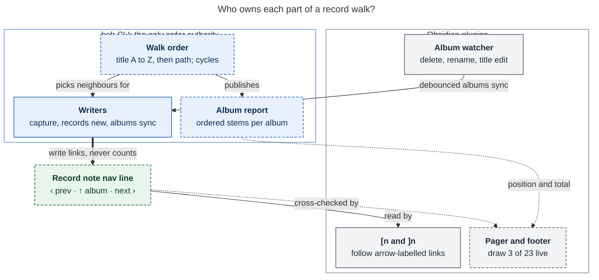

# Record walks: `‹ prev · next ›` links and `N of M` for album records

*Researcher: cld · 2026-11-18 · repos read: bob-cli (this checkout), bob-plugins
(linked), the live Bob vault (read-only census)*

## TL;DR

The idea is good, and most of the groundwork already exists. Today's `[n` / `]n`
already follow any body link whose label starts with `‹` or ends with `›`. So a
bob-written line such as

```markdown
[[tv/attack_on_titan|‹ Attack on Titan]] · [[tv|↑ TV]] · [[tv/foundation|Foundation ›]]
```

makes `[n`, `]n`, `[[`, `]]`, and the walker footer's `n` compass work on every
record **with no plugin change**.

I would change one requirement. **Store the links, but render `N of M` live; do not
write it into the note.** A stored counter forces bob to rewrite every record in the
album whenever one record is added or removed. `eat` has 104 records, so that is
about 104 file rewrites per new restaurant, and each rewrite is a chance for a
multi-host sync conflict. Links alone touch at most 3 notes per create. The count
belongs in the plugin, using the rule the period notes already follow: "No number is
ever written into Markdown" (`docs/periods.md`, Note anatomy and ownership).

The recommended design is a hybrid:

- **bob** is the only authority on walk order. It writes and repairs one nav line per
  record, inside the existing record-write transaction and inside `bob albums sync`.
- **bob-ledger-tools** draws a pager on the record sheet showing `‹ 3 of 23 ›`. It
  also adds a `3/23` meter to the `n` walker footer, using an additive ordered `walk`
  in bob's album report.
- **bob-navigation-hotkeys** gets one small safety fix: `]n` must never create a ghost
  note inside an album folder.

---

## 1. What exists today (facts this design builds on)

### `[n` / `]n` contract (bob-plugins)

- `openLabeledBodyLink` scans the **body only**: it skips frontmatter and code fences
  and opens the **first** matching link
  (`bob-plugins:plugins/bob-navigation-hotkeys/src/670-plugin-project-files.js:151`,
  `findFirstRenderedLink` at `:794`).
- The label rule is in `renderedLinkMatchesNavLabel`
  (`bob-plugins:plugins/bob-navigation-hotkeys/src/680-plugin-link-parse.js:5`):
  - the exact word `prev` / `next` matches;
  - otherwise **prev** must *start* with `‹` or `<`;
  - **next** may *start or end* with `›` or `>`.

  The trap: a prev label that *ends* in `>` or `›` also matches `]n`. Because the prev
  link comes first on the line, `]n` would then go backwards. Bob has to sanitize
  labels to prevent this (§5.2).
- If the link target does not exist, `]n` **creates the note**
  (`openOrCreateLinkCandidate` → `createNoteFromLinkCandidate`,
  `bob-plugins:.../640-plugin-notes-and-task-move.js:314,380`). Period notes are
  routed through `bob periods ensure`; everything else gets a template. So a dangling
  walk link left behind after a record is deleted would make `]n` create an empty
  ghost note in the album folder.
- The bracket-repeat family `n` already exists. `]]` / `[[` repeat `]n` / `[n`, and
  `]}` / `[{` say "No uppercase link walk"
  (`docs/reference/plugins/bob-navigation-hotkeys.md`, Bracket repeat).
- The `n` **walker footer** previews both arms via `walkMode.links()` v2. It strips
  the arrows from labels to show `‹ Name · Name ›`, and its `meterText` slot is empty
  for links today (`bob-plugins:plugins/bob-ledger-tools/src/124-links-walker-footer.js`).
  That slot is the natural home for `3/23`.
- Lane walks already use the `N of M` wording, plus `rank/total` in compact places
  (`bob-plugins:.../543-lane-walk-notice.js:24`, `542-lane-walk-model.js:678`).

### Record notes and albums (bob-cli)

- Record notes have **no H1**. The frontmatter `title` is the only title, and the
  record sheet renders it (`docs/records.md`, "The note Bob writes", commit
  `2f80442b`).
- **Vault census** (6 albums, 192 records: eat 104, subscriptions 28, tv 23,
  podcasts 15, movies 12, sase_blog_zettel 10). Each record's first non-blank body
  line is:

  | First body line | Records |
  | --- | ---: |
  | `## Notes` | 81 |
  | `## Source` | 63 |
  | prose | 1 |
  | empty body | 47 |
  | H1 | 0 |

  So a nav line placed first in the body never competes with an H1.
- The index orders records by `title_order`: lowercased title, then path
  (`src/native/albums/grouping.rs:404`). Inside a status group, the records index is
  therefore already in "alphabetical" walk order.
- Record writers (capture and `records new|update`) rebuild the album's
  `[!records]` index **in the same guarded transaction**. They overlay staged
  postimages onto the cached folder slice and guard every preimage
  (`src/native/capture/record_note.rs:416` `stage_album_index`,
  `src/native/albums/write.rs`). A walk planner fits right next to it.
- The record fingerprint covers frontmatter only; "Body bytes … do not affect it"
  (`docs/records.md`, Reading one record). A body nav line therefore never makes the
  Record Card's `expect` stale. A frontmatter `prev:`/`next:` design would.
- The plugin's album data service **already schedules a debounced `bob albums sync`**
  in two cases (`bob-plugins:.../241m-plugin-album-data-service.js:363`,
  `241l-plugin-album-data.js:412`):
  - when a record member is created, deleted, or renamed;
  - on any frontmatter change to a member, including `title`.

  So if `albums sync` also repairs walk lines, desktop edits made in Obsidian heal
  within about 3 s with no new trigger code. `bob nightly` runs albums sync too.
- The record sheet mounts at the first body line when there is no H1
  (`bob-plugins:.../242k-plugin-record-sheet.js:716` `recordSheetAnchor`). A nav line
  placed there sits directly under the sheet.

### Vault reality checks

- Records are created in bursts (34 on 2026-11-09, 28 on 2026-11-15) and otherwise
  at about 1–7 per day (86 creations since 2026-09-01).
- Several hosts write the vault, and conflicts do happen.
  `_conflicts/sync_conflicts.md` records both-modified and clobber events on hub
  notes: `sase.md`, `bob.md`, and `eat.md` on 2026-11-12. The more files a single
  gesture rewrites, the more chances a concurrent edit has to collide.

---

## 2. Is this a good idea?

**Yes.** Albums currently work like a filing cabinet: open the album, scan the index,
click one record. A walk turns each album into something you can flip through.
Triaging "to watch", reviewing restaurants, or rereading zettels becomes `]n ]] ]] ]]`
with a constant sense of where you are. It reuses a navigation grammar you already
know from daily and period notes, so it costs almost nothing to learn. It also fits
the bracket-repeat model: `]n` once, then `]]` all the way around.

The literal plan does have weak spots:

1. **A stored `N of M` is the wrong trade.** Every insert or delete shifts N for
   everything after it and changes M for everyone, which means O(M) rewrites per
   membership change. For `eat` that is about 104 files per new restaurant, and about
   3.5k file writes for 34 separate captures. Each rewrite of a note that is open on
   another host is a possible conflict copy in `_conflicts/`. It also fills `git log`
   for every record with "counter changed" noise.
2. **Staleness is dangerous, not just untidy.** If a record is deleted in Obsidian,
   its neighbours' links dangle, and `]n` (as written today) would create an empty
   ghost record. Reliability needs both fast repair *and* a guard in `]n`.
3. **"Alphabetical" needs a precise definition.** `&grain` sorts first, 15 `eat`
   titles cluster under "The …", and numbers sort by code point. The walk must use
   exactly the index's order so that the album page and the walk never disagree
   (§5.1).
4. **The edge cases need rules.**
   - A one-record album cannot sensibly "cycle", because both links would point to
     itself.
   - A two-record album *does* cycle, with both arms pointing to the other record;
     your example is right.
5. **Link-graph side effect.** Each record gains 2 backlinks from its neighbours, and
   the graph view shows each album as a ring. This is a mild cost. There is no clean
   way to exclude specific links in Obsidian, so accept it.
6. **Interaction with existing writers.** `bob records tidy` finds a redundant H1 by
   checking the first non-blank body line. The update planner inserts `## Notes` "at
   the top of the body". The new-note renderer ends right after `---` when the body is
   empty. All three must learn to step past the nav line.

## 3. Requirement adjustments (called out explicitly)

| # | Your requirement | My adjustment | Why |
| --- | --- | --- | --- |
| **A1** | Render `N of M` near the links | **Render it live in the plugin, never store it in Markdown.** bob publishes the order; the record sheet pager, the `n` footer meter, and `bob records show` display it. | Avoids O(M) churn and conflicts. Matches "No number is ever written into Markdown" for period notes. A live count is always correct. |
| **A2** | Walk cycles | Cycle for M ≥ 2, as you asked. For **M = 1**, write no prev/next arms, only `[[album\|↑ Album]]`; `]n` says `Only record in 📺 TV`. | Links from a note to itself are noise and look broken. |
| **A3** | Alphabetical | **The records index's title order over the whole album**: case-insensitive title, ties broken by path. Status groups are ignored. | Stable under status edits, which are the most common record edit. Matches the index's in-group order. Status-grouped order would rewrite neighbours on every status change. |
| **A4** | `<` and `>` links | Use the period-note glyphs `‹` / `›` with **neighbour titles** as labels, plus an **up link `↑ Album`** between them. | Same shape as `‹ W44 · ↑ 2026-Q4 · W46 ›`. Previews where you are going. Gives a body route to the album and somewhere for the counter to sit. |
| **A5** | (implicit) | The nav line is the **first body line**, its content belongs to bob, and bob inserts it only when it is missing. | `]n` takes the first matching link, so first position guarantees the walk wins over arrow-like links inside Notes. |
| **A6** | (new) | `]n` / `[n` **never create a note inside an album folder**. A dangling walk link starts a sync and shows a notice instead. | Prevents ghost records. |

## 4. Options considered

| Option | What it is | Verdict |
| --- | --- | --- |
| **L — literal** | Markdown links plus a stored `3 of 23` in each note | ✗ O(M) churn per create or delete; conflict-prone; noisy history |
| **V — virtual** | Nothing written. The plugin computes the walk, `]n` special-cases records, and the sheet draws the pager | ✗ as the primary design: no tap navigation on mobile, invisible outside Obsidian desktop, and a new special case in `]n`. Its counter idea is kept in H. |
| **F — frontmatter** | `prev: "[[…]]"`, `next: "[[…]]"` properties | ✗ `]n` ignores frontmatter. Neighbour edits change the record fingerprint, so the Record Card would hit `stale_record` mid-edit. Clutters Properties. |
| **G — group order** | The walk follows the index's status groups | ✗ Every status change reorders the walk and rewrites up to 5 notes. Triage walks jump around. |
| **H — hybrid** ✅ | bob writes links only; the plugin draws `N of M` live from bob's album report; bob is the single order authority | Recommended |

---

## 5. Recommended design



*Figure: bob computes the order and writes only links. `[n` / `]n` read those links
as they already do. The plugin draws `N of M` live from bob's report, so no count is
ever stored in a note. Dashed boxes are new; solid boxes already exist (the writers
and the album watcher gain walk duties).*
*(Rendered with mermaid-cli 12.0.0 using the PDF config: 868 × 868 px, fit 75.2%.)*

### 5.1 Order

- **Members:** the same structural set the `[!records]` index lists, i.e. the
  immediate Markdown children of `<album>/` that the index counts. **M equals the
  index tally**, which is an invariant worth testing.
- **Key:** reuse `title_order` (`grouping.rs:404`): lowercased title, then path.
  Titles fall back to the humanized stem exactly as `GroupingRecord::from_indexed`
  does. Factor this into one shared `record_walk_order()` so the index and the walk
  can never drift apart.
- **Cycle:** `next(last) = first` and `prev(first) = last`.
- **Purity:** the order is a pure function of member titles and paths. There is no
  clock and no host input, so every host computes identical bytes, as with the
  period-note scaffolds.
- *Deliberately not in v1:* article-insensitive ("The Boys" under B) or natural-number
  collation. If you want either, change the shared key once so the index and the walk
  move together. That is a one-time reorder of every album, so it deserves its own
  decision.

### 5.2 The nav line (Markdown grammar)

Example, `tv/designated_survivor.md`, which is 3 of 23:

```markdown
---
parent: "[[tv]]"
type: "[[record]]"
title: "Designated Survivor"
status: to_watch
created: 2026-11-09T12:00:00-0500
---

[[tv/attack_on_titan|‹ Attack on Titan]] · [[tv|↑ TV]] · [[tv/foundation|Foundation ›]]

## Notes

- …
```

| Members | Line bob writes |
| --- | --- |
| M ≥ 3 | `[[<a>/<prev>\|‹ <Prev title>]] · [[<a>\|↑ <Album title>]] · [[<a>/<next>\|<Next title> ›]]` |
| M = 2 | Same shape. Both arms target the other record, e.g. `[[movies/f1\|‹ F1]] · [[movies\|↑ Movies]] · [[movies/f1\|F1 ›]]` |
| M = 1 | `[[<a>\|↑ <Album title>]]` (adjustment A2) |
| M = 0 | Nothing to write |

**Label rules.** These are deterministic, and they protect the `]n` matcher.

- Start from the display title used in the index row. Drop the alias-unsafe
  characters `|[]#^` and escape active Markdown with the same helpers
  (`ALIAS_DROP`, `inert_text` in `index.rs`).
- **prev label** = `‹ ` + title with any trailing `›`/`>` (and whitespace) removed.
  Otherwise `]n` would match the prev link first (§1).
- **next label** = title with any leading `‹`/`<` removed + ` ›`.
- **up label** = `↑ ` + album title with leading `‹<›>` and trailing `›>` removed. The
  album title is the one owner catalogs already use for `[[stem|Title]]`.
- If sanitizing leaves a label empty, fall back to the humanized stem.
- Use full titles, not truncated ones. Markdown keeps the exact text (searchable and
  stable), and the pager truncates visually with CSS ellipsis.

### 5.3 Placement, ownership, states

- **Placement:** the first body line, after the frontmatter, the usual blank line,
  and with one blank line before any following content. An otherwise empty body ends
  with the nav line plus a newline.
- **Ownership:** bob owns the line's content. bob recognizes its line by grammar: a
  line made only of 1 or 3 wikilinks, separated by ` · `, that target `<album>` and
  `<album>/*` with the arrow labels above. As with `## Albums` catalogs ("content is
  bob's, position is Bryan's"), a recognized line that you moved further down is
  rewritten **where it is**. bob inserts a line at the top only when none exists.
- **Per-record states**, using the same names the index uses:

  | State | Meaning | What bob does |
  | --- | --- | --- |
  | `current` | Line matches the expected links | Nothing |
  | `missing` | No nav line | Insert one |
  | `stale` | Recognized line, wrong targets or labels | Rewrite it |
  | `damaged` | A nav-like line with extra text, two nav lines, or unparseable frontmatter | Report and leave the bytes alone |

  The fix for `damaged` is to delete the line; the next sync re-adds it.
- **Findings:**
  - `record_walk_stale` (warning): covers missing and stale; hint `bob albums sync`.
  - `record_walk_damaged` (warning, not an error): your note, so bob never blocks on
    it.
  - Per album, `bob albums list/check` report `walk: {state, current, missing, stale,
    damaged}`. The album's state is the worst state among its records.

### 5.4 Who writes, and when

| Path | Walk behavior |
| --- | --- |
| **Capture / `bob records new`** | Plan the walk from the same overlay used for the index (folder slice plus staged postimages). Stage the **new record with its line** and **only the neighbours whose line changes**: normally 2, and 1 when going from M = 1 to M = 2. Guard each neighbour's preimage. Everything lands in the existing single commit. A bulk capture of K records plans once from the final overlay and writes each file once. A damaged neighbour is skipped with a warning; the record is still written. An incomplete folder already refuses through the index path. |
| **`bob records update`** | No walk edits, because membership and titles cannot change through it. Its `## Notes` insertion now goes *after* the nav line. |
| **`bob albums sync`** (also nightly, also the plugin's 3 s debounce) | Repair every `missing` or `stale` line in the same scoped `albums: sync (N notes)` commit. `-d` previews the diffs. This repairs deletes, renames, YAML title edits, cross-host races, and hand edits. |
| **`bob albums create`** | Empty album, so nothing to write. |
| **`bob records tidy`** | When looking for a "redundant H1", skip the nav line; when testing whether a body is empty, ignore it. Never remove it. |
| **New-note renderer** | Writes the nav line as part of the planned Markdown, so dry runs show the exact bytes. |
| **One-time backfill** | `bob albums sync -d`, then a real run: about 192 notes in one commit. |

**Churn comparison**, in notes rewritten per event:

| Event | Links only (recommended) | Links + stored `N of M` |
| --- | ---: | ---: |
| Create a record | 3 | M (eat: 105) |
| Delete a record in Obsidian | 2 | M − 1 |
| YAML title edit, same order | 2 (labels) | 2 |
| YAML title edit that reorders | ≤ 5 | up to M |
| Status or field edit | 0 | 0 |
| Album title rename | M (`↑` labels; rare) | M |

### 5.5 Reports and protocols (all additive, `schema_version` unchanged)

- **`bob albums list|check -f json`**: per album, add `walk: {state, order: [stem…],
  counts}`, plus the capability `record_walk_v1` in `capabilities[]`. The plugin
  gates its rendering on that capability.
- **`bob records show TYPE STEM`**:
  - JSON gains `record.walk: {position, total, prev, next, state}`.
  - The human card adds one line: `3 of 23 · ‹ Attack on Titan · Foundation ›`.
- **Capture and `records new` dry-run / JSON**: add `walk_files[]` (`path`, `before`,
  `after`), alongside `album_files` and `album_index`.

  The capture protocol may only grow additively, and this change does. Bob Mac Capture
  stays a thin client: it can ignore the field or show "also relinks 2 neighbours".
- No new CLI commands or flags. The existing nouns `albums sync/check` and
  `records show/tidy` own the behavior, which keeps `cli_rules.md` satisfied.

### 5.6 Rendering: making it beautiful

**Docked pager on the record sheet** (desktop, Reading view and Live Preview). The
sheet already mounts exactly where the nav line sits. bob-ledger-tools recognizes the
line and **docks it as the sheet's top band**, then suppresses the raw line's own
rendering. In Live Preview the raw Markdown comes back when the cursor enters the
line, the same idiom LP uses for links.

```text
┌───────────────────────────────────────────────────────────────────────┐
│ ‹ Attack on Titan              📺 TV · 3 of 23              Foundation › │
│ ━━━━━━━━●━━━━━━━━━━━━━━━━━━━━━━━━━━━━━━━━━━━━━━━━━━━━━━━━━━━━━━━━━━━━ │
│ Designated Survivor                                                    │
│ 📺 TV › Show                                                           │
│ Status   🔖 To watch                                                   │
└───────────────────────────────────────────────────────────────────────┘
```

- **Three slots:**
  - the prev title, left-aligned and muted, with a hover preview;
  - the centre: album emoji, album title (the up link), and `3 of 23` in tabular
    numerals;
  - the next title, right-aligned.
- **Position rail:** a hairline track in the album owner's root-area hue (the accent
  the album cards already use), with a thumb at N/M. It reads as "a third of the way
  through" without counting.
- **Narrow panes** (< ~480 px) collapse to a compact cluster on the breadcrumb row:
  `‹ 3 of 23 ›`. Neighbour titles move into tooltips.
- **Wrap cue:** on 1 of M the prev arm shows `↺`, and on M of M the next arm does.
  Tooltip: `Wraps to Abbott Elementary (1 of 23)`. Cycling never disorients you,
  because you see the wrap before you take it.
- **Collapsed sheet:** the band stays visible, because collapse hides facts, not
  navigation.
- **Clicks** route through the same `[n` / `]n` commands, so jump history, `<C-o>`,
  and the repeat family all behave the same as the keys.

**Walker footer (`n` family) on a record:** `contextText = "📺 TV"` and
`meterText = "3/23"`. The arms keep today's `‹ Attack on Titan · Foundation ›`.

**Fallbacks** (the "never guess" rule the album cards already follow):

- No sheet (mobile, missing report, non-canonical record): the raw line is still a
  tappable pager. The plugin may append a quiet `3 of 23` mark after `↑ TV` from the
  last-good report. Without a report it shows nothing.
- **Cross-check before showing a number.** The counter appears only when the report's
  neighbours for this stem match the targets in the nav line. If they differ, it shows
  a muted `⟳` ("Walk syncing") instead of a number, and the 3 s sync debounce is
  already on its way. A wrong number is never shown.
- **Ghost guard (adjustment A6):** if `]n`'s target would be created inside an album
  folder, refuse. Show `Record walk is catching up — syncing albums`, and ask the
  ledger to sync.

**No new toast.** `]n` lands silently today. The pager at the top of the note and the
footer meter already say where you are.

### 5.7 Failure modes

| Failure | Effect | Handling |
| --- | --- | --- |
| Record deleted or renamed in Obsidian (desktop) | Neighbours briefly dangle | The existing watcher runs `albums sync` within about 3 s. Obsidian's own link updating already fixes rename targets. The ghost guard covers the gap. |
| Record deleted on mobile or with no plugin | Dangles until the next sync | The plugin on next desktop open, or nightly `albums sync`. The ghost guard still applies. |
| Two hosts create adjacent records before syncing | Both rewrite one neighbour's line, so vault-sync records a conflict | Remote is kept and the local copy goes to `_conflicts/`. The next sync regenerates the line. *Optional later:* teach vault-sync that a conflict confined to a nav line can be regenerated. |
| Hand-edited nav line | `damaged` | Reported, never rewritten. Delete the line and sync. |
| Unreadable folder member | Order unknown | No walk edits. The index path already refuses. |
| Stale plugin report | Wrong N | The cross-check shows `⟳` instead of a number. |
| Record moved out of its album | Keeps an orphan nav line | `records check` already flags `record_outside_album`. bob does not remove the line from non-members. |
| Open editor on a rewritten neighbour | Background reload | Disk reloads stay out of undo history (nav-hotkeys "Undo history and disk reloads"). Only 2 neighbours are touched, not M. |

---

## 6. Rollout

1. **bob-cli, shippable alone.**
   - Work:
     - a pure `albums/walk.rs` module: order, grammar, sanitizer, plan;
     - integration with `albums sync|check|list` and `walk` JSON;
     - capture and `records new` staging plus `walk_files`;
     - fixes in tidy, Notes insertion, and the renderer;
     - `records show` walk output;
     - docs: a "Record walk" section in `docs/records.md`, json-outputs, CLI help;
     - a **decision record**, e.g. `record-walks-store-links-not-counts`;
     - backfill.
   - Outcome: `[n`/`]n`/`[[`/`]]` and the footer compass work immediately with
     today's plugins.
2. **bob-plugins.**
   - Work: docked pager, wrap cue, footer meter, mobile mark, cross-check, ghost
     guard.
   - Gate on `record_walk_v1`, then run `bob plugins sync`.
3. **Later, optional.**
   - `N]n` counted record jumps.
   - Wire `]}`/`[{` on records to "first record of the next status group".
   - A collation upgrade.
   - A regenerable-conflict class in vault-sync.

**Tests worth pinning:**

- Cycle invariants for random member sets: `next^M(x) = x`, `next(prev(x)) = x`,
  positions form a permutation, M equals the index tally.
- Golden lines for M = 1, 2, 3.
- Titles that end in `>` or `›`; sanitized-empty titles.
- Bulk capture of two *adjacent* new records in one batch.
- A preimage race on a neighbour refuses everything.
- BOM and CRLF preserved.
- Second sync is a no-op.
- Tidy and Notes insertion with a nav line present.
- Plugin: `]n` on the line, counter cross-check, ghost-guard refusal.

## 7. Open questions for Bryan

1. **Up link:** keep `↑ TV` (recommended) or use only the two arrows?
2. **Labels:** neighbour titles (recommended) or plain `‹ prev` / `next ›`? Titles
   cost 2 label rewrites per title edit.
3. **Wording:** `3 of 23` in the pager and `3/23` in the footer (matches lane walks),
   or one form everywhere?
4. **Collation:** keep today's index order (recommended for v1) or adopt
   article-insensitive and natural ordering for both index and walk later?

## 8. Recommended solution

Build the **hybrid**:

- **bob, the order authority.** It writes one nav line as each record's first body
  line, in the form `[[a/prev|‹ Prev]] · [[a|↑ Album]] · [[a/next|Next ›]]`.
  - Order is the records index's title order (case-insensitive title, then path) over
    the whole album, cycling.
  - A one-record album gets only `↑ Album`.
  - The line is maintained by capture and `records new` in the same guarded
    transaction (new record plus at most 2 neighbours), and repaired by
    `bob albums sync`. Sync is already run by nightly and by the plugin's 3 s watcher.
  - bob publishes the ordered walk additively in the album report and in
    `records show`.
- **Never store `N of M` in Markdown** (requirement change). bob-ledger-tools docks
  the line as a three-slot pager on the record sheet: neighbour titles, `📺 TV ·
  3 of 23`, a hue rail, and wrap cues. It also fills the `n` footer meter with
  `3/23`. It shows a number only when the report agrees with the links.
- **Harden `]n`** so it never creates a ghost note inside an album folder.

Phase 1 alone delivers working `[n`/`]n` on every record with no plugin release,
because the labels already match today's matcher. Phase 2 adds the counter and the
polish.
