# Record Notes as a capture unlock: preservation first, new types last

**Author:** researcher grk (5-researcher swarm)  
**Date:** 2026-11-08  
**bob-cli SHA:** `971214d8`  
**Epic:** `bob-cli-ir` (Record Notes — capture and manage custom-typed notes)  
**Binding plan:** `plan:202611/record_notes.md`  
**Prior design research:** `research:202611/record_type_capture/record_type_capture.md`  
**Vault evidence:** live `bob query` on 2026-11-08; clone `gh:bobs-org/bob`

---

## Bottom line

The feeling is half-true, and it is true in a more useful way than "I will start tracking new domains."

Record Notes is a large unlock for **keeping data that currently dies when a task closes**, and for **letting agents query the collections you already keep**. It is a moderate unlock for **filling fields you already named but skip**, and only if the Record Card sits in the capture path. It is a weak unlock for **inventing wholly new types** of life data. The vault already named the types that matter: restaurants, podcasts, TV shows, and movies. The missing piece is a write path that preserves a verdict, a date, and a recommendation when the action is done.

That is a real change in what you can *do* with the data. It is a smaller change in what you will *notice* to capture. The schema asks questions. It does not invent appetites.

A practical test of the feeling, in one sentence: if the next four Saturday movie nights still leave the film title on a closed MEET, the unlock is not capture friction. It is a habit you have not chosen yet.

---

## What Record Notes is, in this context

The epic `bob-cli-ir` is in progress. Phase 1 (no-replace install of new files) has already landed on this tree. The rest of the engine, capture grammar, Mac Record Card, `bob records`, and the four seed types are the remaining phases.

A **record type** is a `config.yml` `records:` entry such as `restaurant`. It owns one folder (`eat/`). Capture creates a note with `<title> @<dir>/`; `@<dir>/<stem>` updates it. `key:: value` bullets become frontmatter; other bullets become dated `## Notes`. `bob records` is the agent and CLI surface. The Mac panel shows a Record Card and a whole-note preview. Writes are planned in full, never replace a file, and refuse duplicates.

The four seed types, already decided:

| Type | Folder | Job |
| --- | --- | --- |
| `restaurant` | `eat/` | 92 notes already exist; add `to_try`; revisits append dated notes |
| `podcast` | `podcasts/` | 15 notes already exist; subscription status |
| `show` | `tv/` | recommendation + verdict; download/watch stays a task |
| `movie` | `movies/` | same split; a finite watch with a year and a date |

`seed_records = yes`: open watch-list titles become `to_watch` records. The task lines stay. That decision is already the preservation unlock in miniature.

This report does not re-litigate that design. It asks a different question: once that engine exists, does it cause you to capture useful data you would never have considered, and what would you do with it?

---

## Four unlocks, ranked

The feeling mixes four claims. They are not equally true.

| Rank | Unlock | Strength | What it actually buys |
| --- | --- | --- | --- |
| 1 | **Preservation** | Strong, checkable today | A verdict, a recommendation, and a date survive the close of "Watch X" / "Try Y" |
| 2 | **Agent-readable taste** | Strong once writes happen | `bob records` and Bases can answer "liked sushi in Cranford" from notes you already have |
| 3 | **Schema as prompt** | Conditional | Empty fields ask you for `visited`, `verdict`, `recommended_by` at capture time. A schema on disk does not fill itself |
| 4 | **New-type induced demand** | Weak | Adding a type later is config plus `bob records init`. The vault does not currently hide a fifth collection waiting to be born |

The first two are the huge unlock. The third is the part that *feels* like "data I never considered." The fourth is the part the feeling overweights.



*Figure 1. Most of the feeling is preservation and schema-as-prompt on types you already have; a new type is the last branch.*  
(Rendered at 833.544 × 808 px; fit 78.3%; Mermaid CLI 12.0.0.)

Read an observation down the figure. "Eric recommended Landman at Christmas" is already a task, so it buys **preservation**: keep the title and the recommender when the download task closes. "We went back to Ninja Sushi" is a field on an existing type, so it buys **schema as prompt**: set `visited` and append a dated note. "I want a gift log" fails the repeat-with-own-fields test, so it stays a task. "I want a movie type" passes, and the epic already scheduled it.

---

## What the vault already knows

Everything in this section was re-checked on 2026-11-08 with `bob query` against the live vault and by reading the named notes in the authorized clone.

### Two collections already behave like records

| | `eat/` restaurants | `podcasts/` |
| --- | --- | --- |
| Notes | 92 | 15 |
| Status | `liked` 85, `not_liked` 7 | `subscribed` 9, `unsubscribed` 6 |
| `visited` set | **2** | n/a |
| `companions` | `[[kelly]]` on 90; empty on the same 2 | n/a |
| `category` null | 6 | — |
| Distinct categories | 36 strings | — |
| Top locations | cranford 25, Westfield 15 + westfield 5 = 20, Clark 7, NYC 5 | — |

The two notes with `visited` are the only post-migration restaurants, both written by agents:

- `eat/rush_bowl.md` — `status: not_liked`, `visited: 2026-06-04`, `companions: []`. Dated note: "Got an acai bowl and a chai espresso coffee. Both were terrible, and the restaurant itself stank."
- `eat/brown_fox_coffee_box.md` — `status: liked`, `visited: 2025-07-07`, `companions: []`. Dated notes carry spending ($29.09, $36.58) from a Myrtle Beach week.

That pair is the shape new records should follow. It is also the proof that **a schema on disk does not induce capture**. Ninety restaurants already have `status`, `category`, `location`, and `companions`. Ninety of them have no visit date. Ninja Sushi has two prose notes ("Kelly said this was her favorite sushi place"; "I liked the california rolls") and still no `visited` field. The missing data is not a missing type. It is a missing prompt at the moment of writing.

### Watch history currently lives on tasks that complete

Open watch and download actions, today:

- `now_fun.md`: `TV SHOW: Lioness / Landman / Designated Survivor` with `INSPIRED BY: %eric recommended on xmas!`; `%nona` on Happy's Place, Lost, Manifest; `The Brutalist` inspired by the `twit` podcast; a `#plex` bundle of Lower Decks, Jury Duty, Upload, Reservation Dogs.
- `love.md`: Watch *Messenger*, *F1*, and *Thunderbolts* with Kelly; Download Equilibrium, Romantic Comedy, *"9"*, Sucker Punch.
- `prj_plex.md`: Abbott Elementary, Foundation, Invincible as active TV shows.
- `tv.md`: one bullet, "The Studio (w/ Seth Rogan)".

When those rows complete they go to `done/`. The title, the recommender, and the verdict go with them. The epic's own rule is the right split: **the record holds the recommendation and the verdict; the download or watch stays a task that links to it.**

### Three smoking guns for the feeling

**1. Burger Bistro is already waiting for Record Notes.**  
`love.md`, created today:

```text
Add [[eat]] record note for Burger Bistro!
[dependsOn:: bob__custom-note-types]
```

You are not wondering whether restaurants are a type. You have a restaurant in hand and a blocked task because the writer does not exist yet. That is induced demand on a type you already have.

**2. Movie night is a ritual with almost no title log.**  
`recur_meet.md` has Saturday 19:30 "Movie night with %kelly" (`meet_movie_night`). The 2026-11-03 daily note has a closed MEET **Disney Movie Night!** whose only title is a child bullet, `Monsters Inc!`. The next day is a second MEET, **Finish watching "Monster's Inc"!**. The film exists as calendar residue on two day notes. There is no movie record, no verdict, no `watched_on` that an agent can list. Letterboxd would call this *watched* without *logged*: the year-in-review does not count it.

**3. The wishlist and the collection have already drifted.**  
`maybe_eat.md` is a stale P5 list (`last_refreshed_on:: 1900-01-01`) of twelve places Kelly and you "want to try." It still holds **1950 Originals** in Cranford, with Kelly's note that they serve only hot dogs and hamburgers. `eat/1950s_originals.md` is already `liked`, category `Burgers + Dogs`, location **Westwood**. A list-in-one-note and a folder of records do not stay in sync without a writer. Seeding `to_try` (`seed_records = yes` for watch titles; the same move is optional for `maybe_eat`) is how that drift stops.

### Types the vault already rejected

The binding plan scanned for other collections and kept the prior research's kill list:

- **Books** belong to `ref/` (1,200+ notes). A `book` record type would split the library.
- **Podcast episodes** are references (`podcast_ref.md`, `lit/podcasts`).
- **People** are `%alias` rows in `people.md`, plus area notes such as `kelly.md`. That is an LDAP table, not a personal CRM.
- **Drinks** are two liquor-store rows in `drink.md`.
- **Recipe** and **gift** hits are tasks and chat refs, not folders of notes.

Those rejections still hold. They are the answer to "data I never considered capturing" when that sentence means "a fifth folder." The interesting unread data is on the types you already named.

---

## Why the feeling is half-true

### Preservation is the huge unlock

GTD's capture step is supposed to be cheap: get the thought out of your head, decide what it is later. Bob already does that for tasks. The cost shows up at the other end. Completing "Watch *F1* with Kelly" currently *is* the decision, and it throws the object away.

Letterboxd makes the same distinction in public. Marking a film **watched** is a check that you have seen it at some point. **Logging** it writes a diary date; year-in-review, hours-watched, and personal stats count only logs. A rating without a diary date is a vote in the community ranking and a blank in your year. Bryan's movie nights are currently the watched-without-logged case. Saturday 19:30 is the cadence. The missing object is the film.

Andy Matuschak's taxonomy puts this kind of note *outside* the evergreen ladder. Record Notes are **proper-noun notes**: one note per restaurant, film, show, podcast, weakly evergreen, useful as a linkage target and as a **log** sliced by thing rather than by day. They will not compound into insight the way a concept-oriented evergreen note does. They will accrete observations ("stank"; "$29.09"; "Kelly's favorite sushi"). That is the right grain. The daily note already holds the day-sliced log; the record holds the thing-sliced log. Disney Movie Night on 2026-11-03 is the day slice. `movies/monsters_inc.md` would be the thing slice.

### Schema as prompt is real, and it is not free

A blank field is a question. HCI form research is blunt about the cost: Nielsen's default for any potential field is "does not exist"; every extra field is friction and a failure point. Structured fields beat a blank box when you will *compare* answers later (status, category, location, verdict). Open text wins for the sentence you have not categorized yet (the dated note). Record Notes already pick that hybrid: closed `status` / `verdict`, open `category` with suggestions, dated notes for the rest.

The vault shows the other side. `visited` has been a field on restaurant notes long enough for 90 of 92 to leave it empty. Companions default to Kelly in the forthcoming schema because that is what 90 notes already store; the two agent notes stored `[]` and drifted. A schema that is only a YAML block in the file does not prompt. A Record Card in the capture path, with Tab walking missing required fields and "More (…)" for optional ones, *does*. That is the "data I never considered" mechanism: you would not have opened `eat/ninja_sushi.md` to type a date, and you will type `visited:: today` if the card asks.

The risk is junk. Arxiv 2311.13517 documents **obsolete required fields**: users put `n/a` in a box they cannot skip, and the dataset rots. The epic's rule that `status` has no default, and that an empty optional bullet means "explicitly none," is the right counter. Keep `visited`, `verdict`, `recommended_by`, and `watched_on` optional. Required is for identity fields you always know at create time (restaurant `status` / `category` / `location`).

### Agent-readable taste is the payoff you can name today

Obsidian Bases is a view over note properties. `eat.base` already exists; it currently needs a 22-branch formula to tidy categories at read time. The data is in the Markdown. The view is a saved question. `bob records list` / `show` / `check` is the same question for agents and for Command Mode.

Queries that become cheap once the writes exist:

| Question | Source today | Source after records |
| --- | --- | --- |
| Liked sushi near Cranford? | Manual scan of 92 notes; 4 sushi, 25 cranford | `bob records list restaurant` filtered on `status=liked`, `category`, `location` |
| What did we think of Rush Bowl? | One agent-written note | `bob records show rush_bowl` |
| What has Eric recommended, and did we like it? | `INSPIRED BY: %eric` on open tasks | `recommended_by` on show/movie records, plus `verdict` after watch |
| What did we watch with Abby in November? | Child bullets on daily MEETs | `movie` records with `watched_on` and `companions` |
| Where should we eat on Saturday? | Memory, plus `eat.base` | liked + location + category, minus recent `visited` |

Those are uses. They do not require a fifth type. They require `visited` and `verdict` to start getting written, and they require the watch list to become records before the tasks close.

Personal CRM tools are the cautionary parallel. Dex's own comparison says the test is "will you actually keep the tool up to date?"; Monica stays accurate only as long as you keep typing; Goodword calls a manual contact database "a very organized graveyard." Record Notes avoid that graveyard if the write is a side-effect of a gesture you already make (capture a restaurant, close a watch, append a movie-night title). They become that graveyard if you add types whose only job is to be complete.

### New types are the last branch

Capacities' documented test for a new object type, in order:

1. Is it a distinct group of notes?
2. Does this group have distinct properties?
3. Can queries and/or property visibility help instead?

Yes, yes, and no → create the type. Their own people/friends/family/colleagues example usually stays **one** Person type with a category, because the properties overlap and life overlaps. Tana's check is the "is a" sentence: Marisha *is a* Person; Oslo *is a* City. A good supertag is a thing that comes up in notes and needs to be remembered, organized, or actioned.

Map that onto Bob:

| Candidate | Distinct group? | Distinct fields? | Query enough? | Verdict |
| --- | --- | --- | --- | --- |
| Restaurant | Yes (`eat/`) | status, category, location, companions, visited | No: 92 notes, 6-view Base | **Ship** (in epic) |
| Podcast | Yes | subscription, category, url | Folder already exists | **Ship** (in epic) |
| Show | Yes (seasons, watching) | status, service, recommended_by, verdict | Tasks evaporate | **Ship** (in epic) |
| Movie | Yes (finite, year) | year, watched_on, verdict | Tasks evaporate | **Ship** (in epic) |
| Book | Yes, already `ref/` | library fields | `ref/` is the type | **Keep in `ref/`** |
| Person | Yes, `%alias` | name, ldap | `people.md` is the table | **Keep as aliases** |
| Drink | Two rows | same as restaurant | Use a restaurant category | **No** |
| Gift | Occasional tasks | maybe recipient, occasion | A task plus a dated note on the person | **No, yet** |
| Recipe | Chat/SASE hits | ingredients? | Not a collection | **No, yet** |

The prior design research's rule still holds: add a type when individual things repeatedly need their own identity, a few stable fields, and a collection view that beats a list in one note. `maybe_eat.md` is the list that lost. `drink.md` is the list that is still enough.

The feeling that Record Notes will surface *new* domains is the Capacities failure mode of starting with a catch-all and splitting too early. Their docs say the opposite: start with fewer types, split when a subset wants properties the others do not. For Bob that means: ship the four, use them for a month, then run the three questions on whatever overflowed into tasks.

---

## What to actually do with the data

Concrete uses, in the order I would try them, each tied to a write you can do in capture.

### 1. A dinner picker you can ask an agent

You already have the columns: 85 liked restaurants, 25 in Cranford, 20 in Westfield, 4 sushi. The missing column is recency (`visited`). One month of appending `Went back @eat/ninja_sushi` with `visited:: today` turns "where should we eat" into a query instead of a rummage. The dated note is the taste memory ("stank"; "california rolls"); the fields are the filter.

### 2. A recommendation ledger

Eric's Christmas TV list, Nona's downloads, the TWIT pointer at *The Brutalist*, Kelly on Ninja Sushi, Frank Scarpel on N'Between Bar: those are already in the vault as `INSPIRED BY` drawers. They die with the task. On a show or movie record, `recommended_by` is a field you fill once. A year later the question is "what did Eric recommend that we actually liked?" That is a new question. It is not a new type.

### 3. A movie-night diary that matches the ritual you already have

Saturday 19:30 with Kelly is a recurring MEET. Disney nights with Abby already happened twice this week (*Monsters, Inc.*). The capture is one line after the credits:

```text
Monsters, Inc. @movies/
- status:: watched
- watched_on:: 2026-11-03
- companions:: [[abby]]
- verdict:: loved
```

Letterboxd's year-in-review only counts diary dates. Your analog is `bob records list movie` grouped by `watched_on` month. The MEET stays the calendar object. The record stays the film.

### 4. A year-in-review that is honest about gaps

Ninety restaurants with no `visited` means a 2026 restaurant year-in-review would currently be two rows (Rush Bowl, Brown Fox). That is useful. It tells you the capture habit is not installed. After a quarter of Record Card use, the same query is a real list: places, companions, the dated notes. Empty is a diagnostic. Full is a memory.

### 5. Agent context for `+love` and dinner plans

The Burger Bistro task is the template. An agent that can `bob records show` / `list` can stop asking you to paste YAML. It can also refuse to invent a visit you did not log. Taste becomes a file, not a vibe in a prompt.

### 6. A `to_try` queue that can age

`maybe_eat.md`'s twelve rows, and the open watch tasks, become `to_try` / `to_watch` records with `recommended_by` carried over. A Base grouped by status then does the job the stale P5 list cannot: you see the queue, you mark `liked` after the visit, you stop maintaining two sources.

---

## How to test the feeling without betting the vault

Do this for four weeks after capture-for-records ships. Do not add a fifth type during the test.

| Week | Write | Count at the end |
| --- | --- | --- |
| 1 | Capture Burger Bistro as the first new restaurant | Created? Fields complete? |
| 1–4 | Every restaurant visit: one-liner update `@eat/<stem>` with a dated note and `visited:: today` | How many visits vs how many updates |
| 1–4 | After each Saturday movie night (and any Disney night): create or update the movie record with `watched_on`, `companions`, `verdict` | 4 ritual nights → how many titles logged |
| 1 | Let `seed_records` create `to_watch` rows; leave the tasks in place | Seeded count vs skipped |
| 4 | Run `bob records check` | Drift vs clean |

Pass the feeling as "huge unlock" if movie-night titles and restaurant revisits actually get written, and if you ask an agent a dinner or watch question that it can answer from records. Fail it back to "reliability fix for two collections" if the Record Card exists and the dated notes still only appear when an agent writes them. That second outcome is still worth shipping — it is the original design-research case — and it is a smaller story than the feeling.

Kill-list during the test: gift, recipe, drink, person, book, trail, workout. If three instances of the same thing show up as tasks *and* they want fields a task cannot hold *and* you would open a Base of them weekly, then run Capacities' three questions and add config. Adding the type is cheap (`bob records init`). Filling it is not.

---

## Risks, in the shape this vault already shows

**Schema tax vs GTD capture.** David Allen's capture step is supposed to accept an item in a few seconds without asking category, date, or priority. Record capture *does* ask, because the draft is the form. That is acceptable when you already know "this is a restaurant." It is poison if every inbox thought has to pick a record type. Keep ordinary capture as the default. Record spelling is opt-in (`@eat/`). The near-miss guard on `@eat` without the slash is there so the opt-in cannot silently file a task into `eat.md`.

**Quantified-self abandonment.** Epstein, Ping, Fogarty, and Munson (CHI 2016) surveyed people after they stopped tracking. The leading reason is the cost of collecting and integrating: the habit is a hassle, people get behind, they cannot find the time to start back. Record Notes inherit that failure if `visited` and `verdict` become a daily chore. They avoid it if the write rides a gesture you already make (capture, close, movie night).

**Organized graveyard.** A personal CRM you stop updating is worse than no CRM, because it looks complete. `eat/` with 90 unvisited liked restaurants is already a mild version of this: the Base looks rich, recency is a lie. `bob records check` should stay a manual lint until the folder is clean, as the epic already decided. Do not put it in nightly until the empty `visited` fields are either filled or declared optional-and-absent.

**Junk required fields.** If a field is required and often unknown, you will type noise. Keep required fields to the ones you know at birth. Optional emptiness is a first-class state in the epic (`- key::` on an optional field writes nothing). Use it.

**Empty notes.** A `to_watch` movie with no recommender and no year is still better than a completed task with no residue. It is worse than a task if you never open it. Seed from real titles; do not pre-create a catalog of films you might someday see.

---

## What I would tell you, as a direct answer

You asked whether Record Notes might be a huge unlock for capturing useful data you would never have considered, and what you would do with that data.

- **Yes, for history that currently evaporates.** Watch verdicts, recommenders, movie-night titles, and restaurant revisits. You have already felt this: Burger Bistro is blocked on the feature, and *Monsters, Inc.* is a child bullet on a closed MEET.
- **Yes, for questions you cannot ask an agent today.** Dinner picker, Eric's recommendation batting average, a year of Saturday films. The collections are already there. The query surface is what the epic adds.
- **Only if the card is in the path, for fields you skip.** `visited` on 2 of 92 notes is the evidence. Schema without a prompt does not capture. The Record Card is the prompt.
- **No, for a blooming ontology of new life-tracking types.** The vault's own scan is the prior. Four types, then stop until a subset of leftover tasks wants its own fields and a view you would actually open.

The feeling is the right instinct pointed at the wrong layer. The unlock is not "I will discover new kinds of notes." It is "the kinds I already care about will finally keep the sentence I would have forgotten by February."

---

## Sources

**Bob, this vault, this epic**

- `sase bead read bob-cli-ir` — Record Notes epic; `seed_records = yes`; four seed types; glossary decision deferred
- `plan:202611/record_notes.md` — binding contract: schema, `@dir/` spelling, no-replace, `bob records`, show/movie after restaurants and podcasts
- `plan:202611/records_engine.md` — engine scope; frozen 92+15 fixture
- `research:202611/record_type_capture/record_type_capture.md` — prior design research; "when to add a type"; kill list for books, people, drinks, recipes, gifts
- Live `bob query` 2026-11-08: 92 restaurants (85 liked / 7 not_liked; `visited` on 2; `companions` Kelly on 90; 6 null categories; 36 category strings; cranford 25, Westfield/westfield 20, Clark 7); 15 podcasts (9 subscribed / 6 unsubscribed)
- Vault notes: `eat/rush_bowl.md`, `eat/brown_fox_coffee_box.md`, `eat/ninja_sushi.md`, `eat/1950s_originals.md`, `maybe_eat.md`, `love.md` (`love__eat-record-note`, watch/download tasks), `bob.md` (`^custom-note-types`), `now_fun.md`, `tv.md`, `prj_plex.md`, `drink.md`, `people.md`, `restaurant.md`, `podcast.md`, `recur_meet.md` (`meet_movie_night`), `2026/20261103.md` (Disney Movie Night / Monsters Inc!), `2026/20261104.md` (Finish watching Monster's Inc!)

**External**

- Capacities, *When to create a new object type* — three questions: distinct group, distinct properties, can queries/visibility suffice. Start with fewer types; split when a subset wants its own fields. <https://docs.capacities.io/tutorials/when-to-create-new-object-type>
- Capacities, *Define your own object types* — object types give structure; convert later; do not pre-define everything. <https://docs.capacities.io/tutorials/custom-content-types>
- Tana Outliner, *Supertags* — a supertag is an "is a" type; candidates are things that need to be remembered, organized, or actioned. <https://outliner.tana.inc/learn/features/supertags>
- Letterboxd, *2024 Year in Review FAQ* — only **logged** (diary-dated) films count toward the personal summary; watched/rated without a diary date do not. <https://letterboxd.com/journal/2024-year-in-review-faq/>
- Five Star Insider, *How to Log a Film on Letterboxd* — logging is a dated diary entry; marking watched is not the same. <https://fivestarinsider.com/letterboxd-how-to-log-a-film/>
- Andy Matuschak, *Taxonomy of note types* — proper-noun notes (literature, person, business) and log notes sit outside the evergreen ladder; they are weakly evergreen. <https://notes.andymatuschak.org/Taxonomy_of_note_types>
- Andy Matuschak, *Evergreen notes* — concept-oriented notes compound; proper nouns generally do not. <https://notes.andymatuschak.org/z5E5QawiXCMbtNtupvxeoEX>
- Epstein, Ping, Fogarty, Munson, *Beyond Abandonment to Next Steps* (CHI 2016) — leading reason people stop tracking is the cost of collecting and integrating. <https://pmc.ncbi.nlm.nih.gov/articles/PMC5428074/>
- Obsidian Help, *Introduction to Bases* — a base is a view over local Markdown properties; the notes stay the source of truth. Already in the library as `ref/docs/obsidian_bases.md` (dropped). <https://obsidian.md/help/bases>
- Dex, *Dex vs Monica* — the practical test is whether you will keep the tool up to date; Monica stays accurate only while you type. <https://getdex.com/blog/dex-vs-monica/>
- Goodword, *CRM for Individuals: What Most Tools Get Wrong* — most personal CRMs become "a very organized graveyard." <https://www.goodword.com/blog/why-personal-crms-exist-and-what-most-of-them-get-wrong>
- Jakob Nielsen, *Required Fields in Forms* — default of any potential field is "does not exist"; extra fields are friction. <https://jakobnielsenphd.substack.com/p/required-fields>
- GTD capture vs organize — capture should not demand category, date, and priority; filing is a later step. <https://sir.studio/capture/blog/getting-things-done-method>
- Stivala, Terragni, et al., *Learning-Based Relaxation of Completeness Requirements for Data Entry Forms* (arXiv:2311.13517) — obsolete required fields produce meaningless values (`n/a`) that rot the dataset.

---

Library check: 1 of 14 candidates already in your library (0 finished). Obsidian Bases help is in `ref/docs/obsidian_bases.md` (dropped 2026-06-08); I cited it as already-read context rather than a new recommendation.
