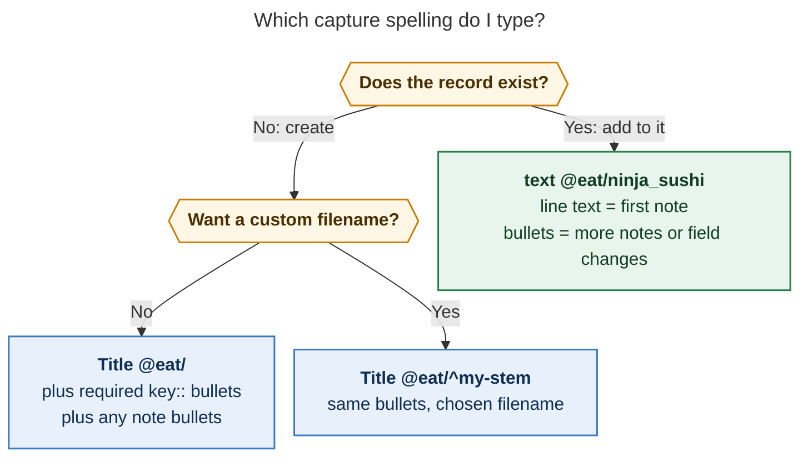
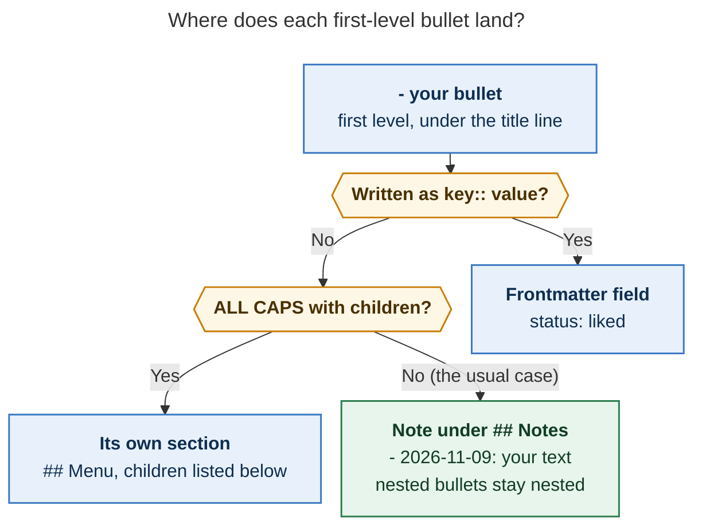

# Record notes with notes: how to capture them, and how to add to them later

_Snapshot of `bob` 0.5.0 (master `f231b9d3`), 2026-11-09. Epic `bob-cli-ir` is still
open. Everything on the bob side has shipped. On the Mac, the Record Card has shipped, but
the whole-note preview and the update card are still in progress (§4). Every example
below is real `bob` output from a throwaway copy of the vault. Only the `created:`
timestamps differ from what you'd get._

## TL;DR

- **Yes, a new record can have notes from the start.** Under `Title @eat/`, every
  first-level bullet that isn't a `key:: value` field becomes a note under `## Notes`.
  Restaurant notes get today's date. Nested bullets stay nested. An ALL-CAPS bullet with
  children becomes its own `## Section`.
- **To add notes to an existing record, use `@eat/<stem>`**, with no `^` and no title.
  Any text on that line becomes the first new note. Bullets below it add more notes or
  change fields. Nothing else in the file moves.
- **Notes don't replace required fields.** A new restaurant still needs `status`,
  `category`, and `location`. If any are missing, bob refuses and prints a draft you can
  copy and finish.

## 1. Which spelling to type



_Figure 1. The trailing `/` is the switch. `@eat/` creates a record, `@eat/<stem>` adds to
an existing one, and plain `@eat` still files a task into `eat.md`._

| You want to…                     | Type                                     |
| -------------------------------- | ---------------------------------------- |
| Create a restaurant (with notes) | `Ramen Nagi @eat/` + bullets             |
| Create with a hand-picked stem   | `Hard Fork @podcasts/^hardfork` + bullets |
| Jot one note on a record         | `Loved it again @eat/ninja_sushi`        |
| Add several notes / set a field  | `@eat/ninja_sushi` + bullets             |
| Same thing from a terminal       | `bob records new` / `bob records update` with `-n` |

## 2. Creating a record that already has notes

**You type** (on the Mac panel or with `bob capture`):

```text
Ramen Nagi @eat/
- status:: to_try
- category:: Ramen
- location:: Clark
- Kelly says the broth is the best in NJ
  - Go before 6; the line wraps the block
- MUST ORDER
  - Tonkotsu black
  - Spicy red king
```

**bob writes `eat/ramen_nagi.md`:**

```markdown
---
parent: "[[eat]]"
type: "[[restaurant]]"
title: "Ramen Nagi"
status: to_try
category: "Ramen"
location: "Clark"
companions:
  - "[[kelly]]"            ← default; you didn't type it
created: 2026-11-09T11:20:42-0500
---

# Ramen Nagi

## Notes

- 2026-11-09: Kelly says the broth is the best in NJ     ← note, auto-dated
  - Go before 6; the line wraps the block                ← nested bullet kept as is

## Must Order                                           ← ALL-CAPS bullet → section

- Tonkotsu black
- Spicy red king
```

_The `←` arrows are annotations and aren't part of the file. bob also writes fields in
schema order, whatever order you typed them in._

bob decides where each first-level bullet goes by its shape:



_Figure 2. Any first-level bullet that isn't a field is a note. Dates apply to `eat/` and
the planned `tv/` and `movies/` types, not to `podcasts/`, whose notes stay undated._

Field order doesn't matter, and notes can come before fields. On the Mac, Tab moves
through the missing required fields in the Record Card. Type the notes as ordinary `- `
bullets.

## 3. Adding notes to an existing record

**One note, one line.** The text before the route becomes a dated note:

```text
Went back, the california rolls are still great @eat/ninja_sushi
```

```diff
 ## Notes

 - 240826#0F LID::29 %kelly said this was her favorite sushi place, … ^z-240826-0f
   I'm willing to give it another shot though.
   * WEBSITE: https://www.clarkninjasushi.com/…

 - 240925#04 LID::33 I liked the california rolls! ^z-240925-04
+- 2026-11-09: Went back, the california rolls are still great

 ## Source
```

**Several notes, plus a field change.** A route-only line works too:

```text
@eat/ninja_sushi
- visited:: today
- Tried the dragon roll
  - Too much mayo
- Kelly wants to come back for lunch
```

```diff
 companions:
   - "[[kelly]]"
+visited: 2026-11-09
 source_note: "[[eat]]"
 …
 - 240925#04 LID::33 I liked the california rolls! ^z-240925-04
+- 2026-11-09: Tried the dragon roll
+  - Too much mayo
+- 2026-11-09: Kelly wants to come back for lunch
```

Only the lines marked `+` change. Legacy keys (`lid`, `source_*`), the old migrated
bullets, and the `## Source` fence stay byte-for-byte the same. bob confirms with:

```text
✓ 🍽️ updated restaurant  eat/ninja_sushi.md
  1 note
```

**Finding the stem** (the filename without `.md`):

| Situation                                | What bob does                                                                      |
| ---------------------------------------- | ---------------------------------------------------------------------------------- |
| Caret in `@eat/…` on the Mac             | Lists existing restaurants. Picking one inserts `@eat/ninja_sushi`.                 |
| Typo: `@eat/ninja_sushy`                 | Refuses: ``did you mean `@eat/ninja_sushi`?``                                      |
| You start a new record that exists       | Refuses: ``record already exists: eat/ninja_sushi.md; add to it with `@eat/ninja_sushi` `` |

**From a terminal or script:**

```sh
bob records update restaurant ninja_sushi -n 'Went back, still great' -s visited=today
bob records update podcast talk_python -n 'Listened to the async episode'   # no date: podcasts are undated
bob records new podcast 'Hard Fork' -s status=to_try -s category=Tech -n 'Kelly recommended it'
```

Add `-d` to any of these to print the exact Markdown without writing anything.

## 4. Where you can do this today

| Surface                         | Create with notes | Add notes | What's missing                                                                                               |
| ------------------------------- | :---------------: | :-------: | ------------------------------------------------------------------------------------------------------------ |
| `bob capture` (CLI)             |         ✅         |     ✅     | Nothing. `--dry-run` prints the exact file.                                                                  |
| `bob records new` / `update`    |         ✅         |     ✅     | Nothing.                                                                                                     |
| Bob Mac Capture panel           |         ✅         |     ✅     | The panel doesn't yet show the finished note or a before→after update (`bob-cli-ir.11`, `.12`). The "Similar records → Add to it" band is also still to come. |

Until those Mac pieces land, you can still submit with confidence: the panel sends the
exact draft to bob, which plans every item before writing anything. Nothing is written
if any item fails.

## 5. Gotchas

| You see                                                          | Why                                                                         | Do this                                                                                   |
| ---------------------------------------------------------------- | --------------------------------------------------------------------------- | ----------------------------------------------------------------------------------------- |
| `a Restaurant note needs 3 more required fields` + a draft       | A new record's notes don't count as fields                                  | Copy the printed draft and fill in the `…` lines                                          |
| `- location: Clark` became a note                                | One colon makes a note. Fields need two.                                    | Write `- location:: Clark`                                                                |
| `#fix is a task marker…` refusal                                 | Task markers aren't allowed on a record's **title line**                    | Remove it. Inside note bullets, `#omakase`, `%kelly`, `!`, and URLs are all fine.          |
| `` `@tv/` is not a record folder `` on apollo                     | apollo's `~/.config/bob/config.yml` still lists only `eat/` and `podcasts/` | Re-apply the chezmoi config on apollo (likely `chezmoi update`) so `tv/` and `movies/` work |
| You want to fix or delete an older note                          | bob only adds notes                                                         | Edit the file in Obsidian                                                                 |
| A new `- MUST ORDER` section on an update lands at the very end, with no blank line above it | New sections go after `## Source` on migrated notes. The missing blank line is a bug, now noted on `bob-cli-ir`. | Cosmetic only, since Obsidian still renders the heading. Repeating a section name adds to the existing section. |
