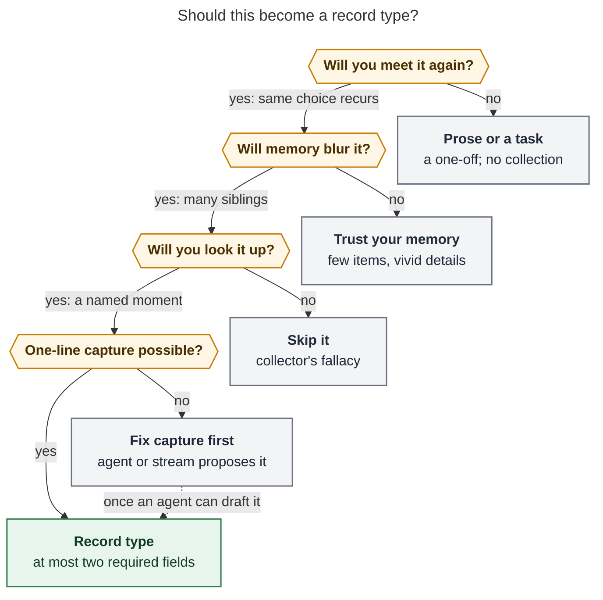
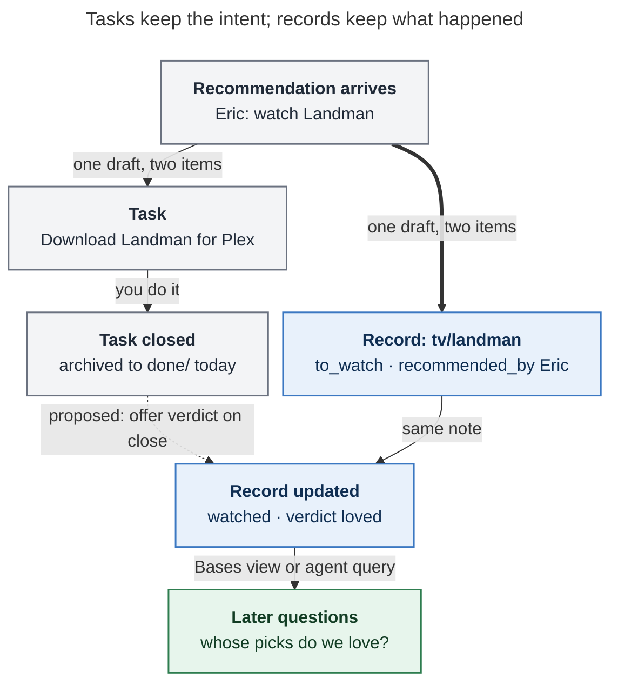

# Are Record Notes a huge unlock? What you would record, and what you would do with it

> **Research query.** Bryan suspects that Record Notes (epic `bob-cli-ir`) could be a
> huge unlock: a way to start recording useful data he would never have thought to
> capture. It is only a feeling. He cannot yet name good examples or say what he would do
> with the data. Help him think it through.

## Bottom line

- **The feeling is half right.** The unlock is real, but it is mostly not *new kinds of
  data*. Most of what records would hold is data you already write down, as prose and
  tasks, that never becomes usable:
  - 432 `INSPIRED BY` lines;
  - dog weights in `vet_log.md`;
  - a 2025 surf log;
  - about 30 job applications kept as tasks;
  - gift and favorite-flower notes for specific people;
  - about 200 "Buy …" tasks.

  Records turn that exhaust into something you can look up.
- **The new thing is outcomes.** Bob records *intent* (tasks) and *effort* (Pomodoros) in
  great detail, but almost never *what happened and what you thought of it*.
  - "Watch 'F1' the movie with Kelly!" closes and moves to `done/`. Whether you liked it
    is never recorded.
  - Eric recommended *Lioness*, *Landman*, and *Designated Survivor* at Christmas 2024.
    Nothing records whether his picks were any good.

  Records are the first place in Bob where a verdict has a home.
- **The research warns that capture alone does not pay.**
  - Personal records get used "only when they are efficient to access and when users
    feel their own memory is unreliable" ([Sellen & Whittaker 2010](#sources)).
  - People who track too many things burn out ([Choe et al. 2014](#sources)).
  - People lapse by forgetting, by upkeep, by skipping, and by suspending
    ([Epstein et al. 2015](#sources)).
  - Your own vault shows the same pattern. The basketball log says "I stopped tracking
    this on 2025-10-13!", and `trash_tocks` is marked "(OBSOLETE)".
- **It becomes a big unlock only if three loops close:**
  1. **Capture.** One line at the moment it happens, or a record an agent drafts for you.
  2. **Verdict.** You get prompted for a verdict when the related task closes.
  3. **Use.** There is a named moment when you look records up: date night, weekly
     review, a friend asking, or an agent prompt.

  The epic builds loop 1 well. Loops 2 and 3 are where the value is decided.
- **The lever specific to you is agents.** `bob records new` and `bob records check`
  give agents a typed, linted place to write, and facts to read. Many records could be
  drafted from streams Bob already reads (Gmail, Calendar), leaving you only the verdict.
  The verdict is the one field only you can supply.
- **What to do next:**
  - Keep a two-week *question log*.
  - Use the four shipped types for six weeks.
  - Add at most two new types that pass [the test](#the-test-when-should-something-become-a-record-type).
    My bets are **places** (outings, trails, beaches, surf spots) and **job applications**
    or **providers**.
  - Judge success by lookups and changed decisions, not by how many records you create.

## What actually changes with Record Notes

You could always write a note per restaurant; 92 of them already exist. The epic
(`plan:202611/record_notes.md`) changes the *economics* and the *trust*, not the storage.

| | Before | With Record Notes |
| --- | --- | --- |
| Creating one | Hand-write YAML, or ask an agent (both post-migration restaurants were agent-written, and both drifted) | `Ramen Nagi @eat/` in the capture panel; Tab walks the missing fields |
| Shape | Drifts: `category: null` ×6, `companions: []`, a quoted `visited` | Config schema; `bob records check` lints every writer |
| Updating one | Open the file, find `## Notes`, type a date | `Went back, still great @eat/ninja_sushi`, which adds a dated note |
| Agents | Free-form edits | `bob records new/update` is a planned, dry-runnable contract |
| Views | Bases (already good) | Same Bases, but the data is clean enough to filter on |
| Lifecycle | Tasks vanish into `done/` | `to_watch → watched` with a verdict, kept on the thing itself |

What does **not** change:

- **Records hold no reminders.** Task markers on a record item are refused. The "Download
  X" task stays a task, and it can sit in the same draft.
- **Dated notes are prose.** `dated_notes: true` turns note bullets into
  `- 2026-11-08: …`, so an entity carries an event history. But that history lives in
  the body, where Bases cannot filter it. "How many times did we go?" needs an agent or
  a future derived count, not a Base column.
- **No new type ships by itself.** Adding one is a config entry plus `bob records init`,
  which is cheap, but someone has to decide that it is worth it.

## What the evidence says about "capture more, learn more"

No study measures "typed record notes in a personal vault lead to more useful data"
directly. The adjacent evidence is consistent, though, and it points at retrieval rather
than capture.

### Lifelogging: total capture mostly failed

Sellen and Whittaker reviewed a decade of lifelogging (CACM, 2010). They found that
"extended usage studies show little impact outside research labs". In one study, people
asked to pick objects of memory significance in their homes chose digital ones less than
2% of the time. They frame the possible benefits as **five Rs**:

| R | What it means (their words, abridged) | Record-note analogue |
| --- | --- | --- |
| Recollecting | "mentally 're-live' specific life experiences" for practical purposes | "What did we order at Ramen Nagi?" |
| Reminiscing | re-living past experiences "for emotional or sentimental reasons" | A year-in-review of places you went with Kelly and Abby |
| Retrieving | finding specific information encountered before | "What's the detail shop's number? What did the vet prescribe?" |
| Reflecting | "examining patterns of past experiences" and "seeing things anew" | "Whose recommendations do we actually like?" |
| Remembering intentions | prospective memory: errands, appointments | The `to_try` and `to_watch` lists (Bob's tasks already own most of this) |

Their four lessons map almost one-to-one onto how to choose record types:

- **"Selectivity, not total capture."** Target "situations where human memory is poor"
  or "the things users most want to remember."
- **"Cues not capture."** A record is a cue that triggers memory, not a copy of the
  experience. A one-line verdict plus a date is enough.
- **Clarity about which kind of memory you are serving.** "Unless system designers know
  precisely what their systems are intended to do, they can't determine whether their
  designs are successful."
- **"Synergy not substitution."** "Digital records are used only when they are efficient
  to access and when users feel their own memory is unreliable."

The last point is the sharpest test. You will never look up your favorite restaurant;
you know it. You *will* look up "that place in Clark Kelly liked" once you have 92
restaurants.

### Quantified Self: three pitfalls

Choe et al. (CHI 2014) analyzed 52 Quantified Self meetup talks. Their findings:

- **Why people track:** to improve health, to improve other aspects of life (often
  software engineers optimizing work), and "to find new life experiences".
- **Pitfall 1, tracking too many things:** "I've made the classic newbie self-tracking
  mistake which is that I track everything." This "led to either stop tracking entirely
  due to tracking fatigue or failure to do data analysis."
- **The workaround is cheap capture:** "If you can't automate your tracking, make your
  tracking binary," and make "recording … a one-tap process."
- **Pitfall 2, not tracking triggers and context:** people log outcomes but not causes.
  For records, that means logging the verdict but not who recommended it, who you were
  with, or what you ordered.
- **Manual capture has its own value:** Q-Selfers feel "intimacy with data" when they
  record by hand, and "people make sense of data not only when they explore data but also
  when they collect data."
- **Early feedback matters:** the paper recommends tools that give "early feedback on the
  relationships between different factors", because people put off analysis that is
  tedious.

### Lived informatics: people lapse

Epstein et al. (UbiComp 2015) surveyed 105, 99, and 83 past and present trackers of
physical activity, finances, and location, and interviewed 22 of them.

- **Three reasons to start:** behavior change, *instrumenting* an activity, and pure
  curiosity.
- **Curiosity-driven trackers are fragile:** for them, "upkeep becomes a barrier to
  usage."
- **Four kinds of lapse:**
  - forgetting;
  - upkeep ("too much work to keep up to date");
  - skipping (when an entry is too hard, or "I already know the distance");
  - suspending.
- **Old data keeps value after a lapse:** after a long lapse, people may not resume
  collecting, but "may resume integrating or reflecting upon" the data they already have.

### Collector's fallacy

Christian Tietze's warning about notes applies equally to records: "'to know about
something' isn't the same as 'knowing something'". Collecting is rewarding in itself.
That is exactly the risk of a satisfying new capture form.

### Existence proofs that it can pay

- **Steph Ango (Obsidian's CEO).** His vault keeps "a template for every category with
  properties at the top" (books, movies, places, people, podcasts) and a 1–7 rating for
  everything. Two of his rules matter here:
  - "Property names and values should aim to be reusable across categories."
  - The payoff is cross-category views: "I can see an archive of *Sci-fi* books, movies
    and shows in one place."
- **Beli (restaurant app).** Users mark a visit "liked / fine / didn't like" and then
  rank it against places they have already rated. More ratings produce better
  recommendations. Secondary sources report more than 75M reviews logged since 2021.
  People *will* record verdicts when it is quick and the list visibly gets smarter.
- **Simon Willison's personal data warehouse.** Ten years of check-ins, tagged with a
  wolf emoji when his dog came along, answered "where does Cleo like to go": 280
  check-ins, 57 parks, 32 dog runs, and 19 coffee shops. He also found "the last time I
  had eaten a waffle-fish ice cream". Neither question existed when the data was
  captured, and both became answerable because the data was structured.
- **Tana's supertags.** Tana's own guidance is the same as Sellen's: make a supertag
  when you want to *collect* something, not for every object.

**Synthesis.** The unlock is in *retrieval*, not capture. A record type pays when three
things hold: you will face the same choice again, your memory will blur the details,
and there is a named moment when you look them up. Curiosity-only capture works mainly
when it is automated.

## Your vault already contains the latent records

I surveyed `~/bob` (7,001 Markdown files) for collections hiding in prose, tasks, and
zorg-era notes. The pattern repeats: **you already capture the facts; the verdict, the
date, and the structure are missing.**

| Where | What is there today | What is missing |
| --- | --- | --- |
| Vault-wide `INSPIRED BY` | 432 lines of provenance. `%eric` and `%nona` are each the source of about 10 recommendations, and "%kelly recommended" appears about 9 times | Whether any of it was good. Provenance with no outcome |
| `now_fun.md`, `love.md`, `#plex` (143 lines) | "TV SHOW: Lioness · INSPIRED BY: %eric recommended on xmas!"; "Download all of 'Lost' · INSPIRED BY: %nona"; "Watch 'Thunderbolts' on Disney Plus with Kelly!" | A verdict. Each title disappears into `done/` |
| `chad_movie.md` | An unfinished "@LLM prompt for a movie recommendation" listing criteria | Your watch history, which is what would ground the recommendation |
| `eat/` and daily notes | 92 restaurant notes, but only about 7 mentions of any of their titles across the 2025 and 2026 year folders (daily notes and archives) | Visits. Revisits are recorded almost nowhere |
| `vet_log.md`, `lenard.md` | Per-visit agenda, instructions, and weights as prose ("He weighs 10.3lbs") | A queryable history, such as a weight trend or "what did the vet say last time?" |
| `surf_log.md` | 2025 sessions with spot (Deal, Manasquan), board, duration, companions, and how fun it was; a weekly tickler "Log all surf sessions" | Structure; the sessions are free text inside one task |
| `body_ticks.md`, `home_ticks.md` | Basketball dates 2025-04-19 → 2025-08-31, then "I stopped tracking this on 2025-10-13!"; `trash_tocks` "(OBSOLETE)" | A question. These event logs had no lookup moment, and they lapsed |
| `job_2026*.md`, `ref/chat/*job*` | "Apply to 29 job openings!", about 22 roles in Waves 2 and 3, URLs on tasks, five applications cancelled together on 2026-10-28, "I was declined" in a Cancel Log, and a research task on "how long you can expect to wait for call backs" | A pipeline: applied date, channel, response, and outcome per company |
| `gift.md`, `favorites.md`, `flowers.md` | Gift ideas per person (%dad, %eric, %pops); favorite cake and flower per person; the yearly roses tradition | What was given, when, and how it landed |
| `car.md`, `honda.md`, `dentist.md`, `haircut.md`, `dog.md`, `gym.md`, `nemeses.md` | Detail shop with price, address, and why you chose it; dealer; dentist; barber (created 2026-11-06); vet; gyms you evaluated; "%isaac … messed up my fade" | One place for providers you use, rate, and avoid |
| `casa.md`, about 200 "Buy …" lines | Refrigerator, dishwasher, and dresser research; "Buy a new microwave!"; "Dispute North Face jacket delivery! Get $400 back!"; "Return first grey Lola blanket!" | What you bought, when, from where, the return or warranty window, and whether you'd buy it again |
| `nj_trails.md`, `nj.md` | Seven trails, some with run times; beaches (Deal, Manasquan, Asbury Park, Cape May, LBI); "Trails %kelly needs to take me to" | Been-there status, a verdict, last visit, and who came |
| Task text | "Try Grok 4.7!", "Try Fable 5.1!", "Try Opus with Blender." | What you concluded, so you neither re-try a dud nor forget a win |

This answers "I can't think of examples". Your vault is full of them. You did not see
them as data because Bob had nowhere to put an outcome.

## The test: when should something become a record type?

The prior research's rule was "individual things repeatedly need their own identity, a
few stable fields, and a collection view that beats a list in one note". That rule is
right. The literature adds two questions about *use*, which is where this report's
answer lies.

*Figure 1. A kind of thing earns a record type only when you will face the same choice
again, your memory will fail across many siblings, and there is a specific moment when
you will look it up. Cheap capture is the last gate, and an agent can open it.*

The four questions in practice:

1. **Will you meet it again?** "Meet again" means the same *choice* recurs: where to
   eat, what to watch, which barber, whether to buy that brand again. A one-off is a
   task.
2. **Will memory blur it?** You need many siblings. One dog is a note (`lenard.md`), not
   a collection. Ninety-two restaurants are a collection.
3. **Will you look it up?** Name the moment before you create the type, such as
   "Friday dinner", "a friend asks for sushi", "birthday in two weeks", or "the
   dishwasher broke". No moment means collector's fallacy.
4. **Is one-line capture possible?** If not, as with purchases or job applications,
   make an agent draft it from a stream, and supply only the verdict yourself.

Three field rules follow from Choe, Epstein, and Ango:

- **Keep required fields to two at most**, usually `status` plus one. Everything else is
  optional context.
- **Always allow the context fields**: `recommended_by`, `companions`, `location`. They
  are the "triggers and context" that make reflection possible later, and they cost
  nothing when a default fills them.
- **Reuse property names across types**: `status`, `verdict`, `recommended_by`,
  `companions`, `location`, `url`. Cross-type questions work only if the names match.

## Candidate record types for you, ranked

| Type (folder) | Question it answers | Capture moment | Key fields beyond `status` | Verdict |
| --- | --- | --- | --- | --- |
| **restaurant** (`eat/`, shipping) | "Where tonight?" and "where should my friend go for sushi?" | Leaving the restaurant; a friend's tip | `visited`, `companions`, `category`, `location` | **Strong.** Update `visited` on every revisit, or "not been in a while" never works |
| **show / movie** (`tv/`, `movies/`, shipping) | "What next?" and "whose taste do we trust?" | A recommendation arrives; the watch task closes | `recommended_by`, `verdict`, `service` | **Strong.** The verdict-on-close bridge (below) decides whether this works |
| **place** (`go/` or `places/`) | "Weekend outing within 45 minutes that we liked and haven't done since summer?" | Getting home; a tip from Kelly | `kind` (trail, beach, surf, park, town), `location`, `companions`, `verdict`, dated visit notes | **Strong.** `nj_trails`, the beaches in `nj.md`, the surf log, and "trails Kelly needs to take me to" already exist |
| **job application** (`apply/`) | "Who hasn't answered in 14 days?", "which channel works?", "how long do callbacks take?" | Clicking Apply; a recruiter email | `company`, `role`, `url`, `channel`, `applied`, `stage` | **Strong now, seasonal later.** About 30 live applications. Your own data would answer the callback-timing question you paid an agent to research. A Gmail-linked agent could keep `stage` current |
| **provider** (`pros/`) | "Who did the french drains, and were they good?", "which barber, and who not to book?", "when was the last cleaning?" | After the appointment | `kind`, `phone`, `location`, `verdict`, dated visit notes | **Strong-ish.** Low volume, but it is retrieval where memory is worst: phone numbers, names, last dates |
| **purchase** (`stuff/`) | "What model is the dishwasher and is it under warranty?", "would I buy these headphones again?", "is the return window still open?" | The order confirmation email | `bought`, `price`, `from`, `return_by`, `warranty_until`, `verdict` | **Try, agent-fed.** About 200 "Buy" lines say the volume is there. Typing every order is not viable, so this works only if an agent drafts from receipts |
| **trial** (`tries/`) | "Did I already try that model or tool, and why did I drop it?" | Ending the trial | `kind`, `verdict`, `why` | **Try.** Fits your work (AI tools churn monthly) and could feed blog posts. Verdicts go stale fast |
| **gift** (`gifts/`) | "What did we give Mom last year, and what is on the idea list for Eric?" | When someone mentions a want; after giving | `for` (alias), `occasion`, `given`, `reaction` | **Try.** `gift.md` has only three rows since 2024, but that may reflect friction rather than need. Pairs with `favorites.md` |
| **drink** (`drinks/`) | "Which tequila was the good one?" | At the store or table, often with a photo | `kind`, `recommended_by`, `verdict` | **Probe.** Prior research said no (two rows). This is the clearest "never considered capturing" case, and you should test it rather than predict it |
| **decision** (`calls/`) | "Why did we pick this? Was I right?" | When a non-trivial life decision is made | `options`, `expected`, `review_on`, `verdict` | **Maybe.** You already value decision records for software. A life version builds calibration, the "resulting" check from Annie Duke. The review needs a paired task |
| person | — | — | — | **No.** Keep `%alias`. Get people views by querying `recommended_by`, `companions`, and `for` across types |
| dog health, body metrics, consumables, quotes | — | — | — | **No.** One entity, event logs, recurring tasks, or one curated note. Records are the wrong shape |

## What you would actually do with the data

Each use below is a concrete query, view, or prompt, grouped by Sellen and Whittaker's
categories plus one they did not have: delegating to agents.

1. **Choose (retrieve plus remembering intentions)**
   - A Base view: `status = liked`, `location ∈ {Westfield, Cranford, Garwood}`,
     `visited < today − 90d`. This needs `visited` updated on each revisit.
   - "Something we both want to watch, from someone whose picks we've loved, under two
     hours": `to_watch`, filtered by recommender hit rate.
2. **Recommend to others**
   - "Three sushi places we liked near Clark" answered in ten seconds from `eat.base`'s
     Favorites view.
   - Recommendations travel: friends ask about restaurants, shows, contractors, barbers,
     and dog things.
3. **Recall**
   - "What did the vet say about the eye drops last time?" and "Lenard's weight at each
     visit."
   - "Model and purchase date of the dishwasher" when it breaks, along with whether the
     warranty still runs.
4. **Reminisce**
   - Period notes already have an agent-draftable `## Review` (`bob periods draft`).
     Records give that agent concrete material, for example (illustrative numbers) "2026
     with Kelly: 14 new restaurants (3 loved), 9 shows, 4 beaches." Shared `companions` makes "us"
     queries possible across types.
   - Ango's "fractal journaling" and "random revisit" are the ritual version of this.
5. **Reflect and calibrate (patterns)**
   - **Taste-trust by recommender.** Join `recommended_by` with `verdict`. After 10 to 20
     verdicts you would know whether Eric's, Nona's, or Kelly's picks land for you. No
     single field captures this; it appears only when provenance and verdict share a
     record. It is the best example of data you would never think to capture.
   - **Category hit rate.** "We like 9 of 10 Thai places and 2 of 6 pizza places"
     (illustrative).
   - **Purchase regret rate** and **job channel response rate**, for example
     (illustrative) "warm intros answered in 4 days; cold applications answered 1 in 12
     times, after 19 days."
6. **Delegate (agents)**
   - Ground `chad_movie.md`'s prompt in your verdict history instead of generic
     criteria.
   - "Plan Saturday": an agent reads `places` and `eat` for liked, nearby, not-recent
     options, checks the calendar, and proposes two plans.
   - "Draft follow-ups for every application older than 14 days with no response."

## Where the real leverage is: agents and streams

Epstein found that curiosity-driven tracking dies of upkeep. Choe found that automating
capture gave the longest, most regular data. For a manual system, that is the strongest
argument that the big unlock is **agents writing records and you writing verdicts**.

| Stream Bob already reads | Records an agent could draft | Field you still supply |
| --- | --- | --- |
| Gmail (`bob gmail sync`) | Purchases from order confirmations; restaurant visits from reservation emails; application stage from recruiter replies | `verdict`, `would buy again` |
| Google Calendar (`bob gcal`) | A visit to a place or restaurant named in an event, plus `companions` from attendees | `verdict` |
| Spotify (`sase spotify`), Plex (no integration today) | Podcast `subscribed` status; watched titles | `verdict` |
| Agent research reports (`ref/chat/`) | Options evaluated ("gyms near me", "detail shops"), each a `to_try` record | The choice, later |

Guardrails:

- **Agents propose and never decide.** Drafts go through `bob records new -d` and a
  confirmation step. An agent never sets a field that encodes a judgment (`verdict`,
  `liked` or `not_liked`). Choe's "intimacy with data" argument says the verdict is the
  part worth keeping manual.
- **`bob records check` is what makes agent writes safe at scale.** The epic already
  plans it.
- **Privacy.** The vault is git-synced and read by LLM agents. Records about health,
  money, or other people go to model providers whenever an agent reads them. Decide per
  type whether agents may read it before you create it, not after.

## The missing piece: closing the loop from intent to verdict

*Figure 2. The epic lets one draft create both the record and its task, and lets
`@tv/landman` set the verdict later. The dashed edge is the proposed bridge: closing the
task is the natural moment to ask for the verdict.*

Without that bridge, `to_try` and `to_watch` records pile up the way Someday/Maybe lists
do:

- `maybe_eat.md`'s 12 rows;
- `maybe_book.md` and `maybe_bucket_list.md`, each with an `@FRESHNESS` tickler bolted
  on to force review.

Bob already has the gesture shape this needs. It asks for a Work Log summary on unlink,
asks for a Rotten Log reason on a keep, and offers successors on close. A "verdict offer"
when a task that links a record closes would be the same pattern: one keystroke, and
blank skips. The prior design deliberately deferred automatic draft-level linking, and
this research supports building it next.

## Design observations for the epic (non-blocking)

1. **Status versus verdict.** Restaurant `status` mixes lifecycle with verdict
   (`to_try`, `liked`, `not_liked`). Shows and movies separate `status` from `verdict`.
   Cross-type queries such as "everything we loved this year" will need a mapping.
   Changing 92 restaurant notes is not worth it now, but future types should keep
   `verdict` separate.
2. **Spell recommenders consistently.** `recommended_by` is free text with suggestions,
   so taste-trust only works if Eric is always `eric`. Using the `%alias` stem would let
   agents join against `people.md`.
3. **Dated notes need a derived view eventually.** A later `bob records show`, or an
   agent, could report visit counts and last-visit dates from dated notes. That turns the
   per-entity event log into something Bases-adjacent without writing it twice.
4. **Review for wishlists.** Records sit outside the freshness walk. A "🔖 oldest
   to-try" Base view, or an occasional random revisit (Ango's practice), keeps
   wishlists honest without making records into tasks.

## A cheap way to test the feeling

1. **Weeks 0–2: question log.** Each time you think "what was that place…", "when did we
   last…", "who recommended…", "did we like…", or "what's the number for…", jot one line
   in a single note. Domains that produce several questions deserve types. Domains that
   produce none do not, however appealing they look. This applies Sellen and Whittaker's
   "selectivity" with your own data.
2. **Weeks 2–8: use what ships.** Restaurant, podcast, show, and movie. Count every time
   a record *answered* something or changed a choice. That count is the metric, not
   records created.
3. **Then add at most two new types** that passed the question log and Figure 1. Give
   each a named lookup moment in its type note ("Used on Friday nights", "Used when
   someone asks").
4. **Kill rule at 90 days.** A type with no lookups stops getting new fields and is
   dropped from your active habit. Its notes stay as reminiscence material, which
   Epstein shows keeps value after a lapse.

If the question log comes back thin, the feeling was about the satisfaction of a new
capture form. That is a real pleasure, but not an unlock. If it comes back with taste,
places, providers, and purchases, which the vault evidence suggests it will, then it is
an unlock, and agents are how you scale it.

## Open questions for you

- **Is Kelly a reader?** Many payoffs are joint (dinner, outings, shows). Does she ever
  look at Bases, or should the "use" loop be an agent message or a shared list?
- **Verdict scale.** The plan's 4-point verdict (loved, liked, meh, disliked) suits
  quick capture. Ango uses 1–7, and Beli uses three buckets plus pairwise ranking.
  Consistency across types matters more than the scale chosen.
- **Agent read scope.** Which record types, if any, should be off-limits to agents that
  send context to model providers?

## Sources

- Sellen, A. & Whittaker, S. (2010). *Beyond Total Capture: A Constructive Critique of
  Lifelogging.* Communications of the ACM 53(5): 70–77.
  [Microsoft Research PDF](https://www.microsoft.com/en-us/research/wp-content/uploads/2016/02/p70-sellen.pdf)
  · [publication page](https://www.microsoft.com/en-us/research/publication/beyond-total-capture-a-constructive-critique-of-lifelogging/)
- Choe, E.K., Lee, N.B., Lee, B., Pratt, W. & Kientz, J.A. (2014). *Understanding
  Quantified-Selfers' Practices in Collecting and Exploring Personal Data.* CHI 2014.
  [course-reading PDF](https://my.eng.utah.edu/~cs5540/au16/readings/PersonalInformatics-Choe2014.pdf)
  · [MSR page](https://www.microsoft.com/en-us/research/publication/understanding-quantified-selfers-practices-collecting-exploring-personal-data/)
- Epstein, D.A., Ping, A., Fogarty, J. & Munson, S.A. (2015). *A Lived Informatics Model
  of Personal Informatics.* UbiComp 2015.
  [course-reading PDF](https://my.eng.utah.edu/~cs5540/au16/readings/PersonalInformatics-Epstein2015.pdf)
- Li, I., Dey, A. & Forlizzi, J. (2010). *A Stage-Based Model of Personal Informatics
  Systems.* CHI 2010.
  [author page](https://ianli.owlstown.net/publications/17-a-stage-based-model-of-personal-informatics-systems)
- Tietze, C. (2014). *The Collector's Fallacy.*
  [zettelkasten.de](https://zettelkasten.de/posts/collectors-fallacy/)
- Ango, S. *How I use Obsidian.* [stephango.com/vault](https://stephango.com/vault)
  · [kepano-obsidian template](https://github.com/kepano/kepano-obsidian)
- Willison, S. (2020). *Personal Data Warehouses: Reclaiming Your Data.*
  [simonwillison.net](https://simonwillison.net/2020/Nov/14/personal-data-warehouses/)
- Beli coverage (secondary; user counts are founder-reported):
  [Food Network](https://www.foodnetwork.com/fn-dish/news/beli-app-trend)
  · [Demand Curve #285](https://www.demandcurve.com/newsletters/growth-newsletter-285)
  · [Startup Signals](https://startupsignals.substack.com/p/beli-your-food-diary-and-dining-advisor)
- Tana, *Supertags* docs: [tana.inc/docs/supertags](https://tana.inc/docs/supertags)
- Decision journaling (secondary summaries of Annie Duke and Farnam Street):
  [expectedvalue](https://site-expectedvalue-co-uk.pages.dev/blog/decision-journals/)
- Internal: `plan:202611/record_notes.md`;
  `research:202611/record_type_capture/record_type_capture.md`; bead `bob-cli-ir`; and a
  read-only survey of `~/bob` (the notes named in the tables above).

Library check: 0 of 10 candidates already in your library (0 finished). None of the
readings above is in `ref/`. If you want any of them, add them with
`bob ref create <URL>`; Sellen & Whittaker and Epstein are the two most worth reading
whole.
