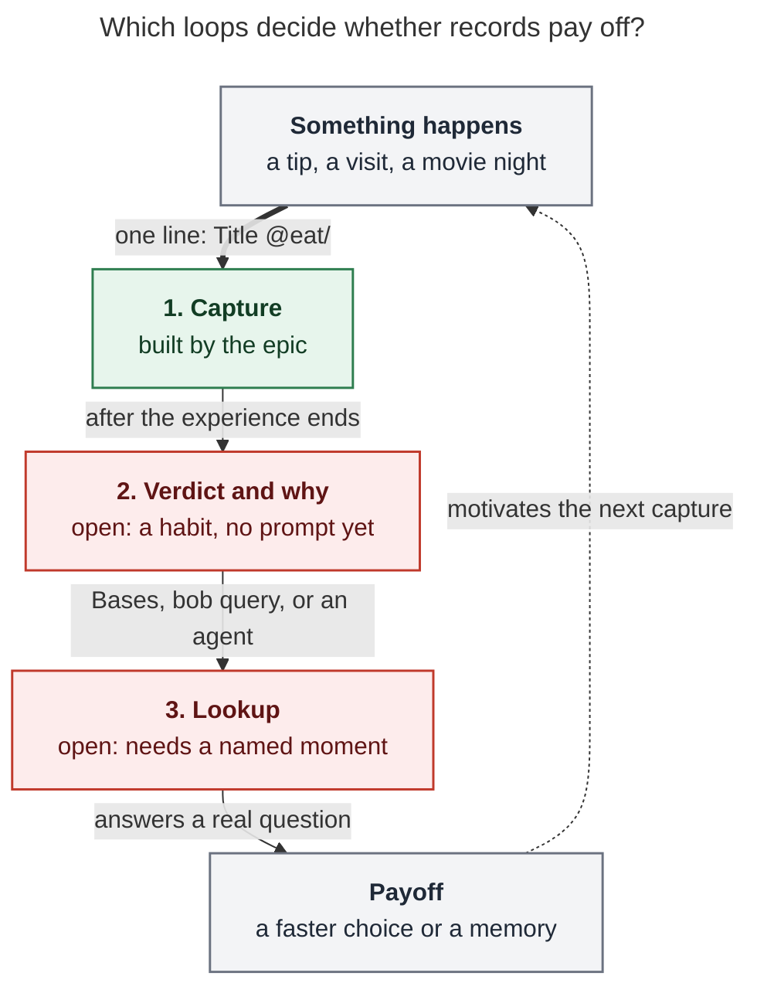
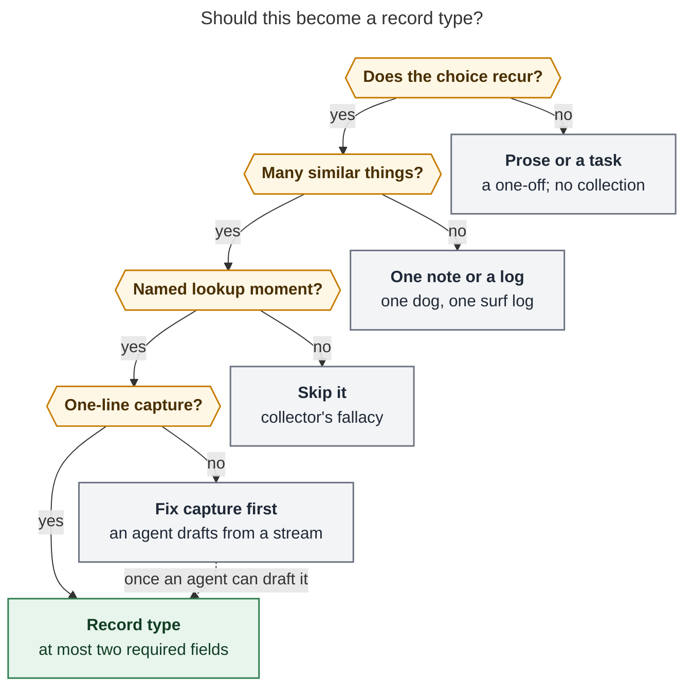

# Record Notes as a data unlock: what is worth recording, and what you would do with it

*Consolidated research report (lead) · 2026-11-08 · merges the five swarm reports
([cdx](record_notes_data_unlock__cdx.md), [cld](record_notes_data_unlock__cld.md),
[grk](record_notes_data_unlock__grk.md), [mus](record_notes_data_unlock__mus.md),
[gem](record_notes_data_unlock__gem.md)) with the lead's own checks: the binding plan's
CLI contract, a read-only vault audit, and two added studies.*

**Request.** You have a feeling that Record Notes (epic `bob-cli-ir`) might be a huge
unlock: a way to start recording useful data you would never have thought to capture.
It is only a feeling. You cannot yet name good examples, and you are not sure what you
would do with the data. Help think it through.

## Bottom line

- **The feeling is half right. All five researchers reached that verdict on their own.**
  - The unlock is real, but it is mostly **not new kinds of data**.
  - It gives **outcomes** a home: what happened, what you thought, and why, recorded on
    things you already track.
  - Bob already records **intent** (tasks) and **effort** (Pomodoros) in detail. It almost
    never records how a restaurant, show, or outing turned out. Today that outcome
    disappears when the task closes, or it was never written down.
- **The data you "would never have considered capturing" is real, but it is small.** It
  is the sentence you would have forgotten by February:
  - "too loud to talk; great for takeout";
  - "dropped after episode 3, the humor wasn't for us";
  - "Eric recommended it, and we loved it";
  - "we haven't been since June".

  There is evidence behind this part of the feeling. People reliably underestimate how
  much they will value a record of an *ordinary* experience later, and they skip
  recording because of it ([Zhang et al. 2014](#sources)).
- **Capture alone does not pay.**
  - Lifelogging mostly failed outside labs ([Sellen & Whittaker 2010](#sources)).
  - Self-trackers who track everything burn out ([Choe et al. 2014](#sources)).
  - People lapse from upkeep ([Epstein et al. 2015, 2016](#sources)).
  - Your vault shows the same pattern:
    - 90 of 92 restaurant notes have an empty `visited` field, even though the field
      already exists;
    - the basketball log says "I stopped tracking this on 2025-10-13!";
    - the surf log has 7 sessions from 2025 and none from 2026.
- **It becomes a big unlock only if three loops close (Figure 1):**
  1. **Capture**: one line at the moment it happens.
  2. **Verdict**: a verdict and a reason written after the experience ends.
  3. **Lookup**: a named moment when you consult records.

  The epic builds loop 1 well. Loops 2 and 3 are habits and prompts that do not exist
  yet, and they decide the payoff.
- **The lever specific to you is agents.**
  - Typed, linted records give agents facts they can read with `bob query` and write
    through `bob records new` and `update`.
  - Streams Bob already reads (Gmail, Calendar) could feed agent-drafted records. You
    would supply only the verdict, which is the one field only you can supply.
- **What to do:**
  - Start a **question log** now. It needs nothing from the epic.
  - For about six weeks after capture ships, use only the shipped types.
  - Judge the feeling by **lookups and changed decisions**, not by how many records you
    create.
  - Then add at most one or two new types that pass the test in Figure 2. The best bets
    are **places** and **providers**. Run **gifts** and **bottles** as scratch-list
    experiments first.

## What Record Notes actually changes

The epic is **in progress**. Phase 1, which installs new files without replacing
existing ones, has landed. The engine, CLI, capture grammar, Mac Record Card, and the
show and movie types are still being built. "Planned" below means the approved contract
(`plan:202611/record_notes.md`), not shipped behavior.

You could always write one note per restaurant; 92 exist. The epic changes the cost of
writing a well-formed record and how far you can trust its shape. It does not change
where records are stored.

| | Today | With Record Notes |
| --- | --- | --- |
| Create | Hand-written YAML, or ask an agent. Both post-migration restaurants were agent-written, and both drifted | `Burger Bistro @eat/` in capture; guided entry walks the required fields |
| Update | Open the file and type a dated bullet | `Went back, still great @eat/ninja_sushi` appends a dated note and sets fields |
| Shape | `category: null` ×6, `companions: []`, a quoted `visited` | Config schema; `bob records check` lints every writer |
| Watch list | ~25 open tasks; the title, recommender, and verdict leave with the task | `to_watch` → `watched` + `verdict` on the record; the action stays a task |
| Day one | — | **Seeded:** `to_try` records for `maybe_eat.md`'s 12 rows, and `to_watch` records for open watch titles with `recommended_by` carried from `INSPIRED BY: %name` (reviewer decision `seed_records = yes`) |

**A correction that matters for "what would I do with it".** Three reports describe
record-level queries through the CLI: grk ("`bob records list restaurant` filtered on
`status=liked`"), mus, and gem ("clean, machine-readable JSON" for agent queries). The
plan does not provide that.

- `bob records list` lists record **types**, with counts and required fields.
- `bob records show TYPE` prints the schema plus the top values of suggested fields.
- `new`, `update`, `check`, and `init` write or lint records. None of them searches
  records.

cdx flagged this correctly. Record-level questions go through **Obsidian Bases** or
**`bob query`** (Dataview), and both work today. So the agent payoff does not wait on new
CLI. It depends on fields getting written consistently.

The plan also rules out computed fields and relations. "How many times did we go?" and
"when did we last go?" from dated notes therefore need an agent or future work.

## The data you would never have thought to capture

cdx's prompt is the most useful single test: **"What did I just learn that future me
could not easily reconstruct?"** The answer is rarely a number or a full review. Across
the reports it falls into six kinds. Here they are with real vault cases where they
exist; quoted lines marked *(illustrative)* are invented.

| Kind | Example | Where it lives in a record | When it pays |
| --- | --- | --- | --- |
| **Verdict** | *F1*, *Thunderbolts*, and Eric's Christmas trio (*Lioness*, *Landman*, *Designated Survivor*) have no recorded outcome | `verdict` / `status` | Choosing what to watch; answering "did we like it?" |
| **The condition behind it** | *(illustrative)* "Great food, too loud to talk; order the broth separately for takeout" | A dated note (prose) | Choosing *for tonight's situation*, not just in general |
| **Negative knowledge** | `eat/rush_bowl.md`: "Both were terrible, and the restaurant itself stank." | `not_liked` / `dropped` plus the reason | Not repeating a dud, or knowing what would make it worth reconsidering |
| **Recency** | 2 of 92 restaurants have `visited`; "Kelly said this was her favorite sushi place" has no date | `visited` / `watched_on` plus dated notes | "Somewhere we liked but haven't been lately" |
| **Provenance joined to outcome** | 432 `INSPIRED BY` lines in 172 notes; none says whether the tip was any good | `recommended_by` + `verdict` on the same note | Thanking or replying to the recommender; weighing their next tip |
| **Ordinary shared moments** | *Monsters, Inc.* with Abby survives only as a child bullet under a closed "Disney Movie Night!" event (2026-11-03) | A movie record with `companions` and `watched_on` | Reminiscing, and a year in review |

Two sources sharpen why this category is easy to miss.

- **Rediscovery is undervalued, especially for the mundane.** Zhang, Kim, Brooks, Gino,
  and Norton ran four studies with time capsules.
  - People underestimated how curious they would later be about records of ordinary
    recent experiences, and how much they would enjoy them.
  - The more ordinary the experience, the larger the underestimate.
  - In their fourth study, people passed up chances to document the present, but later
    preferred rediscovering those moments to an alternative fun activity.

  That is close to your feeling: "I would never think to record this" is a documented
  forecasting error, not just a lack of imagination. The finding supports *cheap cues for
  reminiscence*. It says nothing about better decisions. ([Zhang et al. 2014](#sources);
  abstract and secondary coverage verified, full text paywalled.)
- **Structured data answers questions nobody asked at capture time.** Simon Willison
  added a wolf emoji to every check-in where his dog Cleo came along. Years later, that
  answered "where does Cleo go?": 280 check-ins, 57 parks, 32 dog runs, and 19 coffee
  shops. The question did not exist when the data was captured
  ([Willison 2020](#sources)). The record analogue is `companions` and `recommended_by`:
  cheap context fields that later join with a verdict.

**A reality check on the joined data.** cld calls recommender "taste-trust" the best
example of data you would never think to capture, and estimates that 10 to 20 verdicts
per person would reveal whose picks land. The lead's count shows how small these samples
will stay:

- Only **79** of the 432 `INSPIRED BY` lines name a person.
- The most frequent names are Nona (14), Frank Scarpel (10), and Eric (10), counted
  across *all* domains over roughly two years.
- Per person, per media type, verdicts will stay in single digits for years.

Treat "whose picks do we love?" as a conversation piece and a recall aid, such as "what
did Eric recommend, and did we like it?". It is not a hit rate. cdx's caution applies:
three recorded failures suggest a pattern but do not establish a rate without the total
number of attempts.

## What you would actually do with the data

The reports converge on one ordering. Returns arrive in this order, and each needs more
data than the last. Recall and choosing pay from a single record. Pattern-finding needs
many records and honesty about the gaps.

| Use | Concrete question | What it needs | Day-one status |
| --- | --- | --- | --- |
| **Recall** | "What did we order at Ninja Sushi? What did we think of Rush Bowl?" | One record and a way to find it | Works for notes that have prose |
| **Choose** | "Liked, in Cranford or Westfield, sushi?" (85 liked; Cranford 25, Westfield 20 per grk's count) | Clean `status`, `category`, `location` | Works today in `eat.base` or `bob query` |
| **Choose, with recency** | "…and we haven't been in 90 days" | `visited` set on **every** revisit | Fails today: set on 2 of 92 notes |
| **Watch next** | "Something on the list, recommended by someone we trust, under two hours" | Seeded `to_watch` + `recommended_by` | Works on the day `seed_records` runs |
| **Recommend to others** | "Three sushi places we liked near Clark", answered in ten seconds | `status` + `location` | Works today |
| **Reminisce** | "2026 with Kelly: new restaurants, films, beaches" | `visited` / `watched_on`, `companions` | Needs a quarter of real capture |
| **Reflect** | "What do the shows we dropped have in common?" | Several verdicts *with reasons* | Months away; agent-assisted |
| **Delegate** | "Plan Saturday: two liked, nearby, not-recent options that fit the calendar" | Records + `bob query` + calendar | Works once recency data exists |

Three notes on using these well:

- **Make retrieval situational.** Check restaurants when choosing where to eat, and media
  when choosing what to watch. A weekly obligation to review every record would eat the
  value (cdx). Sellen and Whittaker's sharpest finding fits here: digital records get
  used "only when they are efficient to access and when users feel their own memory is
  unreliable." You will never look up your favorite restaurant. You will look up "that
  place in Clark Kelly liked" once there are 92.
- **Period reviews are a natural consumer.** `bob periods draft` already drafts period
  `## Review` sections. Records give it concrete material to draft from (cld).
- **Ask agents checkable questions.** For example, from cdx: "From these notes, find up
  to three candidates for a quiet dinner. Give the dated evidence for each, and separate
  recorded facts from your suggestions." An agent cannot recover an unrecorded reason or
  interpret an absent verdict.

## The three loops, and which one the epic builds

*Figure 1. The epic builds the capture step. The verdict and lookup steps are open, and
they decide whether records pay off. The dashed return edge is the feedback that keeps
capture alive: a lookup that helped makes the next entry feel worth it.* (Rendered
526 × 894 px, fit 99.9%, Mermaid CLI 12.0.0.)

**Loop 1, capture.** This is the epic's strength. Note one grk finding: a schema on disk
does not, by itself, induce capture. `visited` has existed on restaurant notes long
enough for 90 of 92 to leave it empty. A Record Card that asks for the field *in the
capture path* is the mechanism behind "data I'd never have considered." You would not
open `eat/ninja_sushi.md` to type a date, but you will accept `visited:: today` when
asked. Keep that field optional. Required fields that are often unknown get filled with
junk (grk, citing Nielsen and arXiv 2311.13517).

**Loop 2, verdict. This is the weakest link, and the reports placed it in the wrong
spot.** cld proposes a verdict offer when a task that links a record closes, which
follows the existing Rotten Log and Work Log prompts. The lead's audit suggests that
moment rarely happens:

- The archived `done/` notes hold only **two** watch or download tasks, and both were
  **cancelled** (*Primal*, *Hacks* S4).
- *F1* and the rest stay open.
- Actual viewing shows up, if at all, as a calendar Event Task. Only two movie events
  appear in 2026 daily notes, both for *Monsters, Inc.*.

The verdict moment is the **end of the experience**, and Bob currently sees that, at
best, as a closing calendar event. Two cheap options:

- **Now:** the habit. A one-liner after the credits or on the drive home.
- **Later:** an *agent proposal*. A periodic agent could read the day's closed events
  ("Disney Movie Night!", a dinner reservation) and offer "log a title or a verdict?".
  This would follow the existing gcal rule that Bob proposes once and never decides.

A task-close hook is still worth having for the occasional linked task. It should not be
the main mechanism.

**Loop 3, lookup.** Name the moment before you create a type: "Friday dinner", "a friend
asks for sushi", "birthday in two weeks", "the dishwasher broke". No named moment means
collector's fallacy, which Tietze describes as "'to know about something' isn't the same
as 'knowing something'". Ask early whether Kelly reads records too (see
[Open questions](#open-questions-for-you)). Many payoffs are joint, and the lookup for a
shared choice may need to be a shared list or an agent message rather than a Base.

## The agent lever

Bob is unusually agent-heavy, and that changes the economics described in the
quantified-self literature.

- **Manual-only tracking dies of upkeep.** Curiosity-driven trackers are the most
  fragile, and fully automated capture produces the longest and most regular data
  ([Epstein 2015](#sources); [Choe 2014](#sources)).
- **The middle path has a name.** *Semi-automated tracking* mixes automated capture with
  deliberate manual input. Choe and colleagues propose choosing the mix from capture
  feasibility, purpose, and motivation ([Choe et al. 2017](#sources)). Choe's 2014 study
  also found that people build awareness *while* collecting by hand. That is an argument
  for keeping the judgment step manual.

Applied to records (cld's table, with the Gmail commands corrected; Bob has no
`bob gmail sync`, it saves the threads you choose):

| Stream Bob already reads | Records an agent could draft | Field you still supply |
| --- | --- | --- |
| Gmail (read-only `bob gmail search` / `peek` / `save`) | Purchases from order confirmations; restaurant visits from reservation emails; job-application stage from recruiter replies | `verdict`, "would buy again" |
| Google Calendar (`bob gcal`) | A visit or a movie night named in an event, with `companions` from attendees | `verdict`, the title |
| Agent research reports (`ref/chat/`) | Options already evaluated ("gyms near me", "detail shops") as `to_try` records | The choice, later |

Guardrails, which all reports that discuss agents share:

- **Agents propose and never decide.** Drafts go through `bob records new -d`, a
  dry-run, before anything is written. An agent never sets a judgment field (`verdict`,
  `liked`, `not_liked`).
- **`bob records check` is what makes agent writes safe at scale.** Keep it a manual lint
  until the folders are clean, as the plan already says.
- **Privacy is decided per type, before you create the type.** The vault is git-synced
  and read by LLM agents. Health, money, or third-party details in a record go to a model
  provider whenever an agent reads them.

## Where the reports disagreed, and how this report resolves it

| Question | Positions | Resolution |
| --- | --- | --- |
| How true is the feeling? | cdx: plausible, unproven. cld, grk: half right. mus: right but mislabeled. gem: "fundamentally sound", via a "Jevons paradox" friction cliff | **Half right.** gem's numbers (≈60 s → ≈4 s per capture; thresholds at 5 s and 30 s) are unsourced and unmeasured. Treat them as intuition, not evidence |
| Can `bob records` query records? | grk, mus, gem: yes. cdx: no | **No.** `list` and `show` work at the type level (plan, CLI table). Record queries use Bases or `bob query` |
| Should `maybe_eat.md` be seeded? | grk: optional | **Already decided yes.** The reviewer approved seeding its 12 rows. "1950 Originals" is skipped because `eat/1950s_originals.md` exists |
| Will the vault yield new types? | grk: weak; "no hidden fifth collection"; kill-list during the test. cld, mus, gem: several strong candidates | **Both partly right.** cld's survey shows latent data (job applications, providers, purchases, a surf log, trails). The prior research and the plan rejected surf, vet, and trails as logs, and gift and drink as too thin. Most proposals fail the *recurring choice + many siblings + lookup moment* test or are logs. **No new type during the test**; afterwards, one or two (next section) |
| Surf | mus, gem: one record per *session*. cld: a *place* type, with sessions as dated notes. Prior research and grk: keep the log | **A spot is the thing; a session is a dated note.** A per-session note breaks "one note per thing" and yields thin notes (7 sessions in 2025, none logged in 2026). Fold surf into a *places* type only if places earns one |
| Dog and vet health | gem: 7/10 candidate. cld, prior research: no | **No.** One dog is one note with dated entries (`lenard.md`, `vet_log.md`); a collection buys nothing |
| Verdict moment | cld: offer a verdict when the linked task closes | **The experience end, not the task close** (audit above). Habit first, then perhaps an agent proposal |
| Recommender hit rate | cld: the best new insight after 10–20 verdicts | **Recall value, not statistics** (79 person-attributed tips in two years) |
| Every type needs a Base before capture? | gem: yes | `bob records init` scaffolds a Base anyway. The real prerequisite is a **named lookup moment** |
| Thousands of record files will slow Obsidian | gem | The vault already has 7,000 Markdown files. The real cost is noise and empty notes, not performance |

## Choosing future types: the test

The prior research's rule still holds: add a type when individual things repeatedly need
their own identity, a few stable fields, and a collection view that beats a list in one
note. The swarm adds questions about **use**. They are close kin to Capacities'
documented test (a distinct group? distinct properties? would a query do instead?) and to
Tana's "make a supertag when you want to collect something".

*Figure 2. A kind of thing earns a record type only when the same choice recurs, there
are enough siblings for memory to blur them, and you can name the moment you will look
them up. Cheap capture is the last gate, and an agent can open it. Adapted from cld's
figure.* (Rendered 803 × 1134 px, fit 78.7%, Mermaid CLI 12.0.0.)

What each question means in practice:

- **Does the choice recur?** The same *choice* comes back: where to eat, what to watch,
  which barber, whether to buy that brand again. A one-off is a task.
- **Many similar things?** You need many siblings. Ninety-two restaurants are a
  collection. One dog is a note.
- **Named lookup moment?** Name it before you create the type, such as "Friday dinner"
  or "the dishwasher broke".
- **One-line capture?** If not, have an agent draft the record from a stream, and supply
  only the verdict yourself.

### Candidates beyond the four shipped types

The vault evidence in this table comes from the proposing researchers' surveys. The lead
re-checked only the surf log figures.

| Candidate | Proposed by | Vault evidence | Verdict |
| --- | --- | --- | --- |
| **Places / outings** (trails, beaches, surf spots) | cld (strong), mus (deferred), gem (surf only) | `nj_trails.md` (7 trails), beaches in `nj.md`, `surf_log.md`, "Trails %kelly needs to take me to" | **Best next candidate.** One note per spot, with visits as dated notes. "Weekend outing within 45 minutes that we liked and haven't done since summer" is a real recurring choice |
| **Providers / vendors** | cld, gem | `car.md`, `dentist.md`, `haircut.md` (created 2026-11-06), `dog.md`, `nemeses.md` ("messed up my fade") | **Strong-ish.** Low volume, but this is retrieval where memory is worst: names, numbers, last dates, whom to avoid |
| **Gifts** | mus (#1), gem, cld (try). Plan: no | `gift.md` (3 small sections), `favorites.md`, `flowers.md` | **Scratch list first.** Annual cadence means a year passes before the first payoff. mus's backfill test (10 past gifts, then check at the next occasion) is cheap |
| **Bottles / drinks** | mus (#2), gem (9/10), cld (probe). Plan: no | A `fun.md` wine note (Faust good, Graham's Tawny bad); `drink.md` lists only *stores* | **Probe.** The clearest "never considered" case. Five bottles in a scratch note, then see whether you ever looked |
| **Purchases / home equipment** | gem (`home/`), cld (agent-fed), cdx (product fit) | ~200 "Buy …" tasks; appliance research in `casa.md` (cld) | **Only if agent-fed** from order emails. Manual typing will not happen. One "home equipment" note may beat a type |
| **Job applications** | cld | ~30 applications kept as tasks across `job_2026*.md`; a paid research task on callback timing | **Time-boxed, if the search is still active.** The data is pipeline-shaped, and a Gmail agent could keep `stage` current. It goes stale when the season ends |
| **Trials** (AI models, tools) | cld, cdx | "Try Grok 4.7!", "Try Fable 5.1!" tasks | **Use project or decision notes first.** Verdicts go stale quickly |
| **Life decisions** | cld (maybe) | — | **Not a record shape.** It needs a paired review task |
| Books, podcast episodes, people, dog health, daily habits and body metrics, recipes | — | `ref/` (1,240 notes), `%alias` table, one-entity notes, tickler logs | **No.** All five reports and the plan agree |

## Rules that keep a collection useful

Merged from all five reports. Most are cheap to follow from the first record.

- **Use fields for what you filter by and prose for the reason.** "Liked" scans quickly;
  "liked the food, but only for takeout" explains the choice. Promote a recurring
  distinction to a field only after you have wanted to filter on it twice (cdx).
- **Require at most two fields.** Everything else is optional context. Required fields
  that are often unknown get filled with junk (grk, gem, cld).
- **Reuse property names across types**: `status`, `verdict`, `recommended_by`,
  `companions`, `location`, `url`. Cross-type questions such as "everything we loved
  this year" work only when names match. Steph Ango's vault keeps cross-category views
  for exactly this reason (cld).
- **Spell recommenders as `%alias` stems.** `recommended_by` is free text with
  suggestions, and seeding carries it from `INSPIRED BY: %name`. Recommender questions
  work only if Eric is always `eric` (cld).
- **Frontmatter is the current summary, not history.** Updating `visited` or
  `companions` overwrites the previous value. Put circumstances that matter later into
  dated notes. A note's capture date is not the event's date, so state the real date
  when backfilling (cdx).
- **Missing is not negative.** No verdict can mean not yet watched, forgotten, or
  deliberately skipped. The `companions: [[kelly]]` default is a convenience, not proof
  she came (cdx).
- **Mind one schema mismatch.** Restaurant `status` mixes lifecycle and verdict
  (`to_try`, `liked`, `not_liked`), while shows and movies keep `status` and `verdict`
  separate. It is not worth changing 92 notes now, but future types should keep them
  apart (cld).
- **Keep the best existing home.** Do not move reading history, technical decisions, or
  receipts into records just for uniformity. A record can link to the authoritative
  source.
- **Avoid the organized graveyard.** A personal CRM that is not kept up "looks
  complete" and misleads (grk, citing Dex and Goodword). `eat/` is already a mild case:
  the Base looks rich, but its recency data is missing.
- **Let old notes keep their value after a lapse.** People who stop collecting often
  keep reflecting on what they already have (Epstein). A paused type is not a failure.

## A cheap test of the feeling

This merges the four test plans (cdx, cld, grk, mus) into one. It is a personal trial,
not an implementation plan.

1. **Start now, before anything ships: a question log.** Whenever you think "what was
   that place…", "did we like…", "who recommended…", "when did we last…", or "what's the
   number for…", add one line to a single note. Domains that produce several questions
   deserve types. Domains that produce none do not, however appealing they look.
2. **Weeks 1–6 after capture ships: use only restaurants and shows/movies.**
   - Capture **Burger Bistro** first. Its task is already blocked on this feature.
   - After every restaurant visit, write a one-liner to `@eat/<stem>` with
     `visited:: today` and a sentence of *why*.
   - After every movie or show night, create or update the record with `watched_on`,
     `companions`, and `verdict`. *Monsters, Inc.* with Abby is a ready first entry.
   - Let `seed_records` create the `to_watch` and `to_try` rows, and leave the tasks
     alone.
   - Before each relevant choice, **open the collection**. Without this step the test
     measures only data entry.
3. **Keep a payoff tally of a few lines.** Note each time a record saved a search,
   changed a choice, prevented a repeat, or was enjoyable to reread. Also note each time
   capture felt like a chore or a lookup failed.
4. **At week 6, decide:**
   - Run `bob records check`.
   - Compare visits with updates, and movie nights with titles logged.
   - **"Huge unlock"** if most visits and nights got logged without nagging, at least
     two lookups changed or sped a real decision, and the question log names a domain
     outside the four with several questions. The two-lookup bar is cdx's proposed
     decision rule, not a research threshold.
   - **"Reliability fix for two collections"** if the card exists but records appear
     only when agents write them. That outcome still justifies the epic. It is a smaller
     story than the feeling (grk).
5. **Then add at most one or two types** from the question log that pass Figure 2.
   Write each type's lookup moment into its type note. Stop adding to any type with no
   lookups after 90 days, and keep its notes for reminiscence (cld).

If the question log comes back thin, the feeling was the pleasure of a new capture form.
That is real, but it is not an unlock. If it comes back full of taste, places, providers,
and purchases, which the vault suggests it will, then it is an unlock, and agents are how
you scale it.

## Open questions for you

- **Does Kelly read the records?** Dinners, outings, and shows are shared choices. If she
  will not open a Base, the lookup loop may need to be a shared list or an agent message.
- **Is Saturday movie night still a weekly ritual?** grk's test assumes it is
  (`recur_meet.md` has `Sa_1930`). Only two movie events appear in 2026 daily notes, so
  the volume of watch verdicts may be lower than four a month.
- **Which record types may agents read?** Decide before you create a type, not after.
- **Which verdict scale?** The plan's four-point scale (loved, liked, meh, disliked)
  suits quick capture. Ango uses 1–7, and Beli uses three buckets plus pairwise
  ranking. Consistency across types matters more than the scale you pick (cld).

## Sources

**Research and practice**

- Sellen, A. & Whittaker, S. (2010). *Beyond Total Capture: A Constructive Critique of
  Lifelogging.* CACM 53(5).
  [PDF](https://www.microsoft.com/en-us/research/wp-content/uploads/2016/02/p70-sellen.pdf)
- Choe, E.K., Lee, N.B., Lee, B., Pratt, W. & Kientz, J.A. (2014). *Understanding
  Quantified-Selfers' Practices in Collecting and Exploring Personal Data.* CHI 2014.
  [MSR page](https://www.microsoft.com/en-us/research/publication/understanding-quantified-selfers-practices-collecting-exploring-personal-data/)
- Choe, E.K. et al. (2017). *Semi-Automated Tracking: A Balanced Approach for
  Self-Monitoring Applications.* IEEE Pervasive Computing 16(1).
  [PDF](https://users.ece.utexas.edu/~ethomaz/papers/j1.pdf) (added by the lead)
- Epstein, D.A., Ping, A., Fogarty, J. & Munson, S.A. (2015). *A Lived Informatics
  Model of Personal Informatics.* UbiComp 2015.
  [PDF](https://depstein.net/assets/pubs/depstein_ubi15.pdf)
- Epstein, D.A. et al. (2016). *Beyond Abandonment to Next Steps.* CHI 2016.
  [PMC](https://pmc.ncbi.nlm.nih.gov/articles/PMC5428074/)
- Zhang, T., Kim, T., Brooks, A.W., Gino, F. & Norton, M.I. (2014). *A "Present" for the
  Future: The Unexpected Value of Rediscovery.* Psychological Science 25(10).
  [APS summary](https://www.psychologicalscience.org/news/were-only-human/wrapping-a-present-for-the-future.html)
  · [SAGE](https://journals.sagepub.com/doi/abs/10.1177/0956797614542274)
- Bernstein, M. et al. (2008). *Information Scraps.*
  [PDF](https://hci.stanford.edu/publications/2008/infoscraps/TOIS-final-with-refs.pdf)
- Van Kleek, M. et al. (2011). *Finders/keepers* (List-it).
  [MIT](https://dspace.mit.edu/entities/publication/75796cd4-f2d4-4dba-844b-96bc832dc33b)
- Moore, J. et al. (2021). *The Personal Informatics Analysis Gap.*
  [arXiv](https://arxiv.org/html/2108.03761v1)
- Willison, S. (2020). *Personal Data Warehouses: Reclaiming Your Data.*
  [simonwillison.net](https://simonwillison.net/2020/Nov/14/personal-data-warehouses/)
- Ango, S. *How I use Obsidian.* [stephango.com/vault](https://stephango.com/vault)
- Matuschak, A. *Taxonomy of note types.*
  [notes.andymatuschak.org](https://notes.andymatuschak.org/Taxonomy_of_note_types)
- Tietze, C. (2014). *The Collector's Fallacy.*
  [zettelkasten.de](https://zettelkasten.de/posts/collectors-fallacy/)
- Capacities, *When to create a new object type.*
  [docs](https://docs.capacities.io/tutorials/when-to-create-new-object-type) · Tana,
  *Supertags.* [docs](https://tana.inc/docs/supertags)
- Letterboxd, *Year in Review FAQ*: only diary-dated logs count.
  [letterboxd.com](https://letterboxd.com/journal/2024-year-in-review-faq/)
- Personal-CRM cautions: [Dex vs Monica](https://getdex.com/blog/dex-vs-monica/) ·
  [Goodword](https://www.goodword.com/blog/why-personal-crms-exist-and-what-most-of-them-get-wrong)
- Obsidian Bases. [help](https://obsidian.md/help/bases) (already in your library as
  `ref/docs/obsidian_bases.md`, dropped)

**Internal**

- Bead `bob-cli-ir` (status and reviewer decisions, read 2026-11-08);
  `plan:202611/record_notes.md` (schema, CLI table, `seed_records` blocks, Out of
  scope); `research:202611/record_type_capture/record_type_capture.md` ("Which types
  should exist").
- The lead's read-only vault checks, 2026-11-08, via `bob query` and the `bobs-org/bob`
  clone at `1f80738b3`:
  - `eat/`: 92 notes, 85 liked and 7 not_liked; `visited` set only on `rush_bowl` and
    `brown_fox_coffee_box`.
  - 432 `INSPIRED BY` lines in 172 notes; 79 name a person.
  - Archived `done/` notes: two watch/download tasks, both cancelled.
  - `surf_log.md`: 7 dated 2025 sessions; the weekly tickler last ticked 2026-03-01.
  - `body_ticks.md`: "I stopped tracking this on 2025-10-13!".
  - The "Add [[eat]] record note for Burger Bistro!" task, blocked on
    `bob#^custom-note-types`.
  - The 2026-11-03 and 2026-11-04 *Monsters, Inc.* events.
- Other vault figures are each researcher's own survey and are attributed in the text.

Library check: 1 of 9 recommended readings is already in your library (0 finished). The
Obsidian Bases help is there, marked dropped. Sellen and Whittaker, Epstein 2015, Zhang
2014, Choe 2017, Willison, Ango, Matuschak, and Tietze are not. The two most worth
reading whole are Sellen & Whittaker and Zhang et al., for example with
`bob ref create https://www.microsoft.com/en-us/research/wp-content/uploads/2016/02/p70-sellen.pdf`.
