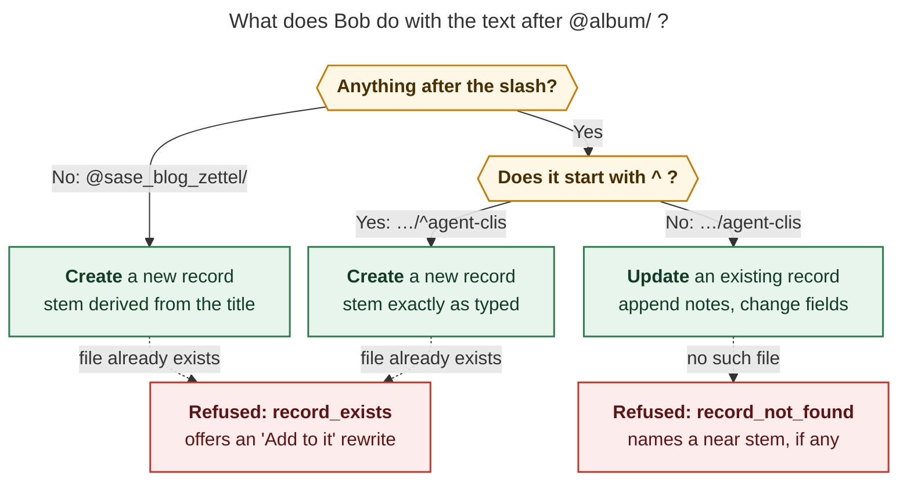
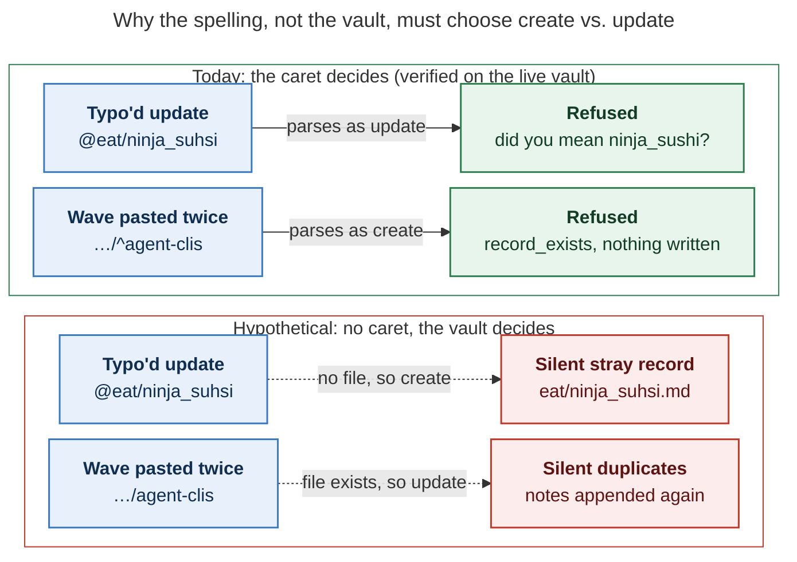

# Why `@album/^stem` needs the `^`

_Snapshot: `bob` 0.5.0, bob-cli master `70f69c23`, 2026-11-12. Context:
`research:202611/sase_blog_zettel_wave_captures.md`, where every record line looks like
`One CLI → Every CLI @sase_blog_zettel/^agent-clis`. Every result below came from
`bob capture-parse` or `bob capture --dry-run` against the live vault. Nothing was
written._

## TL;DR

- **The `^` is the only thing that marks a record as new.** Without it,
  `@sase_blog_zettel/agent-clis` already has a meaning: **add to the existing record
  `agent-clis`**. Run today, that line fails with `record_not_found`, because the record
  doesn't exist yet.
- **Bob decides between create and update from the text alone.** It never decides by
  checking which files exist. That's why a mistyped update or a wave pasted twice is
  refused instead of silently writing the wrong file.
- **Why `^` and not some other character:** Bob already uses `^` to give a new thing an
  ID (`@work^outline`, `@area^id@`), so it adds no new sigil. The `@eat/^titos` form was
  also unused before: it was a hard error.
- **`^stem` itself is optional.** You only need it when you want a filename different
  from the one Bob derives from the title. For the 15 wave records, 14 hand-picked stems
  differ from the derived one. Only `^limitations` could be dropped.
- **Rough edges:** `^` doesn't *always* mean "new". `^stem` refuses `_`, but derived
  stems always use `_`. One row in `docs/capture.md` is stale.

## 1. One path family, three meanings

| You type (Wave 1, item 1)                           | Bob reads it as                | Live result                                                          |
| --------------------------------------------------- | ------------------------------ | -------------------------------------------------------------------- |
| `One CLI → Every CLI @sase_blog_zettel/`            | create, stem from the title    | `sase_blog_zettel/one_cli_every_cli.md`                              |
| `One CLI → Every CLI @sase_blog_zettel/^agent-clis` | create, stem as typed          | `sase_blog_zettel/agent-clis.md`                                     |
| `One CLI → Every CLI @sase_blog_zettel/agent-clis`  | **update** an existing record  | ❌ `record_not_found`: record `agent-clis` does not exist             |
| `One CLI → Every CLI @sase_blog_zettel`             | a task route (no slash)        | ❌ `album_holds_no_tasks`: teaches `@sase_blog_zettel/`               |

_Figure 1. Bob decides between create and update from the characters alone. It checks
the vault only afterwards, to refuse a create that collides or an update that has no
target (dotted paths)._

This split was deliberate. The Record Notes design reserved `@eat/<stem>` for "adding to
an existing record", because "creation and appending should share one spelling family"
(A10 in `research:202611/record_type_capture/record_type_capture.md`). The plain path
went to updates, the case you'll use most once records exist: revisits, new notes, and
field changes. Creating a record with a hand-picked name got the extra character.
Updates shipped in `12641768` ("feat(capture): parse existing record updates").

## 2. Why the marker has to be in the text

`parse_record_route_token` (`src/native/capture_language/record.rs`) sorts the route
token into three cases using only its characters: an empty tail, a tail that starts with
`^`, or any other tail. The vault is consulted only *after* that choice is made. Suppose
the caret were dropped, and Bob instead guessed create or update from whether the file
exists:

_Figure 2. With the caret, both mistakes are refused, and the error tells you how to fix
it. Without it, both would succeed and write the wrong thing._

Both "Today" outcomes are real. `Revisited @eat/ninja_suhsi` returns
``record_not_found … did you mean `@eat/ninja_sushi`?``. A draft containing Wave 1's
first item twice fails at item 2 with `record already exists … add to it with
@sase_blog_zettel/agent-clis` and writes nothing.

Deciding from the text has two more benefits:

- The same draft means the same thing on the Mac and on athena, even when the vault sync
  is behind.
- The Mac panel's `capture-rewrite` stays "purely lexical … never touches the
  filesystem".

> The design reports never write out this vault-guessing alternative. This section is my
> analysis of what the split buys. The behaviours it cites are verified.

## 3. Why `^` and not another character

In Bob's capture grammar, `^` usually means *"here is the ID for the new thing I'm
creating"*. It comes from Obsidian, where you write `^block-id` to give a block an ID:

| Spelling                            | What `^` names                       |
| ----------------------------------- | ------------------------------------ |
| `Write an outline @work^outline`    | a **new task**, block ID `outline`   |
| `Body @area^my-proj@`               | a **new project note**               |
| `- child task ^step1` (project note) | a **new child task**, name only     |
| `Title @sase_blog_zettel/^agent-clis` | a **new record**, stem `agent-clis` |

The design report says this directly: "`^` declares a new id, as in `@route^id@`". It
also cost nothing:

- **The slot was free.** Before grammar 20, `@eat/^titos` was a hard error
  (`invalid_task_block_id_route`).
- **No new sigil.** The `decisions:capture-sigils-say-where-what-how` decision stays
  closed.
- **The `/` keeps it apart from project notes.** A generalized seal (`@eat^slug@`) was
  rejected because "one spelling would mean a project or a record depending on config,
  which is invisible."

## 4. Do the waves need `^stem` at all?

The `^stem` part is optional. Drop it (`… @sase_blog_zettel/`) and Bob derives the
filename from the title. Here is what that would change for the 15 wave records:

| Group | # | Chosen `^stem` ← title-derived stem |
| --- | --- | --- |
| Same either way (drop `^stem` freely) | 1 | `limitations` ← `limitations` |
| Separator only | 2 | `project-management` ← `project_management`, `how-i-got-here` ← `how_i_got_here` |
| Shorter or renamed | 12 | `agent-clis` ← `one_cli_every_cli` · `agent-presentation` ← `a_wall_of_terminals_one_screen` · `gates-plans-epics` ← `plan_mode_gates_plans_epics` · `macros-control-flow` ← `one_prompt_programs` · `beads-sidecars` ← `beads_sidecar_repos` · `skills-memory` ← `skills_memory_provider_interface_not_hooks` · `vcs-workspaces` ← `vcs_and_workspace_operations` · `routines-jobs` ← `routines_and_jobs` · `ai-slop` ← `my_definition_of_ai_slop` · `naming` ← `naming_things` · `future-work` ← `epics_legends_and_myths` · `need-your-help` ← `i_need_your_help` |

On average, the chosen stems are 13 characters and the derived stems are 21 (the longest
is 42). The bigger reason is stability. The stem is the record's permanent identity: it
is what `[[sase_blog_zettel/agent-clis|…]]` links point at and what later
`@sase_blog_zettel/agent-clis` updates use. The titles are working headlines, and they
will change while you draft. `Epics, Legends, and Myths` is already filed under the stem
`future-work`. Podcast stems show the same need: 8 of 15 differ from the rule (for
example, `techmeme` for "Techmeme Ride Home").

## 5. Costs and rough edges

- **`^` doesn't always mean "new".** `^work:outline` links an *existing* task (the
  "active-task spelling"). In a project-note capture, `- ^<id>` *moves* an existing
  parent task. So "caret = new" holds for creating things, but it has these two
  exceptions.
- **Two alphabets.** `^stem` accepts only `A-Z a-z 0-9 -` (the block-ID alphabet), but
  derived stems always use `_`. So `^agent_clis` is refused (`record_stem`). You can
  never hand-type a stem in the derived style, and one album can end up mixing
  `kebab-case` and `snake_case` filenames. Updates accept both.
- **The sibling forms disagree.** `@route^my-id@` changes `-` to `_` in the project
  note's filename (`route_my_id.md`). `@dir/^my-id` keeps the hyphen (`dir/my-id.md`).
  The design draft proposed following the project-note rule, but the shipped code
  doesn't.
- **One stale doc row.** The marker table in `docs/capture.md` (line 107) still lists
  `Title @dir/stem` as "Reserved: refused until capture can append to an existing note".
  The Record notes section and `docs/reference/capture-syntax.md` are correct.

## Verdict

**Yes, the `^` is justified, and Bob needs it.** It's the one character that separates
"create this record and name it" from "add to that record". Because that choice lives in
the text and not in the vault, capture refuses instead of writing the wrong file. The
rule to remember:

> **`@album/`** = new, named from the title · **`@album/^stem`** = new, named by me ·
> **`@album/stem`** = existing

## Sources

- bob-cli `docs/capture.md` §Record notes; `docs/reference/capture-syntax.md`
  §Record notes, §`@route^block-id`, §`^route:block-id`; `docs/records.md`.
- `src/native/capture_language/record.rs` (`parse_record_route_token`,
  `is_valid_record_stem`); `src/native/records/plan.rs` (explicit vs. derived stem).
- `research:202611/record_type_capture/record_type_capture.md` (A10, §Capture syntax,
  §Filenames) and `…/record_type_capture__cld.md` (§5.2, the "`@eat/` is free today"
  finding).
- `research:202611/sase_blog_zettel_wave_captures.md` and
  `research:202611/sase_blog_zettel_album_guide.md`.
- Decision `capture-sigils-say-where-what-how`. No decision record covers record routes
  yet; the rationale lives only in the design report above.
- Live checks on 2026-11-12: `bob capture-parse` and `bob capture --dry-run` for all
  four spellings, for all 15 wave titles with and without `^stem`, for the
  `ninja_suhsi` typo, and for a double paste.
