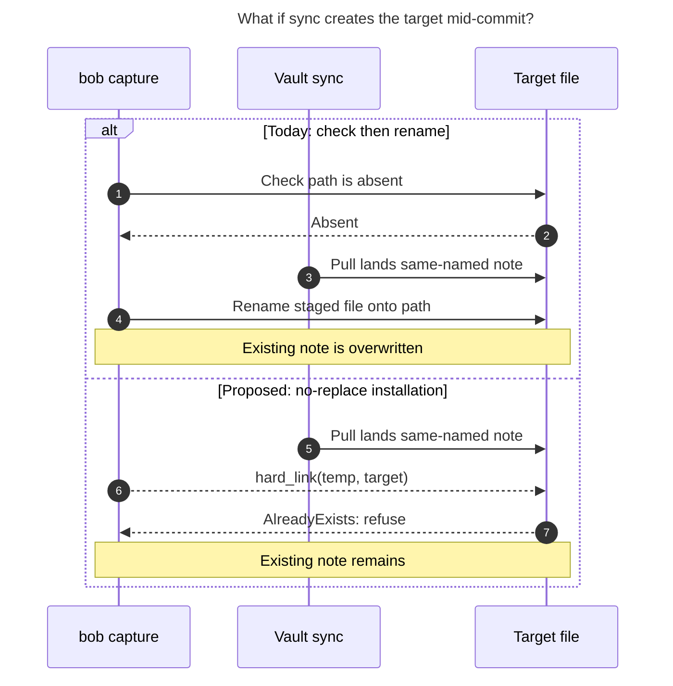

# Diagram proposals: Record notes: capturing custom-typed notes, restaurants first

Proposals for the swarm linker, not a report. Each diagram restates only what the source
report says.

```yaml
source: research:202611/record_type_capture/record_type_capture__final.md
producer: research.3p.image
check: "mmdc 12.0.0 with --no-sandbox and the PDF-mirroring config rendered 1 of 1 Mermaid diagrams"
```

## concurrent-file-creation

```yaml
anchor: |-
  This closes the check-then-`rename` window that §1.2 verified, including a vault-sync
question: |-
  How can sync defeat today's pre-write check, and how would hard-link installation respond?
illustrates: |-
  A vault-sync pull can land a same-named note between the check and the rename; the proposed hard-link installation refuses that collision without replacing the note.
caption: "If sync creates the target mid-commit, today's rename overwrites it; proposed hard-link installation refuses without replacing it."
review: "747x727 px, fit 87.4%; question, source trace, unique anchor and visual checks passed; 0 revisions; batch check passed"
```


