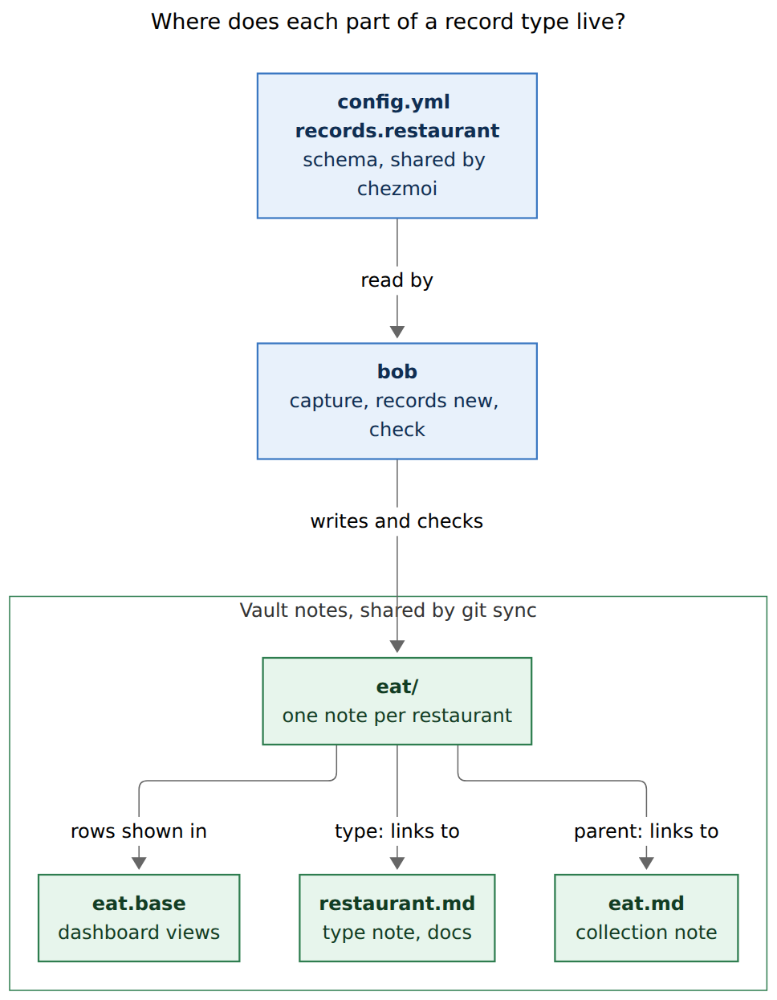
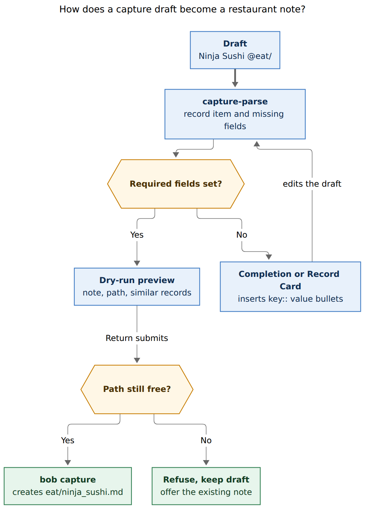
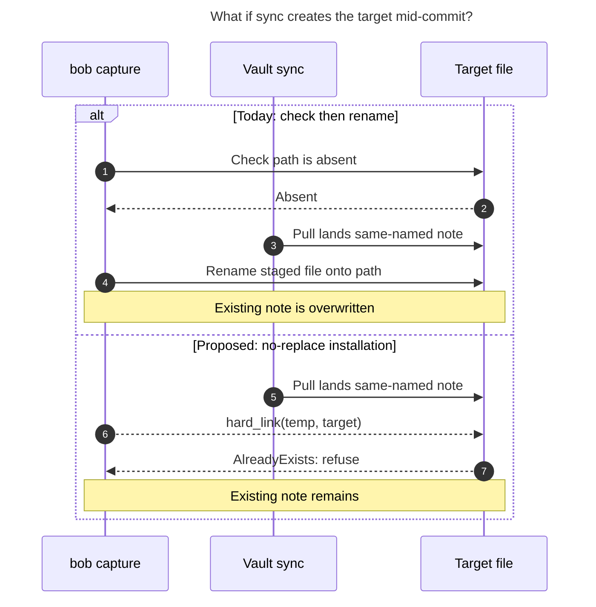

# Record notes: capturing custom-typed notes, restaurants first

> **Research query:** How should Bob add generalized capture for note files of
> custom-defined types, starting with `~/bob/eat/` and possibly podcasts, TV shows, and
> movies, where each type owns a directory and declares the frontmatter fields its notes
> must define, and capture makes entering those values as easy as possible? Is this a good
> idea, would a different approach or adjusted requirements be better, and what intuitive,
> reliable, and beautiful solution is recommended?


## Bottom line

- **Build it, kept small.** All five reports agree on that, and
  [the evidence](#what-exists-today) supports them. The vault already has two
  hand-maintained collections that follow this pattern: 92 restaurant notes in `eat/` and
  15 podcast notes in `podcasts/`. Each has a type note and a Base dashboard. Nothing
  creates their notes, and nothing checks their shape.
- **Call them Record Notes.** A *record type* (for example `restaurant`) owns one folder
  (`eat/`). "Type" alone already means Task Type in Bob, and "catalog" is used 122 times in
  bob-cli's docs for other things.
- **One new capture spelling:** a [trailing slash on a folder route](#capture-syntax).

  ```text
  Ninja Sushi @eat/
  - status:: liked
  - category:: Sushi
  - location:: Clark
  - Spicy tuna was great; Kelly loved the salmon.
  ```

  This creates `eat/ninja_sushi.md`. `key:: value` bullets become frontmatter, and every
  other bullet becomes a dated entry under `## Notes`.
- **[The draft is the form.](#making-input-easy-and-beautiful)** bob reports the missing
  required fields and offers values for each one: choice labels, the values already used
  in that folder (ranked), `today`, and links. Tab walks through the missing fields. On
  the Mac, a **Record Card** and a **new-note preview** show the same draft. The app never
  parses, validates, or writes.
- **The schema goes in [`config.yml` under `records:`](#where-the-schema-lives).** That is
  where Task Types, bullet properties, and `gmail.folder` already live. The file is shared
  by chezmoi.
- **[Reliability](#reliability) needs more than a writer.**
  - One records engine serves both capture and a new `bob records` command group
    (`list`, `show`, `check`, `new`).
  - The new file is installed without ever replacing an existing one. Today's writer can
    [overwrite a file in a narrow race](#figure-concurrent-file-creation).
  - Duplicates are refused.
  - `bob records check` keeps the schema true for notes that agents and Obsidian write.
- **[Types](#which-types-should-exist):**
  - `restaurant` and `podcast` ship first.
  - **TV shows and movies are real demand**, but today they live as watch-list tasks.
    Add them as two separate types (`show`, `movie`) in the next wave, once the engine
    has proved itself on real data.
  - Books, podcast episodes, people, drinks, and logs should not become record types.

## Is this a good idea

**Yes, with conditions.** It fixes three real problems:

1. Creating a record means hand-writing YAML or asking an agent. Both new restaurants
   came from agents.
2. Nothing holds the shape, and drift has already started.
3. Bryan's watch-and-try history is scattered across tasks that disappear into `done/`
   (see [which types should exist](#which-types-should-exist)).

It is risky because capture is Bob's densest surface. It is at grammar revision 19, nearly
every ASCII sigil is taken, and every capture feature lands twice: in bob first, then in
Swift behind macOS CI. Because creation volume is low, the feature only pays off if it
meets all of these conditions:

- It is **declarative**: adding a type is config, with no per-type code.
- It adds **one spelling**, not a sub-language.
- It is **validated everywhere**, not only at write time. Otherwise the schema drifts the
  way the agents' notes did.
- It is **useful outside the Mac panel**. Agents, scripts, and Obsidian Command Mode need
  a contract before the Swift half ships.

**Do not build:**

- views and dashboards (Bases already does this well);
- relations or computed fields;
- web enrichment such as map lookups or title fetching;
- Templater evaluation inside bob;
- schema inheritance;
- automatic migrations;
- dual-writing the old `eat.md` table;
- tasks inside records (v1).

### Alternatives considered

| Approach | Verdict |
| --- | --- |
| **Obsidian only**: the Bases *New* button, Templater folder templates, Metadata Menu or Fileclass | Fine inside Obsidian, but it cannot reach the Mac panel or the CLI, does not enforce required fields, and gives agents no API. Keep it as a complementary path that `bob records check` audits. |
| **Agents only** ("add Rush Bowl to eat") | This is what happens today: slow, costs tokens, and drifts. |
| **A `bob eat add` command per type** (grk's smaller option) | Ships faster, but the next type needs a second command. Two collections already justify one generic engine. |
| **A full entity database** (SQL, a properties API, bidirectional tables) | Bob's grain is Markdown plus Bases. Stay there. |
| **A universal constructor for every `type:` value** | It would fork the engines that already own `project`, `area`, `ref`, `article`, `mail`, `day`, and `done`. Record types are an opt-in subset. |

## What exists today

Everything in this section was verified.

### Two collections already follow the pattern

| | `eat/` | `podcasts/` |
| --- | --- | --- |
| Notes | 92, all `type: "[[restaurant]]"` | 15, all `type: "[[podcast]]"` |
| Parent | `"[[eat]]"` | `"[[podcasts]]"` |
| Dashboard | `eat.base` (filters `file.inFolder("eat")` and `note.type == link("restaurant")`) | `podcasts.base` |
| Type note | `restaurant.md` (prose only, child of `type.md`) | `podcast.md` (prose only) |
| Status values | `liked` 85, `not_liked` 7 | `subscribed` 9, `unsubscribed` 6 |
| Created since migration | 2 (Rush Bowl, 2026-06-05; Brown Fox Coffee Box, 2026-07-04), both by agents | 0; all 15 arrived in one commit (2026-08-06) |

**Restaurant fields.**

- Every note has `title`, `status`, `category`, `location`, and `companions`.
- `category` has 37 distinct strings, including typos such as `Cheeseteaks`, and is
  `null` six times.
- `location` mixes plain towns and block-anchor links. Westfield appears 15 times as
  `"Westfield"` and 5 times as `"[[nj_towns#^z-241117-0d|westfield]]"`.
- `companions` is `[[kelly]]` 90 times. The two notes agents wrote have `companions: []`.
- `lid` and `source_*` are migration residue from zorg.
- The two post-migration notes add `visited`, and their `## Notes` bullets are dated
  (`- 2026-06-04: …`). That is the shape new notes should follow.
- `eat.base` needs a 22-branch `cuisine` formula to clean up categories at read time. That
  formula is the cost of having no schema.

**Creation is rare, and the shape already drifts.** Only two restaurants were added in
five months, and their shape already differs from the established one: empty
companions, `lid: null`, a quoted `visited` date, and different `created` styles. `eat.md`
(a converted zorg table) has not been edited since June. The value of this feature is
**lower friction and a shape that stays stable**, not throughput.

### Capture facts that constrain the syntax

These were checked by running the current `bob`.

| Probe | Result today | Consequence |
| --- | --- | --- |
| `Ninja Sushi @eat/` | Literal task body, no diagnostic | The spelling is free. An old bob would capture it as an inbox task, which is visible in the preview (fails open). |
| `Blaze @eat` | **Files a task into `eat.md`** (every lowercase root note is routable at commit, even if `capture-targets` does not list it). The same holds for `@podcasts`. | `@eat` and `@eat/` differ by one character, so a near-miss guard is needed ([the two traps](#two-traps-verified-in-this-round-and-their-fixes)). This corrects grk, who assumed `@eat` would only work if `eat.md` were an area. |
| `Blaze %restaurant`, `%note:restaurant Blaze` | Refused: `unknown_directive` | A `%` spelling would fail closed on an old bob. |
| `Foo\n- status:: liked\n- category: Sushi` | Both kept as literal sub-bullets | Field bullets have no current meaning on a record item. |
| Mac panel, `/` typed after `@eat` | `capture-rewrite` turns it into `#` and opens `eat.md`'s heading menu, because `@eat` is a route. The rewrite is "purely lexical … never touches the filesystem". | `@eat/` cannot be typed in the panel without a deliberate design ([the two traps](#two-traps-verified-in-this-round-and-their-fixes)). |

**Writer.** For a new target, `capture/commit.rs` checks that the path is absent and then
calls `fs::rename`, which silently replaces a file. Its own comment calls these checks
"not cross-process locking or a fully serialized transaction". Capture does not take
`bob_sync.lock` (only vault-sync, nightly, ref, periods, and similar commands do). So a
vault-sync pull can land a same-named note between the check and the rename. This
corrects grk's statement that writes take the lock.

**Config.** `~/.config/bob/config.yml` is a plain (untemplated) chezmoi file,
`home/dot_config/bob/config.yml`, shared by athena, apollo, and the Mac. Each host picks up
changes with `chezmoi update`. It already holds `types:`, `properties:` (whose `values:`
vocabulary is `date | local_task_id | priority | [list]`), `relations:`, `plan:`, and
`gmail.folder`, which names a vault folder. This corrects mus's statement that host config
does not sync.

**Vault sync.** The vault's `.gitignore` ignores everything and then allows specific
patterns, which include `.md`, `.base`, and named `.bob/*.jsonl` journals. A new
`.bob/note-types.yml` would not sync without a new allow rule (cdx was right).

**Mac app.** Unknown completion contexts render as generic rows, and unknown spans render
as neutral text (`docs/protocol.md`). Bob-side completion therefore works in an older app
with no Swift changes. No multi-field form and no whole-note preview exist yet.

## Deliberate requirement adjustments

| # | As requested | Adjusted to | Why |
| --- | --- | --- | --- |
| A1 | "Custom-defined types" | **Record types**, which create **Record Notes**. The config key is `records:`, the CLI is `bob records`, and the frontmatter stays `type: "[[restaurant]]"`. | "Type" already means Task Type (`#fix`, `types:`, `bob types`). "Catalog" is overloaded: the drawer, theme, and code catalogs, plus `bob __catalog`. Engine types keep their own commands. |
| A2 | "Must be defined" | **Required after defaults.** bob owns and writes `parent`, `type`, `title`, and `created`, and never asks for them. A visible default satisfies a required field. | Asking for what bob already knows is friction. Required does not mean typed by hand. |
| A3 | Optional fields unspecified | **Optional fields: yes.** Empty optional fields are omitted, never written as `null`. Unknown keys are refused with a did-you-mean. | Required-only schemas force invented values; six restaurants already carry `category: null`. |
| A4 | One directory per type | **1:1 type ↔ folder, and the folder is the capture spelling.** The type id is the type note's stem, and the folder is one segment in v1. | Matches `eat/` and `podcasts/`. mus's many-to-one idea is speculative and makes `@eat/` ambiguous. |
| A5 | Schema location unspecified | **`config.yml` `records:`** ([Where the schema lives](#where-the-schema-lives)). | Follows the existing vocabulary precedent. |
| A6 | Capture only | **Also `bob records new`** (agents and scripts) and **`bob records check`** (lint). | Bryan's task asks for easy CLI management. `check` is what makes "reliable" true for writers other than capture. |
| A7 | (implicit) keep the lists in sync | **Write only the folder note.** The Base is the index. Update `eat.base` and `podcasts.base` so new records show up honestly. | Dual-writing the zorg table creates two sources of truth. |
| A8 | (implicit) restaurants are things you liked | **Add a `to_try` status.** | `maybe_eat.md` has 12 open want-to-try rows, and new captures are often recommendations. |
| A9 | Create notes | **Create notes, not tasks.** Task markers on a record item are refused in v1. | A record is durable reference. A reminder is a separate task in the same draft. |
| A10 | Create only | **Reserve `@eat/<stem>` for adding to an existing record** in a later phase. | Revisits, verdict changes, and dated notes on a known place are the obvious next need, and creation and appending should share one spelling family. |
| A11 | Podcasts, TV, and movies? | **Restaurant and podcast first; `show` and `movie` as two types next.** No books, episodes, people, or drinks. | [Which types should exist](#which-types-should-exist). |

## Which types should exist

**When to add a type:** individual things repeatedly need their own identity, a few stable
fields, and a collection view that beats a list in one note. If a list in one note is
enough, keep the list.

| Candidate | Evidence (verified) | Verdict |
| --- | --- | --- |
| **restaurant** (`eat/`) | 92 notes, 6-view Base, type note | **First.** Add `to_try`. Optionally move `maybe_eat.md`'s 12 rows into it later. |
| **podcast** (`podcasts/`) | 15 notes, Base, type note; 8 of 15 filenames differ from the title rule (`talk_python`, `techmeme`) | **First wave, config only.** It proves the engine is not shaped around restaurants (`url`, subscriptions), and it is why the explicit-filename form exists. |
| **show** (`tv/`) | `now_fun.md`: 7 `TV SHOW:` tasks and 9 `#plex` download items, often with `INSPIRED BY: %eric` / `%nona`; `prj_plex.md` "Active TV Shows" (3); `tv.md` (1 bullet, 2026-08); `#plex` in 59 notes | **Next wave.** |
| **movie** (`movies/`) | 4 open movie tasks in `love.md` (created Aug–Oct 2026, e.g. "Watch 'F1' the movie with Kelly"); `#plex` download tasks | **Next wave**, as its own type. |
| book | `ref/` (1,238 `type: [[ref]]`) owns books, PDFs, and reading tasks | **No.** gem's `lit/` book type would split the library. |
| podcast episode | `podcast_ref.md`, `lit/podcasts` | **No.** These are references. |
| person | `people.md` is an `%ldap` alias table; `kelly.md` is an area | **No.** |
| drink | `drink.md` has two liquor-store rows | **No.** Use a restaurant category if needed. |
| trails, surf, vet, quotes | logs or deliberate single notes | **No.** |

**Why TV and movies wait for the next wave rather than shipping now.** The demand is real:
about 25 open titles, recurring recommendation provenance, and a shared watch habit with
Kelly. Bryan names both types in his task. But today these are *actions* ("Download X",
"Watch X with Kelly"), and they vanish into `done/` when completed. That is precisely the
missing history a record would keep: what you watched, whether you liked it, and who
recommended it. This is the same value `eat/` gives restaurants.

They wait for three reasons:

1. They have no folder, type note, index note, or Base yet, so setup is real work.
2. The engine should be proven on the two collections that already exist.
3. Their scope needs one rule decided first: **a show or movie record holds the
   recommendation and the verdict, and the download or watch action stays a task that
   links to it.** A single draft can carry both items:

   ```text
   Landman @tv/
   - status:: to_watch
   - recommended_by:: Eric
   - service:: Paramount+

   Download Landman for Plex
   ```

   Today the task can wikilink the new note. Linking the two items in one draft
   automatically would be later grammar.

**Use two types, not one `media` type.** A show has seasons and a watching state. A movie
is a finite event with a release year. A merged schema fills up with conditional fields.

mus argued that per-title notes would create "hundreds of near-empty notes". At about one
or two titles a month, that is not the volume. A record is also only worth creating when
it carries a recommendation or a verdict.

Draft schemas, ready to add as config once the engine exists:

- **show:** `status` (`to_watch`, `watching`, `watched`, `dropped`; required), `service`
  (suggest), `recommended_by` (text with suggestions; people are `%alias` names, not notes),
  `verdict` (`loved`, `liked`, `meh`, `disliked`), `companions` (default `[[kelly]]`).
- **movie:** `status` (`to_watch`, `watched`; required), `year` (number), `service`,
  `recommended_by`, `verdict`, `companions`, `watched` (date).

## Where the schema lives



*Figure 1. The schema is shared bob config that bob reads. The records, their type note,
their collection note, and the Base are ordinary vault notes linked by frontmatter.*
(Rendered at 645 × 831 px; fit 100%; Mermaid CLI 12.0.0. The source is in
`record_type_capture__final_assets/anatomy.mmd`.)

The reports split three ways:

| Option | For | Against |
| --- | --- | --- |
| **`config.yml` `records:`** (cld, gem) | Every vocabulary Bryan writes already lives here: `types:`, `properties:`, `relations:`, and even `gmail.folder`, a vault folder. It is validated at load, shared by chezmoi, and cannot be mangled by Obsidian's Properties UI or edited by accident from a phone. | Not in the vault, so a bare vault clone cannot create records, though it can still read them. Each host needs `chezmoi update`, the same as for `types:` today. |
| Vault `.bob/note-types.yml` (cdx) | Travels with the notes and syncs automatically. | `.bob/` holds journals that bob writes, not configuration Bryan writes. It needs a new `.gitignore` allow rule. It is invisible in Obsidian. |
| Frontmatter on `restaurant.md` (grk, mus) | Colocated with the human documentation. | Obsidian Properties does not edit nested objects. A schema typo synced from any device breaks capture. It mixes a machine contract into a prose note. |

**Decision: `config.yml` `records:`.** Keep `restaurant.md` as the human documentation,
with one line pointing to `bob records show restaurant`.

**Reopen** this decision if a second vault, a host without chezmoi, or an Obsidian-side
writer needs the schema without calling `bob`.

Whichever home is chosen, two requirements hold:

- **A malformed `records:` block disables record capture only.** It must report an
  actionable error and never break ordinary task capture.
- **Vault-wide property names must be consistent.** Obsidian property types are global
  per property name, so `status` must stay text in every type. The loader checks that
  shared property names use one storage kind.

## Schema and the note it writes

```yaml
# Record types: one note per thing in its own folder (docs/records.md).
# Capture creates one with `<title> @<dir>/`; `bob records check` lints each folder.
records:
  restaurant:                    # type id = type-note stem → type: "[[restaurant]]"
    dir: eat                     # one folder segment; also the capture spelling @eat/
    label: Restaurant
    emoji: 🍽️
    dated_notes: true            # first-level note bullets become "- YYYY-MM-DD: …"
    fields:                      # frontmatter order follows this order
      status:
        required: true
        values:                  # closed choice; labels are display-only
          to_try: 🔖 To try
          liked: 💚 Liked
          not_liked: 🚫 Not liked
      category:
        required: true
        suggest: true            # open vocabulary: rank values already in eat/
      location:
        required: true
        suggest: true
      companions:
        values: link
        list: true
        default: ["[[kelly]]"]   # shown as a default in the card; one key clears it
      visited:
        values: date             # `today` is the first suggestion; no default
      url:
        values: url
    legacy: [lid, source_*]      # tolerated by `check` on old notes; never written
  podcast:
    dir: podcasts
    label: Podcast
    emoji: 🎙️
    fields:
      status:
        required: true
        values: {to_try: 🔖 To try, subscribed: 🎧 Subscribed, unsubscribed: 🚫 Unsubscribed}
      category: {required: true, suggest: true}
      url: {values: url}         # optional: a friend's recommendation rarely has one
    legacy: [zorg_id, source_*]
```

**Field kinds.** `values:` extends the existing `properties:` vocabulary:

| `values:` | Accepts | Suggestions | Written as |
| --- | --- | --- | --- |
| *(omitted)* | free text | existing values when `suggest: true`, by frequency | quoted string |
| `{value: label}` map | one listed value | the labels | bare token (`liked`) |
| `date` | `YYYY-MM-DD`, `today`, `yesterday` | today, yesterday | bare ISO date |
| `link` | `[[wikilink]]`, or a bare name that bob wraps | used values, then `[[` note completion | `"[[kelly]]"` |
| `url` | `http(s)://…` | none | bare |
| `number` | integer or decimal, optional `min`/`max` | none | bare |

Add `list: true` for multi-valued fields; they are written as block lists. Ship only the
kinds the first two types use plus `number`. Defer the rest.

**When to make a field required.** Require it when every existing record has it *and* it
is almost always known at capture time. That rule gives restaurants `status`, `category`,
and `location`. It makes podcast `url` optional, even though all 15 shows have one,
because recommendations arrive without one. `status` has **no default**: a capture is
either a recommendation (`to_try`) or a verdict, and a wrong default would silently
corrupt the verdict views. Choosing costs one keystroke.

**Load-time validation** produces a records-only config error when any of these fail:

- type ids and field keys match `[a-z][a-z0-9_]*`;
- built-in note types (`project`, `area`, `ref`, `day`, `done`, `mail`, `article`) are
  reserved;
- `dir` is unique and is a safe single relative segment;
- the `parent` and type notes resolve;
- choice maps are non-empty;
- each default passes its own field's validation;
- `parent`, `type`, `title`, and `created` are not declared as fields.

**The note bob writes.** It follows the shape of the two hand-made restaurant notes
(Rush Bowl and Brown Fox Coffee Box):

```markdown
---
parent: "[[eat]]"
type: "[[restaurant]]"
title: "Ninja Sushi"
status: liked
category: "Sushi"
location: "Clark"
companions:
  - "[[kelly]]"
visited: 2026-11-08
created: 2026-11-08T12:41:07-05:00
---

# Ninja Sushi

## Notes

- 2026-11-08: Spicy tuna was great; Kelly loved the salmon.
```

- `parent` defaults to `"[[<dir>]]"` when `<dir>.md` exists. A per-type `parent:`
  overrides it.
- `created` uses the project-note timestamp helper and honours `BOB_NOW`.
- bob never writes `lid`, `zorg_id`, `source_*`, or a `## Source` fence.
- An ALL-CAPS first-level bullet with nested bullets becomes a `## Title Case` section,
  using the same rule as project notes and the
  `decisions:capture-bullets-mirror-the-task-block` grammar.

## Capture syntax

### Options weighed

| Spelling | Who proposed it | Verdict |
| --- | --- | --- |
| `#restaurant` | none (all rejected it) | `#` at an item edge is a Task Type, and unknown names already refuse with `type_not_configured`. |
| `@eat` (no slash) | none | Already files a task into `eat.md`. |
| `@eat^slug@` (generalized seal) | mus | One spelling would mean a project or a record depending on config, which is invisible. It forces typing a slug. Its `|` positional fields are brittle. |
| `%restaurant` | grk | Fails closed on an old bob, but user-defined words compete with built-in `%` directives. A kind is a *what*, not a *how*. Appending to an existing record would still need a path spelling. |
| `%note:restaurant` + an indented `key: value` stanza | cdx | Explicit and fails closed, but long to type, and the non-bullet stanza needs a new child-line grammar. |
| **`@eat/` + `- key:: value` bullets** | cld, gem (gem with `key:`) | **Chosen.** |

**Why `@eat/`.**

- `@` already says *where* (`decisions:capture-sigils-say-where-what-how`), and creating a
  note is not new under `@`: `@route^id@` already creates project notes.
- A trailing slash means "folder" in shells, URLs, and Obsidian paths. The text is the
  folder the note lands in.
- No sigil is added, so the sigils decision is not reopened.
- It starts one coherent path family:
  - `@eat/` creates a new record;
  - `@eat/^stem` creates one with an explicit filename (`^` declares a new id, as in
    `@route^id@`);
  - later, `@eat/ninja_sushi` adds to an existing record.

**Why `::`.**

- It is Bryan's own idiom for properties: zorg used `* tick::…` and `LID::ahrres`, and
  every task uses `[key:: value]`.
- It is Dataview-compatible.
- It never captures prose. With single-colon `key:` bullets (gem, grk), a note such as
  `- Location: upstairs in the mall` would silently become a field.
- In the Mac panel the field menu inserts `key:: ` for you, so nobody has to type the
  double colon.

### Grammar

This is grammar revision 20.

| Form | Meaning |
| --- | --- |
| `<title> @<dir>/` or `@<dir>/ <title>` | Create a record of the type whose `dir` is `<dir>`. The filename stem comes from the title. |
| `<title> @<dir>/^<stem>` | The same, with an explicit stem, following the block-ID alphabet (`@podcasts/^talk_python`). |
| First-level `- <key>:: <value>` | Set a declared field. The key must match exactly. |
| First-level `- <key>::` with nothing after it | Incomplete: needs `record_value`. |
| Any other first-level bullet (and its nested bullets) | A note under `## Notes`, dated if `dated_notes` is set. ALL-CAPS with nested bullets becomes a section. |
| `@<dir>/<stem>` | **Reserved** for appending to an existing record. In v1 it is refused with a teaching message. |

Rules:

- The parent line's text, with markers removed, is the title. An empty title needs
  `record_title`.
- A record item's own route beats `@@`.
- Multi-item drafts stay all-or-nothing.
- `%t` composes, so bulk imports are a single paste. For example, `maybe_eat.md`'s rows
  could be imported like this:

  ```text
  {0} @eat/ %t
  - status:: to_try
  - location:: {1}

  "N'Between Bar" Clark
  "1950 Originals" Westfield
  ```
- A URL inside a field bullet is a field value, not a reference job.
- On a record item, v1 refuses these markers with `record_marker_unsupported`, naming the
  marker:
  - `#TYPE`, `s:N`, and `$N`;
  - `%c`, `%n`, and `%l`;
  - `&`, `*`, `~`, `!`, and `+`;
  - session operators and task-id bullets.
- A first-level bullet that starts with a declared field name and a single colon stays a
  note, with a soft hint: `did you mean location::?`.
- Teaching refusals use Bob's established voice:
  - `` `@restaurant/` names the type; restaurant notes live in eat/ — write `@eat/` ``
  - `` `cat` is not a restaurant field; did you mean `category`? (fields: status, category, location, companions, visited, url) ``
  - `` `status:: loved` — restaurant status is to_try, liked, or not_liked ``
  - `` record already exists: eat/ninja_sushi.md (open it; adding to it with @eat/ninja_sushi comes later) ``
  - `` `@ref/` is a folder but not a record folder; record folders: eat/, podcasts/ `` (only
    when `<word>/` is an existing vault folder; any other `@word/` stays literal, as today)

### Two traps verified in this round and their fixes

1. **Near miss: `@eat` instead of `@eat/`.** Today this silently files a task into
   `eat.md`. When a bare `@<route>` names the collection note of a record type, parse
   should emit a warning, `record_collection_route`: "eat.md is the restaurant collection —
   `@eat/` creates a restaurant note". The warning comes with a one-key fix. The preview
   still shows the task diff, so nothing is hidden. Upgrade the warning to a refusal if
   tasks never belong in `eat.md`.
2. **The Mac `/`→`#` typing shortcut.** Typing `/` after `@eat` becomes `#` and opens the
   heading menu, because `capture-rewrite` is lexical and `@eat` is a route. **Recommended
   fix, with no contract change:**
   - When the route is a record collection, `capture-complete`'s heading menu gets a
     first, highlighted row: "🍽️ New restaurant · eat/". Accepting it rewrites `@eat#` to
     `@eat/` and continues to the first missing field. Typing `Ninja Sushi @eat/` then
     Return therefore lands in the record flow.
   - The existing double press (`//`) already leaves a literal `/`.
   - `@` route completion lists record rows (`eat/  🍽️ New restaurant · 92`) that insert
     `@eat/ ` directly.

   **Fallback:** if this feels indirect in use, let `capture-rewrite` read only the
   `records:` folder list from config. That is a documented change to its "never touches
   the filesystem" contract, so it is not the first choice.

## Making input easy and beautiful



*Figure 2. bob parses the record item and fills missing required fields as ordinary
`key:: value` bullets in the draft. Return creates the note only if its path is still
free; otherwise bob refuses and keeps the draft.* (Rendered at 707 × 986 px; fit 90.5%;
Mermaid CLI 12.0.0. The source is in `record_type_capture__final_assets/flow.mmd`.)

**Principle: the form is the draft.** Every assist is an ordinary, undoable text edit
chosen by bob. Stash, undo, templates, the CLI, and dry-run therefore keep working
unchanged, and the card can never disagree with the text.

1. **Discover.** `@` route completion and `bob capture-targets` list record folders,
   marked `kind: record`. The `%`-less design needs no directive row.
2. **Tab through the missing fields.** While the caret is in a record item with missing
   required fields, `capture-complete` returns a `record_value` context for the next
   missing field. Its rows are:
   - choice labels (🔖 To try · 💚 Liked · 🚫 Not liked);
   - folder values ranked by frequency (`Breakfast · 18`, `Coffee · 11`). Values are
     **collapsed by display text**, so Westfield shows once and inserts its most-used
     spelling;
   - `today` and `yesterday` for date fields;
   - links (`[[` falls through to note completion).

   Accepting a row inserts `\n- key:: value` at the end of the field block. It carries a
   `continuation`, so the next missing field's list opens straight away. Typing filters
   the list, and new open-vocabulary values are allowed. A value close to an existing one
   (`Cheeseteaks`) gets a soft `record_value_near` hint. Escape stops at any point and
   keeps what was typed.
3. **Field names.** On a fresh `- ` inside a record item, the `record_field` context
   offers the fields not yet set, required ones first.
4. **Record Card (Mac).** It is drawn from parse's `record` object, in the slot where the
   picker card sits today. Each control is a completion-row acceptance with bob-authored
   replacement ranges, so nothing is submitted outside the draft:

   ```text
   ╭─ 🍽️  New restaurant ───────────────────────── eat/ninja_sushi.md ─╮
   │  ● Status       🔖 To try · 💚 Liked · 🚫 Not liked                │
   │  ✓ Category     Sushi                                             │
   │  ○ Location     Cranford · Westfield · Clark · NYC · …   ⇥ fill  │
   │  ✓ Companions   Kelly                                  default   │
   │    Visited      today · yesterday                                 │
   │  ▸ More (url)                                · 1 note             │
   ╰──────────────── ⇥ next field · ⏎ create · Esc back to draft ──────╯
   ```

   Behavior rules:
   - Persistent labels. Required and invalid states are never shown by colour alone.
     Support VoiceOver and Reduce Motion.
   - Focus and the caret stay keyed by field, so a refreshing response never steals them.
   - In an open list, Return accepts the highlighted row. With no list open, Return
     submits only when the draft is complete; otherwise it moves to the first missing
     field, and the footer says so ("Needs location").
   - Escape closes the popup first, then returns to the intact draft. It never creates a
     partial file.
   - Responses are bound to a draft generation, so stale ones are discarded.
5. **New-note preview.** Dry-run `note_files[]` entries render as a property sheet with
   labels (💚 Liked, not `liked`), then the body. A "View Markdown" disclosure shows the
   exact bytes. Today's Preview pane shows only block diffs, so this is the one new view.
6. **Similar records.** After typing settles, a same-folder near-title match appears in
   the style of the Similar-tasks band
   (`decisions:similar-tasks-are-a-settled-heads-up`): "Already in eat/: Ninja Sushi —
   💚 liked · Sushi". Return never changes because of it. The match is a hint, not proof
   of a duplicate. `eat/1950s_originals.md` (Westwood) and `maybe_eat.md`'s "1950
   Originals" (a Westfield URL) are one chain. Whether that is a duplicate or a second
   branch is a decision for Bryan, which is why bob only shows the match and never merges.
7. **Success.**

   ```text
   ✓ 1/1  🍽️ new restaurant  eat/ninja_sushi.md
           💚 Liked · Sushi · Clark · with Kelly · 1 note
   ```

**CLI.** `bob capture` refuses an incomplete record with a ready-to-copy draft and writes
nothing:

```text
bob capture: a restaurant note needs 2 more fields
  Ninja Sushi @eat/
  - status:: …              to_try · liked · not_liked
  - location:: …            Cranford · Westfield · Clark · NYC
```

Never prompt interactively. That would break piped drafts, scripts, and the Mac
subprocess contract.

## Reliability

### Planning and installing writes

- **One engine.** A new `src/native/records/` module holds `schema`, `catalog` (values,
  stems, and titles per folder), `render`, and `plan`. Capture items and
  `bob records new` both call `plan`. Matching at commit time is exact; menus assist but
  never decide.
- **All or nothing.** Plan every item before writing anything. A record missing a field
  in a mixed record-and-task draft refuses the whole draft and keeps both items. Dry run
  has no side effects.
- **Install without ever replacing.**
  - Write the temporary file, then `hard_link(temp, target)`. That fails with
    `AlreadyExists` if anything appeared at the target.
  - Then remove the temporary file, and fold the cleanup into the existing rollback.
  - Both Linux and APFS support hard links.
  - This closes the check-then-`rename` window that
    [the capture facts above](#capture-facts-that-constrain-the-syntax) verified,
    including a vault-sync pull landing the same filename mid-commit.
  - Do not claim crash atomicity across several files. That is a separate journal
    decision.

[The sync-race sequence diagram](#figure-concurrent-file-creation) shows a vault-sync pull
landing a same-named note between the absence check and the rename, and where the
proposed hard link refuses instead.

<div id="figure-concurrent-file-creation">



_If sync creates the target mid-commit, today's rename overwrites it; proposed hard-link installation refuses without replacing it._

</div>

### Filenames and duplicates

- **Filenames.**
  - The rule: NFKD-fold, `&` → `and`, drop `'` and `’`, turn every other non-alphanumeric
    run into `_`, trim, lowercase.
  - **Verified: it reproduces 91 of 92 existing `eat/` filenames.** The exception is
    `&grain`: the file is `andgrain`, and the rule gives `and_grain`. gem's ASCII rule misses
    14, for example producing `amy_s_omelette_house`.
  - Collisions are checked case-insensitively, because APFS is case-insensitive.
  - `^stem` covers hand-picked names: 8 of 15 podcast stems differ from the rule, e.g.
    `techmeme` for "Techmeme Ride Home".
- **Duplicates are refused, never suffixed.** An exact or already-staged path refuses with
  `record_exists`, unlike Gmail's `_2`, because a second `ninja_sushi.md` is always a
  mistake. A second branch of a chain takes an explicit `^stem`. Near titles get the Similar-records heads-up.

### Values and lint

- **Serialization.** Use a typed YAML serializer with quoting that matches existing notes.
  Golden tests run against real notes (`rush_bowl`, `brown_fox_coffee_box`,
  `talk_python`) and cover quotes, colons, `#`, brackets, numeric-looking names, Unicode,
  and block-anchor links.
- **Defaults** are applied once, to absent fields, before validation, and the preview
  shows where each value came from. An explicitly emptied required field is an error;
  bob never silently re-inserts the default.
- **`bob records check`** lints every record folder and exits 1 on errors. It reports:
  - a wrong or missing `type`;
  - missing required fields and invalid choices;
  - unknown keys (silenced by `legacy:`);
  - records outside their folder, and folder notes without the type;
  - near-duplicate values (`Westfield` vs `[[…|westfield]]`).

  It could run in `bob nightly`. This is what keeps the schema true for the Bases *New*
  button, agents, and hand edits.

### Release and compatibility

**Release.** Grammar revision 20. Claiming `@<dir>/` changes text that is literal
today, so mark the commit `!` under
`decisions:bob-cli-releases-ride-a-daily-train`. JSON stays additive: parse mode
`record_note`, a `record` object, new spans, needs, and contexts, and `note_files[]` in
dry-run. The Mac app rejects an unexpected `schema_version`, so do not bump it.

| App / bob | Behavior |
| --- | --- |
| New / new | Full guided entry |
| Old app / new bob | Bob-side completion works through generic rows; no card or note preview |
| New app / old bob | No record rows offered. A typed `@eat/` previews as a literal inbox task, so it is visible before submit. |
| Old / old | Unchanged |

### Tests that matter

- the existing grammar regression suite;
- field and body boundaries, escapes, Unicode byte ranges, and mixed drafts;
- schema cases: missing or blank required values, meaningful `false`/`0`, defaults,
  invalid choices, reserved keys;
- a rendered-YAML round trip;
- collisions within one batch and between two simultaneous creators;
- an invalid later item causing zero writes;
- the `@eat` near-miss warning and the `/` menu row;
- on the Mac: completion versus submit, focus persistence, stale responses, and
  accessibility, gated by macOS CI;
- typing-to-preview latency measured on the Mac. The ~5 ms spawn figure in
  `decisions:mac-capture-is-a-thin-client` was measured on athena.

## Records CLI

The CLI is `bob records`. The group's membership rule is "notes whose `type` is a
configured record type". Subcommands are alphabetical, every option has a short alias,
and a bare `bob records` runs `list`, which is read-only. Nothing goes under
`bob capture` or `bob types`.

| Command | Purpose |
| --- | --- |
| `check [TYPE] [-f json]` | The lint described in [Values and lint](#values-and-lint). |
| `init TYPE` *(later)* | Scaffold a type's folder, type note, collection note, and starter `.base`. This is the setup step for `show` and `movie`. |
| `list` | Types with emoji, folder, count, and required fields. |
| `new TYPE TITLE [-d/--dry-run] [-f/--format] [-n/--note TEXT]… [-o/--open] [-s/--set KEY=VALUE]… [-S/--stem STEM]` | Create one record through the capture planner. This is the agent contract. Declared through `bob __catalog` slots, it can also appear in Obsidian Command Mode. |
| `show TYPE` | The schema plus each suggested field's top values and counts. |

## Vault changes that belong to the feature

- **`eat.base`:**
  - teach the `verdict` formula `to_try` (🔖 To try) and add a "🔖 To Try" view;
  - make `last_tried` prefer `visited` and fall back to `source_dates`. Never substitute
    `created` for a visit.
- **`podcasts.base`:** show `to_try`, and fall back to `created` where the "Added"
  column relies on migration dates.
- **`restaurant.md` and `podcast.md`:** one line pointing to `bob records show`.
- **Leave alone:** the `eat.md` table stays as it is, with no dual-write. Optionally mark
  it as historical later.
- **Optional, later:** move `maybe_eat.md`'s 12 rows into `to_try` records with one `%t`
  paste.

## Delivery phases

| Phase | Scope | Value on its own |
| --- | --- | --- |
| **1. Engine (bob-cli)** | `records:` config and validation; the records module; filename rule; renderer; no-replace install; `bob records list/show/check/new`; `docs/records.md`; glossary terms *Record Note* and *Record Type* plus a decision record (via `/sase_memory_write`) | Agents and Command Mode get a contract, and `check` exposes today's drift |
| **2. Capture grammar 20 (bob-cli)** | `@dir/` and `@dir/^stem` items; field and note bullets; parse `record` object, spans, and needs; `record_field` / `record_value` contexts with continuation; `@` route rows; the heading-menu "New restaurant" row; the near-miss warning; dry-run `note_files[]`; refusals; docs in `docs/capture.md` and `docs/reference/capture-syntax.md` | Full CLI capture, plus guided completion in the current Mac app with no Swift |
| **3. Mac (bob-mac-capture)** | Record Card, new-note preview, Similar-records band, footer copy; macOS CI watched to green | The beautiful flow |
| **4. Next** | `@eat/<stem>` appends dated notes, and `- key:: value` updates fields as an exact preview diff; `bob records init`; `show` and `movie` types; optional `maybe_eat` import | Revisits and watch history |

Phases 1 and 2 also need the vault edits in
[Vault changes that belong to the feature](#vault-changes-that-belong-to-the-feature),
which are part of what "done" means for the feature.

## Open questions for Bryan

1. Add `to_try` to restaurant status (recommended)? Also `try_again`? `eat.md`'s prose
   mentions places "we want to give another chance".
2. Keep `companions: [[kelly]]` as the visible default?
3. Should `category` stay an open vocabulary with suggestions (recommended), or become a
   closed cuisine list that would let `eat.base` drop its 22-branch formula?
4. Do you want watch history and verdicts for shows and movies? That answer gates
   [phase 4](#delivery-phases)'s `show` and `movie` types. Otherwise they stay tasks.
5. Date-stamp `## Notes` bullets by default (recommended; both hand-made notes do it)?
6. When `@eat` without the slash files a task into `eat.md`, should that stay a warning
   (recommended) or become a hard refusal?

## Recommended solution

Build **Record Notes**: a declarative `records:` block in the shared `config.yml`, one
records engine, a `bob records` group (`list`, `show`, `check`, `new`), and one new capture
spelling, `<title> @<dir>/` (optionally `@<dir>/^stem`). In that spelling, first-level
`key:: value` bullets become frontmatter and other bullets become dated `## Notes`.

Make input easy in three layers, all owned by bob:

1. Tab-through completion steps through the missing required fields, offering choice
   labels, the folder's existing values, `today`, and links. Every accepted value lands
   in the draft as visible text.
2. CLI refusals come with a ready-to-copy draft.
3. On the Mac, a Record Card and a new-note preview render the same draft, with a
   Similar-records heads-up.

Make it reliable:

- writes are planned in full and committed all or nothing;
- matching at commit time is exact;
- the filename rule is proven on 91 of 92 existing names;
- new files are installed with a hard link and never replace anything;
- duplicates are refused;
- `bob records check` keeps the schema true for every writer;
- a near-miss guard and a heading-menu row resolve
  [the two traps verified here](#two-traps-verified-in-this-round-and-their-fixes): `@eat`
  filing a task, and the Mac's `/`→`#` shortcut.

Ship `restaurant` and `podcast` first, along with the Base updates. Add `show` and
`movie` as two types once you decide you want watch history. Keep books, episodes,
people, drinks, and logs where they are. Then add `@eat/<stem>`, so that adding to a
record you already have uses the same spelling family.

## How this report was made

**Consolidated report.** This report merges five independent reports (`__cdx`, `__cld`,
`__grk`, `__mus`, `__gem`, all in this directory) with the lead researcher's own checks
against bob-cli (`572ce974`, grammar 19), the vault (`bobs-org/bob` at `3f5599124`), Bob
Mac Capture (`0583f37`), and the chezmoi source. Date: 2026-11-08.

**Request.** Bryan wants generalized capture for notes of custom-defined types, with
`~/bob/eat/` as the first use-case. Each type should declare its required frontmatter
fields and own a directory. Capturing a new note of a type should make entering the right
values as easy as possible. He asked whether podcasts, TV shows, and movies should be
types too, for a design that is intuitive, reliable, and beautiful, for a critique, for
any justified changes to the requirements, and for a recommended solution. His own task
for this (`bob.md` `^custom-note-types`) adds two lines: "It should be easy to manage these
from the command line!" and "Capture app should also provide an excellent interface for
this (must support a custom schema for each type)!"

### Where the reports disagreed

| Question | cdx | cld | grk | mus | gem | Resolution |
| --- | --- | --- | --- | --- | --- | --- |
| Name | note types | Record Notes | catalog types | custom note types | entity notes | **Record Notes / record types** ("catalog" is taken; "type" alone is Task Type) |
| Schema home | vault `.bob/note-types.yml` | config `records:` | type-note frontmatter | type-note frontmatter | config `note_types:` | **config `records:`** ([Where the schema lives](#where-the-schema-lives)) |
| Spelling | `%note:<type>` + stanza | `@dir/` + `key::` bullets | `%type` + `key:` bullets | `@dir^slug@` + `key=value` / `\|` | `@dir/` + `key:` bullets + `[k:: v]` | **`@dir/` + `key::` bullets** ([Capture syntax](#capture-syntax)) |
| v1 types | restaurant, podcast | + show, movie in v1.1 | restaurant, podcast | restaurant, podcast; TV/movies stay tasks | all four | **restaurant, podcast; show and movie next** ([Which types should exist](#which-types-should-exist)) |
| `status` default | `to_try` | none | none | none | `liked` | **none; add `to_try`** |
| `companions` default | none | `[[kelly]]` | `[[kelly]]` | `[[kelly]]` | `[[kelly]]` | **`[[kelly]]`, visible and clearable** (the collection is explicitly shared: "restaurants that %kelly and I want to try") |
| CLI | read-only check | `bob records` | `bob catalog` | `bob note create` | none | **`bob records`** |
| Install safety | true no-replace primitive | staged-write guard | `bob_sync.lock` | pre-write check | refuse | **hard-link no-replace** (the guard is not enough, and capture takes no lock) |

**Points dropped after checking:**

- gem's statuses `maybe_liked`, `want_to_try`, and `queued` do not exist in the data.
- gem's static `suggest:` lists would drift; live folder values replace them.
- gem's `slug_field: lid` would keep writing a legacy id.
- gem's `{{…}}` body templates add a template language for no gain.
- gem's inline `[key:: value]` on the title line is a second spelling. Defer it until
  one-line capture proves necessary.
- cld's claim that revisits outnumber first visits is plausible but unmeasured.

## Sources

**bob-cli** (`572ce974`):

- `src/native/capture_language/mod.rs` (`GRAMMAR_REVISION = 19`) and `directive.rs`
  (unknown `%` tokens are refused);
- `src/native/capture/commit.rs` (`validate_disk_preimages` comment; `fs::rename`
  install);
- `src/native/capture/project_note.rs`, `src/native/capture_targets.rs`
  (`routable_route_for_root_file`);
- `bob capture-rewrite --help` (the lexical `/`→`#` alias);
- `docs/reference/configuration.md`, `docs/reference/vault-format.md` ("Note types");
- live `bob capture-parse` and `bob capture --dry-run` probes
  ([Capture facts that constrain the syntax](#capture-facts-that-constrain-the-syntax)).

**Vault** (`bobs-org/bob` `3f5599124`):

- `eat/` (92), `podcasts/` (15), `eat/rush_bowl.md`, `eat/brown_fox_coffee_box.md`,
  `eat/ahrres.md`;
- `eat.base`, `restaurant.md`, `podcast.md`, `type.md`, `maybe_eat.md`, `tv.md`,
  `fun.md`, `now_fun.md`, `prj_plex.md`, `love.md`, `bob.md` (`^custom-note-types`);
- `.gitignore`;
- `git log` for `eat/`, `podcasts/`, `eat.md`;
- a filename-rule test over all 107 notes.

**Bob Mac Capture** (`0583f37`): `docs/protocol.md` (generic rendering of unknown
contexts), `docs/keyboard.md` (the `\` / `/` alias and the double-press literal).

**chezmoi:** `home/dot_config/bob/config.yml` (plain, shared), `CLAUDE.md`
(`chezmoi update` per host).

**Memory:**

- `decisions:capture-sigils-say-where-what-how`;
- `decisions:capture-bullets-mirror-the-task-block`;
- `decisions:mac-capture-is-a-thin-client`;
- `decisions:capture-reserves-clock-tags`;
- `glossary:capture`, `glossary:task-type`, `glossary:task-drawer`,
  `glossary:project-note`;
- `obsidian.md`, `cli_rules.md`.

**External** (as cited by the swarm reports):

- [Obsidian properties](https://obsidian.md/help/properties)
- [QuickAdd one-page inputs](https://quickadd.obsidian.guide/docs/Advanced/onePageInputs/)
- [JSON Schema object reference](https://json-schema.org/understanding-json-schema/reference/object)
- [Metadata Menu fileClasses](https://mdelobelle.github.io/metadatamenu/fileclasses)
- [Tana fields](https://www.tana.inc/docs/fields)
- [Capacities custom content types](https://docs.capacities.io/tutorials/custom-content-types)
