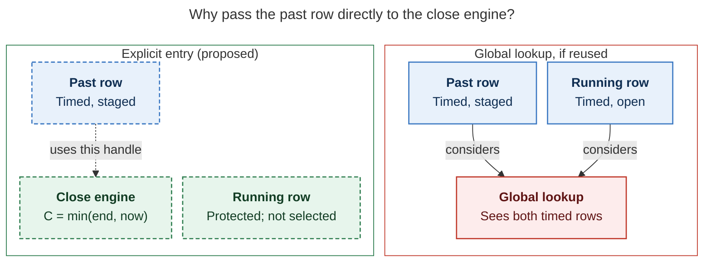
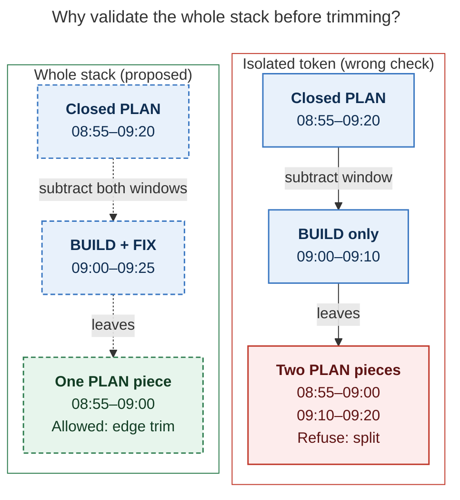

# Diagram proposals: Recording past Pomodoros with `x=`

Proposals for the swarm linker, not a report. Each diagram restates only what the source
report says.

```yaml
source: research:202611/recording_past_pomodoros/recording_past_pomodoros__final.md
producer: research.38.image
check: "mmdc 12.0.0 with --no-sandbox and the PDF-mirroring config rendered 2 of 2 Mermaid diagrams; deliberate invalid syntax exited nonzero"
```

## explicit-past-entry

```yaml
anchor: |-
  Run the existing close engine on an **explicit entry** at clock `C`. Today the
question: |-
  Why must the close engine take an explicit past entry?
illustrates: |-
  An explicit entry at clock C avoids the global lookup that would report two open timed entries beside an adjacent running session.
caption: "Global lookup sees both timed rows; passing the past row explicitly closes at min(window end, now) while protecting the running session."
review: "718×481 px, fit 90.9%; question and visual checks passed; 0 revisions; both global-lookup inputs are considered; source trace checked"
```



## whole-stack-repair

```yaml
anchor: |-
  Checking the whole stack at once matters. Take `x=build@2! x=fix@3!` against PLAN
question: |-
  Why can a safe stack look like a forbidden split when checked one token at a time?
illustrates: |-
  Checking the whole stack trims PLAN's tail to 0855–0900, whereas checking BUILD alone would look like a split of PLAN.
caption: "For `x=build@2! x=fix@3!`, whole-stack validation trims PLAN to 08:55–09:00; checking BUILD alone falsely suggests a split."
review: "527.25×553 px, fit 100.0%; question and visual checks passed; 1 revision to keep each time range on one line; source trace checked"
```


