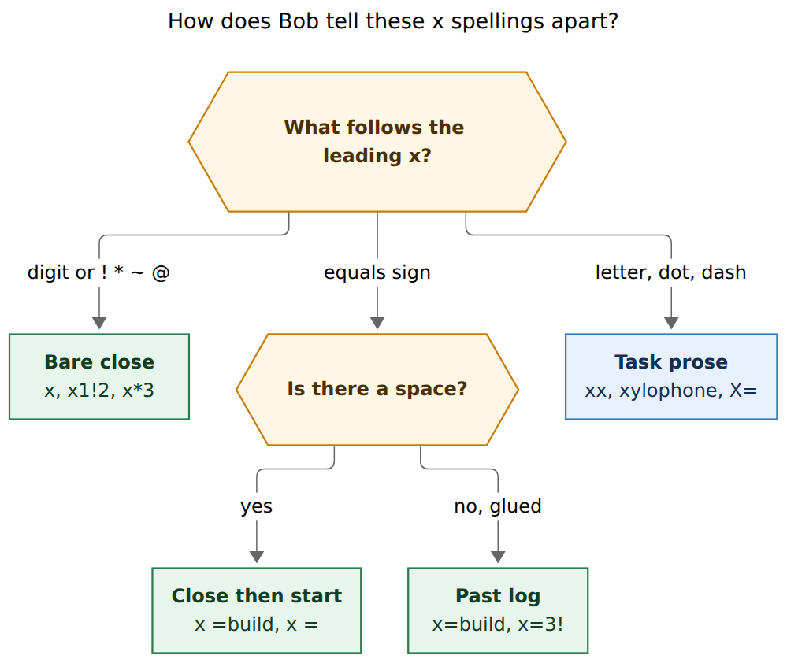
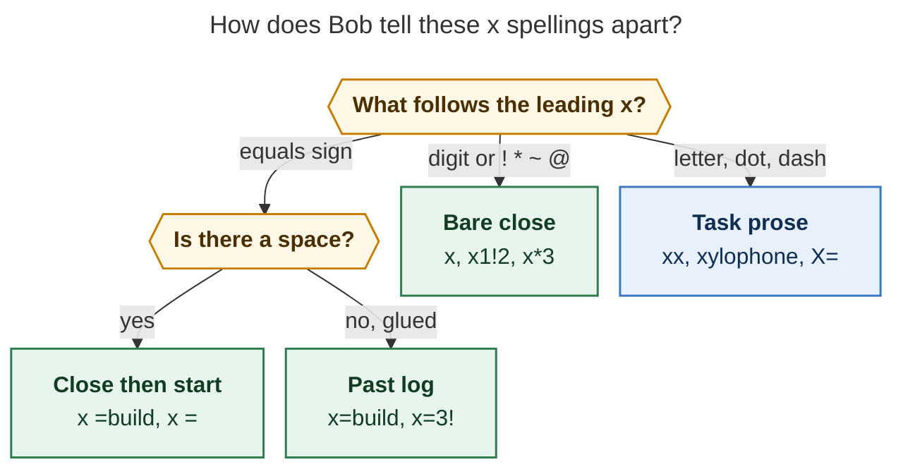
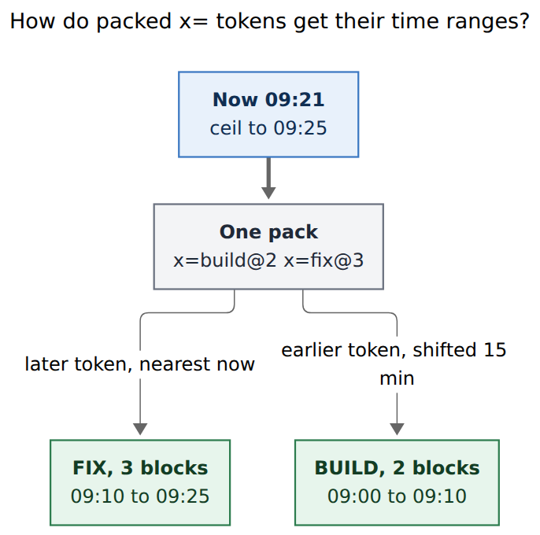
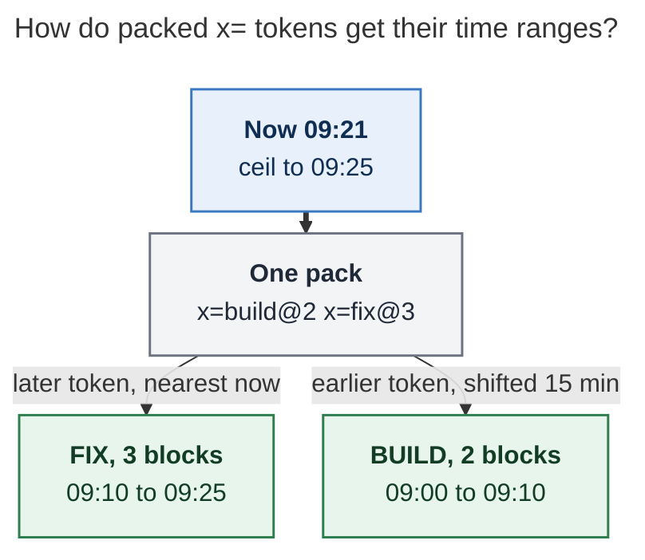

# Log a past Pomodoro with glued `x=`

> **Research query:** Add a new `x=<E>=<X>[!]` capture syntax that starts and
> closes a past Pomodoro in one operation. `<E>` should take the same values
> as `=<E>` except `-<N>`. `<X>` should take the same arguments as `x<X>`.
> The 5-minute count in `<E>` is how many blocks back the session started.
> Several `x=` uses on one line pack earlier ranges backward by later
> durations. Overlap with an existing past Pomodoro is an error, downgraded
> to a warning with `!` (steal the overlapping time). `!` when it is not
> needed is an error. Critique the plan, call out justified requirement
> changes, and recommend a design that is intuitive, reliable, and
> beautiful.

Researcher: **grk**. Independent of the other swarm reports.

Figures rendered with Mermaid CLI **12.0.0** (PDF-mirroring config, DejaVu
Sans, `useMaxWidth: false`). Measured fit against a 652.8 × 892.8 px text
box:

| Figure | Size | Fit |
| --- | --- | --- |
| Token recognition | 665.6 × 562 px | 98.1% |
| Packed lookback | 457 × 454 px | 100.0% |

An overlap-steal flowchart was drafted twice and dropped: both renders
missed the 75% fit floor (50.9%, then 61.3%). The steal rule is a table
instead.

## Bottom line

**Build it. Do not desugar it to `=<E> x`.** The gesture is real, the unused
token space `x=` is sitting there as task prose, and the examples at 09:21
are already what `se<X>` does when duration equals offset. The trap is
execution: a wall-clock start-then-close writes the wrong Event Task close
time, prints `ran Nm over` on every successful log, and will override a
running session. Write a **closed** row whose span is the lookback, and run
the close engine **as of that span's end**.

I would ship it with these changes to the request as written:

1. **First-class past operator**, not a macro over `=` plus `x`.
2. **Pack every consecutive `x=` in one draft**, not only same-line tokens.
3. **`<E>` is identity plus duration**, never `-<N>`, never `~<K>`, never
   `=/` or `=*`.
4. **`!` trims one prefix or suffix** of one existing timed session. A hole,
   a full cover, or `!` with no overlap is an error.
5. **MEET uses the lookback span**, not the calendar event run.

Recommended spelling, packing math, steal table, JSON, and rollout are in
[Recommended solution](#recommended-solution).

## Critique of the plan

### The plan under review

Bryan wants one capture item that both starts and closes a session that
already happened. The proposed spelling is `x=<E>=<X>[!]`. Worked examples
assume `BOB_NOW` 09:21:

| Typed | Intended span | Notes |
| --- | --- | --- |
| `x=build` | BUILD 0900–0925 | Default 5 blocks ending at ceil(now) |
| `x=build@2 x=fix@3` | BUILD 0900–0910, FIX 0910–0925 | Later token sits next to now |
| `x=2#fix=*3 apollo agent` | FIX 0915–0925 | Same as `x=fix@2=*3 apollo agent`; park task 3; log the entry |
| `x==1!2` | Next future, 0900–0925 | Keep task 1, complete task 2 |
| `x=3!` vs existing 0855–0920 | New 0910–0925; old becomes 0855–0910 | Steal the overlapping suffix |

He also asks that `x=3` equal `=3-3 x`, that `-<N>` be refused inside `<E>`
because the operator is already in the past, and that `!` be illegal when
nothing overlaps.

### Is this a good idea?

**Yes.** The gap is the five-minute arithmetic you currently have to do in
your head. Logging “I was in BUILD for the last 25 minutes” today is
`=5-5#build` then `x`, quoted for zsh, and it only works if nothing is
running and you accept an overrun warning. Logging two forgotten sessions
is worse: the second `=` lands on the same end time as the first unless you
inflate the earlier offset by hand (`=2-5#build x =3-3#fix x`). A glued
`x=` that means “close a session that started N blocks ago” is the mnemonic
the rest of the language already taught: `x` closes, `=` starts, no space
means both, in the past.

It is a **bad** idea if it is implemented as a literal `=` then `x` chain.
That path is already legal (`= x`, `=3-3 x`) and it is the wrong path. See
[F6](#what-already-exists-verified) and
[A1](#a1-write-a-closed-row-do-not-start-then-close-at-now).

Three other reasons to do it now:

1. **The token is free.** `classify_whole_item_close` never claims `x=`.
   Spaced `x =build` already means close-then-start. Gluing them is the
   one remaining spelling, and it currently creates a task titled
   `x=build`.
2. **The math is already in `se<X>`.** `x=3` ≡ `=3-3` on the start clock,
   then a close that must **not** use wall-clock `now` as C.
3. **Mac Capture stays thin.** Bob can emit the same `pomodoro_close` card
   plus a `past` flag. The app does not parse `x=`.

### What I would not do

- **A new sigil** (`p=`, `z=`, `x-`). `x=` is the beautiful one. Another
  letter is a second language.
- **Keep `=D-D#name x` as the spelling** and only document it. The offset
  equals duration only after you have done the arithmetic; packing still
  needs a new operator.
- **Obsidian parity on day one.** Ctrl+Enter closes the running session.
  This is a capture-only backfill. Plugins can wait.
- **`!!` as the steal marker.** Bryan’s `x=3!` is the no-selection form.
  Disambiguate steal from close-complete with the second `=`, not with a
  doubled bang. See [A5](#a5-parse-steal-after-the-close-selection).

## What already exists (verified)

Checked against bob-cli `d216f7eb`, `docs/capture.md`,
`src/native/capture_language/`, `src/native/capture/pomodoro_start.rs`,
`src/native/capture/meet_event_run.rs`,
`src/native/capture_pomodoro_close/ledger.rs`, Mac Capture
`docs/protocol.md` / `docs/capture-previews.md`, and the inlined
decisions for capture sigils, Mac thin-client, Pomodoro names, and
Event Task closes.

- **F1. Close claim is narrow.** `classify_whole_item_close` accepts a
  leading lowercase `x` only when the rest is empty or starts with a
  digit, `,`, `!`, `~`, `*`, or `@`. `x=build`, `x==1!2`, and `x=3!` all
  return `None`. Source:
  `src/native/capture_language/close_selection.rs` lines 108–124.
- **F2. Spacing already means chain.** `x =build` is close, then start
  BUILD. `x =` is the session-switch idiom. Recognition requires at least
  two whitespace-separated session tokens.
  `docs/capture.md` “Chaining session operators on one line”.
- **F3. Glued `x=` is task prose today.** After F1 fails, `session_equals_token`
  only strips a leading `=`, so `x=build` is not a start either. Bare
  `xx` / `xa` / `xylophone` stay tasks; `X=build` would too. Claiming
  `x=` is a grammar break. `GRAMMAR_REVISION` is **10**
  (`src/native/capture_language/mod.rs`).
- **F4. Start timing is duration × 5, offset before ceil-to-5.**
  `parse_pomodoro_start_suffix`: empty → 5 units / 0 offset; `3` → 3 / 0;
  `-2` → 5 / 2; `3-3` → 3 / 3. `start_block_minute` subtracts
  `5 · offset_units` from `hour*60+minute`, then ceils to a 5-minute grid
  with `(n+4)/5*5` when n ≥ 0. End is start plus duration, modulo 1440.
  Sources: `tokens.rs` `parse_pomodoro_start_suffix`;
  `meet_event_run.rs` lines 198–224; `pomodoro_start.rs`
  `compute_pomodoro_start_range`.
- **F5. The examples are that math.** At 09:21 (minute 561) the ceil is
  09:25 (565).

  | Token | Duration | Offset | Start | End |
  | --- | ---: | ---: | --- | --- |
  | `=5-5` / `=-5` | 25 | 25 | 09:00 | 09:25 |
  | `=3-3` | 15 | 15 | 09:10 | 09:25 |
  | `=2-2` | 10 | 10 | 09:15 | 09:25 |
  | `=2-5` | 10 | 25 | 09:00 | 09:10 |

  So `x=build` matches `=5-5#build` on the clock, `x=3` matches `=3-3`,
  and `x=build@2 x=fix@3` matches `=2-5#build` then `=3-3#fix`.
- **F6. Close uses wall-clock now as C.** `close_timing` sets `closed_at`
  from `now.hour/minute`. If `end − now ≥ 5`, it shortens by whole
  5-minute units. If `end − now < 5`, it leaves the span. If `now` is
  after `end`, it reports an overrun and still leaves the span.
  `capture_pomodoro_close/ledger.rs` lines 188–226;
  `docs/capture.md` “Closing the running Pomodoro”.
- **F7. Naive `= x` at 09:21 is a zero-length session.** `=` writes
  0925–0950. `x` then sees remaining 29 minutes, subtracts 25, and closes
  0925–0925. Offset is not optional.
- **F8. Naive `=3-3 x` at 09:21 logs 0910–0925 and warns `ran 11m over`.**
  The span is right; C is 09:21, the session ended at 09:25? No: the
  written end is 09:25, remaining is 4, so this particular case is
  *untouched* (remaining < 5). Shift the example: `=2-5#build x` writes
  0900–0910, now is 09:21, remaining is negative, overrun fires. Event
  Task classification uses S and **C = now**, so a 0900–0910 past session
  closed at 09:21 treats a 09:15 meeting as `running`.
  `decisions:event-task-links-close-by-the-clock`.
- **F9. One open timed entry.** Starts refuse or override when a session
  is already running. Link starts refuse. Whole-item `=` restarts or
  swaps, with `--refuse-override` for Mac. A past log must not take that
  path.
- **F10. Named start resolution.** Open untimed placeholder starts in
  place; a completed match starts “again”; otherwise create. Bare `=`
  never creates an unnamed entry. `x=build` should reuse that resolution,
  then close. `x=` / `x==1!2` should use the next future placeholder, and
  fail like `=` when none exists.
- **F11. Closed insertion already exists.** `closed_insert_at` (settle and
  gcal) puts a closed row after the last completed entry whose start is
  ≤ the new start, else before the first completed, else before the first
  open. Past logs should land there, not in the running “current slot”.
- **F12. `!` is already three things.** Close complete (`x!2`, `x!`),
  whole-item task complete (`!note:id`), and Ensure-Next toggle
  (`@route+id!`). Steal is a fourth. The second `=` is the only clean
  fence between close-complete and steal.
- **F13. MEET empty start follows the event run.** A counted suffix
  (`=5#meet`) uses the explicit span. Off-clock stamping still follows
  counted links.
- **F14. Capture JSON is unversioned, schema 1.** New optional fields keep
  version 1. `GRAMMAR_REVISION` bumps for a claimed-token change. Mac
  decodes missing objects as omitted cards (`decodeIfPresent`); the
  grammar gate accepts `grammar >= 5`.
- **F15. Inline Work Log and chains.** `x apollo agent` logs to the first
  worked task. On a chain, the inline entry sits after the last close in
  the lead; child bullets attach to the last `x`. A non-session word
  between two operators is not an all-session chain.
- **F16. Touching is clustering, not this overlap.** Gcal past MEETs
  cluster when `next.start ≤ cluster.end`. Back-to-back 0855–0910 and
  0910–0925 must **not** be an `x=` overlap. Overlap is a positive-length
  intersection of `[start, end)`.
- **F17. Closes never emit event-run-past warnings.** Starts, `+N`, and
  `++N` do. A past log that covers a meeting should still say so, because
  the author is asserting that span.

## Figures

**Reader question:** How does Bob tell `x`, `x =build`, and `x=build`
apart?

**Caption:** Spacing is the design. A selection-shaped `x` closes the
running session; a space makes `x =build` close then start; glued `x=`
logs a past session. Other `x…` spellings stay tasks.





**Reader question:** How do packed `x=` tokens get their time ranges at
09:21?

**Caption:** Ceil now to 09:25. The later token occupies its own duration
ending there. Each earlier token keeps its duration and shifts back by
every later duration, so the pack is contiguous and chronological.





## Justified requirement adjustments

Each of these is a change to the request. The original is quoted, then the
change and why.

### A1. Write a closed row; do not start-then-close at now

**Request:** `x=3` should be equivalent to `=3-3 x`.

**Change:** Equivalent **on the clock** (`se<X>` with offset = duration).
Not equivalent as two planner items using wall-clock `now` for the close.

A real `=3-3 x` at 09:21 happens to leave 0910–0925 because remaining is
4 minutes. A packed earlier token such as `=2-5#build x` writes 0900–0910
and then the close reports an overrun and classifies Event Tasks against
C = 09:21. If anything is running, `=` restarts or swaps it.

The implementation writes `- [x] (**HHMM-HHMM** [t:: Nm])` (or `[off::]`)
in one step and runs close selection with **C = the written end**. Work
Log stamps still use write-time `now`, matching today’s close.

### A2. Pack consecutive `x=` items in one draft, not only the same line

**Request:** packing applies to later uses “on the same line”.

**Change:** a **pack** is a maximal run of consecutive `x=` items in one
`bob capture` draft: same-line chain tokens, and adjacent bulk items
separated only by blank lines. A non-`x=` item breaks the run.

Same-line packing cannot carry a per-session inline Work Log.
`x=build@2 wired x=fix@3` is not an all-session chain, because `wired` is
prose (F15). The only way to give each past session its own entry and
still pack is:

```text
x=build@2 wired the lexer

x=fix@3 apollo agent
```

If those two items independently look back from 09:25 they both end at
09:25 and overlap. The overlap rule would then fight the Work Log rule.
Packing the run fixes both.

Same-line `x=build@2 x=fix@3` stays the short form.

### A3. `<E>` is identity plus duration, not a full start token

**Request:** `<E>` accepts mostly the same values as `=<E>`, except `-<N>`.

**Keep:** empty, a duration count, a name (`build`, `#build`, `#"DEEP WORK"`),
and the two name+duration orders (`3#build`, `build@3`). Digit-leading
names still need `#` (`x=#2fa`).

**Drop from `<E>`:**

| Form | Why |
| --- | --- |
| `-<N>`, `D-N`, `D-` | Requested. Lookback is implicit: offset = duration. `x=3-3` teaches `x=3`. `x=-2` teaches `x=5` or `x=` (default 5). |
| `~<K>` | Start-drop and close-drop are different. Close already has `~` on `<X>`. One numbering domain. |
| `=/`, `=*` | Split and merge are not starts of a past span. |
| Duration `0` | A zero-length past session is not a log. Teach a positive count. |

So `x=2#fix=*3` is E = `2#fix`, X = `*3`. `x=fix@2=*3` is the same E in
the `@` order. That matches the request’s equivalence.

### A4. Steal is an end-cut, never a split or a replace

**Request:** overlap is an error; `!` steals by updating the old range;
`!` when not needed is an error.

**Keep** the three-way: overlap without `!` errors; overlap with `!`
warns and rewrites; `!` without overlap errors (`split_type_not_needed`
is the precedent).

**Tighten what steal may do.** Overlap is a positive-length intersection.
Touching at a 5-minute boundary is legal (F16). After packing, each new
span is checked against existing timed entries (open or closed), never
against its pack siblings.

| Intersection with exactly one existing timed session | `!` | Result |
| --- | --- | --- |
| None | absent | Write |
| None | present | Error: `` `!` is not needed; drop it `` |
| Prefix of the existing span (new end cuts existing start) | absent | Error: overlaps NAME HHMM–HHMM |
| Prefix | present | Existing start becomes new end; warning |
| Suffix of the existing span (new start cuts existing end) | absent | Error |
| Suffix | present | Existing end becomes new start; warning. This is the 0855–0920 vs `x=3!` example: old becomes 0855–0910 |
| Interior hole, or the existing span is fully covered | either | Error even with `!`: would split or replace NAME; edit the ledger or choose a duration that only cuts one end |
| Two or more existing sessions | either | Error: name them; steal one end of one session per `!` |

Remainder after a trim must be a positive multiple of 5 minutes. A
0-minute leftover is “would replace”, not a silent delete: the old row
still holds Task Links.

For a **pack**, apply steal per new span after offsets are known. Against
one older session that covers the whole pack, every overlapping member
needs `!` (`x=build@2! x=fix@3!`). Each trim is applied to the current
image of the victim, so left-to-right BUILD 0900–0910 then FIX 0910–0925
against 0855–0920 becomes: first trim (middle) **refuses**; the author
must cut the suffix in one step (`x=5!` to take 0900–0925, or `x=3!` to
take 0910–0925) or steal from a session that only overlaps one end.

That last sentence is the honest cost of “no holes”. The 0855–0920 vs
`x=3!` example is a suffix cut of a **single** token, and it stays
beautiful. A two-token pack that punches the middle of one victim is not
a steal, it is a split, and it stays an error.

### A5. Parse steal after the close selection

**Request:** `x=<E>=<X>[!]`.

**Parse:**

```text
'x=' <E> [ '=' <X> ] [ '!' ]
```

`<X>` is `lex_close_selection` on the bytes after the second `=`. A
final `!` that the close lexer does **not** consume is steal.

Worked disambiguation:

| Token | E | X | Steal |
| --- | --- | --- | --- |
| `x=` | empty (next future, 5 blocks) | default close | no |
| `x=build` | `build` | default | no |
| `x=3!` | `3` | default | **yes** (no second `=`, trailing `!` is steal) |
| `x==1!2` | empty | `1!2` | no |
| `x==!` | empty | `!` (complete-all) | no |
| `x==!!` | empty | `!` | **yes** (close consumes one `!`, one remains) |
| `x=build=*3` | `build` | `*3` | no |
| `x=build=*3!` | `build` | `*3!` (park 3, complete-all rest) | no |
| `x=build=*3!!` | `build` | `*3!` | **yes** |
| `x==` | empty | missing X | incomplete, needs `pomodoro_close_task` |
| `x=!` | empty | none | steal on the default 5-block next future |

`x=3!` is Bryan’s example and stays steal. Close-complete always sits
behind the second `=`. Teaching: `` `x=3!` steals overlapping time; to
complete task 3 write `x==!3` or `x=3=!3` ``.

### A6. MEET lookback is explicit time, not the event run

**Request:** `<E>` like `=<E>`. Empty `=meet` follows the calendar run.

**Change:** `x=meet` is 5 blocks ending at ceil(now), like `=5#meet`.
Past logging is “I occupied this time”, not “sync this meeting”. Gcal
already files past MEETs. A counted `x=8#meet` is an 40-minute past MEET.
Clock key still follows counted links (F13).

### A7. Running sessions are overlap candidates

**Request:** silent on a session that is already running.

**Change:** a running timed entry is just another span. `x=build` at 09:21
while CAPTURE is 0900–0925 overlaps and errors, with a teaching line
``close it with `x`, swap with `=build`, or add `!` to cut this end``.
`!` may trim the running session’s start or end under [A4](#a4-steal-is-an-end-cut-never-a-split-or-a-replace).
A past log never goes through the `=` override / `--refuse-override`
path.

### A8. Event overlap is a warning, not a close-silent

**Request:** silent.

**Change:** because this write **asserts** a span, reuse
`pomodoro_runs_past_event` / `pomodoro_starts_during_event` as warnings
on the past item when the new span hits an open Event Task that is not
in this session’s lineup. Do not fail the capture. Closes stay silent
for the running-session path (F17); past logs are the exception.

### A9. Capital `X=` remains the prose escape

Same rule as `X post about the launch`. A task that must begin with
`x=…` is typed `X=…`. Mid-body `Plan x=build` stays prose.

## Recommended solution

### Grammar

Claim a whole-item / chain token that starts with glued `x=`:

```text
x=  <E>  [ =<X> ]  [ ! ]  [ work-log text ]
```

`<E>` reuses the start identity lexer with offset **forbidden**:

- empty → next future placeholder, duration 5
- `D` → duration D, next future
- `name` / `#name` / `#"NAME"` → that Pomodoro, duration 5
- `D#name` / `name@D` → that Pomodoro, duration D

Duration D is the lookback: offset is set to D internally and never
typed. Default D is 5. D = 0 is an error.

`<X>` is the existing close selection, including inline Work Log on the
same item. Child bullets attach to that item as they do for `x`.

The token is a session-chain token. `x=build x=fix@3` packs. `x =build`
does not.

Bump `GRAMMAR_REVISION` to **11**. Capture JSON `schema_version` stays 1.

### Timing

For a pack of n tokens with durations D₁ … Dₙ (left to right), let T be
`start_block_minute(now, offset=0)` (ceil to 5). Token k occupies:

```text
end_k   = T − 5 · (D_{k+1} + … + D_n)
start_k = end_k − 5 · D_k
```

Modulo 1440 for midnight. At 09:21, T = 09:25:

- `x=build@2 x=fix@3` → BUILD 09:00–09:10, FIX 09:10–09:25
- `x=2#fix` → 09:15–09:25
- `x=` / `x==1!2` → 09:00–09:25

Human preview prints those ranges before Return, from dry-run JSON.

### Placement and close

1. Resolve the name (F10). Fail like `=` if unnamed and no next future.
2. Compute the span (above). Fail if duration overflows.
3. Check overlap against every timed entry on the staged daily note
   except pack siblings. Apply [A4](#a4-steal-is-an-end-cut-never-a-split-or-a-replace).
4. If the target is an open untimed placeholder, convert it in place
   then **move the closed block** with `closed_insert_at`. If the target
   is a completed name, create a new closed “again” row at that insert
   point. If missing, create closed.
5. Run the close engine on that entry with **S, C = the written span**,
   selection `<X>` (plain `x` if omitted), Work Log as today. Clock key
   from counted kept links. Close-names, parking, successor offers,
   freshness, and 🍅 history are the close we already have.
6. Do not create a continuation placeholder unless the close actually
   carries links (same as `x`).

Atomic with the rest of the draft. `--dry-run` agrees. Forced
`--route` / `--task` / `%` / `s:` / `$` fail on the item as they do for
`=` and `x`.

### JSON and Mac

Kind stays **`pomodoro_close`** with additive fields, so an old Mac
still shows a close card:

```json
"pomodoro_close": {
  "past": true,
  "raw": "x=build@2",
  "lookback_units": 2,
  "steal": false,
  "stolen": [],
  "start": "0900",
  "end": "0910",
  "duration_minutes": 10
}
```

`stolen` is a list of `{name, line, before, after}` when `!` trimmed
someone. Omit `past` on ordinary closes. Human line:

```text
logged BUILD 0900-0910 (10m) · 2026/20261104.md line 5
```

Dry-run: `would log`. Steal adds a warning line
`PLAN 0855-0920 → 0855-0910`.

Spans: `pomodoro_start` over `x=<E>` (name part `pomodoro_name` as
today), close-selection spans over `=<X>`, and `pomodoro_close_complete`
does **not** cover a steal `!`. Give steal its own span kind
`pomodoro_past_steal` (unknown kinds render as neutral text on an old
Mac). Completion: cursor in the name uses `pomodoro_start_name`; cursor
in `<X>` matches close completion; a dangling `x=` / `x=#` needs
`pomodoro_name`; dangling `x==` needs `pomodoro_close_task`.

Mac: if `past: true`, retitle the close card “Log past” and show the
written range instead of a decrement. Until that ships, the ordinary
close card plus the range is acceptable. The app still does not parse
`x=`.

### Teaching errors (claim the token)

| Typed | Message shape |
| --- | --- |
| `x=-2` | `` `x=-2` is already in the past; write `x=` or `x=5` for 25 minutes, not `-<N>` `` |
| `x=3-3` | `` `x=3-3` sets lookback from the count; write `x=3` `` |
| `x=0` | `` `x=0` needs a positive 5-minute count; write `x=1` `` |
| `x=3!` with no overlap | `` `!` is not needed; drop it `` |
| overlap without `!` | `` `x=3` overlaps PLAN 0855-0920; add `!` to end PLAN at 0910, or pick another count `` |
| interior overlap | `` `x=2!` would punch a hole in PLAN 0900-0930; steal only a prefix or suffix, or edit the ledger `` |
| `x=/build` | `` `x=` logs a past session; split with `=/build` `` |
| unnamed, no future | same diagnostic as `=`, plus ``(or name one with `x=build`)`` |

### Tests to pin before code

Vectors at `BOB_NOW=… 09:21:00` unless noted.

1. Lexer: `x=build` is past; `x =build` is chain close+start; `xx` / `X=`
   are tasks; `x=3!` steal; `x==1!2` selection; `x==!!` selection+steal.
2. Clock: the F5 table, plus 09:25 exact (aligned ceil), 00:03 wrapping,
   09:21:59 (minutes only).
3. Pack: same-line and blank-line-adjacent; a `=` between two `x=`
   breaks the pack; pack siblings do not overlap each other.
4. Overlap table in [A4](#a4-steal-is-an-end-cut-never-a-split-or-a-replace),
   including touching 0855–0910 vs new 0910–0925 (legal) and `!` not
   needed.
5. Close-as-of C = end: Event Task 0900–0910 inside a 0900–0910 past
   session is `ended_inside`; a 09:15 meeting is `not_started`. No
   overrun warning.
6. `x=2#fix=*3 apollo agent` parks 3, logs the entry on 3, span 0915–0925.
7. `x==1!2` on the next future with two links.
8. Running-session overlap teaching error.
9. MEET: `x=meet` is 25 minutes, not the event run.
10. Grammar 11 in `capture-parse`; additive JSON; dry-run equals real-run
    except `dry_run`.

### Rollout

1. **bob-cli grammar + planner + docs/capture.md glance table and a
   “Logging a past Pomodoro” section.** Decision record in
   `sase/memory/decisions/`. No README dump (`docs.md`).
2. **Conformance vectors** shared with any later plugin, like Event Task
   close vectors.
3. **Mac Capture** additive `past` card title. Ship after bob, tolerant
   decode.
4. **Plugins** later if Bryan wants an Obsidian command. Not blocking.

Mark the capture JSON addition as additive. If a client treated unknown
whole-item `x=…` as a task, that client must read grammar 11. That is
the `!` in the CLI-contract sense only for the claimed-token break, not
for JSON shape.

### Risks

- **Grammar break.** Today `bob capture 'x=build'` files a task. After
  this, it logs BUILD. The escape is `X=build`. Call that out in the
  changelog by describing the new token, not by editing CHANGELOG.md
  in-repo (release train owns that file).
- **`!` overload.** Mitigated by the second `=`. Still easy to type
  `x=3!` meaning complete-all; the teaching error has to be excellent.
- **Pack-vs-steal of a middle.** Document with one example. Do not
  silently split.
- **Midnight wrap.** One session 2340–0005 on today’s note, modulo 1440,
  matching starts. Cross-day history stays yesterday’s note.
- **Stats double-count** if steal is skipped. The overlap error exists
  so Total does not count 0900–0925 twice.

## Would I take a different approach?

The only serious alternative I still like is **forbidding steal
entirely** and making overlap always an error. Then `!` never joins the
`!` pile, and the 0855–0920 case is “close or hand-edit PLAN, then
`x=3`”. That is less beautiful for the exact example Bryan gave, so I
would not take it. I would take **no-split steal** over “update the
range appropriately” as an unbounded rewrite.

I would not take a two-step wizard or a duration picker. Capture’s whole
point is that `x=3` is already the picker.

## Sources

Independent report · 2026-11-04 · bob-cli `d216f7eb`.

- `docs/capture.md` — glance table, start `se<X>`, named start, override,
  close selection, chaining, Work Log
- `src/native/capture_language/close_selection.rs` — `classify_whole_item_close`
- `src/native/capture_language/item.rs` — `session_equals_token`,
  `is_session_chain_token`
- `src/native/capture_language/tokens.rs` — `parse_pomodoro_start_suffix`
- `src/native/capture_language/mod.rs` — `GRAMMAR_REVISION = 10`
- `src/native/capture/meet_event_run.rs` — `start_block_minute`
- `src/native/capture/pomodoro_start.rs` — `compute_pomodoro_start_range`
- `src/native/capture_pomodoro_close/ledger.rs` — `close_timing`
- `src/native/task_status_hooks/settle.rs` — `closed_insert_at`
- `src/native/capture/event_conflict.rs` — start warnings, closes silent
- `src/native/capture_parse.rs` — `schema_version` 1
- bob-mac-capture `docs/protocol.md`, `docs/capture-previews.md` —
  thin-client spans and close/start cards
- Decisions: `mac-capture-is-a-thin-client`,
  `event-task-links-close-by-the-clock`,
  `pomodoro-theme-is-one-component`, `capture-sigils-say-where-what-how`
- Glossary: Capture, Pomodoro, Work Log, Task Link, Task Type, Event Task
- CLI rules: no subcommand under `bob capture`; JSON contract additive
  unless marked `!`
