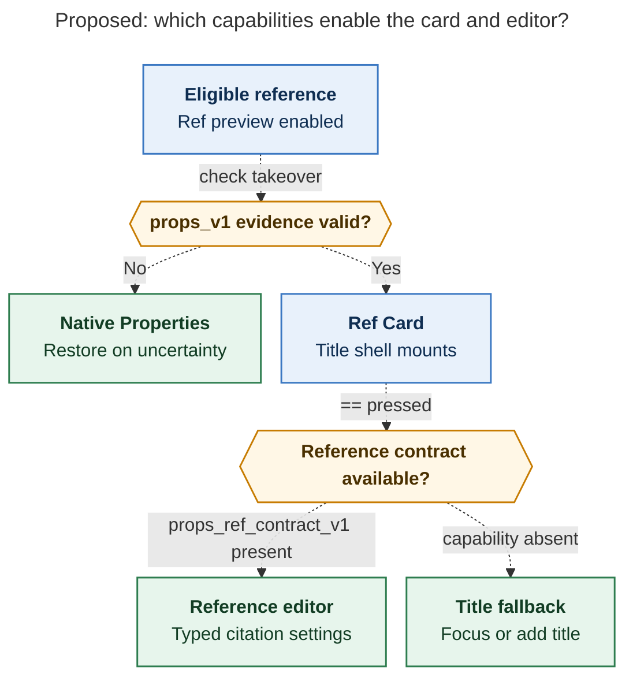
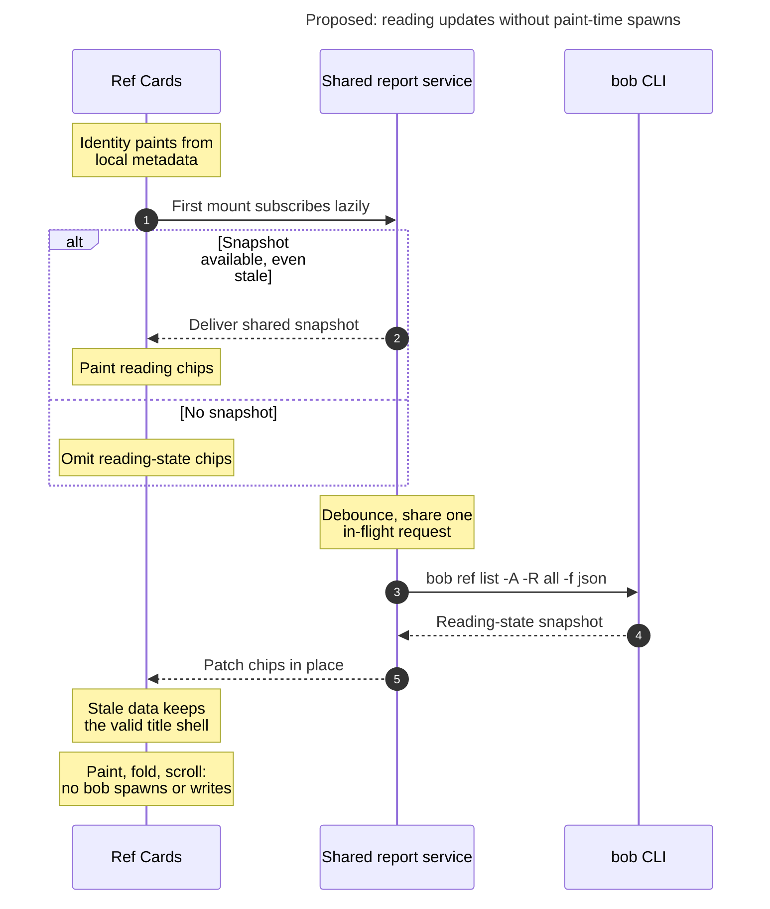

# Diagram proposals: Ref Cards: consolidated design, `==` editor, and parallel delivery beside `bob-cli-qm`

Proposals for the swarm linker, not a report. Each diagram restates only what the source
report says.

```yaml
source: research:202611/ref_cards/ref_cards__final.md
producer: research.6l.image
check: "mmdc 12.0.0 with the PDF-mirroring config rendered 2 of 2 Mermaid diagrams; pinned CLI with Puppeteer no-sandbox; negative syntax check returned nonzero"
```

## capability-fallbacks

```yaml
anchor: |-
  without `props_ref_contract_v1`, `==` falls back to focus-or-add on
question: |-
  Which capability enables card takeover, and which enables the full Reference editor?
illustrates: |-
  The card mounts on props_v1 alone, while == opens the Reference editor with props_ref_contract_v1 and otherwise falls back to focus-or-add on title.
caption: "Takeover needs props_v1; a missing reference contract keeps the card and routes == to the title fallback."
review: "558.941×962 px, fit 92.8%; question, source trace, labels and visual checks passed; 0 visual revisions"
```



## passive-report-service

```yaml
anchor: |-
  a scan rewrite or embed heal while the note is open must patch chips
question: |-
  How do reading-state chips update without spawning bob during painting, folding or scrolling?
illustrates: |-
  One shared, debounced, stale-while-revalidate report supplies reading-state chips, while identity paints local-first and painting, folding, and scrolling never spawn bob.
caption: "The shared service runs bob; cards keep local identity and patch reading chips without spawning or writing during paint."
review: "868×938 px, fit 75.2%; question, source trace, labels and visual checks passed; 1 visual revision tried, original retained because the narrower revision clipped its title"
```


