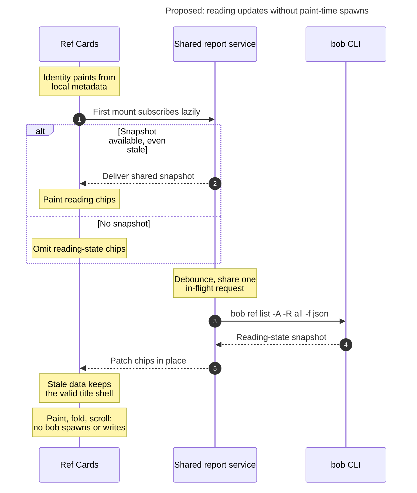
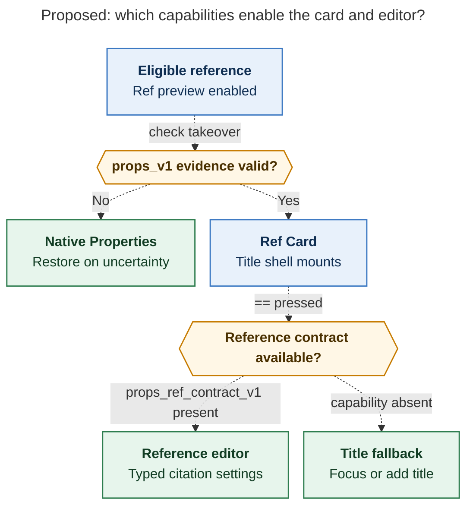

# Ref Cards: consolidated design, `==` editor, and parallel delivery beside `bob-cli-qm`

> **Research query:** What is the best way to implement "ref cards," a new type of property card for ref notes, in parallel with the in-progress `bob-cli-qm` epic (notebook and prose cards), and is coordination with it even needed? How should the card look so it carries as much genuinely useful information about the reference as possible without clutter, should it support the `==` keymap and, if so, what operations should its schema editor support, and what glossary term should "ref card" get? Critique the plan, call out any justified requirement changes, and recommend an intuitive, reliable, and beautiful solution.


## Bottom line

**Build Ref Cards, and start [three phases](#delivery-beside-bob-cli-qm) today.** All five researchers independently
recommend building the card; none recommends waiting for `bob-cli-qm` to finish, and
none recommends merging into it. The vault evidence is one-sided: `ref/` holds
**1,377 indexed references** (1,379 files; 775 modern, 602 legacy) against 39 notebooks
and one prose note, and a modern reference opens on the worst native Properties wall in
the vault — a median of 14 keys and ~800 characters of YAML dominated by sync hashes
and pipeline bookkeeping, while the facts that matter (reading lane, why it is snoozed,
annotation counts, where the PDF is) are invisible or live in another note.

The consolidated recommendation:

1. **One `ref` species on the existing Property Card kit, shipped as a sibling epic**
   with its own preview gate — never `qm`'s `cardPreviewKinds`, which `qm.7` deletes.
2. **A small [bob-cli phase](#the-bob-cli-phase) is in scope** (4 of 5 researchers): tighten reference
   ownership roles in `src/native/props/roles.rs` and add an additive reference
   contract behind a new capability (working name `props_ref_contract_v1`). Verified by
   the lead: today only `type` and `source_markdown` are protected on a reference note;
   `id`, `status`, `parent`, `ref_type`, `source_pdf_sha256`, every `highlights_*` key,
   and `pipeline_version` are loose, so the generic `+` editor can corrupt sync state
   right now, card or no card.
3. **`==` yes — as a [Reference editor](#the-reference-editor), never a schema editor.** It opens the shared
   Property Editor on a typed REFERENCE section (editable citation fields) with
   teaching rows that route lane, residence, and file name to their real owners,
   degrading to `qm.1`'s focus-or-add on `title` under an older bob.
4. **Identity paints local-first; reading state comes from one [shared report service](#figure-passive-report-service)**
   patterned on the notebook data service (`241a`): a lazily subscribed,
   debounced, stale-while-revalidate `bob ref list -A -R all -f json` snapshot shared
   by every mounted card. Painting, folding, and scrolling never spawn bob.
5. **[Glossary](#glossary-draft):** a new `glossary:ref-card` strand at go-live, plus a family-list edit
   to `glossary:property-card` serialized after `qm.7`.

**What changed while the swarm wrote:** `bob-cli-qm.1` (kit) **closed done** at
2026-11-26T18:07:36Z — minutes after the researchers filed. Every report gated its
kit-wiring phase on `qm.1`; that gate has already cleared, so `ref-shell` can start now
alongside `ref-props` and `ref-model`. `qi.4` (takeover harness) is also closed
(confirming cld/grk over gem's stale read). Still in progress: `qi.6`, `qj.2`–`qj.5`,
`qm.2`–`qm.7`.

## Critique of the request and adjusted requirements

The idea is sound and overdue — this is the largest typed family without a card, and it
completes the family's visual language. Three instincts in the request would hurt if
taken literally, and each researcher independently flagged at least two of them:

1. **"Schema editor" → "Reference editor."** Refs have no user-defined schema; bob owns
   it. `==` [edits the few human-owned citation fields](#the-reference-editor) and *teaches* where everything
   else lives.
2. **"As much information as possible" → "answer four questions, omit the rest."**
   What is this? Where did it come from? Where am I with it? What useful material is
   here? Everything else goes behind the drawer or expanded details. Most refs are
   finished agent reports with no author, highlights, or audio; absence is the normal
   case and [must look intentional](#the-card).
3. **"Parallel with `qm`" → "parallel with four named seams", not zero coordination and
   not merging.** Merging would serialize 1,377 notes behind 39 notebooks, re-open an
   approved plan whose memory decisions don't authorize `glossary:ref-card`, and put
   ref work in the path of `qm.7`'s gate deletion. Zero coordination would [collide](#delivery-beside-bob-cli-qm) at
   the kit registry, the acceptance harness, the family glossary, and the deploy.

## Where all five researchers agree

- **Build it; highest-leverage remaining card.** 35× the notebook population, the
  noisiest YAML, and the one typed family whose most useful fact (reading state) lives
  in a different note.
- **Not a schema editor.** Albums earned a schema card because they own a user-authored
  nested `record:` schema. A reference's shape is bob's fixed contract; most keys
  belong to the sync engine, the reading task, or the file system. A field builder
  would hand `bob props` a loaded gun.
- **Content-gate everything; never paint a zero.** Only 33 refs have `author`, 28 have
  `published`, 98 have highlights, 29 have audio. "As much information as possible"
  must become "answer the first questions immediately, omit what is absent": a sparse
  legacy ref renders a calm two-line card, not a field of ghosts. A count is a snapshot
  fact, never a progress score; a publication date is never a file date.
- **The roles gap in `roles.rs` is a [live integrity bug](#the-bob-cli-phase)** independent of this feature.
- **Passive painting.** No spawns, no writes, no task creation from paint, fold,
  resize, cursor motion, or drawer toggles — with spy tests proving it (the lesson of
  the `bob-cli-p2` spawn-storm incident).
- **Fail-open takeover** under the family gate, keyed on `props_v1` alone; every
  uncertain state restores native Properties.
- **`==` should exist** (family promise: `==` opens the species editor; Vim reindent on
  a YAML-fronted note is nearly useless) and must reuse the shared Property Editor
  stack, never a fourth bespoke modal.
- **No Mac Capture work, no thumbnails, no highlight streams on the card.** The Ref
  Panel stays the inspector (`decisions:mac-capture-is-a-thin-client`); the note body
  below the card already renders the annotations.
- **A `glossary:ref-card` strand ships at go-live** via `/sase_memory_write`, under the
  implementing plan's accepted memory decisions.

## The card

A compact header card on the kit: **`ribbon` tile** (a bookmark form with a notched
ribbon edge — distinct in grayscale and `forced-colors` from `stack`, `sheet`, `leaf`,
`plain`, `field`, `pennant`, `spine`, and `folio`), **`REF` kicker** with the humanized
kind (`Paper`, `Blog`, `Chat`, …) and parent crumbs in the root-area hue
(`decisions:theme-hue-is-config-pin-exempt-area-hash` family rule: hue says *where*,
form and words say *what*; never a hue per `ref_type`). Namespaces: `refCard*` /
`refNoteCard*` in JS, `.bob-ref-card*` in CSS (bare `ref*` greps collide with half the
codebase).

A finished blog post (the most common external shape; drawn from a live note):

```text
╭───────────────────────────────────────────────────────────────────────────╮
│ ▛▚ REF · Blog · ● SASE › SASE PyPI releases                ✓ Read · Oct 23 │
│ ▙▟  Agentic coding is straining CI. Here's how we scaled test impact      │
│     analysis at Anthropic                                                 │
│     Sachin Malhotra · claude.com ↗ · Sep 14, 2026                         │
│     ✎ 5 annotations                                      ▤ PDF   ♫ Listen │
│ ───────────────────────────────────────────────────────────────────────── │
│   created Oct 22, 2026                              ▸ Properties · 14 − + │
╰───────────────────────────────────────────────────────────────────────────╯
  ![[done/sase_pypi_releases_done#^ref-agentic-coding-...]]   ← stays visible
```

A sparse legacy reference is equally intentional — no ghost rows, no zeros, no
"create a task" nag:

```text
╭───────────────────────────────────────────────────────────────────────────╮
│ ▛▚ REF · Book · ● Mind › Outlive                       🗄 legacy · 2 of 3  │
│ ▙▟  Outlive                                                               │
│     amazon.com ↗                                                          │
│ ───────────────────────────────────────────────────────────────────────── │
│                                                      ▸ Properties · 6 − + │
╰───────────────────────────────────────────────────────────────────────────╯
```

### Element rules

| Element | Source | Rule |
| --- | --- | --- |
| Kicker + lane chip | Local `ref_type`; report `status`/`blocked`/`task`/Today | Kind word from one **shared ref vocabulary** extracted from the Reading Board's kind map and completed for all 13 kinds plus a fallback (one library, one set of words across board, card, CLI, and Bob Refs). Lane chip in the board's words: 📖 Reading, ⭐ Next, 📥 Ready, 💤 Snoozed → wake/prerequisite, ✓ Read · date, Dropped, 🗄 legacy (with `a of b chapters` for legacy books). Priority mark and TODAY pill only from the ledger (`decisions:today-is-read-from-the-ledger`). Click goes to the reading task. Absent report → absent chip, never a guess. |
| Title | `title:` → first-body H1 → humanized stem | Matches the index's precedence. Adopt (hide) only a *matching* first-body H1; a differing H1 stays visible content; a Live Preview cursor reveals raw Markdown. A `vN` chip from the report's reading lineage when part of a reread family. |
| Byline | Local `author`, `published`, `source_url`/`url`, `agent` | `Authors · host ↗ · date`, each component omitted independently; year-only values render as years. Agent reports read "agent report" plus the agent name. arXiv/DOI identifiers as copyable chips when present. |
| Annotations | Report counts + snapshot time | `✎ N annotations · M with notes`, only when nonzero. (cdx verified bob's counters include non-highlight kinds, so "annotations" is more accurate than "highlights".) Click jumps to `## Highlights`; tooltip: "From the Highlights scan on <date>; not live PDF state." |
| Access | Local `source_pdf`, `audio` | `▤ PDF` opens via a small versioned nav-hotkeys seam wrapping the existing `openReferencePdfPath` (no shell-interpolating frontmatter); `♫ Listen` for companion audio. Omitted when absent; a declared-but-missing PDF gets one precise diagnostic, not an alarm on every legacy note. |
| Foot | Kit | `created` (else `captured`), **silent when missing** — ~900 refs lack it, so `ref` joins the T1 silent set in `240m`. Lint chip only for actionable report diagnostics (`parent_mismatch`, `open_ref_without_task`, `open_v1_tracker`, …). `▸ Properties · N`, `−`, `+`. |
| Drawer | Kit inventory | Every key in file order; the managed set (`source_pdf_sha256`, `highlights_*`, `pipeline_version`, `source_markdown`, `return_links`, `earlier`, `recaptured`, zorg provenance) folds into a closed **Managed · N** group. |

**Not on the card:** PDF thumbnails, highlight excerpts, raw URLs, hashes, page counts
or reading-time estimates (bob records neither;
`decisions:code-copy-reads-render-time-catalog` forbids re-parsing), completion
percentages, freshness/decay pressure, live queue membership, or anything that writes.

**Beauty and reliability rules:** finished refs (two-thirds of the library) are set in
muted ink with only Reading/Next wearing the accent; reserve the readout row's height
while a snapshot is expected and patch in place (never placeholder numbers); check
light/dark/grayscale/forced-colors at ~420 px and wide, beside an album, notebook, and
prose card; a scan rewrite or embed heal while the note is open must patch chips, never
unmount the card or flash native Properties; stale report data never tears down a valid
title shell. [The report-service sequence diagram](#figure-passive-report-service) traces the handoff: identity paints from local metadata, one shared debounced report patches the reading chips, and painting, folding, and scrolling never spawn bob.

<div id="figure-passive-report-service">



_The shared service runs bob; cards keep local identity and patch reading chips without spawning or writing during paint._

</div>

## The Reference editor

`==` registers the `ref` kind in the existing `248m` dispatcher (the capture-grammar
fast `==` of `decisions:relation-equals-alias-and-flips` is a different surface and
stays untouched). It opens the shared Property Editor on a typed **REFERENCE** section
driven by a bob-owned contract — the area/project settings architecture, not a new
modal. Esc, `q`, and `Ctrl+[` close through the shared ladder
(`decisions:q-and-ctrl-bracket-mirror-esc`); every write is one previewed, undoable
`bob props update`.

**Editable rows** (synced-field saves say "syncs to the PDF marker at the next writing
scan" and never claim the PDF already changed;
`decisions:open-pdf-writes-are-coordinated` stays in charge):

| Row | Keys | Notes |
| --- | --- | --- |
| Title | `title` | Nonblank line; conditionally retitles the generated H1 (contested — see [Decisions](#decisions-for-bryan)). |
| Authors | `author` | Scalar or list of nonblank names; no structured-creator schema. |
| Published | `published` | `YYYY`, `YYYY-MM`, or `YYYY-MM-DD`; never coerce the global property type to get a date picker. |
| Source | `source_url` / legacy `url` | Writes whichever key the note uses; validates HTTP(S). |
| Aliases, Topics | `aliases`, `topics` | Existing list stages. |
| Summary | `summary` | Optional one-line dek, note-local, never marker-synced — a new convention only cld proposed; see [Decisions](#decisions-for-bryan). |

**Owned-elsewhere teaching rows** (show the value; Enter navigates to the owner):
Reading → the reading task (status is derived from the checkbox;
`decisions:task-status-is-derived` lineage); Lives under → the task's residence (a v2
`parent` is projected from it); File name → Command Mode's `ref-rename`
(`decisions:reference-ids-follow-file-stems`,
`decisions:reference-renames-keep-identity`); Kind → read-only (follows `lib/<type>/`).
Sync bookkeeping never appears as rows; it lives in the drawer's Managed fold.

**Refused everywhere:** add/remove/reorder/retype fields; edits to `id`, `status`,
`parent`, pointers, hashes, `pipeline_version`
(`decisions:reference-sources-are-preserved-write-once` for `source_markdown`); any
PDF write, scan, task creation, or bundle move as an editor side effect.

**Degradation:** without `props_ref_contract_v1`, `==` falls back to focus-or-add on
`title`; an older plugin ignores the new contract kind entirely. The card still mounts
on `props_v1` alone. [The capability-fallback diagram](#figure-capability-fallbacks) orders the two checks: `props_v1` alone lets the card mount, then `props_ref_contract_v1` decides whether `==` opens the Reference editor or the `title` fallback.

<div id="figure-capability-fallbacks">



_Takeover needs props_v1; a missing reference contract keeps the card and routes == to the title fallback._

</div>

### The bob-cli phase

Phase name: `ref-props`.

1. **Roles** (scoped to bob's ref coverage so hub notes stay loose): all `highlights_*`
   keys, `source_pdf`/`source_pdf_sha256`, `pipeline_version`, `audio`,
   `return_links`, `earlier`, `recaptured`, and zorg provenance become **derived**
   with owners and teaching reasons; `id` and `ref_type` become **identity**; `status`
   and `parent` become **derived** when a reading task is located. `title`, `author`,
   `published`, `source_url`/`url`, `summary`, `aliases`, `topics`, `captured`,
   `created`, `tags` stay loose. The same policy must bind Set, Unset, Rename, YAML
   replacement, and undo — not just one code path — with the raw-YAML escape preserved
   as the deliberate recovery route.
2. **Contract**: `bob props show` on a library reference adds a
   `contract: {kind: "reference", …}` block in the area-contract row shape, announcing
   `props_ref_contract_v1` (also in `__catalog` features); `setting.set`/`clear` gain
   the rows above.
3. **Release**: rides the daily train; no version/CHANGELOG edits; the `!` question per
   the [resolution table](#disagreements-resolved). The plugin must probe the capability — the train means
   source-landed ≠ host-available.

## Delivery beside bob-cli-qm

Coordination is needed at four seams — everything else is new fragment files or
bob-cli Rust that `qm` never touches:

| Seam | Failure if ignored | Handling |
| --- | --- | --- |
| Shared kit files (`240f`, `240m`, `240q`, `240t`, `248m`, `styles.css`, `fragments.json`) | Concurrent rewrites; `qm.1`'s exhaustive test asserts `ref` claims nothing | `qm.1` is closed, so `ref-shell` starts now with additive edits + rebase discipline; **one integrator owns every shared-kit edit**; extend (don't fork) the precedence test. With a third species hitting the same hardcoded lists, prefer making them descriptor-driven. |
| Activation | `propertyCardKindLive` ships any registered non-notebook/prose kind live | Ref-owned `refCardPreview` gate (off by default), gating mount + `==` + UI together; deleted only by ref's own go-live, after the CLI capability is released. |
| Real-app acceptance | Concurrent harness edits/runs mid-`qm.6` screenshot proof | `ref-acceptance` waits for `qm.6` to close, then extends the harness as a sibling runner importing its lib. Never land shared-kit edits mid-run. |
| `glossary:property-card` + deploy | Two concurrent edits to one strand; a sync shipping half-finished work | `ref-go-live` waits for `qm.7`, edits the family strand under its own accepted memory decision, and deploys clean. Bundle files are always rebase-and-rebuild, never hand-merged; `bob plugins sync` without `-F`. |

There is no seam with `qj` (refs never touch prose) and none with `qi` beyond what
`qm.7` already waits for.



*Figure 1: Which ref-card phases start now, and which wait on `bob-cli-qm`. Because
`qm.1` already closed, `ref-props` (bob-cli), `ref-model`, and `ref-shell` all start
immediately; only acceptance and go-live wait, on `qm.6` and `qm.7` respectively.
Converging arrows mean all inputs are required. Gates are polled with `qm`'s own
procedure: closed phase-bead poll under `/sase_monitor`, then one audited read
confirming closed done, not canceled.* (Rendered 843.5 × 701 px, fit 77.4%, Mermaid
CLI 12.0.0.)

| Phase | Repo | Scope | Starts |
| --- | --- | --- | --- |
| `ref-props` | bob-cli | Roles tightening scoped to ref coverage; reference contract + capability; `docs/props.md`; tests | **Now** |
| `ref-model` | bob-plugins (new fragments) | Shared ref vocabulary; ref-library report service (the `241a` pattern); pure view model; fixtures covering every live shape (modern chat, annotated blog, blocked paper, v1 tracker, legacy book with chapters, reread family, hub note non-claim, mixed type, H1 ≠ title, superseded) | **Now** |
| `ref-shell` | bob-plugins (kit + new) | `ref` species + `ribbon` tile; T1/T3 entries; precedence + test; own preview gate; host, title adoption, foot with Managed fold; `_`; `==` registration with focus-or-add fallback | **Now** (qm.1 closed; one integrator for shared files) |
| `ref-readouts` | bob-plugins | Service subscription; lane chip, snooze line, annotations, lineage, Today, PDF/audio seam; reserved rows; no-spawn spies | After `ref-shell` |
| `ref-editor` | bob-plugins | REFERENCE section + owned-elsewhere rows; capability probe; ladder tests | After `ref-shell` + `ref-props` |
| `ref-acceptance` | bob-plugins | Takeover, single-owner, native restoration, scan-rewrite-while-open, rename-while-open, hub-note non-claim, passive proofs, screenshot matrix | After `qm.6` + both UI phases |
| `ref-go-live` | both | Delete own gate; docs both repos; `glossary:ref-card` + family edit; clean deploy; wait for a bob release carrying `ref-props` | After `qm.7` + `ref-acceptance` |

**Rejected alternatives** (unanimous or near): merge into `qm` (re-plans an approved
epic, serializes the largest family behind the smallest); wait for `qm` to finish (two
phases have zero overlap and the roles gun stays loaded); no coordination (two
in-flight rewrites of the species registry); an album-style schema card; a Mac
inspector clone on the note-top; skipping `==` (breaks family muscle memory on the
largest card population); spawning `bob ref` from paint.

## Glossary draft

Draft strand: `glossary:ref-card`.

Keyword **Ref Card**; aliases *reference card*, *ref title card*. Publish at go-live,
adjusted to shipped behavior; family-list edit to `glossary:property-card` only after
`qm.7`; optional "not the Ref Card" clauses on `glossary:ref-panel` and
`glossary:reference-note`.

> **Ref Card** (aka reference card, ref title card)
>
> The note-top [[property-card]] for a [[reference-note]] in the library (`ref/`),
> painted by Bob Ledger Tools in desktop Live Preview and Reading view.
>
> - **Identity.** A ribbon tile and a `REF` kicker with the reference's kind (Blog,
>   Paper, Chat, Book, …) and the parent's crumbs in the root hue lead the title
>   (`title:`, else the matching first H1, else the stem), a byline of authors, source
>   site, and publication date (never a file date), and an optional one-line
>   `summary:`. Missing facts are omitted, never zeroed, and a legacy reference renders
>   a calm sparse card.
> - **Reading.** From one shared `bob ref list` report it adds the reading lane in the
>   Reading Board's words, the snooze or blocked reason, a Today pill from the ledger,
>   annotation counts from the last Highlights scan (never reading progress), reread
>   lineage, and diagnostics in the foot. PDF and audio chips open the source.
> - **Keys.** `==` opens the Reference editor for title, authors, published, source,
>   aliases, topics, and summary; it routes reading state, residence, and file name to
>   their owners — the [[reference-task]], a task move, and `bob ref rename`. `+`
>   opens the Property Editor, `-` the drawer (sync bookkeeping folds under Managed),
>   `_` compacts the card.
> - **Body and painting.** The managed reading-task embed stays visible below the card
>   as the task's editable control. Painting never writes the vault or a PDF and never
>   spawns bob; native Properties return on any uncertain evidence.
>
> Not the [[ref-panel]] (Bob Refs), the Reading Board, a reading task, a PDF preview,
> or a schema definition. The root `*_ref` hub notes get no card. See the Ref Card
> user documentation.

## Lead verification of the landed kit

Reading the code `qm.1` actually landed (bob-plugins `deee0f21`) resolves questions the
researchers could only predict:

- **The preview-gate trap is real and worse than described.** In
  `240t-plugin-property-card-note-species.js`, `propertyCardPreviewKindsFromData`
  filters the stored list to exactly `"notebook"` and `"prose"`, and
  `propertyCardKindLive` treats **any other kind present in `PROPERTY_CARD_KINDS` as
  always live**. Adding `ref` to the registry without a ref-owned gate would ship the
  card to 1,377 live notes on the next `bob plugins sync` — no `qm.7` interaction
  required. The ref epic must gate its own mount, `==` registration, and UI behind its
  own switch (e.g. `refCardPreview` in ledger-tools plugin data), deleted only by ref's
  own go-live. This vindicates the 4-of-5 consensus; mus's "append `reference` to
  `cardPreviewKinds`" is not implementable against the landed whitelist, and the gate
  itself is deleted by `qm.7`.
- **Precedence has a seam ready for `ref`.** `propertyCardNoteSpecies` resolves bank →
  album → record → area/project → temporal → notebook → prose → none, with home-style
  path exclusions (`done/`, `_templates/`, `_conflicts/`, type notes). `ref` slots
  after `prose`, exactly where cld/grk/mus predicted, and the exhaustive 111-case
  precedence test must be extended so `ref` claims exactly the library notes.
- **Fold semantics are now checkable.** `foldDefault: true` means *open by default*
  (`240s`'s resolver). Album, record, area, project, and **notebook default open**;
  **prose and bank do not**. The family majority defaults open.
- **The report-service pattern is the family precedent.** `241a-plugin-notebook-data.js`
  is a shared, versioned, stale-while-revalidate report with debounced revalidation,
  and the landed `249k` readout stub says the readouts phase "subscribes here to the
  shared apiNotebookSubscribe report (zero new spawns)". A ref-library service should
  mirror this shape.
- **`qm`'s own rules are confirmed in source:** the `240t` comment states "go-live
  deletes the gate, the key, and their tests", and the approved plan reserves the
  `glossary:property-card` edit for `qm.7` under its `memory_property_card` decision
  and gates acceptance on `qi.4` (closed) with the takeover harness
  (`scripts/obsidian-frontmatter-takeover-e2e*.cjs`).

## Disagreements resolved

| Question | Positions | Resolution |
| --- | --- | --- |
| **Data path** | Local-YAML-only v1 (grk, gem) vs one shared `bob ref list` service (cdx, cld, mus) | **Shared service.** The facts worth showing — true `reading_state`, blocked reasons, archived-task residence, Today, lineage, diagnostics — are not in local YAML (`status` lags sync; 602 legacy notes have no task at all), and gem's local-first alternative re-parses the library in JavaScript, which cdx rightly forbids ("do not parse a second library"). The landed notebook pattern (`241a`/`249k`) is exactly this service, and a full-library refresh costs ~1.1–1.4 s off-paint. grk's real objection — paint-triggered spawns — is preserved as an invariant: the service subscribes lazily on first mount, debounces, shares one in-flight request, and paint never requests. |
| **Default fold state** | Folded (grk, cdx) vs open (mus, gem) vs full-with-`_`-compact (cld) | **Open by default, but small and calm** (cld's model). The family majority defaults open; the folded camp's concern — clutter on the 917 finished refs — is answered by content gating (a typical finished ref is ~4 quiet lines) and muted terminal styling. `_` compacts to kicker + title per note per session. Flagged as a [Bryan decision](#decisions-for-bryan) below. |
| **`==` scope** | Focus-or-add `title` only in v1 (grk, mus) vs full Reference editor (cld, gem; cdx between) | **Ship the Reference editor, capability-gated.** The bob-cli contract phase is in scope anyway (the roles fix), the editor reuses the proven area/project settings pattern (`298w`/`298z`), and the minimal camp's option ships automatically as the degraded path when `props_ref_contract_v1` is absent. The one genuinely contested operation (Title) is isolated below. |
| **Does a Title edit retitle the generated H1?** | Yes, atomically, when the H1 still equals the old title (cld) vs display-only / defer (cdx, gem) | **Recommend yes, as cld designed** — bob writes the H1 once at birth and never retitles it (verified in `sync.rs`), so editing `title:` alone un-hides a stale H1 under the card: the worst UX outcome of the whole feature. The conditional rewrite (only when the H1 still equals the old title, in the same atomic `bob props` write) is safe and self-limiting. It deliberately widens props' "frontmatter-only changes" statement for this one setting and must be documented and tested as such; if Bryan prefers strict body immutability, drop Title from the v1 editor (cdx's fallback) rather than shipping a frontmatter-only title edit. |
| **Eligibility** | Exact `type: [[ref]]` alone (grk, mus) vs type AND path under `ref/` (cld, gem; cdx leaning) | **Both required.** 13 root hub notes (`sase_ref.md`, `obsidian_ref.md`, …) are typed `[[ref]]` but are parents of references, not references; bob's index has no row for them. Eligibility = exact `[[ref]]` (scalar or single-item list) AND bob's ref coverage (`ref/**` minus `*.assets/`, hidden dirs, `_templates/`, `done/`, `_conflicts/`, embeds, `ref_history/`). Mixed types mount nothing. The roles tightening in bob-cli must scope the same way so hub notes are never mis-taught. |
| **Managed reading-task embed** | Keep visible below the card (cdx, cld, mus, gem) vs absorb at render (grk) | **Keep it visible.** It is the task's live, editable control (checkbox, `Cmd+Enter`, audio scrubbing beside it); absorbing it would need a cross-note task writer that does not exist. Precedent: the Project card keeps `^prj` visible. Revisit docking only after screenshot review ([follow-up F3](#follow-ups)). |
| **Preview gate** | Own gate (cdx, cld, grk, gem) vs extend `cardPreviewKinds` (mus) | **Own gate** — settled by the landed code (see the [lead verification](#lead-verification-of-the-landed-kit) above). |
| **Tile icon** | One species icon (grk, cdx) vs per-kind Lucide icon with `bookmark` fallback (cld, gem) | **Per-kind icon inside one `ribbon` tile form, with the `qm`-style escape hatch:** the tile *form* is the species discriminator and the kind word is always present as text, so a per-kind glyph adds scent without carrying meaning alone. If acceptance grayscale screenshots show the species blurring, switch to `bookmark` everywhere — the same escape `qm` built for prose's folio initial. |
| **Breaking-change `!`** | No `!` needed (cld, gem) vs may be `feat(props)!` (grk; cdx conditional) | **Planner must decide with evidence at implementation time.** The contract block is additive, but the role tightening makes `bob props` refuse writes it accepts today and changes role values in existing JSON. If any formerly accepted generic mutation now refuses, mark the commit `!` per `decisions:bob-cli-releases-ride-a-daily-train` rather than disguising it as additive. |

Minor factual conflicts: gem's "qi.4 pending" was stale (it closed); legacy counts
differ by two (602 vs 604 — superseded handling); 2 vs 5 notes with H1 ≠ `title:`
(era filters). None changes a conclusion.

## Decisions for Bryan

Recommended defaults:

1. **Sibling epic; start `ref-props`, `ref-model`, and `ref-shell` now** — yes.
2. **`==` opens the Reference editor** (bob contract, focus-or-add fallback) — yes.
3. **A Title edit retitles the generated H1** when it still equals the old title —
   **yes**, but this is the one [genuinely contested call](#disagreements-resolved) (cdx/gem would defer); saying
   no means dropping Title from the v1 editor, not shipping a frontmatter-only edit.
4. **Optional `summary:` dek on refs** (new convention, note-local, no ghost) — yes.
5. **Open by default; `_` compacts** — open (grk/cdx preferred folded; content gating
   makes the open card ~4 quiet lines).
6. **Per-kind tile icons with the grayscale escape hatch to `bookmark`** — yes.
7. **Legacy refs included with calm muted treatment** — yes.
8. **Reading-task embed stays visible below the card** — yes (revisit after
   screenshots).
9. **`!` on the roles commit** — planner evaluates against actual refusal behavior;
   default to `!` if any formerly accepted write now refuses.

## Follow-ups

Not this epic:

- **F1.** Retype or re-home the 13 root `*_ref` hub notes (Bryan's call).
- **F2.** Let the Reading Board consume the shared ref-library snapshot.
- **F3.** Dock the reading-task embed into the card if screenshots show the
  duplication hurts and a safe cross-note lane writer exists.
- **F4.** bob-supplied reading-time/page estimates and an agent-report "Bottom line"
  excerpt as additive `ref list` fields.
- **F5.** Code-block and link counts from the saved-source catalog as expanded-row
  readouts.

## Sources

Lead consolidation of five independent swarm reports — [cdx](ref_cards__cdx.md),
[cld](ref_cards__cld.md), [grk](ref_cards__grk.md), [mus](ref_cards__mus.md),
[gem](ref_cards__gem.md) — plus the lead's own verification pass, 2026-11-26.
Lead evidence was verified at bob-cli `8025ab3c`, bob-plugins `deee0f21` (the commit
that landed `bob-cli-qm.1`), and live bead state read after the swarm reported.

- The five swarm reports in this directory (each independently verified the vault
  census, CLI timings, roles gap, and epic state; grk's figures are the
  `fig-equals-editor.*` and `fig-qm-parallel.*` files alongside).
- Lead audited reads: `plan:202611/prose_and_notebook_cards.md`; bead `bob-cli-qm.1`
  (closed done 2026-11-26T18:07:36Z); live phase-bead listing for `qi`/`qj`/`qm`.
- Lead code verification at bob-plugins `deee0f21`: `240t` (precedence, preview gate,
  `propertyCardKindLive`), `240f` (species registry, `foldDefault`), `240s` (fold
  resolver), `241a` (notebook data service), `249k` (readouts stub); at bob-cli
  `8025ab3c`: `src/native/props/roles.rs` (reference protection = `source_markdown`
  only).
- Memory: decisions roster plus the records cited inline; glossary
  `property-card`, `reference-note`, `reference-task`, `ref-panel`.
