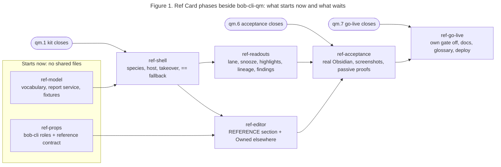

# Ref Cards: design, `==` editor, and parallel delivery beside `bob-cli-qm` (cld)

Researcher `cld`, swarm `research.6l`. Evidence was verified on 2026-11-26 at bob-cli
`cf414ce1`, bob-plugins `6bd399f3`, and the live `~/bob` vault (read-only), with
`bob-cli-qm` about 15 minutes into its run (all seven phases claimed, nothing landed yet).

## Bottom line

**Build it.** Ref notes are the largest typed-note population in the vault (1,377 indexed
references, against 39 notebooks and one prose note). They also have the worst native
Properties: a modern ref note opens on a median of 14 keys and about 800 characters of
YAML, including a JSON-in-a-string `highlights_marker_base` of up to 519 characters.
Meanwhile the facts Bryan actually wants (reading lane, why it is snoozed, how much he
annotated, where the PDF is) are not visible on the note at all. A Ref Card fixes both
problems on the existing Property Card kit.

What I recommend:

1. **A new `ref` species** on the kit, delivered as a **sibling epic**. Two of its phases
   start **now** because they share no files with `qm`: a small bob-cli phase and a
   plugin data/model phase. The card shell waits for **`qm.1` (kit) to close**,
   acceptance waits for **`qm.6`**, and go-live waits for **`qm.7`**. The epic keeps its
   **own preview gate**, because `qm.7` deletes `qm`'s gate.
2. **The card shows identity locally and reading state from one shared report.** Kind,
   title, byline, crumbs, and PDF/audio access paint synchronously from frontmatter. The
   lane, snooze reason, Today pill, highlight counts, lineage, and findings come from one
   plugin-level, lazily refreshed `bob ref list -A -R all -f json` snapshot. That
   snapshot covers the whole library in 1.1 s; a single `bob ref show` costs 0.94 s,
   because indexing dominates either way.
3. **`==` should exist, but it should not be a "schema editor".** Refs have no
   user-defined schema. `==` opens a **Reference editor**: a typed REFERENCE section in
   the Property Editor, backed by a bob-owned contract (as area/project settings are).
   It edits only the citation fields bob syncs safely: Title (which also retitles the
   generated H1), Authors, Published, Source, and an optional one-line Summary. Reading
   lane, residence, file name/id, kind, and sync bookkeeping are **owned elsewhere**, so
   the editor routes each one to its real owner instead of editing YAML that the next
   scan would overwrite or that would break the three-way merge.
4. **One small bob-cli change is justified** (unlike `qm`, which has none): tighten
   `bob props` ownership roles for reference keys, and add the reference contract behind
   a new capability. Today `+` offers `highlights_marker_hash`, `id`, `status`, and
   `parent` as freely editable loose keys. That is a latent data-integrity bug whether or
   not the card ships.
5. **Glossary:** a new strand keyed **"Ref Card"** (aka *reference card*). A draft is
   [below](#glossary-draft-ref-card).

## What I verified

| Fact | Evidence |
| --- | --- |
| Library size and shape | `bob ref list -A -R all -f json`: 1,377 rows. 775 modern and 602 legacy. Origin: 723 agent-report, 654 external. Kinds: chat 723, ai 280, docs 170, blogs 85, papers 67, zorg 14, books 11, slides 8, code 6, notes 5, forums 5, podcasts 2, meetings 1. |
| Typical state is calm | Reading states: finished 917, queued 227, started 161, dropped 70, unknown 2. Modern statuses: read 692, abandoned 50, ready 28, next 5. 27 blocked; 29 carry a priority, 30 a scheduled date. |
| Sparse enrichment | Highlights on 98 notes (max 28), comments on 58, audio on 29, `author` on 33, `published` on 28, URLs on 627, PDFs on 775, arXiv ids on 46. 4 notes are in a reading family; 9 legacy books have chapter statuses. 387 reading tasks are archived in `done/`. |
| Reading tasks | 458 are v2 (live in the parent note, with a managed embed under the H1); 317 are v1 in-note `^ref` trackers; 602 legacy notes have none. |
| Frontmatter wall | Modern notes have a median of 14 keys and 800 characters, max 25 keys. About 10 of the 14 are pipeline bookkeeping (`docs/highlights-ref-sync.md` § Synced Properties lists them). |
| Title ↔ H1 | All 1,377 notes start their body with an H1. Of the 1,320 with `title:`, only 5 have an H1 that differs. bob writes the H1 once at birth (`src/native/highlights_ref/note.rs` `default_note_body`), and later syncs never retitle it. |
| Report cost | `bob ref list -A -R all -f json`: 1.13 s wall, 1.48 MB. `bob ref show <path> -N -f json`: 0.94 s. A filtered `list -t papers`: 0.87 s. Indexing dominates, so per-note fetches buy nothing. |
| Report row is rich enough | Each row already carries `status`, `reading_state`, `blocked`/`blocked_by`, `task{path,mark,archived,priority,scheduled}`, `earlier`/`reading`, `author`/`published`/`captured`, `added`/`finished`, `source_pdf`, `audio`, `annotation_count`/`comment_count`, `snapshot`, `research_ref`, `superseded_by`, and `diagnostics` (`docs/ref.md` § JSON envelope). No new CLI surface is needed for the card. |
| **Trap: hub notes typed `[[ref]]`** | 13 root notes (`sase_ref.md`, `ai_ref.md`, `dev_ref.md`, `obsidian_ref.md`, …) are typed `[[ref]]`, but they are *parents of* references, not references. They sit outside `ref/`, so bob's index has no row for them. `bob props` still classifies them as `reference` (`src/native/props/roles.rs`: `type_names.any(== "ref")`). |
| Props roles today | For reference notes, only `source_markdown` is non-loose (`roles.rs` `derived_role`). Every `highlights_*` key, `source_pdf_sha256`, `pipeline_version`, `id`, `status`, `parent`, `ref_type`, and `earlier` is **loose**, so the `+` Property Editor offers to edit them. |
| Sync semantics | Frontmatter-only edits to standard synced fields (`title`, `author`, `published`, `source_url`, `aliases`, `topics`, …) auto-merge into the PDF marker at the next writing scan. A v2 note's `parent` is *rendered from the reading task's residence*, and refiling the task repoints it. A frontmatter `status` edit drives a checkbox edit, or conflicts if the checkbox also moved (`docs/highlights-ref-sync.md` § Synced Properties, § Reading Tasks In Parent Notes (v2)). |
| Kit traps shared with `qm` | `240m:190`: `silent = temporal \|\| kind === "area"` would print "no created date" on roughly 900 ref notes. `240q:515–543` hardcodes the eligible kinds, the mount-source attribute, and the area/project-only `props_contract_v1` rule. `240f:7` `PROPERTY_CARD_KINDS`. These are the same T1/T3 traps that `qm.1` is fixing right now for notebook/prose. |
| `==` precedent | `248m` `registerPropertyCard` is an additive extension registry. Area/project register `open → openPropertyEditor({ focusSettings: true })` (`298z:234–250`), rendered from bob's settings contract (`298w`; area/project-gated at lines 71, 117, 310). |
| Existing ref surfaces to reuse | Reading Board kind map `242:6–14` (7 of the 13 live kinds, no fallback). Lane words in `docs/ref.md` § Reading Board. Nav-hotkeys `openReferencePdfPath` (`677:341`) and `isManagedRefNote` rename guard (`210:1`). Command Mode FOR THIS NOTE rows `ref-today`, `ref-show`, `ref-rename` (`bob-command-mode/src/160-sheet-rank.js:653–655`). Bob Refs inspector honesty rules (`bob-mac-capture/docs/refs-inspector.md`). |
| Epic state | `qi.1`–`qi.5` closed, `qi.6` in progress; `qj.2`–`qj.5` in progress; `qm.1`–`qm.7` in progress (kit first). Related ref epics `bob-cli-87` and `bob-cli-d2` are done or orthogonal; `bob-cli-50` (durable "ever finished" history) is open and unaffected. |

## Is this a good idea? Critique of the request

**Yes, and it pays off more than notebook or prose cards.** It reaches 35× more notes
than the Notebook Card. It removes the single ugliest native-Properties experience in the
vault. It also puts reading state on the note, which today only shows a checkbox inside
an embed frame that cannot say *why* a reference is snoozed.

Where the request as written would go wrong:

- **"Schema editor" is the wrong model for `==`.** Albums have a user-authored schema,
  so their `==` opens a schema card. A ref note's shape is bob's fixed contract, and
  most of its keys belong to the sync engine, the reading task, or the file system. A
  ref `==` that edits "the schema", or exposes every key, would invite exactly the edits
  that corrupt sync: a hand-edited `highlights_marker_hash`, a `parent` the next scan
  re-projects, or an `id` that must follow the stem
  (`decisions:reference-ids-follow-file-stems`).
- **"As much information as possible" needs an honesty filter.** Most refs are
  finished agent reports with no author, highlights, or audio. Content-gate every fact,
  never paint a zero, and apply the Bob Refs inspector's rules: absence stays absence; a
  publication date is not a file date; a highlight count is not progress.
- **Parallelism does not mean "no coordination".** Three `qm` phases touch exactly the
  lines a `ref` species needs. See
  [Parallel delivery](#parallel-delivery-beside-bob-cli-qm).
- **`[[ref]]` is not a sufficient eligibility rule.** The 13 hub notes would get
  hollow, wrong cards.

Would I take a different approach? I would keep the architecture (a kit species), but
make four changes. Each is an explicit adjustment below.

## Adjustments to the requirements (called out)

| # | Adjustment | Why |
| --- | --- | --- |
| **A1** | Eligibility is **exactly `[[ref]]` under bob's ref coverage (`ref/**`)**, excluding `*.assets/`, hidden directories, conflict copies, `_templates/`, `done/`, `_conflicts/`, and embeds. The 13 root `*_ref` hub notes keep native rendering. | They are collections, not references; bob has no row for them. Retyping them is a separate question (follow-up F1). |
| **A2** | `==` opens a **Reference editor** (a typed REFERENCE section in the Property Editor), not a schema editor. It edits five citation fields and routes everything else to its owner. | See [The `==` editor](#the--editor-yes-but-a-reference-editor-not-a-schema-editor). |
| **A3** | **A small bob-cli phase is in scope:** tighten reference ownership roles and add a reference contract behind a new capability. The card itself remains fail-open on an older bob. | The roles gap is a real integrity bug. bob owns contracts; the plugin should not invent validation for synced fields. |
| **A4** | The managed **reading-task embed stays visible** below the card as the task's editable control, as the Project card keeps its `^prj` line. v1 does not dock or absorb it. | Absorbing it would require a new cross-note task writer. The Project card precedent already accepts this duplication. Revisit after the screenshot review (follow-up F3). |
| **A5** | The card's vocabulary **reuses the Reading Board's words**, from one shared ref-vocabulary model extracted from `READING_BOARD_KIND_MAP` and extended to all 13 kinds plus a fallback. | One library should use one set of words across the board, the card, `bob ref list`, and Bob Refs. |
| **A6** | The ref epic owns its **own preview gate** and must not join `qm`'s `cardPreviewKinds`. | `qm.7` deletes that gate. Riding it would ship an unaccepted ref card, or break the build, at `qm.7`'s sync. |
| **A7** | An optional, note-local **`summary:` dek** on refs: one line, with no ghost and no nag (the prose precedent). | When glancing at a saved reference, "why did I save this?" is the most useful line. `summary` is not a marker-synced field, so it stays local and safe. Decision D3. |

## Design

### Precedence and eligibility

Add `ref` to the kit's precedence function (`qm.1` creates it in a new `240t`
fragment) after `prose`. That matches bob's props order (bank → album → area → project →
notebook → reference). Like `qm`'s new species, `ref` claims a note only when `type` is
exactly `[[ref]]` (scalar, or a one-element list). Today all 1,377 library notes qualify.
Mixed types mount nothing. Extend `qm`'s exhaustive two-type test, which currently
asserts that `ref` claims nothing, so it asserts that `ref` claims exactly the library
notes and never a hub note.

### Anatomy

The full card is the default. `_` compacts it to the kicker and title for reading, per
note per session, like the Area card's collapse. Rare rows (snooze reason, lineage,
findings) appear only when present, so a typical finished reference is four quiet lines.

The mockups use live notes where possible. The third (paper) mockup's arXiv id, summary
line, `v2` lineage, and finding are illustrative.

A finished blog post (the most common external shape):

```text
╭───────────────────────────────────────────────────────────────────────────╮
│ ▛▚ BLOG · ● SASE › SASE PyPI releases                      ✓ Read · Oct 23 │
│ ▙▟  Agentic coding is straining CI. Here’s how we scaled test impact       │
│     analysis at Anthropic                                                  │
│     Sachin Malhotra · claude.com ↗ · Sep 14, 2026                          │
│     ✎ 5 highlights                                        ▤ PDF   ♫ Listen │
│ ────────────────────────────────────────────────────────────────────────── │
│   created Oct 22, 2026                                ▸ Properties · 4  − + │
╰───────────────────────────────────────────────────────────────────────────╯
  ![[done/sase_pypi_releases_done#^ref-agentic-coding-is-straining-ci-heres]]   ← stays
```

A queued agent report that is snoozed on a prerequisite:

```text
│ ▛▚ CHAT · ● SASE › SASE memory                          💤 Snoozed → ⭐ Next │
│ ▙▟  Shrinking SASE's Agent Instruction Files to ≤100 Lines: A Budgeted      │
│     Router, Not a Trim                                                     │
│     agent report                                                           │
│     ⛓ after Generate AGENTS.md dynamically at launch!   ✎ 1   ▤ PDF        │
```

A paper being read today, in a reading family, with a finding:

```text
│ ▛▚ PAPER · ● SASE › SASE goals               📖 Reading · ⏫ · TODAY        │
│ ▙▟  Goals as First-Class Abstractions in Human–AI Collaboration     v2      │
│     microsoft.com ↗ · arXiv 2604.01234 · Apr 2026                          │
│     Why I saved this: goals as first-class objects for agent routing.      │
│     ✎ 22 highlights · 3 with notes                       ▤ PDF   ♫ Listen  │
│     Readings  v1 · Mar 2   v2 · this reading                               │
│ ────────────────────────────────────────────────────────────────────────── │
│   created Oct 10, 2026 · ⚠ 1                          ▸ Properties · 5  − + │
```

A legacy zorg-era book (muted, outlined tile, like a closed project):

```text
│ ▛▚ BOOK · ● Mind › Outlive                     🗄 zorg-era · 2 of 3 chapters │
│ ▙▟  Outlive                                                                │
│     amazon.com ↗                                                           │
```

Compacted (`_`):

```text
│ ▛▚ PAPER · ● SASE › SASE goals               📖 Reading · ⏫ · TODAY        │
│ ▙▟  Goals as First-Class Abstractions in Human–AI Collaboration     v2      │
```

In a narrow pane (about 420 px), the lane chip drops below the title as a muted line,
the byline wraps, and the PDF/♫ cluster wraps under the readout.

### Element rules

| Element | Source | Rule |
| --- | --- | --- |
| Tile | Kit | A new **`ribbon`** form: a tile with a bookmark ribbon notched into its top edge. The ribbon carries the species, so it must stay distinct in grayscale and `forced-colors`. The icon is the kind's Lucide icon, falling back to `bookmark`. If acceptance finds that per-kind icons blur the species, switch to `bookmark` everywhere (the same escape hatch as `qm`'s folio initial). Legacy and dropped refs get the muted, outlined tile treatment. |
| Kicker | Local `ref_type`, shared vocabulary | The kind word (BLOG, PAPER, CHAT, …; REFERENCE as fallback), then crumbs from local `parent` through the home-card resolver, with the root-area hue pip. No species hue. The accessible name is "Reference · Paper: <title>". |
| Lane chip (kicker right) | Report `status`, `blocked`, `task.priority`, `status_sync`; Today cache | The Reading Board's words in family glyphs: 📖 Reading (`wip`), ⭐ Next, 📥 Ready, 💤 Snoozed → <return lane>, ✓ Read · <finished>, Dropped · <date>, 🗄 zorg-era · <legacy label or chapters>. A priority mark and a TODAY pill appear only when the reading task is linked under today's open Pomodoros (`decisions:today-is-read-from-the-ledger`). A dim `*` marks a pending frontmatter sync. Click goes to the reading task; Mod opens a new tab. Without a report the chip is absent. |
| Title | Local `title:`, then first-body H1, then stem | `role="heading"`. A matching first-body H1 hides at render time, and a Live Preview cursor reveals it (kit title adoption). A non-matching H1 stays visible (fail-open). A `vN` chip appears from the report's `reading` when N > 1, or as `v1` on a root that has later readings. |
| Byline | Local `author`, `source_url`/`url`, `published`, `agent`, report `identity.arxiv` | Authors · host ↗ (opens the first URL) · `arXiv id` (copies) · published date, formatted only from `published` and never from `created` or the file. Agent reports read "agent report", plus the `agent:` name or the researcher suffix from the stem (`__gem` → "gem draft"), as Bob Refs does. The row is omitted when empty. |
| Summary | Local `summary:` | Optional one-line dek in italics, clamped to two lines. Absence is normal: no ghost. |
| Snooze reason | Report `blocked_by` | One line: `💤 until Dec 2`, `⛓ after <title> +N`, `🧱 in blocked project <stem>`, or `⏸ blocked`, in the exact words of `bob ref list` and the board. Prerequisite titles navigate. |
| Annotations | Report `annotation_count`, `comment_count`, `snapshot.synced_at` | `✎ N highlights · M with notes`, never a 0. Click jumps to the `## Highlights` heading (from the metadata cache). The tooltip says "From the Highlights scan on <date>; not live PDF state." |
| Legacy chapters | Report `reading_state_source` `legacy_chapters:a/b` | `a of b chapters` in the lane chip. |
| Access | Local `source_pdf`, `audio` | `▤ PDF` opens the PDF in Highlights through a small versioned nav-hotkeys API (`api.refPdf.open(path)`, wrapping `openReferencePdfPath`); off macOS it opens the PDF in a new tab. `♫ Listen` opens the companion audio. Both are omitted when absent. |
| Readings | Report `earlier`/`reading`, plus a client-side join for "later" | Shown only for the 4 family notes. The chips open each reading. |
| Foot | Kit | `created`, silent when missing (on ~900 notes). The lint chip carries report diagnostics (`parent_mismatch`, `multiple_open_ref_tasks`, `open_ref_without_task`, `open_v1_tracker` → "run `bob ref migrate-tasks`", `earlier_dangling`, `opaque_url`) with per-issue tooltips. Then `▸ Properties · N` and `−` / `+`. |
| Drawer | Kit inventory | Every key in file order. The managed set folds into a closed **Managed · N** group: `source_pdf`, `source_pdf_sha256`, `highlights_*`, `pipeline_version`, `source_markdown`, `return_links`, `audio`, `earlier`, `recaptured`, `type`, `ref_type`, and zorg provenance (`source_note`, `source_block(s)`, `source_id`, `source_path`, `source_line_*`, `legacy_chapter_statuses`). |

**Not on the card:** freshness, review pressure, decay, ready caps, page counts, or
reading-time estimates (bob has no page or word count for refs; see follow-up F4), and
no completion percentage.

### Beauty notes

- **Finished refs (two thirds of the library) must look calm.** "✓ Read · Oct 23" is set
  in muted ink. Only Reading and Next use the accent, and Snoozed uses the theme's
  warning token. No new hues.
- **Typography:** the title is in the family title face and size, and the byline is
  muted and slightly smaller, separated by middle dots. Chips use the kit pill. The tile
  sits on the kicker baseline with its ribbon notch.
- **Layout:** reserve the readout row's height while a snapshot is expected, patch in
  place when it arrives, and collapse the row once if none comes. Never paint
  placeholder numbers (`qm`'s rule).
- **Visual QA:** check light, dark, `forced-colors`, and grayscale, at narrow and wide
  widths, in Live Preview and Reading. Screenshot it next to an Album card and a
  Notebook Card for family consistency.

### Data path: one shared ref-library snapshot

- **Service:** a plugin-level **ref library service** (new fragment) runs
  `bob ref list -A -R all -f json` and keeps a path-keyed index.
  - It subscribes lazily, on the first mounted Ref Card, and stays idle with no card
    mounted.
  - It serves stale data while revalidating, with one in-flight request shared by
    everyone.
  - It revalidates on vault create, modify, rename, and delete under `ref/`, and on
    modifications to a mounted card's task residence. Revalidation is debounced, with a
    trailing call at most every ~10 s, so typing in a ref note's own notes never storms.
  - It also refreshes on a manual command. Subscriptions are released on unload.
- **Cost:** about 1.1 s of background CPU per refresh. Painting, folding, cursor moves,
  and drawer toggles never spawn bob or write the vault, and spy tests prove it.
- **Rows that never arrive:** a missing row (the 2 superseded notes, a ref outside the
  index, or an old bob) leaves an identity-only card, never zeros.
- **Reading Board:** leave it on its own filtered argv for now. The service should still
  be shaped so the board could later filter one snapshot client-side.

### Takeover, title, and the managed embed

- **Takeover:** the family's fail-open takeover gate applies unchanged, keyed on
  `props_v1` alone, like `qm`'s species.
- **Machine rewrites while the note is open:** ref notes are machine-rewritten by scans
  (`highlights_synced_at`, counts, embed healing). The shell and data freshness must be
  checked separately (`qm`'s rule). A scan rewrite patches chips and must never unmount
  the card or flash native Properties.
- **Renames:** a `bob ref rename` is a file rename. The card remounts on the new path,
  and the report row re-keys.
- **Managed embed:** it stays as the second body line, directly under the card (A4). The
  v1 tracker line on 317 notes is treated the same way.

## The `==` editor: yes, but a Reference editor, not a schema editor

**Should ref cards support `==`?** Yes. The family promise is that `==` opens the
species editor, and on a YAML-fronted note Vim's `==` reindent is nearly useless (the
same reasoning `qm` adopted). It would be wrong, though, for `==` to open either a
schema editor or the generic Property Editor list. The editor's job is to make the few
*human-owned* facts easy to fix and to make the machine-owned facts impossible to
corrupt.

### What it edits (REFERENCE section)

| Row | Keys | Operation and validation | After-effects reported (`effects[]`) |
| --- | --- | --- | --- |
| **Title** | `title` | One line, nonblank. bob also rewrites the first-body H1 in the same atomic write when that H1 still equals the old title (it is bob's generated birth line). Decision D2. | "Heading updated. Syncs to the PDF marker at the next writing scan (⌘S in Bob Refs)." |
| **Authors** | `author` | Scalar or list of nonblank, distinct names. | Marker sync note, as for Title. |
| **Published** | `published` | `YYYY`, `YYYY-MM`, or `YYYY-MM-DD`. The help text says it is the publication date, never a file date. | Marker sync note, as for Title. |
| **Source** | `source_url`, or legacy `url` | Writes to whichever key the note uses; a new value goes to `source_url`. Accepts a URL or a list. HTTP(S) URLs are validated, and anything else warns with `opaque_url`. | "`bob ref find` identity keys change: <old> no longer matches." |
| **Summary** | `summary` | Optional single line; over 140 characters warns (the area-summary rule). | "Note-only; not synced to the PDF." |

### What it routes elsewhere (an "Owned elsewhere" group of teaching rows)

Each row shows the current value. Enter takes you to the real owner.

| Row | Shows | Enter does | Why not edit here |
| --- | --- | --- | --- |
| Reading | Lane, plus snooze reason | Go to the reading task (the Task Card and checkbox keys live there) | Status is derived from the checkbox. A YAML edit either drives the checkbox at the next scan or conflicts. |
| Lives under | Residence crumbs | Go to the reading task. The hint says "Ctrl+Shift+M moves it; `parent` follows." | A v2 `parent` is rendered from the task's residence. |
| File name | Stem / `id` | Opens Command Mode's existing `ref-rename` row (preview first, with bob's eligibility refusals) | `decisions:reference-ids-follow-file-stems`, `decisions:reference-renames-keep-identity` |
| Kind | `ref_type` | Inert (shown read-only) | Derived from the `lib/<type>/` folder. |

The **sync bookkeeping** keys never appear as rows. They live in the drawer's Managed
fold. **Read today** stays in Command Mode's FOR THIS NOTE (`ref-today`) and on the
Bob Refs ⌘N card. No new writer is added to the card or the editor.

The editor closes with Esc, `q`, and Ctrl+`[` through the shared ladder
(`decisions:q-and-ctrl-bracket-mirror-esc`). Every write goes through
`bob props update`: preview, one atomic apply, and an undoable `inverse_ops`.

**Fallback:** when bob lacks the new capability, `==` falls back to `qm.1`'s
focus-or-add on `title`. An older plugin ignores a `reference` contract, because
`298w` gates the section on area/project.

### The bob-cli contract (phase `ref-props`)

1. **Roles.** Scope these to notes inside bob's ref coverage, so hub notes are never
   mis-taught.

   | Keys | Today | Proposed role and teaching reason |
   | --- | --- | --- |
   | `source_pdf`, `source_pdf_sha256`, `highlights_sidecar`, `highlights_count`, `highlights_synced_at`, `highlights_marker_hash`, `highlights_marker_base`, `highlights_marker_replaced_hash`, `pipeline_version` | loose | **derived**, owner `ref sync`: "Highlights sync bookkeeping; editing it breaks the three-way merge" |
   | `audio`, `return_links`, `earlier`, `recaptured` | loose | **derived**, owner `ref create`/`ref sync` (written at birth or by companions) |
   | `ref_type` | loose | **identity**: "follows the `lib/<type>/` folder" |
   | `id` | loose | **identity**: "follows the file stem; use `bob ref rename`" |
   | `status`, when a reading task is located | loose | **derived**: "set by the reading task's checkbox" |
   | `parent`, when a v2 task is located | loose | **derived**: "follows the reading task's note; move the task" |
   | zorg provenance (`source_note`, `source_block(s)`, `source_id`, `source_path`, `source_line_*`, `legacy_chapter_statuses`) | loose | **derived**, owner `ref migrate-zorg` |
   | `title`, `author`, `published`, `source_url`/`url`, `summary`, `aliases`, `topics`, `captured`, `created`, `tags`, `legacy_status`, `highlights_marker_fields` (a user opt-in list) | loose | unchanged (**loose**) |

2. **Contract.** `bob props show -f json` on a library reference adds
   `contract: {kind: "reference", settings: [...]}` with the five rows above, in the
   same row shape as the area contract (`declared`, `value`, `issues`, `help`). The
   response announces the new **`props_ref_contract_v1`** capability, also listed in
   `__catalog` features. `setting.set`/`setting.clear` gain `title`, `author`,
   `published`, `source`, and `summary` on reference notes.
3. **The Title setting** is the one setting that edits a body line: the generated H1,
   and only when it still equals the old title. That widens the props "frontmatter-only
   `changes`" statement for this one setting, so document it in `docs/props.md`.
4. **Release.** This rides the daily train
   (`decisions:bob-cli-releases-ride-a-daily-train`). The contract is additive, and the
   role tightening changes values, not the JSON shape. I believe it needs no `!`; the
   planner should confirm against the gotcha.

## Parallel delivery beside `bob-cli-qm`

### Is coordination needed?

Yes, at four seams. Everything else is new fragment files or bob-cli Rust, which `qm`
never touches.

| Seam | Concrete failure if ignored | Handling |
| --- | --- | --- |
| **`qm.1` kit edits**: `240f` registry, `240m` silent created (T1), `240q` coordinator lists (T3), the new `240t` precedence function and its exhaustive test, focus-or-add | Both epics would rewrite the same lines. `qm.1`'s test asserts that `ref` claims nothing, so a `ref` species landed first breaks it. | **`ref-shell` waits for `qm.1` to close**, then adds `ref` to the structures `qm.1` created. Because `ref` is the third species to hit the same hardcoded lists, `ref-shell` should make them descriptor-driven (per-species `createdSilent`, `sourceAttr`, `contractGate`) if `qm.1` has not. |
| **Preview gate**: `qm.1` adds `cardPreviewKinds`, and `qm.7` deletes it | If `ref` joins the list, `qm.7`'s deletion makes an unaccepted card live, or leaves a dangling reference. If `ref` is added to `PROPERTY_CARD_KINDS` without a gate, `propertyCardKindLive` treats it as an existing, always-live kind. | **A ref-owned gate** (`refCardPreview: true` in ledger-tools plugin data, read only by ref fragments), deleted by ref's own go-live (A6). |
| **`glossary:property-card`**: `qm.7` holds the only authorized edit | Two concurrent edits to one strand, with only one memory decision on file. | **`ref-go-live` waits for `qm.7`**, then edits the family list under its own memory decision. |
| **Real-Obsidian acceptance**: `qm.6` extends the `qi.4` takeover harness | Concurrent real-app runs and shared-kit landings mid-run, which `qm`'s rules forbid. | **`ref-acceptance` waits for `qm.6`** and extends the harness `qm.6` leaves (a sibling runner that imports its lib, never a fork). |

There is no seam with `qj`; ref cards never touch prose. There is none with `qi` beyond
what `qm.7` already waits for. Bundle files (`main.js`, `styles.css`, `fragments.json`,
`package.json`, manifest versions) follow `qm`'s rebase discipline: take upstream,
re-apply your own entries, rebuild, re-bump, and never hand-merge a bundle.

**Rejected alternatives:**

- **Fold ref cards into `qm` as extra phases.** `qm`'s plan is approved, its memory
  decisions are scoped to named strands ("No other memory note may be edited"), and its
  acceptance is already large. Re-planning it costs more than a sibling epic.
- **Wait for `qm` to finish.** Two of the seven phases have zero overlap and can finish
  while `qm` runs. `qm.1` is the only hard wait, and it is short.

### Phases and gates



*Figure 1 shows which Ref Card phases start immediately and which wait on `qm` phases.
Rounded nodes are `qm` phase closures, polled with `qm`'s gate procedure (closed
phase-bead poll under `/sase_monitor`, then one audited read confirming the phase closed
done and not canceled). Only `ref-shell`, `ref-acceptance`, and `ref-go-live` wait on
`qm`.*

| Phase | Repo | Scope | Starts |
| --- | --- | --- | --- |
| `ref-props` | bob-cli | Role tightening scoped to ref coverage; `reference` contract, `setting.*` ops, generated-H1 retitle, `props_ref_contract_v1`; `docs/props.md`, `docs/ref.md` pointer; tests | Now |
| `ref-model` | bob-plugins (new fragments) | Shared ref vocabulary, extracted from the board's kind map and completed for 13 kinds plus a fallback; the ref library service; the pure view model (eligibility, title, byline, access, managed set, lane mapping); fixtures (byte copies: blog read, paper with highlights and audio, blocked agent report, v1 tracker, abandoned, legacy book with chapters, legacy ai, `__v2` family, hub note `sase_ref.md`, mixed type, missing `title:`, H1 ≠ title, superseded); unit tests | Now |
| `ref-shell` | bob-plugins (kit) | `ref` species and `ribbon` tile; T1/T3 entries (preferably descriptor-driven); precedence and test update; own preview gate; host on `createPropertyCardHost`; title adoption; foot adapter with Managed fold; `_`; `==` registration (fallback focus-or-add on `title`) | After `qm.1` + `ref-model` |
| `ref-readouts` | bob-plugins | Subscription, lane chip, snooze line, annotations with jump, lineage, findings, Today pill, PDF/audio access (plus the tiny nav-hotkeys `api.refPdf` seam); reserved rows; no-spawn spies | After `ref-shell` |
| `ref-editor` | bob-plugins | REFERENCE section in `298w`/`298x`/`298y` (`reference` kind; date-partial and URL-list stages if missing); the Owned-elsewhere rows (task jump, Command Mode `ref-rename` dispatch); capability probe; ladder tests; tests use `BOB_BIN` from bob-cli master | After `ref-shell` + `ref-props` |
| `ref-acceptance` | bob-plugins | Takeover, single-owner, native restoration, scan rewrite while open, rename while open, hub notes stay native, passive proofs, and the screenshot matrix | After `qm.6` + both UI phases |
| `ref-go-live` | both | Delete the own gate; docs (`docs/ref-card.md`, `property-editor.md`, `architecture.md`, `bob-ledger-tools.md`; bob-cli `docs/ref.md`); memory (`glossary:ref-card`, `glossary:property-card` family list); `sase memory init`, `just docs-gen`/`docs-check`; clean deploy; wait for a bob release carrying `ref-props` | After `qm.7` + `ref-acceptance` |

## Glossary draft: Ref Card

The keyword is **Ref Card**: Bryan's word, and it pairs with *Ref Panel*. The aliases are
*reference card* (the family's note-type naming) and *ref title card*.

> **Ref Card** (aka reference card, ref title card)
>
> The note-top [[property-card]] for a [[reference-note]] in the library (`ref/`),
> painted by Bob Ledger Tools in desktop Live Preview and Reading view.
>
> - **Identity.** A ribbon tile with the reference's kind icon and a kind kicker (BLOG,
>   PAPER, CHAT, BOOK, …), plus the parent's crumbs in the root hue, lead the title
>   (`title:`, else the first H1). Below it sits a byline of authors, source site, and
>   publication date (never a file date), and an optional one-line `summary:`.
> - **Reading.** From the shared `bob ref list` report it adds the reading lane in the
>   Reading Board's words: Ready, Next, Reading, Read with its date, Dropped, or Snoozed
>   with its wake date or prerequisite. It also shows the [[reference-task]]'s priority,
>   a Today pill, highlight and note counts from the last Highlights scan, the reading
>   family's `vN`, and findings in the foot. Missing report data is omitted, never
>   zeroed. PDF and audio chips open the source.
> - **Keys.** `==` opens the Reference editor for title, authors, published, source, and
>   summary. It routes the lane, residence, and file name to their owners: the reading
>   task, a task move, and `bob ref rename`. `+` opens the Property Editor; `-` opens
>   the drawer, where sync bookkeeping folds under Managed; `_` compacts the card.
> - **Embed and painting.** The managed reading-task embed stays below the card as the
>   task's editable control. Painting never writes the note or PDF and never spawns bob.
>
> Not a Reading Board card, the [[ref-panel]] inspector, a Copy card, or `bob ref show`
> output. The root `*_ref` hub notes get no card. See
> `docs/reference/plugins/ref-card.md`.

## Decisions to put to Bryan (recommended defaults)

| # | Question | Default |
| --- | --- | --- |
| D1 | What does `==` open? | The **Reference editor** (bob contract), falling back to focus-or-add on `title`. The alternative is focus-or-add on `title` only. |
| D2 | Does a Title edit retitle the generated H1? | **Yes**, atomically, only when the H1 still equals the old title. Without it, a title edit leaves a visible, stale H1 under the card. |
| D3 | Add an optional `summary:` dek to refs? | **Yes**: optional, note-local, with no ghost. |
| D4 | Dock or absorb the reading-task embed? | **Keep it visible** in v1 (A4), and revisit after screenshots. |
| D5 | Fold model? | **Full by default**; `_` compacts to the kicker and title. |
| D6 | Kicker for `chat`? | Keep the board's **"Chat"**, with "agent report" in the byline. Rename both later only if Bryan prefers "Agent report". |
| D7 | Memory? | New `glossary:ref-card`; a family-list edit to `glossary:property-card` after `qm.7`. Optionally a decision record: "The Reference editor edits citation fields only; lane, residence, and identity stay with their owners." |

## Risks

- **Scan rewrites under an open card.** This is the most likely real-app defect.
  Acceptance must cover a scan, an embed heal, and a rename while the note is open.
- **Report freshness.** Lane changes made elsewhere (Bob Refs, Highlights, the walk)
  appear only after the next debounced refresh. Mitigation: watch residence-file
  modifications for mounted cards, and add a manual refresh command.
- **Kit growth.** Twelve species is where hardcoded kind lists become a liability; take
  the descriptor-driven refactor (Seams table) seriously.
- **bob/plugin skew.** The contract arrives by the daily train, and the plugin must probe
  `props_ref_contract_v1` rather than assume it.

## Follow-ups (not in this epic)

- **F1.** The 13 root `*_ref` hub notes typed `[[ref]]`: retype them (Bryan's call) or
  give them their own surface. Until then, keep reference roles scoped to ref coverage.
- **F2.** Optionally let the Reading Board consume the shared ref library snapshot.
- **F3.** Dock the reading-task embed into the card once a safe cross-note lane writer
  exists, if screenshots show the duplication hurts.
- **F4.** A bob-supplied reading-time estimate (page or word count recorded at
  render/sync) and an agent-report "Bottom line" excerpt (as the Bob Refs inspector
  shows), both as additive `ref list` fields.
- **F5.** Code-block and link counts from the saved-source catalog, as an expanded-row
  readout.

## Recommended solution

Ship **Ref Cards** as a `ref` species on the Property Card kit, delivered in a **sibling
epic of seven phases**:

- **Start now:** `ref-props` (bob-cli) and `ref-model` (plugins, new fragments).
- **Then:** `ref-shell` after `qm.1` closes; `ref-readouts` and `ref-editor` in parallel
  after it.
- **Finally:** `ref-acceptance` after `qm.6`, and `ref-go-live` after `qm.7`.
- **Throughout:** use a ref-owned preview gate, and never `qm`'s.

**The card:**

- A ribbon tile with a kind kicker and the parent's crumbs; the title (adopting the
  matching generated H1); a byline of authors, source site, and published date; and an
  optional summary dek.
- From one lazily refreshed `bob ref list -A -R all` snapshot: a lane chip in the
  Reading Board's words with priority and TODAY, the snooze reason, highlight and note
  counts that jump to `## Highlights`, lineage, and findings in the foot.
- PDF and audio chips, and a Managed drawer fold for sync bookkeeping.
- Full by default, `_` to compact, and the reading-task embed left below as its control.

Everything is content-gated, nothing is zeroed, painting never spawns or writes, and
everything is fail-open to native Properties. Eligibility is exactly `[[ref]]` under
`ref/`, never the hub notes.

**`==`:** a **Reference editor**, a REFERENCE section in the Property Editor driven by a
new bob contract (`props_ref_contract_v1`). It edits Title (with the generated H1),
Authors, Published, Source, and Summary through one undoable `bob props update`. It
routes Reading, Lives under, and File name to the reading task and Command Mode's
`ref-rename`, and it falls back to focus-or-add on `title` on an older bob. The same
bob-cli phase tightens reference ownership roles, so the generic `+` editor can no
longer corrupt sync state.

**Glossary:** add `glossary:ref-card` ("Ref Card", aka reference card), and extend
`glossary:property-card`'s family list after `qm.7`.

## Sources

- **Plans and research:**
  - `plan:202611/prose_and_notebook_cards.md` (`bob-cli-qm`)
  - `research:202611/prose_and_notebook_title_cards/prose_and_notebook_title_cards.md`
- **Live bead state:** `bob-cli-qm`, `qm.1`, `bob-cli-qi`, `bob-cli-qj`, `bob-cli-87`,
  and `bob-cli-50`, read 2026-11-26.
- **bob-cli:**
  - `docs/ref.md` (§ Reading state, § `bob ref list`, § Reading Board, § `bob ref show`,
    § JSON envelope)
  - `docs/highlights-ref-sync.md` (§ Required Parent, § Synced Properties, § Reading
    Tasks In Parent Notes (v2))
  - `docs/props.md` (§ Ownership roles, § Area and project settings, § Settings
    contract)
  - `src/native/props/roles.rs`
  - `src/native/highlights_ref/note.rs`
- **bob-plugins:**
  - `plugins/bob-ledger-tools/src/`: `240f`, `240m`, `240q`, `241` (reading board
    data), `242` (reading board models), `248m`, `298w`, `298x`, `298y`, `298z`
  - `docs/area-and-project-cards.md`
  - `plugins/bob-navigation-hotkeys/src/210-*.js`, `677-*.js`
  - `plugins/bob-command-mode/src/160-sheet-rank.js`
- **bob-mac-capture:** `docs/refs-inspector.md` (honesty rules, reading-task fact,
  agent-report bylines).
- **Decisions:**
  - `reference-ids-follow-file-stems`
  - `reference-renames-keep-identity`
  - `reference-sources-are-preserved-write-once`
  - `code-copy-reads-render-time-catalog`
  - `open-pdf-writes-are-coordinated`
  - `today-is-read-from-the-ledger`
  - `q-and-ctrl-bracket-mirror-esc`
  - `mac-capture-is-a-thin-client` (Bob Mac Capture is unchanged)
  - `bob-cli-releases-ride-a-daily-train`
  - `decision-rules-are-read-at-planning-time`
- **Glossary:** `property-card`, `reference-note`, `reference-task`, `ref-panel`,
  `record-card`.
- **Live vault measurements** (read-only, 2026-11-26): `bob ref list -A -R all -f json`
  and `bob ref show -N -f json` timings, frontmatter and H1 scans over `ref/**`, and the
  hub-note census.
