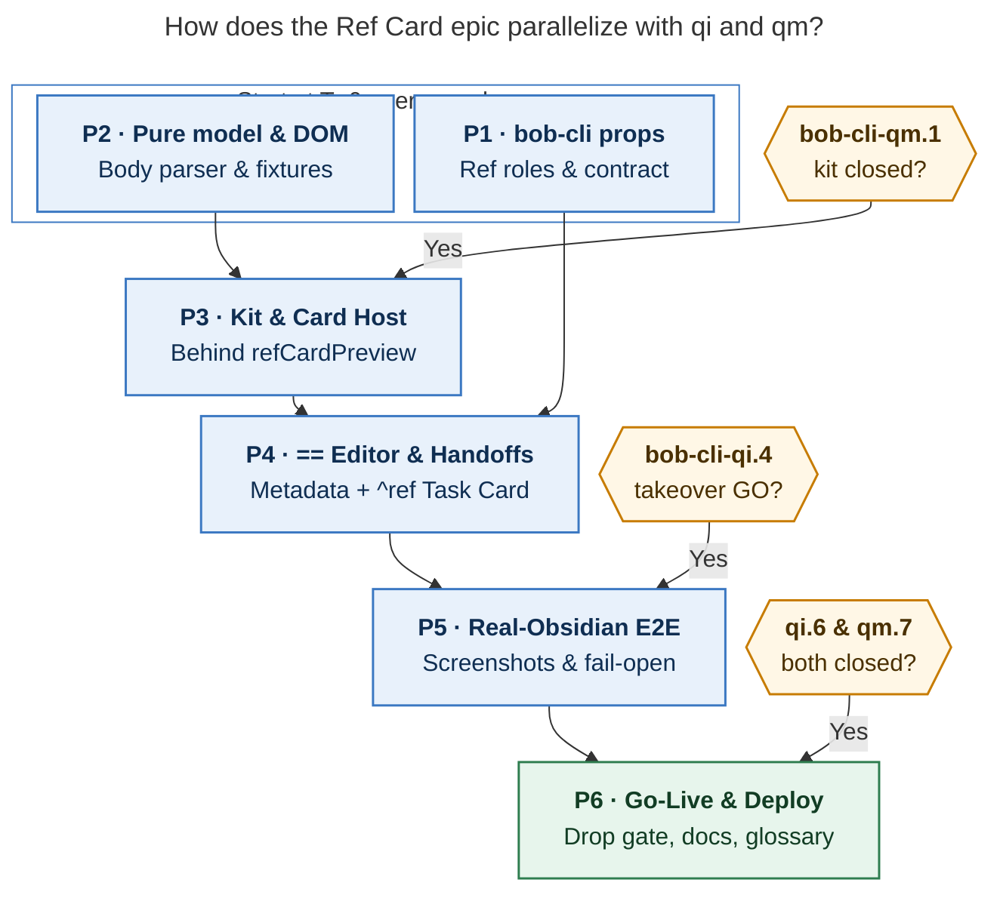

# Ref Cards: Design, Critique, and Parallel Delivery Plan

**Bottom line:** Ref Cards are the single highest-leverage missing member of the Property Card family. Bryan's live vault holds **1,379** reference notes under `ref/` (**775** modern PDF-backed + **604** legacy zorg-era), compared to 39 notebooks and 1 prose note, and every modern reference currently opens onto a 17–21 row native Properties wall dominated by SHA-256 hashes, escaped JSON sync snapshots, and pipeline plumbing. Implementing Ref Cards is strongly worthwhile — **provided we make six concrete adjustments** to the naive design:

1. **Confine eligibility to `ref/**/*.md` + exact `[[ref]]`** (never `type: [[ref]]` alone, which would falsely claim 13 legacy root-level `*_ref.md` hub notes), and support **both modern and legacy `ref/` notes** calmly.
2. **Harden `bob props` ownership on `reference` notes in `bob-cli`**, because `roles.rs` currently leaves 15+ Highlights pipeline, sync-hash, and `^ref`-projected keys (`parent`, `status`, `id`, `highlights_marker_*`, `source_pdf_sha256`, etc.) editable as `loose`.
3. **Keep painting 100% zero-spawn and local-first** (`bob ref show` takes ~1.09 s and `bob ref list -R all -A` takes ~1.18 s / 1.48 MB on the live vault); every card fact can come synchronously or off-paint from local frontmatter, the note body, Obsidian's Tasks/Today/backlink caches, and the write-once `code.json` catalog.
4. **Hide only the redundant opening H1** — keep the managed `![[parent#^ref-...]]` reading-task embed and `![[lib/...mp3]]` audio player visible directly below the card as live interactive controls (matching how Project Cards preserve `^prj`).
5. **Support `==`, but inside the shared Property Editor — NOT a bespoke modal:** mirror Area/Project's proven settings-plus-handoff architecture (`REFERENCE METADATA` with ghost rows + `ON THE ^REF TASK` Task Card handoff + Command Mode bundle actions for Rename / Pull to Today / Sync PDF), degrading cleanly to focus-or-add on `title` under older `bob`.
6. **Parallelize with `bob-cli-qm` using an isolated preview gate (`refCardPreview`) and three minimal external gates** (`qm.1`, `qi.4`, and `qi.6 + qm.7`), never reusing `qm`'s `cardPreviewKinds` switch (which `qm.7` deletes!) and never waiting on `bob-cli-qj`.

---

## 1. Empirical Grounding: Live Vault & Codebase State

Verified against `bob-cli` `cf414ce1`, `bob-plugins` `6bd399f3`, `plan:202611/prose_and_notebook_cards.md` (`bob-cli-qm`), `bob-cli-qi` (`qi.1`–`qi.3`, `qi.5` closed; `qi.4` screenshot artifacts attached; `qi.6` pending), and a read-only audit of `~/bob/ref/` and `~/bob/ref_history/`.

### 1.1 Live Vault Inventory (`~/bob`)

| Metric | Live Vault Count | Design Implication |
| --- | ---: | --- |
| Total files under `ref/` | **1,379** (1,377 active + 2 superseded) | 35× more notes than notebooks (39); every visual or performance mistake multiplies across the vault. |
| Modern PDF-backed (`era: modern`) | **775** (`chat` 711, `blogs` 28, `papers` 18, `docs` 11, `notes` 4, `podcasts` 2, `meetings` 1) | Primary daily surface; every one carries 10–15 pipeline/sync YAML keys. |
| Legacy PDF-less (`era: legacy`) | **604** (`ai` 280, `docs` 159, `blogs` 57, `papers` 49, `zorg` 14, `chat` 12, `books` 11, `slides` 8, `code` 6, `forums` 5, `notes` 1) | 44% of `ref/`; zero have `created:` or `source_pdf:`; 586 carry `url:`; 9 are multi-chapter books (`legacy_chapter_statuses`). |
| `type: "[[ref]]"` **outside** `ref/` | **13** (`obsidian_ref.md`, `sase_ref.md`, `dev_ref.md`, `ai_ref.md`, `zorg_ref.md`, etc.) | Legacy zorg hub notes — **must NOT** mount a Ref Card. |
| Frozen history under `ref_history/` | **1** (no `type:` key, opens with `> [!info]` replacement banner) | Inert archive; already excluded by path and missing `type: [[ref]]`. |
| Active reading queue (`ready`/`next`/`wip`) | **33** modern (`ready` 28, `next` 5, `wip` 0); **27** currently `blocked` | Active vs terminal visual distinction (`read` 692, `abandoned` 50) matters immediately on open. |
| Reading task shape (modern) | **458** v2 managed embeds (`387` archived in `done/`, `71` live); **317** v1 in-note `^ref` (all closed: 300 `read`, 17 `abandoned`) | Card must read live v2 embeds, archived v2 embeds, and v1 in-note tasks equally well. |
| Companion media & sources | **29** `audio:` (`.mp3` embeds); **493** `source_markdown:` (`.bob/ref-sources/*/code.json`); **25** multi-URL collections | Media and saved-source indicators earn compact, content-gated chips; never zero-fill when absent. |
| Annotations & sections | **98** with `highlights_count > 0`; **58** with comments; **1** with `[!summary\|section]` cards; **46** with extra body lines (mostly `LINKED FROM` mentions) | Highlight/comment counts and jumpable section chips should render only when present. |
| Special provenance | **27** `agent:` (SASE reports); **4** modern `source_note:`; **3** `earlier:` / `recaptured:`; **1** `meetings` (`event`, `meeting_start/end`, `notes_producer`); **0** modern `topics:` or `aliases:` | Provenance byline adapts cleanly by archetype; ghost `topics`/`aliases` rows in `==` unlock unused taxonomy. |
| Missing `created:` | **284** modern + **604** legacy = **888 / 1,379** (64%) | Kit Trap T1 (`240m`) **must** keep missing `created` silent for `ref` (never nag `"no created date"`). |
| Opening H1 behavior | **1,378 / 1,379** start with `# ...`; **2** modern notes differ from `fm.title` (`log_is_the_agent.md`, `filesystem_memory.md`); **1** starts directly with v1 `- [x] #task #ref` | H1 adoption needs case/stem/managed-embed tolerance and clean fallback when H1 is absent. |

### 1.2 Measured CLI Timings & Ownership Audit

- **CLI latency on live vault:** `bob ref list -R all -A -f json` took **1.18 s** (1.48 MB); `bob ref list -s ready,next,wip -A -f json` took **1.25 s** (46 KB); `bob ref show <path> -f json` took **1.09 s** (because `show` runs `build_index` over all 1,379 notes). Spawning `bob ref` on note open or paint would add >1 s lag and violate the Property Card family's passive-painting rule.
- **Critical `bob props` ownership gap (`src/native/props/roles.rs`):** Verified live via `bob props show ref/meetings/261123_bryan_bugyi_derrick_blakely.md -f json`. Out of **21** frontmatter properties, `bob props` currently protects only **two** — `type` (`identity`) and `source_markdown` (`derived`). All **19** remaining keys — including `highlights_marker_hash`, `highlights_marker_base`, `source_pdf_sha256`, `pipeline_version`, `ref_type`, `status`, `parent`, and `id` — are returned as `role: "loose", owner: "props"`.
- **Two-way PDF marker sync subtlety (`src/native/highlights_ref/sync.rs` & `docs/tick.md`):**
  - `bob tick` runs `bob ref scan -w` every 15 minutes, **but** its change gate triggers only when `lib/` or `xlib/` changed, a pre-scan hook is set, or 6 hours have passed (`docs/tick.md:87`). Editing a synced frontmatter field (`title`, `author`, `published`, `source_url`, `topics`, `aliases`) in Obsidian leaves `lib/` untouched, so PDF marker write-back waits up to 6 hours unless the user triggers `bob ref sync <pdf> -w`.
  - Editing `title:` in frontmatter does **not** rewrite an existing note's body H1 during `bob ref sync` (`sync.rs:1208-1234`), which explains the two live `H1 != fm.title` notes and informs our H1 adoption rule.

### 1.3 Governing SASE Decisions Consulted

Read via `sase memory read roster:decisions` and individual strands:

- `decisions:reference-ids-follow-file-stems` — `id` tracks the note stem (numbered suffix only on duplicate); editing `id` directly in YAML breaks identity (`bob ref rename` owns renames).
- `decisions:reference-renames-keep-identity` — renaming moves bundle paths and inbound links while preserving `^ref-…` reading-task identity; annotated and legacy refs are refused.
- `decisions:reference-sources-are-preserved-write-once` — `.bob/ref-sources/<type>/<stem>--<hash12>/source.md` + `code.json` is write-once and immutable; `source_markdown` is birth-only and note-local.
- `decisions:code-copy-reads-render-time-catalog` — clients read `code.json` / `bob ref code` (and `bob ref links`) and never extract code from PDF text or re-parse Markdown at read time.
- `decisions:references-are-ingested-at-birth` — create-time ingest files PDF + note + reading task together; annotation sync remains Mac-owned.
- `decisions:open-pdf-writes-are-coordinated` — any PDF marker write uses bounded `.forMerging` coordination on macOS; Obsidian plugins never write PDFs directly.
- `decisions:q-and-ctrl-bracket-mirror-esc` — every modal/stage opened from the card closes via Esc / `q` / `Ctrl+[`.
- `decisions:bob-cli-releases-ride-a-daily-train` — never edit `Cargo.toml` versions or `CHANGELOG.md`; keep `bob props` changes strictly additive (`schema_version: 1`) so no `!` breaking bump is required.

---

## 2. Critique of the Plan & Justified Requirement Adjustments

**Overall verdict:** Implementing Ref Cards is a **high-ROI, architecturally natural fit** for the Property Card family. Every other major typed note kind in the Bob vault (`bank`, `album`, `record`, `day`/`week`/`quarter`/`year`, `area`, `project`, and in `bob-cli-qm`, `notebook` and `prose`) will soon have a title card hiding native Properties behind the shared kit. Leaving the vault's largest typed collection (1,379 notes with the noisiest raw YAML) on native Properties would be the most glaring gap in the system.

However, six adjustments to the informal requirements are justified by vault evidence and codebase contracts:

| # | Requirement / Assumption | Critique & Evidence | Justified Adjustment |
| --- | --- | --- | --- |
| **A1** | "A new type of property card for ref notes" | `type: "[[ref]]"` matches **13 root-level `*_ref.md` hub notes** (`obsidian_ref.md`, `dev_ref.md`, etc.) that are NOT references. Meanwhile, 604 `ref/` notes are legacy zorg migrations with no PDF. | Require **both** `path.startsWith("ref/")` (excluding `*.assets/`, hidden dirs, conflicts, `_templates/`, `done/`) **and** exact `type: [[ref]]`. Support both `modern` and `legacy` `ref/` notes with a calm legacy treatment; exclude `ref_history/` and root `*_ref.md` hubs. |
| **A2** | Plugin-only work like `bob-cli-qm` | Unlike notebooks and prose notes, modern ref notes carry 15+ pipeline/sync/task-derived YAML keys that `bob props` currently exposes as editable **`loose`** rows (`roles.rs:152-159`). Hiding native Properties without locking those keys makes `+` a footgun. | Include a small, non-breaking **`bob-cli` phase (Phase 1)** to lock pipeline/sync/derived ref keys in `roles.rs` and emit an additive `props_ref_contract_v1` block for `==`. Gate Ref Card takeover on **`props_v1` alone** so older `bob` binaries still work and fail open cleanly. |
| **A3** | Report-backed readouts like Notebook Card (`bob notebooks list`) | `bob ref list -R all -A` takes ~1.18 s (1.48 MB) and `bob ref show` takes ~1.09 s; `bob-ledger-tools`'s existing Reading Board fetch (`241`) only covers the 33 queued modern rows. | Make Ref Cards **100% local-first with zero `bob` spawns**: read local frontmatter, the note's own Highlights/Sections body, Obsidian's Tasks/Today/Snoozed/backlink caches, cached residence task reads (for `done/`), optional passive Reading Board cache hits, and immutable `.bob/ref-sources/*/code.json`. |
| **A4** | Title/body ownership below the card | Every modern v2 ref note has `![[parent#^ref-...]]` (and 29 have `![[lib/...mp3]]`) immediately below the H1. Hiding them would break `Cmd+Enter`-on-embed and native audio scrubbing. | Hide **only the redundant opening H1** (using a case/stem/managed-embed-aware recognizer so editing `title:` never reveals a stale birth H1). Leave the `![[...#^ref-...]]` embed and `![[...mp3]]` player visible below the card, mirroring how Project Cards keep `^prj`. |
| **A5** | Parallelize with `bob-cli-qm` via shared preview gate | `bob-cli-qm.1` creates `cardPreviewKinds` and `bob-cli-qm.7` **deletes** it. Sharing that gate risks prematurely shipping unaccepted Ref Cards or breaking builds when `qm.7` lands. | Use a **Ref-Card-owned preview gate** (`refCardPreview: true` in ledger-tools plugin data), completely decoupled from `qm`'s `cardPreviewKinds`. Coordinate only at 3 explicit gates (`qm.1`, `qi.4`, `qi.6 + qm.7`). |
| **A6** | "What kinds of operations the schema editor triggered by `==` should support" | Ref notes have no nested YAML schema or dedicated `bob ref props-update` CLI (unlike Bank/Album/Record/Periods). Building a fourth bespoke modal would duplicate 25 fragments of Property Editor dry-run/undo/YAML-escape code. | **Yes, support `==`**, but route it into the **shared Property Editor** (Area/Project's pattern!) with a `REFERENCE METADATA` group (including ghost rows for unset synced fields), an `ON THE ^REF TASK` Task Card handoff, and Command Mode bundle actions (`Rename`, `Pull to Today`, `Sync PDF`). |

---

## 3. Parallel Delivery with `bob-cli-qm` (and `qi` / `qj`)

### 3.1 Is Coordination Needed?

**Yes — minimal, surgical coordination at 3 gates; zero need for serial blocking.**

Waiting for all of `bob-cli-qm` to close would stall Ref Cards behind **`bob-cli-qj`** (the `article` → `prose` vault cutover, which gates `qm.5` and `qm.7`), even though Ref Cards share **zero** code or domain with Prose! Conversely, editing `240f`/`240m`/`240q`/`240t` concurrently with `qm.1` (which is already running and Medium-sized) or deploying without a preview gate would create avoidable merge conflicts and risk leaking unaccepted cards onto 1,379 live vault notes when `qi.6`, `qj.4`, or `qm.7` runs `bob plugins sync`.

### 3.2 Overlap Matrix Across Active Epics

| Active Phase | What It Touches | Overlap with Ref Cards | Handling |
| --- | --- | --- | --- |
| `bob-cli-qm.1` (`kit`) | `240f`, `240m`, `240q`, new `240t` precedence table, `298z` focus-or-add, `styles.css` | Shared kit species/precedence/ownership files | **Gate 1:** Phases 1 (`bob-cli` Rust) & 2 (pure JS model/body/DOM/fixtures) start immediately at T=0; Phase 3 (kit wiring + host) waits only for `qm.1` (already running). |
| `bob-cli-qm.2`–`qm.5` | `notebookCard*` / `proseNoteCard*` fragments, `bob-articles` | **None** (only mechanical `fragments.json` / `main.js` / `manifest.json` rebases) | Run Phases 3 & 4 fully in parallel! Namespace isolation: `refCard*` in JS, `.bob-ref-card*` in CSS, `249g`–`249l` + `298ab`–`298ac` fragments, dedicated `refCardPreview` gate. |
| `bob-cli-qi.4` (`takeover-proof`) | Real-Obsidian takeover harness & kit polish (4 screenshot artifacts already attached!) | Takeover harness library | **Gate 2:** Phase 5 (Real-Obsidian E2E) waits for `qi.4` and runs in a sibling runner `scripts/obsidian-ref-card-e2e.cjs` importing the shared lib (no clash with `qm.6`). |
| `bob-cli-qi.6` & `bob-cli-qm.7` | `glossary:property-card`, passive-rendering proof, `docs/nav.yml`, `docs/index.md`, final live deploy | Shared docs, family glossary, passive proof, live cutover | **Gate 3:** Phase 6 (Go-Live: delete `refCardPreview`, docs, glossary, deploy) waits for both `qi.6` and `qm.7`. |
| `bob-cli-qj.*` | `bob prose`, `bob-articles`, prose vault cutover | **None** | Zero dependency. |

### 3.3 Six-Phase Parallel Execution Topology

*Figure 1 (verified with `mmdc 12.0.0`, rendered 730.96 × 732 px, 89.3% PDF fit): Phases 1 and 2 start immediately with zero overlap, while three explicit gates isolate kit registration (`qm.1`), real-Obsidian acceptance (`qi.4`), and live cutover (`qi.6` and `qm.7`); converging arrows mean all upstream inputs are required.*



**Coordination discipline for every `bob-plugins` phase:**
- Keep `refCardPreview: true` closed by default until Phase 6 so every intermediate `bob plugins sync` leaves the live vault untouched.
- Never hand-merge generated `main.js`, `fragments.json`, `styles.css`, or `manifest.json` on rebase: take upstream, re-append the `ref` fragment/CSS entries, run `npm run build` + `npm run build:check`, and re-bump the manifest version.
- Use the same non-audited `sase bead list --status closed --type phase -f json` polling procedure from `bob-cli-qm` for Gates 1–3, confirming closed `done` (not `canceled`) once via `sase bead read`.

---

## 4. Ref Card Visual & Functional Design

### 4.1 Family Identity: `ribbon` Tile, Root Hue, Quiet Material

Every Property Card obeys **"Hue says where; form and word say what"**:

- **Tile form: `ribbon`** — a vertical bookmark ribbon with a crisp inverted-V notch cut into its bottom edge (`clip-path: polygon(0 0, 100% 0, 100% 100%, 50% calc(100% - 0.42em), 0 100%)`).
  - **Distinct across the entire family in grayscale and `forced-colors`:** `stack` (album, offset sheets), `sheet` (record, top-right corner fold), `leaf` (day/period, calendar band), `plain` (bank), `field` (area, rounded swatch), `pennant` (project, **right-edge** horizontal notch), `spine` (notebook, left vertical bar), `folio` (prose, folded corner + initial), and now `ribbon` (ref, **bottom-edge** vertical bookmark notch).
- **Per-`ref_type` Lucide glyph inside the `ribbon` tile** (monochrome SVG, never raw emoji):
  - `papers` → `scroll-text` · `blogs` → `newspaper` · `chat` → `sparkles` · `docs` → `book-open` · `books` → `book-marked` · `podcasts` → `headphones` · `meetings` → `users` · `notes` → `sticky-note` · `slides` → `presentation` · `code` → `code-2` · `forums` → `messages-square` · fallback (`ai`, `zorg`, unknown) → `bookmark`.
- **Hue & wash:** Derived from the parent's root area via `homeCardWalkAncestry` + `pomodoroHomeHue` (never a species hue).
  - **Active references** (`wip`, `next`, `ready`, or legacy `started`/`queued`): **5% hue wash** and filled `ribbon` tile.
  - **Terminal or legacy-archived references** (`read`, `abandoned`, or legacy `finished`/`dropped`/`unknown`): calm **2–3% wash** and **outlined `ribbon` tile** (`data-tile-outline="true"`), mirroring terminal Project Cards so Bryan instantly senses *active queue vs library archive* in peripheral vision.

### 4.2 Visual Layouts Across Real Vault Archetypes

Default fold state is **expanded** (`foldDefault: true` in `240f`) because the card stays compact (~110–145 px tall) and surfaces the highest-value reading controls immediately, while `_` collapses it to a tight ~75 px header band when Bryan wants maximum vertical space for reading highlights.

#### Archetype 1: Modern Annotated Agent Report (`chat`) with Audio, Annotation Sections & Saved Source (`NEXT` + `TODAY`)

```text
╭──────────────────────────────────────────────────────────────────────────────╮
│ ┌──┐  REF · Chat · ● SASE › SASE blog                  [Open PDF]     [▾ _] │
│ │✦ │  Breaking the SASE Blog Post into Obsidian Tasks                 TODAY  │
│ └╲╱┘  ✦ research.g.final · Captured Oct 23 · v2 (from v1 ↗)                  │
│                                                                              │
│   ★ NEXT  in sase_blog ↗     ·     ✎ 8 (4 notes) · ♫ Audio · </> 4 · 🔗 13  │
│   § cards 2   § other 6                                                      │
│ ──────────────────────────────────────────────────────────────────────────── │
│   created Oct 23 · sase_blog_writers_block_task_plan      ▸ Properties · 18 − + │
╰──────────────────────────────────────────────────────────────────────────────╯
```

*(Directly below the card, the body begins with the live interactive `![[sase_blog#^ref-...]]` reading-task embed, `![[lib/...mp3]]` player if present, and `## Highlights`.)*

#### Archetype 2: Blocked External Paper (`papers`) with Author, Published Date, arXiv/URL & Topics

```text
╭──────────────────────────────────────────────────────────────────────────────╮
│ ┌──┐  REF · Paper · ● AI › Agents                       [Open PDF]     [▾ _] │
│ │📜│  Attention Is All You Need                                       v2     │
│ └╲╱┘  Vaswani et al. · Jun 2017 · ↗ arxiv.org/abs/1706.03762 · arXiv:1706…   │
│                                                                              │
│   ⏸ BLOCKED → ★ NEXT  ·  ⛓ after Transformer Basics ↗     ·     ✎ 14 (6 notes)│
│   #transformers   #attention                                                 │
│ ──────────────────────────────────────────────────────────────────────────── │
│   created Oct 15 · attention_is_all_you_need       ⚠ 1    ▸ Properties · 17 − + │
╰──────────────────────────────────────────────────────────────────────────────╯
```

#### Archetype 3: Meeting Reference (`meetings`)

```text
╭──────────────────────────────────────────────────────────────────────────────╮
│ ┌──┐  REF · Meeting · ● Job                             [Open PDF]     [▾ _] │
│ │👥│  Bryan Bugyi and Derrick Blakely — Meeting Notes                        │
│ └╲╱┘  📅 Mon Nov 23, 15:00–15:30 · Wispr Flow · ↗ calendar.google.com        │
│                                                                              │
│   ★ NEXT  in job ↗  ·  Event: [[20261123]] ↗                 ·     </> source│
│ ──────────────────────────────────────────────────────────────────────────── │
│   created Nov 25 · 261123_bryan_bugyi_derrick_blakely     ▸ Properties · 21 − + │
╰──────────────────────────────────────────────────────────────────────────────╯
```

#### Archetype 4: Legacy Zorg-Era Book (`ref/zorg/`, PDF-less, Multi-Chapter)

```text
╭──────────────────────────────────────────────────────────────────────────────╮
│ ┌──┐  REF · Book · ● Work                                   LEGACY     [▾ _] │
│ │📖│  Ad Tech Book                                                           │
│ └╲╱┘  ↗ adtechbook.clearcode.cc · ↰ from [[ad_tech_book]]                    │
│                                                                              │
│   📖 STARTED  (legacy · 4/11 chapters)  ·  #zorg/reference                   │
│ ──────────────────────────────────────────────────────────────────────────── │
│   ▸ Properties · 16                                                      − + │
╰──────────────────────────────────────────────────────────────────────────────╯
```

#### Archetype 5: Folded (`_`) State

```text
╭──────────────────────────────────────────────────────────────────────────────╮
│ ┌──┐  REF · Paper · ● AI › Agents                       [Open PDF]     [▸ _] │
│ │📜│  Attention Is All You Need  ·  ★ NEXT · ✎ 14                     v2     │
│ ──────────────────────────────────────────────────────────────────────────── │
│   created Oct 15 · attention_is_all_you_need              ▸ Properties · 17 − + │
╰──────────────────────────────────────────────────────────────────────────────╯
```

**Narrow panes (~420 px):** `Open PDF` compacts to an icon + `PDF` button; the right-hand artifact readouts (`✎`, `♫`, `</>`) wrap cleanly onto their own muted line beneath the reading state; section and topic chips wrap to at most two lines before a session `+N` expander.

### 4.3 Element-by-Element Contract (Data, Interactions, Honesty Rules)

| Slot | Content & Rule | Data Source (Zero `bob` Spawns) | Interaction |
| --- | --- | --- | --- |
| **Tile** | `ribbon` form with `ref_type`-specific Lucide glyph; outlined + muted wash when terminal (`read`/`abandoned`) or `legacy`. | Local `ref_type`, effective reading state, root-area hue. | Decorative (`aria-hidden="true"`). |
| **Kicker** | `REF` · `<Kind>` (humanized `ref_type`, e.g. `Paper`, `Blog`, `Chat`, `Meeting`) · root-hue pip + up to 4 parent crumbs (middle collapsed to `…`). | Local `ref_type` + `homeCardWalkAncestry(parent)` (`249b`). | Crumbs navigate (`Mod` opens new tab). |
| **Header Actions** | `Open PDF` button (shown only when `source_pdf` exists on disk; shows muted `PDF missing ⚠` if declared but absent; omitted on legacy PDF-less notes); `LEGACY` outline pill when `era === "legacy"`; compact `▾`/`▸` fold toggle (`_`). | `app.vault.getAbstractFileByPath(sourcePdf)` (O(1) memory lookup). | `Open PDF` calls `bob-navigation-hotkeys`'s `api.openReferencePdf(sourcePdf)` on macOS (tooltip: `Open in Highlights (⌘↵)`) or opens PDF tab off macOS. Never writes vault. |
| **Title Row** | `title:` → opening H1 → first `aliases` → humanized file stem. Inline pills (content-gated): **`TODAY`** (solid accent, only when `api.isToday` confirms the reading task is under today's open Pomodoros), **`vN`** (only when part of a multi-reading family). | Local frontmatter/H1 + `api.isToday` + `earlier:` / `resolvedLinks` backlinks. | `role="heading" aria-level="1"` while title-owned. Hides inline title + redundant opening H1; cursor reveals raw H1 in Live Preview. |
| **Byline Row** *(always visible, omitted if empty)* | Archetype-aware provenance, obeying honesty rules (publication date is never file date):<br>• **Standard:** `author` · `published` · `↗ domain/path` (multi-URL shows `+N` with full list in tooltip) · `arXiv:<id>` / `DOI:<id>` (parsed from URL).<br>• **Note snapshot:** `↰ from [[source_note]]` · `Captured <date>`.<br>• **Meeting:** `📅 <start>–<end>` · `<notes_producer>` · clickable `[[event]]` link.<br>• **Agent report:** `✦ <agent>` · `Captured <date>` (plus `research:` ref if set).<br>• **Overwritten:** `· recaptured <date>`. | Local frontmatter only (`author`, `published`, `source_url`/`url`, `source_note`, `event`, `meeting_start`, `meeting_end`, `notes_producer`, `agent`, `captured`, `recaptured`). | External URLs open in browser; internal wikilinks navigate in Obsidian; multi-URL chip opens a quick popover/menu or primary URL + click-to-copy. |
| **Status & Signals Row** *(inside `_` fold)* | **Left (Reading State):** Live task state wins over frontmatter (`📖 READING` / `★ NEXT` / `📥 READY` / `✓ READ <date>` / `⊘ DROPPED <date>` / `⏸ BLOCKED → <lane>` + blocked reason via `blockMarks`: `⛓ after <prereq>`, `💤 until <date>`, `🧱 <project> blocked`), priority mark, and residence link (`in sase_blog ↗` or `archived ↗`). Legacy notes show `legacy_status` or `N/M chapters` for books. If live task disagrees with frontmatter `status`, append dim `*` (`Pending sync`).<br>**Right (Artifact Readouts, strictly omitted when 0/absent):** `✎ N` highlights (`(M notes)` when comments > 0; tooltip shows `highlights_synced_at` + *"Snapshot from last Highlights scan, not live PDF"*), `♫ Audio`, `</> N code` / `🔗 M links` (or `</> source` when `source_markdown` is set before catalog loads). | Live `^ref` task via Tasks cache (synchronous) or cached single-file `vault.cachedRead` (for archived `done/` embeds) or in-note v1 line; highlights/comments counted from the note's own managed region; `code`/`links` counts from one immutable off-paint read of `.bob/ref-sources/.../code.json` (cached for session). | Click residence/state → `api.landOnTask` jumps to `^ref` task (`Alt+Click` opens Task Card); click `✎ N` → scrolls to `## Highlights`; click `♫ Audio` → scrolls to audio player; click `</> code` / `🔗 links` → runs `bob ref code` / `bob ref links` via `api.commandMode`. |
| **Nav & Taxonomy Row** *(inside `_` fold, omitted if empty)* | **1. Annotation Sections:** `§ <Name> <N>` chips for each `[!summary\|section]` card in document order (cap 7 + `+K` session toggle).<br>**2. Lineage:** `← v1 (Nov 11)` / `→ v2` / `↺ replaced Oct 28` from `earlier:` + reverse `resolvedLinks`.<br>**3. Topics / Tags / Related:** `topics:` pills, `tags:` pills, `related:` links.<br>**4. Local Jump Chips:** `Notes` / `Tasks (N open)` only when `## Notes` or `## Tasks` exist in the note. | Parsed directly from note body + frontmatter + Obsidian `resolvedLinks`. | Section/Notes/Tasks chips scroll & focus heading/block; lineage & related chips open target note; topic chips open Property Editor on `topics`; tag chips open Obsidian tag search. |
| **Foot (`240o`/`240r`)** | `created` via `240m` (**silent when missing**; if absent and `captured` is present, show honest `captured <date>`); clickable `id` token (copies stable ref `id`, parallel to Notebook's `@stem`); lint chip (`⚠ N` for missing PDF/audio, `id` ≠ stem, status drift, pending marker sync vs `highlights_marker_base`, dangling `earlier:`, unresolved image notes, invalid/duplicate YAML); `▸ Properties · N` (`-`); `+`. | Local frontmatter + `240n` inventory + local diagnostic checks. | Click `id` copies to clipboard with notice; click lint chip shows diagnostic tooltips (or jumps to YAML / opens Sync action); `-` toggles drawer; `+` opens Property Editor. |
| **Drawer (`-`)** | Every key in file order with truthful `where` marks (`tile`, `kicker`, `title`, `byline`, `state`, `action`, `chip`, `lineage`, `foot`). **All 20+ pipeline/sync/zorg keys** (`source_pdf_sha256`, `highlights_marker_*`, `highlights_sidecar`, `highlights_count`, `highlights_synced_at`, `pipeline_version`, `return_links`, `source_markdown`, `source_block`, `source_path`, `source_id`, `source_line_*`, `source_blocks`, `legacy_chapter_statuses`, `zorg_*`, `generated_from_zorg*`) are marked `managed` and fold into **`Managed · N`**. | `240n` `propertyCardInventory` with adapter `where` and `managed` maps. | Enter on a row opens Property Editor focused on that key; `y` jumps to YAML line. |

### 4.4 Subtle Edge Cases Handled by Design

1. **H1 adoption after `title:` edits:** On managed modern ref notes (`source_pdf` present), recognize the opening first-body H1 if its cleaned text case-insensitively matches `{ cardTitle, firstAlias, humanizedStem, rawStem }` **OR** if it immediately precedes (across blank lines) the managed `![[...#^ref-...]]` embed or in-note `^ref` tracker. Never consume followers (so the embed, audio player, `LINKED FROM`, and prose stay untouched), and always reveal raw Markdown when a Live Preview cursor touches the H1.
2. **H1-less notes (`ref/chat/backcompat_lifecycle_governance.md`):** Title falls back cleanly to `frontmatter.title` → humanized stem; title ownership hides only the Obsidian inline title (`propertyCardNeverTitleRecognizer` fallback).
3. **Zero layout shift:** Everything except `done/`-archived task reads and optional `code.json` counts is **synchronous on first paint**; reserve no jittery extra height when those optional fields are absent, and patch chips smoothly in place when the one cached read settles.
4. **Fail-open & passive guarantees:** Source mode, embeds, hover popovers, canvas, print, mobile, invalid/unclosed/duplicate YAML, cache/source mismatch, or unconfirmed `props_v1` all restore native Properties cleanly. Zero `bob` spawns and zero vault writes during paint, fold, resize, cursor motion, or drawer toggle.

---

## 5. Deep Dive: Should Ref Cards Support `==`, and What Should It Do?

### 5.1 Comparing the Four Options

| Option | UX & Consistency | Engineering Cost | Critique |
| --- | --- | --- | --- |
| **1. No `==` binding** (leave to Vim auto-indent) | Breaks family muscle memory: **11 of 12** Property Card species bind `==`; pressing `==` on a Ref Card would randomly reindent Markdown. | Lowest | **Reject.** Poor UX cliff on the vault's largest card population. |
| **2. Bare focus-or-add on `title`** (Notebook / Prose pattern) | Consistent with `qm`, zero new UI — but leaves `author`, `published`, `topics`, `aliases`, `source_url` invisible when unset, gives no path to `^ref` Task Card or `bob ref rename`, and doesn't teach marker-sync rules. | Very low | **Good degraded fallback** (for older `bob` without ref contract), **too thin** as the primary Ref Card experience. |
| **3. Bespoke "Ref Schema Editor" modal** (Album / Bank / Record pattern) | Full custom layout, but ref notes have **no nested YAML schema** and no dedicated `bob ref props-update` CLI. | Very high (duplicates dry-run, undo, overlays, YAML escape) | **Reject.** Violates single-writer simplicity and fragments `==` vs `+` for flat YAML keys. |
| **4. Shared Property Editor with Reference Contract + Handoffs** *(Area/Project pattern!)* | **Best of all worlds:** `==` lands on a structured `REFERENCE METADATA` group (with ghost rows for unset synced fields), `ON THE ^REF TASK` Task Card handoff, and `REFERENCE ACTIONS` delegating to Command Mode (`Rename`, `Pull to Today`, `Sync PDF`), with full dry-run, undo/redo, and locked `Bob-managed` keys. | Moderate & clean (extends `298w`/`298z` + `roles.rs`) | **Recommended!** Reuses every safety guarantee of `bob props` and mirrors Area/Project (`^prj`) down to the muscle memory. |

### 5.2 Exact Operations Supported When `==` Opens

Pressing `==` on a Ref Card in Live Preview Vim normal mode (or clicking a metadata chip / running **Edit reference properties**) opens the **shared Property Editor** focused on the `REFERENCE METADATA` group (while `+` still opens generic browse over all rows, and pressing `=` inside browse jumps straight to `REFERENCE METADATA`, exactly as Area/Project does for Settings!).

| Group in Property Editor | Rows | Key / Action & Authoritative Writer |
| --- | --- | --- |
| **1. REFERENCE METADATA** *(editable flat YAML keys; unset fields appear as faint italic ghost rows!)* | • **Title** (`title`)<br>• **Author** (`author`)<br>• **Published** (`published` — date stage)<br>• **Source URL** (`source_url` on modern, `url` on legacy — scalar URL or ordered list for collections)<br>• **Topics** (`topics` — ordered list stage)<br>• **Aliases** (`aliases` — aliases stage) | Writes through guarded **`bob props update`** (`prop.set` / `prop.unset`) with 250 ms dry-run preview and exact byte-level `u` undo / `Ctrl+R` redo.<br><br>On modern PDF-backed notes, rows carry a quiet `syncs to PDF` hint, and a successful save to any marker-synced key displays: `Saved · u undo · run Sync PDF or wait for next scan`. |
| **2. ON THE `^REF` TASK** *(modern refs with a located reading task — exact parallel of Project's `ON THE ^PRJ LINE`!)* | • **Reading task** (`status`, lane, residence, priority/schedule/blocked summary)<br>• **Lives under (parent)** (`parent` — explains that moving the `^ref` task reparents the ref!) | Pressing **Enter** validates the exact task line text against current source (even across files in the residence note!), navigates there, and opens **`bob-navigation-hotkeys`'s Task Card** (`openBulletPropertyPicker`) — letting Bryan change reading lane, priority, schedule, dependencies, or move parent (`Ctrl+Shift+M`) through the ONE true task writer! Archived tasks navigate read-only to the `done/` line. |
| **3. REFERENCE ACTIONS** *(delegated bundle & Highlights operations via `bob-command-mode` / `bob-navigation-hotkeys`)* | • **Open PDF in Highlights** *(modern PDF-backed)*<br>• **Pull into Today's Pomodoro** *(open v2 task not yet in Today)*<br>• **Rename reference…** *(modern unannotated only; disabled with teaching reason on annotated or legacy notes per `decisions:reference-renames-keep-identity`)*<br>• **Sync with Highlights PDF** *(modern PDF-backed; highlighted with a badge when frontmatter differs from `highlights_marker_base` or task status drifted!)*<br>• **Inspect saved code / links** *(only when `source_markdown` is present)* | • `api.openReferencePdf(sourcePdf)`<br>• `api.commandMode.openText("bob ref today <ref>")`<br>• `api.commandMode.openText("bob ref rename <ref> …")` (preview-first!)<br>• `api.commandMode.openText("bob ref sync <source_pdf> -w")` (preview-first / coordinated `.forMerging`!)<br>• `api.commandMode.runText("bob ref code <ref>")` / `bob ref links <ref>`<br>*(If `bob-command-mode` is absent, rows explain the exact CLI command instead of failing.)* |
| **4. Loose** | `tags`, `related`, `created`, `source_note`, `captured`, `agent`, meeting metadata, plus any custom keys. | Standard guarded `bob props update` stages (edit, add `o`, rename `r`, delete `Ctrl+D`, reorder, copy/paste, kind convert `t`). |
| **5. Identity** *(locked)* | `type` (`[[ref]]`); on modern refs, `id` (`Follows the note file stem — use Rename reference`). | Locked (`y` opens YAML escape for emergency repair). |
| **6. Bob-managed** *(collapsed by default: `Bob-managed · N`)* | **Pipeline/sync (`highlights sync`):** `source_pdf`, `source_pdf_sha256`, `ref_type`, `audio`, `source_markdown`, `return_links`, `highlights_sidecar`, `highlights_count`, `highlights_synced_at`, `highlights_marker_hash`, `highlights_marker_base`, `highlights_marker_replaced_hash`, `highlights_marker_fields`, `pipeline_version`.<br>**Task-projected (`reference task`, modern PDF-backed only):** `status`, `parent` (note: entering either jumps to `ON THE ^REF TASK`!).<br>**Provenance (`reference importer`):** `earlier`, `recaptured`, and legacy `source_block`, `source_path`, `source_id`, `source_line_start`, `source_line_end`, `source_blocks`, `legacy_status`, `legacy_chapter_statuses`. | Locked under the write lock in `bob-cli/src/native/props/roles.rs` with clear teaching reasons — single-writer safety enforced both in CLI and UI! |

### 5.3 Clean Separation of Passive Reads vs. Guarded Writes

| Surface | Reads From | Spawns `bob`? | Writes Vault? |
| --- | --- | --- | --- |
| **Ref Card paint / fold / drawer** | Local YAML, note body (`## Highlights`, sections), Tasks/Today/Snoozed/backlink caches, cached residence task, immutable `code.json` | **Never** | **Never** |
| **Card `Open PDF` / `Cmd+Enter`** | Local `source_pdf` path | Never (`open -b net.highlightsapp.universal`) | **Never** |
| **Card `==` / `+` Property Editor** | `bob props show <path> -f json` (on modal open only) | Only on explicit open & edit preview/apply | Only via guarded `bob props update` |
| **`ON THE ^REF TASK` handoff** | Exact task line verified against live residence note | Never | Only if user commits inside Task Card |
| **`Rename` / `Pull to Today` / `Sync PDF`** | `bob-command-mode` (`api.commandMode`) | Only on explicit user action (preview-first for writes) | Only via canonical `bob ref` writers under `bob_sync.lock → scan.lock` |

**Version-skew guarantee:** If a host runs an older `bob` with `props_v1` but without `props_ref_contract_v1`, the Ref Card **still mounts**, native Properties **still hide**, the `-` drawer **still folds** all 20+ pipeline keys under `Managed · N`, and `==` gracefully falls back to `openPropertyEditor({ filePath, key: "title" })` (using `qm.1`'s focus-or-add) with a quiet `"Update bob for Reference metadata & ^ref task controls"` hint.

---

## 6. Proposed Glossary Term: `glossary:ref-card`

Per `/sase_memory_write`, the implementing epic plan should include two accepted memory decisions (`memory_ref_card` and `memory_property_card`) — never hand-editing `AGENTS.md`, and regenerating with `sase memory init` after `qi.6` and `qm.7` close.

### 6.1 Draft Strand: `sase/memory/glossary/ref-card.md`

- **Keyword:** `Ref Card`
- **Aliases:** `reference card`, `ref title card`

> The note-top [[property-card]] for a [[reference-note]] under `ref/`. Bob Ledger Tools paints it in desktop Live Preview and Reading view for both modern PDF-backed references and legacy zorg-era notes, excluding `ref_history/` archives and non-`ref/` hub notes that carry `type: "[[ref]]"`.
>
> - **Identity.** A vertical bookmark `ribbon` tile carrying a `ref_type`-specific glyph and a `REF` · `<Kind>` kicker, with the parent home's crumbs in the root-area hue, lead the reference title (`title:`, else opening H1, else first alias, else humanized stem), an inline `TODAY` pill while its [[reference-task]] holds a live [[task-link]] today, and a `vN` pill for multi-reading families. Active references wear the full hue wash; finished, abandoned, and legacy notes soften to a muted wash and outlined tile.
> - **Provenance and state.** A content-gated byline carries author, publication date, clickable source URLs (with arXiv/DOI recognition), note-snapshot origin, meeting schedule/producer, or agent-report attribution. Below it, the card shows the live reading state (live `^ref` task over frontmatter, blocked reasons, residence jump, and pending-sync `*`), quiet readouts for synced highlights/comments, companion audio, and saved-source code/link counts, plus jumpable [[annotation-section]] chips, reading lineage (`earlier:` and later backlinks), and authored topics/tags. Missing data stays absent, never zero.
> - **Title and body.** It owns the inline title and redundant opening H1 (revealed by a Live Preview cursor) and never hides the managed `![[…#^ref-…]]` reading-task embed or companion audio player directly below it.
> - **Takeover, drawer, and keys.** It replaces native Properties under the family's fail-open `props_v1` gate; `created` stays silent when missing, the foot carries a click-to-copy `id` token and lint chip, and the `-` drawer folds pipeline, sync-hash, and legacy importer keys into `Managed`. `==` opens the Property Editor on Reference metadata, `ON THE ^REF TASK` Task Card handoffs, and Command Mode actions (Rename, Pull to Today, Sync PDF), degrading to focus-or-add on `title` under older `bob`. `_` folds details, `-` toggles the drawer, and `+` opens the Property Editor.
> - **Passive.** Painting reads only local frontmatter, the note body, Obsidian caches, and immutable saved-source catalogs; it never spawns `bob` or writes the vault.
>
> Not the Mac [[ref-panel]] (Bob Refs), the Reading Board (`bob-reading-board`), `bob ref show` terminal output, or a `ref_history/` archive banner. See `docs/reference/plugins/ref-card.md`.

### 6.2 Companion Update to `glossary:property-card` (in Phase 6, after `qi.6` & `qm.7`)

- Add `Ref Card` (`[[ref-card]]`) to the family list alongside Album, Record, Day/Period, Bank, Area, Project, Notebook, and Prose cards.
- Note that Ref Cards confine eligibility to `ref/**/*.md` with exact `type: [[ref]]`, gate takeover on `props_v1` alone (upgrading `==` with `props_ref_contract_v1`), and keep the managed `^ref` embed and audio player visible below the card.

---

## 7. Recommended Solution & Implementation Roadmap

Adopt **Option 4 (Local-First Ref Card + `bob props` Reference Roles/Contract + Shared Property Editor `==`)** delivered in **6 clean phases** across `bob-cli` and `bob-plugins`:

1. **Phase 1 — `bob-cli` Reference Property Roles & Contract (`bob-cli`, starts immediately at T=0):**
   - Tighten `src/native/props/roles.rs` for `ref/` notes: lock pipeline/sync keys (`highlights sync`), birth/legacy importer keys (`reference importer`), `id` (`reference rename`), and v2/PDF-backed `status` & `parent` (`reference task`) while leaving non-`ref/` `*_ref.md` hubs unlocked.
   - Add an additive `reference` contract block + `props_ref_contract_v1` capability to `bob props show` / `update` (`schema_version: 1`, advertised in `bob __catalog` features): ordered `REFERENCE METADATA` descriptors (`title`, `author`, `published`, `source_url`/`url`, `topics`, `aliases`), verified `ref_task` locator (`path`, `line`, `line_text`, `archived`), `rename_eligible` + reason, and `marker_sync_pending` flag.
   - Update `docs/props.md` and unit/golden tests. Zero overlap with `qi`, `qj`, or `qm`.
2. **Phase 2 — Ref Card Pure Model, Body Parser, DOM & Fixtures (`bob-plugins`, starts immediately at T=0):**
   - Add brand-new pure fragments (`249g-plugin-ref-card-model.js`, `249h-plugin-ref-card-body.js`, `249i-plugin-ref-card-dom.js`), CSS under a dedicated `/* Ref Card */` region (including the `ribbon` tile silhouette), and `scripts/fixtures/ref-cards/` covering all live archetypes (modern annotated + sections + audio, blocked/Today paper, multi-URL blog, meeting, note snapshot, reread `v2` + `earlier`, legacy book, H1-differs, H1-less, missing PDF, `*_ref.md` hub non-claim, `ref_history/` non-claim).
   - Full unit tests with zero-spawn / zero-write spies.
3. **Phase 3 — Kit Wiring, Card Host, Foot & Live Caches (`bob-plugins`, gated on `bob-cli-qm.1`):**
   - Add `ref` species (`ribbon`, `bookmark`, `foldDefault: true`) to `240f`, silent missing `created` to `240m`, `ref` + `data-ref-source` (`props_v1`-only) to `240q`, and `ref/` eligibility + precedence to `240t` (extending the exhaustive two-type test!).
   - Add isolated `refCardPreview` gate (default off) and fragments `249j-plugin-ref-card-host.js`, `249k-plugin-ref-card-foot.js`, `249l-plugin-ref-card-live.js` (wiring `createPropertyCardHost`, H1-only adoption, `240r` foot with `Managed · N`, live Tasks/Today/Snoozed/backlink/cached-`done/` task/immutable `code.json` subscribers, and `Open PDF` / jump actions).
4. **Phase 4 — `==` Reference Editor & Handoffs (`bob-plugins`, depends on Phases 1 & 3):**
   - Add `298ab-plugin-property-editor-ref-rows.js` and `298ac-plugin-property-editor-ref-entrypoints.js`: register `ref` with `registerPropertyCard` (`==`), render `REFERENCE METADATA` (with ghost rows + sync-to-PDF save notice), `ON THE ^REF TASK` (generalizing `298z`'s `propertyEditorProjectTaskHandoff` to cross-file residence notes!), and `REFERENCE ACTIONS` (Open PDF, Pull to Today, Rename, Sync PDF, Code/Links via `api.commandMode`), with automatic focus-or-add on `title` fallback when `props_ref_contract_v1` is absent.
5. **Phase 5 — Real-Obsidian Acceptance & Screenshot Review (`bob-plugins`, gated on `bob-cli-qi.4`):**
   - Add sibling runner `scripts/obsidian-ref-card-e2e.cjs` importing the shared takeover harness lib, running with `refCardPreview: true` against a master-built `bob` across the disposable fixture vault: takeover in LP + Reading, `H1`-only hiding with visible `^ref` embed & audio player, single-owner non-claim on `*_ref.md` & `ref_history/`, `==` metadata edit + undo + `^ref` Task Card handoff, degraded-bob fallback, fail-open, and light/dark + wide/narrow screenshots retained as artifacts.
6. **Phase 6 — Go-Live, Docs, Glossary & Clean Deploy (`bob-plugins` + `bob-cli`, gated on `bob-cli-qi.6` & `bob-cli-qm.7`):**
   - Delete the `refCardPreview` gate and its tests, extend the passive-rendering proof to cover Ref Cards, ship `docs/ref-card.md` (and `bob-cli` mounted reference), add `glossary:ref-card` and update `glossary:property-card` via accepted memory decisions (`sase memory init`), run `npm run build:check` + `npm test` + `just docs-check`, deploy via `bob plugins sync`, and verify post-sync smoke.

### Explicitly Out of Scope (Keep Focused!)

- Any Bob Mac Capture (`bob-mac-capture`) changes (Bob Refs panel keeps its own inspector).
- Replacing or hiding Obsidian's interactive `![[...#^ref-...]]` embed or `![[...mp3]]` audio player.
- Rewriting note body H1s from `bob props update` (preserves `docs/props.md`'s body-immutability invariant) or auto-running PDF writes on every keystroke.
- PDF page-count / thumbnail rendering inside Obsidian (expensive PDF parsing belongs to Bob Mac Capture's cached PDFKit loader, not passive Obsidian card paint).
- Cards on mobile (`ref` notes remain native on mobile like every other Property Card).

### Open Questions for Bryan Before Turning This Into an Epic Plan

1. **Default fold state:** Recommend **expanded** (`foldDefault: true`, matching Notebook/Area/Project/Record, since the 3-band card stays ~110–145 px tall and makes reading state, `Open PDF`, and section chips visible at a glance). Confirm expanded vs folded-by-default (Prose style)?
2. **Legacy `ref/` notes (604 zorg-era notes):** Recommend **including** them under the same Ref Card (muted wash, `LEGACY` pill, derived reading state + chapter progress, clickable `url`/`source_note`, 12+ zorg keys tucked in `Managed`). Confirm include vs modern-PDF-only?
3. **Scope of `==` in the first epic:** Confirm Option 4 (full `REFERENCE METADATA` + `ON THE ^REF TASK` handoff + Command Mode actions backed by `props_ref_contract_v1`, with zero-regression `props_v1` fallback), or prefer shipping Ref Cards plugin-only first (Option 2 focus-or-add on `title`) and deferring `props_ref_contract_v1` to a fast follow-up epic? *(Recommendation: ship Option 4 together — Phase 1 in `bob-cli` has zero overlap with `qi`/`qj`/`qm`, finishes in parallel with Phase 2, and immediately fixes the real `roles.rs` safety gap before hiding native Properties on 1,379 notes.)*
