# Ref cards: a property-card species for reference notes

> **Research query:** How should a new property-card species for reference notes
> look and behave — including whether `==` should open a schema editor, how to
> ship beside the in-progress `bob-cli-qm` notebook/prose epic, and what an
> excellent `glossary:ref-card` term should say — so the feature is intuitive,
> reliable, and beautiful? Is the plan a good idea, which requirement
> adjustments are justified, and what solution is recommended?

## Bottom line

**Do it, as a sibling epic beside `bob-cli-qm`, with a tighter product than
"schema editor" and a safety fix that can start today.**

Reference notes are the vault's largest typed family without a title card: **1,377
listed notes** under `ref/` (1,379 files, 2 superseded hidden) versus 39
notebooks and one live prose note. They still open as a stacked identity
(inline title, managed H1, a 15–25 key YAML wall, a managed reading-task embed).
Album, record, day, period, bank, area, and project notes already speak one
grammar: a species tile, a kicker word, one heading, a foot row, `=-`, and
`==`/`=+`. `bob-cli-qm` is adding notebook and prose to that grammar behind a
preview gate. Refs should join the same family, not invent a parallel one.

The recommended product in one paragraph: **one species, `ref`.** A folded
citation-plate card paints from local YAML and the metadata cache: `plate` tile,
`REF` kicker, parent crumbs in the home hue, the title, a content-gated type
pill and byline, quiet PDF/audio/highlight chips only when those facts exist,
and the kit foot. It absorbs the managed H1 plus reading-task embed at render
and never deletes them. `==` opens the Property Editor focused on `title`, and
only after pipeline keys are locked. Painting never spawns bob or writes the
vault. Native Properties hide under the family gate (`props_v1` only). The Mac
Refs panel stays the inspector (`decisions:mac-capture-is-a-thin-client`).

Ship the work as two tracks of one sibling epic. **Track A (bob-cli) starts
now:** lock identity and derived pipeline keys so generic `+` cannot trash
`id`, `status`, `parent`, hashes, or highlight bookkeeping. That is a
justified Rust change, and it may be `feat(props)!`
(`decisions:bob-cli-releases-ride-a-daily-train`). **Track B (plugins) waits
for three `qm` seams**, not for the whole epic: kit files after `qm.1`,
acceptance after `qm.6`, glossary and deploy after `qm.7`. Do not merge into
`qm`. Do not edit kit files while `qm.1` is in flight.

## Critique of the plan

The plan is a good idea. I would still take it, with the adjustments below. The
scale argument is stronger than it was for notebooks: a modern chat note
already carries nineteen frontmatter keys, of which only `type` and
`source_markdown` are protected today. Opening `ref/chat/…` is a YAML wall
above the reading. A title card is the family's promised relief.

Three instincts in the request would make the feature worse if taken literally.

**1. "Schema editor" is the wrong name for the surface, and the wrong job.**
Album notes earned a Schema Card because they own a nested `record:` map that
generic YAML cannot stage. Reference notes have the opposite problem: bob
already owns the schema. `id` follows the file stem
(`decisions:reference-ids-follow-file-stems`). `parent` is projected from the
reading-task residence. `status` is reconciled with the `#task #ref` checkbox.
`source_markdown` is a write-once pointer
(`decisions:reference-sources-are-preserved-write-once`). Highlight marker
hashes, sidecar paths, and `pipeline_version` are scan bookkeeping
(`decisions:open-pdf-writes-are-coordinated`). A field builder that can add,
remove, reorder, or retype those keys would teach the wrong lesson and give
`bob props` a loaded gun. The in-note panel is a **property card**. `==` opens
the **card editor**, which for refs is the Property Editor focused on `title`.
`+` stays the inventory.

**2. A card that copies the Mac Refs inspector will fight the note.** The
inspector (`glossary:ref-panel`) is a near-full-screen glass panel fed by
`bob ref show`: thumbnail, highlight list, copy/rename/today cards. The
Obsidian note already has the managed embed, the body, and `## Highlights`.
Putting a second highlight stream and a page thumbnail into the title card
duplicates the Mac, forces a spawn or a stale snapshot on every paint, and
crowds the one job the card should do: name the reference and get out of the
way. The Reading Board (`241`–`244`) is a third surface, a queue, not a
note-top. Three surfaces, three jobs.

**3. "Implement in parallel with `bob-cli-qm`" does not mean merge, and it
does not mean wait for `qm` to finish.** `qm` is the right inspiration
(species registry, preview gate, T1/T3 traps, fail-open takeover, no spawn on
paint). It is the wrong vehicle. All seven `qm` phases are in progress on
master; `qm.1` owns every shared kit file; `qm.7` is authorized to edit
`glossary:property-card`. Merging a third species into that epic would
serialize 1,377 notes behind 39 notebooks. Coordination is needed at **three
plugin seams** (kit registry/gate, takeover harness, family glossary) plus one
preview-gate invariant spelled below. Everything else is new fragments and a
bob-cli role change that `qm` never touches.

A fourth, quieter failure mode is already live, with or without a card.
`bob props show` on a modern blog and a modern chat reports `props_v1` only,
and classifies `id`, `status`, `parent`, `ref_type`, `source_pdf`, hashes, and
`highlights_*` as **loose**. Generic `+` can edit them today. Locking those
roles is the reliability prerequisite for any ref editor, including the
Property Editor that already exists. Unlike `qm`'s "no Rust in v1" rule, this
epic **should** change bob-cli first.

## Adjusted requirements

Each row changes or sharpens the request. Defaults are what I would ship.

| # | Request as written | Adjustment | Default |
|---|---|---|---|
| A1 | A new property-card species for ref notes | Yes. One species `ref` on the existing ledger-tools kit. Mount on exact `type: [[ref]]` only. Mixed types mount nothing. | yes |
| A2 | `==` opens a schema editor | `==` opens the Property Editor focused on `title`, after pipeline keys are locked. No add/remove/reorder/type. No album Schema Card. Do not register `==` before the lock. | yes |
| A3 | Show as much useful information as possible | Compact identity plus **content-gated** chips. Omit zeros, hashes, pipeline keys, raw URLs, and live queue counts. Design the empty state for chats, which are the majority. | yes |
| A4 | Implement in parallel with `bob-cli-qm` | Sibling epic. Track A (props-lock) starts now in bob-cli. Track B waits for `qm.1` / `qm.6` / `qm.7` at three seams. Do not merge; do not edit kit files while `qm.1` is in flight. | yes |
| A5 | Excellent `glossary:ref-card` | Yes, at go-live, through `/sase_memory_write`. Family-edit `glossary:property-card` only after `qm.7`. Add "not the Ref Card" clauses to `glossary:ref-panel` and `glossary:reference-note`. | yes |
| A6 | Copy Mac inspector richness into the card | No thumbnail, no highlight stream, no rename/today/copy cards on the note-top. Those stay in Bob Refs and in the note body. | yes |
| A7 | New CLI / wire kind / Mac work | No new `bob ref` subcommand, no new props wire kind (`reference` already exists), no Mac Capture change. | yes |
| A8 | Paint from `bob ref list` / `bob ref show` | Local YAML and the metadata cache on paint. Reuse a warm cache if one already exists; never spawn from paint, fold, resize, or drawer (`bob-cli-p2`). | yes |
| A9 | Highlight count as progress | A count is a fact, not a score. Show `N highlights` only when `N ≥ 1`. Never a bar, never `0 highlights`. | yes |
| A10 | Fold default unspecified | Folded by default, like prose. The body is the reading. | yes |
| A11 | Managed embed stays in the body | Absorb the matching H1 and the managed `![[parent#^ref-…]]` embed at render, the way the Notebook Card absorbs the linked header. Do not delete the source; fail-open restores it. | yes |
| A12 | Preview gate reuse | New species must be **gated by default**. Adding `ref` to `PROPERTY_CARD_KINDS` without that invariant would ship the card to the live vault the moment `qm.7` deletes a notebook/prose-only gate. | yes |

## Evidence from the live vault and the current code

Census, 2026-11-26, via `bob ref list -A -R all -f json` (1,377 listed, 2
superseded hidden, 1,379 files under `ref/`) and `bob props show` on a modern
blog and a modern chat. Dataview over `ref/` confirmed the file count but
mis-mapped several columns; the list JSON is the authority.

**The library is a chat library that also holds papers.**

| Slice | Count | Design consequence |
|---|---|---|
| Listed notes | 1,377 | Largest remaining typed family without a card |
| `ref_type: chat` | 723 (52%) | Empty-state and folded chrome must look right on a chat |
| Modern era | 775, of which 711 chats | 92% of modern notes are chats |
| External origin | 654 | Papers/blogs/docs are the minority the thumbnail instinct overfits |
| Agent-report origin | 723 | Matches chats; SASE research, not "reading history" |
| Finished / queued / started / dropped / unknown | 917 / 227 / 161 / 70 / 2 | Reading-state chip is useful; it is not a progress bar |
| YAML `status` | read 692, legacy 602, abandoned 50, ready 28, next 5 | `status` is pipeline-owned; the task is the source of truth |
| Modern / legacy | 775 / 602 | 602 notes have no reading task (`missing task` = 602) |
| Title and parent | 1,377 / 1,377 | Identity chrome always has a title and a crumb |
| Author / published | 33 / 28 | Byline must be content-gated or 1,300 cards grow empty rows |
| URLs | 627 | Link glyph, not a raw URL |
| `source_pdf` / `source_markdown` | 775 / 493 | PDF chip only when the pointer exists |
| Audio | 29 | Rare; a quiet chip, never a reserved row |
| Notes with annotations | 98 (461 highlights, median 2, max 28) | 1,279 notes would print `0 highlights` if the chip were unconditional |
| Blocked | 27 | Skip unless local YAML already says so; do not spawn to discover it |
| Parents | `obsidian_ref` 269, `bob` 193, `sase` 123, … | Hue comes from the home crumb, not from `ref_type` |

Kind mix: chat 723, ai 280, docs 170, blogs 85, papers 67, zorg 14, books 11,
slides 8, code 6, notes 5, forums 5, podcasts 2, meetings 1. Design the card
for **chat + paper**, in that order.

**Roles are the live reliability bug.**

`NoteKind::Reference` already wires as `reference` and already reports
`props_v1` (not `props_contract_v1`). `src/native/props/roles.rs` locks `type`
as identity and `source_markdown` as derived (owner: "reference importer").
Everything else on a modern ref is loose. Measured on
`ref/blogs/the_ai_native_sdlc_playbook.md` and
`ref/chat/sase_blog_zettel_album_additions.md`:

| Key | Today's role | Should become | Why |
|---|---|---|---|
| `type` | identity | identity | already locked |
| `id` | loose | identity | `decisions:reference-ids-follow-file-stems` |
| `ref_type` | loose | identity | directory membership; rename does not refile |
| `source_url` | loose | identity | URL dedup key after the stem-id decision |
| `source_markdown` | derived | derived | write-once store pointer |
| `parent` | loose | derived | projected from the reading-task residence |
| `status` | loose | derived | reconciled with the `#task #ref` checkbox |
| `source_pdf`, `source_pdf_sha256` | loose | derived | pipeline pointers and digest |
| `highlights_sidecar`, `highlights_count`, `highlights_synced_at`, `highlights_marker_*` | loose | derived | scan bookkeeping |
| `pipeline_version` | loose | derived | importer generation |
| `audio`, `earlier`, `recaptured` | loose | derived | companion path and overwrite history |
| `title`, `author`, `published`, `aliases`, `topics` | loose | **loose** | the editable bibliographic surface |
| `captured`, `created` | loose | loose | stamps; `created` stays loose by family rule |
| `return_links` | loose | loose | drawer only; not card chrome |

Until that table lands, registering `==` or celebrating `+` on these notes is
unsafe. The Property Editor already exists.

**Kit, as of bob-plugins `19e895f0`.**

- `PROPERTY_CARD_KINDS` in `240f`: album, record, day, week, quarter, year,
  bank, area, project. No `ref`, no `notebook`, no `prose` yet.
- Tile forms in `styles.css`: `stack`, `sheet`, `leaf`, `plain`, `field`,
  `pennant`. `qm.1` will add `spine` and `folio`.
- T1: `240m` silences missing `created` only for temporal kinds and `area`.
  Project, record, album, and (once added) notebook/prose/ref print "no
  created date" otherwise. A Dataview pass over `ref/` found 1,160 notes
  without a usable `created` column; whatever the exact YAML count, T1
  applies.
- T3: `240q` hardcodes the eligible kind list, per-kind mount-source
  attributes (`data-album-source`, `data-record-source`,
  `data-bank-setup-source`, `data-home-source`, else
  `data-intention-source`), and a `props_contract_v1` extra gate for
  area/project. Refs must get `data-ref-source` and the `props_v1`-only
  path, same as album/record/temporal.
- `248m` builtins are bank → album → record. Area/project register through
  `registerPropertyCard`. Refs should too, after the lock.
- Hue means *where* (`decisions:theme-hue-is-config-pin-exempt-area-hash` via
  the parent home). Words and tile form mean *what*.
- Painting never spawns bob. The Reading Board is allowed to call
  `bob ref list` because it is a mounted queue, not title-block paint.

**`bob-cli-qm` live state, 2026-11-26.**

Epic `bob-cli-qm` (Prose and Notebook Cards) is in progress, all seven phases
in progress, plan `plan:202611/prose_and_notebook_cards.md`. It already does
the right things this epic should copy: new fragments, a preview gate
(`cardPreviewKinds: ["notebook", "prose"]`), T1/T3 fixes, precedence tests,
focus-or-add for a missing loose key, fail-open takeover, no spawn on paint,
glossary last. It also hardcodes the gated kinds as notebook and prose, with
"existing kinds always live." That is the landmine for a third species.

Sibling epics: `bob-cli-qi.4` (takeover harness) is **closed**; `qi.6`
(family glossary, deploy) is in progress. `bob-cli-qj.1` is closed; `.2`–`.5`
are in progress. `qm.6` waits on `qi.4` (already done) plus its own
notebook/prose work. `qm.7` waits on `qi.6` and `qj.4`.

Verified at bob-cli `cf414ce1` and bob-plugins `19e895f0`. Anchors drift.

## What the card should look like

Reuse the title-block skeleton (kicker + title + optional dek/chips + foot).
Refs get **record-quiet material**: about 4% hue wash, the same pressure as
prose and project. A reference is one cited work, not a collection (album
stack, 8% area field). Hue stays *where*: the parent home's pip, resolved by
the same crumb helper home cards already use. The kicker word names the
species. The type pill names the material. Glyphs are Lucide, `aria-hidden`,
with the species word as the accessible prefix (`Reference: The AI-native
SDLC playbook`).

New species token:

| Kind | Word | Tile form | Icon | Accent | Fold |
|---|---|---|---|---|---|
| `ref` | REF | `plate` | `bookmark` | parent-home hue, 4% wash | folded by default |

**`plate`** is a bibliographic tile the family does not have yet: a rounded
rectangle with a 3 px leading binding bar in the accent, slightly wider than
it is tall. It reads as a library card. It is distinct from `field` (area
swatch), `sheet` (record dog-ear), `folio` (prose initial), `spine`
(notebook), and `pennant` (project). One species icon, not a per-`ref_type`
emoji set — the Reading Board already uses emoji in a queue, and grayscale
tests in `qm.1` are the right bar. If acceptance finds `plate`+`bookmark`
colliding with `sheet`+`file-text` in grayscale, switch the icon to
`book-marked` and keep the binding bar.

Prefixes: `refNoteCard*` in JS, `.bob-ref-card*` in CSS. A bare `ref*`
collides with too much grep (ref panel, ref list, `^ref`).

### Folded (the default, and the majority)

Chats, finished reports, and anything Bryan opens to read the body.

```text
╭────────────────────────────────────────────────────────────────╮
│ ╭──╮ REF · ● sase · CHAT                            queued     │
│ │🔖│  New records for the SASE Blog Zettel album               │
│ ╰──╯                                                           │
│ ─────────────────────────────────────────────────────────────── │
│   captured Nov 25, 2026                  ▸ Properties · 19  − + │
╰────────────────────────────────────────────────────────────────╯
```

### Expanded (`_`), annotated modern blog

```text
╭────────────────────────────────────────────────────────────────╮
│ ╭──╮ REF · ● sase · BLOG                            ready      │
│ │🔖│  The AI-native SDLC playbook                              │
│ ╰──╯  Louis Claxton · 21 Aug 2026                              │
│       PDF · audio · 16 highlights                              │
│ ─────────────────────────────────────────────────────────────── │
│   captured Oct 28, 2026                  ▸ Properties · 24  − + │
╰────────────────────────────────────────────────────────────────╯
```

### Sparse legacy (no task, no byline, no media)

```text
╭────────────────────────────────────────────────────────────────╮
│ ╭──╮ REF · ● obsidian_ref · DOCS                    legacy     │
│ │🔖│  25 Goog Evals                                            │
│ ╰──╯                                                           │
│ ─────────────────────────────────────────────────────────────── │
│                                          ▸ Properties · 6   − + │
╰────────────────────────────────────────────────────────────────╯
```

| Element | Source and rule |
|---|---|
| Tile | `plate` form, `bookmark` icon, parent-home accent. Never a PDF thumbnail. |
| Kicker | `REF` · parent crumbs with a hue pip when the parent is a home; a plain wikilink otherwise. |
| Type pill | Uppercase `ref_type` (`CHAT`, `BLOG`, `PAPER`, `AI`, `DOCS`, …). Always present; it is the discriminator. |
| Reading chip | Mapped from local YAML `status` (`ready` / `next` / `wip` / `read` / `abandoned` / `legacy`). Tooltip: "Mirrors the reading task; change it there." Omit when the key is missing. Do not spawn `bob ref list` to upgrade this to `reading_state` in v1. |
| Title | `title:` (one line) → first alias → verbatim file stem. Tooltip on stem fallback: "Title from the file name — press == to set one." Owns the inline title and a matching first-body H1. |
| Byline | `author · published`, omitted independently when absent. No empty slots. |
| Media/annotation row (expanded only) | `PDF` if `source_pdf` is nonempty; `audio` if `audio` is nonempty; `N highlights` only when `N ≥ 1`. Each is a fact chip, not a button that writes. Page counts stay out of v1 (they need the render catalog; `decisions:code-copy-reads-render-time-catalog`). |
| Foot | Kit foot. Prefer `captured`, else `created`, else silent (T1). `▸ Properties · N`, `−` drawer, `+` Property Editor. Pipeline keys (`highlights_marker_*`, `pipeline_version`, hashes, `earlier`) mark `managed` and fold into **Managed · N**, same as qm's zorg keys. |
| Absorbed body | Matching H1 and the managed `![[residence#^ref-…]]` embed hide at render while the card owns the title. Cursor in Live Preview reveals the raw lines. Source bytes stay. Failed mounts restore both. Legacy notes with no embed absorb nothing. |
| Narrow pane (~420 px) | Type pill and reading chip share one muted line under the title; chips wrap to at most two lines before `+N`. |

**Not on the card:** raw URLs, `id`, hashes, `pipeline_version`, highlight
excerpts, PDF thumbnails, page thumbnails, code-copy, rename, Link to Today,
blocked-by chains, live NOW/WIP queue membership, word counts, mtime, a
Bottom-line excerpt (chats already have the body), or anything that needs a
spawn. The `-` drawer still inventories every key.

**Title ownership.** Unlike prose (inline title only, because every ATX
heading is a numbered section), a reference note's `#` is the managed title
and the next block is the managed embed. The card owns both at render, in the
ordinary family way. Annotation `## Highlights` and Bryan's own notes stay
visible.

## What `==` should open

**Yes, register `==` — after the pipeline lock, and not as a schema editor.**



*Album, record, and home notes keep the editors they already earned. A
reference note opens the Property Editor on `title`, and only once identity
and derived pipeline keys are locked. Until that lock, `==` stays
unregistered so the existing `+` inventory cannot be mistaken for a safe
species editor.*

Rendered size: 678.6 × 538 px; fit scale: 96.2%. Mermaid CLI 12.0.0.

Family rule, already in `glossary:property-card`: `==` opens the species
editor, `-` the drawer, `_` folds, `+` the Property Editor. Capture-grammar
`==` (`decisions:relation-equals-alias-and-flips`, a fast double-equals that
types a literal `=`) is a different surface and must stay out of this keymap.

**v1 operations the editor supports**

- Focus `title` via the `qm.1` focus-or-add path
  (`openPropertyEditor({ filePath, key: "title" })`). Title is present on
  every listed ref today; if it is missing, Add mode prefills the key.
- Edit other still-loose bibliographic keys through the same modal's list
  (`author`, `published`, `aliases`, `topics`). They are not staged as a
  custom form.
- Close with Esc, `q`, and `Ctrl+[` (`decisions:q-and-ctrl-bracket-mirror-esc`).

**v1 operations the editor refuses**

- Add, remove, reorder, or retype fields (the album Schema Card's job).
- Edit identity or derived keys (`id`, `ref_type`, `source_url`, `parent`,
  `status`, pointers, hashes, highlight bookkeeping, `pipeline_version`).
- Rename the bundle (`bob ref rename`; eligible modern, PDF-backed,
  unannotated only — `decisions:reference-renames-keep-identity`).
- Link to Today (`bob ref today`).
- Refile the parent (move the reading task; the note's `parent:` is derived).
- Change reading state (the `#task #ref` checkbox, Task Card, or walk).
- Open the PDF, copy code, or scan (`decisions:code-copy-reads-render-time-catalog`,
  `decisions:open-pdf-writes-are-coordinated`).

Handoffs after v1, if the title-only editor feels thin: a focused row that
*offers* Rename / Today / Open PDF as command chips which call the existing
CLI. Those chips are not the schema editor, and they are not v1. Do not build
a second modal to hold them.

Until Track A lands, `+` remains available (family foot) but writes to
pipeline keys must start returning `prop_identity` / `prop_derived`. That is
the lock's user-visible proof.

## Parallel delivery with `bob-cli-qm`

Coordination is needed. It is not needed everywhere.



*Lock pipeline keys in bob-cli immediately. Kit and card fragments wait for
`qm.1` so they inherit the species registry, T1/T3 fixes, focus-or-add, and a
generic preview gate. Acceptance extends the `qm.6` takeover harness instead
of forking it. Docs, the family glossary, and deploy wait for `qm.7` so
`glossary:property-card` is edited once.*

Rendered size: 724.1 × 1072 px; fit scale: 83.3%. Mermaid CLI 12.0.0.

| In-flight phase | What it touches | Overlap | Handling |
|---|---|---|---|
| **Now (Track A)** | `src/native/props/roles.rs`, props tests, golden JSON | None with `qm` (qm's bob-cli edits are docs at go-live) | Start immediately. May be `feat(props)!`. No plugin files. |
| `qm.1` kit | `240f`, `240m`, `240q`, `248m`, `styles.css`, `fragments.json`, preview gate, precedence tests | Every shared kit file | **Wait for close.** Then add `ref` to the registry, T1 silent set, `data-ref-source`, `props_v1`-only, precedence after prose, `plate` tile, and `"ref"` on the preview list. |
| `qm.2`–`qm.5` | New notebook/prose fragments | None if ref work is also new fragments | Parallel after `qm.1`. One integrator owns shared-kit edits. |
| `qm.6` acceptance | Takeover e2e harness, screenshot matrix | The harness | **Wait for close**, then extend. `qi.4` is already closed, so the family harness exists; do not fork a second one. |
| `qm.7` go-live | Deletes the preview gate, edits `glossary:property-card`, deploys | Family glossary, gate deletion, `bob plugins sync` | **Wait for close.** Ref go-live is a later, serialized sync. If `qm.7` would delete a notebook/prose-only gate while `ref` is already in `PROPERTY_CARD_KINDS`, ref cards would ship by accident — see the invariant below. |
| `qi.6` / `qj.4` | Family glossary, prose cutover | Indirect, through `qm.7` | Do not touch. |

**Preview-gate invariant (the one thing `qm.1` should hear).** Always-live
kinds are the pre-qm set: album, record, day, week, quarter, year, bank,
area, project. Every *new* species is live only when listed in
`cardPreviewKinds`. `qm.7` moves notebook and prose onto the always-live
list (or deletes the split once those two are accepted). It must not treat
"anything in `PROPERTY_CARD_KINDS`" as always-live. If `qm.1` ships a
hardcoded `notebook`/`prose` exception instead of this allowlist, the ref
epic's first kit patch teaches the gate the allowlist before registering
`ref`.

**Work split.** A bob-cli worker for Track A. After `qm.1`, a plugin worker
for new `refNoteCard*` fragments, and **one integrator** who owns every edit
to `240f` / `240m` / `240q` / `248m` / `styles.css` / `fragments.json`. Two
feature agents never rewrite the same kit file — the `qm` plan already uses
this pattern.

**Courtesy.** Never land shared-kit edits mid-`qm.6` screenshot run. Rebase
and rerun `npm run build`; never hand-merge generated `main.js`. `bob
plugins sync` without `-F`, following bob-plugins `AGENTS.md`. The preview
gate makes those syncs safe. Phase workers record `PROPOSED FOLLOW-UP:`
notes rather than creating beads.

**Precedence after `qm.1` (ref added last):**

1. bank path
2. album
3. record
4. area / project
5. temporal
6. notebook
7. prose
8. **ref**
9. none

Exact `type: [[ref]]` (scalar). A list that is not solely `[[ref]]` mounts
nothing. Exclusions match homes: `_templates/`, `done/`, `_conflicts/`, type
notes, embeds. Exhaustive two-type tests include `ref` in the matrix `qm.1`
already names.

## Glossary draft

Lands at go-live, through `/sase_memory_write`. The user asked for this term,
so the plan's memory decision for `glossary:ref-card` defaults on. The family
edit and the two "not" clauses are separate decisions sequenced after
`qm.7`.

**Ref Card**

> The note-top member of the [[property-card]] family for a
> [[reference-note]] (`type: "[[ref]]"`), rendered by Bob Ledger Tools in
> desktop Live Preview and Reading view. A bibliographic `plate` tile and
> `REF` kicker with the parent's crumbs in the home hue lead the title
> (`title:`, else the file stem); a type pill names the material (`CHAT`,
> `BLOG`, `PAPER`, …) and a reading chip mirrors local `status`. Author,
> published date, PDF, audio, and a highlight count appear only when those
> facts exist — never as zeros, never as a progress score, never as a
> thumbnail. It owns the inline title and the matching managed H1, absorbs
> the managed reading-task embed at render without deleting it, and hides
> native Properties only under the family gate, restoring them on any
> uncertain evidence. Folded by default. `==` opens the Property Editor on
> `title` after pipeline keys are locked; `+` the Property Editor; `-` the
> drawer; `_` the details. Painting never writes, formats, or spawns bob.
> Not the [[ref-panel]] (Bob Refs), the Reading Board, a [[reference-task]],
> an [[annotation-section]], or `bob ref` CLI output.

**Family edit** (`glossary:property-card`, after `qm.7`): add Ref Card to the
title-card list and the `==` order; note that it gates on `props_v1` alone;
record that pipeline keys on references are identity or derived. The current
strand still says "album, record, day, period, and bank" even though area and
project already ship in `240f` and `qm.7` will add notebook and prose — the
post-`qm.7` edit should list the family that actually exists.

**Not-clauses**

- `glossary:ref-panel`: add "Not the [[ref-card]] on the Obsidian note."
- `glossary:reference-note`: add that the note-top chrome is the [[ref-card]],
  distinct from the managed embed and from Bob Refs.

No new decision record is required. The glossary strand carries the rules,
same as `qm`'s default. Revisit a decision only if title-absorption of the
managed embed later needs a write-once/do-not-delete invariant stronger than
the family fail-open contract.

## Alternatives considered

**Merge into `bob-cli-qm` as a third species.** Shares the kit integrator and
the preview gate. Serializes 1,377 notes behind 39 notebooks, widens an epic
whose memory decisions do not authorize `glossary:ref-card`, and puts ref
work in the path of `qm.7`'s gate deletion. Rejected.

**Wait for `qm` to fully close, then start.** Safest rebase, slowest relief,
and it leaves the loose-key gun loaded. Rejected. Track A does not need `qm`
at all.

**No coordination at all; edit `240f` in parallel with `qm.1`.** Two in-flight
rewrites of the species registry and the preview gate. The `qm` plan already
forbids this shape. Rejected.

**Album Schema Card on refs.** Matches the request's wording. Refs do not own
a user-defined nested schema; bob does. Rejected.

**`==` aliased to `=+` with no focus, as on homes.** Homes have a closed
policy vocabulary and typed stages. Refs have one primary editable field
(`title`) and a dangerous pipeline. Focused title is the smaller, safer
gesture. Rejected as v1; the inventory remains on `+`.

**Do not register `==` at all, to preserve Vim reindent.** The family promise
is that `==` is the species editor. On a folded card, that promise matters
more than `==` as reindent (which still exists in Source mode, where cards
do not mount). Rejected, with the lock as the safety gate.

**Dashboard / inspector card (thumbnail, highlight list, NOW pill, blocked
chain).** Useful in Bob Refs and on the Reading Board. On the note it
duplicates both, and it cannot paint without a spawn or a stale report.
Rejected for v1.

**Subscribe to `bob ref list` the way notebooks subscribe to `241a`.** Would
upgrade `status` to true `reading_state` and surface `blocked`. It is also
how `bob-cli-p2` happened (ledger-tools re-ran `notebooks list` ~97 times per
burst). Local YAML is honest enough for v1. Revisit only with a shared
read-only cache that paint never requests.

**Per-`ref_type` tile icons.** Pretty in the Reading Board's emoji map. The
title-block family uses one Lucide icon per species so grayscale still
discriminates *what*. Type stays a word pill. Rejected for v1.

**Expanded by default.** Right for notebooks (the card *is* the front door).
Wrong for refs: the next thing Bryan does is read. Folded matches prose.

**Mount on every Markdown file under `ref/` regardless of type.** Classification
is `type: [[ref]]`, and mixed types must mount nothing. Path is not kind.

**A `bob refs update` writer.** v1 extends `bob props` roles and reuses the
Property Editor. Rename, today, and scan already exist. A focused writer is
later compression, not a prerequisite.

**Ship Mac inspector changes in the same epic.**
`decisions:mac-capture-is-a-thin-client`: the app decodes bob. Nothing in v1
changes a JSON contract the Mac must present, other than possibly new `role`
values on props JSON, which `decodeIfPresent` already tolerates. Leave the
app alone.

## Recommended solution

Ship **Ref cards** as the next property-card epic beside `bob-cli-qm`:

1. **Track A, now, bob-cli.** Lock reference pipeline keys as identity or
   derived. Prove `bob props` refuses those writes. Mark `feat(props)!` if
   the JSON role change is a contract break. Do not edit `Cargo.toml`
   versions or `CHANGELOG.md`.
2. **Track B, after `qm.1`, bob-plugins.** Species `ref`, `plate` tile,
   folded citation-plate card, T1 silence, `data-ref-source`, `props_v1`
   gate, generic preview-gate allowlist, precedence after prose, new
   `refNoteCard*` fragments. `==` registered only after Track A, focused on
   `title`. Absorb managed H1 + embed at render. Never spawn on paint.
3. **Acceptance after `qm.6`.** Extend the takeover harness; screenshot
   chat, annotated blog, sparse legacy, mixed-type refusal, Source-mode
   fail-open, version skew.
4. **Go-live after `qm.7`.** Docs (`docs/reference/plugins/ref-card.md`,
   mention in `docs/ref.md`), `glossary:ref-card` plus the sequenced family
   and not-clause edits, one clean `bob plugins sync`.

That is intuitive (same card family, same `=` chords, chats look like first-class
refs), reliable (one writer per key, fail-open, no spawn, preview-gated,
pipeline locked before `==`), and beautiful (one quiet plate, hue for *where*,
words for *what*, empty rows refused).

### Decisions for Bryan

1. Sibling epic beside `qm`, not a merge, with Track A starting now —
   **default yes**.
2. `==` is the Property Editor on `title` after the lock; no schema editor —
   **default yes**.
3. Folded by default; absorb the managed embed without deleting it —
   **default yes**.
4. Content-gated chips; no zeros, no thumbnail, no Mac-inspector clone —
   **default yes**.
5. Preview gate: new species default-gated via an always-live allowlist —
   **default yes**.
6. `glossary:ref-card` at go-live; family edit after `qm.7` —
   **default yes**.
7. No Mac work, no new CLI, no new wire kind in v1 —
   **default yes**.
8. Do not subscribe to `bob ref list` from paint in v1 —
   **default yes**.

## How this report was built

Independent research as swarm member `grk`, 2026-11-26. Peer swarm reports
from this invocation were not read.

Audited reads: `plan:202611/prose_and_notebook_cards.md`,
`research:202611/prose_and_notebook_title_cards/prose_and_notebook_title_cards.md`,
bead `bob-cli-qm` and phase `bob-cli-qm.1`, plus compact searches of
`bob-cli-qi` / `bob-cli-qj`. Code: `src/native/props/roles.rs`,
`240f-plugin-property-card-species.js`,
`240m-plugin-property-card-created.js`,
`240q-plugin-property-card-frontmatter-ownership.js`,
`248m-plugin-schema-double-equals.js`, `249c-plugin-home-card-dom.js`,
`241-plugin-reading-board-data.js`, `styles.css` tile forms. Live vault via
`bob ref list -A -R all -f json` and `bob props show` on
`ref/blogs/the_ai_native_sdlc_playbook.md` and
`ref/chat/sase_blog_zettel_album_additions.md`.

Glossary: Property Card, Reference Note, Ref Panel, Reference Task, Record
Card, Album Card, Bank Card, Day and Period Card, Annotation Section,
Notebook. Decisions consulted via `sase memory read roster:decisions` and
cited above: `decisions:reference-ids-follow-file-stems`,
`decisions:reference-renames-keep-identity`,
`decisions:reference-sources-are-preserved-write-once`,
`decisions:references-are-ingested-at-birth`,
`decisions:code-copy-reads-render-time-catalog`,
`decisions:open-pdf-writes-are-coordinated`,
`decisions:mac-capture-is-a-thin-client`,
`decisions:q-and-ctrl-bracket-mirror-esc`,
`decisions:bob-cli-releases-ride-a-daily-train`,
`decisions:relation-equals-alias-and-flips`,
`decisions:decision-rules-are-read-at-planning-time`. No decision record
governs property-card species; none found a basis to require a new one.

Prior analog: `research:202611/area_project_property_cards/area_project_property_cards__grk.md`
(same "schema editor is the wrong name" argument, reused here because it is
still the right one).
