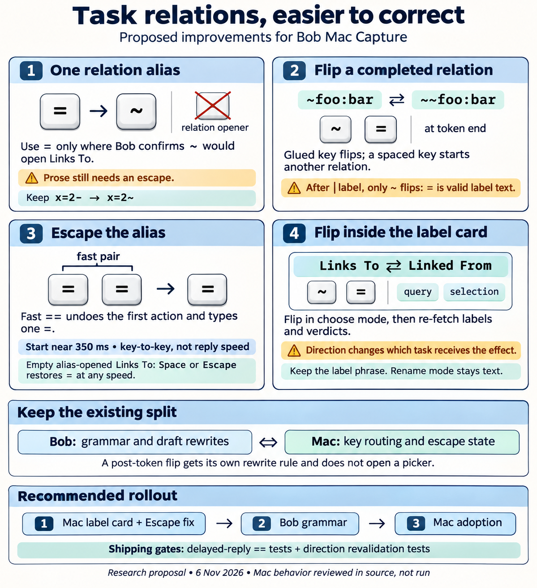
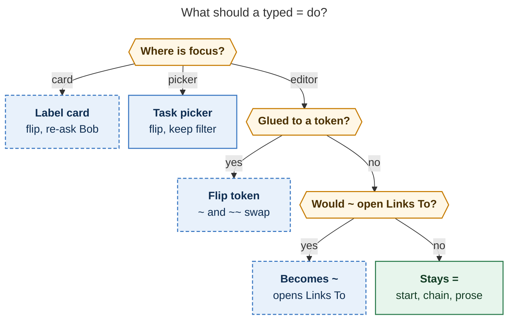

# Relation `=` alias, direction flips, and the `==` escape in Bob Mac Capture

> **Research query:** How should the bob-mac-capture app improve its handling of task relations (the `~foo:bar` capture syntax): make `=` the only alias for `~` where appropriate, let a `~` or `=` typed after a `~foo:bar` link toggle it to `~~foo:bar` (and back), let a fast `==` escape the `=` alias, and let `~`/`=` toggle between "link to" and "linked from" in the task relation label panel as they already do in the task relation panel? Critique the plan, call out any justified adjustments to the requirements, and recommend a solution.

## Bottom line

**Build all four improvements. They fix real, recurring friction, and the
architecture already has the right split: Bob's `capture-rewrite` owns every
draft transform, and the Mac owns key routing and one-shot arms.** Five
adjustments keep the change safe. They are marked **[ADJUSTED]** or
**[ADDED]** in [Adjusted requirements](#adjusted-requirements).

1. `=` replaces the *relation* `-` alias. It uses exactly [today's gate](#what-exists-today):
   whitespace before it, a non-empty item prefix, and Bob's confirmation that
   a bare `~` there would open Links To. The unrelated past-segment
   `x=2-` → `x=2~` alias stays.
2. A glued `~` or `=` after a complete `~note:id` / `~~note:id` flips the
   direction and is consumed. This is a new Bob rewrite rule with its own rule
   name. After a `|label`, only `~` flips, because `=` is legal label text.
3. A second `=` typed within a short key-to-key window (start at about 350 ms)
   undoes whatever the first `=` did and types **one** literal `=`. The same
   rule applies on every surface where `=` stands for `~`. On an alias-opened,
   empty Links To, Space and Escape also restore the literal at any speed, as
   the dash alias does today.
4. In the relation label card's choose mode, `~` and `=` flip the relation.
   The flip edits the draft token, keeps the query and selection, and
   **re-asks Bob**, because cancel, complete, merge, and successor effects
   apply to the source task and a flip changes which task that is.

**Ship order:**

1. The label-card flip, Mac only. It has the highest value, needs no Bob
   release, and should ship with a fix for [an existing Escape bug](#facts-i-verified-for-this-consolidation) in the same
   code path.
2. The Bob grammar changes.
3. The Mac adoption of that grammar.

## Scope and method

Consolidated research report, 2026-11-06. It merges five independent reports
([cdx](relation_equals_alias_and_direction_flips__cdx.md),
[cld](relation_equals_alias_and_direction_flips__cld.md),
[grk](relation_equals_alias_and_direction_flips__grk.md),
[mus](relation_equals_alias_and_direction_flips__mus.md),
[gem](relation_equals_alias_and_direction_flips__gem.md)) with my own code
reading and probes. Code inspected: bob-cli `e0960045` (rewrite and completion
code unchanged since `ee05db4d`) and bob-mac-capture `e9d3ae2`. Probes ran
against the installed `bob 0.4.0` on apollo (Linux). No Swift was compiled
and the app was not run. Every Mac claim below comes from reading the source.

## Critique of the request

The request is a good idea. I would keep the requested gestures rather than
invent a modifier chord, for three reasons:

- **It removes the worst alias.** A spaced `-` is ordinary prose (`foo - bar`,
  `-v`, `->`, `- - -` chains, `--` for an em dash). `-v` and `->` cannot be
  rescued by the empty-filter restore, because the second key lands in the
  filter. A spaced `=` is much rarer in task text.
- **It fixes mistakes where they are noticed.** [The existing flips](#what-exists-today) act before
  commit, in the bare sigil and the picker filter. A wrong direction usually
  becomes obvious when you see the sentence in the label card, which is
  Bryan's "happened several times". cld's catalog survey shows why that
  matters: passive "… by" labels dominate (80 of 86 labelled links), and four
  of the top five labels cancel, complete, or merge the source task.
- **It needs no new syntax.** `bob capture` and `capture-parse` stay literal.
  Every change is an editor assist or a Mac key route. Nothing in the vault
  changes and nothing needs migrating.

Bryan's premise, "`=` is never needed where the relation menu would open", is
**true for capture grammar and false for prose**. Every grammatical `=` (`=`,
`=3`, `=bugs`, `=/`, `=*`, `x =`, `x=2`, `@id=x…`, `=~K`) sits where Bob's
gate already refuses `~`. Prose `a = b` passes the gate, so the alias needs
both the restore keys and the `==` escape. A naive "`=` after whitespace"
rule would break `x =` and every session chain. The gate is the whole design.

## Adjusted requirements

| # | Change | Why |
| --- | --- | --- |
| A1 | **[ADJUSTED]** `=` aliases `~` only where Bob's existing gate says a bare `~` opens Links To, with the replacement exactly `[start, cursor)`. Line and bullet starts, glued words, backticks, and wikilinks stay literal | The gate is what makes the premise true |
| A2 | **[ADJUSTED]** "Only alias" means only the *relation* alias. Keep `x=2-` → `x=2~`. Remove the relation `-` alias and the `-=` → `~~` branch | The past-segment `~` is a different `~`, and `=` is structural inside `x=` tokens |
| A3 | **[ADJUSTED]** The post-token flip fires only on a key glued to the token end. A spaced `~`/`=` still starts another relation. After `\|label`, only `~` flips | Multiple relations per task are legal, and labels may contain `=` |
| A4 | **[ADJUSTED]** "Fast enough" is a key-to-key window measured from `NSEvent.timestamp` (default about 350 ms, a named constant), valid only while nothing else has happened. Space and Escape restores on an alias-opened empty Links To ignore speed | Independent of Bob's latency, testable, and keeps slow `= =` meaning Linked From |
| A5 | **[ADJUSTED]** Fast `==` yields one `=`, and `===` yields `==` | Bryan's wording and the `\\` precedent |
| A6 | **[ADDED]** A card flip re-fetches the catalog and verdicts, cancels a pending submit, and never commits against a verdict computed for the other direction. It keeps the query, `selectedKey`, one-off, and Hidden state. It keeps the label phrase (no automatic inverse) | Source-side effects change with direction (verified) |
| A7 | **[ADDED]** Fix Escape-from-Shift-Return ([see below](#facts-i-verified-for-this-consolidation)) in the same change. After a flip, Escape returns to a picker in the *new* direction | The flip must define Escape, and the current path is probably broken |
| A8 | **[ADDED]** `~~=` → `~` in the editor (the inverse of `~=` → `~~`) | The draft gives the same result before and after the picker appears |
| A9 | **[ADDED]** Teach the gesture: a `~ flips` keycap in the card header, and a flip keycap in the footer when Bob's verdict copy says "use ~~" | It turns Bob's existing advice into one keystroke without spending a sixth footer pair |
| A10 | **[ADDED]** Rename mode keeps `~` and `=` as text, and no flip runs while a label save is in flight | Rename is a separate text operation |

## Recommended behavior contract

*Proposed. Dashed boxes are new behavior. On every blue surface, a second `=`
within the escape window undoes the first `=` and types one literal `=`.
Bob's gate leaves `=`, `x =`, `=bugs`, and other native `=` commands literal
(start, chain, prose). Rendered with mermaid-cli 12.0.0 in the PDF
configuration: 848 × 760 px, 77% fit.*

In the table, `D` is an eligible task draft and "fast" means two non-repeat
`=` key-downs within the window with nothing in between.

| Surface and state | Key | Result |
| --- | --- | --- |
| Editor, `D ` | `=` | `D ~`, opens Links To |
| Editor, `D ` | fast `==` | `D =`, picker dismissed (also when the second key beats Bob's reply) |
| Editor, `D ` | `=` then slow `=` | `D ~~`, Linked From (the second `=` flips in the picker, or `~=` → `~~` before it opens) |
| Editor, `D ` | `=` then `~` | `D ~~` at any speed. Teach this as the reliable Linked From spelling |
| Alias-opened Links To, empty filter | Space / Escape | `D = ` / `D =`, at any speed |
| Editor, `D ` | `-` | Literal `-`, no picker (**behavior removed**) |
| Editor, `x=2` | `-` | `x=2~` (unchanged) |
| Editor, item start, `x `, `=bugs`, … | `=` | Native meaning (unchanged) |
| Editor, `D ~` / `D ~~` | `=` | `D ~~` / `D ~` |
| Editor, `D ~foo:bar` / `D ~~foo:bar` | `~` or `=` | `D ~~foo:bar` / `D ~foo:bar`, key consumed, no picker pops |
| Editor, `D ~foo:bar\|see` | `~` / `=` | Flips / label becomes `see=` |
| Editor, `D ~foo:bar ` (spaced) | `~` or `=` | Starts another relation |
| Editor, any flip above | fast `==` | The flip is undone and one `=` is typed at the original caret (a glued `=` is still Bob's `invalid_relation`) |
| Task picker, any filter | `~` or `=` | Flips and keeps the filter (unchanged) |
| Task picker | fast `==` | Original direction restored, one `=` inserted into the filter |
| Label card, choose mode | `~` or `=` | Flips the token and sentence, re-asks Bob, keeps query and selection |
| Label card, choose mode | fast `==` | Flip undone, one `=` typed into the label field |
| Label card, rename mode | `~` / `=` | Text, as today |
| Pasted text, `bob capture`, `capture-parse` | any | Literal. No timing-based syntax reaches the grammar |

### The trailing-space trade-off

Accepting a picker row at the end of the draft inserts `token + " "`
(`CapturePanelModel.swift:8284`, `:10923`). So in the most common moment,
right after picking, the caret sits at `~foo:bar ␣`, and `=` there starts a
second relation. I recommend accepting that rather than changing the accept:

- The cheapest fixes for "wrong way, just picked" are the picker flip before
  Return and the card flip on Shift-Return or `|`. Both keep the label flow
  intact.
- If Bryan then finds Backspace-then-`=` too slow, the next step is a
  Mac-owned one-shot "just accepted" arm, not a grammar change. The Mac
  inserted that space itself, so deleting it on a following `=`/`~` decides
  no syntax. Its cost is that `=` right after an accept could no longer start
  a second relation, so defer it until real use shows the need.

## What exists today

| Gesture | Today | Where |
| --- | --- | --- |
| `-` after a space or tab, where `~` would open Links To | Becomes `~` and opens Links To. On an empty filter, Space restores `- `, `-` restores `--`, and Escape restores `-` | `rewrite.rs:308` `expand_relation_dash_alias`, gate `relation_dash_position_ok` at `:334`; Mac `CaptureRelationDashArm` |
| `=` right after a bare `~`, or after an aliasable ` -` | Becomes `~~` (Linked From) | `rewrite.rs:388` `expand_relation_flip_alias` |
| `~=` after `~~`, or a glued `=`/`~` after a complete token | Stays literal. The glued forms parse as `invalid_relation` | Same function's early return; probes below |
| `~` or `=` anywhere in a relation picker's filter | Flips direction in place and keeps the filter | `CaptureKeyCommandRouter` → `flipRelationDirection` (`CapturePanelModel.swift:~8897`) |
| `-` inside an `x=` past token | Becomes the segment `~` (`x=2-` → `x=2~`) | `rewrite.rs:231` `expand_past_segment_dash_alias` |
| `\|` after a relation token, even with spaces between | Glues the pipe to the token and opens the label card | `rewrite.rs:1286` `attach_relation_label` |
| Relation label card | No direction control. `direction` and `tokenRange` are `let` | `CapturePanelModel.swift:280–299` |
| `=` forwarded to the rewrite lane | Only when the previous character is `~` (U+007E) or `-` (U+002D) | `CapturePanelController.swift:1127–1137` |
| Second `\` / `/` after the `#` alias | Leaves one literal key "at any typing speed". This is a state arm with no clock | Mac `docs/capture-panel.md:227` |

Bob already has the exact shape of the proposed post-token flip.
`switch_block_id_separator` consumes a `^`, `:`, or `+` typed right after a
complete `@route:id` and swaps the separator in place (`rewrite.rs:1025`).

## Facts I verified for this consolidation

These settle the points where [the reports disagreed](#where-the-reports-disagreed-and-the-resolution).

- **A caret glued to a complete relation token sits inside a live completion
  field.** `bob capture-complete` on `Fix it ~foo:bar` with the caret at the
  end returns `relation_to` with replacement `7..15` and 28 candidates. With
  the auto-inserted trailing space, it returns no context. This rules out
  grk's proposal to stop appending the space after a relation accept.
- **Any collapsed-caret edit requests completion.** `editorTextDidChange`
  sets `requestCompletion = insertionOffset != nil`
  (`CapturePanelModel.swift:~2726`). Pressing Backspace right after an accept
  therefore probably reopens Links To with the filter `foo:bar`. In that case
  `=` already flips there through the existing picker path. **Verify this on
  the Mac.** If it holds, the new editor rule mostly serves carets that
  reached the token end by arrow keys or a click, and the "Backspace, then
  `=`" path works either way.
- **The label catalog depends on direction, not only the verdicts.**
  `capture_complete/cancel.rs` resolves the source from the token: the item
  owner for `~`, the `~~` token's task for `~~`. It stamps a `row_disable`
  reason (`new_task` / `recurring`) on every `cancels_source` row. After a
  flip the **catalog** must be refetched, not just the typed-row probe. cdx
  is right here; grk ("catalog can stay") is wrong, and cld only partly right.
- **The Mac picks its rewrite path by rule name.** `switch_block_id_separator`,
  `attach_relation_label`, and `expand_sigil_alias` go through the undoable
  native edit, and the last two request completion afterwards
  (`CapturePanelModel.swift:~15565`, `~15723`). An unknown rule name falls
  through to a whole-draft `setPlainDraft`. The post-token flip therefore
  needs **its own rule name**, so the Mac can apply it natively without
  popping a picker (the caret ends glued to the token) and without arming the
  opener's Space/Escape restores. This settles cdx and cld (new rule) against
  gem, grk, and mus (fold it into `expand_sigil_alias`).
- **Escape from a card opened with Shift-Return is probably broken today.**
  `openRelationLabelPromptFromPickerRow` inserts the token and calls
  `closePickerForAccept()`, which sets `pickerIndex = nil`.
  `cancelRelationLabelPrompt()` (`:12120`) then sets `picker = returnPicker`
  and `pickerPresentation = pickerIndex?.presentation(…)`, which is `nil`. It
  never restores the pre-insert draft, so `picker.draftSnapshot` no longer
  matches `plainDraft`, and accept and flip both fail their snapshot guards.
  The sibling `cancelTaskIDPrompt` *does* rebuild the index from
  `returnPicker.candidates`. The only test,
  `testRelationCardEscapeReturnsToPickerWhenStaged`, asserts just
  `picker != nil`. cld raised this; I confirmed it by reading the code but did
  not reproduce it. A card flip has to define Escape anyway, so fix both
  together.
- **Labels may contain `=` but never `~`.** `Fix it ~foo:bar|see=` parses
  with label `see=`. `|see~`, `~foo:bar=`, and `~foo:bar~` all parse as
  `invalid_relation`. Bryan's vault has 12 labels, and none contains either
  character (cld).
- **Bob's copy already points at the fix.** The `new_task` refusal and the
  inverse hint say "…to retire “{T}”, use ~~" (`cancel.rs:114`, `:156`;
  `docs/task-relations.md` CL6). The Obsidian nav already gets its own
  spelling ("nav says `⇧L` instead of `~~`"), so client-specific copy has
  precedent.
- **Prose `=` does reach the gate.** `a ~` opens `relation_to`, so typing
  `a = b` will alias. `x ~` does not, so `x =` (close, then start) is safe.
  This matches cld's F1 table.

## Where the reports disagreed and the resolution

| Question | Positions | Resolution |
| --- | --- | --- |
| What does fast `==` produce? | One `=` (cdx, grk, mus, gem); `==` (cld, citing Obsidian `==highlight==` and `a == b`) | **One `=`.** This is Bryan's wording ("escape the `=` sign") and matches the `\\` → `\` precedent. `===` gives `==`, because the third `=` follows `=` rather than whitespace, so no alias fires. Highlights in task titles are rare, and cld's variant remains a reasonable alternative if Bryan prefers it |
| What does "fast enough" mean? | Key-to-key timer of about 350 ms using `NSEvent.timestamp` (cdx); a state rule that escapes at any speed while the alias-opened filter is empty (cld, mus, gem); escape only until the picker is visible (grk) | **A key-to-key window plus state conditions.** Unlike `\\`, the second `=` has a competing meaning (flip), so speed is the only signal that doesn't depend on hidden state. "Picker visible" ties meaning to Bob's completion latency (about 550 ms median on apollo, unknown on the Mac). A pure state rule loses "slow `= =` gives Linked From", which mirrors `~~` and is what "fast enough" implies. Use injected timestamps in tests, so there are no wall-clock sleeps |
| Does Space restore `= ` on an alias-opened empty filter? | Yes (cld); no, Space is filter input (grk) | **Yes, at any speed, and Escape restores `=`.** An empty filter that starts with a space means nothing, and this makes `a = b` just work, as the dash arm does today |
| Drop the trailing space after a relation accept? | Drop it (grk); keep it and require Backspace (cdx, cld, gem) | **Keep it.** A glued caret is a live `relation_to` field ([probe above](#facts-i-verified-for-this-consolidation)). The space also matches `&`/`*` chaining, and `attach_relation_label` was built around it. See [the trailing-space trade-off](#the-trailing-space-trade-off) |
| Does `=` flip after `~a:b\|label`? | Yes (grk, mus, gem); only `~` (cld); neither (cdx) | **Only `~`.** `\|see=` is a valid label (probe) and `~` never is. Labelled relations are normally edited in the card anyway |
| `=` in the label card | Always flips (grk, gem); flips only on an empty field (mus); flips, with `==` typing a literal (cdx, cld) | **Always flips in choose mode; a fast `==` undoes the flip and types one `=` into the field.** The wrong-way realization often comes after typing a few letters of the query, so mus's empty-field gate would miss it. No vault label contains `=` |
| Re-ask Bob after a card flip: catalog or probe? | Probe only (grk); verdicts plus catalog (cld, cdx) | **Catalog, verdicts, and typed probe.** The `row_disable` reasons depend on direction (verified) |
| Rule name for the post-token flip | Inside `expand_sigil_alias` (gem, grk, mus); new rule (cdx, cld) | **New rule** (`toggle_relation_direction`). The Mac must skip the completion request and skip arming (verified routing) |
| Bare `~~=` | Make it `~` (grk, cdx); keep it literal (mus) | **Make it `~`.** The draft can briefly hold `~~` before the picker opens. Without this rule, `=` gives `~` once the picker is up but literal `~~=` in that gap. A strikethrough that starts with `=` is negligible |
| Ship order | Bob first (grk, mus, gem, cdx); label card first (cld) | **Label card first.** It is Mac-only and independent, and it carries the Escape fix |

## Implementation design

### bob-cli

Primary file: `src/native/capture_language/rewrite.rs`.

1. **Opener.** Replace `expand_relation_dash_alias` with
   `expand_relation_equals_alias`. Reuse the gate (rename
   `relation_dash_position_ok` → `relation_alias_position_ok`) and
   `wikilink_claims`, and require `RelationTo` at exactly `(start, cursor)`.
   Summary: "Typed ~ for =". Delete `finish_relation_flip_dash_alias` and the
   `-=` branch, and keep `expand_past_segment_dash_alias` first for `-`.
2. **Bare flips.** Keep `~=` → `~~`. Add `~~=` → `~` (delete one `~` and the
   trigger) where the result opens an empty `RelationTo`.
3. **Post-token flip, new `RewriteRule::ToggleRelationDirection`.**
   - When it fires: the byte before the cursor is `~` or `=`, and with that
     byte removed, a `Complete` relation from `scan_line_relations` ends
     exactly there. Escaped, protected (code, wikilink), partial, and
     strikethrough tokens are excluded. After a label, only `~` qualifies.
   - What it changes: it emits two edits, inserting or removing one `~` at the
     sigil and deleting the trigger, and it preserves every other byte
     (quoted note names, label).
   - How to validate: re-scan the result and require the same target and
     label in the opposite direction.
   - Order: run it before the bare flips and the opener in `rewrite_draft`.
     The Mac already merges multi-edit responses through
     `CaptureRewriteResponse.coveringEdit`.
4. **Idempotence.** Feeding the output back with its cursor changes nothing.
5. **Docs.**
   - Update `docs/capture.md` ("Sigil alias"),
     `docs/reference/cli/capture-rewrite.md`, and the `capture-rewrite` long
     help. Read the `docs` and `cli_rules` reference memory first.
   - Commit as `feat(capture)!:`. A documented `capture-rewrite` behavior
     (`-` → `~`) goes away (decision `bob-cli-releases-ride-a-daily-train`),
     while the JSON shape and `schema_version` stay the same.
6. **Tests** (unit tests in `capture_language/tests/rewrite.rs` and CLI tests
   in `tests/cli/capture/rewrite.rs`):
   - every gate exclusion (`=`, `=3`, `x =`, `x=2 =`, `=/ =`, `Fix it ==`,
     line or bullet start, backtick, wikilink);
   - `-` after a space is now literal, and `x=2-`, `x=~-` still rewrite;
   - the post-token matrix: both directions × `~`/`=`, quoted and Unicode
     notes, labelled (`|see=` literal, `|see~` flips), a spaced key, the
     token not at the end of the line;
   - idempotence.

### bob-mac-capture

1. **Forwarding** (`noteSeparatorToggleIntentIfEligible`):
   - Drop the previous-character gate for `=`.
   - Forward `~` only when the last `capture-parse` spans put a relation
     token's end at the caret. This uses Bob's spans as a send filter, not
     Swift lexing, and keeps an ordinary `~` from waiting on a rewrite round
     trip before its picker opens.
   - Keep forwarding `-` for the past-segment alias.
2. **One equals-gesture record** in place of `CaptureRelationDashArm`:
   - It holds the surface (editor, picker, or card), the prompt or picker
     identity, the pre-gesture draft, selection, and direction, the rewrite
     generation, and the first key's `NSEvent.timestamp`.
   - Check it before ordinary relation routing.
   - Arm it after an `expand_sigil_alias` `=` → `~` reply, a `~=` / `~~=`
     flip, a `toggle_relation_direction` reply whose trigger was `=`, a picker
     `=` flip, or a card `=` flip.
   - Only the opener also arms the speed-independent Space and Escape
     restores. Tell the opener from `~=` by checking the byte before the edit
     (cld F11).
   - **Second `=` before Bob's reply:** reuse the `HashAliasProbe` pattern.
     Re-ask Bob about the first draft, and collapse to one `=` only if the
     first key really was an alias.
   - **Second `=` after the reply:** restore the saved state and type one
     `=`. Do not "flip again".
   - Ignore auto-repeat and marked-text (IME) input. Clear the record on any
     other key, a user click or caret move, a paste, Undo, or a dismissal.
   - Synthesized events (`CapturePanelController.swift:386` uses
     `timestamp: 0`) must never satisfy the window by accident.
3. **Post-token rule application.** Route `toggle_relation_direction` through
   the native single-edit path so Undo is one step. Do **not** request
   completion. Announce Bob's summary ("Flipped to Linked From").
4. **Picker.** Flip behavior is unchanged. Delete the dash-restore commands
   and `relationDashLiteralArmed`. While the opener arm is live, the subtitle
   can read "`==` types `=` · `~` flips".
5. **Label card** (`relationLabelPromptCommand`, `CaptureRelationLabelPromptState`):
   - Routing: in choose mode, an unmodified non-repeat `~` or `=` returns
     `.flipRelationLabelDirection` before `isolatedPromptCommand`.
   - Guards: `!isSaving`, `rename == nil`, `draftSnapshot == plainDraft`, and
     a `~` at `tokenRange.start`.
   - Draft edit: make `direction` and `tokenRange` `var`. Insert or remove one
     `~` after the sigil, and shift `tokenRange.end`, `labelRange`, and
     `restoreCursor` by ±1. Follow the existing rename fix-up, which already
     rebases these fields. Use a focus-preserving native edit so the card
     keeps focus.
   - Invalidation: clear `relationCancel`, `relationComplete`,
     `relationSuccessor`, the typed-row result, `errorMessage`, and
     `pendingSubmit`. Bump both generations and drop the in-flight markers.
     Refetch the catalog, and the typed probe when the query is non-empty.
     The existing `draftSnapshot` guards already drop late replies for the old
     direction.
   - Return while the probe is in flight reuses the pending-submit path.
   - Keep the query, `selectedKey` (show its new disabled reason if it has
     one), `oneOff`, `showHidden`, and ghosts.
   - Flip `returnPicker` (source, `draftSnapshot`, `replacementRange.end`).
     Fix Escape so it restores `returnPicker.draftSnapshot` undoably, rebuilds
     `pickerIndex` from `returnPicker.candidates` (as `cancelTaskIDPrompt`
     does), and refocuses the filter.
   - Announce "Links To" / "Linked From" for VoiceOver.
   - The flip itself writes no label preference and runs no effect.
6. **Docs** (`just docs-check`): `docs/relationship-pickers.md` (remove the
   `-` paragraph and add the post-token and card flips), `docs/keyboard.md`
   (the `-` and `=` editor rows, the picker paragraph, and the relation card
   keys), and `docs/capture-panel.md` (rewrite-lane paragraph). Also add one
   sentence to `docs/task-relations.md` in bob-cli.
7. **Tests:**
   - Retarget `CaptureRelationDashAliasTests` to the `=` opener, keeping its
     past-segment cases.
   - In `CaptureRelationFlipAliasTests`, the existing "two `=` presses flip
     there and back" cases must now carry slow timestamps. Add fast-`==` cases
     before, during, and after the reply, plus the threshold boundary, `=~`,
     `~==` → `~=`, and `~=` not arming Space/Escape.
   - Add card cases to `CaptureRelationPanelTests`: both directions, verdicts
     refetched, a late old-direction reply dropped, Return during the probe,
     state preserved, rename passthrough, Escape after a flip from both the
     `|` and Shift-Return flows, and key repeat.
   - Use fake-bob delayed replies and injected timestamps, never sleeps.

### Compatibility and verification

- **New Mac with old Bob:** a bare `=` comes back `changed: false` and stays
  literal. The old `-` alias still fires but has no restore keys, which is
  brief and tolerable on the daily train.
- **Old Mac with new Bob:** the old Mac never forwards a bare `=` or a
  post-token key, and `-` turns literal, so it degrades to plain typing.
- **Verification:**
  - Swift: `just portable-check`, a scratch-copy `bundle.sh` plus
    `just typecheck-tests` on the Mac, then the exact-SHA macOS CI run
    (bob-mac-capture `AGENTS.md`).
  - Report any macOS step that could not run as unverified.

### Records and follow-ups for the implementer

- **New decision record** (via `/sase_memory_write`): "`=` is the only
  relation alias; fast `==` is one literal `=`; direction flips in the
  editor, picker, and card."
- **Partly supersede `relation-card-tab-accepts-ctrl-d-hides`** for its
  "catalog fetched once on open" clause. A direction flip is an edit that
  re-fetches. Navigation still never does.
- **Parity, out of scope:** the Obsidian Task Card's relation picker already
  flips on `~` (`docs/task-relations.md` intro), but its label stage does
  not. That is a bob-plugins task bead, not part of this change.

## Rejected alternatives

| Alternative | Why not |
| --- | --- |
| Keep `-` as a second opener | Two prose-hijack keys and two restore tables, and `-` collides far more (`-v`, `->`, `- - -`) |
| Detect tokens or flip in Swift | Violates `mac-capture-is-a-thin-client` and drifts from Bob's strike, wikilink, and code guards |
| Flip on a spaced key after a token | Collides with adding a second relation |
| Drop the auto-space after a relation accept | Leaves the caret in a live `relation_to` field (probe), breaks `&`/`*` consistency, and changes the `\|` flow |
| Auto-invert the label on a card flip (`supersedes` ↔ `superseded by`) | The correction Bryan wants is the edge, not the phrase. Inverting both can silently preserve the wrong meaning, and Bob's inverse table is display-only |
| `==` means Linked From outright | Contradicts the escape and breaks prose |
| `<` / `>` direction markers | A `feat(capture)!` across three repos (`research:202610/relation_direction_markers_prompt_review.md`). This change stays additive |
| Unconditional `=` flip with no escape in the card | Strands legal `=` labels. The fast-`==` escape costs nothing extra once the shared record exists |

## Open questions for Bryan

1. Window length: start at 350 ms? A user setting is unnecessary at first.
2. Fast `==`: one `=` (recommended) or `==` (better for typing
   `==highlight==`)?
3. Should the label-card flip ship ahead of the Bob work? (Recommended: yes.)
4. After using it, is Backspace-then-`=` after an accept good enough, or do
   you want the [Mac-owned "just accepted" arm](#the-trailing-space-trade-off)?

## Recommended solution

Proceed as one coordinated change in three steps.

**(1) Mac only, [label card](#bob-mac-capture).**
- `~` or `=` flips the relation in choose mode.
- The flip edits the token, preserves the query and selection, and re-fetches
  the catalog and verdicts so Return never commits against the other
  direction's effects.
- It also flips `returnPicker`, and Escape is fixed to restore the draft and
  rebuild the picker index.
- A fast `==` types a literal `=`, and a header keycap teaches the gesture.

**(2) [bob-cli](#bob-cli).**
- `=` replaces the relation `-` opener under the existing gate; the
  past-segment dash stays.
- `~~=` → `~` joins `~=` → `~~`.
- A new `toggle_relation_direction` rule flips a complete token on a glued
  `~` or `=` (only `~` after a label).
- Ship as `feat(capture)!` with docs and the full test matrix.

**(3) [Mac adoption](#bob-mac-capture).**
- Forward `=`, and forward `~` behind Bob's relation spans.
- Replace the dash arm with one equals-gesture record: a key-to-key window of
  about 350 ms for the `==` escape (handling the before-reply race), plus
  speed-independent Space and Escape restores on an alias-opened empty Links
  To.
- Apply the post-token flip natively without popping a picker.
- Update the docs.

The two shipping gates are the delayed-reply `==` tests and the
label-direction revalidation tests. A key-routing patch alone would leave the
most consequential bugs in place.
