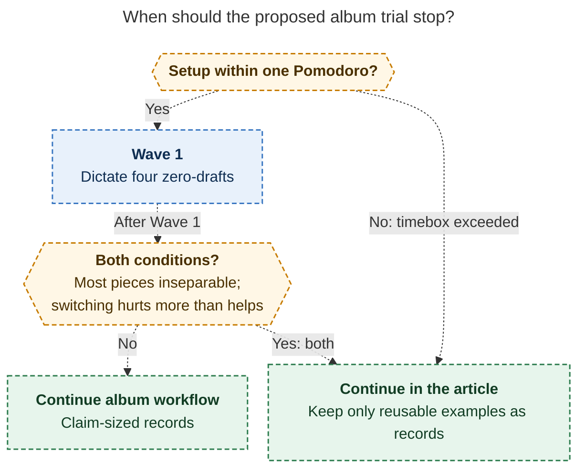

# Diagram proposals: Drafting the SASE blog post in record notes

Proposals for the swarm linker, not a report. Each diagram restates only what the source
report says.

```yaml
source: research:202611/sase_blog_drafting_in_records/sase_blog_drafting_in_records__final.md
producer: research.4f.image
check: "mmdc 12.0.0 with the PDF-mirroring config rendered 1 of 1 Mermaid diagrams; Puppeteer --no-sandbox"
```

## album-trial-fallback

```yaml
anchor: |-
  or if after Wave 1 most pieces feel
question: |-
  When should the album experiment give way to article-only writing?
illustrates: |-
  Article-only is the fallback when album setup exceeds one Pomodoro or, after Wave 1, most pieces feel inseparable and file-switching hurts more than it helps.
caption: Either fallback trigger leads to article-only writing; after Wave 1, the trigger requires inseparable pieces and file-switching that hurts more than helps.
review: "609.766x786 px, fit 100%; reader-question, source-trace, and visual checks passed; 1 visual revision, 0 parse repairs; unique body anchor confirmed"
```


