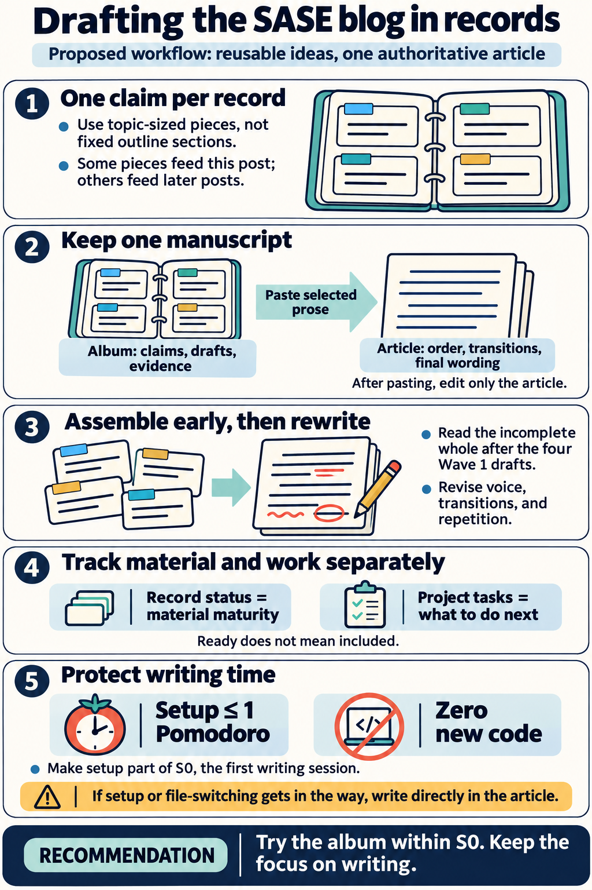
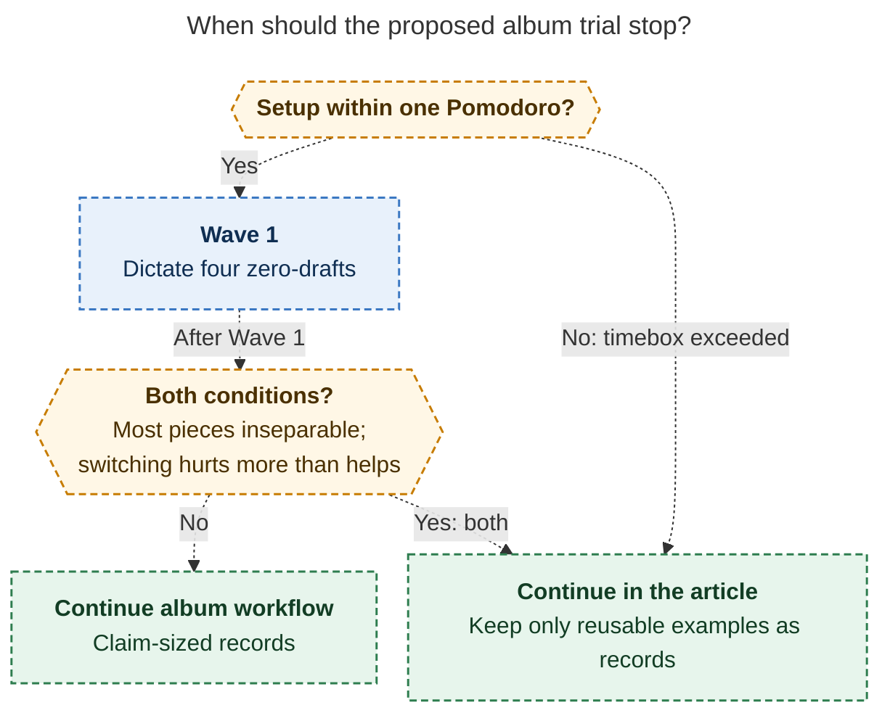

# Drafting the SASE blog post in record notes: consolidated research

> **Research query:** Should I write each section or topic of my sase blog post
> (sase-org/sase) as its own record note, parented by a new `~/bob/sase_blog_zettel.md`
> album note, so that writing the post becomes mostly re-arranging finished records?
> Critique the plan (is it a good idea, or would a different approach be better?), call
> out any justified requirement adjustments, and recommend how best to implement it,
> given the `bob-cli-k3` record/album epic and my still-unfinalized outline in
> `~/bob/sase_blog_contents.md`.



## Bottom line

**Build the album, but only as the way to do [Spike S0](#first-session-as-revised-s0) —
not as a step before it — and change the unit, the authority, and the promise:**

1. **One record per *topic/claim*, never one per outline section.** The outline is
   explicitly unstable; claims are not. A section can draw on several records, and a
   record can feed one paragraph or nothing.
2. **`sase_blog_contents.md` (the article) stays the manuscript,
   [the spine](#assembling-and-publishing-from-the-spine), and the only authority for
   order and transitions.** The album is a workbench, never a second outline. There is
   no `order` field.
3. **"Mostly re-arranging" is a documented illusion.** Budget a real rewrite pass for
   voice, transitions, and de-duplication; the existing `^v1-draft` task stays a
   writing task.
4. **Hard timebox: setup inside S0, ≤ 1 🍅, zero new bob or plugin code.** Everything
   needed already ships (verified end-to-end in two independent sandboxes). If album
   setup threatens the timebox, skip it and write directly in the article —
   [that fallback](#fallback-and-rejected-alternatives) is fully viable and three of
   five researchers preferred it outright.

The honest framing: the panel split 2–3. cdx and cld recommend the album (heavily
adjusted); grk, mus, and gem recommend writing in the article now, with at most a
notebook for capture. The split is not about mechanics — those are settled (see
[Disagreements resolved](#disagreements-resolved)) — it is about whether a new
container helps or stalls a project whose bottleneck is words, not storage. The
recommendation above takes the pro side's verified design with the anti side's
guardrails: the album must *replace* part of S0's work (claim sentences become record
seeds) rather than precede it, and the article-only path is the explicit fallback.

## Ground truth

Lead-verified 2026-11-12.

- **The project is stalled on writing, not tooling.** `sase_blog.md` was created
  2026-06-11. `bob articles outline sase_blog_contents` reports 301 words, 15
  sections, **15 TODO stubs**; only the 190-word lede plus the meta-harness paragraph
  exist. Spike S0 (promise sentence, four Wave 1 cards, one claim per heading, 2 🍅
  hard stop) has been the only Next task since 2026-10-23. Today's S0 work-log entry
  is this research: *"apollo research on creating new sase_blog_zettel album!"*. All
  five researchers flagged productive-procrastination risk; it is the single biggest
  risk in the plan.
- **The writing method already exists.** S0 → four zero-draft tasks (`zd-cli`,
  `zd-tui`, `zd-gates`, `zd-macros`, each "dictate ≥150 words, no editing") each
  carrying a CARD (😈 pain · 😇 SASE move · PROOF screenshot · LESSON) → Wave 1 review
  (decides full section / short paragraph / cut for five other headings) → `^v1-draft`
  → intro last. The proposal changes where material lives, not this method.
- **Albums/records fully shipped.** Epic `bob-cli-k3` now has **all 11 phases
  CLOSED** (epic at landing — the cdx/grk claim that k3.11 was still in progress is
  stale as of today). `bob albums create` works; the vault has exactly four albums
  (eat 104, podcasts 15, tv 23, movies 10), all thing-catalogs.
- **Publishing target:** sase.sh is MkDocs Material (`blog` plugin, `strict: true`).
  A 2,882-word launch post has been live since 2026-07-08, plus nine `draft: true`
  posts (~16.7K words). One syntax-conversion pass (wikilinks, callouts, image
  embeds, `[^1]` footnotes) is required at the end **under every option**, so it does
  not discriminate between them.
- **Names have drifted.** sase.sh already says "xprompts have been renamed to macros"
  and the Patches draft was slugged `changespecs-in-practice`. The outline still says
  "Xprompts"; drafts that sit for weeks go stale on names and facts.

## Disagreements resolved

### Record bodies and prose

**"Record bodies are note bullets, not prose" — false as a mechanical claim.**

grk, mus, and gem argued records can't hold essay prose. cdx and cld each
independently sandbox-verified the opposite, and the lead confirmed the contract in
`docs/records.md`: bob writes frontmatter, `# Title`, and `## Notes`, and every
subsequent update "preserves every untouched key, comment, **body byte**, and line
ending." Prose paragraphs, callouts, links, fenced code, and extra headings (e.g.
`## Draft`) all pass `bob records check` with zero findings. The only hard
prohibition is task checkboxes (`record_checkbox`: "records hold facts, never
tasks"). What *is* true: nothing in records helps with prose (no word counts,
`bob articles` refuses records with `not-article`), and `## Notes` bullets are the
only thing capture appends. So records are a legal, byte-safe home for drafts — just
an unassisted one. The spine keeps the article tooling (see
[Assembling and publishing from the spine](#assembling-and-publishing-from-the-spine)).

### Records as durable things

**"Records are for durable things; this is a category error" — half true, and the fix
is the unit.**

grk's design-intent argument is correct against the *original* plan (one record per
outline section = a structure note wearing an album header; filenames frozen from
section titles; index grouped by status while the essay needs narrative order). It
largely dissolves against the adjusted plan: a record per **claim** is
concept-oriented (Matuschak), reusable across this post, the six "Later Posts"
topics, and the nine sase-repo drafts — which also answers mus's "schema buys nothing
for single-use prose": this material is *not* single-use. grk itself observed "the
Wave 1 cards are the actual zettels." Correct — and the album gives those zettels a
durable, capturable, statused home instead of task-child bullets.

### Notebook instead of album

**"Use a notebook instead" (mus, gem) — rejected for drafting; unnecessary for
capture.**

Notebooks hold bullets: `notebook_shape` warns on stray top-level paragraphs and deep
headings, so 150-word dictated prose fights the shape. And once the album exists,
capture already routes ideas to topics (`idea @sase_blog_zettel/<stem>` appends a
dated bullet under that record's `## Notes`), so a separate notebook inbox would be a
sixth home. mus's variant would also consume the `sase_blog_zettel` name for a
notebook, foreclosing the album.

### Status versus the GTD tracker

**"Status duplicates the GTD tracker" (gem, mus) — avoidable by division of labor.**

Record `status` tracks **material maturity** (is this piece usable?); tasks in
`sase_blog.md` keep tracking **work** (what do I do next?), with tasks linking to
records. No reconciler is needed because they answer different questions. The
zero-draft tasks keep their exit criteria, now aimed at a record's `## Draft`.

### Vault-root permanence and decommissioning

**Raised by gem — real but small, and mooted by reuse.**

The album does permanently occupy `~/bob/sase_blog_zettel.md` + folder + `.base` +
one `## Albums` catalog row in `sase_blog.md`. But since the album serves the whole
post series (`later` records feed the six planned posts), it should *not* be
decommissioned after publication — gem's cleanup plan is moot under the adjusted
design. grk's "album of posts" idea (one record per *published post*) remains a
reasonable, separate, later idea.

## Requirement adjustments

Explicit changes to the request:

| # | Original requirement | Adjustment |
| --- | --- | --- |
| R1 | One record per section or topic | One record per **topic/claim** only; many-to-one with sections; some never ship |
| R2 | Blog writing becomes "mostly re-arranging" | Arranging in the spine **plus one real rewrite pass**; `^v1-draft` stays a writing task |
| R3 | New album `~/bob/sase_blog_zettel.md` as parent | Kept — parent `[[sase_blog]]`, noun `zettel`, 📇, with the schema in [Create the album](#create-the-album) |
| R4 | Finish one record per topic, then write | **Assemble early** after Wave 1; maturity (`ready`) ≠ inclusion; cutting a ready record is fine |
| R5 | (implicit) outline drives records | Outline is candidate coverage; the spine owns order; no order/section fields in the schema |
| R6 | (new) | [Routing rule](#one-home-per-kind-of-material) — one home per kind of material |
| R7 | (new) | Setup inside S0, ≤ 1 🍅, zero new code; article-only is the explicit fallback |
| R8 | (new) | `ready` gate includes a name/fact check against current sase (Macros/Patches drift) |

## Recommended solution

### Create the album

~5 minutes, inside S0.

```sh
cd ~/bob
bob albums create sase_blog sase_blog_zettel -n zettel -e 📇 -t 'SASE Blog Zettel' \
  -s 'Topic-sized pieces of my SASE posts, one claim per record, in my own voice.' -d
# Inspect the diff, then rerun without -d.
```

Notes: pass `-t`, or the title comes out "Sase blog zettel". Use 📇, not 🧩 (bob
already uses 🧩 for sub-project rows) and not ✍️ (generic). Parent is the
**project** `[[sase_blog]]` — valid (album parents are areas or projects), and it
puts the Album card chip (count · lead group · age) on the project note.

Then edit the album frontmatter to add the schema (`create` writes only the basics;
cld validated this schema with `bob albums check`, 0 errors):

```yaml
record:
  noun: zettel
  label: Zettel
  dated_notes: true
  fields:
    status:
      required: true
      values:
        seed: 🌱 Seed
        draft: ✍️ Draft
        ready: ✅ Ready
        placed: 📌 Placed
        later: ⏭️ Later
        cut: ✂️ Cut
    claim:
      required: true
    part:
      values:
        hook: 🪝 Hook
        why: 🙋 Why I use it
        what: 🧱 What it is
        why_not: 🛑 Why not
        close: 🏁 Close
```

plus `index_facets: [part, claim]`, so every index row shows `part · claim` and the
generated `[!records]` callout reads as the post's argument, with the tally
(`N zettels · 🌱 … · ✍️ … · ✅ …`) as a free progress bar. Bob disallows a default
for `status`, so capture must always supply it.

- **`claim` is required** — the one Zettelkasten discipline that earns the name. If
  you can't state the claim, it isn't a topic yet: capture it as a note on an
  existing record instead.
- **Status exit criteria:** 🌱 title + claim → ✍️ ≥150 unedited words in `## Draft` →
  ✅ revised, **current SASE names and facts checked against sase HEAD** (Macros, not
  Xprompts; Patches, not ChangeSpec), links/images resolved → 📌 pasted into the
  spine (*from then on, edit only the article*). ⏭️ later = future post; ✂️ cut =
  dropped but kept.
- **No `order`, `section`, `wave`, `target_words`, or devil/angel fields** (gem
  proposed several): order lives only in the spine; the index can't sort by it; CARD
  material is prose for `## Notes`, not schema.

### Record body convention

```markdown
# One CLI → Every CLI            ← bob writes this

## Draft                          ← only this ever ships

Portable prose in your voice; current SASE names; [^1]-style footnotes.

## Notes                          ← bob-managed; capture appends dated bullets

- 2026-11-12: 😈 one CLI at a time · 😇 every provider behind one harness
- 2026-11-12: PROOF ~/tmp/screenshots/20260616_140429.png (Claude-outage retries)
```

Never a checkbox — actions belong in `sase_blog.md` tasks that link to the record.

### One home per kind of material

This is the routing rule. Without it, the album becomes a fifth pile (the material
already spans `sase_blog.md` Requirements/Outline/Screenshots, the article, and legacy
notes):

| Material | Home | Ships? |
| --- | --- | --- |
| Idea, quote, screenshot path, proof for a topic | That record's `## Notes` (capture) | No |
| Prose in your voice | That record's `## Draft` | Yes, pasted when ✅ |
| Order, headings, transitions, intro, promise sentence | `sase_blog_contents.md` | Yes — it *is* the post |
| Post-wide style/production rules (emojis, stick figures, polls, podcast task) | `sase_blog.md` `## Requirements` | During rewrite |
| Work: zero-drafts, reviews, release | Tasks in `sase_blog.md`, linked to records | n/a |

Triage the 44 Requirements bullets **lazily**: when drafting a topic, search for its
bullets and move them into that record's `## Notes` then — no up-front migration.

### Assembling and publishing from the spine

```text
sase_blog.md                 project: tasks, style rules, release
├── sase_blog_zettel.md      album: schema + generated inventory/progress tally
│   └── sase_blog_zettel/    records: one claim each
└── sase_blog_contents.md    article: argument, order, transitions, final prose
```

- Under each article heading, link the records that feed it
  (`→ [[sase_blog_zettel/agent_clis|One CLI → Every CLI]]`). Reordering the post is
  moving headings and link lines; `bob articles` renumbers and repairs heading links.
  Heading-identity capture (`@sase_blog_contents#agent`) survives renumbering.
- Write transitions directly in the spine — they belong to the whole.
- **Assemble early**: after the four Wave 1 records reach ✍️/✅, paste and read the
  incomplete whole. Early assembly exposes duplication, terminology drift, and
  structural gaps while cutting is still cheap (cdx; Harvard reverse-outline
  guidance). Do not wait for every record.
- On paste, set the record 📌 placed; the article is now the authority for that
  wording — an intentional one-way fork, no back-syncing. Per-section
  `bob articles outline` word counts then show real progress.
- Publish by copying into `docs/blog/posts/<slug>.md` in sase-org/sase with
  launch-post-shaped frontmatter, converting Obsidian syntax, and running
  `mkdocs build --strict`. The promise sentence must decide whether this post
  replaces or sits beside the July launch post — that choice drives which topics go
  ⏭️/✂️ instead of being re-explained.
- **No assembly/export script now** (gem drafted one; cdx/cld/gem all agree it is
  premature). ~15 manual pastes ≈ 15 minutes. Revisit only after two posts ship this
  way, and any future exporter must take an explicit ordered selection, never "all
  ready records."

### First session as revised S0

≤ 1 🍅, then stop.

1. Create the album + schema ([Create the album](#create-the-album)).
2. Seed one zettel per current topic with its claim via one `%t` batch capture
   (~12–18 rows; cld verified atomic multi-record capture). This *is* S0's "one claim
   sentence under every heading," in a form the index displays. Use current names.
3. Move the four Wave 1 CARD bullets into their records' `## Notes`; point each
   `zd-*` task at its record (exit criteria unchanged, now targeting `## Draft`).
4. Put spine links under the article headings; write the promise sentence.
5. Stop. Dictate the four zero-drafts next, as already planned.

## Fallback and rejected alternatives

- **Article-only (grk, gem's recommendation; cld's option A):** fully viable, zero
  setup, full `bob articles` tooling, heading-identity capture. **This is the
  fallback**: if the album costs more than 1 🍅, or if after Wave 1 most pieces feel
  inseparable and file-switching hurts more than it helps, continue in the article
  and keep records only for reusable examples. That outcome is a successful
  experiment, not a failure.
- **Notebook (`sase_blog_zettel` or `sase_blog_notes` as `[[notebook]]`)** (mus,
  gem): rejected — bullets-only shape fights prose, and album capture already covers
  the inbox role ([Notebook instead of album](#notebook-instead-of-album)).
- **One article per section / transcluded leaf articles** (gem's option C): rejected
  — `bob articles` outline/stubs/numbering read one note; embeds hide prose from it.
- **Longform/Easy Bake plugins, new bob compile feature:** rejected/premature for one
  post.
- **An album of *posts*** (grk): sensible later, after this essay ships, to catalog
  the live post + nine drafts + the series. Separate decision; not now.

[The album-trial fallback diagram](#figure-album-trial-fallback) traces both exits to
article-only writing: setup costing more than one 🍅, or, after Wave 1, most pieces
feeling inseparable and file-switching hurting more than it helps.

<div id="figure-album-trial-fallback">



_Either fallback trigger leads to article-only writing; after Wave 1, the trigger requires inseparable pieces and file-switching that hurts more than helps._

</div>

## Open questions for Bryan

1. **Does this post replace or accompany the July launch post?** Decide in the
   promise sentence; it drives ⏭️/✂️ choices.
2. **Required `claim` on every new topic capture** — strongest guard against vague
   topics, costs one sentence per capture. Drop to optional if it blocks capture flow.
3. grk objects that "zettel" over-promises (these are topic drafts, not evergreen
   notes). The name is yours and harmless; the required `claim` is what earns it.

## Follow-ups verified and recorded by the lead

Both were cld findings, lead-verified in source on master `4ed4fdab`, and recorded as
`DISCOVERED ISSUE:` notes on epic `bob-cli-k3` (still in progress at landing, and the
credible cause of both) for its land agent to triage:

- **Album index tally ignores singular counts** — `tally_text`
  (`src/native/albums/index.rs:338`) always uses the plural, so a one-record album
  reads `1 zettels`. This album will show it on first capture.
- **`bob capture --help` still says record types come from the retired `records:`
  config block** (`src/native/capture/cli.rs` long_about) — stale after k3.9/k3.11
  retired config-declared records; the k3.11 docs audit missed it.

## Question and method

Lead consolidation of five independent reports (`__cdx`, `__cld`, `__grk`, `__mus`,
`__gem`) plus the lead's own verification, 2026-11-12.

**Question:** should each SASE-blog section or topic become a record note under a new
`~/bob/sase_blog_zettel.md` album, so writing the post becomes "mostly just
re-arranging" finished records? Is the plan good, and what should change?

## Sources

Researcher reports (this directory): `__cdx`, `__cld`, `__grk`, `__mus`, `__gem` —
see each for full source lists, sandbox transcripts, and dry-run evidence.

Lead verification, 2026-11-12: `bead:bob-cli-k3` (audited read; all 11 phases
CLOSED, epic at landing); `~/bob/sase_blog.md` and `~/bob/sase_blog_contents.md`
(live reads); `bob albums list` and `bob articles outline sase_blog_contents` (live,
read-only); bob-cli workspace checkout — `docs/records.md` (body-byte preservation
§~482, `record_checkbox`, vault-root + area/project parent rules, no `status`
default), `src/native/albums/index.rs:338` (`tally_text`), `src/native/capture/cli.rs`
(stale long_about).

Key external method sources (cited across reports): Matuschak on atomic,
concept-oriented notes; Ahrens, *How to Take Smart Notes* ("don't copy notes into a
manuscript — translate them"); Harvard Writing Center on reverse outlines; Scrivener
corkboard (pieces↔composition linkage); Obsidian Help (embeds, Templates, Bases);
sase-org/sase `mkdocs.yml` + `docs/blog/posts/` (launch post, nine drafts, rename
notices). None of these are reading assignments; S0 says "no new reading."
