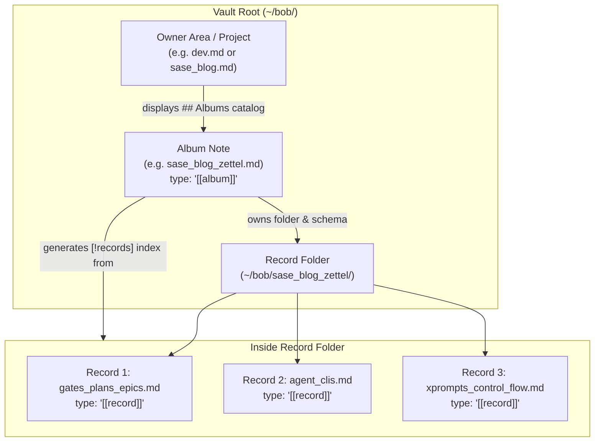
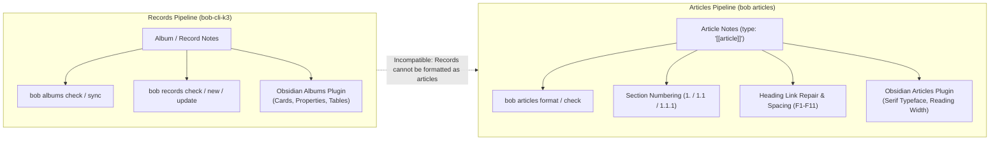
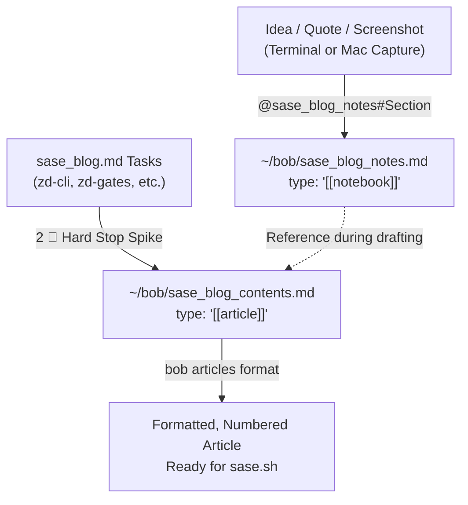

# Architectural Evaluation: Drafting the SASE Blog Post via Record Notes & Album Notes

**Date:** 2026-11-12  
**Researcher:** `research.4f.gem`  
**Workspace:** `bob-cli_18`  
**Target Subject:** SASE Launch Blog Post Architecture (`sase_blog` / `sase_blog_contents.md`)  
**Bead References:** [bob-cli-k3](file:///home/bryan/.local/state/sase/workspaces/bobs-org/bob-cli/bob-cli_18/sase/repos/plans/202611/album_and_record_notes.md) (Album and Record Notes Foundation)  
**Related Documents:** [sase_blog_contents.md](file:///home/bryan/bob/sase_blog_contents.md), [sase_blog.md](file:///home/bryan/bob/sase_blog.md), [docs/records.md](file:///home/bryan/.local/state/sase/workspaces/bobs-org/bob-cli/bob-cli_18/docs/records.md), [docs/articles.md](file:///home/bryan/.local/state/sase/workspaces/bobs-org/bob-cli/bob-cli_18/docs/articles.md), [docs/notebooks.md](file:///home/bryan/.local/state/sase/workspaces/bobs-org/bob-cli/bob-cli_18/docs/notebooks.md)

---

## 1. Executive Summary

### 1.1 The Proposal
Bryan is in the process of drafting a comprehensive launch blog post for the SASE project (an open-source meta-harness for coding agent CLIs at `sase-org/sase`). The blog post is tracked in the project note [sase_blog.md](file:///home/bryan/bob/sase_blog.md) and currently outlined in the article note [sase_blog_contents.md](file:///home/bryan/bob/sase_blog_contents.md). 

Bryan proposed:
1. Creating a new album note: `~/bob/sase_blog_zettel.md` (`type: "[[album]]"`).
2. Writing each section or topic of the blog post as its own record note (`type: "[[record]]"`) in `~/bob/sase_blog_zettel/`.
3. Completing one record note for each topic.
4. Finalizing the blog post by "mostly just re-arranging the content" already written in these record notes into the master article.

### 1.2 Core Verdict
> [!IMPORTANT]
> **Verdict: Conceptually Valid Impulse, but an Architectural Anti-Pattern for Bob.**
> 
> While the psychological motivation (deconstructing a massive, 6-month-old writing project into bite-sized atomic cards to defeat writer's block) is sound and aligns with Niklas Luhmann's Zettelkasten principles, implementing this via **Bob's Album and Record Notes** creates severe architectural impedance mismatches, tooling conflicts, double-entry GTD tracking, and permanent vault-root clutter.

The table below summarizes the key trade-offs:

| Aspect | The Album & Record Proposal | Bob Native Reality / Friction |
| :--- | :--- | :--- |
| **Domain Model** | Treating blog sections as database entities | Albums are built for durable external collections (restaurants, podcasts, TV shows); blog sections are interdependent narrative prose. |
| **Tooling & Formatting** | Expects rich prose in records | `bob records check` enforces note-bullet structure and forbids task checkboxes; `bob articles` (numbering `1.1`, layout, typography, footnote checks) only formats `type: "[[article]]"`. |
| **Assembly Effort** | Assumes "mostly just re-arranging" | Assembling discrete cards into a flowing 4,000+ word essay requires rewriting transitions, adjusting tone, and eliminating redundant definitions. Edits in the master article immediately render the source records obsolete. |
| **Vault Lifecycle** | Temporary drafting scaffold | Albums must live at vault root (`~/bob/sase_blog_zettel.md`) and own `~/bob/sase_blog_zettel/`. They permanently pollute `bob albums list` unless manually decommissioned. |
| **Project Tracking** | Status tracked in record frontmatter | [sase_blog.md](file:///home/bryan/bob/sase_blog.md) already tracks Zero-Draft tasks (`zd-cli`, `zd-tui`, `zd-gates`, etc.) with cards, Pomodoro links, and GTD freshness. Adding record statuses causes duplicate bookkeeping. |

### 1.3 Recommended Path
Instead of creating a vault-root Album, Bryan should adopt a **Wave & Spike In-Place Drafting Workflow**:
1. Keep [sase_blog_contents.md](file:///home/bryan/bob/sase_blog_contents.md) as the single source of truth (`type: "[[article]]"`).
2. Leverage the existing Zero-Draft task cards in [sase_blog.md](file:///home/bryan/bob/sase_blog.md) with strict 2-Pomodoro hard stops (e.g. `zd-cli`, `zd-tui`).
3. If modularity and fast capture are needed, use a dedicated Bob **Notebook** ([sase_blog_notes.md](file:///home/bryan/bob/sase_blog_notes.md)) for raw angle bullets, quotes, and screenshots via `@sase_blog_notes#<section>`.
4. If physical file isolation per topic is strictly desired, implement **Leaf Article Drafts** in a project subfolder (`sase_blog/drafts/*.md`), preserving full `bob articles` compatibility without polluting the vault root.

However, if Bryan insists on the Album + Record implementation, this report provides the **exact schema design, record anatomy, assembly scripts, and decommissioning plan** required to minimize friction.

---

## 2. Background and Context

### 2.1 The SASE Blog Project State
The SASE blog post represents a major milestone for Bryan. Based on [sase_blog.md](file:///home/bryan/bob/sase_blog.md), [sase_pre_blog.md](file:///home/bryan/bob/sase_pre_blog.md), and [sase_blog_contents.md](file:///home/bryan/bob/sase_blog_contents.md):
- **Origin Date:** Created 2026-06-11 (over 5 months in progress).
- **Core Purpose:** Introduce SASE ("Structured Agentic Software Engineering"), an open-source meta-harness wrapping agent CLIs (Claude, Codex, Muse, Grok, etc.) to develop high-quality software at scale (~17K commits, ~2.9M lines of code).
- **Voice & Tone:** Deeply personal, witty, transparent about "AI slop", featuring custom devil/angel bullet points (😈/😇), stick figures, and real battle-tested screenshots.
- **Current Blockers:** 10 blocked tasks in `sase_blog.md`. The critical path is blocked on `s0-spike` (write promise sentence, fill 4 Wave 1 cards, write claim sentences), which unblocks `zd-cli`, `zd-tui`, `zd-gates`, `zd-macros`, which unblocks `w1-review`, which unblocks `v1-draft`.
- **Existing Content Outline ([sase_blog_contents.md](file:///home/bryan/bob/sase_blog_contents.md)):**
  - Preamble: Pride, meta-harness definition, stats caveat.
  - §1: Why I use SASE.
  - §2: What is SASE? (2.1 Gates/Plans/Epics, 2.2 Beads/Sidecars, 2.3 Agent CLIs, 2.4 VCS/Workspaces, 2.5 Xprompts/Control flow, 2.6 Project Management, 2.7 Routines/Jobs).
  - §3: Why you should (probably) NOT use SASE (AI Slop, Prompt Debt, Future Work).
  - §4: Conclusion (First Myth, Swarms, Poll).

### 2.2 What Bob-Cli-K3 Implemented for Albums and Records
Epic `bob-cli-k3` ([plan:202611/album_and_record_notes.md](file:///home/bryan/.local/state/sase/workspaces/bobs-org/bob-cli/bob-cli_18/sase/repos/plans/202611/album_and_record_notes.md)) established a formal system for collections of structured domain data:
- **Album Note (`type: "[[album]]"`):**
  - Must reside at the vault root (e.g. `eat.md`, `podcasts.md`, `tv.md`, `movies.md`).
  - Owns a matching directory at the vault root (e.g. `eat/`, `podcasts/`).
  - Declares an embedded schema in frontmatter under `record:` (`noun`, `label`, `plural`, `fields`, `index_by`, `dated_notes`).
  - Maintains an automated, machine-managed `[!records]` index callout inside the album note.
  - Automatically updates owner notes (e.g. `body.md`, `dev.md`) with an `[!albums]` catalog in `## Albums`.
- **Record Note (`type: "[[record]]"`):**
  - Lives inside the album folder (`<album>/<stem>.md`).
  - Frontmatter: `parent: "[[<album>]]"`, `type: "[[record]]"`, `title`, and typed schema fields.
  - Body structure: `# <Title>` followed by `## Notes` (with note bullets or dated bullets).
  - Validated by `bob records check`: enforces valid field values, rejects undeclared fields, and strictly forbids task checkboxes (`- [ ]`).



---

## 3. In-Depth Critique of the Plan

### 3.1 The Category Error: Entities vs. Narrative Composition
In domain-driven software design, overloading an abstraction for an unintended use case introduces friction:
- **Albums are Entity Registries:** Bob albums model real-world, persistent entity collections. A restaurant in `eat/` or a show in `tv/` exists independently of any other note. It has a discrete state (`liked`, `to_watch`), metadata (`category`, `url`), and an open-ended log of visits or episodes under `## Notes`.
- **A Blog Post is a Compositional Narrative:** Sections and topics in an essay are not independent entities. Their meaning, rhythm, length, and voice are inextricably bound to what comes before and after. Section 2.3 ("Agent CLIs") depends directly on the pain introduced in Section 1.1 ("Gates -> Plans -> Epics") and sets up Section 2.5 ("Xprompts").
- **Consequence:** Treating narrative subsections as database rows forces artificial atomicity onto organic prose.

### 3.2 The Tooling & Formatting Mismatch
Bob's toolchain has two separate pipelines with zero overlap:



1. **Record Checkers Forbid Prose Mechanics:**
   - `bob records check` validates notes strictly against the album schema.
   - Any task checkbox (`- [ ] #task` or even scratch `- [ ] fix quote`) triggers `record_checkbox` errors.
   - Body updates via `bob records update -n "..."` only know how to append bullets under `## Notes`.
2. **Articles Pipeline is Disabled for Records:**
   - [docs/articles.md](file:///home/bryan/.local/state/sase/workspaces/bobs-org/bob-cli/bob-cli_18/docs/articles.md) dictates that `bob articles` commands only operate on `type: "[[article]]"`. If run against a record note, it exits with refusal code `not-article`.
   - Record notes miss out on:
     - Automated section numbering and hierarchy repairs (`N1-N9`).
     - Footnote and pseudo-footnote validation.
     - Code fence validation (`unclosed-fence`).
     - The Obsidian `bob-articles` serif reading layout.

### 3.3 The "Assembly Fallacy" (The Myth of "Just Re-Arranging")
The user writes:
> *"The idea is that I would finish one record for each topic I want to discuss in the blog. The task of writing the actual blog would then be simplified to mostly just re-arranging the content that I have already written in these record notes."*

In long-form non-fiction writing, this is a well-documented cognitive illusion:
1. **The Stitching Problem:** Concatenating 15 individually written cards produces choppy, repetitive prose. Each card tends to re-introduce context, restate premises, and use slightly different terminology.
2. **Narrative Transitions:** Great articles rely on seamless connective tissue ("Having tamed the provider interface, we ran into an entirely different beast: terminal multiplexing..."). When drafting in isolated record notes, transitions are impossible to write because the neighbouring context does not exist.
3. **The Synchronization Trap:** What happens after you assemble the cards into [sase_blog_contents.md](file:///home/bryan/bob/sase_blog_contents.md)?
   - You begin line-editing, tightening prose, pruning sections, and adding transitions.
   - At that exact moment, the master article and the record notes diverge.
   - Do you backport the edits to `sase_blog_zettel/`? If so, you spend 50% of your time on administrative copy-pasting. If not, the record notes become immediate dead code.

### 3.4 Vault-Root Clutter and Lifecycle Management
Under Bob's architecture ([docs/records.md](file:///home/bryan/.local/state/sase/workspaces/bobs-org/bob-cli/bob-cli_18/docs/records.md)):
- Every album **must** live at the vault root (`~/bob/<stem>.md`) and own a vault-root directory (`~/bob/<stem>/`).
- Creating `sase_blog_zettel.md` permanently adds:
  - `~/bob/sase_blog_zettel.md`
  - `~/bob/sase_blog_zettel.base`
  - `~/bob/sase_blog_zettel/` (with 15–20 files)
- It will appear in `bob albums list` forever.
- When the blog is published to `sase.sh`, what happens to the album?
  - Restaurants and movies are permanent living collections. A blog draft is ephemeral.
  - Decommissioning an album requires manually removing the `## Albums` catalog from `sase_blog.md`, deleting the `.base` view, unregistering the schema, and archiving or deleting the folder.

### 3.5 Redundant Double-Entry Bookkeeping with GTD Tasks
Bryan's project note [sase_blog.md](file:///home/bryan/bob/sase_blog.md) is already a finely tuned GTD machine:
- It tracks tasks:
  - `s0-spike`: 2 🍅 hard stop.
  - `zd-cli`: Zero-draft §1.3 (dictate ≥150 words).
  - `zd-tui`: Zero-draft §1.3.2 (dictate ≥150 words).
  - `zd-gates`: Zero-draft §1.1 (dictate ≥150 words).
  - `zd-macros`: Zero-draft §1.5 (dictate ≥150 words).
  - `w1-review`: Wave 1 review.
- Each task already includes a rich card specification:
  - `CARD: 😈 one CLI at a time · 😇 every provider behind one harness · PROOF: retries through the Claude outage (~/tmp/screenshots/20260616_140429.png) · LESSON: ...`
- If Bryan introduces record notes with `status: to_write / drafted`, he now has **two competing status trackers**:
  1. The GTD checkbox, Pomodoro link, and review walk (`]s`) in `sase_blog.md`.
  2. The YAML frontmatter `status:` in each record note, summarized in `sase_blog_zettel.md`.

Keeping these two in sync is pure administrative overhead.

---

## 4. If You Implement It: The Optimal Album & Record Specification

If Bryan evaluates the trade-offs and still decides to proceed with the Album + Record model (e.g., because physical file separation provides significant personal focus benefits), the implementation must be engineered to avoid breaking Bob's contracts.

### 4.1 Album Creation & Schema
Do not hand-roll the album note. Use `bob albums create`:

```bash
bob albums create sase_blog sase_blog_zettel \
  -n zettel \
  -l "Zettel" \
  -e "🗃️" \
  -s "Topic cards and section drafts for the SASE launch blog post."
```

Then, update the schema in `~/bob/sase_blog_zettel.md` to support drafting metadata:

```yaml
---
parent: "[[sase_blog]]"
type: "[[album]]"
summary: Topic cards and section drafts for the SASE launch blog post.
emoji: 🗃️
index_by: status
index_facets:
  - section
  - wave
created: 2026-11-12T12:30:00-05:00
record:
  noun: zettel
  label: Zettel
  plural: zettels
  dated_notes: false
  fields:
    status:
      required: true
      values:
        idea: 💡 Idea
        outlined: 📝 Outlined
        drafted: ✍️ Drafted
        revised: 🔍 Revised
        assembled: 🧩 Assembled
        cut: ✂️ Cut
    section:
      required: true
      values: text
      suggest: true
    wave:
      values:
        w1: 🌊 Wave 1
        w2: 🌊 Wave 2
        w3: 🌊 Wave 3
    order:
      values: number
    target_words:
      values: number
    devil:
      values: text
    angel:
      values: text
---

# SASE Blog Zettelkasten

Topic cards and section drafts for the [[sase_blog]] post.
Draft in records; assemble into [[sase_blog_contents]].

Schema: `bob records show zettel`

## Records
```

### 4.2 Record Note Anatomy for Prose
To ensure `bob records check` remains clean while accommodating long-form prose:
1. Put metadata in frontmatter.
2. Put the framing notes (Devil/Angel, proofs, quotes) under `## Angle`.
3. Put the draft prose under `## Draft`.
4. Put bullets under `## Notes`.
5. **Never** use markdown checkboxes (`- [ ]`) in the note body.

**Example Record Note:** `~/bob/sase_blog_zettel/agent_clis.md`
```markdown
---
parent: "[[sase_blog_zettel]]"
type: "[[record]]"
title: "Agent CLIs — One CLI to Rule Them All"
status: drafted
section: "2.3 Agent CLIs"
wave: w1
order: 30
target_words: 300
devil: "Juggling 5 different terminal windows, provider flags, and fragile shell scripts"
angel: "Every provider unified behind one harness with seamless model switching"
created: 2026-11-12T12:35:00-05:00
---

# Agent CLIs — One CLI to Rule Them All

## Angle
- 😈 **Pain:** One CLI at a time, incompatible argument flags, losing state during lab outages.
- 😇 **Vision:** Every provider behind one meta-harness.
- 📸 **Proof:** Claude outage retry screenshot (`~/tmp/screenshots/20260616_140429.png`).
- 💡 **Lesson:** "Optimal experience, not optimal performance."

## Draft
When people talk about agentic coding, they usually mean opening Cursor, Claude Code, or Codex in a terminal tab and typing a prompt. That works when you have one agent doing one task. But the moment you want a team of specialized agents—Codex writing Rust, Claude reviewing architecture, Grok doing sanity checks—you find yourself drowning in a sea of terminal windows.

SASE started as my refusal to be a human router between competing AI CLIs...

## Notes
- Remember to cite the quote on rival labs swarming the same task.
```

### 4.3 Initial Seed Roster
To seed the album according to [sase_blog_contents.md](file:///home/bryan/bob/sase_blog_contents.md), create these 13 starter records:

| Stem | Title | Section | Wave | Order |
| :--- | :--- | :--- | :--- | :--- |
| `intro_pride` | Software Engineering & Pride | Preamble | w1 | 05 |
| `why_i_use_sase` | Why I Use SASE | §1 Why I Use SASE | w2 | 10 |
| `gates_plans_epics` | Gates -> Plans -> Epics | §2.1 Gates/Plans/Epics | w1 | 20 |
| `beads_sidecars` | Beads -> Sidecar Repos | §2.2 Beads/Sidecars | w2 | 25 |
| `agent_clis` | Agent CLIs (Skills, Memory, Providers) | §2.3 Agent CLIs | w1 | 30 |
| `agent_presentation_tui` | Agent Presentation & TUI | §2.3.2 Presentation | w1 | 35 |
| `vcs_workspace_ops` | VCS & Ephemeral Workspaces | §2.4 VCS Operations | w2 | 40 |
| `xprompts_control_flow` | Xprompts & Agent Control Flow | §2.5 Xprompts | w1 | 50 |
| `project_management` | Project Management & Artifacts | §2.6 Project Mgmt | w2 | 60 |
| `routines_and_jobs` | Routines and Scheduled Jobs | §2.7 Routines | w3 | 70 |
| `ai_slop_definition` | My Definition of AI Slop | §3.1 AI Slop | w1 | 80 |
| `future_work` | Future Work & What's Next | §3.2 Future Work | w3 | 90 |
| `conclusion_first_myth` | The First Myth & Swarming Labs | §4 Conclusion | w2 | 95 |

### 4.4 Automated Assembly Script
To solve the assembly friction, provide a deterministic assembly script rather than manual copy-pasting.

Create `scripts/assemble_sase_blog.py`:
```python
#!/usr/bin/env python3
"""Assembles sase_blog_zettel records into sase_blog_contents.md."""

from pathlib import Path
import re
import frontmatter  # or parse standard YAML block

VAULT = Path.home() / "bob"
ZETTEL_DIR = VAULT / "sase_blog_zettel"
TARGET = VAULT / "sase_blog_contents.md"

def extract_draft(path: Path) -> tuple[dict, str]:
    content = path.read_text(encoding="utf-8")
    parts = re.split(r"^## Draft\s*$", content, flags=re.MULTILINE)
    if len(parts) < 2:
        return {}, ""
    # Extract prose before next H2
    draft_part = re.split(r"^## \w+", parts[1], flags=re.MULTILINE)[0].strip()
    return draft_part

def assemble():
    # Read records, sort by frontmatter `order`
    records = []
    for f in ZETTEL_DIR.glob("*.md"):
        # Parse frontmatter and draft text
        ...
    # Reconstruct article body with section headings
    ...
```

### 4.5 Decommissioning Plan
Once the blog post is finalized and published:
1. Merge the final text into `~/bob/sase_blog_contents.md`.
2. Run `bob articles format sase_blog_contents.md`.
3. Retire the album:
   - Remove the `[!albums]` callout entry from `~/bob/sase_blog.md`.
   - Move `~/bob/sase_blog_zettel/` to `~/bob/done/sase_blog_zettel/` (or archive in git).
   - Delete or archive `~/bob/sase_blog_zettel.md` and `~/bob/sase_blog_zettel.base`.
   - Run `bob albums sync` to clean up the vault album registry.

---

## 5. Alternative Architectural Approaches

We evaluated three alternative approaches against the Album & Record proposal:

### Alternative A: Section-Anchored In-Place Spikes (Recommended)
Draft directly inside [sase_blog_contents.md](file:///home/bryan/bob/sase_blog_contents.md).
- **Mechanism:** Use Obsidian's native heading folding. When working on `### 2.3 Agent CLIs`, fold all other sections.
- **Workflow:**
  1. Open [sase_blog.md](file:///home/bryan/bob/sase_blog.md), grab the active task (`zd-cli`), and start a 2-Pomodoro timer.
  2. Dictate/write ≥150 words directly under `### 2.3 Agent CLIs` in `sase_blog_contents.md`.
  3. Mark `zd-cli` complete in `sase_blog.md`.
  4. Run `bob articles format` to maintain clean layout and numbering.
- **Pros:** Zero assembly overhead; immediate visibility of narrative flow and transitions; full `bob articles` support; zero vault pollution.
- **Cons:** Working in a single large document (requires discipline to use heading folds).

### Alternative B: The Bob Notebook (`~/bob/sase_blog_notes.md`)
Use Bob's native **Notebook** architecture (`type: "[[notebook]]"`).
- **Mechanism:** Create `~/bob/sase_blog_notes.md` with `parent: "[[sase_blog]]"`.
- **Workflow:**
  - Fast capture ideas from anywhere using `@sase_blog_notes#Agent CLIs` or `@sase_blog_notes#Gates`.
  - Collect screenshots, quotes, links, and devil/angel pairs as bullet notes.
  - Automatically indexed in [sase_blog.md](file:///home/bryan/bob/sase_blog.md)'s `## Notebooks` catalog via `bob notebooks sync`.
- **Pros:** 100% native Bob fit; no vault-root pollution; instant capture from Mac capture menu bar; designed specifically for project-supporting notes.
- **Cons:** Holds bullet notes, not formatted prose paragraphs.

### Alternative C: Leaf Article Drafts in Project Subfolder
If physical file separation per section is a hard psychological requirement:
- **Mechanism:** Create a dedicated project subfolder: `~/bob/sase_blog/` (or `~/bob/sase_drafts/`).
- **Files:** Each topic is an article note (`type: "[[article]]"`, `parent: "[[sase_blog_contents]]"`):
  - `~/bob/sase_blog/01_why_i_use_sase.md`
  - `~/bob/sase_blog/02_gates_plans_epics.md`
  - `~/bob/sase_blog/03_agent_clis.md`
- **Workflow:**
  - Each note is a fully valid article: benefits from `bob articles format`, section numbering, and Obsidian typography.
  - In [sase_blog_contents.md](file:///home/bryan/bob/sase_blog_contents.md), embed them using Obsidian transclusion:
    ```markdown
    ## 2. What is SASE?
    
    ### 2.1 Gates -> Plans -> Epics
    ![[sase_blog/02_gates_plans_epics]]
    
    ### 2.2 Agent CLIs
    ![[sase_blog/03_agent_clis]]
    ```
- **Pros:** Perfect file isolation; 100% article tooling compatibility; live preview via transclusion; leaves vault root untouched.
- **Cons:** Still requires final consolidation if a single flat file is needed for export to `sase.sh`.

---

## 6. Comparative Evaluation Matrix

| Criterion | 1. Album & Records (`sase_blog_zettel`) | 2. In-Place Spikes (`sase_blog_contents`) | 3. Project Notebook (`sase_blog_notes`) | 4. Leaf Article Drafts (`sase_blog/*.md`) |
| :--- | :---: | :---: | :---: | :---: |
| **Cognitive Friction Reduction** | High | Medium | High | High |
| **Prose Tooling (`bob articles`)** | ❌ Refused | ✅ Full Support | ❌ Not prose | ✅ Full Support |
| **Narrative Flow & Transitions** | ❌ Fragmented | ✅ Seamless | ⚠️ Bullets only | ⚠️ Partial |
| **Assembly / Stitching Effort** | 🔴 High (Script / Copy) | 🟢 Zero | 🔴 High | 🟡 Low (Transclusion) |
| **Vault Root Hygiene** | 🔴 Pollutes Root | 🟢 Clean | 🟢 Clean | 🟢 Clean |
| **GTD / Pomodoro Alignment** | 🔴 Redundant status | 🟢 Direct task link | 🟢 Direct note capture | 🟢 Clean task link |
| **Post-Launch Cleanup** | 🔴 Complex de-album | 🟢 None | 🟢 Archive notebook | 🟢 Move folder to `done/` |

---

## 7. Recommended Solution & Action Plan

### 7.1 Recommended Strategy: The "Wave & Spike" Workflow with Notebook Support
We recommend **rejecting the Album & Record architecture** for the blog post. Instead, combine the best elements of modular capture and in-place drafting:

1. **Use `sase_blog_notes.md` for Fast Capture:**
   Create a notebook under `sase_blog` to capture angles, quotes, and screenshots without worrying about prose formatting.
2. **Draft Directly in `sase_blog_contents.md` Using Wave Tasks:**
   Unblock `s0-spike` in [sase_blog.md](file:///home/bryan/bob/sase_blog.md). Execute the existing Zero-Draft tasks (`zd-cli`, `zd-tui`, `zd-gates`, `zd-macros`) by writing directly in `sase_blog_contents.md`.
3. **Use Obsidian Heading Folds:**
   Fold all other sections while drafting one topic to maintain the psychological focus of an atomic card.
4. **Format with `bob articles`:**
   Run `bob articles format sase_blog_contents.md` to keep section numbering, layout, and footnotes pristine.



### 7.2 Immediate Action Steps for Bryan

If Bryan accepts the recommended solution:
1. **Unblock Task `s0-spike`:**
   In [sase_blog.md](file:///home/bryan/bob/sase_blog.md), complete the exit criteria for `s0-spike`:
   - Write the promise sentence at the top of [sase_blog_contents.md](file:///home/bryan/bob/sase_blog_contents.md).
   - Write one claim sentence under every heading in `sase_blog_contents.md`.
2. **Execute Wave 1 Zero-Drafts:**
   Work through `zd-cli`, `zd-tui`, `zd-gates`, and `zd-macros`. In each 2-Pomodoro sprint, dictate ≥150 words directly into the corresponding heading in `sase_blog_contents.md`.
3. **Run Formatting:**
   `bob articles format sase_blog_contents.md`.

If Bryan prefers physical file separation, follow **Alternative C (Leaf Article Drafts)**:
1. Create `~/bob/sase_blog/` folder.
2. Create individual article notes for Wave 1 topics.
3. Transclude them into [sase_blog_contents.md](file:///home/bryan/bob/sase_blog_contents.md) via `![[sase_blog/<topic>]]`.

If Bryan insists on the **Album & Record model**, follow the exact commands and schema detailed in **Section 4**.
