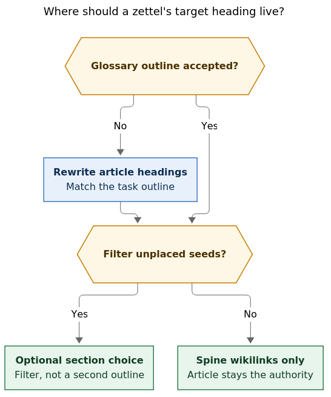
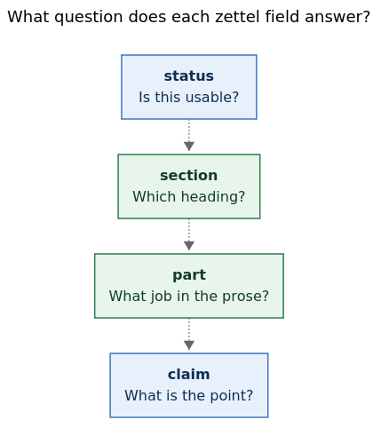

# Add a section facet to SASE Blog Zettel

> **Research query:** Edit `~/bob/sase_blog_zettel.md` so each zettel can name the blog-post section it targets. Construct a closed value set from the `^section-field` task on `~/bob/sase_blog.md`. Add any related fields that are hard to argue against. Critique the plan, adjust the requirements where justified, and recommend how to implement it.

## Bottom line

**Add an optional `section` choice field, and treat it as a placement filter for unplaced claims.** Keep `part` (rhetorical job) and `status` (material maturity). Keep order, transitions, and heading text in `sase_blog_contents.md`. The one related schema change that is hard to argue against is `index_facets: [section, part, claim]`; without it the generated `[!records]` index hides the new field.

This is a good idea only after the glossary outline on `^section-field` is accepted as the article spine. Today the manuscript still uses a different, feature-list outline (`bob articles outline` reports 15 stub headings, 301 words). Minting album values from the task while the article still names Gates / Beads / Agent CLIs creates a third outline. Rewrite the article headings in the same sitting, then copy those headings into the album YAML.

Do this as a frontmatter edit of `sase_blog_zettel.md`, then backfill the one live zettel. Zero new bob or plugin code. The Schema Card cannot write `index_facets`, and it would derive long, brittle choice keys from the heading labels.

## Verdict

The impulse is right: `part` cannot tell you that "Prompts should be managed like code…" belongs under *What is a prompt language?*. The type is already right: this album is a claim workbench, and a closed choice field is how Bob stores a fixed vocabulary on a record.

The risk is using `section` as a second manuscript. Prior research on this album ([Draft the SASE blog in claim-sized zettels](../sase_blog_zettel_album_guide.md), consolidated in [Drafting the SASE blog post in record notes](../sase_blog_drafting_in_records/sase_blog_drafting_in_records.md)) explicitly rejected `section`, `order`, and `wave` so the article would remain the only authority for sequence. That rejection still holds for **order**. It does not hold for a **filter**. A filter answers "which unplaced seeds feed this heading?" The spine still answers "in what order, with what transitions?"

I would take this approach, with the adjustments below. I would not add a `subsection` field, a list, a numeric order, a `post` field, or any bob feature.



_Accept the glossary outline first. Then store the target heading as an optional album choice field when unplaced seeds need a filter. Order stays in the article._

Rendered size: 541.2 × 650 px; fit scale: 100%. Mermaid CLI 12.0.0 SVG; PNG cropped from a wkhtmltoimage conversion after mermaid-cli PNG export failed twice with `ConnectionClosedError`.

## Ground truth

Live reads on 2026-11-16.

### The album already has a coarse outline axis

`~/bob/sase_blog_zettel.md` is a vault-root album (`type: "[[album]]"`, parent `[[sase_blog]]`, noun `zettel`). Its schema, from `bob records show zettel -f json` and `bob albums check -f json`:

| Field | Kind | Required | Role today |
| --- | --- | --- | --- |
| `status` | choices | yes | 🌱 Seed → ✍️ Draft → ✅ Ready → 📌 Placed; ⏭️ Later / ✂️ Cut |
| `claim` | text | yes | One-sentence point |
| `part` | choices | no | 🪝 Hook / 🙋 Why I use it / 🧱 What it is / 🛑 Why not / 🏁 Close |

`index_facets` is the explicit list `[part, claim]`. Grouping is `status`. `index_by` is unset. Schema fingerprint `sha256:9063b2ad5b6349215424ff31ffc63bfde7c2c11df5b8749a81f6479016b1c129`. Index state `current`. One record, last added 2026-11-14. Zero issues.

The generated index already shows the live row as **🌱 Seed** · `Prompt Management (macros)` — 🙋 Why I use it · *Prompts should be managed like code…*. `part` is a reader-facing facet, not a heading.

### One live zettel already needs a finer bucket

`~/bob/sase_blog_zettel/prompt_management_macros.md`:

```yaml
status: seed
claim: "Prompts should be managed like code, with several different layers of structure (depending on complexity)."
part: why
```

`part: why` is correct as a rhetorical job. It does not name the heading. Under the task outline this record targets **What is a "prompt language" (macros)?**.

### The task outline and the article disagree

The Next task `^section-field` (created 2026-11-14, fresh 2026-11-15) on `~/bob/sase_blog.md` is:

- What is SASE?
  - What is a "prompt language" (macros)?
  - What is an "agent turn"?
  - What is a "gate"?
  - What are agent families, clans, and tribes?
  - What is a "memory"?
  - What is a "plan"? *(include artifacts)*
  - What is a "project"?
  - What is an "automation" (service)?
- The Demos
- Why SASE is still NOT ready?
- Future Work

`bob articles outline sase_blog_contents -f json` still reports the older spine:

| Number | Title | Words | Stub |
| --- | --- | ---: | --- |
| *(lede)* | unnumbered preamble | 190 | |
| 1. | Why I use SASE | 1 | yes |
| 2. | What is SASE? | 0 | yes |
| 2.1–2.7 | Gates, Beads, Agent CLIs, Skills/memory, Agent presentation, VCS, Xprompts, Project Management, Routines and Jobs | 1 each | yes |
| 3. | Why you should (probably) NOT use SASE | 0 | yes |
| 3.1 | My Definition of "AI Slop" | 1 | yes |
| 3.2 | Future Work | 1 | yes |
| 4. | Conclusion | 1 | yes |

Total 301 words, 15 stub sections. The article has no `→ [[sase_blog_zettel/…]]` lines. The S0 wiring recommended in the album guide never landed.

The task is a glossary-first rewrite. The article is still a feature-list rewrite of the June outline. The value set must come from the task, as requested. That only works if the article is updated to match.

### Bob already has the field kind this needs

From `docs/records.md`:

- Field names match `[a-z][a-z0-9_]*`. Reserved keys are `parent`, `type`, `title`, `created`. `section` is legal.
- A nonempty `values:` mapping is a closed choice list. Capture completion inserts the **key** and offers the **label** (`src/native/capture_complete/records.rs`).
- Choice and field order follow the YAML mapping. Labels may include emoji, matching `status` and `part`.
- `index_facets` is at most three field names. An explicit list does not auto-include a new field. Empty facet values disappear from a row.
- Grouping prefers `status` when present. `index_by` subgroups only appear once a group exceeds 12 records.
- `bob albums update` can `field.add` a choices field. `album.set` may change `label`, `plural`, and `dated_notes` only. It cannot write `index_facets`. A used choice cannot be removed (`choice.remove` requires `count = 0`). `choice.set` can change label and emoji while the stored key stays fixed.
- Schema Card keys are `normalize_stem(label)` (`src/native/records/stem.rs`). "What is a \"prompt language\" (macros)?" becomes `what_is_a_prompt_language_macros`. "What are agent families, clans, and tribes?" becomes `what_are_agent_families_clans_and_tribes`.
- Record writes rebuild the `[!records]` index in the same transaction. Base files stay byte-identical on `albums update`.
- No other live album declares a `section` field, so there is no cross-album storage clash.

Heading-identity capture already exists for the article (`@sase_blog_contents#agent` still finds `## 1.3 Agent CLIs` after numbering; `docs/capture.md`). That is how notes land **in the manuscript**. It is not how an unplaced seed declares a target before the heading exists, or how the album index filters.

## Critique

### What is good about the plan

1. **The job is real.** `part` is a five-value rhetorical palette copied from the old 1/2/3/4 spine (Why / What / Why not / Close, plus Hook). The new outline is a glossary of SASE terms plus Demos / Not ready / Future work. Those are different questions. The live macros zettel is the proof: one record is both `part: why` and (once tagged) `section: prompt_language`.

2. **A closed choice field is the native Bob shape.** The request is a fixed vocabulary Bryan will maintain by editing the album note. That is exactly `record.fields.section.values`. Capture already completes choice keys. The Schema Card can add a heading later with `c`. `bob records check` will flag unknown keys.

3. **The album is already a workbench, not a catalog of restaurants.** Prior research adjusted the unit to one record per claim. A placement facet on that unit is a query index, the same role `index_facets: [part, claim]` already plays.

4. **Cost is small.** One YAML mapping, one facet list, one backfill. The writing bottleneck is unchanged: 190 words of lede and 15 TODO stubs.

### What is wrong with the plan as stated

1. **Three outlines.** Task, article, and album would each name sections. The album guide's rule was: the article is the spine; the album is inventory. A `section` field is a projection of the spine. Projecting a spine that has not been rewritten is how the field becomes a competing outline.

2. **Hierarchy is in the task and not in the schema.** Bob has no dependent enums. A `section` plus `subsection` pair would accept `demos` + `gate`. Flatten the tree into one list. Keep the parent *What is SASE?* as a selectable value for claims about the whole, and keep each glossary term as its own value.

3. **Required would punish seeds.** `claim` and `status` are required because they *are* the zettel. `part` is optional. A seed captured before its heading is obvious should still write. Make `section` optional, like `part`. Empty values already disappear from index rows.

4. **`list: true` fights "one claim per record."** A definition and a demo are two claims. Two records. A demo zettel targets `demos`; a gate definition targets `gate`.

5. **Schema Card is the wrong first writer.** It cannot update `index_facets`. It would mint the long `normalize_stem` keys above. Bryan asked to maintain the list by editing `sase_blog_zettel.md`. Do that.

6. **Productive procrastination is still the main risk.** The `^section-field` work log already has two research sessions and no article-heading rewrite. This edit is justified if it ends in YAML and a backfill, then writing. It is not justified as a Schema Card tour or a bob feature.

### Would I take a different approach?

Yes, slightly: **rewrite the article headings to the glossary outline in the same sitting, then copy that list into the album.** The field is a snapshot of heading identities with short, stable keys. Labels track wording; keys do not. Order stays in the article, including `bob articles` numbering and heading-identity capture.

The fallback if the glossary outline is *not* accepted: leave the schema alone and keep using `part`. Do not mint values from a rejected outline.

Spine wikilinks (`→ [[sase_blog_zettel/<stem>|Title]]` under a heading) remain the assembly mechanism for placed material, as the album guide already specified. They do not replace the field for 🌱/✍️/✅ inventory that is not in the manuscript yet. Use both: field while drafting, wikilink when assembling.



_Status is material maturity, section is the target heading, part is the rhetorical job, and claim is the one-sentence point. Section does not replace part._

Rendered size: 425.8 × 478 px; fit scale: 100%.

## Constructed value set

Keys are short and durable. Labels follow the task wording and can change later via YAML or `choice.set` without retagging. Declaration order is parent, then its glossary children, then the three sibling sections. Parent *What is SASE?* stays selectable.

| Key | Label | Task bullet |
| --- | --- | --- |
| `what_is_sase` | ❓ What is SASE? | top-level section; claims about the whole |
| `prompt_language` | 📜 Prompt language | What is a "prompt language" (macros)? |
| `agent_turn` | 🔄 Agent turn | What is an "agent turn"? |
| `gate` | 🚧 Gate | What is a "gate"? |
| `families` | 👪 Families, clans, and tribes | What are agent families, clans, and tribes? |
| `memory` | 🧠 Memory | What is a "memory"? |
| `plan` | 📋 Plan | What is a "plan"? (artifacts live here) |
| `project` | 📁 Project | What is a "project"? |
| `automation` | ⚙️ Automation | What is an "automation" (service)? |
| `demos` | 🎬 Demos | The Demos |
| `not_ready` | 🛑 Why SASE is still not ready | Why SASE is still NOT ready? |
| `future_work` | 🔮 Future work | Future Work |

The task's note under *plan* ("This should include artifacts!") is a label/scope note, not a thirteenth value. The potential first line under *not_ready* belongs in that record's `## Draft` or `## Notes`, not in the schema.

Backfill now: `prompt_management_macros` → `prompt_language`.

Suggested mapping if the parked Wave-capture seeds are created later:

| Old contents heading | `section` key | `part` |
| --- | --- | --- |
| Why I use SASE | a glossary child, or omit section | `why` |
| What is SASE? | `what_is_sase` | `what` |
| Gates → Plans → Epics | `gate` (and a second zettel for `plan` if needed) | `what` |
| Beads → Sidecar repos | `later` status, or `plan` / `project` if it stays | `what` |
| Agent CLIs | `agent_turn` | `what` |
| Skills, memory, provider interface | `memory` | `what` |
| Agent presentation / tribes, clans, families | `families` | `what` |
| VCS and workspace operations | likely `later` / `cut` | `what` |
| Xprompts / macros | `prompt_language` | `what` |
| Project Management | `project` | `what` |
| Routines and Jobs | `automation` | `what` |
| Why you should NOT / AI Slop | `not_ready` | `why_not` |
| Future Work | `future_work` | `why_not` |
| Conclusion | omit section | `close` |
| *(new)* The Demos | `demos` | `what` |

## Related fields

### Add: `index_facets: [section, part, claim]`

This is album metadata, not a record field, and it is the one companion change that is hard to argue against. The list is already explicit and capped at three. A new choice field is invisible in `[!records]` until it is named here. Putting `section` first makes the index read as heading · rhetorical job · claim, which is the browse order this field is for.

`bob albums update` cannot write this key. It has to move in the same YAML edit as the new field.

### Companion, not a field: the Base view

`sase_blog_zettel.base` currently groups by `status` and shows only the title formula and `status`. `albums update` leaves Base files byte-identical. Add `section` (and `part`, `claim`) to the table `order`, and add a second view grouped by `section`, by hand. Bob will not do this.

### Do not add these record fields

| Candidate | Why it fails the "hard to argue against" test |
| --- | --- |
| `subsection` | Schema cannot enforce pairing with `section`. Flatten instead. |
| `section` as `list: true` | One claim, one heading. Demos are their own records. |
| `order` / `seq` | The article owns order. The album index cannot sort by it. Rejected in the 2026-11-12 research and still right. |
| `post` | `status: later` already parks material for future posts. A second album or a later `post` field can wait until a second post is actually being drafted here. |
| `wave` / `target_words` | Rejected in the album guide; still CARD/Notes material. |
| link to `[[sase_blog_contents#…]]` | Heading identity is the right *article* selector. It is not a closed vocabulary in the album file, which is the request. |
| `required: true` on `section` | The one live record would become invalid until backfill, and seeds would be blocked. Optional matches `part`. |
| `index_by: section` | Status grouping is the drafting pipeline. Subgroups only fire above 12 rows in a group. Revisit if Seed ever gets that large. |
| retiring `part` | It is in use (`why` on the live zettel) and answers a different question. Used choices cannot be removed until count is 0. |

## Requirement adjustments

Call these out as changes to the request.

| # | Original | Adjustment |
| --- | --- | --- |
| A1 | Add `record.section` with a fixed value set from `^section-field` | Keep. Optional choice field, keys in the table above. |
| A2 | Values maintained by editing `sase_blog_zettel.md` | Keep. YAML is the source of truth. Schema Card is for later one-choice adds. |
| A3 | *(implicit)* The article outline can stay as it is | **Rewrite `sase_blog_contents.md` headings to the glossary outline in the same sitting.** The field is a projection of that spine. |
| A4 | *(implicit)* Nested subsections | **Flatten.** Parent + eight glossary children + three siblings. No `subsection` field. |
| A5 | Add other related fields that are hard to argue against | **Only `index_facets: [section, part, claim]`.** No other record fields. |
| A6 | *(unspecified)* required vs optional | **Optional**, like `part`. |
| A7 | *(unspecified)* implementation path | **YAML + backfill.** Zero new bob code. Do not use `bob albums update` for the initial set, because it cannot write `index_facets` and would derive verbose keys. |
| A8 | Lede / Why I use SASE / Conclusion as sections | **Omit.** The 190-word lede is unnumbered preamble. `part: why` and `part: close` already cover those jobs. Optional extra value `intro` only if lede-bound claims start piling up; do not add it now. |
| A9 | Artifacts as their own section | **Omit.** They live under `plan`, per the task note. |

## Implementation

About five minutes, after the article headings match.

### 1. Edit album frontmatter

In `~/bob/sase_blog_zettel.md`, change `index_facets` and append `section` after `part`:

```yaml
index_facets: [section, part, claim]
record:
  noun: zettel
  label: Zettel
  dated_notes: true
  fields:
    status:
      required: true
      values:
        seed: 🌱 Seed
        draft: ✍️ Draft
        ready: ✅ Ready
        placed: 📌 Placed
        later: ⏭️ Later
        cut: ✂️ Cut
    claim:
      required: true
    part:
      values:
        hook: 🪝 Hook
        why: 🙋 Why I use it
        what: 🧱 What it is
        why_not: 🛑 Why not
        close: 🏁 Close
    section:
      values:
        what_is_sase: ❓ What is SASE?
        prompt_language: 📜 Prompt language
        agent_turn: 🔄 Agent turn
        gate: 🚧 Gate
        families: 👪 Families, clans, and tribes
        memory: 🧠 Memory
        plan: 📋 Plan
        project: 📁 Project
        automation: ⚙️ Automation
        demos: 🎬 Demos
        not_ready: 🛑 Why SASE is still not ready
        future_work: 🔮 Future work
```

Edit only frontmatter. Leave the bob-owned `[!records]` callout alone.

### 2. Backfill and rebuild the index

```sh
bob records update zettel prompt_management_macros -s section=prompt_language -d
# inspect, then
bob records update zettel prompt_management_macros -s section=prompt_language
bob albums check
```

The update rebuilds `[!records]` in the same write. The Seed row should then show **📜 Prompt language · 🙋 Why I use it ·** the claim. `bob albums check` should stay at zero issues, index `current`.

Capture from then on:

```text
Prompt Management (macros) @sase_blog_zettel/^prompt_management_macros
- status:: seed
- claim:: Prompts should be managed like code, with several different layers of structure (depending on complexity).
- part:: why
- section:: prompt_language
```

Completion on `section::` offers the twelve labels and inserts the key.

### 3. Optional Base pass

In `sase_blog_zettel.base`, add `section` to the All Zettels `order`, and add a view grouped by `section`. This is Obsidian Base YAML, not bob.

### 4. Later outline edits

- Wording only: change the label next to an existing key, or `choice.set`.
- New heading: add a key in YAML, or Schema Card `c` once `index_facets` already names `section`.
- Drop a heading: retag every record that uses the key, then `choice.remove` (refused while `count > 0`).
- Prefer adding a key over renaming one. Keys are identities.

## Rejected alternatives

- **Spine wikilinks only.** Right for placed material. Wrong as the only targeting mechanism while the article still has no zettel links and most records will sit in Seed/Draft.
- **Heading-identity capture into the article.** Right for notes that belong in the manuscript. Wrong as a substitute for an album facet.
- **Schema Card `field.add` with `restore_values`.** Mechanically possible (undo metadata can pin curated keys) and still cannot write `index_facets`. YAML does both in one edit.
- **Text field with `suggest: true`.** The request is a closed set. Free text will drift (`Gate` vs `gate` vs `What is a gate?`).
- **New bob feature** (dependent enums, nested choices, album-owned outline sync). The writing project does not need it.

## Recommended solution

1. Accept the `^section-field` glossary outline as the article spine and rewrite the headings in `sase_blog_contents.md` to match (stubs are fine).
2. Add optional `record.fields.section` to `sase_blog_zettel.md` with the twelve keys in the table above, appended after `part`.
3. Set `index_facets: [section, part, claim]`. Add no other record fields. Keep `part` and `status`.
4. Backfill `prompt_management_macros` with `section=prompt_language` through `bob records update`, then `bob albums check`.
5. Optionally add `section` to `sase_blog_zettel.base`.
6. Capture with `- section:: <key>`. Assemble with spine wikilinks. Edit the post in the article.

That is the whole change. Then write the post.

## Sources

- `~/bob/sase_blog.md` — `^section-field` task (Next, created 2026-11-14), project kitchen, Later Posts, Requirements.
- `~/bob/sase_blog_zettel.md` — live album schema, `index_facets: [part, claim]`, generated index.
- `~/bob/sase_blog_zettel/prompt_management_macros.md` — the one record (`status: seed`, `part: why`).
- `~/bob/sase_blog_zettel.base` — status-grouped table, no `section` column.
- `~/bob/sase_blog_contents.md` plus `bob articles outline sase_blog_contents -f json` — 301 words, 15 stub sections, 190-word lede, old feature-list spine.
- `bob records show zettel -f json` and `bob albums check -f json` — live field kinds, counts, fingerprint `sha256:9063b2ad…`, index `current`.
- bob-cli `docs/records.md` — field kinds, `index_facets` cap of three, grouping, `albums update` ops, index rebuild on record write, Base files unchanged.
- bob-cli `docs/articles.md` and `docs/capture.md` — heading identity, `@sase_blog_contents#agent`.
- bob-cli `docs/reference/plugins/albums.md` — Schema Card, `choice.set` keeps stored keys, Base/index presentation.
- bob-cli `src/native/albums/update/ops.rs` — `album.set` allow-list, `field.add` key derivation, `restore_values`.
- bob-cli `src/native/albums/mod.rs` — `index_facets` at most three, must name declared fields.
- bob-cli `src/native/records/stem.rs` — `normalize_stem`.
- bob-cli `src/native/capture_complete/records.rs` — choice completion inserts keys, displays labels.
- `research:202611/sase_blog_zettel_album_guide.md` — approved workbench rules; no `section`/`order`/`wave`.
- `research:202611/sase_blog_drafting_in_records/sase_blog_drafting_in_records.md` — R5: outline is candidate coverage; spine owns order.
- `research:202611/sase_blog_zettel_wave_captures.md` — Wave seeds still keyed to the old contents headings.
- Glossary: Album Note, Record Note.
