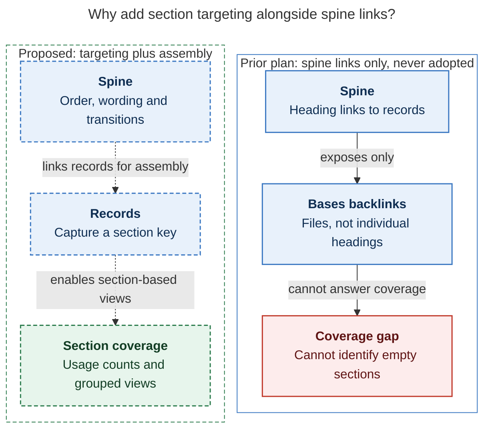
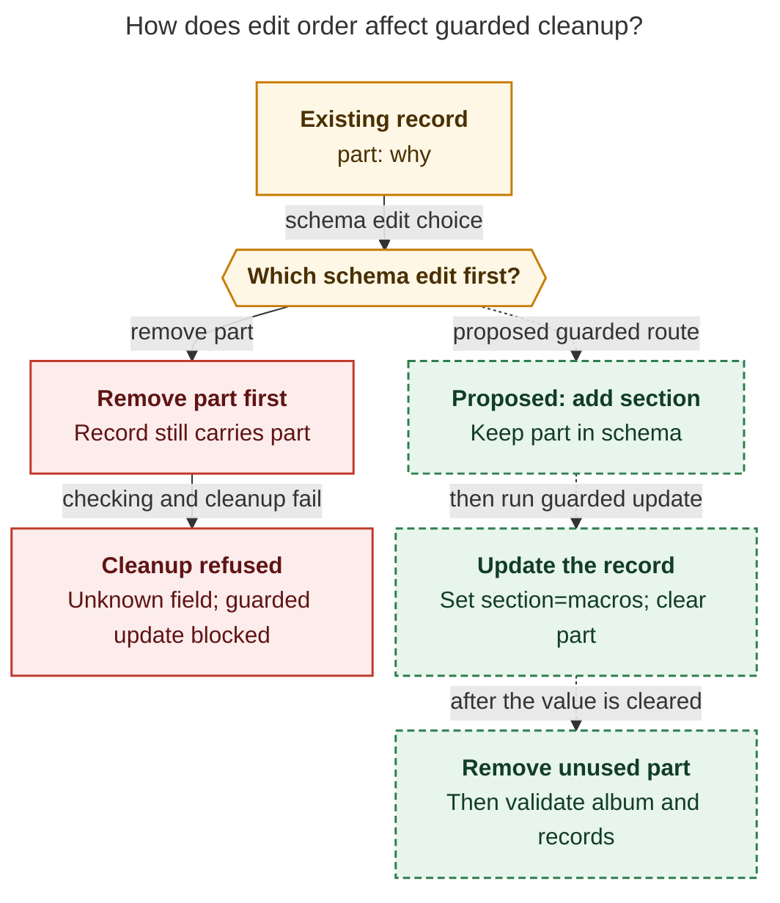

# Diagram proposals: A `section` field for the SASE Blog Zettel album: consolidated recommendation

Proposals for the swarm linker, not a report. Each diagram restates only what the source
report says.

```yaml
source: research:202611/sase_blog_zettel_section_schema/sase_blog_zettel_section_schema__final.md
producer: research.4w.image
check: "mmdc 12.0.0 with the PDF-mirroring config rendered 2 of 2 Mermaid diagrams; no-sandbox Puppeteer flag; SVG and PNG inspected"
```

## targeting-and-assembly

```yaml
anchor: |-
  The spine has none, and Obsidian Bases cannot see
question: |-
  Why add section targeting if the spine can link to records?
illustrates: |-
  A section field supports usage counts and grouping that heading-level spine links cannot supply to Bases, while spine wikilinks remain the assembly mechanism for placed material.
caption: "Section fields make coverage visible; the spine keeps assembly and article order."
review: "688.516x601 px, fit 94.8%; question, source-trace and visual checks passed; 0 revisions"
```



## guarded-migration-order

```yaml
anchor: |-
  Removing `part` from the schema while the record still carries
question: |-
  How does edit order affect guarded cleanup of part?
illustrates: |-
  Removing part from the schema while a record still carries it makes the guarded cleanup refuse the field, so Path B clears the record value before removing the unused schema field.
caption: "In the guarded route, clear the record's part value before removing the schema field; removing the schema first blocks cleanup."
review: "500x1036 px, fit 86.2%; question, source-trace and visual checks passed; 0 revisions"
```


