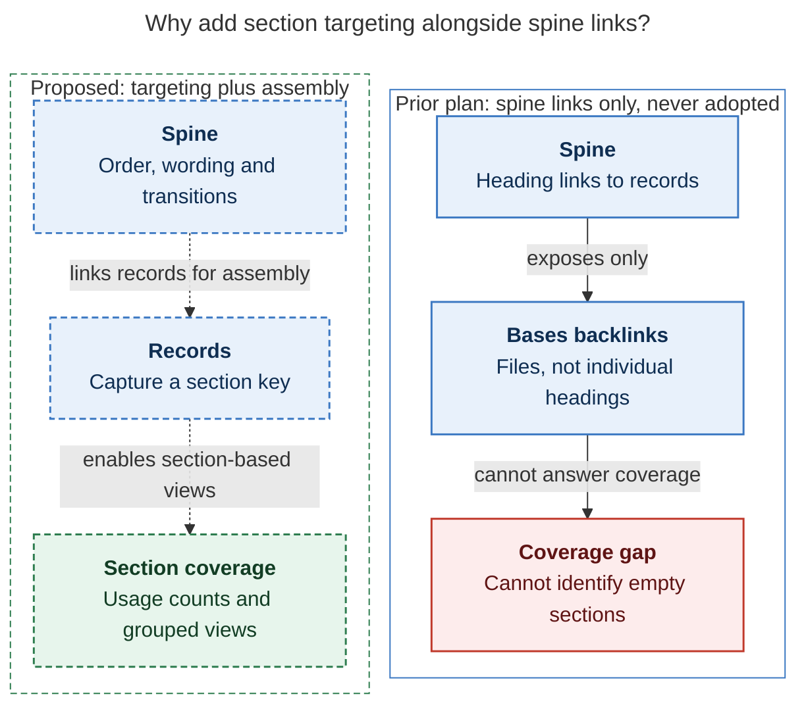
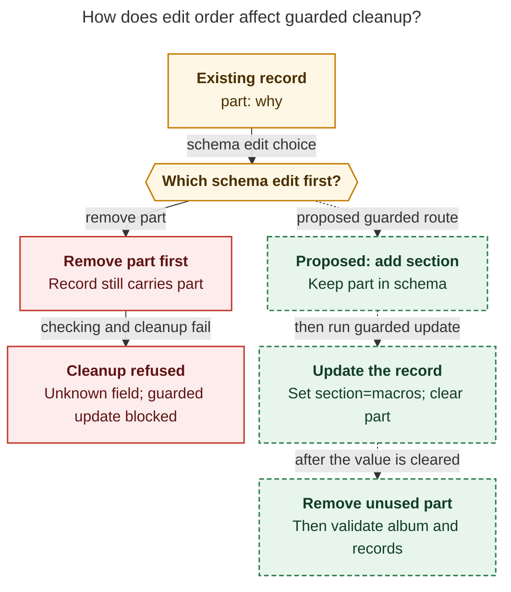

# A `section` field for the SASE Blog Zettel album: consolidated recommendation

> **Research query:** How should I add a new `record.section` property to the
> `~/bob/sase_blog_zettel.md` album note that names the blog-post section a record note
> targets, using a fixed set of values (changeable later by editing that file) built
> from the `^section-field` task in `~/bob/sase_blog.md`, plus any other related fields
> that are objectively useful? Is this plan a good idea, would a different approach be
> better, and which justified requirement adjustments (clearly called out) and final
> recommended solution follow?

![Infographic summarizing the proposed section schema: one optional section field with stable keys and editable labels, 13 proposed destinations (twelve from the task outline plus intro), index_facets [section, claim] to make targeting visible, a three-step migration to retire part, and keeping the schema small before writing](sase_blog_zettel_section_schema_infographic.png)

## Bottom line

**Yes, add `section` — all five researchers independently said yes.** It is a good
idea, with one honest caveat: it knowingly reverses the 2026-11-12 research's "no
`section` field" rule, and the reversal is justified ([details below](#the-reversal-of-the-prior-decision-is-justified)). The consolidated
recommendation:

1. **One flat, optional, scalar choices field** `record.fields.section` (each record
   then carries a top-level `section:` property — the literal spelling `record.section`
   is not a thing Bob supports). Short stable concept **keys**, short emoji **labels**
   that are freely editable, declared in outline order.
2. **13 values:** the twelve sections in the `^section-field` task plus **`intro`**
   (a [called-out addition](#requirement-adjustments-called-out)). "Why I use SASE" and "Conclusion" are deliberately left
   out as [open questions](#open-questions-for-bryan).
3. **Retire `part`** after migrating the one existing record. Keeping both placement
   fields creates a consistency rule Bob cannot check (3 of 5 researchers; the two
   dissents and a safe keep-`part` fallback are [noted below](#retire-the-part-field-and-the-dissent)).
4. **`index_facets: [section, claim]`** — without this the generated `[!records]`
   index never shows the new field.
5. **No other record fields.** Every candidate (`order`, `subsection`, `post`,
   `proof`, `words`, task link, heading link, `required: true`, `list: true`,
   `index_by`) fails the "hard to argue against" bar; [the rejection table below](#other-candidate-fields-all-rejected) merges
   all five audits.
6. **Implement as a direct YAML edit plus one `bob records update` backfill.** The
   guarded `bob albums update` envelope cannot write `index_facets`, so a hand edit is
   required anyway. There is a verified [migration-order trap](#the-migration-order-trap) (below).
7. **Then stop tooling and write.** The spine has 15 TODO stubs and ~190 words of
   prose, the album has one zettel with zero draft words, and this is at least the
   third research round on this album. The schema change is one sitting; the value is
   only realized by drafting.

## Is this a good idea? (verdict and critique)

### The reversal of the prior decision is justified

The 2026-11-12 research (`sase_blog_zettel_album_guide`, `sase_blog_drafting_in_records`)
explicitly rejected `section`, `order`, and `wave` so the article spine
(`sase_blog_contents.md`) would stay the only authority for sequence. That rejection
still holds for **order** — and this proposal does not touch it:

- **`section` is a targeting fact, not an order.** "This claim is meant for the Gate
  section" says nothing about where it sits within the section or where the section
  sits in the post. The spine keeps order, wording, and transitions. The album's
  choice order matches the outline by convention only; nothing reads it as an order.
- **The spine-link alternative never happened.** The prior plan was `→ [[zettel]]`
  lines under spine headings. The spine has none, and Obsidian Bases cannot see
  *which heading* links to a record (`file.backlinks` is file-level only), so that
  mechanism can never answer "which sections have no material?". A field filled at
  capture time (`- section:: gate`, with label-filtered completion) costs far less
  than a spine edit per capture — and will actually get used. Spine wikilinks remain
  the right *assembly* mechanism for placed material; the two complement each other.
- **It pays for itself immediately.** Index rows read like an annotated outline
  (`— 🚦 Gate · <claim>`), the Schema Card's choice chips show per-section usage
  counts (zero-count chips = sections with no material), and a Base view can group by
  section while drafting one.
- **The existing record is the proof of the gap.** `part: why` cannot say that
  "Prompts should be managed like code…" belongs under *Prompt language (macros)*.

[The targeting-and-assembly diagram](#figure-targeting-and-assembly) contrasts the
never-adopted spine-links-only plan, whose file-level backlinks cannot reveal empty
sections, with the proposed section field feeding coverage views while the spine keeps
assembly.

<div id="figure-targeting-and-assembly">



_Section fields make coverage visible; the spine keeps assembly and article order._

</div>

### Real risks, and how the design absorbs them

- **Outline churn.** The `^section-field` outline was rewritten repeatedly in one
  session on 2026-11-15 (a "What is an agent?" parent with three children appeared and
  was flattened away; "memory" and "The Demos" were added — vault git history, cld).
  Mitigation: keys name *concepts*, never headings or numbers. Rewording a heading is
  a label edit; reordering is a YAML line move; neither touches a record. Only a
  split/merge touches records, and at this scale that is minutes.
- **Premature taxonomy / competing outlines.** Four outline copies now exist: the
  task bullets, `sase_blog.md ## Outline` (stale June era), the spine's headings
  (stale October era), and soon the album choices. Mitigation: one vocabulary (album),
  one order and wording (spine); reconcile the spine in the same sitting and clear the
  task's bullet list ([follow-ups below](#follow-ups-outside-the-album-note)).
- **Forced misfiling.** A required field would make every raw seed, ⏭️ Later, and
  ✂️ Cut capture pick a section prematurely. Mitigation: optional; empty honestly
  means "no home yet", and a "Needs section" view surfaces those records.
- **Productive procrastination** (flagged independently by grk and gem). This edit is
  justified only if it ends in YAML plus a backfill, then writing.

### Alternatives considered and rejected (merged)

| Alternative | Why rejected |
| --- | --- |
| `section` + `subsection` pair (gem's recommendation) | Bob has no dependent enums: nothing stops `section: demos` + `subsection: gate`. Outvoted 4–1. gem's motivating UI fact is real but cosmetic (verified below): the *unfocused* Mac Capture choice-pill strip is a non-scrolling HStack that clips past ~6 pills, but the focused completion list scrolls and filters fine, which is the interaction that matters. |
| Hierarchy in keys (`what_gate`, `what_memory` — cdx) | Bakes today's hierarchy into keys Bob refuses to rename; the "What is an agent?" parent lasted less than a session. Labels and declaration order carry hierarchy more cheaply. |
| Number-prefixed keys (`s2_3_gate`) | Every reorder becomes a key rename plus record migration. |
| `link` field to spine headings (`[[sase_blog_contents#…]]`) | `bob articles` renumbers headings and does not repair links in frontmatter; not a fixed set; the spine lacks the new headings. |
| Free text with `suggest: true` | Not a closed set; drifts (`Gate` vs `gate` vs `What is a gate?`); zero completion candidates until each value is typed once. |
| Tags (`#section/gate`) or per-section folders | Not schema-checked or completed; albums treat nested folders as `record_outside_album`. |
| Spine `→ [[zettel]]` links only (the prior plan) | No capture-time ergonomics, no coverage view, heading-level backlinks invisible to Bases. Keep for assembly, not targeting. |
| Do nothing until the outline freezes | Loses validation and the coverage view exactly during the drafting phase that needs them. |

## Requirement adjustments called out

| # | Requirement | Adjustment |
| --- | --- | --- |
| A1 | Add `record.section` | Implemented as `record.fields.section` (schema) + `section:` (records); optional, scalar, no default. |
| A2 | Values from `^section-field` | Plus **`intro`**; minus "Why I use SASE" and "Conclusion" ([open questions 1–2](#open-questions-for-bryan)); task NOTEs absorbed into labels/records, not values. |
| A3 | (implicit) values mirror task wording | Keys are stable concept slugs; labels are short emoji text; `families` label updated to the current glossary term ("Sessions, clans & tribes") — revert is a free label edit. |
| A4 | Add other objectively useful fields | **None added.** Instead: retire `part` (with a stated keep-`part` fallback) and set `index_facets: [section, claim]`. |
| A5 | (implicit) only the album note changes | Also migrate the one record (required for a clean `records check`), optionally edit the `.base`, and reconcile the spine ([follow-up 1](#follow-ups-outside-the-album-note)). |
| A6 | (new) | One outline **vocabulary** (album) and one outline **order/wording** (spine); retire the other two outline copies. |

## Recommended album frontmatter

cld scratch-verified this exact shape (`albums check` and `records check zettel` at
0 errors); the lead changed only the `families` label (see [adjustment A3](#requirement-adjustments-called-out)). Only
`index_facets` and the `part` → `section` block differ from today's file.

```yaml
---
parent: "[[sase_blog]]"
type: "[[album]]"
summary: Topic-sized pieces of my SASE posts, one claim per record, in my own voice.
emoji: 📇
created: 2026-11-12T13:54:08-0500
index_facets: [section, claim]
record:
  noun: zettel
  label: Zettel
  dated_notes: true
  fields:
    status:
      required: true
      values:
        seed: 🌱 Seed
        draft: ✍️ Draft
        ready: ✅ Ready
        placed: 📌 Placed
        later: ⏭️ Later
        cut: ✂️ Cut
    claim:
      required: true
    section:
      values:
        intro: 🪝 Intro
        what: 🧱 What is SASE?
        macros: 📜 Prompt language (macros)
        turn: 🔁 Agent turn
        gate: 🚦 Gate
        families: 👪 Sessions, clans & tribes
        memory: 🧠 Memory
        plan: 🗺️ Plan & artifacts
        project: 📁 Project
        automation: ⚙️ Automation (service)
        demos: 🎬 The Demos
        not_ready: 🛑 Why SASE is still NOT ready
        future: 🔮 Future Work
---
```

Notes on the shape:

- Omit `required`, `default`, `list`, and `suggest` — an optional scalar with a closed
  key set is exactly the request.
- Keep `index_facets` in **inline** `[section, claim]` form. cdx found that Bob's
  top-level list parser mis-reads an unindented block sequence (treats it as no
  explicit facets), so edit the line in place rather than reserializing the file.
- No YAML comments in the frontmatter: Obsidian's Properties UI may drop them on
  rewrite. Declaration order carries the outline.
- `what` is for overview/transition material about SASE as a whole — not an
  "undecided subsection" bucket (leave `section` empty for undecided).
- The task's NOTEs are absorbed, not minted as values: "include artifacts" lives in
  the `plan` label; the "POTENTIAL FIRST LINE" belongs in the eventual `not_ready`
  record's draft or the spine, not the schema.

## Value-set rationale, additions, and omissions

| Decision | Basis |
| --- | --- |
| Twelve task-derived values, flattened | The task's own four top-level bullets plus the eight "What is SASE?" subsections. Flat is Bob's only choices model; parent stays selectable for whole-post-level claims. |
| **Add `intro`** (adjustment, 3 of 5 researchers) | The spine's only real prose is a 190-word lede; `^intro-v1` exists; old `part` had `hook`; the Requirements list has intro-specific bullets. Omitting it strands the one part of the post that is actually underway. |
| **Omit "Why I use SASE"** (open question 1) | Absent from every iteration of the task outline; the move from "why (not) use it" to "what it is / is it ready" reads deliberate. If wanted: add `why: 🙋 Why I use SASE` between `intro` and `what` — one YAML line, any time. |
| **Omit "Conclusion"** (open question 2) | Future Work appears to be the new closing section. If a separate close returns: `close: 🏁 Conclusion` — one YAML line. |
| **Label `families` as "Sessions, clans & tribes"** (adjustment) | Lead-confirmed: the sase glossary renamed "agent family" → "sase agent session". The post should ship current terminology; the historical name can be explained in prose. Reverting is a label edit costing nothing — the **key** stays `families` either way. |
| Short keys, emoji labels | Keys are immutable identities (renames refused); labels/emoji are freely editable and are what capture completion filters on. Matches the existing `status`/`part` style. Never let the Schema Card mint keys from headings (`what_is_a_prompt_language_macros`). |

"Fixed set" therefore means: a controlled vocabulary owned by this album at a given
moment. Adding a value or rewording a label is a YAML edit (or Schema Card
`choice.add`/`choice.set`). Removing or renaming a stored **key** is a migration:
retag affected records first (the Schema Card refuses removing a used choice — that
refusal is the safety net, not an obstacle).

## Retire the part field and the dissent

**Majority position (cdx, cld, lead):** `part`'s five values were minted from the old
spine (`hook`→lede, `why`→§1, `what`→§2, `why_not`→§3, `close`→§4) — it *is* a coarse
placement field, not an orthogonal rhetorical axis. Two placement fields invite
contradictions (`part: why` + `section: gate`) that nothing validates, and `part`'s
values are already stale against the new outline (no demos/future; why/close gone).
Coarse targeting survives: `what`, `demos`, `not_ready`, and `future` are themselves
values. One record uses `part`, so now is the cheapest moment this will ever be.

**Dissent (grk, mus):** `part` answers "what rhetorical job does this claim do?"
(a *why* argument can live inside the gate section) and its removal is irreversible
history. **Fallback if Bryan agrees with the dissent:** keep `part` optional and
untouched, and set `index_facets: [section, part, claim]` (the cap is exactly 3).
Nothing else in this recommendation changes. The lead still recommends retirement:
in fourteen months of use the field has been written once, as a placement.

## Other candidate fields all rejected

Merged audit:

| Candidate | Why it fails "hard to argue against" |
| --- | --- |
| `subsection` (choices or text) | Unenforceable pairing with `section`; flat keys already cover the hierarchy (4 of 5 researchers). |
| `order` / `rank` / `seq` (mus proposed) | The spine owns order — the one part of the 11-12 decision everyone reaffirms. Reordering would mean editing N records; the `[!records]` index cannot sort by it; Base formulas can order sections centrally with zero frontmatter churn. Overruled 4–1. |
| `post` / `target_post` | `status: later` already parks future-post material; the `## Later Posts` list is itself provisional. Revisit when a second post is actually drafted here. |
| `proof` / `media` / `sources` | Evidence is a mix of URLs, vault links, and local screenshot paths; no single `url`/`link` kind fits. Dated `## Notes` bullets already hold source + locator + explanation. |
| `words` / `target_words` / `wave` | Derived or task-execution metadata; goes stale; belongs on tasks in `sase_blog.md`. Rejected by the prior accepted research too. |
| Link to a `zd-*` task | Duplicates the task→record link the album guide already prescribes. |
| `anchor` / heading link | Brittle across `bob articles` renumbering; frontmatter links are not repaired. |
| `required: true` on `section` | Forces misfiling of seeds/Later/Cut; would also flag the existing record invalid until backfilled. Optional, with a "Needs section" view, is strictly better. Revisit only after the outline freezes *and* every record is backfilled. |
| `list: true` | A claim targeting two sections should be split, or is cross-cutting (Notes). Grouping uses only the first item anyway. |
| `index_by: section` | Subgroups render raw keys, alphabetically, and only inside a status group that exceeds 12 records. Facets already show the label on every row. Leave unset. |

## Implementation

### The migration-order trap

Scratch-verified by cld.

Removing `part` from the schema while the record still carries `part: why` makes
`bob records check` error (`unknown field part`), after which
`bob records update … -s part=` is *refused* ("not a Zettel field"). **Clear the
record's value before (or in the same edit as) removing the schema field.** [The
guarded-migration-order diagram](#figure-guarded-migration-order) traces both branches:
removing `part` first blocks cleanup, while Path B clears the record's value before
dropping the unused field.

<div id="figure-guarded-migration-order">



_In the guarded route, clear the record's part value before removing the schema field; removing the schema first blocks cleanup._

</div>

### Path A — one hand edit (fastest at one record; verified)

1. Replace the album frontmatter with the block above (Source mode).
2. In `sase_blog_zettel/prompt_management_macros.md`, replace `part: why` with
   `section: macros`.
3. `bob albums sync`, then `bob albums check` and `bob records check zettel` — expect
   0 errors. Sync regenerates the index with the new facet.

### Path B — guarded commands (each step validated and committed; verified)

1. Hand-edit the album: add the `section` block (keep `part` for now) and set
   `index_facets: [section, claim]`. (This part must be a hand edit: the guarded API
   cannot write `index_facets`.)
2. `bob records update zettel prompt_management_macros -s section=macros -s part=`
   — sets `section`, clears `part`, and rebuilds the index in one write. Dry-run with
   `-d` first if you want to inspect.
3. Remove `part`: Schema Card (**⊞ Schema** → Part → `Ctrl+D` → Enter; previews
   `remove field "part" (was unused)`), or `bob albums update sase_blog_zettel` with
   `{"schema_version":1,"expect":"<fingerprint from bob albums list -f json>","ops":[{"op":"field.remove","field":"part"}]}`.
4. `bob albums check` and `bob records check zettel`.

Backfill note: `section: macros` is the claim-driven assignment (4 of 5 researchers).
cdx's conservative alternative — honoring the record's explicit `part: why` — only
exists if you adopt a `why` value (open question 1).

### Capturing with the new field (scratch-verified)

```text
A gate is plan mode, generalized @sase_blog_zettel/^gate-generalizes-plan-mode
- status:: seed
- claim:: Plan mode is one instance of a deeper primitive: a gate that pauses an agent until a human or rule answers.
- section:: gate
```

Dry-run plans `section: gate`; the index row renders `— 🚦 Gate · Plan mode is…`; an
unknown value (`gates`) is refused with the full key list. In Mac Capture, type
`- section:: ` and pick from the label-filtered menu; because the field is optional it
sits under the `More` disclosure until you start typing it — that is the accepted cost
of not forcing misfiling.

### Base view (optional, recommended)

Bob's index stays grouped by status, so "show me everything targeting the Gate
section" belongs in `sase_blog_zettel.base` (a hand edit; Bob never touches it). Add
`section` and `claim` columns to the existing view, plus:

```yaml
  - type: table
    name: "🧭 By section"
    filters:
      and:
        - note.status != "cut"
        - note.status != "later"
    groupBy:
      property: section
      direction: ASC
    order: [formula.name, status, claim]
    summaries:
      formula.name: Count
```

**Do not add `groupOrder`** to force outline order: Bases *hides* any value missing
from that list, so a section added later only in the album would silently vanish from
the view (independently flagged by cld and cdx). Groups will sort by raw key
alphabetically; for outline-ordered counts use the Schema Card chips or `bob albums
list -f json`. If you later want a numbered, outline-ordered storyboard, gem's report
(filed beside this one) contains a full `.base` with `section_slot` formulas and a
"Needs Section" view — worthwhile once records exist, premature today. One unknown
remains: how Bases renders records with an empty `section` in a grouped view is
undocumented and was not checked in the Obsidian UI — verify when you open the Base.

## Follow-ups outside the album note

1. **Rewrite `sase_blog_contents.md` headings to the glossary outline in the same
   sitting** (stubs are fine; `bob articles` renumbers). grk would make this a hard
   precondition; the consolidated view is softer — concept keys don't break if the
   spine lags — but doing it same-day is what keeps the field from becoming a fourth
   competing outline.
2. **Clear the `^section-field` bullet list and close the task** once the field
   lands. Move its two NOTEs and the "POTENTIAL FIRST LINE" into the spine or the
   matching records.
3. Optionally archive the stale `sase_blog.md ## Outline` (XPrompts/ACE era).
4. **Then write.** First concrete step: dictate the `## Draft` for
   `prompt_management_macros` before touching the schema again.

## Open questions for Bryan

1. **"Why I use SASE":** folded into the intro on purpose, or missing from the task by
   accident? If wanted: `why: 🙋 Why I use SASE` between `intro` and `what`.
2. **Conclusion:** is Future Work the close, or add `close: 🏁 Conclusion`?
3. **`part`:** accept retirement (recommended), or keep it as a rhetorical-role field
   with `index_facets: [section, part, claim]`?
4. **`families` label:** current term ("Sessions, clans & tribes", recommended) or
   your task wording ("Families, clans & tribes")? Free to flip either way.

## Scope and method

The lead researcher restated the task as: "Give `~/bob/sase_blog_zettel.md` a new
`record.section` property naming the blog-post section each zettel targets, with a fixed
value set built from the `^section-field` task in `~/bob/sase_blog.md` (editable later
by editing the album file), plus any other fields that are objectively useful. Critique
the plan, make justified adjustments (clearly called out), and end with a recommended
solution."

Consolidated by the lead researcher on 2026-11-16 from five independent reports (cdx,
cld, grk, mus, gem — filed beside this report) plus [the lead's own verification](#ground-truth) against
the live vault, bob-cli HEAD, the `sase` glossary, and `bob-mac-capture` source. All
five researchers verified write mechanics in scratch vaults only; nothing in `~/bob`
was changed by this research.

## Ground truth

Verified live by the lead, 2026-11-16:

- `~/bob/sase_blog_zettel.md`: fields `status` (required choices, 6), `claim`
  (required text), `part` (optional choices: `hook`/`why`/`what`/`why_not`/`close`),
  `index_facets: [part, claim]`, noun `zettel`, `dated_notes: true`. **One record.**
- `~/bob/sase_blog_zettel/prompt_management_macros.md`: `status: seed`, `part: why`,
  claim "Prompts should be managed like code…", empty `## Notes`.
- `^section-field` (`sase_blog.md:31`, Next & In Progress, created 2026-11-14): "What
  is SASE?" with a NOTE that its eight sub-bullets (prompt language (macros), agent
  turn, gate, agent families/clans/tribes, memory, plan — "should include artifacts!",
  project, automation (service)) are subsections; then The Demos; Why SASE is still
  NOT ready? (with a potential first line); Future Work.
- `~/bob/sase_blog_contents.md` still carries the **older** outline (§1 Why I use
  SASE, §2 What is SASE? with subsystem headings 2.1–2.7, §3 Why NOT, §4 Conclusion),
  ~190 words of real lede prose, 15 TODO stubs, and **no** zettel links.
- `~/bob/sase_blog_zettel.base`: generic starter table (name + status only).
- Bob contract (docs/records.md + source, convergently verified by three scratch-vault
  runs): choices fields store the **key**, capture completion shows **labels** in
  schema order and inserts the key (unknown values exit 2); `index_facets` is an
  explicit list capped at **3** and does not auto-include new fields; the `[!records]`
  index always groups by `status` when present; `index_by` subgroups only fire past 12
  records per group and render **raw keys alphabetically**; `bob albums update` /
  Schema Card cannot write `index_facets`, auto-derives verbose keys from labels
  (`why_sase_is_still_not_ready`), refuses key renames, and refuses removing used
  fields/choices; record writes rebuild the index in the same transaction; `albums
  update` leaves `.base` files byte-identical. No other vault album declares
  `section`, so there is no cross-album storage clash. `section` is a legal,
  non-reserved field name.
- Terminology (lead-verified in the `sase` repo, `docs/reference/glossary.md:568-576`):
  a sase agent session "was formerly called an agent family" — gem's claim confirmed.

## How the five reports were reconciled

| Disagreement | Positions | Resolution |
| --- | --- | --- |
| Field shape | Flat ×4 vs `section`+`subsection` (gem) | Flat. Pairing is unenforceable; the pill-clipping motivation is real but cosmetic (lead-verified: only the unfocused strip clips; completion scrolls). |
| Key style | Short slugs (cld/grk/mus/gem) vs `what_`-prefixed (cdx) | Short slugs; prefixes freeze a hierarchy that churned within one session. |
| `part` | Retire (cdx/cld) vs keep (grk/mus; gem keeps but demotes) | Retire, with the dissent and a zero-risk fallback documented. |
| `intro`/`why`/`close` | cdx all three (+`hook`); cld `intro`; gem `intro`+`close`; grk/mus none | `intro` only (strong evidence); `why`/`close` as open questions with one-line adds. |
| Extra fields | `order` (mus), `subsection` (gem), none (×3) | None; both proposals individually rebutted above. |
| `index_facets` | `[section, claim]` ×2, `[section, part, claim]`, `[section, subsection, claim]`, unchanged (mus) | `[section, claim]` (follows from retiring `part`); mus's "leave it" loses because an explicit list never auto-includes the new field. |
| Write path | YAML (cld-A/grk/gem) vs envelope (cdx/mus) | Hybrid: YAML (forced by `index_facets`) + guarded record update; both scratch-verified. |
| Backfill value | `macros` ×4 vs `why` (cdx) | `macros`, claim-driven; `why` presupposes a key the set doesn't have. |
| Terminology | gem's "agent family → sase agent session" | Confirmed by the lead at `sase` `docs/reference/glossary.md:576`; label adjusted, key unaffected. |

## Sources

- Live vault (lead, read-only, 2026-11-16): `~/bob/sase_blog_zettel.md`,
  `~/bob/sase_blog_zettel/prompt_management_macros.md`, `~/bob/sase_blog.md`
  (`^section-field`), `~/bob/sase_blog_contents.md`, `~/bob/sase_blog_zettel.base`.
- Lead verification: bob-cli workspace checkout `docs/records.md` (facet cap, explicit
  list semantics), `src/native/albums/grouping.rs` (`group_field`, `LARGE_GROUP = 12`);
  `sase` repo `docs/reference/glossary.md:568-576` (agent-family rename);
  `bob-mac-capture` `Sources/BobMacCapture/RecordCardView.swift:652-667`
  (non-scrolling `schemaChoiceCapsules` vs scrolling `valueScroller`).
- The five researcher reports filed beside this file (`__cdx`, `__cld`, `__grk`,
  `__mus`, `__gem`), each with its own source log; grk's Mermaid figures accompany its
  report. Scratch-vault verification of every write step appears in cld (bob 0.5.0,
  both migration paths, the ordering trap), cdx (guarded-envelope dry runs, parser
  pitfall, completion probes), and gem (`index_by` raw-key/alphabetical behavior,
  4-facet refusal, backfill command).
- Prior research cited through the reports: `research:202611/sase_blog_zettel_album_guide.md`,
  `research:202611/sase_blog_drafting_in_records/sase_blog_drafting_in_records.md`,
  `research:202611/sase_blog_zettel_wave_captures.md`.
- Obsidian: Bases [views](https://obsidian.md/help/bases/views) /
  [syntax](https://obsidian.md/help/bases/syntax) /
  [functions](https://obsidian.md/help/bases/functions) (groupOrder hiding, grouping),
  [Properties](https://obsidian.md/help/properties).
