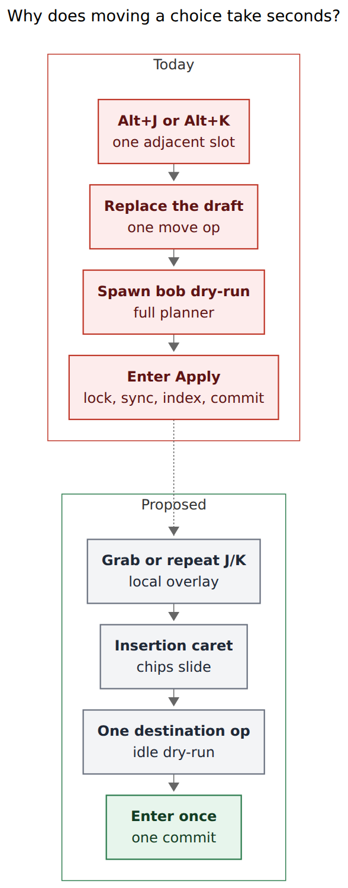
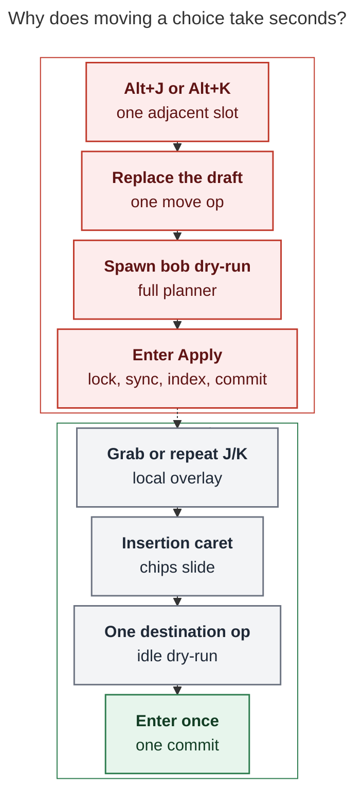
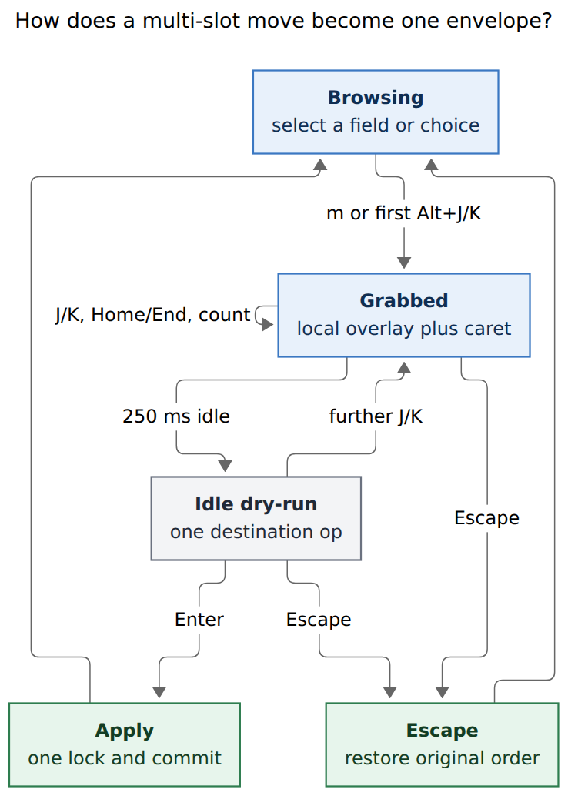
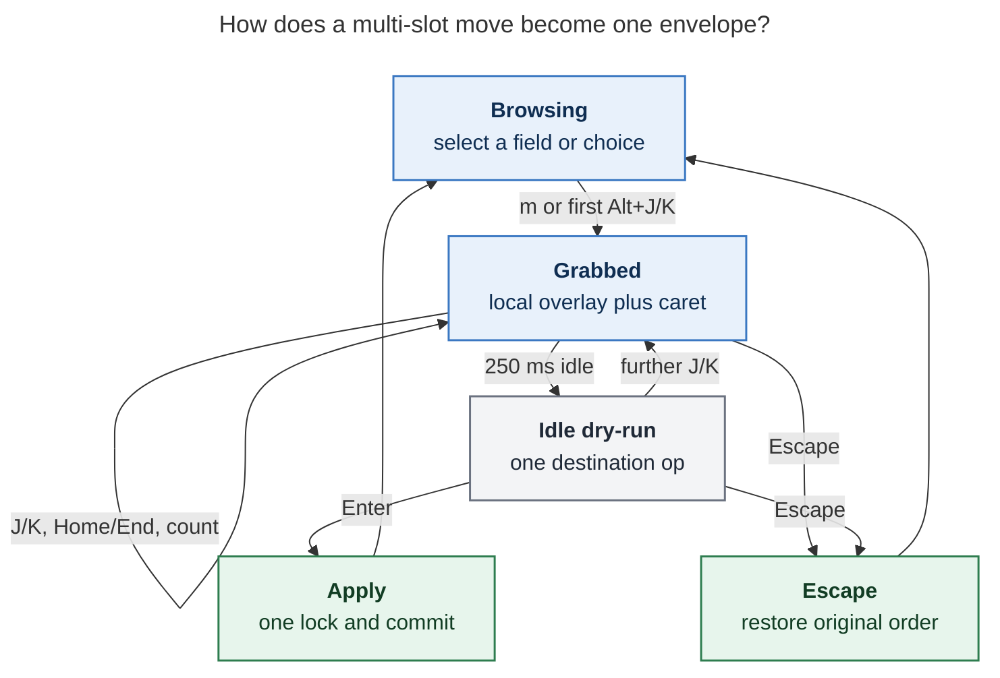
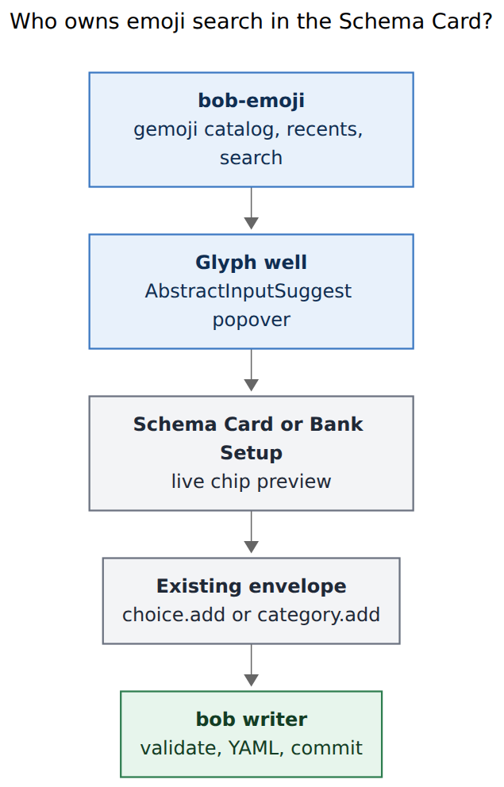
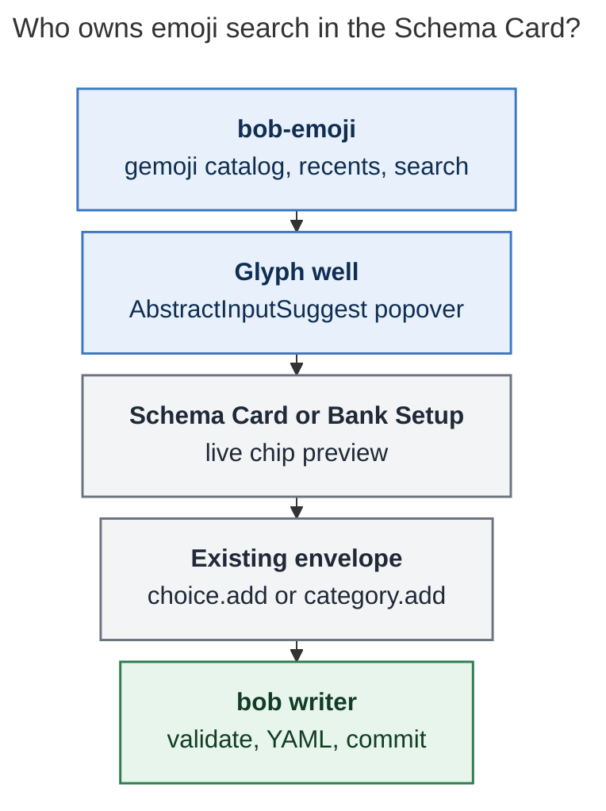

# Schema Card emoji completion and multi-slot reorder

> **Research query:** Make the album Schema Card and bank Setup Card easier to use: excellent emoji completion when prompting for an emoji, and a fast, previewable way to move fields and choices many slots. Critique the request, adjust requirements where justified, and recommend an intuitive, reliable, and beautiful design.

## Bottom line

This is a good idea, and the cards are the right surface. The current editors already know how to add a choice, stamp an emoji, and ask bob to move something. They fail as *spatial* tools. Reorder is a one-slot hop that waits on a full vault planner. Emoji is a blank text box sitting next to a catalog the vault already owns.

**Do not make Apply faster as the primary fix.** One Alt+J today queues a single adjacent `choice.move` / `field.move` / `category.move`, paints consequence text, leaves the chips where they were, and asks Enter to take the vault lock, pre-sync, replan, rebuild the generated index, and commit. The next hop cannot even be composed: `schemaMoveSelected` reads the live model, `setDraft([op])` replaces the whole draft, and the bank card opens a confirm stage per neighbor. Moving a Section chip twelve slots on `sase_blog_zettel` is twelve planner runs and twelve commits. YAML is faster because a YAML line move is one edit. That is the bar.

**Do compose locally, apply once.** Grab the selected chip, slide a local overlay with an insertion caret, idle-dry-run one destination op, Enter once. Reuse bob-emoji’s gemoji catalog through an Obsidian `AbstractInputSuggest` glyph well. Keep bob as the only writer. Keep `y` as the YAML hatch. Ship no CLI break in v1 — `field.move` / `choice.move` already take an absolute `position`, and `category.move` / `group.move` already take a `before` / `after` anchor. The UI underuses those contracts.

The rest of this report is the design that makes that feel obvious.

## What the screenshot actually shows

The 2026-11-16 capture (`~/tmp/screenshots/20261116_134836.png`) is the album Schema Card on `sase_blog_zettel`, mid “Add choice” stage:

- Title trail `Zettel · dev › SASE = … › sase_blog › SASE Blog Zettel`.
- **Status** chips already carry glyphs (`🌱 Seed`, `📝 Draft`, `✅ Ready`, …).
- **Claim** is a required text field.
- **Section** is the motivating list: roughly fifteen emoji chips (`🚪 Intro`, `❓ What is SASE?`, `📜 Prompt language (macros)`, … through `🏁 Conclusion`). The field *sub-groups the index*, so choice order is the index’s grouping order.
- The stage is two ordinary text inputs, **Choice label** and **Choice emoji**, with the emoji field focused and empty. There is no catalog, no recents, no colon hint, no live chip.
- The toolbar is a wrap of twelve-plus actions: Edit, Add field, Add choice, Toggle required, Toggle suggest, Move up, Move down, Remove, YAML, Undo, Cancel stage, Close.
- The footer already teaches `⌥J/K move`. Those keys exist. They move one slot.

This is the same album prior research treated as a YAML job because “reordering is a YAML line move” and the Schema Card was too painful to use for a fifteen-choice shuffle (`research:202611/sase_blog_zettel_section_schema/sase_blog_zettel_section_schema__final.md`). The card shipped. The spatial work did not.

## Is this a good idea?

Yes, with the mechanism below. The Schema Card was the right product bet in `research:202611/album_record_schema_ux/album_record_schema_ux__final.md`: Properties cannot edit nested `record:` YAML, bob is the only writer, YAML stays first-class via `y`. That bet assumed reorder and re-emoji would be pleasant once the writer existed. They are not.

A different approach I considered and rejected:

| Approach | Why it loses |
| --- | --- |
| Teach people to keep using YAML for order | The card already exists; YAML-is-faster is a bug report against the card, not a workflow. |
| Make `bob albums update` skip lock / pre-sync / index rebuild on every Apply | Correctness of the generated `[!records]` index and the fingerprint `expect` contract matter more than shaving a slow hop. Measure later. |
| Auto-apply each Alt+J/K | Turns a twelve-slot shuffle into twelve commits and twelve undo entries. Worse. |
| Vendor emoji-mart / a community picker | A second catalog, a mouse grid, and a desktop-only detour. bob-emoji already ranks ~1870 gemoji aliases, tags, descriptions, and 30 recents. |
| Duplicate gemoji inside ledger-tools | Two catalogs drift. Recents would not follow the user from Markdown into the card. |
| New CLI ops (`field.reorder`, `choice.nudge`, `--fast`) | v1 needs none of them. Absolute position and neighbor anchors already exist. `cli_rules` stay quiet. |
| Drag-only reorder | Keyboard-first vault. WCAG 2.5.7 also wants a non-drag path. Drag is a follow-up on top of grab mode. |

The request is two symptoms of one architectural cut: the card treats every key as a writer gesture. Reorder and emoji search are *editor* gestures. The writer should see the settled intent.

## Critique of the requested plan

The request as stated is: (1) excellent emoji completion when prompting for emojis, (2) move fields/choices many spots with a great preview, (3) fast performance because Apply currently takes a few seconds per one-slot hop. Lead the design so it is intuitive, reliable, and beautiful.

That problem framing is right. Three implied solutions inside it are not.

**“Faster Apply” is the wrong knob.** Apply is slow because a *changed* `bob albums update` / `bob bank config update` takes the shared vault lock, pre-syncs, replans against the original `expect`, rebuilds the generated index or `bank.md`, verifies the fingerprint, and makes one scoped commit (`docs/records.md`, `docs/bank.md`, `src/native/albums/cli.rs`). The plugin then revalidates. That cost is honest for a write. It is dishonest to pay it twelve times to slide `🚪 Intro` next to `🏁 Conclusion`. Dry-run is not free either: it “previews the entire intended edit, including the index diff” (`docs/records.md`). A Section / `index_by` / `index_facets` order change still rebuilds grouping in the planner. Doing that per key, then again on Apply, is the stutter.

**“Move more than one slot” is already in the protocol.** Album `field.move` / `choice.move` take a zero-based `position`. Bank `category.move` / `group.move` take `before` or `after` any neighbor, not only the adjacent one. The UI is what is adjacent-only:

```541:556:sase/repos/linked/bob-plugins/plugins/bob-ledger-tools/src/241y-plugin-album-schema-card.js
  schemaMoveSelected(direction) {
    const target = this.schemaSelectedTarget();
    // ...
      const next = index + direction;
      if (index < 0 || next < 0 || next >= fields.length) return;
      this.schemaQueueOp({ op: "field.move", field: target.field.key, position: next }, target.key);
    } else {
      const choices = target.field.choices || [];
      const index = choices.findIndex((choice) => choice.value === target.choice.value);
      const next = index + direction;
      if (index < 0 || next < 0 || next >= choices.length) return;
      this.schemaQueueOp({ op: "choice.move", field: target.field.key, value: target.choice.value, position: next }, target.key);
    }
  }
```

`schemaQueueOp` then `setDraft([op])`, which **replaces** the draft and invalidates Apply until a new dry-run (`242aa-plugin-guarded-update-session.js`). Positions are computed against `schemaModel`, not against a pending overlay. A second Alt+J before Apply recomputes the same neighbor hop. Plugin tests encode that adjacent-only envelope (`scripts/test-ledger-tools-album-header.cjs`).

Bank is stricter. `bankSetupCardCategoryMoveOp` emits `before`/`after` the immediate neighbor, and `beginGesture("move")` opens a confirm stage (“Review bob's consequence, then press Enter to apply.”) so you cannot even mash Alt+J.

**Consequence text is not a reorder preview.** Chips are painted from `schemaModel` via `host.empty()` on every session `onChange` (`paintSchemaCard` in `241y-plugin-album-schema-card.js`, `albumSchemaCardBuildEl` in `241y-plugin-album-schema-card-dom.js`). The chips do not slide. The user watches “Previewing this edit…” and a sentence. That is why the screenshot’s Section row looks like a finished layout while the only live work is an empty emoji input.

**Emoji completion is an attachment gap, not a missing feature.** bob-emoji already searches the gemoji catalog with alias-prefix, substring, tags, description, recents (30), and a popular empty-query list (`plugins/bob-emoji/src/030-emoji-model.js`). The trigger is editor-only: `(^|\s):query` through `EditorSuggest` (`emojiFindTrigger`). The Schema Card’s Choice emoji control is a plain `<input type="text">` (`albumSchemaControl` in `242c-plugin-album-schema-edit.js`). Bank new-category is one label field; Bryan is expected to type `🍔 Fast food` by hand (`bankCategoryNewDraftOp` → `category.add` `{label}`). There is no public `attach` helper. Helpers are exported on `module.exports.helpers` for tests, not for other plugins.

**The toolbar is already too loud.** Adding Move to top / Move to bottom / Pick emoji buttons would make the wrap in the screenshot worse. Keys plus a grab affordance beat more chrome. `m` is free in the Schema Card keydown (`a`, `c`, `!`, `s`, `y`, `u` are claimed; `j`/`k` without Alt already move *selection*).

## Called-out requirement adjustments

These change the request as written. Each is intentional.

1. **“Faster Apply” becomes “compose locally, apply once.”** Pay the lock / pre-sync / index / commit cost for the settled destination, not for each neighbor. Optional apply-speed work (skip pre-sync when generation is unchanged; skip index rebuild when the op cannot change grouping) is a measured follow-up, not v1.
2. **The product preview is spatial.** Chips slide. An insertion caret marks the landing slot. Consequence text from bob is the backup line after idle, not the thing you watch while holding Alt+J.
3. **Do not auto-apply each hop.** Enter (or the existing Apply action) commits one destination op. Escape restores the original order. One gesture, one scoped commit, one Undo — the writer contract from the albums research stays.
4. **Do not duplicate gemoji, and do not spawn emoji-mart.** Extend bob-emoji with a small public `search` / `attach` / `remember` API. Ledger-tools attaches. If bob-emoji is disabled, the well stays a paste target with a one-line hint.
5. **Colon is optional in a dedicated emoji field.** Markdown `:$` after whitespace is the right trigger in a note. Inside Choice emoji, typing `fire` or `:fire` both search. A leading colon is stripped, never required. Paste of a glyph still wins.
6. **Unify album and bank glyph wells.** Album already splits `choiceEmoji` from the label and sends `choice.add` `{label, emoji?}`. Bank still sends a combined `category.add` `{label}`. The well is shared; the envelope stays bank-shaped. Edit-category uses the same well against `category.set` `{set:{label}}` with the combined string bob already splits.
7. **Bank moves pass a destination anchor**, not only the adjacent neighbor. Grab mode on the Setup Card must not open a second confirm stage per hop. Enter applies once, same as album.
8. **Do not skip the index rebuild when Section / `index_by` / `index_facets` order changes.** Those fields *group* or *sub-group* the generated index (the screenshot says so on Claim and Section). A fast path that leaves grouping stale is a correctness bug. Skip-index is only for ops that cannot change grouping, and only after measuring.
9. **Keep Apply gated on a matching successful preview.** Local visual preview is immediate and does not wait on bob. The writer session still refuses Enter until the idle dry-run of the destination op succeeds (`createGuardedUpdateSession`). If the user hits Enter during the 250 ms debounce or in-flight preview, wait for that preview, then apply; do not apply a stale neighbor hop.
10. **v1 is one destination move, not an arbitrary multi-edit compose.** Mixing “move Section, then retitle Claim, then add a choice” in one overlay is a different product. Grab is a move session. Other gestures still replace the draft as they do today.
11. **Grab uses `m`, and the first Alt+J/K also grabs.** Repeated Alt+J/K after grab move the overlay only. Count prefix `5⌥K` and Home/End are in v1 because a fifteen-choice Section is the motivating list. Hold-repeat is allowed only because the hop is local.
12. **Selection stays key-based**, same lesson as `decisions:relation-card-tab-accepts-ctrl-d-hides`. The carried chip is identified by field key + choice value (album) or category/group/rule identity (bank), never by a shifting DOM index.
13. **Do not full-rebuild the card DOM on every hop.** `host.empty()` on each `onChange` is why even a successful local reorder would flash. Grab paints an overlay: lift the chip, FLIP the others (~120 ms), update the caret. Rebuild from the report after Apply.
14. **Album-level `emoji` is out of v1.** `album.set` may only `set`/`unset` `label`, `plural`, `dated_notes` (`src/native/albums/update/ops.rs`). The album glyph in the title is the note’s scalar `emoji` property. A later `album.set` emoji op is a CLI change and a different decision.
15. **YAML `y` stays.** No field/choice key rename in this work. The teaching refusals from the albums research stay YAML-gated.
16. **No new CLI flags and no protocol break in v1.** Plugin work plus a small bob-emoji export. If destination-position tests uncover a remaining-list vs current-list mismatch between `field.move` and `choice.move`, fix with coverage in bob-cli — that is a writer bug, not a new op.
17. **Pointer drag is a plus, not the v1 definition of done.** Keyboard grab satisfies WCAG 2.5.7’s demand for a non-path-based alternative. Drag can share the same overlay in a follow-up.

## How the current editors actually work

### Album Schema Card

Keyboard-first modal (`AlbumSchemaCardModal`). One gesture at a time. Stages collect typed intent (`choice-add`, `choice`, `field-add`, …). Safe ops queue through `schemaQueueOp` → guarded session → debounced `bob albums update -d` (250 ms) → Enter `session.apply()`.

Move keys: Alt+J down, Alt+K up, matching the footer. Plain `j`/`k` and arrows move *selection*, which is correct and must stay.

Choice emoji is a separate string, sent as `op.emoji` on `choice.add` / `choice.set`. Labels on disk are combined with bob’s `split_icon` convention (leading non-ASCII-alnum run is the icon, `src/native/albums/output.rs`). The card already splits them for editing via `albumSchemaChoiceParts`. Completion is the missing piece, not storage.

### Bank Setup Card

Same guarded session, different envelope. Categories, groups, rules, accounts. Move is a confirm-stage gesture built from adjacent `before`/`after` (categories, groups) or adjacent `position` (rules). New category is one label string; emoji is not a field.

### Shared writer rules worth keeping

- Plugin never writes schema YAML.
- Fingerprint `expect` guards the file.
- Dry-run, then apply the previewed envelope.
- One envelope is one commit; inverse ops feed Undo.
- Apply is inert until `canApply` on the current revision.

Grab mode must keep all five. It only changes *when* the draft is set: after the overlay idles on a destination, not on every key.

## Why one-slot moves feel slow

**Reader question:** Why does moving a choice take seconds?

**Answer:** Each adjacent key replaces the draft, spawns a full bob dry-run, leaves the chips unmoved, and Apply then locks, syncs, rebuilds the index, and commits. The proposal composes locally, dry-runs one destination, and commits once.



Rendered size: 391.516 × 1000 px; fit scale: 89.3%. Mermaid CLI `@mermaid-js/mermaid-cli@12.0.0`.



Two extra cuts of the same wound:

- **Selection vs model.** Alt+J does not move the selected chip in the painted model, so the next press cannot aim further down the list.
- **DOM rebuild.** Session `onChange` empties the dialog. Even a 50 ms dry-run would flash the stage focus. Grab must stop calling `paintSchemaCard()` per hop.

## Recommended design: grab-mode reorder

**Reader question:** How does a multi-slot move become one envelope?

**Answer:** Browsing becomes grabbed with `m` or the first Alt+J/K. While grabbed, motion keys change only a local overlay. An idle dry-run arms Apply. Enter writes one destination move. Escape restores the original order.



Rendered size: 491.65 × 690 px; fit scale: 100.0%. Mermaid CLI `@mermaid-js/mermaid-cli@12.0.0`.



### Contract

| Gesture | Effect |
| --- | --- |
| Select a field or choice (existing `j`/`k` / arrows) | Browse. No draft. |
| `m`, or the first Alt+J / Alt+K, or Move up / Move down | Enter grab. Lift that chip. First Alt+J/K also steps one slot. |
| Alt+J / Alt+K / J / K / arrows while grabbed | Move the overlay one slot among siblings. Repeat-key coalesces. |
| `5` then Alt+K | Step five slots (count prefix, vim-shaped, capped at the list edge). |
| Home / End | First / last sibling slot. |
| Idle 250 ms | `setDraft` **one** destination op; bob dry-runs; consequence line updates; Apply arms. |
| Further motion | Overlay moves immediately; draft invalidates; caret follows; no “Previewing…” flash per key. |
| Enter, or Apply, once `canApply` | Existing apply path. One lock, one index rebuild if grouping changed, one commit, one Undo. |
| Escape | Restore original order, clear draft, leave grab. A second Escape closes the card, matching today’s dispatch. |
| Click another target, `c`, `a`, `⌃D`, … | Leave grab as Escape would, then run that gesture. Never silently keep a pending move under a different edit. |
| Same destination as start | Treat as no-op: clear draft, leave grab, no Apply. |

Bank: same state machine on categories within a group, on groups as blocks, and on rules. Destination op uses `before`/`after` of the overlay neighbor (category/group) or the overlay `position` (rule). Do not call `beginGesture` per hop.

### Overlay math (keep this in tests)

Identify the carried row by stable key. Build the sibling list from the live model once at grab-start (a snapshot). `from` is the snapshot index. Each step updates `to` in `0..n-1`. Paint siblings in snapshot order with the carried row spliced to `to`.

When idle, emit:

- Album field: `{op:"field.move", field, position: to}`
- Album choice: `{op:"choice.move", field, value, position: to}`
- Bank category: `{op:"category.move", key, before|after: neighborKey}` where the neighbor is the overlay occupant of the slot the carried row is inserting against
- Bank group: `{op:"group.move", group, before|after: neighborGroup}`
- Bank rule: `{op:"rule.move", index, match_was, position: to}`

`field.move` removes the entry then indexes the remaining list; `choice.move`’s `move_choice` removes then `insert(to)` with `to` bounded by the original length (`src/native/albums/update/ops.rs`). Adjacent hops today send `index + direction` on the original list, so sending the overlay’s visual index `to` matches current tests for a one-slot move and extends them for first-to-last. Unit-test first-to-last, last-to-first, no-op same slot, and a 12-slot Section hop against both the composer and a bob dry-run.

### Beauty of the grab

The screenshot’s Section row is already a chip cloud. Grab should feel like picking one chip up.

- Carried chip: `translateY(-2px)`, 1 px accent ring, `cursor: grabbing`, `z-index` above siblings. Opacity of the vacated slot ~0.35, not gone — the hole teaches origin.
- Insertion caret: 2 px vertical bar in the accent color used by the focused Choice emoji ring in the screenshot, sitting in the gap before the landing neighbor. On a wrapping chip cloud the caret is a 2 px underline under the gap, not a page-tall beam.
- FLIP the other chips (~120 ms, `transform` only, `prefers-reduced-motion: reduce` snaps). No `host.empty()`.
- Stage strip while grabbed, replacing the empty “Add choice” panel:

  ```text
  Moving 🚪 Intro  ·  3 of 15  ·  between 📜 Prompt language and 🤖 Agent turn
  ```

  Live region (`aria-live="polite"`) announces that sentence, not “Previewing this edit…”.
- Footer swaps to `⏎ apply move   ⌥J/K step   5⌥K count   Home/End   m/esc cancel`. Toolbar Move up/down stay enabled during grab (they step the overlay). Apply appears once `canApply`.
- After Apply, chips are already where the overlay left them; the report refresh confirms counts. If bob refuses, snap back with the refusal line.

This is the opposite of today’s “press Alt+J, wait, read a sentence, press Enter, wait, see the chip finally jump one slot.”

## Why emoji prompting feels empty

The focused field in the screenshot is a rectangle. bob-emoji’s documented contract is: type a colon after whitespace in a Markdown editor, rank alias prefix → substring → tags → description, show recents then popular on empty query, Enter/Tab insert the glyph (`plugins/bob-emoji/docs/bob-emoji.md`). None of that is attached to a modal `<input>`.

Obsidian’s public class for this is `AbstractInputSuggest` (a `PopoverSuggest` bound to an HTML input), not `EditorSuggest`. Ledger-tools should not reimplement ranking.

## Recommended design: glyph-well emoji

**Reader question:** Who owns emoji search in the Schema Card?

**Answer:** bob-emoji owns the catalog, recents, and ranks. The Schema Card and Bank Setup attach `AbstractInputSuggest` to a glyph well. The chosen glyph rides the existing choice or category envelope. bob validates and writes.



Rendered size: 422.188 × 662 px; fit scale: 100.0%. Mermaid CLI `@mermaid-js/mermaid-cli@12.0.0`.



### bob-emoji public API (additive)

Today `module.exports.helpers` already exports `emojiSearch`, `emojiBuildIndex`, `emojiRecordRecent`, `BobEmojiSuggest`, … for the plugin’s own tests. Promote a stable, tiny surface other Bob plugins may call through `app.plugins.plugins["bob-emoji"]`:

```js
{
  search(query, { limit } = {}) -> rows,   // same ranks as the editor menu
  attach(inputEl, { onPick, emptyRecents = true }) -> { close(), destroy() },
  remember(row),
  recents(),
}
```

`attach` constructs an `AbstractInputSuggest` whose `getSuggestions` calls `emojiSearch` on the live index and recents. `selectSuggestion` writes the glyph into the input, calls `onPick`, and `remember`s. Empty query shows recents then popular, matching the editor. Disabled plugin: `attach` is absent; the well still accepts paste.

Do not require a colon in `getSuggestions`. Normalize by stripping a single leading `:`. Keep the editor trigger unchanged (`(^|\s):query`) so Markdown typing does not shift.

### Glyph well chrome

Replace the long “Choice emoji” text input in the screenshot with a well plus a short search field:

```text
Choice label   [  Prompt language (macros)           ]
Choice emoji   [🌱]  fire█
               └ live chip: 🌱 Prompt language (macros)
```

- Well: ~2.0 em square, 1 px border, centered glyph. Empty state is a dashed well with a muted `:`. Focused well uses the same accent ring as the current emoji input.
- Search field: placeholder `fire or :fire`; `aria-label` “Choice emoji”.
- Popover rows reuse bob-emoji classes: glyph, `:shortcode:` with match highlight, up to two aliases or tags (`040-emoji-suggest.js`). Same 30-row cap.
- Tab / Enter select the highlighted row, relation-card style (Tab accepts the top match when the popover is open; a fast Tab with no query leaves the field). Escape closes the popover first, then the stage.
- Paste of `🌱` into either the well or the field sets the glyph, remembers it if it is in the catalog, and does not require a search.
- Native OS picker (Ctrl+Cmd+Space on macOS, Win+.) still types into the field. The well displays whatever glyph lands; bob’s existing one-line emoji validation remains the gate.
- Live ghost chip under the row restyles as the real Section chip would: `🌱 Prompt language (macros)`. That is the preview that matters, because the index will show that token.
- Clear: Backspace on an empty search, or Delete with the well focused, unsets emoji (`choice.set` empty emoji already removes the icon).

Bank new/edit category: the same well. The typed label stays the words. The envelope label is `` `${glyph} ${label}`.trim() `` when a glyph is set, else the words, matching how tiles already render (`248a-plugin-bank-setup-model.js`). Stored keys still strip emoji, as bob already does on `category.add`.

### Beauty of the well

The screenshot fails because the emoji question looks like a filename field. A well is how every good emoji control teaches “this holds one glyph.” Recents on empty query make the second add instant (`🌱` then `📝` then `✅` is a real Status session). Matching bob-emoji row chrome means the muscle memory from typing `:fire` in a note transfers: same ranks, same highlight, same Enter/Tab.

Skin-tone modifiers stay out of v1. The catalog is GitHub gemoji; the vault’s existing chips do not use Fitzpatrick modifiers. A tone grid is a fashion feature on a schema editor.

## Architecture

Two shared fragments in `bob-ledger-tools`, plus a small bob-emoji export. Album Schema Card and Bank Setup Card both call them. No third copy in `main.js` beyond the usual concatenative build.

```text
bob-emoji
  helpers.search / attach / remember
        │
        ▼
ledger-tools  bob-emoji-input.js     ← glyph well + AbstractInputSuggest
              bob-reorder-session.js ← snapshot, overlay index, destination op,
                                       grab keys, FLIP paint hook
        │
        ├─ AlbumSchemaCardModal (grab + well on choice stages)
        └─ BankSetupCardModal   (grab + well on new/edit category)
        │
        ▼
existing guarded session → bob albums update / bob bank config update
```

`bob-reorder-session` is pure where it can be: given siblings + `from` + keystrokes → `{to, op}`. DOM/FLIP is a thin paint adapter the two modals pass in. That keeps the adjacent-only tests honest: they become destination-op tests without spinning Obsidian.

### What does not move

- Guarded session debounce, `expect`, `canApply`, inverse Undo.
- `y` YAML jump.
- One-gesture-at-a-time for add/remove/toggle/set.
- Plugin-never-writes-YAML.

### Apply-speed follow-up (not v1)

After grab ships, measure a no-grouping `choice.move` on a large album (eat’s 104 restaurants) versus a grouping move on `sase_blog_zettel` Section. If dry-run is still >300 ms on the no-grouping path, then consider:

- skipping vault pre-sync on Apply when the session’s generation still matches;
- skipping index rebuild when the planner can prove grouping/facet order is unchanged.

Do not guess. Do not skip rebuild on Section.

## Tests that have to change

- `sase/repos/linked/bob-plugins/scripts/test-ledger-tools-album-header.cjs` currently asserts `schemaMoveSelected(1)` emits `{position: 1}` from the live model. Keep that as the one-step grab case. Add: two steps before apply emit `{position: 2}` once; grab then Escape emits no draft; Home/End; count prefix; same-slot no-op.
- New unit tests for `bob-reorder-session` destination ops on album fields/choices and bank category/group/rule, including first-to-last.
- New unit tests for glyph-well query normalization (`fire`, `:fire`, paste glyph, empty → recents).
- Existing bob-cli `tests/cli/albums_update.rs` already covers absolute `choice.move` / `field.move`. Add one first-to-last case if coverage is only adjacent. Bank `category.move` already has `before`/`after` fixtures (`src/native/bank/config_update/tests.rs`).
- Do not add a spawn-bob-per-key test; add the opposite: N overlay steps cause one `setDraft`.

## Risks

| Risk | Mitigation |
| --- | --- |
| Overlay `to` disagrees with remaining-list `position` | Golden tests against bob `-d` for first, last, swap-with-neighbor, 12-step. |
| Grab plus an in-flight neighbor preview applies the wrong op | Invalidate draft on every overlay step; Enter waits for the *current* idle preview (`canApply` on that revision). |
| FLIP vs `host.empty` race | Grab paint path bypasses `paintSchemaCard`; session `onChange` during grab updates the consequence line only. |
| bob-emoji disabled | Paste-only well + hint “Enable Bob Emoji for shortcode search.” Never block Apply. |
| `AbstractInputSuggest` missing on an old Obsidian | Same paste-only fallback. Plugin min version already tracks 1.8.7 on bob-emoji. |
| Bank confirm-stage users expect a pause per hop | Grab’s stage strip *is* the pause, once, at the destination. Matches album. |
| Count prefix eats `5` from a future numeric close list | Grab-local only; browsing still ignores digits. |
| Beauty overreach (tone grid, drag handles, toolbar redesign) | Explicitly out of v1. |

## Implementation slices

**Slice 1 — Reorder (plugin only).** `bob-reorder-session`, grab keys, overlay paint, destination op, idle dry-run, Enter/Escape. Album fields/choices first (the screenshot). Bank categories/groups/rules in the same slice if the helper stays generic; if time slips, bank follows immediately after because it shares the helper.

**Slice 2 — Emoji (bob-emoji API + plugin well).** Public `search`/`attach`/`remember`. Glyph well on album choice add/edit. Same well on bank category new/edit, still emitting combined labels.

**Follow-ups, not this feature:** pointer drag sharing the overlay; skip-index / skip-pre-sync after measurement; `album.set` emoji; toolbar declutter (Move up/down can recede once grab is obvious); skin tones.

## Recommended solution

Ship **grab-mode reorder** and a **bob-emoji glyph well** on the existing Schema Card and Bank Setup Card.

1. Treat reorder as an editor overlay that coalesces to one absolute `field.move` / `choice.move` / `category.move` / `group.move` / `rule.move`. Visual chips follow the caret immediately. Bob dry-runs once at idle. Enter applies once through the current guarded session. Escape restores. YAML `y` remains. No CLI break.
2. Treat emoji as a glyph well attached to bob-emoji’s catalog and recents. Type `fire` or `:fire`, Tab/Enter pick, paste a glyph, live chip previews the token the index will show. Bank uses the same well and still sends a combined category label.
3. Judge success on the screenshot album: moving `🚪 Intro` to sit beside `🏁 Conclusion` is one grab, a handful of Alt+J (or `12⌥J`, or End then a step), a sliding caret, one Apply that takes the time it already takes, and one Undo. Adding `🌱 Seed` is typing `seed` into the well and seeing the chip before Enter.

That is smaller than “make Apply fast” and larger than “move more than one slot.” It is also the design that makes the card beat YAML for the work YAML currently wins.