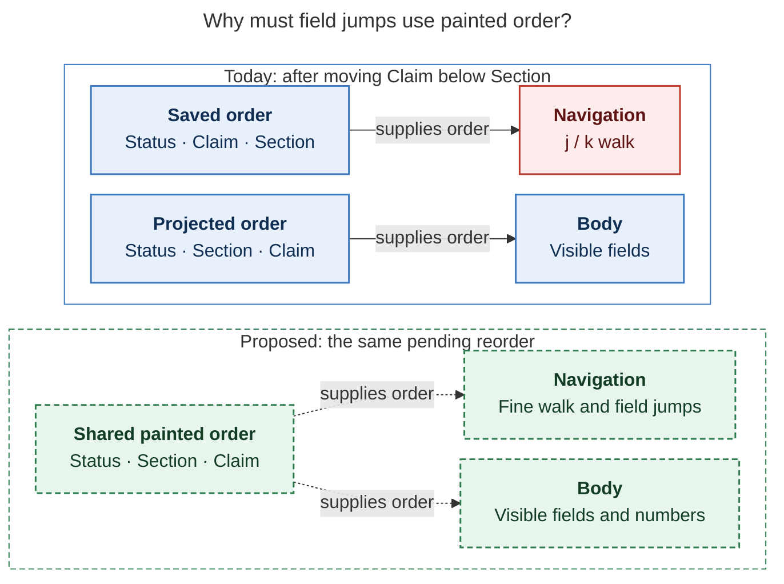
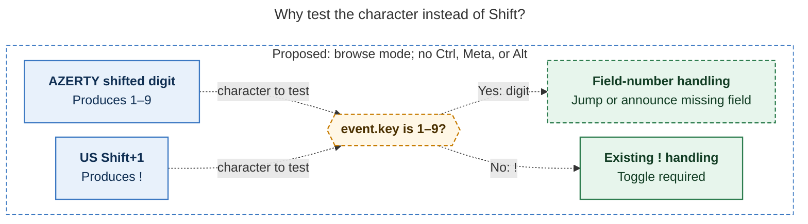

# Diagram proposals: Schema card field jumps

Proposals for the swarm linker, not a report. Each diagram restates only what the source
report says.

```yaml
source: research:202611/schema_card_field_jump_design/schema_card_field_jump_design__final.md
producer: research.57.image
check: "mmdc 12.0.0 with the PDF-mirroring config rendered 2 of 2 Mermaid diagrams"
```

## painted-order

```yaml
anchor: |-
  `schemaTargets()` reads raw `model.fields` while
question: |-
  Why can a pending reorder make keyboard navigation disagree with the screen, and what changes?
illustrates: |-
  One shared painted-order helper fixes navigation, numbering, and today's j/k drift together.
caption: "The proposed shared painted order keeps navigation and field numbers aligned with the visible fields while a reorder is pending."
review: "591.969x772.594 px, fit 100%; question, source, and visual checks passed; 1 revision"
```



## shifted-digits

```yaml
anchor: |-
  AZERTY produces digits *with* Shift held.
question: |-
  Why do Shift-produced digits jump while US Shift+1 still toggles required?
illustrates: |-
  Matching event.key rather than shiftKey lets AZERTY digits work while US Shift+1 remains ! and keeps the required toggle.
caption: "The proposed test ignores Shift: either example supplies event.key, so AZERTY digits navigate and US Shift+1 keeps required toggling."
review: "587.516x623 px, fit 100%; question, source, and visual checks passed; 1 revision"
```


