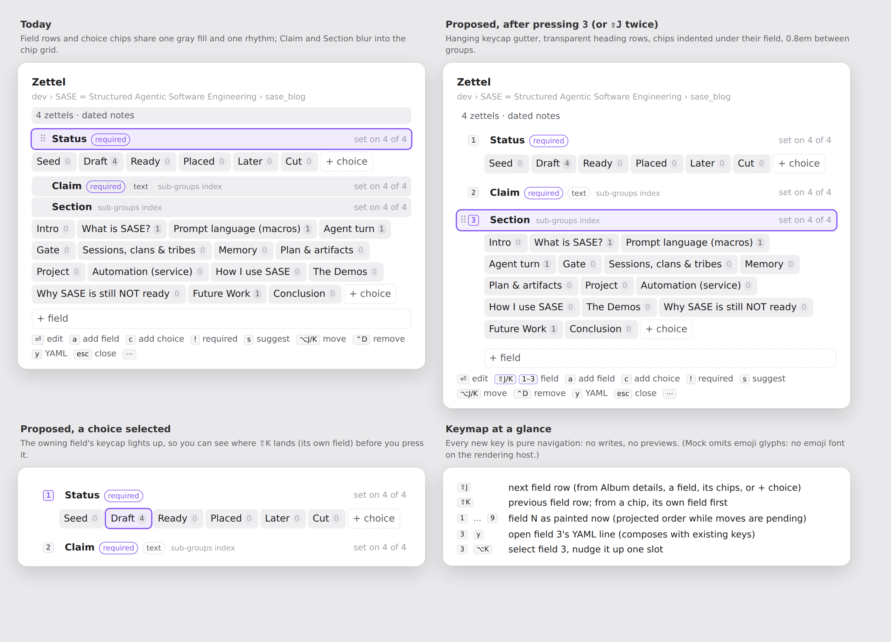

# Schema Card field jumps: `⇧J`/`⇧K`, `1`–`9`, and field-group spacing

_Researcher: cld · 2026-11-17 · scope: bob-plugins `bob-ledger-tools` (album/record
Schema Card and bank Setup card)_

## TL;DR

The request is a good idea for the **album Schema Card** (which album notes and
record notes both open). It needs adjustment for the **bank Setup card**, and it
collides with one shipped album-card feature. In order of importance:

1. **Digits are already taken in both cards.** In the album card, `0`–`9` feed an
   undocumented-in-UI count prefix for `⌥J/K` nudges (`4⌥K`). In the bank Setup
   card, digits are **category hotkeys**, and your live `bank.md` binds `1`–`8` to
   the Bills categories. `⇧K` also already selects 🚗 Car there, because hotkey
   matching lowercases the key.
2. **My recommendation:** in the album/record card, `1`–`9` become field jumps and
   the count prefix is retired. In the bank card, digits stay category hotkeys and
   only `⇧J`/`⇧K` are added, jumping between category group headings.
3. **Spacing alone fixes half the "which choices belong to which field" problem.**
   The other half is that field rows and choice chips render with the **same gray
   button fill**. That fill is most likely Obsidian's default `button` style
   overriding the card's `transparent`. Field rows should read as headings and chips
   as pills. Use 0.8em above each field, keep chips tight under their field, and
   indent the chips under the field label so the number badges hang in a gutter.
4. **Number by painted position, not by schema identity.** While reorders are
   pending, the numbers must follow the projected order you see. While fixing this,
   I found that today's `j`/`k` walk the *saved* order during a pending
   arrangement. That is a real mismatch, and the same helper should fix it.
5. `⇧J`/`⇧K` **clamp** at the ends (they don't wrap). Every keyboard jump scrolls
   the selection into view: today focus uses `preventScroll: true` and nothing
   scrolls.



_Figure: HTML mock of the Zettel card from your screenshot, rendered with headless
Chromium. Today (left) vs proposed (right), the "you are here" state (bottom
left), and the key summary (bottom right). Emoji glyphs are omitted because the
rendering host has no emoji font._

---

## 1. What exists today (grounded)

All paths below are in the `bob-plugins` linked repo under
`plugins/bob-ledger-tools/src/` unless noted.

### 1.1 Two card implementations cover the three surfaces

| Surface | Modal | Notes |
|---|---|---|
| Album note | `AlbumSchemaCardModal` (`241y-plugin-album-schema-card.js`) | `==`, ⊞ Schema, palette, Command Mode |
| Record note | **same modal**. `242d-plugin-album-entrypoints.js:160` resolves `record-parent` → album, `:272` opens the album card | Same keys automatically |
| `~/bob/bank.md` | `BankSetupCardModal` (`248k-plugin-bank-setup-card.js`) | Tabs: Categories / Accounts / Rules / Checks |

So "album + record" is one implementation and bank is a second one with a
different shape.

### 1.2 Album card navigation model

- Selection walks one **linear target list** (`242c-plugin-album-schema-edit.js:4`
  `albumSchemaTargets`): `stats` (Album details) → `field` → each `choice` →
  `+ choice` → next field … → `+ field` → `issue`s.
- `j`/`k`/arrows step one target and **wrap** (`241y…card.js:65-74, 866-869`).
- How many keypresses that costs, measured against your vault (`bob albums list -f json`):

  | Album | Fields | j/k targets | Status → last field: `j` presses | with `⇧J` | with a digit |
  |---|---|---|---|---|---|
  | sase_blog_zettel (screenshot) | 3 | ~28 | 9 | 2 | 1 (`3`) |
  | subscriptions | **9** | ~24 | 18 | 8 | 1 (`9`) |
  | tv | 6 | ~18 | 13 | 5 | 1 |
  | movies | 7 | ~17 | 12 | 6 | 1 |
  | eat | 5 | ~11 | 7 | 4 | 1 |
  | podcasts | 3 | ~9 | 5 | 2 | 1 |

  The largest album has **exactly 9 fields**, so `1`–`9` covers 100% of today's
  albums.
- **`⇧J`/`⇧K` are free in the album card.** Plain `j`/`k` match lowercase only
  (`:866-867`), and `⌥J`/`⌥K` require `altKey` (`:864-865`; the arrange wrapper in
  `241yb…arrange.js:832-833` also requires `altKey`).
- **Digits are not free.** `241yb…arrange.js:885-889` appends every unmodified
  `0`–`9` to `schemaArrangeCountBuffer`, and `schemaArrangeConsumeCount`
  (`:81-87`) spends it on the next nudge. `docs/albums.md:133-136` documents it
  ("a count prefix such as `4Alt+K` repeats the nudge"). The buffer never expires
  and is not cleared by other keys, so `4`, `j`, `j`, `⌥K` moves four slots. No
  keystroke test covers the prefix: the arrange tests call
  `schemaArrangeNudge(-2)` directly (`scripts/test-ledger-tools-album-schema-arrange-card.cjs:170+`).
- `m` hint mode labels gaps with letters only (`SCHEMA_ARRANGE_GAP_ALPHABET =
  "asdfghjklwertyuiopzxcvbnm"`, `241xa…:5`), so digits never collide with it. Inside
  hint mode `J` lowercases to the gap label `j`. Hint mode owns letters, and that
  is fine.
- **Pre-existing mismatch:** `schemaTargets()` uses `model.fields` order
  (`242c:4`, consumed at `241yd…paint.js:102`), but the body paints the
  **projected** order while moves are pending (`241yc…regions.js`
  `albumSchemaCardPaintBody`). During a pending arrangement, `j` can therefore jump
  "backwards" on screen. Numbers built on the same list would be wrong in exactly
  the state where `3⌥K` is most useful.
- **No scroll on selection.** `schemaFocusAfterPaint` focuses with
  `preventScroll: true` (`241yd:79, 96`) and nothing calls `scrollIntoView`. The
  docs say the card autoscrolls during drags, so tall cards do scroll, and a
  digit jump to field 9 could land off-screen.

### 1.3 Why the screenshot reads ambiguously

- The rhythm is almost uniform. Field rows have `margin: 0.15em 0`, and choice
  clouds have `margin: 0.15em 0 0.35em` (`styles.css` ~8617, ~8773). The gap
  *above* "Section" is about the same as the gap *between chip rows*, so the eye
  can't group them (the proximity principle).
- The visual weights are equal. In the screenshot, unselected field rows
  ("Claim", "Section") and choice chips have the **same gray fill and shadow**.
  The stylesheet asks for `.bob-album-schema-target { background: transparent }`
  (`styles.css:8736`). The rendering matches Obsidian's default
  `button:not(.clickable-icon)` fill winning on specificity: (0,1,1) beats (0,1,0).
  The selected row escapes it only because `.bob-album-schema-target.is-selected`
  is (0,2,0). The result is that field rows look like wide chips, and "Claim" looks
  like it belongs with Status's chip grid. _I inferred this from the screenshot plus
  the selector specificity. I did not inspect Obsidian's shipped CSS in this run._

### 1.4 Bank Setup card

- In the Categories tab, groups ("Money moves" built in, then Everyday, Bills, and
  HIDDEN) are already wrapped in `<section class="bob-bank-setup-card-group">` with
  `margin: 0.55em 0` and small-caps labels (`248j…dom.js:260-320`, `styles.css`
  ~9836). **Grouping is already visually clear, so the spacing request is an
  album-card problem.**
- Navigation uses arrows and `Ctrl+N/P`, not `j`/`k`, and it **clamps**
  (`248i…model.js:130` `bankSetupCardMoveSelection`).
- **Plain letters and digits select categories by hotkey**
  (`248k…card.js:793-796` → `248i:123` `bankSetupCardSelectionByHotkey`). The
  match is case-insensitive.
- Your live `bank.md` binds `1`–`8` to Housing, Utilities, Tech & AI, Media,
  Loans, Household, Taxes, and Fees, and `k` to Car. bob-cli only accepts
  `[a-z0-9]` hotkeys (`src/native/bank/config.rs:963`), so the case-insensitive
  match is incidental. Its only effect today is that `⇧K` selects Car.
- There is precedent: the bank arrange layer already uses `⌥M` instead of `m` so
  that it "never hijacks hotkey letters" (test title in
  `scripts/test-ledger-tools-bank-setup-arrange.cjs:303`). **In the bank card,
  plain keys belong to category hotkeys.**

### 1.5 Neighbouring conventions

- The Task Card (the idiom the Schema Card copies) uses `1`–`9` for **set
  priority** (`bob-navigation-hotkeys/src/314-task-card-key-model.js:160`). Digit
  meanings are card-local. In the Schema Card a digit is pure navigation, so a
  mistaken press is harmless.
- Keycap styling already exists twice: `.bob-bank-category-keycap` (monospace,
  1px border, `--background-secondary`, 0.78em) and the hint-strip `kbd`. A field
  number drawn as the same keycap reads as "a key you press", and it ties the
  album and bank cards together visually.

---

## 2. Critique: is this a good idea?

**For the album/record card: yes, clearly.** Choice-heavy fields turn `j`/`k`
into a slog, and the field is the unit you act on (`!`, `s`, `c`, `⏎`, `⌥J/K`,
`y`). Field jumps compose with every existing key:

- `3⏎` edits field 3.
- `3!` stages "required" on it.
- `3c` adds a choice to it.
- `3a` adds a field after it, because `field.add` uses the selected field's
  index + 1.
- `3⌥⇧K` moves it to the top.
- `3y` opens its YAML line.

Visible numbers also teach themselves: you see `2` beside Claim and you know
what `2` does. The costs are small: the count prefix is retired, one hint item is
added, and a column of muted digits appears.

**For the bank card: half of it.** `⇧J`/`⇧K` between group headings is useful,
since there are about 20 tiles across 3–4 groups and arrows step one at a time.
`1`–`9` would take away eight live Bills hotkeys that match the filing Category
card, where the same digit means the same category. That muscle memory matters
more than jumping among 3–4 groups. Painting group numbers next to tiles whose
keycaps already show `1`–`8` would also put one digit on screen with two meanings.

**On spacing: yes, but it's half the fix** (see 1.3). Without separating field
rows from chips visually, extra space only spreads the same muddle out.

**What I would not do:**
- Number choices. Fields can have 15+ choices, and `⌥J/K` plus `m` already cover
  in-field work.
- Use multi-digit counts with a timeout (`1`,`2` → field 12). This is laggy and
  nondeterministic, and no album has more than 9 fields.
- Bind letters for fields 10+.
- Show numbers in the in-note album header, where the digits do nothing.

---

## 3. Requirement adjustments (explicit)

| # | Your requirement | Adjustment | Why |
|---|---|---|---|
| A1 | `J`/`K` and `1`–`9` in all three surfaces | Album and record card: both. **Bank Setup card: `⇧J`/`⇧K` between category group headings only.** Digits stay category hotkeys, no group numbers are painted, and the keys are inert in Accounts, Rules, and Checks | Live hotkeys `1`–`8`, and one digit with two meanings in one card |
| A2 | (implicit) keep existing keys | **Retire the album card's digit count prefix (`4⌥K`)**. Digits become field jumps | A digit can't both jump now and wait to see whether `⌥K` follows without a laggy timeout. `m` gap hints and `⌥⇧J/K` cover long moves. The prefix has a no-expiry footgun and no keystroke test |
| A3 | `J`/`K` = next/previous field | **Clamp at the ends** (bump feedback plus a live-region "First field" / "Last field"). Plain `j`/`k` keep wrapping | Holding `⇧J` should land on the last field reliably. Wrapping is unnecessary when `1` reaches the top. The bank card's own navigation already clamps |
| A4 | "index each field starting at 1" | **The number is the painted position**, so it renumbers live while moves are pending. Route `j`/`k` through the same painted-order list | It matches what you see, and fixes the `j`/`k` mismatch in 1.2 |
| A5 | "vertical space before field selections" | Add 0.8em above each field row **and** make field rows transparent headings (chips keep the fill). Indent chips under the field label, with numbers hanging in a fixed gutter | Proximity plus contrast. Space alone leaves rows and chips looking identical |
| A6 | (new) | **Scroll the keyboard selection into view** (`block: "nearest"`, instant) | Reliability. A jump must never land off-screen |
| A7 | `1`–`9` | Only `1`–`9`. Fields 10+ get an empty gutter slot (alignment kept) and are reached with `⇧J/K`. `0` stays unbound | No timeouts. Today's maximum is 9 |
| A8 | Show the index "close to its field name" | Show it as a **muted keycap left of the name**. It lights up in accent on the selected field, **and on the owning field when one of its chips or its `+ choice` is selected** ("you are here") | Shows where `⇧K` will land, and ties chips to their field |
| A9 | (discoverability) | Add one hint item, `⇧J/K` `1–N` **field**, showing the live range (`1–3`). The bank footer gets `Shift+J/K group` in its own text style | `J/K` alone reads as plain j/k under keycap convention, and `⌥J/K` sits right next to it |

---

## 4. Album/record card design

### 4.1 Semantics

| Key | From | Lands on |
|---|---|---|
| `⇧J` | Album details | field 1 |
| `⇧J` | field *n*, any of its chips, its `+ choice` | field *n+1* (clamp at the last field; bump) |
| `⇧J` | `+ field`, issues | stays (bump) |
| `⇧K` | a chip or `+ choice` of field *n* | **field *n*** (its own heading first, like Vim `[[`) |
| `⇧K` | field *n* | field *n−1* (clamp at field 1; bump) |
| `⇧K` | `+ field`, issues | last field |
| `1`–`9` | anywhere (browsing) | field N in **painted** order. If N > field count: no move, and the live region says "No field 7 · this album has 3" |
| any | zero fields | no-op. The hint item is hidden |

Matching: `event.key === "J"/"K"` (this also covers Caps Lock) with no
Ctrl/Meta/Alt, because `⌥⇧J/K` already means "move to edge". Digits match
`/^[1-9]$/` on `event.key` with no Ctrl/Meta/Alt, **ignoring Shift**, so that
AZERTY (where digits are shifted) still works. `!` is a different `key` value, so
`⇧1` keeps meaning "required". A near-miss is safe because `!` only *stages* a
preview.

### 4.2 Gating ("pure navigation that inherits `j`/`k`'s gates")

| State | `⇧J`/`⇧K` | `1`–`9` |
|---|---|---|
| Browsing | jump | jump |
| Moves pending (dirty arrangement) | jump in painted order | jump in painted order (so `3⌥K` `5⌥J` works) |
| `m` hint mode | hint mode owns letters (existing) | **swallowed** (inert) |
| Stage open / ghost placement | inputs own keys (types `J`, `3`) | same |
| Focus in input/select/textarea, IME composing | never intercepted (existing guards) | same |
| Applying / lock wait | same as `j`/`k` today (blocked by `schemaOnKeyDown`'s `applying` return) | same |
| Read-only body (no session) | no-op. Read-only rows aren't targets; possible follow-up | no badges |

All jumps go through the existing `paintSchemaCard("select")` path, which is
selection-only and cheap. They never touch the session, previews, or
arrangement.

### 4.3 Visual spec

**Hierarchy.** Each field is a heading row: `[⠿ grip][keycap][Label][pills] … [set on n of m]`.
Its chips sit in a cloud **indented to the label's start**, so the numbers form a
clean left column and every chip sits visibly under its field name. The heading
rows have no fill (hover shows the hover fill, and selected keeps the accent ring
plus a 10–12% tint). The chips keep their filled pill look. Between groups there
is 0.8em of space. A field's chips sit about 0.15em below their row.

**Keycap.** Use the bank keycap recipe: monospace 650 weight, about 0.78em,
fixed 1.5em square, 1px `--background-modifier-border`, `--background-secondary`
fill, `--text-muted` digit. It is accent-tinted (border + digit) when its field is
selected or is the owning field of the selected chip. It is `aria-hidden`.

**CSS sketch** (the numbers are a starting point; tune visually):

```css
.bob-album-schema-dialog-body { --bob-schema-gutter: 2.7em; }

/* Field rows (and Album details) read as headings, not chips. These selectors
   must out-specify Obsidian's button:not(.clickable-icon). */
.bob-album-schema-dialog button.bob-album-schema-field,
.bob-album-schema-dialog button.bob-album-schema-stats-target {
  background: transparent; box-shadow: none;
}
.bob-album-schema-dialog button.bob-album-schema-field:hover {
  background: var(--background-modifier-hover);
}
/* Re-assert selection at higher specificity, or the rule above erases it */
.bob-album-schema-dialog button.bob-album-schema-field.is-selected {
  box-shadow: 0 0 0 2px var(--interactive-accent);
  background: color-mix(in srgb, var(--bob-album-accent, var(--interactive-accent)) 11%, var(--background-primary));
}

/* Rhythm: space between groups, chips hug their field */
.bob-album-schema-dialog-body > * + .bob-album-schema-field,
.bob-album-schema-dialog-body > * + .bob-album-schema-add-field { margin-top: 0.8em; }
.bob-album-schema-dialog .bob-album-schema-choice-cloud {
  margin: 0.15em 0 0; padding-inline-start: var(--bob-schema-gutter);
}
.bob-album-schema-dialog .bob-album-schema-add-field { margin-inline-start: var(--bob-schema-gutter); width: auto; }

/* Hanging keycap */
.bob-album-schema-field-key {
  flex: 0 0 auto; display: inline-flex; align-items: center; justify-content: center;
  inline-size: 1.5em; block-size: 1.5em;
  border: 1px solid var(--background-modifier-border); border-radius: 0.3em;
  background: var(--background-secondary); color: var(--text-muted);
  font: 650 0.78em/1 var(--font-monospace); font-variant-numeric: tabular-nums;
}
.bob-album-schema-field.is-selected .bob-album-schema-field-key,
.bob-album-schema-field.is-current-group .bob-album-schema-field-key {
  border-color: var(--interactive-accent); color: var(--interactive-accent);
  background: color-mix(in srgb, var(--interactive-accent) 10%, var(--background-primary));
}
.bob-album-schema-field-key.is-unnumbered { visibility: hidden; } /* fields 10+ */
```

Give the grip and the keycap fixed inline sizes, and derive
`--bob-schema-gutter` from those same values (row padding + grip + keycap +
gaps). That way the chip clouds line up with the labels by construction rather
than by eye. Hint-mode gap buttons and ghost rows are body siblings too, and the
`* +` rule spaces them consistently.

**Why not wrap each field + cloud in a group container** (which would allow a
whole-group tint)? `albumSchemaCardInsertGhost`, the hint-mode gap interleaving,
and the pointer-drag gap math all assume field rows and clouds are **direct
siblings** of the body host (`241yc` filters `host.children` by
`data-arrange-id`). A wrapper is the prettiest option, but it puts reorder at
risk. The sibling-class `is-current-group` keycap gives most of the "you are
here" value with no structural change.

**Accessibility.** Field row `aria-label` becomes "Field 3 of 3, Section, …".
Add `aria-keyshortcuts="3"` on field buttons 1–9. The bump at the ends reuses the
existing 3px nudge shake (`241yb:119-130`), gated on the existing
`schemaArrangeReducedMotion()` helper (`241xb:222`). Today's nudge shake does
**not** check that helper. It uses `node.animate()`, and the Web Animations API
ignores the card's CSS `animation: none` reduced-motion block. Gate both.

**Possible confusion with count pills.** Choice count pills are round and sit
*inside* chips. The keycaps are square and sit *outside*, in a gutter column. The
two differ in shape, position, and alignment, so they don't read alike.

---

## 5. Bank Setup card design

- **`⇧J`/`⇧K` in the Categories tab only**, between group-label items in
  `model.items` (type `group`, including `group:hidden`). From a tile, `⇧K` goes
  to its own group label first. Navigation clamps (matching the card's arrows). In
  the other tabs the keys are inert.
- **Resolve the `⇧K`→Car collision** by handling `J`/`K` (unmodified except Shift)
  *before* the hotkey branch at `248k:793`. Every other hotkey behaves exactly as
  today, `k` still selects Car, and `1`–`8` still select the Bills categories.
- No group numbers and no spacing change (the groups are already sectioned).
  Optional polish: when a tile is selected, raise its group label from
  `--text-faint` to `--text-normal`. This is the bank version of "you are here".
- Footer: `Enter edit · + new · Shift+J/K group · Alt+J/K move · …`, matching that
  footer's word style.

---

## 6. Alternatives considered

| Option | Verdict |
|---|---|
| Keep the count prefix and disambiguate "digit = count if `⌥J/K` follows" | Rejected. The jump must wait for the next key or a timeout, which feels laggy and nondeterministic. A jump-then-count reading moves the *new* selection, which is incoherent |
| `{`/`}` or `[[`/`]]` (Vim paragraph/section) | Not needed. `⇧J/K` pairs naturally with `⌥J/K` (move) and stays on the home row. `{`/`}` could be added later as aliases if wanted |
| `Tab`/`⇧Tab` between fields | Rejected. Tab is focus traversal (a11y), and the bank card uses Tab for sections |
| Vimium-style letter hints for fields | Rejected. They clash with `a c s y u m` and are overkill for ≤ 9 fields |
| Digits select choices within the selected field | Rejected. Fields reach 15 choices, and `m` already covers in-field placement |
| Divider lines between field groups | Not needed. Space plus the fill change suffice, and dividers add noise |
| Per-group container with tint | Deferred. It's the best look, but it puts arrange/drag/ghost DOM assumptions at risk (4.3) |

---

## 7. Implementation sketch (bob-plugins)

Fragments must stay ≤ 1000 lines. Today `241y…card.js` has 953 lines and
`241yc…regions.js` has 928.

1. **Pure helpers** in `242c-plugin-album-schema-edit.js` (250 lines):
   `albumSchemaDisplayTargets(model, projected)` gives targets in painted order
   (fields and choices reordered by the arrangement projection).
   `albumSchemaFieldStep(targets, key, dir)` and `albumSchemaFieldNumberKey(targets, n)`
   give the clamped field jump and the N-th field key.
2. **Targets in painted order:** `schemaTargets()` passes
   `this.schemaArrangement?.scopes()` when the arrangement is dirty. This fixes
   `j`/`k` too, and `paintSchemaCard` repair keeps working.
3. **Keys:** in `241yb`, replace the digit count-buffer branch (`:885-889`) with
   `schemaJumpField(n)`. Delete `schemaArrangeCountBuffer` and
   `schemaArrangeConsumeCount`, so a nudge is `direction × 1`; the
   `schemaArrangeNudge(step)` API stays. In hint mode, swallow digits. Add the
   `J`/`K` branches next to `j`/`k` in `241y:866-867`, or in a new small fragment
   if the line budget is tight.
4. **Paint:** `albumSchemaCardPaintFieldRow` takes `fieldNumber`. Put the keycap
   builder in `241y-plugin-album-schema-card-dom.js` (117 lines) to spare `241yc`.
   Paint numbers from the same `fieldOrder` that `albumSchemaCardPaintBody`
   already computes (projected when dirty). `albumSchemaCardPaintSelection` also
   toggles `is-current-group` on the owning field row. The `select` paint calls
   `scrollIntoView({ block: "nearest" })` on the focused target. Add the hint item
   in `albumSchemaCardHintItems`, showing the live `1–N` range.
5. **CSS** as in 4.3.
6. **Bank:** add `bankSetupCardMoveGroupSelection` in `248i`, `J`/`K` before the
   hotkey branch in `248k`, and the footer text.
7. **Tests:**
   - Card shell/arrange: `⇧J/⇧K` clamps, `⇧K` from a chip goes to its own field,
     digits pick field N, numbers follow the projected order, digits are inert in
     hint mode and stages, no writer calls are made, and `j` follows the painted
     order while dirty.
   - Bank setup: `K` no longer selects Car, `k` does, and `1`–`8` still select
     Bills.
   - Album UI e2e: a real Shift+J (`key: "J"`).
8. **Docs:** in `docs/albums.md` (key paragraph and arrange paragraph), remove the
   count prefix and add `⇧J/K` and `1–9`. Update the bank setup docs. Run
   `npm run build`, `npm test`, `npm run docs:check`, then `bob plugins sync`.
9. **Optional memory:** after it ships, record a decision along the lines of
   "Schema-card digits jump to numbered fields unless the card already binds
   digits as hotkeys" via `/sase_memory_write`, so future cards follow the same
   rule.

---

## 8. Recommended solution

**Album and record Schema Card**
- Add `⇧J`/`⇧K` to jump to the next/previous **field heading**. From a chip, `⇧K`
  goes to its own field. Both clamp at the ends with a soft bump, and both are pure
  navigation that inherits `j`/`k`'s gates.
- `1`–`9` jump to field N **in painted order**, renumbering live while moves are
  pending. They are inert in hint mode and stages. **Retire the `4⌥K` count
  prefix.**
- Paint a **muted hanging keycap** (bank keycap recipe) left of each field label.
  It turns accent when that field, or one of its chips, is selected.
- Make field rows **transparent headings**, indent chips under the label, and put
  **0.8em** above each field. Scroll every keyboard jump into view.
- Add one hint item: `⇧J/K` `1–N` **field**.
- Route `j`/`k` through the same painted-order target list, which fixes today's
  dirty-arrangement mismatch.

**Bank Setup card**
- Add `⇧J`/`⇧K` between category group headings in the Categories tab only,
  handled before the hotkey lookup so that `⇧K` stops selecting Car.
- **Digits stay category hotkeys.** No group numbers and no spacing change.
- Footer: `Shift+J/K group`.

This keeps the parts you asked for that hold up and drops the one that would
break existing behaviour. A single rule underlies it: navigation keys never write,
and a digit means one thing per card.
