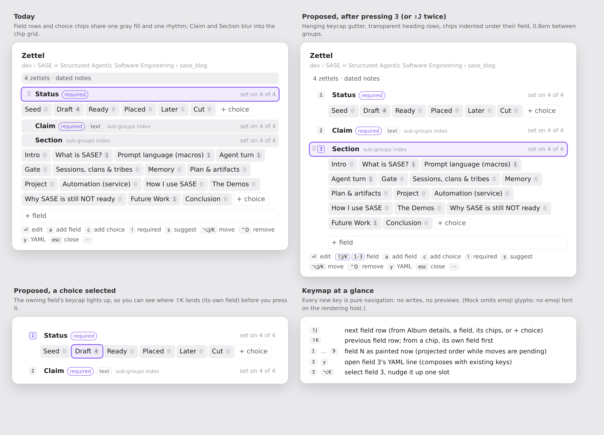

# Schema card field jumps: `⇧J`/`⇧K`, `1`–`9`, numbered fields, and visual grouping

Lead consolidation · 2026-11-17 · merges five independent reports (cdx, cld, grk, mus,
gem — siblings in this directory) plus the lead's own verification pass against
bob-plugins `master`, the live vault, and `~/tmp/screenshots/20261117_110414.png`.
File paths below are bob-plugins `plugins/bob-ledger-tools/` unless noted.

## Verdict

**Build it.** All five researchers independently reached the same top-line verdict: the
request fixes a real mismatch between the card's visual hierarchy and its keyboard
model. Today the album Schema Card walks one flat target list — field row, every choice
chip, `+ choice`, next field — so crossing from Status to Claim in the screenshot costs
~8 presses, and crossing Section's fifteen chips costs ~16. Fields are the unit you act
on (`⏎`, `!`, `s`, `c`, `a`, `⌥J/K`, `y`); field-level motion is the missing scale.

Three parts of the request need adjustment, each confirmed by multiple researchers and
re-verified by the lead:

1. **Digits are not free.** The album card silently buffers bare `0`–`9` as a Vim-style
   count prefix for `⌥J/K` nudges (`4⌥K`), and the bank Setup card uses digits as live
   category hotkeys — your `bank.md` binds `"1"`–`"8"` to the Bills categories. The
   album count prefix should be retired; the bank digit hotkeys must survive.
2. **The bank card is a different card.** `~/bob/bank.md` opens `BankSetupCardModal`
   (tabs: Categories / Accounts / Rules / Checks), not the album Schema Card. It has no
   fields, its groups are already visually sectioned, and Rules rows are already
   numbered. It gets `⇧J`/`⇧K` group jumps only — no `1`–`9`, no renumbering.
3. **Spacing alone is half the visual fix.** Field rows are supposed to render
   transparent (`styles.css` asks for `background: transparent` on
   `.bob-album-schema-target`) but Obsidian's default `button:not(.clickable-icon)`
   fill wins on specificity, so field rows render as wide gray chips — visually
   identical to the (intentionally filled) choice chips below them. Space plus restored
   row/chip contrast is the fix; space alone spreads the same muddle out.

One pre-existing bug must ship inside this feature: while a reorder is pending, the
body paints the **projected** order but `schemaTargets()` walks the **saved** order, so
`j`/`k` can jump backwards on screen. Numbers built on the saved order would lie in
exactly the state (`3⌥K`) where they are most useful. One shared painted-order helper
fixes navigation, numbering, and today's `j`/`k` drift together.

## Scope facts (all researcher-verified, lead-confirmed)

- **One card covers album and record notes.** `242d-plugin-album-entrypoints.js`
  resolves a record's `parent:` to its album and opens the same
  `AlbumSchemaCardModal`. Implement once; records get it for free. A future Record
  Card should call the same field-jump helpers so `2` means the same field everywhere.
- **`⇧J`/`⇧K` are free in the album card.** The base handler matches lowercase
  `j`/`k` only; `J`/`K` fire only with Alt held (nudge). Verified in
  `241y-plugin-album-schema-card.js:864-869`.
- **Bare digits are swallowed.** `241yb-plugin-album-schema-arrange.js:884-890`
  appends unmodified `0`–`9` to `schemaArrangeCountBuffer` (3-digit cap, **no expiry,
  no UI feedback, no keystroke test**). Documented once, at `docs/albums.md:139`
  (bob-plugins repo root). This is the only thing digits do today.
- **`1`–`9` covers 100% of today's albums.** The largest (`subscriptions.md`) has
  exactly 9 fields; the screenshot's Zettel album has 3 (Status, Claim, Section).
- **Bank digits and `⇧K` are live.** `248k-plugin-bank-setup-card.js:793` matches
  `/[a-z0-9]/i` and `bankSetupCardSelectionByHotkey` lowercases, so `1`–`8` select
  Bills categories and `⇧K` accidentally selects 🚗 Car (`hotkey: k`). Lead-confirmed
  against live `~/bob/bank.md`.
- **No jump ever scrolls.** Focus restoration uses `focus({ preventScroll: true })`
  (`241yd:79,96`; bank `248kb:390`) and nothing calls `scrollIntoView`. A digit jump
  to field 9 can land off-screen today.
- **Projected-order mismatch.** `schemaTargets()` reads raw `model.fields` while
  `albumSchemaCardPaintBody` paints `projected` order when the arrangement is dirty.
  Lead-confirmed at `241y:34-36`. cdx reproduced it concretely: after moving Claim
  below Section, the arrangement reports `[status, section, claim]` while targets
  still report `[status, claim, section]`.
- **Spacing root cause** (gem's measurement): chip margins don't collapse inside the
  flex cloud, so the intra-field chip-row gap (~0.50em) equals the inter-field gap
  after a cloud (~0.50em), and a choice-less field boundary (Claim → Section) is only
  ~0.15em — *tighter* than rows within one field. The screenshot confirms the
  resulting ambiguity exactly.
- **Flat DOM is load-bearing.** Ghost insertion scans `host.children` directly, `m`
  hint-mode gap buttons are painted as direct body siblings, and drag-caret math
  relies on the flat `[data-arrange-id]` tree (`241yc`, `241xb`). The inline note
  header also reuses `.bob-album-schema-field`.
- **Line budgets.** `241y` 953 / `241yb` 949 / `241yc` 928 of the 1000-line fragment
  cap; `242c` (250) and `241yd` (200) have room. New logic goes in `242c` (pure
  helpers) and small/new fragments, not the near-full cores.

## Disagreements and how they are resolved

**Keep lowercase `j`/`k` as the fine walk (4–1).** mus proposed redefining bare
`j`/`k` (either case) as field-only motion with arrows for chips. Rejected: the user
wrote capitals and said "add", Section's fifteen chips would become arrow-only, and
Vim/ranger/lazygit convention — and this card's own `⌥J` vs `j` split — already uses
Shift as "bigger j". Two scales over one order: `j`/`k` fine, `⇧J`/`⇧K` coarse.

**Clamp, don't wrap (split 2–3, resolved on reliability).** grk, gem, and mus wrapped
field jumps (matching `schemaMove`'s wrap); cdx and cld clamped. Decision: **clamp
with a soft bump**. Holding `⇧J` must land on the last field deterministically; a
bottom-to-top teleport can read as an ordering error; `1` already reaches the top
instantly; and the bank card's own navigation clamps. gem notes the toggle is one
line, so this is cheap to revisit. Plain `j`/`k` keep wrapping — fine motion and
coarse motion may differ, as they already do for `⌥J/K`.

**Bank gets `⇧J`/`⇧K` groups only (resolved against both extremes).** cdx proposed
full per-tab numbered destinations with `1`–`9` taking priority over category hotkeys;
mus and gem (first choice) deferred bank entirely. Both lose to the middle position
(cld, grk, gem's option B1): the user explicitly asked for bank support, and the
honest subset is `⇧J`/`⇧K` between category group headings in the Categories tab —
cheap, useful (~20 tiles across 3–4 groups, arrows step one at a time), and it
*requires* fixing the `/i` hotkey match so `⇧K` stops accidentally selecting Car.
cdx's digit takeover is rejected outright: it would break eight live Bills hotkeys
that mirror the filing Category card's muscle memory, and would paint one digit on
screen with two meanings. No group numbers, no spacing change (groups are already
sectioned with small-caps labels and 0.55em margins).

**Flat DOM + CSS, not a wrapper block (3–1).** grk's `.bob-album-schema-field-block`
wrapper (hairline + gap between blocks) is the prettiest structure, but cdx, cld, and
gem each independently traced the ghost/gap/drag code that assumes field rows and
clouds are direct body siblings. Decision: spacing and grouping via dialog-scoped CSS
on the existing flat tree. The wrapper (and whole-group tint) is deferred polish that
must move the placement/measurement code and its tests together if ever done.

**Digit matching ignores Shift (conflict resolved by layout analysis).** gem and grk
required `!event.shiftKey` on digits to protect `!` (toggle required); cld pointed out
AZERTY produces digits *with* Shift held. cld is right: match
`/^[1-9]$/.test(event.key)` with no Ctrl/Meta/Alt and **ignore `shiftKey`**. On US
layouts `⇧1` produces `event.key === "!"`, which never matches the digit test, so `!`
is safe with no extra guard; on AZERTY the digits keep working. For `J`/`K`, match
`event.key === "J"/"K"` with no Ctrl/Meta/Alt (this also covers Caps Lock; the
existing `⌥J/K` branch keeps its `event.code` fallback). An `event.code === "KeyJ"`
fallback for non-Latin layouts would be consistent with the Alt branch but the
existing `j`/`k` walk doesn't have one either — defer for parity.

**Leave `0` unbound (3–1 + lead).** grk bound `0` → Album details (`stats`); cdx, cld,
and gem leave it unbound. With the count buffer retired `0` is free, but v1 keeps the
surface minimal and honest: nine numbered things, nine digits. `0` → details is a
cheap later nicety.

**One compact hint item (gem's measurement beats grk's abstinence).** grk resisted any
hint-strip addition fearing the 2-line `max-height: 3.1em` clip; gem measured the
strip: line 2 currently holds only `esc close` + `⋯` (~75% empty). Decision: one item,
`⇧J/K · 1–9 field`, hidden when the schema has zero fields. The painted keycaps teach
the digits; the hint teaches the capitals (bare `J/K` in a hint would read as the
lowercase walk).

**Fields 10+: no visible number, reserved gutter.** mus/gem/grk paint nothing; cdx
paints non-interactive ordinal text; cld paints an invisible placeholder. Decision:
cld's **hidden placeholder** (`visibility: hidden`) — honest (no number that can't be
typed) while keeping every label on the same vertical axis. Today no album needs it.

## Adjusted requirements (explicit call-outs)

| # | Original request | Adjustment |
|---|---|---|
| A1 | `J`/`K` next/previous field | `⇧J`/`⇧K` (`event.key === "J"/"K"`, no Ctrl/Meta/Alt). Lowercase `j`/`k` keep the full fine walk. **Clamp** at the first/last field with a soft bump; no wrap. `⇧K` from a chip or `+ choice` goes to its **own** field's row first (parent-first), then onward. |
| A2 | `1`–`9` jump to numbered field | Album/record card only. Number = **painted position** (projected order while a reorder is pending). Out-of-range digit: stay put + announce. Shift state ignored (AZERTY); `!` unaffected. **The album digit count prefix (`4⌥K`) is retired** — a digit cannot both jump now and wait for `⌥K` without a laggy timeout; `m` gap hints and `⌥⇧J/K` already cover long moves. |
| A3 | Index shown near field name | Muted square keycap (bank-keycap recipe) between grip and label, `aria-hidden`, `aria-keyshortcuts` on the row. Accent-tinted when its field — or one of its chips — is selected ("you are here"). Fields 10+ get a hidden placeholder, no number. |
| A4 | Vertical space before fields | ~0.8–0.9em before each field block **plus** restore the intended row/chip contrast: field rows transparent headings (out-specify Obsidian's button fill), chips keep their pill fill, chip clouds slightly indented under the label. Dialog-scoped CSS only; DOM stays flat. |
| A5 | (implied) all three surfaces | Bank Setup card: `⇧J`/`⇧K` between category group headings in the Categories tab only, handled **before** the hotkey branch (fixing `⇧K` → Car); digits stay category hotkeys; no numbers, no spacing change; inert in other tabs. |
| A6 | (new) | Every keyboard jump calls `scrollIntoView({ block: "nearest" })` on select-reason paints — today nothing scrolls and `preventScroll: true` would strand jumps off-screen. |
| A7 | (new) | Route `j`/`k` and the numbering through one shared **painted-order** target helper, fixing the existing dirty-arrangement drift. |

## Recommended design — album/record Schema Card

### Keys (browse mode; inherits every existing gate)

| Key | From | Lands on |
|---|---|---|
| `⇧J` | Album details | field 1 |
| `⇧J` | field *n* / its chip / its `+ choice` | field *n+1*; clamp + bump at the last field |
| `⇧J` | `+ field`, issues | stays (bump) |
| `⇧K` | chip / `+ choice` of field *n* | **field *n*** (parent-first, like Vim `[[`) |
| `⇧K` | field *n* | field *n−1*; clamp + bump at field 1 |
| `⇧K` | `+ field`, issues | last field |
| `1`–`9` | anywhere browsable | field N in painted order; miss = stay + announce ("No field 7 · this album has 3") |
| `j`/`k`/arrows | — | unchanged full walk (now painted-order), still wraps |
| `⌥J/K`, `⌥⇧J/K`, `m`, `⏎`, `!`, `s`, `a`, `c`, `y`, `u`, `⌃D`, `q`/`Esc`/`⌃[` | — | unchanged |

Jumps are pure navigation: they go through `schemaSelect` → `paintSchemaCard("select")`
and never touch the session, previews, writers, or the arrangement. Gating is
inherited: inert in inputs/stages (existing early returns), in `m` hint mode (digits
swallowed; hint mode owns letters), during IME composition, and while applying.
Zero-field schemas: no-ops, hint item hidden. These keys compose with everything —
`3⏎` edits field 3, `3!` stages required, `3c` adds a choice, `3⌥⇧K` moves it to the
top, `3y` opens its YAML line.

### Visuals

```text
 ⠿ [1] Status   required                        set on 4 of 4
       [🌱 Seed 0] [✍️ Draft 4] [✅ Ready 0] … [+ choice]
                                                    ← ~0.8em
 ⠿ [2] Claim    required · text · sub-groups    set on 4 of 4
                                                    ← ~0.8em
 ⠿ [3] Section  sub-groups index                set on 4 of 4
       [🪝 Intro 0] [🧱 What is SASE? 1] … [+ choice]

 [+ field]
 ⏎ edit · a add field · … · ⇧J/K · 1–9 field · esc close · ⋯
```

- **Field rows become headings:** transparent at rest (selector must out-specify
  Obsidian's `button:not(.clickable-icon)`), hover fill on hover, existing accent
  ring + ~11% tint when selected (re-asserted at higher specificity). Chips keep
  their intended `--background-modifier-hover` pill fill. This restores the contrast
  the stylesheet already intends.
- **Keycap:** bank-keycap recipe — ~1.45em square, 1px `--background-modifier-border`,
  `--background-secondary` fill, `--text-muted` tabular-numeral digit, monospace
  ~0.78em/650. Accent border + digit when its field is selected **or owns the selected
  chip** (`is-current-group`), which also shows where `⇧K` will land. Square-outside
  vs the round count pills inside chips, so the two never read alike.
- **Rhythm:** ~0.8em top margin before each field row and `+ field` (sibling `* +`
  rules so ghost rows and gap hints space consistently); cloud hugs its field
  (~0.2em) with chip margins zeroed so the cloud's `gap` owns intra-cloud spacing;
  cloud indented by a `--bob-schema-gutter` derived from grip + keycap widths so chips
  align under labels by construction. All scoped to `.bob-album-schema-dialog-body`
  (the inline note header reuses these classes and must not change).
- **Feedback:** clamp bump reuses the existing 3px nudge shake — gated on
  `schemaArrangeReducedMotion()`, which the existing shake currently skips (fix both;
  `node.animate()` ignores the CSS reduced-motion block). Live region announces
  "Claim, field 2 of 3" on jump, misses on bad digits. Row `aria-label` gains
  "field N of M"; keycap stays `aria-hidden`.
- The cld mock renders today-vs-proposed side by side:
  
  grk's report in this directory has the key-routing and cluster-landing diagrams.

## Recommended design — bank Setup card

- `⇧J`/`⇧K` in the **Categories tab only**, stepping between group-label items
  (Money moves → Everyday → Bills → HIDDEN), clamping like the card's arrows. From a
  tile, `⇧K` goes to its own group label first (same parent-first rule).
- Handle `J`/`K` **before** the hotkey branch, and/or tighten the hotkey match to
  lowercase (`/[a-z0-9]/` without `/i` — safe: bob-cli only accepts `[a-z0-9]`
  hotkeys, stored lowercase). Net user-visible change: `⇧K` stops selecting Car; `k`
  still does; `1`–`8` still select Bills. Precedent: the bank arrange layer already
  uses `⌥M` so it "never hijacks hotkey letters".
- No digit bindings, no painted numbers, no spacing changes. Inert in Accounts,
  Rules, Checks. Footer gains `Shift+J/K group`. Optional polish: raise the selected
  tile's group label from `--text-faint` to `--text-normal`.

## Implementation sketch (all bob-plugins; no CLI contract, no release-train impact)

1. **Pure helpers in `242c-plugin-album-schema-edit.js`** (250/1000 lines — the only
   roomy fragment): `albumSchemaOrderedFields(model, projected)`,
   `albumSchemaFieldStep(…)` (clamped, parent-first), `albumSchemaFieldNumberKey(…)`.
   Shared by key handling, badge painting, and `schemaTargets()`.
2. **Painted order everywhere:** `schemaTargets()` passes the arrangement's projected
   scopes when dirty — fixes today's `j`/`k` drift; `schemaRepairSelection` keeps
   working.
3. **Keys:** replace the `241yb:884-890` digit-buffer branch with the field jump;
   delete `schemaArrangeCountBuffer`/`schemaArrangeConsumeCount` (nudge becomes
   direction × 1; `schemaArrangeNudge(step)` API stays). Swallow digits in hint mode.
   Add `J`/`K` branches beside `j`/`k` in `241y` or a small new fragment (241y is at
   953/1000).
4. **Paint:** `albumSchemaCardPaintFieldRow` takes `fieldNumber` from the same
   projected `fieldOrder` the body already computes; keycap builder in `241yd` or a
   new DOM fragment; selection paint toggles `is-current-group`; `"select"` paints
   call `scrollIntoView({ block: "nearest" })`. Hint item in
   `albumSchemaCardHintItems` (and read-only strip parity).
5. **CSS:** dialog-scoped rules per the visual spec (cld §4.3 and gem §D have
   concrete, compatible starting sketches).
6. **Bank:** group-step helper in `248i`, `J`/`K` before the hotkey branch in `248k`
   (with the case tightening), footer text.
7. **Docs:** `docs/albums.md:139` — remove the count-prefix promise, add `⇧J/K` and
   `1–9`; bank setup docs add `Shift+J/K group`.
8. **Tests** (extend the existing shell/arrange/bank suites; FakeNode already drives
   `schemaOnKeyDown`): clamps at both ends; parent-first `⇧K`; digits pick field N and
   follow projected order while dirty; `j` follows painted order while dirty; digits
   inert in hint mode/stages/inputs; `⇧1` still toggles required; no writer calls on
   any jump; keycaps only on fields 1–9; scroll called on select; bank `K` no longer
   selects Car while `k` and `1`–`8` are unchanged; one real-`key:"J"` e2e in the
   album UI harness.
9. **Ship:** `npm run build` → `npm test` → `npm run docs:check` → `bob plugins sync`.
   Manual pass on the screenshot's Zettel album (Status → `⇧J` → Claim; `3` →
   Section), one record note, and the 9-field subscriptions album; light/dark and
   narrow width.

## Risks and what would reopen this

- **Caps Lock** makes `event.key === "J"` without Shift — the fine step becomes the
  coarse step until Caps Lock is off. Accepted: it's how the card already
  distinguishes case, and the failure is benign navigation.
- **Bank case tightening is user-visible** for anyone who Shift-selected a category.
  That path was accidental; lowercase hotkeys are the contract.
- **An album with 10+ fields in daily use** would justify a second pass (`0` as
  details/last-field, or a prefix); nothing today needs it.
- **Retiring digit category hotkeys on bank** is the only event that would let bank
  group headings borrow `1`–`9`.
- After shipping, consider a decision record via `/sase_memory_write`: *schema-card
  digits jump to numbered fields unless the card already binds digits as hotkeys* —
  so future cards (Record Card, etc.) follow one rule.

## Inputs

- `schema_card_field_jump_design__cdx.md` — conflict inventory, acceptance examples,
  WCAG/keyboard-interface grounding, fixture-level probes of the raw/projected drift.
- `schema_card_field_jump_design__cld.md` — per-album keypress economics, bank
  hotkey audit, keycap/gutter visual spec, clamp rationale, HTML mock.
- `schema_card_field_jump_design__grk.md` — cluster-landing semantics, Mermaid
  routing diagrams, wrapper-block alternative, `0` → details proposal.
- `schema_card_field_jump_design__mus.md` — field-only-motion alternative (rejected),
  anchor rule, edge-case checklist, verification plan.
- `schema_card_field_jump_design__gem.md` — spacing root-cause measurements, flat-DOM
  constraints, concrete CSS/code blueprint, hint-strip fit measurement.
- Lead verification: `styles.css` transparent-vs-rendered fill + intentional chip
  fill; `241yb` count buffer; `241y` raw-order `schemaTargets` and free `⇧J/K`;
  `248k`/`248i` hotkey case path; live `bank.md` Bills `1`–`8` and Car `k`;
  `docs/albums.md:139`; fragment line counts; the screenshot itself.
