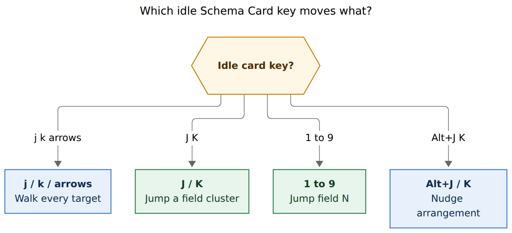
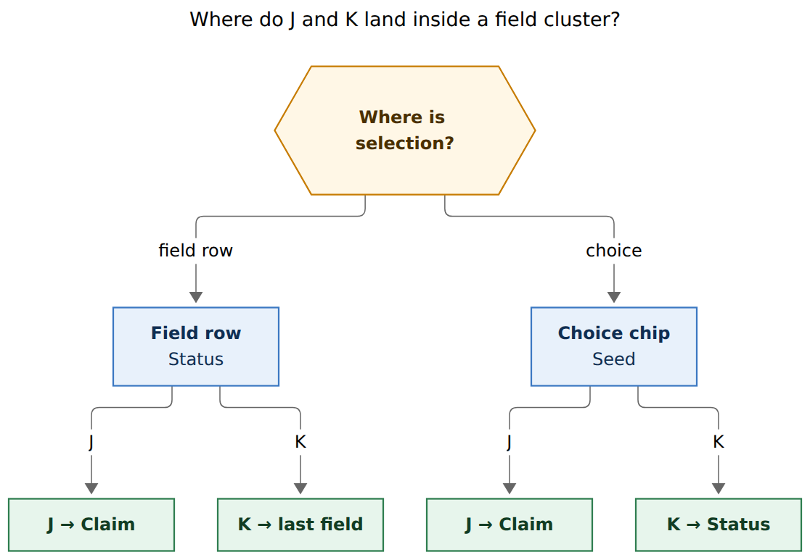
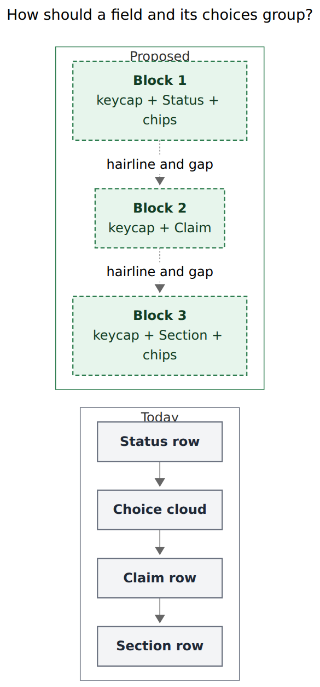

# Schema Card J/K and 1–9 field jumps

> **Research query:** Add `J`/`K` and `1–9` keymaps to Obsidian schema editing cards (album notes, record notes, and `~/bob/bank.md`) so `J`/`K` jump to the next/previous *field* selection, `1–9` jump to a numbered field with the index painted next to the field name, and field groups gain vertical space. Critique the plan, adjust requirements where justified, and recommend an intuitive, reliable, and beautiful design.

## Bottom line

**Build it on the album Schema Card. Interpret `J`/`K` as Shift+J/K. Do not steal `1–9` on the bank Setup Card.**

The 2026-11-17 capture is the whole argument. Status is selected. Lowercase `j` already exists, and it does not go to Claim. It walks *every* target in `albumSchemaTargets`: Status → Seed → Draft → Ready → Placed → Later → Cut → `+ choice` → Claim. That is seven hops across a choice cloud to reach the next field. Section then adds fifteen more chips. Field-level motion is missing. Digit motion is missing. The field row and its chips are siblings with `0.15em` of margin, so Claim's gray bar sits on Status's `+ choice`.

The request is the right product. Three readings of it are wrong, and one of them is the reading that would ship a regression.

1. **`J`/`K` are not a replacement for lowercase `j`/`k`.** Lowercase already walks every target (`241y-plugin-album-schema-card.js`). Shift+J/K is unbound without Alt. Keep the small step. Add the large step.
2. **`1–9` are not free on every schema surface.** Album digits currently feed a silent vim-style arrange count (`4Alt+K`). Bank digits are live category hotkeys — Bills already uses quoted `1`–`8`. Steal album counts. Do not steal bank hotkeys.
3. **Vertical space belongs *before the next field*, as a wrapped field block, not as `margin-top` on the field row alone.** A gap on the row would still leave the choice cloud as a loose sibling. Wrap `field row + choice cloud` so the gap groups chips with their field.

This is a good idea. I would take this approach, with the adjustments below. I would not change lowercase `j`/`k` to skip chips, would not paint CSS counters, and would not put `1–9` on the hint strip.

## Verdict: good idea

The Schema Card is already keyboard-first (`docs/albums.md`): `j`/`k` and arrows move selection, `Alt+J`/`K` arrange, `m` opens gap badges, `Enter` edits, `q`/`Esc`/`Ctrl+[` close. What it cannot do is *leave a field*. On `sase_blog_zettel` that is the daily motion: Status is a seven-chip cloud, Claim is a text row, Section is a fifteen-chip index facet. Editing the contract means jumping between those three, then descending into a cloud only when a choice needs work.

Numbered field jumps are the same idea the window-prefix research already accepted for tabs (`research:202611/obsidian_ctrl_w_numbered_tab_jump`): a 1-indexed, hinted, in-place jump whose number is honest. The Schema Card is a better home for always-on numbers than the tab bar was. The modal *is* the armed mode. Three fields fit in one glance. A keycap next to **Status** teaches `1` the way a tab numeral teaches `Ctrl+W 3`.

Record notes do not have a second schema editor today. `openAlbumSchemaEntry` already resolves a record's `parent:` to the owning album and opens this same card (`242d-plugin-album-entrypoints.js`). The keys land there for free. A future Record Card (value editor, not contract editor) should reuse the same field-jump helper so `2` is always Claim.



_Idle `j`/`k` keep walking every target. Shift+`J`/`K` jump a field cluster. `1`–`9` jump field N. `Alt+J`/`K` keep arranging. Text fields, hint mode, and close keys stay ahead of all four._

Rendered size: 841 × 384 px; fit scale: 77.6%. Mermaid CLI 12.0.0.

## What the screenshot actually shows

Verified against `~/tmp/screenshots/20261117_110414.png` (same card as `20261117_105325.png`) and the live Schema Card source in bob-ledger-tools.

The modal is the album Schema Card on `sase_blog_zettel`, title **Zettel**, trail `dev › SASE = … › sase_blog`. Three fields, declaration order:

| # | Field | Kind | Chips under it |
| --- | --- | --- | --- |
| 1 | **Status** `required` | choices | Seed, Draft, Ready, Placed, Later, Cut, `+ choice` |
| 2 | **Claim** `required` `text` `sub-groups index` | text | none |
| 3 | **Section** `sub-groups index` | choices | fifteen section chips plus `+ choice` |

Status is the current selection: purple accent ring, grip `⠿` on the left, `set on 4 of 4` on the right. Claim and Section are pale full-width bars immediately below Status's cloud. The footer on this capture is:

`⏎ edit · a add field · c add choice · ! required · s suggest · ⌥J/K move · ⌃D remove · y YAML · esc close · ⋯`

Notice what the footer does *not* teach: `j`/`k`, `↑`/`↓`, or any field index. Editable mode dropped `↑/↓ navigate` to stay inside the two-line hint strip (`max-height: 3.1em`). The large-step keys have to live on the field rows themselves, or they will not be learned.

The selection model behind that ring is `albumSchemaTargets` (`242c-plugin-album-schema-edit.js`):

```text
stats,
field:status, choice:status:seed, …, add-choice:status,
field:claim,
field:section, choice:section:intro, …, add-choice:section,
add-field,
issues…
```

`schemaMove(+1)` walks that list and wraps. `event.key === "j"` is lowercase only. `event.key === "J"` currently does nothing unless Alt is held, in which case it nudges. Digits `0–9` are swallowed into `schemaArrangeCountBuffer` even when nothing is being arranged (`241yb-plugin-album-schema-arrange.js`).

That is why `J` from Status *should* land on Claim, and why a painted `2` next to Claim is the honest way to get there in one key.

## Critique of the stated plan

The request is four sentences:

1. `J`/`K` jump to the next/previous selection that represents a field.
2. `1–9` jump directly to the field with that number.
3. Paint that index near the field name.
4. Add vertical space before field selections so chips belong to a field.

Those are the right *family* of requirements. Four implied solutions inside them are not.

**Treating `J`/`K` as lowercase `j`/`k` would delete choice navigation.** The user wrote capitals, and the example is Status → Claim, which lowercase `j` fails today. Changing `j` to skip chips would make a fifteen-choice Section field arrow-only. Vim users expect `j` to be the small step. Ranger, lazygit, and this card's own `Alt+J` vs `j` split already use shift as "bigger `j`". Keep lowercase. Add shift.

**Painting numbers without retiring the digit count buffer would make `3` both "go to Claim" and "nudge three slots."** A timeout (digit, then wait, then jump) would make `1`–`9` feel laggy. A `g` prefix would hide the numbers the rows just advertised. Hold-repeat `Alt+J`, `Alt+Shift+J` (to the edge), and `m` gap badges already cover multi-slot arrange. The silent count is the feature to give up.

**Copying `1–9` onto the bank Setup Card would steal Bills.** `is_hotkey_char` allows lowercase letters *and* digits (`src/native/bank/config.rs`). The November 13 hub rewrite assigned quoted digit hotkeys to Bills categories. The Setup Card already selects a visible category with `/[a-z0-9]/i` (`248k-plugin-bank-setup-card.js`). Digit field indexes on that card would be a lie next to a tile whose keycap is `1`.

**`margin-top` on `.bob-album-schema-field` is the weak version of the spacing request.** The body painter emits a field row, then a `.bob-album-schema-choice-cloud`, as siblings (`albumSchemaCardPaintBody`). A gap on the row separates the *name* from the next name, but the cloud is still an unowned strip. The beautiful version wraps each field and its chips in a block, then puts the gap *between blocks*.

A different approach I considered and rejected:

| Approach | Why it loses |
| --- | --- |
| Change `j`/`k` to field-only; keep arrows for chips | User said add, not replace. Section's fifteen chips become second-class. |
| Easy-motion overlay (`f` then a badge) | Extra mode. The fields already fit on one card. |
| CSS `counter()` on field rows | Window-keys research: counters painted every tab as `0` after Obsidian 1.8.4. Paint from the model. |
| Always-on numbers in the album *header* summary | The summary is not the editor. Numbers belong where `1` lands. |
| Hint-strip items `J/K field` and `1–9` | The strip is already two lines and hiding `↑/↓`. The keycaps *are* the hint. |
| 2D `h`/`l` among chips, `j`/`k` among fields | Pretty, and a later additive. `h` is free but `j` would still change meaning. Ship field jump first. |
| `0` = last field, Chrome-style | Album fields almost never exceed nine. `9` must stay honest. `0` is worth more as Album details. |

## Called-out requirement adjustments

These change the request. Each is required for the design below.

| # | Adjustment | Why |
| --- | --- | --- |
| A1 | **`J`/`K` means Shift+J/K.** Lowercase `j`/`k` and arrows keep walking every target. | Shift+J is unbound today. Lowercase `j` is the choice walk. The screenshot's Status → Claim is the large step. |
| A2 | **Field jump is cluster-aware.** `J` always leaves the current field's cluster (row, chips, `+ choice`). `K` from a chip climbs to that field's row; `K` from a field row goes to the previous field. | From Seed, `K` to Status is spatial. Skipping the header and wrapping to Section would feel like a bug. |
| A3 | **`1`–`9` are album-Schema-Card only.** Bank keeps digit category hotkeys. | Bills already owns those keys. A number next to a group heading that does not press would be dishonest. |
| A4 | **Retire the idle digit count buffer** (`schemaArrangeCountBuffer` on `0–9`). | `1` cannot mean both "Claim" and "pending `1Alt+J`". Hold-repeat, `Alt+Shift+J/K`, and `m` already move many slots. |
| A5 | **Wrap each field and its chips in a `.bob-album-schema-field-block`.** Gap and hairline sit *between blocks*. | This is the beautiful form of "vertical space before field selections." |
| A6 | **Paint a keycap in the field-row, after the grip, before the label.** Do not mutate the label text. Do not use CSS counters. Always-on inside the modal. | Unlike tab titles, the card is the armed surface. Title mutation would fight `aria-label` and YAML keys. |
| A7 | **Missing `5` stays put and announces.** It does not wrap, and it does not jump to last. | Honest indexes, same contract as `Ctrl+W 7` with only four tabs. |
| A8 | **`0` jumps to Album details (`stats`), not last field.** Fields past nine stay unnumbered and reachable by `J`/`K`. | `gg` for the header. Last-field is `K` wrap from field 1. |
| A9 | **Do not add `1–9` or `J/K field` to the hint strip.** One compact `J/K field` under `⋯` is enough. | The strip already overflowed `↑/↓`. The keycaps teach the digits. |
| A10 | **Bank Shift+J/K jump *groups*, not categories, and stop treating Shift+letter as a hotkey.** | Hotkeys are stored lowercase. `/[a-z0-9]/i` currently lets `J` select hotkey `j`. Fix that so group jump can exist. |
| A11 | **Record notes reuse this card today; a future Record Card reuses the helper.** | `openAlbumSchemaEntry` already opens the album card from a record. Do not clone a second schema editor onto the record note. |
| A12 | **Field jumps `scrollIntoView({ block: "nearest" })` on the block.** Today's `preventScroll: true` focus would hide Section on a tall card. | Nearest keeps the modal from jumping while still revealing the destination. |

`q` stays reserved (`decisions:q-and-ctrl-bracket-mirror-esc`). Text controls, an open stage, Move-to hint mode, and an in-flight apply all stay ahead of `J`/`K`/`1–9`, the same way they already stay ahead of `j`.

## Recommended solution

### What you type, album Schema Card, idle (no stage, no input, no hint mode)

| Keys | Action | Behavior |
| --- | --- | --- |
| `j` / `k` / arrows | Walk every target | Unchanged. Wraps. Lands on fields, chips, `+ choice`, `+ field`, lint. |
| `J` / `K` | Jump a field cluster | Lands on a **field row**. Wraps among fields. Cluster-aware as in A2. |
| `1`–`9` | Jump field N | 1-indexed declaration (or projected arrange) order. Never wraps. Missing index: stay, edge bump, `"no field 5"`. Current field's own number: success pulse. |
| `0` | Album details | The existing `stats` target. |
| `Alt+J` / `K` | Nudge | Unchanged. `Alt+Shift+J/K` still jump to first/last slot. |
| Numpad `1`–`9` | Same as top row | `event.key` is `"1"`. |
| Shifted digits `!` `@` … | ignored | They are not aliases. |

From the screenshot, with Status selected:

- `j` → Seed
- `J` → Claim
- `2` → Claim
- `3` → Section
- `K` → Section (wrap)
- `1` → Status (already there; pulse the keycap)

From Seed:

- `j` → Draft
- `J` → Claim
- `K` → Status (climb)
- `1` → Status



_`J` always leaves the cluster. `K` from a chip climbs to that field's row. `K` from the Status row wraps to the last field._

Rendered size: 744 × 516 px; fit scale: 87.7%. Mermaid CLI 12.0.0.

### What you see

Each field becomes one block:

```text
[⠿] [1] Status  required                          set on 4 of 4
    🌱 Seed 0   📝 Draft 4   ✅ Ready 0   …   + choice

        ── hairline, ~0.7em gap ──

[⠿] [2] Claim   required  text  sub-groups index  set on 4 of 4

        ── hairline, ~0.7em gap ──

[⠿] [3] Section  sub-groups index                 set on 4 of 4
    🚪 Intro 0   ❓ What is SASE? 1   …   + choice
```

- **Keycap:** 1.25em rounded square, tabular nums, `--background-secondary` / `--text-muted`, 1px `--background-modifier-border`. Selected field: `--interactive-accent` fill and `--text-on-accent`, matching the window-keys current-tab cap. Sit it after the grip, before the label. Fields 10+ omit the cap.
- **Block:** `.bob-album-schema-field-block` wraps the row and its cloud. Adjacent blocks get `margin-top: 0.7em`, `padding-top: 0.55em`, and a 1px hairline mixed from `--background-modifier-border`. No nested card chrome — the existing selection ring stays the only ring.
- **First block** has no top hairline. `+ field`, legacy chips, and lint stay *outside* the blocks, below.
- **Pulse:** a successful `1`–`9` or `J`/`K` flashes the destination keycap for ~220 ms, same duration as a window-keys numeral flash.
- **Live region:** `"Claim, field 2 of 3"` on jump; `"no field 5"` on a miss. Reuse `schemaArrangeAnnounce`.



_Today the choice cloud is a sibling between field rows. Proposed blocks wrap each field with its chips and put the new gap on the block boundary._

Rendered size: 390 × 837 px; fit scale: 100%. Mermaid CLI 12.0.0.

### Bank Setup Card (adapted, not copied)

The Setup Card is a chart of accounts, not a three-field form. Groups already have `margin: 0.55em 0` and small-caps labels (`styles.css`). Categories already have keycaps.

| Keys | Action |
| --- | --- |
| letter / digit hotkey | Unchanged: select that category. Match **lowercase** `event.key` only, so `J` is no longer hotkey `j`. |
| Shift+`J` / `K` | Jump to the next / previous **group** label (Everyday → Bills → Money moves → HIDDEN), wrapping. From a category inside Everyday, `J` lands on the Bills label. |
| `1`–`9` | **Do not bind.** They remain Bills (and any other digit) hotkeys. Do not paint 1–9 on group headings. |
| arrows, `Ctrl+N` / `P` | Unchanged category/group walk. |

That is the honest analog: album *fields* ↔ bank *groups*; album *choices* ↔ bank *categories*. Digit indexes only where they cannot collide with a painted hotkey.

### Record notes

No extra editor. Opening Schema from a record already uses the album card. When the Record Card (value editor under the H1) ships, call the same `schemaMoveField` / `schemaJumpField` helpers against that album's field list so `2` is Claim on both surfaces.

### What you do not type

- Digits inside an input, the Emoji Slot well, or a stage: they type.
- Digits in Move-to hint mode: gap badges are `asdfghjklwertyuiopzxcvbnm` (no `q`, no digits in the first 25). Hint mode keeps winning.
- `q`, `Esc`, `Ctrl+[`: still close / back out, never a field jump.
- Idle `4` then `Alt+K`: after A4 this is `jump to field 4`, then a nudge of *that* field. Document the retirement in `docs/albums.md` next to the existing `4Alt+K` sentence.

## Implementation sketch

All plugin work. No CLI contract. No `Cargo.toml` version. No `CHANGELOG.md`.

Put the model next to `albumSchemaTargets` in `242c-plugin-album-schema-edit.js` (250 lines today, plenty of budget). `241y` (953/1000), `241yc` (928/1000), and `241yb` (949/1000) cannot absorb a new feature.

```js
function albumSchemaFieldKeys(model) {
  return (Array.isArray(model?.fields) ? model.fields : [])
    .map((field) => String(field?.key || ""))
    .filter(Boolean);
}

function albumSchemaFieldIndexOf(model, selectedKey) {
  const target = albumSchemaTargetByKey(model, selectedKey);
  if (target?.kind === "field" || target?.kind === "choice" || target?.kind === "add-choice") {
    return albumSchemaFieldKeys(model).indexOf(String(target.field?.key || ""));
  }
  if (target?.kind === "stats") return -1;
  return albumSchemaFieldKeys(model).length; // add-field, issues: after last
}

function albumSchemaMoveField(model, selectedKey, delta) {
  const keys = albumSchemaFieldKeys(model);
  if (!keys.length) return null;
  const target = albumSchemaTargetByKey(model, selectedKey);
  if (delta < 0 && (target?.kind === "choice" || target?.kind === "add-choice")) {
    return `field:${target.field.key}`; // climb
  }
  const at = albumSchemaFieldIndexOf(model, selectedKey);
  const next = ((at + delta) % keys.length + keys.length) % keys.length;
  return `field:${keys[next]}`;
}

function albumSchemaJumpField(model, n) {
  const keys = albumSchemaFieldKeys(model);
  if (!Number.isInteger(n) || n < 1 || n > 9 || n > keys.length) return null;
  return `field:${keys[n - 1]}`;
}
```

Wire in `schemaOnKeyDown` **after** close keys and Alt+J/K, **before** lowercase `j`/`k`:

```js
if (!event.altKey && !event.ctrlKey && !event.metaKey) {
  if (event.key === "J") { event.preventDefault?.(); this.schemaMoveField(1); return; }
  if (event.key === "K") { event.preventDefault?.(); this.schemaMoveField(-1); return; }
  if (/^[1-9]$/.test(event.key)) {
    event.preventDefault?.();
    this.schemaJumpField(Number(event.key));
    return;
  }
  if (event.key === "0") { event.preventDefault?.(); this.schemaSelect("stats"); return; }
}
```

`schemaJumpField` no-ops with announce when the helper returns null. `schemaMoveField` calls existing `schemaSelect`. Paint reason `"select"` already refreshes the ring and hints; extend `schemaFocusAfterPaint` to `scrollIntoView({ block: "nearest" })` on the destination `.bob-album-schema-field-block`.

**DOM.** In `albumSchemaCardPaintBody`, open a block per field, paint the row into it, paint the cloud into it, close the block. In `albumSchemaCardPaintFieldRow`, if the field's 1-based index is `1…9`, prepend a `<span class="bob-album-schema-field-index" aria-hidden="true">N</span>`. Keep the row's `aria-label` as `Field Status, required, field 1 of 3` so the cap is not the only name.

**Arrange.** Delete the idle `/^[0-9]$/` branch that writes `schemaArrangeCountBuffer`. Leave `schemaArrangeConsumeCount` harmless for one cycle, or delete both once tests drop `4Alt+K`. Projected field order (`arrange.projected.fields`) is the index order while moves are pending, so `2` follows the chips the user is looking at.

**Bank.** In `onKeyDown`, match hotkeys with `key.length === 1 && /[a-z0-9]/.test(key)` (no `i` flag). On `event.key === "J"` / `"K"` without Alt, `setSection("categories")` if needed and select the next/previous group id (`group:Everyday`, …). Do not paint indexes.

**CSS.** New rules only; keep the existing selection ring:

```css
.bob-album-schema-field-block + .bob-album-schema-field-block {
  margin-top: 0.7em;
  padding-top: 0.55em;
  border-top: 1px solid color-mix(in srgb, var(--background-modifier-border) 70%, transparent);
}
.bob-album-schema-field-index { /* 1.25em keycap, tabular-nums */ }
.bob-album-schema-field.is-selected .bob-album-schema-field-index {
  background: var(--interactive-accent);
  color: var(--text-on-accent);
  border-color: var(--interactive-accent);
}
```

**Docs.** `plugins/bob-ledger-tools` `docs/albums.md`: replace the `4Alt+K` count sentence; add Shift+`J`/`K` and `1`–`9` next to `j`/`k`. Bank setup docs: Shift+`J`/`K` jump groups; digits remain hotkeys.

**Tests** (extend `scripts/test-ledger-tools-album-schema-card-shell.cjs` and the arrange card suite):

- Status selected, `J` → `field:claim`; `j` → first Status choice.
- Seed selected, `K` → `field:status`; `J` → `field:claim`.
- `2` → `field:claim`; `9` on a 3-field album keeps selection and announces.
- `0` → `stats`.
- Digit in a stage input does not jump.
- Hint-mode `j` still picks a gap, not a field.
- Idle `4` no longer populates `schemaArrangeCountBuffer`.
- Field row 1 paints keycap `1` next to the label; field 10 paints none.
- Body contains three `.bob-album-schema-field-block` nodes on the zettel fixture.
- Bank: `1` still selects a Bills category; `J` selects the next group.

## Risks

- **Caps Lock** turns `event.key` into `"J"` without Shift, so the small step becomes the large step until Caps Lock is off. Matching `event.key` is how the card already distinguishes `j` from `J`. Do not special-case Caps Lock.
- **Arrange projection.** Indexes must follow `projected.fields`, or `2` would land on a field that visually moved.
- **Footer overflow.** Resisting new hint-strip items is load-bearing. If someone adds `1–9` there, the strip will clip.
- **Bank hotkey case-sensitivity.** Tightening `/i` is user-visible for anyone who Shift-selected a category. That path was accidental; lowercase hotkeys are the contract.

## What would reopen this

- An album with more than nine fields in daily use. Then a `g` then digit, or `0` as last field, becomes worth a second pass.
- A Record Card that wants `h`/`l` among value widgets. Additive, not a v1 requirement.
- A decision to retire digit category hotkeys on bank. Only then may group indexes borrow `1–9`.

## Recommended solution (one paragraph)

Ship cluster-aware Shift+`J`/`K` and honest `1`–`9` field jumps on the album Schema Card, with always-on keycaps after the grip and a wrapped field block that puts a hairline-plus-gap before the next field. Keep lowercase `j`/`k` as the all-target walk. Retire the idle digit count buffer. Bind `0` to Album details. On the bank Setup Card, bind only Shift+`J`/`K` to groups and leave digits as category hotkeys. Record notes get the album card for free; the field-jump helpers should be the API a future Record Card calls so `2` is Claim everywhere.
