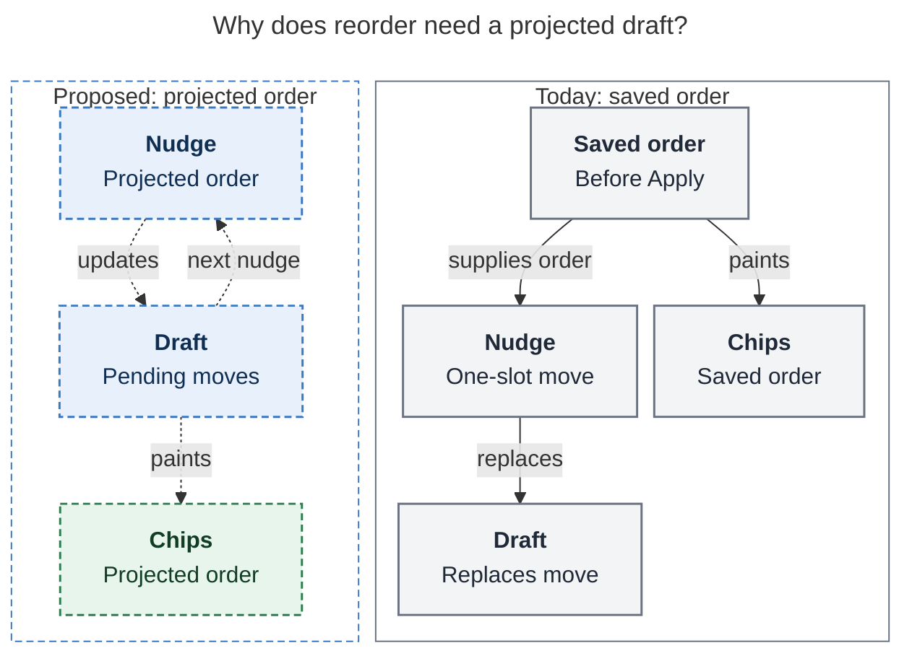
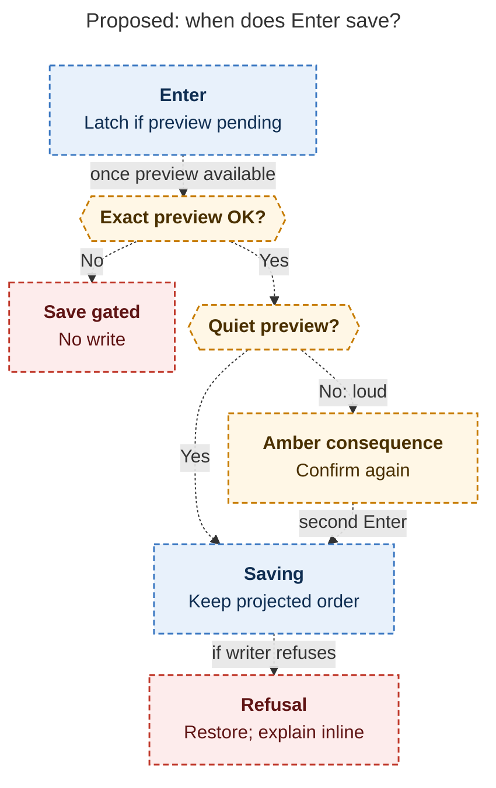
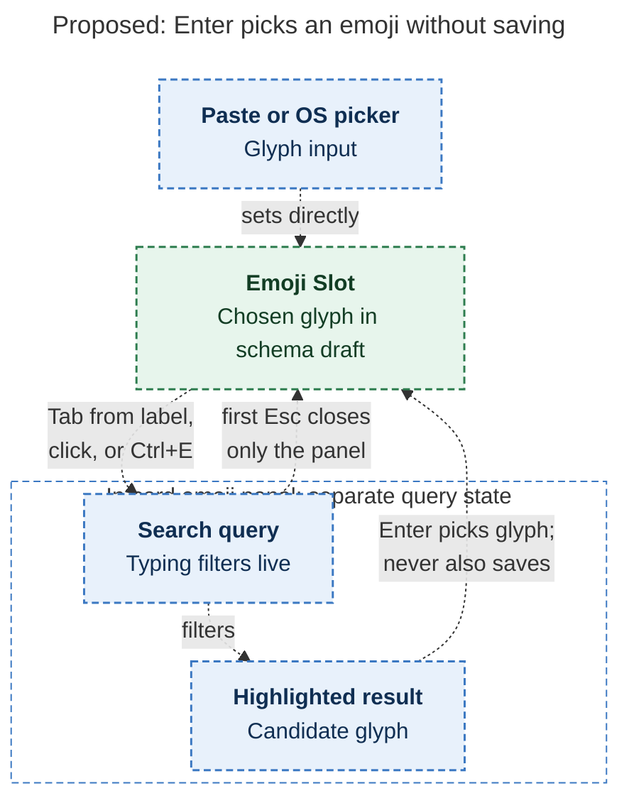

# Diagram proposals: Schema Editors: Emoji Completion and Multi-Slot Reorder — Consolidated Design

Proposals for the swarm linker, not a report. Each diagram restates only what the source
report says.

```yaml
source: research:202611/schema_editor_emoji_and_multislot_reorder/schema_editor_emoji_and_multislot_reorder__final.md
producer: research.51.image
check: "mmdc 12.0.0 with the PDF-mirroring config and Puppeteer no-sandbox rendered 3 of 3 Mermaid diagrams; deliberately broken input exited nonzero"
```

## reorder-draft

```yaml
anchor: |-
  model and `session.setDraft([op])` **replaces** the draft; the chips are painted from
question: |-
  Why do repeated nudges restage the same move today, and what changes with a projected draft?
illustrates: |-
  Today's chips and nudges use the server model, while the proposed projected model accumulates pending moves and repaints the chips.
caption: "Projected drafts accumulate moves and repaint chips; today's nudges keep replacing a move calculated from the unchanged saved order."
review: "674.125x577 px, fit 96.8%; question, source-trace, labels, arrows, and visual checks passed; 1 revision, 2 look rounds"
```



## save-gate

```yaml
anchor: |-
  the preview for the current revision is still in flight, Enter applies the moment it
question: |-
  When does Enter save the arrangement, require confirmation, or restore the order?
illustrates: |-
  The Enter latch waits for a successful preview of the exact envelope, then quiet previews auto-apply, loud previews ask for a second Enter, and refusals restore the order.
caption: "An exact preview gates every save; quiet changes need one Enter, loud changes need another, and refusals restore the order."
review: "504.06x1114 px, fit 80.1%; question, source-trace, labels, arrows, and visual checks passed; 1 revision, 2 look rounds; scoped to validation, confirmation, and refusal"
```



## emoji-focus

```yaml
anchor: |-
  Search text and chosen glyph are **separate state**: typing `rocket` can never become
question: |-
  How does choosing an emoji avoid accidentally saving the schema edit?
illustrates: |-
  The Emoji Slot keeps search text separate from the chosen glyph, so Enter selects a highlighted result without applying the schema edit and the first Escape closes only the panel.
caption: "Enter chooses without saving; Escape closes only the emoji panel, and paste or the operating system picker sets glyphs directly."
review: "437.469x807 px, fit 100%; question, source-trace, labels, arrows, and visual checks passed; 0 revisions, 1 look round"
```


