# Sibling link walks on area, project, notebook, and prose notes

> **Research query:** Add `]n` / `[n` (and, if grouping can be made intuitive, `]N` /
> `[N`) support to area notes, project notes, notebooks, and prose notes; paint a link
> walk widget at the very bottom of each property card, below every cabinet; walk only
> same-type notes that share a parent, grouped by parent; add a glossary term for
> "link walk"; and do this in parallel with the in-progress `bob-cli-qq` cabinets
> epic. Critique the request, lead the design, call out justified requirement
> changes, and recommend a solution.

Researcher: `grk`. Independent of the other four swarm reports. Sources are live
plugin fragments in `bob-plugins`, glossary strands, the decisions roster, the
`bob-cli-qq` bead and cabinets plan, navigation/record/intention-card docs, and
the already-shipped `plan:202611/bracket_n_group_jumps.md` architecture.

## Bottom line

**Yes — this is a good idea, and the architecture for it already exists.** Bob
already has a parent command and a child command. The missing axis is
same-type siblings. Cabinets will show the catalog; the link walk should tour
the members. Do it as a **plugin-only** extension of `api.navGroups`, with
**no walk lines written into these notes** and **no bob-cli release**.

Three corrections to the request as written:

1. **Same-parent membership and "group by parent" cannot both be literal.** A
   walk whose members all share one parent has one group, so `]N` has nowhere
   to jump. Keep the user's example (`bar.md` → `baz.md` under `foo.md`) as
   the *current group*, and widen the ring the way records and days already
   do: `]n` finishes a group, then enters the next; `]N` jumps group heads.
2. **Do not implement the card rail in parallel with `bob-cli-qq`.** The
   resolver and keymaps can land now. The rail mounts after the cabinet stack
   in files that epic is still rewriting.
3. **Do not write bob-owned walk lines** into area, project, notebook, or
   prose notes. Records need those lines because the album ring is a
   filesystem folder. These notes already have `parent:` and a type. Derived
   stops are enough, and they protect
   `decisions:prose-notes-are-owned-prose`.

**Recommendation in brief:**

1. Add a `route: "sibling"` provider to Ledger Tools `api.navGroups`. Authored
   link-only nav lines still win per role; derived sibling stops fill the rest.
2. Step membership is same-type children of the current parent, ordered like
   that type's catalog. When the parent is the same type, widen the ring to
   cousin families under the grandparent, grouped by parent, so `]N` works.
   When walking projects whose parent is an area, group Open then Closed.
3. Paint the existing kit rail (`propertyCardBuildRail`) after the cabinet
   stack, including Properties. Reuse the record/day chrome: prev, parent hub,
   live `N of M`, next, plus a group row when two or more groups exist.
4. Split the epic: resolver + keys + links footer now; card rail after
   `bob-cli-qq` go-live. Add `glossary:link-walk` at that go-live.

## Critique of the request

The idea is right. The gap is real. `open-parent-note` and `open-child-note`
already exist in Bob Navigation Hotkeys; sibling hopping today means the
quick switcher, a catalog click, or an authored `next` link almost nobody
writes on these notes. Pressing `]n` on `bar.md` and landing on `baz.md` is
exactly how the n-family already feels on records and days.

The request as written would still misfire in four places.

### 1. "Same parent" and "group by parent" fight each other

The example is unambiguous:

```text
pig.md   area
  foo.md project
    bar.md project   ← here
    baz.md project   ← ]n
```

`bar` and `baz` share `foo`. That is one group. Grouping those members by
parent draws a nice header ("Under Foo") and gives `]N` nothing to do.

Records solved this by making the group a *partition of a larger ring*:
`walk_by` groups, `]n` finishes a group then enters the next, `]N` jumps
heads (`docs/records.md`, `glossary:record-note`). Days do the same: `]n`
crosses week boundaries, `]N` jumps to the next week's Monday
(`docs/reference/plugins/intention-card.md`, `api.navGroups`).

**Justified adjustment:** the user's example remains the current group and
the default `]n` step. The ring is allowed to contain more than one parent
group so `]N` has a job. Details in [Membership](#membership-and-grouping).

### 2. Parallel-with-qq is file-level, not epic-level

`bob-cli-qq` is in progress: phases 1–7 closed, `.8` acceptance / `.9`
go-live / `.10` finish epic still running. Cabinets already own the bottom
of the card (`plan:202611/property_card_cabinets.md` A8: content cabinets,
then Properties last). qq.2 shipped a **walker-footer overlay** for the
armed `_` pick. That overlay is a status-bar crib. It is not the n-family
panel and must not be hijacked (the cabinets research already warned about
this).

The sibling *resolver* lives in `296f-plugin-nav-groups-api.js` and new
`296*` fragments. Cabinets do not touch those files. The *rail* has to
append after `propertyCardCabinetsAssemble` in `240r` / `240wl`, which
`.10.5` and `.10.6` are still converting. `bob-cli-r5` already parked a
related kit change until qq closes for the same reason.

**Justified adjustment:** land keymaps without waiting. Wait for the rail.
See [Coordination](#coordination-with-bob-cli-qq).

### 3. A widget "like the other files" is a derived rail, not a walk line

Records store `[[prev|‹ …]] · [[album|↑ …]] · [[next|… ›]]` as the first
body line. Days and periods often store a nav line from a template. Legacy
dailies already get a **derived** step row from `api.navGroups` when no nav
line exists. Area, project, notebook, and prose notes should follow that
legacy-daily path:

- No new Markdown.
- No `albums sync`-style rewrite on rename.
- Painting stays "never spawn bob, never write the vault"
  (`glossary:property-card`).

Writing a walk line into a prose note would change author-owned bytes,
which `decisions:prose-notes-are-owned-prose` forbids. Writing one into an
area or project would churn notes whose catalogs bob already owns.

### 4. Pure filename alphabetical order is the wrong default for projects

The request says "next (alphabetically)". Area catalogs already sort
siblings A–Z by stem with a path tie-break (`docs/areas.md`). Notebook
catalogs sort by display title, then path (`docs/notebooks.md`). Project
catalogs do **not**: open rows A–Z by stem, then a Closed subsection newest
closure first (`docs/reference/vault-format.md`). Walking a canceled
project between two live ones would disagree with the Projects cabinet on
the same card.

**Justified adjustment:** walk order equals that type's catalog order at
the current parent. For the `bar` / `baz` example both are open, so stem
order still matches.

## What already exists

The n-family is older than this request. The new work is one more derived
route, not a new keymap.

| Surface | Role today |
| --- | --- |
| `[n` / `]n` | Open the previous / next labeled body link (`next` / `prev`, or a single `‹` / `›`). Authored wins per role. |
| `[N` / `]N` | Previous / next **group head**. `]}` / `[{` repeat that uppercase jump. |
| `api.navGroups` v1 | Derived calendar step and group stops; record group stops from the album report. Non-calendar, non-record paths return `{ ok: true, route: null }`. |
| `resolveNavLinks` (`483-nav-group-links.js`) | One answer for keys, repeats, card rails, and the links footer. |
| Record walk rail | Docked in the card: `‹ prev · ↑ album · N of M · next ›`, plus a group row when `walk_by` is set. |
| Day / period rail | Same kit: authored nav line, or a derived step row; group row for week/quarter. |
| `propertyCardBuildRail` (`240g`) | Shared prev / parent / next row, optional group row, optional child chips. |
| Links walker footer | n-family status-bar compass over step and group stops (`glossary:walker-footer`). |
| Cabinets stack (`240wl`) | After qq, content cabinets then Properties, assembled around the foot. |

`navGroupsResolve` tries records, then calendar. Calendar on `foo.md`
returns `route: null`. `]n` on a project note today only follows an
authored `next` / `prev` link, which these notes almost never have. Adding
a sibling route between those two branches is the whole keymap
implementation.

bob-cli does not need a new command. Type and `parent:` already live in
frontmatter. Obsidian's metadata cache can answer membership synchronously,
which `api.navGroups` requires (never throws, never writes, never spawns
bob). That also stays off the release train
(`decisions:bob-cli-releases-ride-a-daily-train`).

## Membership and grouping

**Walk type** is the current note's primary type: `[[area]]`, `[[project]]`,
`[[notebook]]`, or `[[prose]]` (legacy `[[article]]` counts as prose). Mixed
types under one parent never share a ring. `bank.md` stays out
(`decisions:bank-hub-is-path-canonical-never-area`). Untyped hosts such as
root `area.md` stay out. Notes under `done/` and excluded directories stay
out, matching project catalogs.

**Current group** is every same-type note whose `parent:` resolves to the
current note's parent, including the current note. That is the user's
example, and it is the group the rail labels.

**Ring** depends on the parent:



Rendered size: 674.7 × 758 px; fit scale: 96.8%. Mermaid CLI 12.0.0.

**Caption:** Same-type children of the current parent form the current
group. Nested same-type trees widen to a cousin ring grouped by parent.
Projects under an area split Open and Closed. One-parent walks without
those sections have no `]N` target.

### Nested same-type trees (the `bar.md` case)

When the parent is the same type as the walk — sub-projects under a
project, sub-areas under an area, nested notebooks, nested prose — widen
the ring to every same-type child of every same-type sibling of that
parent (the grandparent's matching families). Groups are those parents, in
the grandparent's catalog order.

On `bar.md`:

| Key | Destination |
| --- | --- |
| `]n` | `baz.md` (next sibling under `foo`) |
| last sibling under `foo`, then `]n` | first project child of the next project under `pig` |
| `]N` | first project child of the next parent group |
| rail hub | `foo.md` |
| wrap | both ends, with `↺`, matching records |

This is the record `walk_by` contract applied to a tree. The user's
example is the first `]n`. The adjustment is only what happens after the
last sibling of `foo`.

If Bryan wants `]n` to wrap inside `foo` and never cross, that is still
coherent: keep the cousin families for the group row and `]N` only. I
would not do that. Every other n-family walk lets `]n` enter the next
group. Teaching a special "stay in this parent" rule for one species is
how the compass becomes untrustworthy.

### Parent is a different type (the common case)

`foo.md` is a project whose parent is the area `pig.md`. There is one
parent group: pig's project children. Cousin-widening would mix in
projects from sibling *areas*, which is a different depth and the wrong
surprise.

For **projects under an area**, use the catalog's own sections as groups:

- **Open** (ready, scheduled, blocked, invalid `^prj`), stem A–Z
- **Closed** (done, canceled), newest closure first

Then `]N` jumps to the first Closed row, or back to the first Open row.
That is the grouping the Projects cabinet already teaches.

For **areas under an area**, **notebooks under an area or project**, and
**prose under anything that is not itself prose**, the ring is that one
parent group. `]N` is a calm no-op: `Foo has one parent group — ]n walks
it`, matching ungrouped records.

### Order

| Type | Order inside a group |
| --- | --- |
| Area | Stem A–Z, ignore case, path tie-break |
| Project (open) | Stem A–Z, ignore case |
| Project (closed) | Newest closure first, undated last |
| Notebook | Display title A–Z, path tie-break |
| Prose | Display title (`title:`, else first alias, else stem) A–Z, path tie-break |

A singleton is `1 of 1` with the parent hub and no arms. `]n` notices
`No other project under Foo`. An orphan (missing, cyclic, or untyped
parent) is a singleton with no hub link.

### Authored links still win, with one prose guard

`resolveNavLinks` already prefers an authored role, then fills from
`navGroups`. Keep that. Catalog callouts (`**[[baz]]**`) do not qualify,
because they are not labelled `next` / `prev` and carry no arrow.

**Justified adjustment for prose (and it should apply to all four
types):** honor authored *step* links only on **link-only nav lines**, the
same rule group links already use. A sentence that says "see the
[next](other) draft" must not steal the sibling walk. Doubled arrows
already never step.

Derived sibling targets are existing notes only. Navigation never creates
an area, project, notebook, or prose note. Missing cousins are ghosts
(`· not in vault`), never dashed `+`.

## The rail, below every cabinet

The widget is the kit rail already used by records and days, not a new
species.

```text
‹ Bar                PROJECT · Foo · 2 of 3                Baz ›
⏮ Foo               ▮■▮                                Other ⏭
```

- Step row: previous sibling, parent hub (species word + parent title + live
  `N of M`), next sibling. Wrap uses `↺`.
- Group row: only when the ring has two or more groups. Arms are group
  heads. Centre ticks are the current group. A one-member group shows no
  ticks.
- Narrow panes compact to `‹ 2/3 ›` with full accessible names, matching
  records below 28rem.
- Clicks run `open-prev-link` / `open-next-link` / `open-prev-group-link` /
  `open-next-group-link` in the card's pane so jump history matches the
  keys. Mod-click opens a tab.
- Collapsing the card keeps the rail, as records already do.
- No count is stored. The rail is derived, like the record position.



Rendered size: 448.8 × 354 px; fit scale: 100%. Mermaid CLI 12.0.0.

**Caption:** The card face stays on top. Cabinets stack next, Properties
last among them. The walk rail pins after that whole stack so it sits
below every cabinet.

Today the record rail sits *above* the foot. After cabinets, the foot
*is* the Properties cabinet, assembled last in `propertyCardCabinetsAssemble`.
The request to put the walk "at the very bottom, below all cabinets" is
therefore a **family-wide layout fix**, not only a new-species paint:

1. Area / project / notebook / prose cards gain a rail for the first time.
2. Record and day/period rails move from above the foot to after the
   cabinet stack, so every species agrees.

Properties keeps the created stamp on its header row. The rail is compass
chrome, not a cabinet, and is not numbered by `_`. Do not sticky-float it.
Collapsed cabinets keep it near the face; open cabinets push it down,
which is correct: the catalog is what you were reading.

Top-level areas whose parent is the synthetic `[[area]]` omit the hub
link and centre the species word (`AREA · 3 of 12`). Inbox area notes
(`inbox`, `mac_inbox`, `gkeep_inbox`) stay in the top-level area ring.
They are area notes with the same parent. Excluding them would be a later
taste pass, not v1.

Ref cards, album notes, daily notes, period notes, and the bank hub are
out of scope. They already have their own n-family answers, or they are
not these four types.

## Coordination with bob-cli-qq

Cabinets and this walk share a *surface* (the bottom of the property card)
and almost no *code* if the work is split.



Rendered size: 640 × 548 px; fit scale: 100%. Mermaid CLI 12.0.0.

**Caption:** The sibling resolver and keymaps live in `navGroups`, which
cabinets do not touch, so they can land now. The card rail mounts after
the cabinet stack in files `bob-cli-qq` is still rewriting, so that paint
waits for cabinets go-live.

| Slice | Files | Parallel with qq? |
| --- | --- | --- |
| Sibling `navGroups` route + tests | new `296h-*`, `296f` dispatcher, `test-ledger-tools-nav-groups.cjs` | Yes |
| Keymaps / repeats | already consume `navGroups`; maybe a notice string in `483` | Yes |
| Links walker footer | already paints step and group stops | Yes, once the provider returns them |
| Card rail after the stack | `240r`, `240wl`, species painters, cabinets e2e | **No — after qq.9 / qq.10** |
| Glossary `link-walk` | `sase/memory/glossary/` | After qq.9: qq's memory decisions are locked to cabinet strands |

qq.2's walker-footer overlay stays the armed-cabinet crib. The n-family
panel keeps showing the sibling compass while a cabinet pick is *not*
armed. Do not add a fourth overlay.

bob-cli stays untouched. Mac Capture stays untouched. The daily train is
not a gate.

A preview gate is optional and probably unnecessary: derived `]n` on
these notes is additive (today it no-ops), and the rail can wait until
cabinets are on. If a gate is wanted, give it its own key
(`siblingWalkPreview`). Do not reuse `cabinetsPreview`.

## Glossary: Link Walk

Add a new strand. Do not overload Walker Footer with the membership rules.
Update Walker Footer in the same go-live so the links footer names sibling
notes beside days, periods, and grouped records.

Proposed strand (planning-time memory decision, default **yes** because
the user asked for the term):

```markdown
---
keyword: Link Walk
aliases:
  - "n walk"
  - "n-family walk"
  - "links walk"
---

The `n` bracket-walk family: `[n` / `]n` step to the previous / next note
stop, and `[N` / `]N` jump to the previous / next group head. `]]` / `[[`
and `]}` / `[{` repeat those motions once the family is selected. Stops
are a destination compass, never a review queue: authored link-only nav
lines win per role, then Bob derives the rest — calendar days and
periods, grouped album records, and same-type sibling notes under a
shared parent. The live position is painted by the property-card walk
rail and the links [[walker-footer]]; it is never stored. Missing album
records and missing sibling notes are never created; missing dailies and
periods follow their own create rules. The link walk is not the `]s`
review walk, the `]w` lane walk, or the `]b` bank walk.
```

Also touch, at go-live only: `glossary:walker-footer` (add sibling notes
to the derived-stop list), `glossary:area-card`, `glossary:project-card`,
`glossary:notebook-card`, `glossary:prose-card` (one sentence: rail below
the cabinet stack). Do **not** edit those card strands while qq.9 still
owns them.

A new decisions-web record is optional. The group-jumps epic declined one
that said "group stops are derived on Bob notes and authored only on nav
lines." This feature's membership rule is easier to get wrong than that
one, so I would add `decisions:sibling-link-walks-are-derived-and-grouped-by-parent`
at planning time, default **true**, citing this report. It is not required
to ship.

## What I would not do

- **Do not invent a fifth bracket family.** This is the n-family. A new
  `]p` for "parent tree" would split the compass Bryan already uses.
- **Do not walk mixed types.** An area's projects, notebooks, and prose
  are different cabinets. Mixing them in one ring makes `N of M` lie.
- **Do not sync walk lines.** Rename already updates `parent:` and
  catalogs. A second rewrite pass is how records earned `⟳`, and these
  notes do not need it.
- **Do not spawn bob from paint or from `]n`.** Use metadata cache, plus
  the cached project-status already on the card when grouping Open /
  Closed.
- **Do not wait for the whole qq epic before keys work.** The links
  footer will show the compass the same day the provider lands.
- **Do not put the rail above Areas.** That recreates today's record-rail
  vs foot bug on the cards that actually have catalogs.

## Suggested epic shape

Plugin-only. Two phases if qq is still in flight; one epic if qq has
closed by the time this is planned.

1. **sibling-route** (medium, parallel): `navGroups` sibling resolver;
   parent resolution from `parent:` wikilinks; catalog-order comparators;
   cousin ring; Open/Closed for projects under an area; authored link-only
   guard; unit tests around `test-ledger-tools-nav-groups.cjs` and
   `test-navigation-group-links.cjs`. `]n` / `]N` / `]]` / `]}` work.
   Links footer shows `Links 2/3` under Foo.
2. **sibling-rail** (medium, after qq go-live): append
   `propertyCardBuildRail` after the cabinet stack for area, project,
   notebook, and prose cards; move record and day rails to the same slot;
   real-Obsidian e2e on the pig/foo/bar fixture; screenshots in the family
   matrix.
3. **glossary** (small, with rail go-live): `glossary:link-walk` plus the
   footer and card-strand sentences, under accepted memory decisions.

Acceptance fixture for the user's example:

```text
pig.md     type: [[area]]
foo.md     type: [[project]]  parent: [[pig]]
other.md   type: [[project]]  parent: [[pig]]
bar.md     type: [[project]]  parent: [[foo]]
baz.md     type: [[project]]  parent: [[foo]]
aaa.md     type: [[project]]  parent: [[other]]
```

From `bar.md`: `]n` opens `baz.md`; `]N` opens `aaa.md`; the step row reads
`PROJECT · Foo · 1 of 3` (ring position, like a record's `3 of 104`) with a
group row `Foo … Other`. From `foo.md`: `]n` opens `other.md`; `]N` jumps
Open → Closed when any sibling project is closed, else the footer says one
group.

## Governing decisions and glossary

Read at research time, to cite from a later plan
(`decisions:decision-rules-are-read-at-planning-time`):

- `decisions:prose-notes-are-owned-prose` — no bob-owned walk line in prose.
- `decisions:notebook-routes-write-notes` — notebooks stay note bullets;
  the walk is a derived compass, not a new catalog format.
- `decisions:bank-hub-is-path-canonical-never-area` — exclude `bank.md`.
- `decisions:bob-cli-releases-ride-a-daily-train` — prefer plugin-only so
  this never waits on a CLI cut.
- Planned qq record `decisions:cabinets-absorb-catalogs-at-render-time` —
  catalogs stay in the note; the rail, like cabinets, is render-time.

Glossary already in play: Property Card, Area Card, Project Card, Notebook
Card, Prose Card, Area Note, Project Note, Notebook, Prose Note, Walker
Footer, Record Card, Album Note, Root Parent.

## Recommended solution

Ship a **sibling route of the existing link walk**, not a new walk.

Keep the user's example as the current group. Widen nested same-type trees
into a parent-grouped cousin ring so `]N` matches records. Group projects
under an area by Open / Closed so `]N` still has a meaning when there is
only one parent. Derive every stop from type + `parent:`. Write nothing.
Paint the kit rail after the cabinet stack. Land the resolver beside
`bob-cli-qq`; land the rail after it.

That is intuitive (siblings of the thing you are looking at), reliable
(one provider, authored-then-derived, no vault churn), and beautiful (the
same rail language as Eat / W47, sitting under the cabinets that list the
same members).
