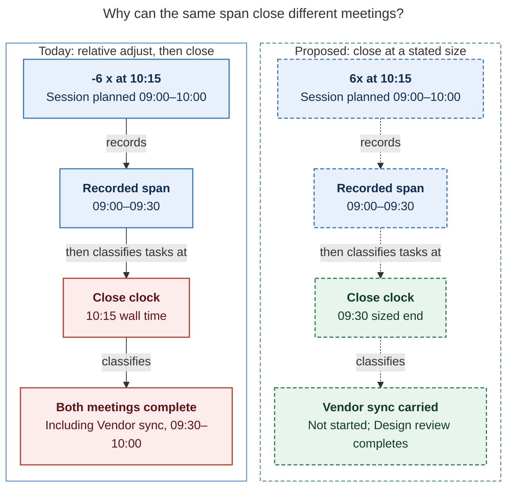

# Diagram proposals: `<N>x`: close the running Pomodoro at a stated size

Proposals for the swarm linker, not a report. Each diagram restates only what the source
report says.

```yaml
source: research:202611/sized_pomodoro_close/sized_pomodoro_close__final.md
producer: research.3s.image
check: "mmdc 12.0.0 with the PDF-mirroring config rendered 1 of 1 Mermaid diagrams"
```

## same-span-different-clock

```yaml
anchor: |-
  The chain cannot fix this: the `x` item does not know that
question: |-
  Why can the same recorded span close different meetings?
illustrates: |-
  A sized close uses the sized end as its close clock in the two-meeting example, so the same recorded span completes Design review and carries Vendor sync instead of completing both at the wall clock.
caption: "Without explicit picks, a sized close carries Vendor sync; today's chain completes it despite recording the same 09:00–09:30 span."
review: "656×721 px, fit 99.5%; question, source trace, labels, arrows, and visual checks passed; 1 visual revision; batch rendered 1/1; broken-diagram control exited nonzero"
```


