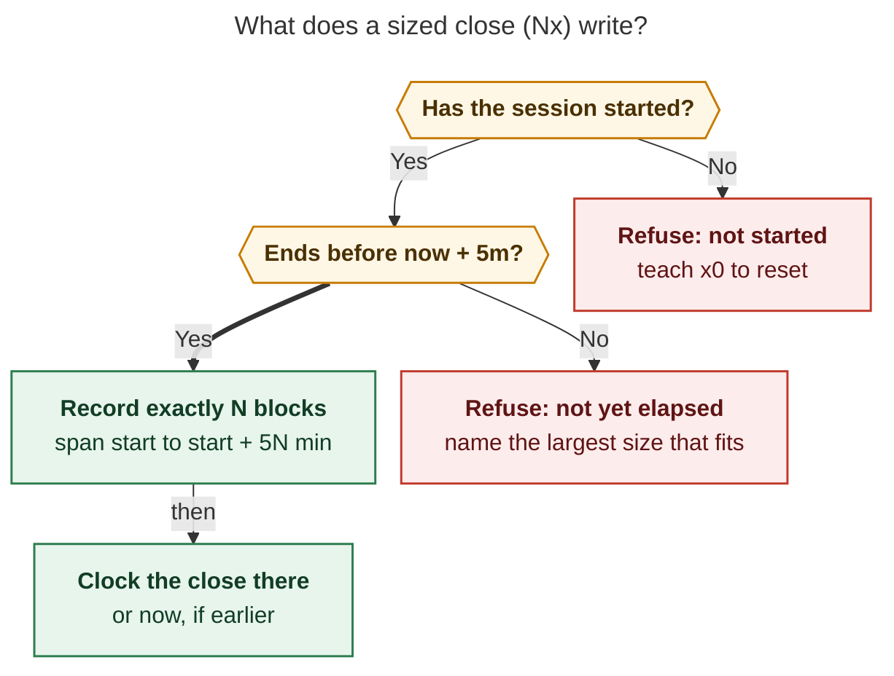

# `<N>x`: close the running Pomodoro at a stated size

*Consolidated research report (lead) · 2026-11-08 · merges the five swarm
reports ([cdx](sized_pomodoro_close__cdx.md), [cld](sized_pomodoro_close__cld.md),
[grk](sized_pomodoro_close__grk.md), [mus](sized_pomodoro_close__mus.md),
[gem](sized_pomodoro_close__gem.md)) with the lead's own source checks and a
vault-history audit.*

**Request.** Add an optional positive integer `<N>` before the `x` capture
close. `<N>` is the size, in five-minute blocks, that the running Pomodoro is
resized to before it closes. On a 25-minute session, `2x!2` should equal
`-3 x!2`. The point is to remove mental arithmetic. The design should be
intuitive, reliable, and beautiful.

## Bottom line

**Build it.** One rule should define it:

> **`Nx` means "I worked N blocks of this session."** Bob records exactly
> `5 × N` minutes from the session's start and closes it as of that moment. If
> that much time has not passed yet, Bob refuses and writes nothing.

Why it is worth building:

- **The need is real and frequent.** A new audit of the vault's git history
  covered 356 same-day closes over 40 days. **35% ended at a size plain `x`
  could not write**: 18% were shrunk below it and 17% ran past the original
  plan (§2.1). That is about two to three resizes a day, each needing `±k`
  arithmetic against a planned duration Bryan may not remember.
- **The spelling fits Bob's grammar.** Session time is already counted in
  five-minute blocks (`=3`, `+2`, `x=3`). The slot after `x` holds task
  numbers. A glued prefix is the only free slot that needs no new sigil:
  **time goes before `x`, tasks go after it**.
- **It fixes defects in today's workaround.** For a late close, `-3 x` reports
  a false `ran 40m over`. It stamps Work Log entries with the wall clock. It
  can **complete a meeting the shortened session never reached** (§2.2). A
  first-class sized close can state when the session actually stopped.
- **Prose collisions are theoretical so far.** No task line in the vault starts
  with `<digits>x`, and only 4 task lines start with a digit at all.

The five reports agreed on the spelling. They split on timing: when the size
has not elapsed yet, they would snap it, cut it, or record past now. The
recommendation here, **exact-or-refuse**, is a synthesis none of them proposed
in full. It is the only option under which the number typed is always the
number recorded and Bob never records time that has not happened. §3 resolves
every disagreement, §5 lists the eleven requirement adjustments, and the
**recommended solution is the last section**.

## Evidence base

| Source | Contribution |
| --- | --- |
| Five swarm reports | cld built `master` @ `59ba11a6` (grammar 19) and ran dry-run probes, including the Event Task defect. cdx ran timing probes on the installed `bob 0.4.0` (grammar 16). grk, mus, and gem read source. mus also ran `capture-parse` probes |
| Lead source check, bob-cli @ `c4d81e17` (still grammar 19) | `close_timing` (`src/native/capture_pomodoro_close/ledger.rs:187`); `plan_pomodoro_close_for_entry` / `close_clock_for_entry` (`linked_tasks.rs:1027`, `:1574`); Work Log stamping from the close's `now` (`linked_tasks.rs:299`); the past-record path that closes at its own clock (`capture/pomodoro_past.rs:1417–1450`); `start_block_minute` rounding a start up to the next five-minute mark (`capture/meet_event_run.rs:200`); adjust clamping at 0 (`pomodoro_adjust.rs:299`); inline-close lead/trail splitting (`capture_language/draft.rs:497–600`) |
| Lead source check, bob-mac-capture @ `0583f37` | Close card draws `planned → closed` only when `decrementedMinutes > 0`; otherwise it shows the planned range (`CapturePomodoroClosePresentation.swift:255–278`). Span kinds map by string with a `default` fallback, and `pomodoro_close` already takes the session-operator tint (`CompletionRowContent.swift:170`) |
| Lead vault audit (read-only, `~/bob` git history, 2026-09-30 → 2026-11-08) | For each non-MEET timed session: first open plan, adjusts committed separately, closed span, and close-commit time, compared with what plain `x` writes. Plus collision greps (§2.1, §2.3) |
| Decision memory | `event-task-links-close-by-the-clock`, `close-selections-list-explicitly`, `mac-capture-is-a-thin-client`, `bob-cli-releases-ride-a-daily-train` |
| Related research | `research:202611/close_outcome_x_s_typing_aliases/close_outcome_x_s_typing_aliases__final.md`: the accepted but unshipped `xx`→`x!` / `xs`→`x*` editor aliases (§4.6) |

Limits: the lead did not build bob or run new capture probes. Executable claims
come from cld's and cdx's probes and were cross-checked against current source.
The vault records outcomes, not keystrokes, so the audit infers resizes from
before-and-after spans (§2.1 caveats). No Swift was compiled.

## 1. What exists today

| Spelling | Meaning | Where the count goes |
| --- | --- | --- |
| `=3` | Start now for 3 blocks (15m). The start rounds now *up* to the next five-minute mark | after `=` |
| `+2` / `-3` | Move the running session's end by 2 or 3 blocks (start fixed; clamps at 0) | after the sign |
| `++2` / `--2` | Shift the whole session | after the signs |
| `x[K][*P][!M][~D][@K]` | Close; the numbers are **Task Link numbers** | after `x` (taken) |
| `x=3…` | Record a *past* session of 3 blocks ending now | after `x=` |
| `@r:id=x…`, `^r:id=x…` | Link a task, then close | after `=x` |
| `+2 x`, `x =`, `-3 x!2` | Same-line chains, run left to right as one atomic batch | — |

**How `x` times a close (`close_timing`).** Let `remaining = end − now`,
normalized into (−720, 720]:

- If `remaining ≥ 5`, the end moves back by `5·⌊remaining/5⌋`, the first
  five-minute step at or after now.
- Otherwise the span stays as written. **`x` never extends**, and an overrun is
  reported (`ran 7m over`).
- If the session has not started, `x` records a zero-length span with an
  `x0` hint.

The same `now` also drives three other effects:

- Event Task classification: `C = now` in `close_clock_for_entry`.
- Work Log timestamps.
- The early/overrun report.

**What `<N>x` parses as today.**

| Draft | Today |
| --- | --- |
| `2x!2`, `2x`, `2x =`, `2x=3`, `2X` | Ordinary task prose |
| `@r:id=2x`, `^r:id=2x!1` | Error: "close-shaped name; write `=2#x`" |
| Whole-item `=2x` | Same error |

The link-suffix spellings are therefore free to claim. All five reports
confirmed this. mus thought they collided with `=<X>` start timing; the probes
show they are errors today.

## 2. Is this a good idea?

### 2.1 How often closes need a resize (new data)

None of the five reports could measure how often a close needed resizing.
cld's duration histogram shows only that 136 of 471 recent closes were 25
minutes. The lead replayed every commit to each daily note in the last 40 days.
For each non-MEET session, the audit compared the closed end with what plain
`x` would write at the close commit, allowing three minutes of commit latency.

| Outcome (356 same-day, non-MEET closes) | Count | Share |
| --- | --- | --- |
| Plain `x` from the original plan writes this span | 230 | 65% |
| **Shrunk below what `x` could write** (`-k x`, or a hand edit) | **63** | **18%** |
| **Extended past the original plan** (some `+k`) | **62** | **17%** |
| Other | 1 | <1% |

Excluded from the table: 120 sessions that were born closed (`x=` records or
hand-written rows), sessions closed on a later day, and MEET rows.

What the data says about the design:

1. **Shrinks are late closes.**
   - Every one of the 63 shrinks ended at or before its close commit. In 60 of
     them the gap was five minutes or more: 43 by 5–30 minutes and 17 by more
     than 30.
   - So the size had always already elapsed.
   - It also means the gap between the sized end and the wall clock is usually
     5–30+ minutes. Which clock stamps Work Logs and classifies Event Tasks
     matters in practice.
2. **Shrinks are small numbers.** 53 of 63 ended at 1–4 blocks: 1 block 5×,
   2 blocks 17×, 3 blocks 26×, 4 blocks 10×. These are trivial to type.
3. **Extensions are common, but only some happen at the close.**
   - 37 of the 62 had an adjust committed while the session was still open.
     That fits a mid-session `+k` ("ten more minutes"), which `Nx` does not
     replace.
   - The other ~25 were decided at close time, mostly at 6–10 blocks.
   - So lengthening must be supported.
   - Only 7 extensions ended after their close commit, all by 1–3 minutes.
     That is inside `x`'s own five-minute round-up.
   - Across all 125 recorded resizes, the timing rule's refusal branch (§4.1)
     **would never have fired**.
4. **Rate.** About 88 of the 356 closes needed an at-close resize (63 shrinks
   plus ~25 extensions), roughly **2 a day**. Each cost the
   planned-duration lookup and a subtraction.

Caveats:

- Commit time stands in for close time. Vault commits are event-driven and
  land seconds after a write.
- A shrink can be a hand edit in Obsidian rather than `-k x`.
- Sessions shifted with `++`/`--` are keyed by their new start.

### 2.2 Why today's workaround is not good enough

The workaround is `-k x` (or `+k x`):

- **Arithmetic against hidden state.** You must know the *planned* duration,
  convert it to blocks, subtract, and pick a sign.
  - The planned duration is often not 25 (`=3`, `=6`, MEET spans, earlier
    adjusts).
  - Reusing a habitual `-3` on a 15-minute session clamps it to 0 rather than
    raising the error gem assumed.
  - A non-grid 23-minute session needs a 13-minute cut, which no `-k` can
    express. cdx's probe recorded 8 minutes.
- **A false report.**
  - At 09:50, `-3 x!2` on `0900-0925` prints `ran 40m over` (cld).
  - It also renders two preview cards (adjust, then close) for one thought.
- **Wrong clocks.**
  - Work Log entries are stamped 09:50, not 09:10.
  - Worse, Event Tasks are classified at the wall clock. In cld's probe, a MEET
    `0900-1000` held *Design review* `0900-0930` and *Vendor sync*
    `0930-1000`. `-6 x` at 10:15 shortened the span to `0900-0930` but still
    **completed Vendor sync and split the session's minutes across both
    meetings**.
  - The chain cannot fix this: the `x` item does not know that the `-6` before
    it meant "I stopped at 09:30".

gem argued that plain `x!1` "leaves the span at 25 minutes" when Bryan stops
early. **That is false.** `x` already trims to the first step at or after now.
The real gaps are the three cases `x` cannot express:

- **Closing late:** "I stopped at 09:10; it's 09:50 now."
- **Claiming an overrun:** `x` never extends.
- **Rounding down instead of up.**

### 2.3 Costs

| Cost | Assessment |
| --- | --- |
| **First digit-led operator.** Every Bob capture operator starts with a sigil or `x` (gem). `Nx` breaks that rule: `2x4 lumber` and `2x speed` would close the running session with a Work Log entry | **Low in practice.** The vault has 0 task lines starting with `<digits>x` (either case) and only 4 starting with any digit. Standalone `<N>x` words occur only mid-sentence in notes (`10x ARR`), never at an item start. Escape: `2X4 lumber`. With no running session, the close errors instead of writing. Mark the change `feat(capture)!` |
| **Two kinds of numbers.** `2x2` reads like dimensions, and the 2s mean different things (blocks vs. a task number) | Learnable with one rule ("time before `x`, tasks after"). Keep the axes visually apart: the size sits on the timing chip, task numbers on the task rows (§4.4) |
| **Not all arithmetic disappears.** "Ten minutes" still has to become `2` | It is the same conversion `=2` and `x=2` already need, and the audit shows the sizes are 1–4 (§2.1) |
| **Typo amplification.** `20x` for `2x` is 100 minutes | Handled by the timing rule: such sizes have not elapsed, so Bob refuses (§4.1) |
| **More grammar to document** | One syntax row, one subsection, and one decision record |

**Verdict: worth doing.** It is a terse operator for an action Bryan takes about
twice a day. It removes a state-dependent subtraction, it makes clock effects
honest, and its risks can be contained.

## 3. Where the reports disagreed, and how this report resolves it

| Question | cdx | cld | grk | mus | gem | **Resolution** |
| --- | --- | --- | --- | --- | --- | --- |
| What if the sized end is after now (`2x` at 09:03)? | Record exactly; the end may be in the future | Cut at now, like `x`, with a warning | Resize, then the ordinary snap | Same as grk | Exact (implicit) | **Refuse** with a fix (§4.1). The other options under-record silently, write typos, or record unworked time |
| Clock for Event Tasks, Work Log, and the report | Actual now | Sized end, `C = min(E′, now)` | Now | Now | — | **cld.** It matches the decision record's "session start S and close time C" and the `x=` precedent |
| Lengthen (`7x` on 25m)? | Yes | Yes | Yes (overrun admit) | Yes, via snap | Yes | **Yes** (unanimous). The audit shows ~25 at-close extensions |
| Range of N | 1–287 | 1–99 (two digits); 3+ digits reserved | Any N ≥ 1 | 1–288 | Reject past midnight | **1–99** (cld). Wrap at midnight like `+N`, not gem's rejection |
| Link suffix `@r:id=2x!1` | Yes | Yes | Yes | No (v1) | Yes | **Yes.** Those spellings are errors today, so nothing collides |
| Claiming rule | Same as `x`; document the `2x4` break | Same as `x`; never after inline log text | Same as `x` | Strict; `X` escape | "Sigil-or-boundary": `2x lumber` stays prose | **Same as `x`**, plus cld's trail guard. gem's rule would make `2x wired the lexer` a task while `x wired the lexer` closes, to guard against 0 historical collisions |
| Span for the digits | Timing colour | Extend `pomodoro_close` | New `pomodoro_close_duration` kind | `pomodoro_close` family | — | **Extend `pomodoro_close`.** The current Mac app tints it, but an unknown kind falls to `default` (untinted) |
| JSON `planned` | Original span; `closed` final; decrement 0 | Sized span; original in `size.from` | Original (implied) | Additive `resize` member | Additive fields | **Sized span** (cld). The current Mac app then renders truthfully. With cdx's choice, a lengthened `7x` would display as `0900-0925 · 25m` (decrement-only arrow, verified) |
| Session not started | Refuse | Cut to 0m and warn | 0m | 0m | — | **Refuse** (cdx). This falls out of the timing rule |
| Whole-item `=2x` | Teaching error pointing at `2x` | Teach both readings | Keep the start near-miss | — | Accept as an alias | **Teach both** (cld). `=` means start |
| `2x0` | Close, never reset | Same | Same | Same | — | **Close** (unanimous) |

## 4. Recommended design

### 4.1 Semantics: exact-or-refuse

Let the running session be `[S, E)`, let `T` be now, and let `N ∈ 1..=99`.

1. **Started?** If `S > T`, refuse (`pomodoro_close_size_not_started`).
2. **Sized end.** `E′ = S + 5N`, computed mod 1440 like `+N` and kept with its
   day offset until validation.
3. **Elapsed?** If `E′ − T ≥ 5`, refuse (`pomodoro_close_size_not_elapsed`).
   This allows exactly the five-minute round-up `x` already makes. The largest
   size that fits is `⌈(T − S)/5⌉` blocks, and the error names it.
4. **Size.** Stage the span `[S, E′)` with the same formatter `±N` uses
   (`format_adjusted_range`), preserving the clock key (`[t::]` or `[off::]`).
   Lengthening fires the same `pomodoro_runs_past_event` warning that `+N`
   fires.
5. **Close at `C = min(E′, T)`.** Call
   `plan_pomodoro_close_for_entry(…, C, …, LedgerClosePolicy::Ordinary)`. This
   is the explicit-clock entry point the `x=` record path already uses. At `C`,
   `close_timing` sees `remaining ∈ [0, 5)`, so it never trims again. Every
   other close behaviour is unchanged:
   - selection and explicit mode;
   - Event Task classes over `(S, C)`;
   - Work Log stamps at `C`;
   - names, carry, the continuation, and successor offers.
6. **Report.** `remaining = E′ − C`: 0, or under 5 inside the round-up. There
   is never an overrun line.



*Caption: a sized close either writes exactly N blocks from the session's
start and clocks the close at that end, or refuses and writes nothing. It never
snaps, cuts, or records more than `x`'s own five-minute round-up past now.*
Rendered with Mermaid CLI 12.0.0 under the research-PDF config: 693 × 714 px,
fit scale 94.2%.

**Why exact-or-refuse wins.** BUILD runs `0900-0925`. The table shows the
recorded span under each candidate rule:

| Draft @ now | Resize then snap (grk, mus) | Cut and warn (cld) | Exact (cdx) | **Exact-or-refuse** |
| --- | --- | --- | --- | --- |
| `2x` @ 09:50 (closing late) | 10m | 10m | 10m | **10m** |
| `2x` @ 09:08 (inside the round-up) | 10m | 10m | 10m | **10m** |
| `7x` @ 09:50 (claiming an overrun) | 35m | 35m | 35m | **35m** |
| `2x` @ 09:03 | 5m, silently | 5m + warning | 10m, ending 7m ahead | **Refused: "1x fits"** |
| `7x` @ 09:12 | 15m, silently | 15m + warning | 35m, ending 23m ahead | **Refused: "3x fits"** |
| `20x` @ 09:50 (typo for `2x`) | **50m**, silently | **50m** + warning | 100m | **Refused: "10x fits"** |
| `2x` on a 23m session @ 09:30 | 10m | 10m | 10m | **10m** (`-3 x` gives 8m) |

Where the size has elapsed, which covers all 125 resizes in the audit, all
four rules agree. They differ only on impossible requests, which are usually typos:

- **Snap and cut** silently replace the typed number with another one, and both
  *lengthen* the session on a typo.
- **Exact (cdx)** records unworked time, which pollutes Worked stats. It also
  breaks chains. Because `=` starts at now rounded up to five minutes, `2x =`
  at 09:03 would close `0900-0910` and then start the next session at 09:05,
  **overlapping it**.
- **Refusing** keeps the promise *the number before `x` is the number
  recorded*. The live preview shows the error before Return, and the message
  carries the fix.

**The request's equivalence.** On a 25-minute session, `2x!2` and `-3 x!2`
write the same span and the same task selection whenever the size has elapsed.
That covers every realistic case. Only at 09:05 or earlier do they diverge:
`-3 x!2` writes 5 minutes or less, and `2x!2` refuses. The clock-dependent effects differ on purpose
(adjustment R4).

**The one-sentence contract for docs.** *`Nx` closes the running session as if
you had typed `x` the moment it reached N blocks. Unlike `x`, it may also
lengthen the session, and it never records time that has not happened.*

### 4.2 Grammar

The form is `[N]x[K][*P][!M][~D][@K]`, plus today's inline Work Log, child
bullets, and chains. `N` is one or two ASCII digits glued to a **lowercase**
`x`. After `x`, the text must already be close-shaped: empty, or starting with
a digit, `,`, `!`, `~`, `*`, or `@`. Modifier order, wildcards, and the
typed-last `@K` stay exactly as today.

| Input | Behaviour |
| --- | --- |
| `2x`, `2x!2`, `2x*!2`, `2x1,3!2`, `2x!2@1` | Sized close (10m) with today's selection semantics. The prefix is **never** a task selection (`2x` defers exactly what `x` defers) |
| `02x` | Valid, 2 blocks. Leading zeros match `=03`, `x=03`, and `+03` |
| `2x wired the lexer`, `2x` + child bullets | Sized close with a Work Log entry stamped at `C` |
| `2x =`, `2x =bugs`, `--1 2x!2`, `2x x=fix~` | Leading session chains. A `--1` shift runs first, so the size counts from the shifted start |
| `@r:id=2x!1`, `^r:id=2x`, `<text> @r:id=2x` | Link first, then the sized close. Today these are errors, so nothing collides |
| `2x0` | Sized close that defers every plain link. **Never a reset** (a size always closes) |
| `2x~`, `2x1,` | The incomplete-selection state `x~` and `x1,` have today |
| `0x`, `00x` | Claimed error: "a sized close needs at least 1 block: write `1x` for 5 minutes, or `x0` to reset the session" |
| `100x`, `0910x` | Claimed error: "a close size is 1–99 five-minute blocks (`12x` is an hour)". Three or more digits stay **reserved** for a possible clock-time close ("stopped at 09:10") |
| Whole-item `=2x` | Claimed error that teaches both readings: "`=2x` is not a start: write `2x` to close at 10 minutes, or `=2#x` to start a Pomodoro named X" |
| `2x=3` | Teaching error: "`x=` records a past Pomodoro and takes its size after `=`. Write `x=3`, or `2x =3` to close at 10 minutes and then start" |
| `2x#bugs` | The same near-miss as `x#bugs`; teach `2x =bugs` |
| `2X`, `2X4 lumber`, `2 x!2`, `2xx`, `2x-ray`, `2.5x`, `２x` | Prose, as today. Capital `X` is the documented escape, and there is no spaced form |
| `x made it 2x` | One close whose log reads "made it 2x". **A sized token is never a trail head after inline Work Log text** (cld). Without this guard, the line would split into two closes and abort |

Never search-and-replace `\d+x` across a draft, and never rewrite the prefix.
Completion and rewrite edit only the selection span.

### 4.3 Machine contracts

- **`capture-parse` spans.** Extend the existing `pomodoro_close` span over the
  digits, so `2x!2` becomes `0–2 pomodoro_close` plus
  `2–4 pomodoro_close_complete`. This mirrors `pomodoro_start` covering `=3`
  and `pomodoro_past` covering `x=3`. An unmodified Mac app therefore tints the
  size correctly. The digits are not a list span, so the comma assist never
  turns `12x` into `1,2x`.
- **`capture-parse` spec.** Add `pomodoro_close.size: {"raw":"2","blocks":2,"minutes":10}`,
  omitted when absent, so unsized payloads stay byte-identical. The human line
  reads `close     2x!2 (10m · complete 2 · defer the rest)`.
- **`bob capture` JSON.** The result stays one `pomodoro_close` object, with no
  sibling `pomodoro_adjust` item:
  - `planned` is the sized span. This is what the chain's close item reports
    today, and it keeps old clients truthful.
  - `closed` is the result.
  - `decremented_minutes` is `0`.
  - `remaining_minutes` is `E′ − C`, and `closed_at` is `C`.
  - The additive member is:

    ```json
    "size": {"raw": "2", "blocks": 2, "minutes": 10,
             "from": {"time_range": "0900-0925", "duration_minutes": 25},
             "delta_minutes": -15}
    ```

- **Grammar revision** goes from 19 to 20. The Mac app must not advertise `Nx`
  until Bob reports at least 20 (cdx).

### 4.4 Presentation: one card, two visible axes

The size lives on the **timing line**. Task numbers stay on the **task rows**.
The two kinds of number never share a place.

Terminal:

```text
ok closed BUILD 0900-0925 → 0900-0910 (10m · 2x, −15m) · 2026/20261108.md line 7
  1 [*] deferred  Add support for x syntax  bob.md ^capture-stop
  2 [*] → [x]     Web capture               bob.md ^web-capture +1 Work Log
      *2026-11-08 09:10* — wired the lexer
  next: BUILD (created) at line 9 · carries 1 link
```

The caption changes by case:

| Case | Caption |
| --- | --- |
| Lengthen | `0900-0925 → 0900-0935 (35m · 7x, +10m)` |
| Same size | `0900-0925 (25m · 5x)`, with no `ran 25m over` |

Mac close card. The `[ … ]` chip replaces the early/over chip and uses the
session-operator tint:

```text
Close BUILD
0900–0925 → 0900–0910 · 10m                 [ 2x · as of 09:10 ]
2  Complete  Web capture
1  Deferred  Add support for x syntax
```

Extensions get an arrow with the same weight as shrinks; today's decrement-only
logic must change. The accessible label is a sentence: "Close BUILD at 10
minutes, 2 blocks, 15 minutes shorter than planned."

Refusals name the field, the fact, and one fix:

```text
error: 7x asks for 35m, but BUILD has run 12m (since 0900); nothing was written
  3x closes at 0915 · x closes now
```

Teaching copy:

- **Inline hint:** "Before `x`: 5-minute blocks · after `x`: task numbers"
  (cdx).
- **Mnemonic** (cld): "`=` starts now, `x` stops now, `Nx` stops at N blocks,
  `x=` records what already happened."
- **Optional** dim, human-only tip when a `±k x` chain could have been `Nx`:
  `tip: 2x!2 closes at 10m in one step`.

### 4.5 Thin-client compatibility

| Pairing | Behaviour |
| --- | --- |
| New bob + current Mac app | Works. The digits are tinted as session syntax. The card reads `0900-0910 · 10m · on time`, which is truthful, though it has no "from 25m" and no size chip |
| New bob + updated Mac app | The full card from §4.4 |
| Old bob + any app | `2x…` stays a task. Live preview shows task mode before Return |

The app never parses the size itself (`decisions:mac-capture-is-a-thin-client`).

### 4.6 Other interactions

- **`xx`/`xs` typing aliases.** These are accepted but not shipped. Their Mac
  prefilter `(^|[ \t=])x` does not see `2xx`, because there a digit precedes
  the `x`. Whichever feature lands second must:
  - widen the prefilter to `(^|[ \t=])[0-9]{0,2}x`;
  - teach the alias locator the size prefix;
  - add `2xx → 2x!`, `2x1s → 2x1*`, and `^r:id=2xs → =2x*` to the shared
    eligibility table.

  Never rewrite the size digits.
- **Event Task vectors.** `classify(span, S, C)` is unchanged; only the `C`
  passed in is new. `tests/fixtures/event_task_close/vectors.json` needs no new
  vectors. Add a CLI test for cld's two-meeting MEET instead.
- **Release.** Claiming previously valid prose is a grammar break. Ship it as
  `feat(capture)!:` on the daily train, as `x=` was. JSON changes are additive.
  Do not edit the version or the changelog
  (`decisions:bob-cli-releases-ride-a-daily-train`).
- **Out of scope.** Plain `x` on an overrun still classifies Event Tasks at
  now. That is defensible when you really kept going, and `Nx` is the honest
  spelling when you did not. Leave plain `x` and the `±k x` chain unchanged.

## 5. Requirement adjustments (flagged)

| # | Kind | Adjustment | Why |
| --- | --- | --- | --- |
| **R1** | Clarified | `N` is an absolute size counted from the session's **start**, not a delta. The 25-minute example is a special case | The planned duration becomes irrelevant, which is the whole arithmetic saving |
| **R2** | **Changed** | **Exact-or-refuse.** Record exactly `5N` minutes, or refuse when the size ends five or more minutes after now. The latter includes a not-started session | The typed number is never silently replaced, unworked time is never recorded, and typos are caught (§4.1). The literal "resize, then close" reading would snap |
| **R3** | Widened | `N` may exceed the planned size (`7x` lengthens) | About 25 at-close extensions in 40 days; `x` never extends |
| **R4** | **Changed** | The clock-dependent effects use `C = min(E′, now)`: Event Task classes, Work Log stamps, the early/overrun report, and `closed_at`. Strict `-k x` equivalence holds for the span and selection only | Otherwise a sized close completes meetings the session never reached and reports a false overrun (§2.2). `x=` already closes at its own clock |
| **R5** | Narrowed | `N` is 1–2 digits (1–99). `0x` and 3+ digits are claimed teaching errors, and 3+ digits stay reserved | Sizes in practice are 1–19 blocks. A clock-time close stays possible later. Arithmetic stays well inside the (−720, 720] window |
| **R6** | Clarified | `2x0` always closes; it never resets | A stated size claims work; this matches "explicit modifiers always close" |
| **R7** | Added | Lexical scope matches `x`: lowercase only, at item start or in a leading chain, never as a trail head after Work Log text. `2X…` is the documented escape | Parity with `x` beats special-casing a collision with no recorded occurrences |
| **R8** | Widened | Link closes accept the size (`^r:id=2x!1`) | They are collision-free, and every form of the close should agree |
| **R9** | Added | One item, one card, one JSON close. `planned` is the sized span, `size` is additive, and the digits extend the `pomodoro_close` span | Beauty, and truthful rendering on current Mac builds (§4.3) |
| **R10** | Added | Grammar 20 ships as `feat(capture)!` with documented prose breaks | Claimed prose changes meaning |
| **R11** | Added | A decision record: *"A Sized Close Records Exactly N Blocks At Its Sized End"* | It extends the Event Task clock record's meaning of `C` |

## 6. Alternatives considered

| Alternative | Verdict |
| --- | --- |
| **Status quo `±k x`** | Keep it unchanged as the *relative* spelling, which is still right for "five more minutes" |
| **Lex `2x` into the chain `-3 x`** | Reject. It is wrong for non-grid durations, keeps the defects in §2.2, and shows two cards |
| **Resize then snap** (grk, mus) | Reject. `Nx` would not always record N blocks, and a typo silently lengthens the session (§4.1) |
| **Cut with a warning** (cld) | Reject. The warning arrives after the write, the CLI has no preview, and `20x` writes 50 minutes |
| **Exact even into the future** (cdx) | Reject. It records unworked time and makes `2x =` overlap the next session |
| **Sigil-or-boundary claiming** (gem) | Reject. `2x wired it` would become a task while `x wired it` closes, all to prevent a collision the vault has never had |
| **`=2x` as an alias** (gem) | Reject. `=` means start; keep the teaching error |
| **A suffix size** (`x:2`, `x/2`, `x!2:10m`, `x@2`) | Reject. Every adjacent sigil is taken (`@K` is the keep list, `:` picks), and trailing text is Work Log |
| **Minutes** (`10mx`) | Reject for v1. Every session operator counts blocks, and the audit's sizes (1–4 blocks) need no conversion effort. Reopen only if Bryan thinks in minutes (Q2) |
| **Clock-time close** (`0910x`) | Defer and reserve (R5). It removes the most arithmetic for "I stopped at 09:10" but costs four keystrokes instead of one |
| **An absolute-resize operator** (`:2 x`) | Reject. Nobody asked for an absolute resize of a session that keeps running, and it brings the two-token chain back |
| **Rejecting midnight crossings** (gem) | Reject. Wrap mod 1440, as `+N` does |
| **Obsidian `N<Ctrl+Enter>`** | Optional follow-up. bob-plugins already uses Vim counts on other keys |

## 7. Implementation plan

### 7.1 bob-cli (one `feat(capture)!` change, grammar 20)

1. **Lexer**, in `capture_language/`:
   - Add a size-aware classifier beside `classify_whole_item_close`
     (`close_selection.rs:107`). It returns `(size, size_range, after_x)` and
     the claimed-error shapes.
   - Give the same treatment to link suffixes in `close_after_eq_parts` (`:74`).
   - Accept the sized token in `session_equals_token`, `is_session_chain_token`,
     and `is_close_hash_token` (`item.rs:3693`, `:3967`, `:4040`).
   - Exclude it as a trail head in `split_inline_close_tokens` (`draft.rs:552`).
   - Add `size: Option<CloseSize>` to `PomodoroCloseSpec` (`model.rs:284`),
     skipped when `None`.
2. **Execution**, in `plan_pomodoro_close_item` (`capture/pomodoro_close.rs:1849`)
   and the link/new-task close paths:
   - Resolve the running entry against staged state, after earlier chain items
     and any same-item link insertion.
   - Apply the §4.1 checks and stage the sized line.
   - Call `plan_pomodoro_close_for_entry` at `C` with `Ordinary`, using
     `pomodoro_past.rs:1417–1450` as the template.
   - Build the summary at `C` and add `size`.
   - Make `is_reset_spec` and `is_reset_selection` (`reset.rs:30–42`) treat a
     size as "not a reset".
   - Keep every write inside `CaptureBatchPlanner`, so a refusal or a later
     batch error rolls everything back.
3. **Output.** The caption, no overrun line on sized closes, the refusal copy,
   and the `size` JSON.
4. **Docs.** First read the `docs` and `cli_rules` reference memories. Then
   update:
   - `docs/capture.md`:
     - the syntax table row;
     - a lifecycle row;
     - a new "Closing at a size" subsection;
     - a sized-close note in the Event Task clock section;
     - the chaining and link-close sections;
     - the mnemonic.
   - `docs/reference/capture-syntax.md`, adding the newly reserved prose shapes
     and the `X` escape.
   - The `capture` / `capture-parse` help.

   Finish with `just docs-gen` and `just docs-check`.
5. **Memory**, through `/sase_memory_write`: the R11 decision record and the
   Capture glossary term (`Nx`).

### 7.2 Bob Mac Capture (follow-up, gated by exact-SHA macOS CI)

- Decode `pomodoro_close.size` with `decodeIfPresent`.
- In `CapturePomodoroClosePresentation`, when `size` is present:
  - render `size.from → closed`, with arrows for both directions;
  - show the `Nx · as of HH:MM` chip instead of early/over.
- Gate advertising on grammar ≥ 20.
- Apply §4.6 if the aliases have shipped.

### 7.3 Tests that earn confidence

| Area | Cases |
| --- | --- |
| Request equivalence | `2x!2` and `-3 x!2` on `0900-0925` at 09:12 give the same span and selection |
| Exact timing | 25→10 late (09:50); 25→10 inside the round-up (09:08); 25→35 lengthen; `5x` on 25m with no overrun; a 23m non-grid session to exactly 10m; a non-grid start 09:02 → `0902-0912`; midnight wrap; an off-clock key preserved |
| Refusals | `2x` at 09:03 and `7x` at 09:12 (names `1x` / `3x`); a not-started MEET; `20x`; unparseable range; no session or several running. All leave the source bytes unchanged |
| Clock effects | Work Log stamped at `C`. The two-meeting MEET with `6x` at 10:15: Design review completes and Vendor sync is `not_started` and carried; an explicit `!2` still completes it |
| Selection orthogonality | `2x` vs `x` and `2x!2` vs `x!2` give identical task outcomes |
| Grammar | Every row of §4.2, including `x made it 2x`, `2X4 lumber`, and the UTF-8 span offsets |
| Composition | `2x =` starts at now rounded up with no overlap; `--1 2x`; `2x x=fix~`; `^r:id=2x!1`; dry-run writes nothing |
| Presentation | Shrink, lengthen, and same-size payloads; an old payload without `size` |

## 8. Questions for Bryan

1. **Q1. Refuse or cut when the size has not elapsed?** *Recommended: refuse.*
   It would have fired for none of the 125 resizes in the audit, it catches
   typos, and the error names the size that fits.
2. **Q2. Blocks or minutes?** *Recommended: blocks.* They are consistent with
   `=N`, `+N`, and `x=N`, and the observed sizes are 1–4 blocks.
3. **Q3. Sized link closes in v1?** *Recommended: yes.*
4. **Q4. The one-line `tip:` when a `±k x` chain could have been `Nx`?**
   *Recommended: yes, dim and human-only.*
5. **Q5. Reserve 3–4 digits before `x` for a future clock-time close?**
   *Recommended: reserve now and build only if a gap appears.*

## Recommended solution

Ship **`Nx` as a first-class sized close** in bob-cli (grammar 20,
`feat(capture)!`), then let Bob Mac Capture present it.

- **Spelling.** `[N]x…`: one or two digits glued to a lowercase `x`, before
  today's unchanged selection, Work Log, chain, and link-close grammar. Time
  goes before `x` and tasks after it. `2X` is the prose escape, `0x` and 3+
  digits are teaching errors, and `2x0` always closes.
- **Meaning.** Record exactly `N × 5` minutes from the session's start, in
  either direction. Clock the close, the Event Tasks, the Work Log stamps, and
  the report at `min(S + 5N, now)`. Refuse with a named fix when the size has
  not elapsed or the session has not started. Nothing is snapped, cut, or
  recorded in the future.
- **Mechanism.** One capture item. Stage the sized span, then run the existing
  explicit-clock close (`plan_pomodoro_close_for_entry`, as `x=` does) inside
  the atomic batch planner.
- **Surface.** One card whose timing line reads
  `0900-0925 → 0900-0910 · 10m · 2x`, with task rows unchanged. JSON is
  additive with `planned` set to the sized span, and the `pomodoro_close` span
  covers the digits. Both keep current Mac builds truthful and tinted.
- **Governance.** Record the decision. Document the reserved prose shapes.
  Coordinate the alias prefilter if the `xx`/`xs` aliases ship first.

The promise users learn is one line: **the number before `x` is the number of
blocks Bob records, or Bob tells you why not.**
