# Snoozed Task Implementation

> **Research query:** How should Bob implement a modified snoozed-task feature, given `research:202611/snoozed_task_links/snoozed_task_links.md` and the new UX, budget, keymap, notification, and glossary requirements? Critique the plan, call out justified requirement changes, and recommend a solution.

**Date:** 2026-11-25 · **Researcher:** grk (independent; this swarm's peers were not consulted)

## Bottom line

**Build it, and treat the original research as the right vault shape with the wrong budget call and an underspecified face.**

The original consolidated report is correct on the hard parts: a same-day `## Snoozed` parking lot after `## Pomodoros`, `bob snooze wake` as the only writer, a cheap `bob tick` step, Event Tasks left on the calendar path, Ready→Next plus a freshness stamp at snooze, no landing in a running Pomodoro, no midnight auto-carry, and gesture cleanup that includes Snoozed in the same release as authoring.

This request adds four things the original treated as open questions or later polish, and they should be **v1**, not a follow-up:

1. **A two-surface visual language.** On the task definition, a clock plus wake time *replaces* the Today tomato while the task is parked. On a woken Task Link, the tomato returns and the same clock time stays on the link so "this joined the plan at 15:30" is obvious.
2. **Snoozed rows do not count toward `plan.max_links`.** Parked work is not today's working set. Warn at snooze time if wake would overflow; start counting when the row actually joins a Pomodoro.
3. **Ctrl+Shift+Z on a daily-note Task Link** is the primary authoring gesture, pairing with Ctrl+Shift+Enter (link now / park until).
4. **A time-sensitive Mac Capture banner** is the notification that is actually likely to be seen, auto-dismissing, with durable vault marks as the record that remains.

The original's open question 1 (count snoozed links toward the cap?) should be answered **no**, with a forecast lint rather than a live `over`. That is a justified reversal of original R4, not a loophole.

## Critique: is this a good idea?

**Yes.** The gap is real and still unexpressible.

| Mechanism | Granularity | Blocks? | Today? | Self-wakes? |
| --- | --- | --- | --- | --- |
| `[scheduled::]` | day | yes (`[?]`) | no | tomorrow's TICKLER |
| Open-Pomodoro Task Link | day | no | yes, from 06:00 | n/a |
| `() — LATER` placeholder | none | no | yes (noise) | no |
| Event Task `**HHMM-HHMM**` | minute | no | time-aware | clock / MEET |
| **Snoozed Task** | **minute, today** | **no** | **not until wake** | **tick + plugin minute** |

`job#^email-dan-eod` is still the proof: linked all day among ~18 open links, visually unactionable until 15:30, carried into Tuesday, cancelled after Dan called. A Task Link says "this is today's work." It cannot say "this is today's work *after 15:30*."

I would not pick a different fundamental approach. A task-line datetime `[scheduled::]` still derives Blocked and fights sticky Next. Inline wake markers *on waiting ledger links* still force every Today/budget/lineup reader to learn a new "present but not Today" state. A `() — SNOOZED` placeholder is Today. Hidden JSONL violates the visible ledger. Notification-only leaves the agenda lying.

What I would change about the original plan is **emphasis and two calls**, not the architecture:

- **Budget.** Counting parked rows toward `max_links` punishes planning. Off-clock links are already exempt because they are not work-clock load (`docs/plan.md`; `src/native/plan_budget/off_clock.rs`). A snoozed row is even less load: it is not in `=`/`x` lineups, not Today, not in a running session. The 19:00 blowout is a **forecast** problem. Handle it with a lint at snooze time, then the ordinary `plan_link_cap_exceeded` lint after wake.
- **Face.** The original parked visuals and notifications in phases 3–4. This request makes them the reason the feature exists. A parking lot Bryan cannot distinguish from Today, and a wake he can miss, recreates the Dan failure inside the new mechanism.
- **Authoring from the daily Task Link.** The original's plugin gesture was "shells out to `bob snooze add`" from somewhere unspecified. The daily-note Task Link is where Bryan is looking when he decides "not now, but at 15:30." That keymap is v1.

## Requirement adjustments

These change or pin the incoming request and the original report. Each is labelled.

| # | Adjustment | Kind |
| --- | --- | --- |
| A1 | **Event Tasks are never snoozed.** The snooze keymap, `z:`, and `bob snooze add` refuse an Event Task target with a teaching notice. gcal ignores `## Snoozed`. This matches the user's instruction and original R1; it is a hard refuse, not "out of scope, please don't." | Pins the user's constraint |
| A2 | **Same-day one-shot clock only.** Multi-day stays `[scheduled::]`. "After that meeting actually ends" stays `starts after`. `z:` completions may *offer* today's event end times as literal HHMM. | Keeps original R2 |
| A3 | **Snoozed is not Today.** Tomato means an open-Pomodoro Task Link. Clock means a live snoozed row. Never both on the definition. | Clarifies the user's tomato→clock request |
| A4 | **Parked snoozed rows do not count toward `plan.max_links`.** Meter `plan 6/10 · snoozed 2` (word in the meter, ⏰ in the vault). At snooze time, forecast `would be 12/10 at 15:30` without setting `status: over`. At wake they count, like any new link. Off-clock snoozed rows stay uncapped. | **Reverses original R4; endorses the user's budget rule** |
| A5 | **Show the wake clock, not the park clock.** For a same-day one-shot they are the same HHMM. After wake, `⏰1530` on the Task Link means "became ready at 15:30," which is the fact Bryan needs. | Decides the user's either/or |
| A6 | **Wake time lives on the woken Task Link in source**, as an `⏰HHMM` marker in the 🍅 prefix slot. Display-only cannot recover the time after the row leaves `## Snoozed`. | Addition the original avoided; now required |
| A7 | **Ctrl+Shift+Z** on a daily-note Task Link (and on the task definition, and on a snoozed row) opens a Snooze card. Ctrl+Shift+Z is free in Bob chords; Obsidian redo on the Mac is Cmd+Shift+Z. | Pins the user's keymap request |
| A8 | **Wake notification is a time-sensitive Mac Capture banner**, auto-dismissing, click opens today's note at the woken link. Obsidian Notice (8s) if focused. `desktop_notify` only if Capture is not running. Durable marks always. No new walker-footer family. | Replaces original "configurable desktop_notify" |
| A9 | **`bob snooze wake` stays the only writer**, called by a 5-minute tick step *and* by the existing ledger-tools minute tick when Obsidian is open, so the lag is ~60s while working and ~5 min when not. | Tightens original R6 for the "likely to see it" goal |
| A10 | **Glossary term is Snoozed Task** (the task), with the daily row described inside it. Do not reuse the Reading Board's 💤 Snoozed lane, `sase bead snooze`, or a cancelled task-line `snooze` property. | Pins the user's glossary request |
| A11 | **Keep original R5, R7, R8, R9** (mechanical wake, section after Pomodoros, cleanup parity, no midnight carry). I independently agree. | Unchanged |

## Recommended solution

### Vault form

Keep the original parking lot. Create `## Snoozed` on demand after `## Pomodoros`, delete it when empty, register `Snoozed` in `is_structural_h2_key` (today: Tasks, status groups, Pomodoros, Events, Highlights — `src/native/capture_drawers.rs`).

```markdown
## Pomodoros
- [ ] () — WRITE
	- 🍅 [[sase_blog_drafts#^what-came-before]]
- [ ] () — JOB
	- 🍅 ⏰1530 [[job#^email-dan-eod]]

## Snoozed
- ⏰ **1900** [[home#^fix-sink]]
	- grab the wrench from the garage first
```

Snoozed-row grammar, in `src/native/snooze/`:

- A list item whose body is an optional `⏰`, a bold `**HHMM**` or `**HH:MM**`, then exactly one block link, with optional child-note subtrees.
- Hand-written `- **1530** [[note#^id]]` parses on day one.
- Not a dedicated Pomodoro Task Link. Not Today. Not in `=`/`x` lineups.

Woken Task Link grammar: extend the existing 🍅 prefix cluster so `dedicated_task_link` still sees exactly one wikilink after stripping markers:

```
[🍅 ][⏰HHMM ][[note#^id]][ #]
```

`strip_pomodoro_markers` / `pomodoro_marker_prefix` (`src/native/capture_pomodoro_close/links.rs`) and the JS copies in bob-ledger-tools / task-status-cycler learn one optional `⏰HHMM` token. Close rewrite that adds 🍅 must preserve the clock. Carry copies it. Unlink drops it (a new placement is a new story).

Putting Snoozed **after** Pomodoros still costs zero gcal-anchor changes. gcal creates `## Events` immediately above `## Pomodoros` (`src/native/gcal/plan.rs`). An after-section is ignored by old binaries the way any unknown H2 already is.

### Two-surface visual language

This is the face of the feature. It belongs in bob-ledger-tools next to Today marks, not as leftover CSS.

**Task definition** (area / project / inbox / ref notes; never inside a daily note — same host rules as `docs/today-marks.md`):

| State | Mark | Tooltip |
| --- | --- | --- |
| Live open-Pomodoro Task Link | 🍅 | existing Today tooltip |
| Live snoozed row today | ⏰ 1530 | `Snoozed until 15:30 · ⌘-click to open the snoozed row` |
| Neither | nothing | — |
| Both (should not happen; wake already-linked drops the snoozed row) | 🍅 | Today wins |

The clock **replaces** the tomato. A definition that wore both would be the opposite of "very clear." CSS: reuse the Today-mark host (`span.bob-today-mark`) with `--bob-snooze-mark-glyph: "⏰"` and a time suffix in the widget, not in source. Copying the task line never copies ⏰ or 🍅. Entrance animation already exists for keys that entered Today in the last 600 ms; play the same pop when a key *leaves* snoozed and enters Today.

`docs/task-tag-marks.md` rejected a moon glyph for `#hide` because it "implies time-based snooze." ⏰ is the reserved reading. Prefer ⏰ over 💤: the Reading Board already uses 💤 Snoozed for blocked references, and a clock plus HHMM is the sentence the user asked for.

**Daily-note Task Link** (ledger rows stay unmarked by task-link rings, `docs/task-link-marks.md`):

| State | Source | Painted row |
| --- | --- | --- |
| Waiting in `## Snoozed` | `- ⏰ **1530** [[note#^id]]` | clock pill `⏰ 1530` then the link (no tomato) |
| Due, not yet moved (`HHMM ≤ now`) | same | amber `due · waking` on that pill |
| Woken under an open Pomodoro | `- 🍅 ⏰1530 [[note#^id]]` | tomato, then a woke pill `⏰ 1530`, then the link |
| Ordinary Today link | `- 🍅 [[note#^id]]` | tomato, no clock |

The woke pill sits in the same slot event-link-times already uses: before the link, after 🍅 (`docs/event-link-times.md`, widget `side: -3`). Off-clock chips stay after the link. A row may wear tomato + woke pill + off-clock chip.

Show **1530** in the compact pill (Event pills copy HHMM with no colon). Tooltips and notices use `15:30`.

Mod+click on the definition's clock jumps to the snoozed row; after wake it jumps to the Pomodoro Task Link, same as Today's Mod+click.

<div id="figure-lifecycle">



_While parked, both the definition and the Snoozed row wear a clock and the wake time. After wake the definition shows a tomato and the Pomodoro Task Link keeps the same clock time as a woke mark. Rendered size: 421 × 764 px; fit 100%. Mermaid CLI 12.0.0._

</div>

### Budget

`plan.max_links` measures the **current working set**: distinct on-clock Task Links under today's **open** Pomodoros. A parked snoozed row is not in that set.

- `links.count` / `status: over` ignore Snoozed.
- JSON grows `links.snoozed` (count of parked on-clock snoozed rows) beside existing `links.off_clock`.
- Human meter: `plan 6/10 · 💤 2` (or `⏰ 2` if we commit to the clock glyph everywhere; I prefer ⏰ in the vault and a compact `snoozed 2` in the meter so 💤 cannot be read as the Reading Board).
- Snooze-time forecast lint, e.g. `snooze_wake_would_exceed_cap`, never flips `status` by itself.
- Wake is not refused for a full budget. Bryan explicitly planned the work for that clock. The ordinary cap lint then fires, the same as Ctrl+Shift+Enter of an 11th task.
- Exempt Pomodoro names (`plan.exempt`) and off-clock classification still apply after wake.

<div id="figure-budget">



_Event Tasks cannot be snoozed. A parked snoozed row is exempt from max_links. A woken Task Link counts. Snoozing still forecasts whether wake would overflow the cap. Rendered size: 654 × 738 px; fit 99.8%. Mermaid CLI 12.0.0._

</div>

This is the one place I would push back on the original report and agree with this request. Counting parked evening work against the morning cap makes snooze feel like cheating, so Bryan will keep using `() — LATER` or over-linking, which is the bug.

### Authoring

**One writer:** `bob snooze add|wake|drop|list`. Plugins and capture shell out. Bare `bob snooze` is the read-only list (`cli_rules.md`).

**Ctrl+Shift+Z** — Snooze card, context-sensitive:

| Cursor | Action |
| --- | --- |
| Daily-note Pomodoro Task Link | Move that subtree into `## Snoozed` at the chosen clock (unlink from Today) |
| Task definition | Add a snoozed row; promote Ready→Next; stamp `[fresh::]` if the line is rewritten, matching Ctrl+Shift+Enter |
| Existing snoozed row | Edit the clock, or Enter on a due row to wake now |
| Event Task link or Events row | Refuse: `Event Tasks keep their calendar span` |
| Already snoozed, invoked from the definition | Focus the snoozed row / offer to change the clock |

Card chrome matches Task Card: time field, chips `+30m` / `+1h` / `+2h` / today's event end times (`15:30 · after Yogi interview`), footer `Enter snooze · Esc/q/Ctrl+[ cancel` (`decisions:q-and-ctrl-bracket-mirror-esc`). Forecast meter on the footer. No default hotkey collision: Bob uses Ctrl chords; Mac Obsidian redo is Cmd+Shift+Z. Property-editor redo's Ctrl+Shift+Z is local to that card.

Ctrl+Shift+Enter on a snoozed task **wakes early** (original). `@route:id!` drops the snoozed row without waking (lane stays, sticky). Alt+N release, complete, cancel, decay, roll, and Ctrl+Shift+M must prune Snoozed through the same `planDeferredPomodoroLinkCleanup` helper that today only scans `## Pomodoros` (bob-plugins `160-pomodoro-reorder.js`). That cleanup is v1, not a later fix — original R8 is right.

**Capture `z:<when>`** (`z:1530`, `z:15:30`, `z:+45m` / `z:+2h` resolved at write). `s:<digits>` is a day offset (`parse_schedule_token`); `z:` is unused. Existing-task items currently refuse extra tokens (`docs/reference/capture-syntax.md`); this needs one explicit exception, same as the original. Refuse past times, cross-midnight, mix with `s:<N>` or `=` start, and items with no link target.

### Wake

`bob snooze wake` is cheap, daily-note-only, idempotent:

1. Lock-free read; exit if nothing is due or prunable.
2. Drop resolved rows (done / cancelled / missing / ambiguous) and already-linked rows (a live open-Pomodoro link means Bryan woke it by hand).
3. For `HHMM ≤ now`: skip still-Blocked targets (deps, project, future date, `#awaiting_reply`) and retry; otherwise ensure Next for hand-written Ready rows and **move** the subtree into the first untimed open exact-type entry, else untimed containing-type, else a new `() — TYPE` placeholder. Never the running entry (plain `x` would record it as worked — `docs/capture.md` close-outcomes).
4. Stamp `⏰HHMM` onto the landed Task Link. One snapshot-checked write. JSON: `woken[]`, `dropped[]`, `pending[]`, `next_wake_at`.

Callers:

- New tick step `snooze`, cadence `5m`, after `gcal` and before `tasks`, ceiling a few seconds. Catalog is currently gcal → gmail → gkeep → refs → projects → tasks (`src/native/tick/catalog.rs`).
- Ledger-tools minute tick (`170-plugin-lifecycle.js` already rebuilds Today on minute rollover) shells out when a snoozed HHMM is due, so an open Obsidian is ~60s late, not ~5 min.
- Both hit the same command. Contention is a no-op retry.

No auto-carry at midnight. Yesterday's unwoken rows are history. Sticky Next plus the review walk resurface the task. Original R9 is right; auto-carry would grant yesterday's plan a new Today.

### Notification: likely to see, then gone

The Dan failure is "nothing signaled at 15:30." A banner Bryan can miss is the same failure. A banner that stays forever is noise. Split **record** from **nudge**.

**Record (stays until the next gesture or end of day):** tomato on the definition, `⏰1530` on the Task Link, idle-agenda row in Next. These are not notifications.

**Nudge (must fire, must vanish):**

1. **Primary: Mac Capture `UNUserNotificationCenter` banner**, `interruptionLevel: .timeSensitive`, sound on, `.banner` + `.sound`, **not** piled in `.list`. Title `Ready now`. Body `Email Dan · woke 15:30`. Click reuses the existing open-note action (`NotificationService.swift` already has `org.bobs.bob-mac-capture.open-note`). Several wakes in one pass collapse to `3 tasks ready · Email Dan, Fix sink, …`. Thread identifier `org.bobs.bob-mac-capture.snooze-wake` so a later wake replaces the last banner. Time-sensitive is the Focus-mode path: 15:30 is often "the meeting just ended."
2. **If Capture is not running:** `desktop_notify` (`osascript display notification` / `notify-send`), same copy, with a sound name on Darwin. This is the vault-sync/gmail pattern; no click-through.
3. **If Obsidian is focused:** `Notice` for 8 seconds, `⏰ Email Dan is ready · woke 15:30`. The plugin sees the daily-note write it already watches.
4. **Idle agenda:** add `snoozed[]` to `bob capture-pomodoros --tasks`, fold `min(wake_at)` into `refresh_at` (today that field is event/buffer boundaries only — `src/native/capture_pomodoros_agenda.rs`). A dim Later-today band is nice; the woken task landing in Next is the one that matters.

**Do not** add a walker-footer `z` family. `s` / `w` / `b` are attention marks for walks (`docs/walks.md`). A woken task is Today; it should not walk in `]s`. A persistent `z` would not go away on its own.

**Correction to the original report:** Mac Capture does **not** currently observe `org.bobs.bob.tick-finished`. I grepped bob-mac-capture for that name; the only Darwin ping it consumes is `org.bobs.bob.ref.scan-finished`. Agenda refresh today is vault events, panel show, wake/unlock, clock change, and `refresh_at`. Wake should post a dedicated Darwin name `org.bobs.bob.snooze-woke` (plus a small receipt JSON) for Capture to hang the banner on. Relying on tick-finished would wait for the rest of the tick and still would not notify.

<div id="figure-notify">



_Wake always writes durable vault marks. A time-sensitive Mac Capture banner auto-dismisses when Capture is running. An Obsidian Notice covers a focused editor, and the idle agenda refreshes either way. Rendered size: 541 × 1146 px; fit 77.9%. Mermaid CLI 12.0.0._

</div>

Hammerspoon pomodoro-indicator flash (`⏰ Email Dan` for ~45s) is a beautiful extra and a chezmoi change. Ship it after the Capture banner, not in v1.

### Glossary term (draft)

Implementing plan proposes this strand through `/sase_memory_write` (new term, default-on because the user asked for it). Do not write it in this research turn.

```yaml
---
keyword: Snoozed Task
aliases:
  - snooze
  - later-today task
---
```

**Snoozed Task** (aka snooze, later-today task)

An open task with a live row in today's daily note `## Snoozed` section: committed to today, but not Today until its wake clock. The row is a later-today parking ticket (`⏰ **HHMM** [[note#^id]]`), never a Pomodoro [[task-link]] and never an [[event-task]]. Snoozing promotes Ready → Next and stamps `[fresh::]` like linking, leaves the task out of `=`/`x` lineups and the `]s` walk, and does not count toward `plan.max_links` until wake. `bob snooze wake` (from `bob tick`, or the plugin minute tick) moves the subtree into an untimed matching [[pomodoro]] as a Task Link that keeps `⏰HHMM` as a woke mark. Distinct from `[scheduled::]` (day-granularity Blocked), from the Reading Board's 💤 Snoozed lane (blocked references), and from `sase bead snooze`.

That definition does the glossary's job: what it is, where it lives, what it is not, and which decisions it sits beside (`today-is-read-from-the-ledger`, `task-lanes-are-sticky`, `open-pomodoro-names-follow-task-links`).

A sibling decision record, roughly *"Snoozed Tasks wait after the ledger and wake through tick"*, should cover not-Today semantics, the budget exemption, Event Task refusal, and the ⏰/🍅 split, because this amends the *surroundings of* Today without changing Today's definition.

### Phases

1. **bob-cli core, useful by hand:** `src/native/snooze/`, `bob snooze` CLI, tick step, structural H2, `⏰HHMM` in `strip_pomodoro_markers`, reconcile treats a snoozed row as linked for lane coverage and never plants a Blocked link, `bob plan` meter + forecast lint, `docs/snooze.md`, conformance vectors.
2. **Capture + agenda:** `z:<when>`, existing-task exception, `snoozed[]` + `refresh_at`, Darwin `org.bobs.bob.snooze-woke` receipt.
3. **bob-plugins, same release as authoring:** cleanup helper learns Snoozed; Today-mark sibling; woke pill on ledger links; due/waking amber; Ctrl+Shift+Z card; minute-tick opportunistic wake; 8s Notice.
4. **Bob Mac Capture:** decode `snoozed`, Later-today band, time-sensitive banner with open-note action, macOS CI on the exact SHA.
5. **After real use:** named times (`z:home`), Hammerspoon flash, event-anchored wakes, missed-yesterday lint.

### Key acceptance cases

1. A task snoozed to 15:30 is absent from `=`/`x` and TODAY at 15:29, keeps its lane and notes, does not walk in `]s`, and does **not** increment `links.count`.
2. Its definition wears ⏰ 1530, not 🍅. Mod+click opens the snoozed row.
3. First eligible wake after 15:30 moves it once into an untimed matching entry, stamps `⏰1530` on the Task Link, and flips the definition to 🍅. A second wake is a no-op.
4. Ctrl+Shift+Z on that Task Link earlier in the day is what created the snoozed row. Event Task targets are refused.
5. A running-only destination never receives the row. A time-sensitive banner fires and dismisses. If Obsidian is focused, a Notice fires and dismisses. The ⏰1530 mark remains.
6. Complete / cancel / release / unlink / move before wake prunes the snoozed row. Wake never revives it.
7. Yesterday's unwoken row never wakes into today.
8. Event sync, MEET filing, Gmail holds, successor offers, and close numbering are byte-for-byte unaffected.

## What I would not do

- **Count parked rows toward `max_links`.** Original R4. Forecast instead.
- **Keep waiting rows inside `## Pomodoros` with a hidden marker.** Every Today reader would have to learn "present but not Today."
- **Leave struck history in `## Snoozed` after wake** so the woke pill can be display-only. Two rows for one task, and unlink/cleanup fan out. Put the clock on the live link.
- **Write `[woke::]` or `[snooze::]` on the task line.** Today is not written onto tasks (`decisions:today-is-read-from-the-ledger`).
- **A new `]s` / walker-footer family.** Woken tasks are Today.
- **Auto-wake into the running Pomodoro.** A plain `x` would log work that did not happen.
- **Snooze Event Tasks "just this once."** Their span, MEET filing, and timed close already *are* the snooze, and waking a 15:00 meeting *at* 15:00 is the wrong clock.

## Open questions I would still ask

Only two, and both have defaults I would ship:

1. **Meter glyph:** `plan 6/10 · snoozed 2` (unambiguous) vs `plan 6/10 · ⏰ 2` (prettier, collides with no existing meter). Default: the word `snoozed` in the meter, ⏰ in the vault.
2. **Snooze-card default time** with no chip picked: next 30-minute boundary vs empty until typed. Default: next 30-minute boundary, matching ledger snippets' 5-minute grid but coarser so a panicked Z is still a real park.

## Evidence (independently verified in this workspace)

| Fact | Where |
| --- | --- |
| Today is open-Pomodoro dedicated Task Links only | `decisions:today-is-read-from-the-ledger`; `src/native/plan_budget/today.rs`; `docs/today-marks.md` |
| Dedicated link = exactly one wikilink after stripping 🍅, strike, trailing `#` | `src/native/capture_pomodoro_close/links.rs` `dedicated_task_link` |
| `## Pomodoros` ends at the next H2 | `src/native/pomodoro.rs` `pomodoros_section_range` |
| gcal inserts `## Events` immediately above Pomodoros | `src/native/gcal/plan.rs` `ensure_events_section` |
| Structural H2 set has no Snoozed | `src/native/capture_drawers.rs` `is_structural_h2_key` |
| `s:<digits>` is a day offset; `z:` unused | `src/native/capture_language/markers.rs` |
| Off-clock links are already `max_links`-exempt | `docs/plan.md`; `src/native/plan_budget/off_clock.rs` |
| Tick steps and 5-minute cron, no snooze step | `src/native/tick/catalog.rs`; `docs/tick.md` |
| `desktop_notify` is osascript / notify-send, best-effort | `src/native/desktop_notify.rs` |
| Mac Capture banners are UNUserNotificationCenter with open-note actions | `NotificationService.swift` |
| Mac Capture does **not** listen for `org.bobs.bob.tick-finished` | bob-mac-capture grep; only `ref.scan-finished` is observed |
| Agenda `refresh_at` is event/buffer bounds only | `src/native/capture_pomodoros_agenda.rs` |
| Today marks already minute-tick | bob-ledger-tools `170-plugin-lifecycle.js` |
| Cleanup helper is Pomodoros-only | original archaeology; `planDeferredPomodoroLinkCleanup` |
| `#hide` docs reserved a snooze glyph | `docs/task-tag-marks.md` |
| Reading Board already has a 💤 Snoozed lane | `docs/ref.md` |
| Ctrl+Shift+Z is not a Bob default hotkey | bob-navigation-hotkeys lifecycle hotkey list |
| Event link times already paint a time pill on ledger Event Task links | `docs/event-link-times.md` |

Original source of context: `research:202611/snoozed_task_links/snoozed_task_links.md` (audited read). Figures in this report were rendered with `@mermaid-js/mermaid-cli@12.0.0` under the Highlights PDF-mirroring config.
