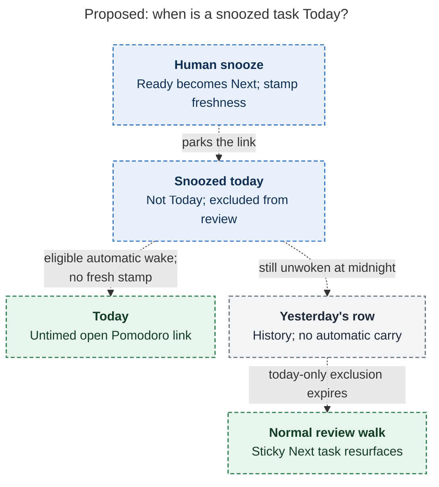
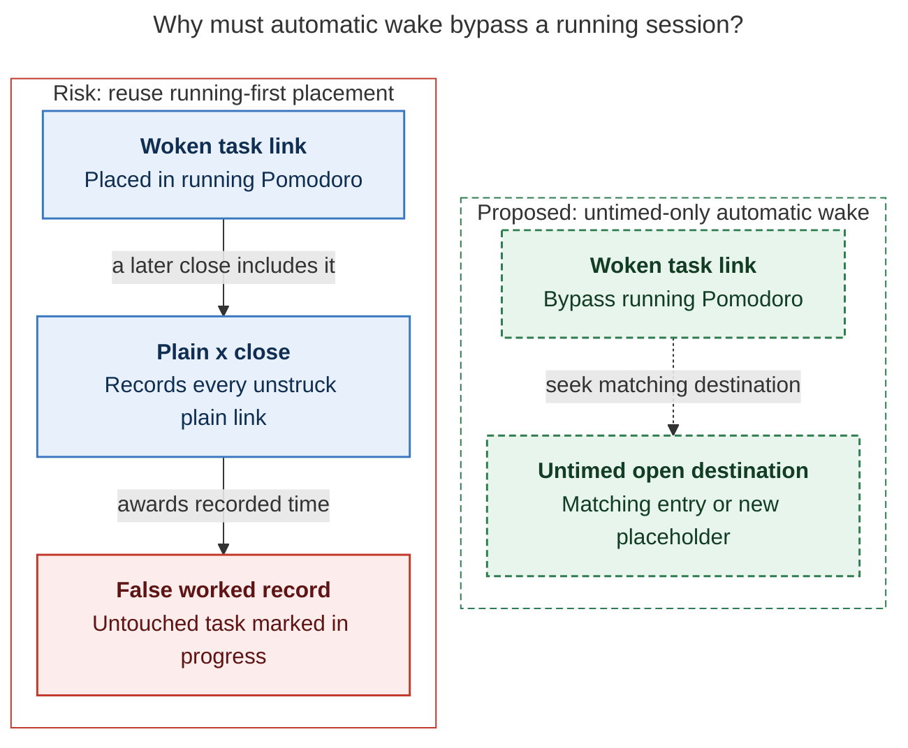
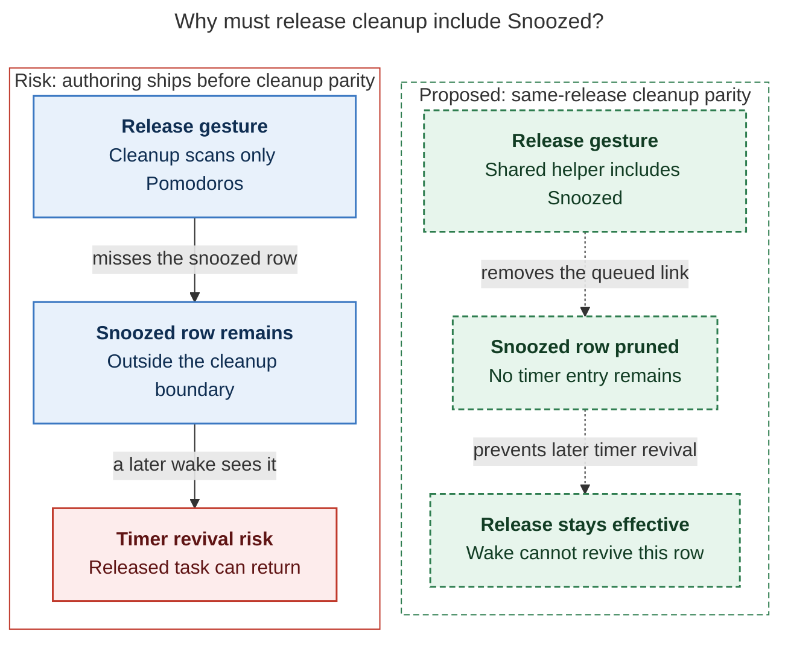

# Diagram proposals: Snoozed Task Links (`^snoozed-tasks`)

Proposals for the swarm linker, not a report. Each diagram restates only what the source
report says.

```yaml
source: research:202611/snoozed_task_links/snoozed_task_links__final.md
producer: research.67.image
check: "mmdc 12.0.0 with Puppeteer --no-sandbox and the PDF-mirroring config rendered 3 of 3 Mermaid diagrams; malformed-input control exited nonzero"
```

## snoozed-task-lifecycle

```yaml
anchor: |-
  execution APIs must not grow fake membership. gem's two real concerns are solved
question: |-
  What changes when a task is snoozed, wakes, or remains unwoken overnight?
illustrates: |-
  Snoozed is not Today until wake, while yesterday's unwoken rows remain history and sticky Next tasks resurface in the normal review walk.
caption: Snoozing commits the task without making it Today; wake links it, while missed-day tasks return through review.
review: "540×814 px, fit 100.0%; question, source trace, labels, arrows, and visual checks passed; 0 revisions"
```



## automatic-wake-placement

```yaml
anchor: |-
  on a plain `x` close, every unstruck plain link in the closing entry is
question: |-
  Why must automatic wake bypass a running session?
illustrates: |-
  Automatic wake bypasses the running entry because a plain x close would record an untouched woken link as worked.
caption: Automatic wake uses untimed destinations so a plain x close cannot falsely record untouched tasks as worked.
review: "679.031×577 px, fit 96.1%; question, source trace, labels, arrows, and visual checks passed; 1 visual revision"
```



## release-cleanup-parity

```yaml
anchor: |-
  released/completed tasks at wake (plugin gestures only clean `## Pomodoros`), or
question: |-
  Why must gesture cleanup cover Snoozed as well as Pomodoros?
illustrates: |-
  Gesture cleanup must prune snoozed rows in the same release as authoring, or a released task can be revived by a timer.
caption: Extend gesture cleanup to Snoozed before authoring ships, or a released task can be revived by a later wake.
review: "730.484×577 px, fit 89.4%; question, source trace, labels, arrows, and visual checks passed; 1 visual revision"
```


