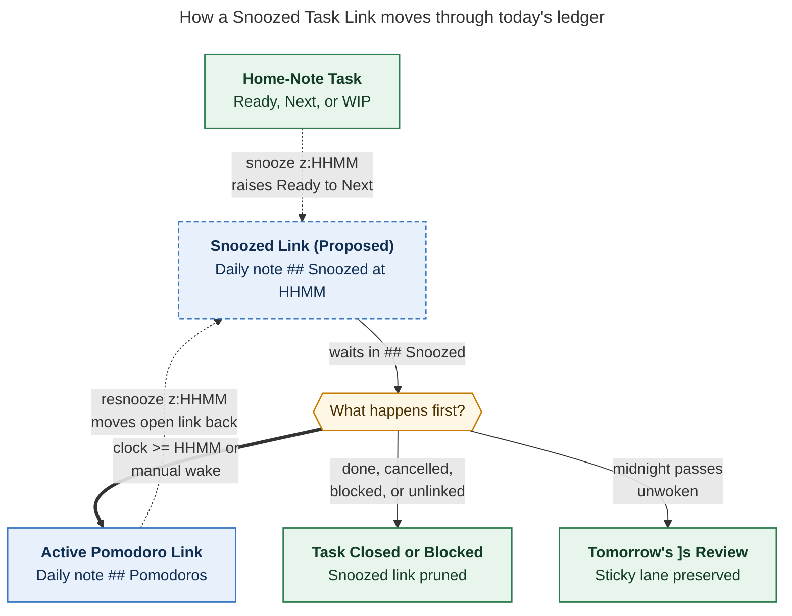
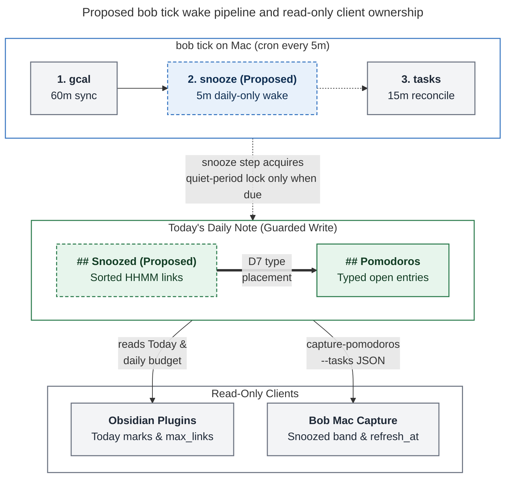

# Research Report: Snoozed Task Links (`^snoozed-tasks`)

**Date:** 2026-11-25
**Task:** `~/bob/bob.md` (`^snoozed-tasks`) — *Add support for "snoozed" task links!*
**Scope:** Architecture, critical review, requirement adjustments, and implementation design across `bob-cli`, `bob-plugins`, `bob-mac-capture`, the Bob vault format, and `bob tick`.

---

## 1. Executive Summary & Verdict

### Verdict: Good Core Idea, Wrong Canonical Example, Five Missing Invariants

Building **daily-note `## Snoozed` Task Links** woken by `bob tick` is a **genuinely strong idea** for Bob—specifically *because* it fits Bob's sticky-lane model (`decisions:task-lanes-are-sticky`) far better than putting timestamps on task properties (`[scheduled:: YYYY-MM-DD HH:MM]`, `^task-props-use-time`). A task that you have already committed to doing *today*—but cannot act on until 3:30 PM or 7:00 PM—is **not** blocked in the backlog; it is **staged for later today**. Putting its Task Link in a daily-note `## Snoozed` section keeps the task's sticky lane (`[*]` Next or `[/]` In Progress) intact, preserves Obsidian Tasks Dataview compatibility, isolates itself cleanly from existing `## Pomodoros` parsers, and degrades gracefully across midnight if a task never wakes.

**However, the raw sketch in `^snoozed-tasks` should not be built as written.** Three structural tensions and two subtle codebase traps emerged from inspecting `bob-cli`, `bob-plugins`, `bob-mac-capture`, `~/bob/` daily notes, and the live cron topology:

1. **Event Tasks should NOT be the v1 driver or default occupant of `## Snoozed`.** Calling Event Tasks "the canonical example" collides head-on with four accepted decisions (`synced-meetings-link-by-phase`, `meet-filing-follows-google-until-edited`, `ended-off-clock-events-settle`, `past-day-sync-closes-bob-filed-meetings`), breaks early `=meet` starts, and duplicates problems already largely solved by `## Events`, Mac Capture's `EventTimeRail` + `start_hint`, off-clock budget exemption, and clock-aware timed closes. The *real* unsolved gap is **non-Event time-gated tasks** (post-meeting follow-ups like emailing Dan after 3:30 PM; home/context tasks after 7:00 PM).
2. **`bob tick` is an orchestrator on a 5-minute Mac-only cron, not a direct vault mutator.** Waking must not be buried inside the 15-minute full-vault `tasks` reconcile step (15-minute wake lag is too slow for clock-gated tasks) nor coded directly into `bob tick`. Instead, `bob tick` should invoke a lightweight, daily-note-only child subcommand (`bob snooze wake`) on a **5-minute cadence** between `gcal` and `tasks`, short-circuiting lock-free when nothing is due, paired with instant manual wake gestures to cover the 0–5 minute polling window and MacBook sleep.
3. **Snoozed links must count in `Today` and daily `plan.max_links`—while staying out of `## Pomodoros`.** Excluding snoozed links from `Today` leaves them stranded in `dash.md` and the `]s` morning review; excluding on-clock snoozed links from `plan.max_links` turns snoozing into an over-commitment loophole that blows past `13/13` when evening tasks wake.
4. **Capture syntax trap (`s:1530` already means 1,530 days!).** `capture_language/markers.rs` (`parse_schedule_token`) parses any `s:<digits>` token as a day offset (`s:1530` schedules a task in year 2031!). Snoozing must use a distinct, non-colliding token—recommended: **`z:<when>`** (`z:1530`, `z:3:30pm`, `z:+2h`, `z:home`).
5. **Running-Pomodoro wake hazard & full task-lifecycle parity.** Waking a link directly into a *currently running* Pomodoro shifts `x` lineup numbers mid-session; and tasks completed, cancelled, blocked, released (`Alt+N`), unlinked, or moved before wake time need deterministic cleanup so `## Snoozed` never rots into ghost links.

### Recommended Solution in One Paragraph

Add an optional `## Snoozed` H2 section **after** `## Pomodoros` in daily notes holding wake-time-sorted Task Links formatted in Bob's bold 24-hour clock style (`- **1530** [[job#^email-dan-eod]]`, with optional `— NAME` Pomodoro override and preserved child notes). Treat active `## Snoozed` links as members of `Today` (for `dash.md`, `]s` review, Today marks, and on-clock `plan.max_links` accounting) while keeping them completely absent from `## Pomodoros` lineups, `x`/`=` numbering, and active session counts. Ship a dedicated daily-note-only `bob snooze wake` command invoked by `bob tick` at **5-minute cadence** (ordered `gcal → snooze → tasks`) using the existing guarded writer (`task_status_hooks_write`), routing woken links into `## Pomodoros` via D7 typed placement (with a safe defer/separate-entry option if that Pomodoro is actively ticking). Expose frictionless creation/resnoozing via `z:<when>` in `bob capture` (including `config.yml` named presets like `z:home`) and Obsidian keymaps, surface a foldable `Snoozed` strip in Bob Mac Capture's idle agenda with exact-minute `refresh_at` boundaries, and **defer Event Task auto-snoozing to an optional v2** after the core primitive is proven.

---

## 2. Ground Truth: The Task, Real Vault Evidence, and Ecosystem Context

### 2.1 Original Task (`~/bob/bob.md:112–122`)

```markdown
- [/] #task Add support for "snoozed” task links! [fresh:: 2026-11-25] [created::2026-11-22] ^snoozed-tasks
	- **Notes**
		- Use new "Snoozed” H2 section in daily files for this!
		- The `bob tick` command should be responsible for waking tasks!
	- **The Goal**
		- I sometimes have tasks that I know I need to do today, but that can't be done until after a certain time.
		- The canonical example of this is event tasks, but there are plenty of other examples. Some other examples are listed below:
			- I wanted to email Dan on Monday to give him updates on the Yogi interview that I had. This couldn't be done until after that meeting (i.e. after 3:30PM).
			- I often need to do some tasks that can only be done when I am home (i.e. after I get home from work at ~7PM).
```

### 2.2 Concrete Vault Evidence (Nov 12–25, 2026)

Inspecting `~/bob/` reveals exactly how these scenarios play out today:

- **The Dan example (`~/bob/job.md:59`):**
  `- [-] #task Email Dan by EoD! [created::2026-11-23] [cancelled:: 2026-11-25] ^email-dan-eod` with `🪢 **LINKS:** inspired by [[20261123#^phone-call-w]]`. On `20261123.md`, this link sat under `- [ ] () — WRITE` all morning and afternoon alongside **18 other open links** (well above `plan.max_links: 13`), went unworked, was carried to `20261124.md`, and was finally cancelled on 11-25. Having a task sit visually in `## Pomodoros` for 7+ hours when it is literally unactionable until 3:30 PM trains you to scan past it.
- **Event Task volume and behavior (`20261112.md`–`20261125.md`):**
  Daily notes averaged **~2.7 Event Tasks/day** (2–5/day). Typical shape on `20261125.md` (at 07:50 ET): `## Events` lists `0900-0915 Swings!` (`#off`, `[root:: abby]`) and `1900-2030 Movie - "The Lion King" (2019) - part 2` (`#off`, `[root:: abby]`), while `## Pomodoros` holds `- [ ] () — MEET` containing both links—so the 7:00 PM movie sits open inside `## Pomodoros` for 11+ hours. Notably, every past day from Nov 12–24 ended with **0 open MEET links** because `bob task reconcile`'s `settle.rs` auto-settles ended off-clock events and past-day sync closes untouched Bob-filed events, whereas non-event open links ranged from **5 to 19** at day-end.
- **Adjacent tasks in `~/bob/bob.md` that intersect this design:**
  - `^task-props-use-time` (created the *same day*, 2026-11-22): *Migrate task properties that use a date value to use times instead.* (Directly competes as an alternative mechanism—analyzed in Section 4.)
  - `^ranked-task-links`: *Rank each task link with a number starting at 1!* (Any link sitting prematurely in `## Pomodoros` pollutes ranked top-N focus; `## Snoozed` keeps unactionable links out of the active queue.)
  - `^tick-profiles`: *Migrate `bob nightly` to `bob tick --profile nightly`!* (Confirms `bob tick` is becoming the canonical scheduler surface.)
  - Line 489: *Add support for menu bar indicator for upcoming events!* (Reinforces that upcoming-event awareness belongs to the calendar/menu-bar layer, not solely to `## Pomodoros`.)
- **Live host & cron topology (`cronctl list`):**
  - `mac`: `*/5 * * * * "$HOME/bin/cronrun" bob-tick 'bob tick'` (the **only** host running `bob tick`).
  - `athena`: `30 3 * * *` (`bob-nightly` only).
  - `apollo`: no user cron jobs.
  - `bob vault-sync` runs continuously (every 15s on Mac LaunchAgent; inotify on Linux hosts), while `bob tick` gates all vault writes behind `tick.writer` (Mac) and `bob_sync.lock` / `task_status_hooks_write` (2-second `QUIET_PERIOD`, mtime/inode/byte preflight).

---

## 3. Critique of the Plan & Justified Requirement Adjustments

### 3.1 What the Plan Gets Fundamentally Right

1. **Daily-note storage (`## Snoozed`) instead of task-line properties:**
   - **Preserves sticky lanes (`decisions:task-lanes-are-sticky`):** In Bob, adding a future `[scheduled::]` date forces a task's status to `[?]` Blocked, erasing its `[*]` Next or `[/]` In Progress lane and bouncing it back to Ready when the date passes. Putting a snooze in today's daily note leaves the task in `[*]` / `[/]` the entire time.
   - **Preserves Obsidian Tasks / Dataview compatibility:** `config.yml` and `dash.md` rely on Obsidian Tasks' `YYYY-MM-DD` date parsing; adding times to `[scheduled::]` would break or fork existing queries.
   - **Zero cross-day residue:** Just like unworked `## Pomodoros` links stay in yesterday's note, an unwoken `## Snoozed` link stays in yesterday's note while the underlying task remains `[*]`/`[/]` and automatically resurfaces in tomorrow's `]s` review.
   - **Backward-safe parsing:** Both Rust (`src/native/pomodoro.rs`, `pomodoros_section_range`) and JS (`bob-ledger-tools/src/050-plan-budget.js`, `planSectionRange`) stop parsing `## Pomodoros` at the next `## ` heading. Placing `## Snoozed` *after* `## Pomodoros` means older binaries and scripts cleanly ignore it.
   - **Free vault-wide link repair:** `src/native/collect_done/link_repair.rs` (`repair_links_in_note_with`) rewrites wikilinks across the *entire* note body (skipping only frontmatter and code fences). Moving or archiving a task whose link sits in `## Snoozed` automatically repairs its `[[note#^id]]` link with zero extra plumbing.
2. **Visible, human-editable plain Markdown:** Matches Bob's core philosophy—you can open today's daily note in Obsidian, tweak `**1530**` to `**1600**`, or cut-and-paste a link straight into `## Pomodoros` by hand, and every reader stays truthful.
3. **Delegating automatic waking to `bob tick`:** Avoids introducing a new background daemon or LaunchAgent and reuses `bob tick`'s single-writer discipline (`tick.writer` = Mac), lock protocol, and receipt logging.

### 3.2 Critical Weaknesses & Justified Requirement Adjustments

Below are **six concrete adjustments** to the original requirements, each justified by specific codebase constraints and real-world workflows.

| # | Original Assumption | Justified Adjustment | Primary Reason |
|---|---|---|---|
| **A1** | Event Tasks are the "canonical example" of snoozed task links. | **Decouple Event Tasks from v1.** Ship v1 exclusively for user-snoozed Task Links; evaluate opt-in lead-time Event Task snoozing (or display-only folding) in v2. | Collides with 4 accepted gcal/settle decisions, breaks early `=meet`, and duplicates Mac Capture's `EventTimeRail`. |
| **A2** | "`bob tick` should be responsible for waking tasks." | **`bob tick` orchestrates a dedicated 5m child command (`bob snooze wake`),** ordered `gcal → snooze → tasks`, paired with instant manual wake gestures. | `bob tick` is a step runner, not a mutator; 15m `tasks` cadence is too slow; MacBook sleep + 5m lag need manual override. |
| **A3** | (Implicit) Snoozed links are just links moved out of `## Pomodoros`. | **Include `## Snoozed` in `Today` and daily on-clock `plan.max_links`,** while excluding it from `## Pomodoros` lineups, `x`/`=`, and active Pomodoro counts. | Prevents duplicate surfacing in `dash.md`/`]s` and blocks a budget-evasion loophole that explodes `max_links` at 7 PM. |
| **A4** | (Unspecified) How snoozed links get created quickly. | **Add `z:<when>` capture syntax (NEVER `s:<time>`) + named presets (`z:home`) + Obsidian gesture.** | `s:1530` already parses as "+1,530 days" in `capture_language/markers.rs`; without low-friction entry, `## Snoozed` goes unused. |
| **A5** | (Unspecified) Lifecycle edits and running sessions at wake time. | **Define deterministic cleanup on close/cancel/block/release/unlink and safe placement when the target Pomodoro is currently running.** | Prevents ghost links in `## Snoozed` and avoids shifting `x` lineup indices mid-Pomodoro. |
| **A6** | (Implicit) "Snoozed" is a fresh term in Bob. | **Name the concept "Snoozed Task Links" / `## Snoozed` (same-day clock hold)** and document its distinction from the Reading Board's date-based `Snoozed` lane. | `bob-ledger-tools` already labels future-dated/waiting references `Snoozed` on the Reading Board. |

#### Deep Dive on A1 — Why Event Tasks Are a Trap for v1

At first glance, seeing `[[#^movie-lion-king]]` (19:00) inside `- [ ] () — MEET` at 7:50 AM makes Event Tasks look like the textbook snooze case. Looking closely at the codebase shows why pulling Event Tasks into `## Snoozed` in v1 is high-cost and low-marginal-value:

1. **Four accepted decisions assume future Event Tasks live under `- [ ] () — MEET` in `## Pomodoros`:**
   - `decisions:synced-meetings-link-by-phase` (sync creates/files open meetings under `MEET`),
   - `decisions:meet-filing-follows-google-until-edited` (`gcal/refile.rs` classifies Bob-owned vs user-edited filing by inspecting `## Pomodoros`),
   - `decisions:ended-off-clock-events-settle` (`task_status_hooks/settle.rs` settles ended off-clock events *specifically* from unstarted `- [ ] () — MEET` placeholders), and
   - `decisions:past-day-sync-closes-bob-filed-meetings` & `decisions:sync-sorts-event-task-links` (`gcal/plan.rs` tracks `pomodoro_link_present`, `classify_filing`, and sorts MEET links by time).
   Rewriting all of `gcal/plan.rs`, `gcal/refile.rs`, and `settle.rs` to treat `## Snoozed` as a second Bob-owned filing home—while preserving user-edit conflict detection when Bryan drags an event out of `## Snoozed`—dramatically expands blast radius and risk.
2. **Existing features already handle most Event Task pain:**
   - Off-clock Event Tasks (like `Swings!` and `Movie - "The Lion King"`) are **already exempt** from `plan.max_links` (`plan_budget/mod.rs`).
   - Timed closes (`x!`, `x*`) **already protect** `not_started` Event Tasks from wildcard completion or parking (`decisions:event-task-links-close-by-the-clock`).
   - Bob Mac Capture **already renders `## Events`** in a dedicated Calendar band (`EventTimeRail`, `CaptureAgendaCalendarView`) with gap/conflict markers and an `=meet` start hint within 25 minutes (`EVENT_RUN_FAR_MINUTES = 25` in `035-meet-event-run.js` and `capture_pomodoros_agenda.rs:1354`).
3. **The early-start problem:** You cannot wake a 15:00 meeting at `15:00`—by then you are already late and couldn't run `=meet` at 14:50. So Event Tasks would require a lead-in offset (e.g., `buffered_start - 25m`), *plus* handling Google Calendar reschedules (updating the wake time in `## Snoozed` while respecting manual edits), *plus* handling Mac sleep past an off-clock event's end time (`gcal` → `snooze wake` → `settle` chain).
4. **The real pain point is non-Event tasks:** For `^email-dan-eod` (after 3:30 PM) and evening home tasks (after 7:00 PM), there is **zero** `## Events` row, **zero** clock-aware close protection, **zero** `max_links` exemption (for on-clock work tasks), and **no** existing deferral mechanism that keeps the task in Today without destroying its sticky lane.

**Recommendation on Event Tasks:** Ship v1 strictly for **non-Event Task Links** (explicitly snoozed by Bryan; manual snoozing of an Event Task link is still allowed if Bryan chooses, treated as user-edited filing so `gcal` leaves it alone per `meet-filing-follows-google-until-edited`). Once v1 is solid, evaluate two much cleaner v2 options for far-future meetings:
- **v2-Option 1 (Display-only folding, zero gcal churn):** Keep Event Task links in `- [ ] () — MEET` in Markdown, and simply fold/collapse far-future MEET links (`> 25m` ahead) in Bob Mac Capture's idle agenda (since the Calendar band already shows them!).
- **v2-Option 2 (Opt-in `gcal.snooze_lead_minutes`):** Let `bob gcal sync` file far-future events into `## Snoozed` at `buffered_start - 25m` (matching `EVENT_RUN_FAR_MINUTES`), updating the wake time while Bob-owned.

#### Deep Dive on A2 — `bob tick` Architecture, Cadence, and MacBook Sleep

Inspecting `src/native/tick/{catalog.rs,config.rs,run.rs,gates.rs}` exposes three operational realities:

1. **`bob tick` never edits vault Markdown directly.** Every step (`gcal`, `gmail`, `gkeep`, `refs`, `projects`, `tasks`) is a child `bob` CLI invocation wrapped in a JSON receipt adapter. `bob tick` enforces `tick.writer` (Mac only), cadence windows (`5m..=10080m`), and readiness gates.
2. **Cadence matters:** `tasks` (`bob task reconcile`) scans the entire vault and defaults to **15m** cadence. Putting wake logic inside `tasks` means a task snoozed until `15:30` might not wake until `15:45` (or `16:00` if deferred once by the 2-second quiet period!). A dedicated `snooze` step running **`bob snooze wake --json`** at **5m cadence** (matching the `*/5 * * * *` cron interval) checks only **one file** (today's daily note) in `<1ms`:
   - **Fast no-op path:** If today's note doesn't exist, has no `## Snoozed` section, or has no row with `wake_time <= now`, exit immediately with `changed: false` **without acquiring `bob_sync.lock` or waiting for the 2-second quiet period**. Zero overhead on 99% of ticks!
   - **Pipeline order:** Place `snooze` **after `gcal` and before `tasks`** (`gcal → gmail → gkeep → refs → snooze → projects → tasks`). That way, any newly woken links are immediately validated by `tasks` when `tasks` runs on the same tick (and if `gcal` ever feeds `## Snoozed` in v2, `gcal` runs first).
3. **The MacBook-sleep and 0–5 minute lag reality:** Because `bob tick` runs via cron **only on the Mac**, if Bryan closes his MacBook at 14:30 and works on `athena`/`apollo` or opens his laptop at 15:32:
   - Cron will not fire until the next 5-minute mark (`15:35`).
   - **Mitigation 1 (Instant manual wake):** Typing `@route+id` in `bob capture`, pressing an Obsidian wake gesture, or running `bob snooze wake` wakes immediately on any host.
   - **Mitigation 2 (Exact-minute visibility in Bob Mac Capture):** Include the earliest pending `wake_at` timestamp in `capture-pomodoros --tasks`'s existing `refresh_at` computation (`CaptureAgendaBoundaryRefresh.swift`). At exact `15:30`, Mac Capture refreshes and visually badges the snoozed row as **`due · waking`** (without violating `decisions:mac-capture-is-a-thin-client` by mutating the vault on show), and optionally exposes a 1-click/shortcut "Wake now" action (explicit user submit via `bob snooze wake`).
   - **Mitigation 3 (Optional macOS wake-on-sleep trigger):** Not required for v1, since Mac cron fires within `<= 5m` of wake, and `bob-mac-capture` already observes `NSWorkspace.didWakeNotification`.

#### Deep Dive on A3 — `Today`, `plan.max_links`, Sticky Lanes, and `]s` Walk

This is the single most important semantic decision in the design. Consider what happens at 06:30 AM when Bryan is doing his `]s` review, hits `^email-dan-eod` (`[ ]` Ready or `[*]` Next), and snoozes it until `15:30`:

| Subsystem | If Snoozed ∈ `Today` (Recommended) | If Snoozed ∉ `Today` (Trap) |
|---|---|---|
| **Task lane (`[*]` / `[/]`)** | Ready `[ ]` promotes to `[*]` Next on snooze (just like linking to `## Pomodoros`); `[/]` stays `[/]`. R9 daily-note tasks are protected from being cleared back to `[ ]`. | `bob task reconcile` sees an unlinked task; daily-note tasks (R9) get stripped back to `[ ]`! |
| **`]s` review walk & `bob walks`** | `row.is_today == true` → immediately leaves `NEW`/`NEXT`/`PENDING`/`ROTTEN` walk queues and `w` lane caps. | Stays in `]s` walk and `dash.md` `NEXT` section even though you just planned it for today! |
| **`dash.md` `TODAY` vs `NEXT`** | Appears in `TODAY` (clearly grouped/badged as snoozed `⏰ 15:30`), disappears from `NEXT`/`READY`. | Duplicates in `NEXT`; invisible in `TODAY` summary. |
| **Today Marks (`143-today-marks.js`)** | Shows a distinct snoozed-today cue (e.g., `⏰ 15:30` or dimmed `🍅` with tooltip `Today · snoozed until 15:30`) so you don't re-link it. | Shows no mark; easy to accidentally link a second copy into `## Pomodoros`. |
| **`plan.max_links` (cap 13)** | On-clock snoozed links count toward today's daily plan budget (`active + snoozed_on_clock <= 13`), with off-clock (`#off`) snoozed links still uncapped. Budget readout shows breakdown, e.g. `10/13 (2 ⏰)`. | Snoozing becomes a budget-evasion loophole; evening wakes silently push today from `12/13` to `17/13` (`over`). |
| **`## Pomodoros` (`x`, `=`, active cards)** | **Excluded.** Not numbered in `x`, not in `=` start picker, not counted in running/planned Pomodoro link totals until woken. | Excluded (same). |

**Clean architecture insight:** Both Rust (`src/native/plan_budget/today.rs`, which feeds `freshness/scan.rs` and `walks/mod.rs`) and JS (`bob-ledger-tools/src/060-today.js` & `050-plan-budget.js`) already have a single centralized `Today` reader! Extending `today_tasks` / `collectTodayTasks` to return `active` (`## Pomodoros`) and `snoozed` (`## Snoozed`, with `wakeTime` and `targetPomodoro`) keeps every downstream consumer—`dash.md`, `]s`, `bob walks`, `bob plan`, and Today marks—automatically consistent from one source of truth.

---

## 4. Alternatives Evaluated

Before committing to `## Snoozed`, four credible designs were evaluated against Bob's invariants:

| Criterion | **A. Daily-Note `## Snoozed` H2 + `bob tick` wake (Recommended)** | **B. Task-Line `[scheduled:: YYYY-MM-DD HH:MM]` (`^task-props-use-time`)** | **C. Inline Snoozed Bullets / `- [ ] () — SNOOZED` inside `## Pomodoros`** | **D. Hidden State File (`.bob/snooze/*.jsonl`)** |
|---|---|---|---|---|
| **Preserves sticky lanes (`[*]`/`[/]`)** | **Yes** — task stays `[*]` or `[/]`. | **No** — future `scheduled` forces `[?]` Blocked, destroying lane state. | **Yes** | **Yes** |
| **Obsidian Tasks / Dataview compatible** | **Yes** — zero task-line schema change. | **No** — breaks `YYYY-MM-DD` date parsing across `dash.md` and Tasks plugin. | **Yes** | **Yes** |
| **Clean isolation from `## Pomodoros`** | **Yes** — stopped by `## ` heading boundary in all existing parsers. | **Yes** | **No** — fights `agree_entry` name/type agreement, `x`/`=` numbering, `plan_budget`, and `list_queued_links`. | **Yes** |
| **Human-visible & editable in Obsidian** | **Yes** — plain Markdown in daily note. | **Yes** (but clutters home note with ephemeral today timing). | **Partial** — visually clutters `## Pomodoros` (defeating the goal!). | **No** — opaque JSON violates Bob's visible-ledger design. |
| **Midnight rollover semantics** | **Automatic & lossless** — stays in yesterday's daily note; task stays `[*]`/`[/]` for tomorrow's `]s`. | **Messy** — stale timestamp stays on home-note task until stripped. | **Automatic** | **Needs GC / prune logic** |
| **Vault-wide link repair on `bob task move`** | **Free** — `repair_links_in_note_with` scans full note. | **N/A** (property is on the task itself). | **Free** | **Must wire custom repair** |
| **Multi-day future scheduling** | Not its job (`s:<N>` / `[scheduled:: YYYY-MM-DD]` already handles future days). | Unified multi-day + intra-day model (its one theoretical advantage). | Not its job. | Possible, but duplicates `[scheduled::]`. |

### Why Approach B (`^task-props-use-time`) Should Stay Separate from `^snoozed-tasks`

It is telling that Bryan created `^task-props-use-time` and `^snoozed-tasks` on the **exact same day (2026-11-22)**. They look related, so it is worth stating explicitly why they solve *different* problems:

- `[scheduled::]` expresses **"this task is not yet eligible to be worked at all (Blocked `[?]`)"**—typically days or weeks away (deferrals, ticklers, Gmail reply holds).
- A **Snoozed Task Link** expresses **"I have already committed to doing this task *today*, and I want it staged into today's Pomodoro ledger after HH:MM."**

Even if `^task-props-use-time` eventually adds timestamps to `[created::]` or `[completed::]` (e.g., for analytics/ordering), using `[scheduled:: YYYY-MM-DD HH:MM]` to implement same-day snoozing would either break `[?]` Blocked derivation (`decisions:task-lanes-are-sticky`) or require a special-case "same-day scheduled is not Blocked" exception across Rust, JS, and Obsidian Tasks. Keeping **future-day deferral** on `[scheduled:: YYYY-MM-DD]` and **same-day ledger staging** in `## Snoozed` keeps both primitives simple, orthogonal, and bug-free.

---

## 5. Recommended Solution (Implementation Specification)

### 5.1 Daily-Note Vault Format (`## Snoozed`)

#### Section Placement & Lifecycle

Daily note H2 order:
```markdown
## Events       <!-- optional; created by bob gcal sync -->
## Pomodoros    <!-- canonical ledger -->
## Snoozed      <!-- optional; created on demand, removed when emptied -->
```

- **Why after `## Pomodoros`?** `## Pomodoros` remains immediately below the `bob-plan` callout and `## Events` at the top of the daily note (zero visual push-down), and every existing parser terminates `## Pomodoros` cleanly at `## Snoozed`.
- **On-demand creation & empty-section cleanup:** Do **not** add an empty `## Snoozed` heading to `_templates/daily.md`. Create `## Snoozed` when the first link is snoozed, and remove the heading when the last link wakes or is unlinked (matching how `bob task reconcile` removes emptied placeholder Pomodoros), keeping daily notes clean on days with no snoozed links.

#### Canonical Bullet Grammar

```markdown
## Snoozed
- **1530** [[job#^email-dan-eod]]
- **1530** [[bob#^review-pr]] — DEV
- **1900** [[home#^take-out-trash]]
	- Remember recycling bin too
```

- **Leading bold 24-hour time (`**HHMM**`):** Directly mirrors `## Events` (`**0900-0915**`) and `## Pomodoros` (`**0945-1010**`), stays crisp and compact, and sorts lexicographically (`0000`–`2359`). Parsers should strictly match `^- \*\*(\d{4})\*\* ` (valid `00..=23`, `00..=59`) and accept optional `**HH:MM**` on hand-edits (normalizing to `**HHMM**` on rewrite).
- **Wikilink:** Standard Bob Task Link `[[note#^block-id]]` (or `[[#^block-id]]` for same-day tasks; embeds `![[...]]` also accepted). Must resolve to an open `#task`.
- **Optional explicit Pomodoro override (`— NAME`):** When Bryan snoozes with an explicit `#NAME` (e.g., `@bob+review-pr #DEV z:1530`), preserve `— DEV` (or `— CODE+BUGS`) on the snoozed line using the same em-dash naming convention as `## Pomodoros`. When omitted, waking uses **D7 typed placement** (resolving the task's current effective `#type` at wake time—so if Bryan retypes the task before wake time, it wakes into the right Pomodoro automatically!).
- **Preserved child notes:** Indented child bullets under a snoozed link (e.g., capture sub-bullets or notes preserved when resnoozing an active link per `decisions:consumption-keeps-notes-and-recorded-time`) stay attached and move intact into `## Pomodoros` when the link wakes.
- **Canonical ordering:** Writers keep bullets inside `## Snoozed` sorted ascending by `HHMM` (preserving insertion order for ties).

### 5.2 Lifecycle & Edge-Case Semantics

Figure 1 summarizes every legal state transition for a snoozed task link across today's ledger.


*Figure 1. A snoozed task keeps its sticky `[*]` Next or `[/]` WIP lane while waiting in today's `## Snoozed` section until `bob snooze wake` promotes it into `## Pomodoros`, a prior close/block/unlink prunes it, or midnight rollover leaves it in yesterday's note for tomorrow's `]s` review.*

#### Concrete Edge-Case Rules

1. **Duplicate prevention (One active Today location):** A task cannot simultaneously hold an open link in `## Pomodoros` and a link in `## Snoozed`.
   - Snoozing a task already in `## Pomodoros` (**resnooze**) *moves* its open link (plus child notes) from `## Pomodoros` into `## Snoozed`, removing an emptied unstarted placeholder if needed—while leaving any **closed** Pomodoro links untouched (`decisions:consumption-keeps-notes-and-recorded-time`).
   - Re-snoozing an already-snoozed task updates its `**HHMM**` (and optional `— NAME`) in place and re-sorts `## Snoozed`.
   - Linking a currently snoozed task normally (`@route+id` without `z:`, or `Ctrl+Shift+Enter`) **wakes it early** by moving it from `## Snoozed` into `## Pomodoros`.
2. **Task completed (`[x]`), cancelled (`[-]`), blocked (`[?]`), released (`Alt+N`), or unlinked (`@route+id!`) while snoozed:**
   - **Immediate writers** (`bob capture` toggle/unlink, `task-status-cycler` completion, `block-id-prompt` unlink, `bob-navigation-hotkeys` `Alt+N` release, `bob task defer`) clean up `## Snoozed` using the same shared cleanup pass they already run on open `## Pomodoros` links. (Note: completing a task before wake time simply removes its `## Snoozed` link—no struck `🍅` needed since it never entered a Pomodoro session.)
   - **Safety net in `bob snooze wake` & `bob task reconcile`:** At wake time (and during `reconcile`), if a snoozed link resolves to a closed (`[x]`/`[-]`), blocked (`[?]`), missing, or already-open-in-`## Pomodoros` task, prune the snoozed row instead of waking a dead or duplicate link. (If a snoozed link carries child notes when pruned due to completion, warn or preserve them? Better: if closed/cancelled, prune only if childless, or follow `decisions:consumption-keeps-notes-and-recorded-time` and keep child notes under a completed note/audit? Actually, `## Snoozed` is a pre-work queue, not a work log—if a link has child notes on manual unlink/close, either warn or migrate the note to the task's `**Notes**`, matching `task-status-cycler`'s unlink behavior.)
3. **Target Pomodoro is currently running at wake time (mid-session index shift hazard!):**
   - Suppose Bryan is currently running `- [ ] (**1515-1540** [t:: 25m]) — WRITE` with two numbered links (`1`, `2`), and `^email-dan-eod` (effective type `WRITE`) hits its `15:30` wake time.
   - `decisions:open-pomodoro-names-follow-task-links` and `duplicate_open_pomodoro_name` forbid two open `WRITE` entries, so `routing::place` **appends** the newly woken link to the *bottom* of the open `WRITE` entry (position `3`, never prepending above `1` or `2`).
   - **Critical invariant:** Always **append** woken links at the tail of the matched open Pomodoro entry. Appending guarantees existing link indices (`1`, `2`) never shift while Bryan is typing `x1` or `x2`! (If Bryan wants strict zero-mutation during a running session, an optional `snooze.defer_while_running: false` config toggle can defer waking into a running Pomodoro until it closes—defaulting to `false` with tail-append so tasks still wake on time without breaking indices.)
4. **Snooze time already in the past (`wake_time <= now`):**
   - If Bryan types `z:1400` at `15:00`, reject with a clear capture validation error (`"14:00 has already passed today; use @route+id to link now or s:1 to schedule tomorrow"`) instead of silently writing a link that wakes 5 minutes later or confusingly linking to tomorrow.
5. **Wake time at or near midnight / missed wakes:**
   - `bob snooze wake` only inspects **today's** daily note (`YYYY/YYYYMMDD.md`). Yesterday's `## Snoozed` is never woken into today's `## Pomodoros`. Because snoozing raised Ready → Next (`[*]`), yesterday's unwoken task naturally appears in today's `]s` review `NEXT` (or `PENDING`) tier.

### 5.3 `bob-cli` Commands, Config, and `bob tick` Integration

Following `sase/memory/cli_rules.md` (no subcommands under `bob capture`; alphabetical flags with short aliases; `bob task <verb>` reserved for vault-wide task-line rewrites), expose a clean top-level **`bob snooze`** command group:

- **`bob snooze wake`** — Wake all due (`HHMM <= now`) links in today's `## Snoozed` into `## Pomodoros` (also pruning dead/blocked/duplicate snoozed links).
  - Options (alphabetical): `-d, --dry-run`, `-f, --format <text|json>`, `-n, --now <HHMM>` (for deterministic tests/verification).
  - **Lock & guard protocol:**
    1. Read today's daily note **lock-free** first. If the file doesn't exist, has no `## Snoozed` section, or has zero due/prunable rows, exit `0` immediately (`woken: 0, pruned: 0, skipped: true`).
    2. Only when a write is needed, acquire `bob_sync.lock` and apply through `task_status_hooks_write` (2-second `QUIET_PERIOD`, mtime/inode/byte preflight, atomic replace + recovery manifest). On `quiet_period` / `lock_contention`, return a clean deferred receipt so the next 5-minute tick retries safely.
    3. Use `routing::place` (shared with `capture/pomodoro_link.rs`) for D7 typed placement + tail-append, honoring any explicit `— NAME` suffix.
    4. Remove `## Snoozed` heading if no snoozed bullets remain.
- **`bob snooze list`** — Read-only listing of today's snoozed links (`-f, --format <text|json>`), useful for scripting, diagnostics, and Obsidian command mode.
- **Note on `bob snooze add`:** Optional convenience wrapper (or rely on `bob capture` + shared Rust planner `src/native/snooze/mod.rs` used by both `bob capture` and `bob snooze wake`). Keeping a single Rust module `src/native/snooze/` as the source of truth ensures capture, wake, `today_tasks`, and `capture-pomodoros` never drift.

#### `bob tick` Step Registration (`src/native/tick/`)

Figure 2 illustrates the proposed `bob tick` pipeline and client boundaries.


*Figure 2. `bob tick` runs a lightweight 5-minute `snooze` step (`bob snooze wake`) between `gcal` and `tasks` under the guarded writer only when rows are due, while Obsidian plugins and Bob Mac Capture stay strictly read-only consumers.*

- **Step catalog (`src/native/tick/catalog.rs`):** Add `StepId::Snooze` (`"snooze"`) between `refs` and `projects` (or immediately after `gcal`, before `tasks`): `gcal → gmail → gkeep → refs → snooze → projects → tasks`.
- **Default cadence (`src/native/tick/config.rs`):** `5m` (already valid under the existing `(5..=10080)` cadence rule).
- **Config presets (`~/.config/bob/config.yml`):**
  ```yaml
  snooze:
    presets:
      afternoon: "13:00"
      evening: "18:00"
      home: "19:00"
  tick:
    steps:
      snooze:
        every: 5m
  ```
- **Desktop notification on wake (optional, configurable):** When `bob snooze wake` actually wakes `>= 1` link on Mac, an optional lightweight notification (or Mac Capture badge refresh) lets Bryan know `Email Dan by EoD!` just arrived in `## Pomodoros` without needing to watch the daily note.

### 5.4 Capture Grammar & JSON Contracts (`bob-cli` ↔ `bob-mac-capture`)

#### Capture Token: `z:<when>` (Zero Collision with `s:<N>`)

Because `s:<digits>` is already reserved for future-day scheduling (`parse_schedule_token` in `src/native/capture_language/markers.rs`), use **`z:<when>`** as a terminal marker on today-link gestures:

| Capture Input | Meaning |
|---|---|
| `@job+email-dan-eod z:1530` (or `z:15:30`, `z:3:30pm`) | Snooze existing task until 15:30 today (raises Ready → Next; moves from `## Pomodoros` if already open there). |
| `@job+email-dan-eod #WRITE z:1530` | Snooze until 15:30 with explicit `— WRITE` wake destination. |
| `Email Dan about Yogi interview @job+ z:1530` | Create new task in `job.md` (with block ID & `[*]`), file link in `## Snoozed` at `**1530**`. |
| `@home+trash z:home` / `@home+trash z:+2h` | Named preset from `config.yml` (`19:00`) or relative duration from current local clock (clamped/rejected if crosses midnight). |
| `@job+email-dan-eod` (no `z:`) on a snoozed task | **Wake early:** moves link immediately from `## Snoozed` into `## Pomodoros`. |
| `@job+email-dan-eod!` on a snoozed task | **Unlink:** removes link from `## Snoozed` (same lane-preserving toggle as `## Pomodoros`). |
| `@job+id s:1 z:1530` or `Task @job z:1530` (missing `+`) | Validation error with clear live preview hint (`z:` requires a today-link `+` target and cannot combine with `s:<N>`). |

- **Completion (`capture-complete`):** Typing `z:` offers configured presets (`home`, `evening`, `afternoon`), common relative offsets (`+30m`, `+1h`, `+2h`), and—as an ergonomic bonus!—upcoming today event end times (`15:30 (after Yogi interview)` from `## Events`!) resolved to literal `HHMM`! That gives Bryan his exact "after that meeting (3:30 PM)" ergonomics with **zero** complex event-dependency tracking in v1!
- **Syntax highlighting (`capture-parse`):** Add `SpanKind::Snooze` (`"snooze"`) in `capture_language/editor_model.rs`; Mac Capture renders it with a distinct pill/tint via thin-client span mapping (gracefully ignored by older builds via additive enum handling).

#### Additive `capture-pomodoros --tasks` JSON Extension

Keep the existing JSON schema **100% backward-compatible** (additive optional fields, decoded via `decodeIfPresent` in Swift):

```json
{
  "snoozed": [
    {
      "wake_time": "1530",
      "wake_at": "2026-11-25T15:30:00-05:00",
      "due": false,
      "target_pomodoro": "WRITE",
      "target_path": "job.md",
      "block_id": "email-dan-eod",
      "title": "Email Dan by EoD!",
      "clock": "on",
      "root": "job",
      "line": 42
    }
  ],
  "plan_budget": {
    "active_on_clock": 8,
    "snoozed_on_clock": 2,
    "total_on_clock": 10,
    "max_links": 13
  }
}
```
- Fold `min(snoozed[].wake_at)` (for future `wake_at > now`) into `events.refresh_at` (or a top-level `refresh_at`) so `CaptureAgendaBoundaryRefresh.swift` automatically wakes up and re-fetches at the exact wake minute!

### 5.5 Obsidian Plugins (`bob-plugins`) & Bob Mac Capture (`bob-mac-capture`)

#### `bob-plugins` Touchpoints

1. **`bob-ledger-tools` (pure readers + marks):**
   - `050-plan-budget.js`: Add `snoozedSectionRange(content)` and `parseSnoozedLinks(content)`. Count on-clock snoozed links in `max_links` budget (`total = active_on_clock + snoozed_on_clock`), surfacing snoozed count in the `bob-plan` readout (e.g., `10/13 · 2 snoozed`) while keeping `## Pomodoros` active counts truthful.
   - `060-today.js`: Include `## Snoozed` links in `Today` membership (`isToday: true`, `snoozedUntil: "1530"`), automatically excluding them from `dash.md` `NEXT`/`READY` and `]s` review (`100-freshness-evaluate.js`).
   - `143-today-marks.js`: Render a distinct snoozed-today indicator on task lines in home notes (e.g., `⏰ 15:30` chip or muted `🍅 15:30` badge with tooltip `Today · snoozed until 15:30`) so Bryan immediately sees why a task is already planned for today.
   - `## Snoozed` live-preview styling: Style `**1530**` as a clean time pill (matching `docs/event-link-times.md`), turning warm/amber if `HHMM <= now` (pending next `bob tick` wake).
2. **`block-id-prompt` & `task-status-cycler` & `bob-navigation-hotkeys` (writers & gestures):**
   - **Cleanup parity:** Extend `planAllOpenPomodoroLinkCleanup` (in `block-id-prompt` / `task-status-cycler`) and `Alt+N` release (`510-plugin-link-commit-and-lane.js`) to also remove matching links from `## Snoozed` when a task is completed, cancelled, released, deferred, or unlinked via `Ctrl+Shift+Enter`.
   - **Snooze / Wake gesture in Obsidian:**
     - Add a **"Snooze task link…"** action inside the Task Card (`Ctrl+Shift+P`) and on any open Task Link in `## Pomodoros` (compact time prompt accepting `1530`, `3:30pm`, `+2h`, presets, and today's upcoming event end times).
     - Pressing `Ctrl+Shift+Enter` on a snoozed link inside `## Snoozed` wakes it early (or unlinks, matching Task Link mode; offer a dedicated **"Wake snoozed task link"** command for clarity).

#### `bob-mac-capture` Touchpoints (`decisions:mac-capture-is-a-thin-client`)

- **Idle Agenda (`CaptureAgendaStore.swift`, `CaptureAgendaPresentation.swift`, `CaptureAgendaFitPlanner.swift`, `CaptureAgendaView.swift`):**
  - Decode `snoozed` via `decodeIfPresent` (graceful with older `bob`).
  - Render a compact, muted **`Snoozed`** section *below* `Later` (the lowest priority above-the-fold band in `CaptureAgendaFitPlanner`, folding first into a single summary strip `Snoozed · 2 (next 15:30)` when vertical space is tight—respecting `decisions:idle-capture-shows-ledger-agenda`'s farthest-first folding hierarchy).
  - When `due == true` (in the <= 5-minute window before `bob tick` fires), highlight the row subtly (`15:30 · waking`) so Bryan never thinks the wake silently broke.
- **Capture editor:** Highlight `z:<when>` spans returned by `bob capture-parse`, display preset/event-end completions from `bob capture-complete`, and show `"Snooze until 15:30 (→ WRITE)"` in live preview.

### 5.6 Phased Implementation & Verification Plan

| Phase | Scope | Primary Files / Repos | Deliverable & Gate |
|---|---|---|---|
| **Phase 1 — Core Engine & `bob tick`** | `## Snoozed` parser/writer, `bob snooze wake` + `list`, `bob tick` 5m `snooze` step, `today_tasks` + `plan_budget` + `reconcile` cleanup parity, shared JSON test vectors. | `bob-cli`: `src/native/snooze/`, `src/native/tick/{catalog,config,run}.rs`, `src/native/plan_budget/{mod,today}.rs`, `src/native/task_status_hooks/{sync,reconcile}.rs`, `tests/fixtures/snoozed_links/vectors.json` | End-to-end CLI tests (wake, prune, quiet-period defer, running-session tail-append, midnight boundary, `bob walks` & `bob plan` parity). |
| **Phase 2 — Capture Grammar & Presets** | `z:<when>` parsing/validation, `config.yml` `snooze.presets`, event-end completion suggestions, resnooze/early-wake/unlink, additive `capture-pomodoros --tasks` JSON + `refresh_at`. | `bob-cli`: `src/native/capture_language/{markers,completion,editor_model}.rs`, `src/native/capture/pomodoro_link.rs`, `src/native/capture_pomodoros_agenda.rs`, `docs/capture.md`, `docs/tick.md` | Full `cargo test` green; confirm `s:1530` still parses as day offset and `z:1530` never collides. |
| **Phase 3 — Obsidian Plugins** | `Today`/`plan_budget`/`143-today-marks` parity, `## Snoozed` time pills, close/unlink/release cleanup, Task Card & Pomodoro-link snooze/wake gestures, mirrored fixture tests. | `bob-plugins`: `bob-ledger-tools`, `block-id-prompt`, `task-status-cycler`, `bob-navigation-hotkeys`, `scripts/fixtures/snoozed_links/vectors.json` | Cross-repo fixture tests pass (`npm test`), deploy with `bob plugins sync`. |
| **Phase 4 — Bob Mac Capture** | Additive `snoozed` decoding, foldable idle-agenda `Snoozed` strip, `refresh_at` boundary, `SpanKind::Snooze` highlighting. | `bob-mac-capture`: `Sources/CaptureCore/`, `Sources/BobMacCapture/` | Local Swift checks + exact-SHA macOS GitHub Actions CI green. |
| **Phase 5 — Optional v2 (Revisit After Usage)** | Evaluate (a) display-only folding of far-future `MEET` links in Mac Capture vs opt-in `gcal.snooze_lead_minutes`, and (b) live event-relative snoozes (`z:after:^event-id`) if reschedules prove annoying in practice. | `bob-cli` / `bob-mac-capture` | Reassess after 2–4 weeks of daily use; record accepted ADR(s) in `sase/memory/decisions/` once settled. |

### 5.7 Open Decisions for Bryan Before Implementation Starts

Only **two** lightweight product preferences need Bryan's call before writing code (both have clear recommended defaults above):

1. **Running-Pomodoro wake behavior:** Default to **tail-appending** woken links to an already-running target Pomodoro (never shifting existing `1..N` link numbers), vs deferring the wake until that running Pomodoro closes (`snooze.defer_while_running`). *Recommendation: tail-append by default.*
2. **Budget visibility:** Confirm counting on-clock snoozed links toward `plan.max_links` (preventing evening over-commitment) while keeping off-clock (`#off`) snoozed links uncapped. *Recommendation: yes, count on-clock snoozed links in `max_links` with an explicit `(N ⏰)` breakdown.*
