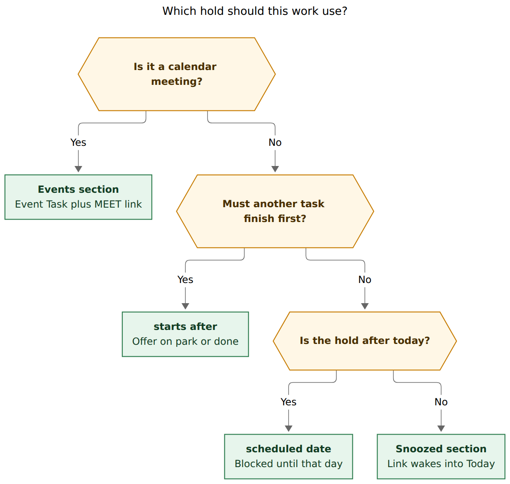
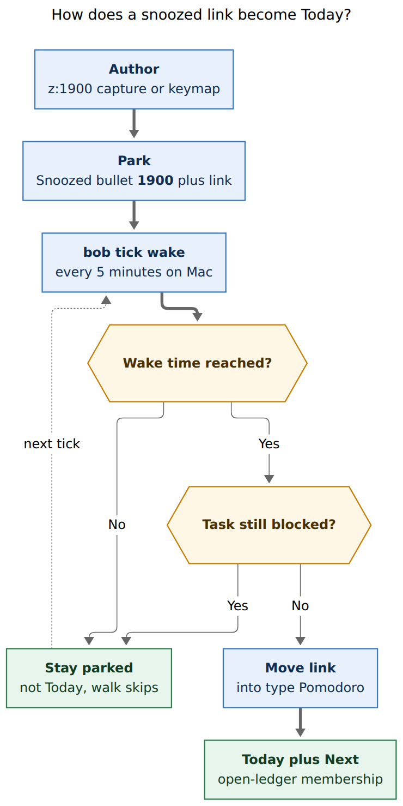

# Snoozed Task Links: park later-today work off the ledger

**Date:** 2026-11-25 · **Project:** bob-cli / bob-plugins / Bob Mac Capture · **Author:** grk (research swarm)

**Question:** How should `^snoozed-tasks` be implemented, and is the vault note's plan a good idea?

**Recommendation:** Build it, after splitting the note's three jobs. Keep a new `## Snoozed` H2 on the daily note as a parking lot for **Task Links**, not task rows. Encode the wake as a local `**HHMM**` on that bullet. Add a cheap `bob task wake` child that `bob tick` runs every 5 minutes, after Calendar and before reconcile, and have it move due unblocked links into a type-matching open Pomodoro. Do **not** put Event Tasks in that section, do **not** overload `[scheduled::]`, and do **not** treat "email Dan after the meeting" as a clock snooze: that case is `starts after`.

## 1. What the vault task actually asks for

From `~/bob/bob.md` on 2026-11-25, `^snoozed-tasks` is In Progress:

> Add support for "snoozed" task links!
>
> - Use new "Snoozed" H2 section in daily files for this!
> - The `bob tick` command should be responsible for waking tasks!
>
> **The Goal.** I sometimes have tasks that I know I need to do today, but that can't be done until after a certain time. The canonical example of this is event tasks, but there are plenty of other examples:
> - Email Dan on Monday after the Yogi interview (after 3:30 PM).
> - Tasks that can only be done when I am home (after ~7 PM).

A sibling Next task, `^task-props-use-time`, asks to migrate date-valued task properties to times. A June 2026 task that would have added a `snooze` property, hidden matching rows from queries, and deleted the field from a cron job was cancelled. Project/area frontmatter `snooze: YYYY-mm-dd` (done 2026-07-10 as `^snooze`) is a different, note-level `#hide` hold.

The live note therefore asks for three things at once:

1. A daily-note parking lot for work that is committed to today and unavailable until a clock time.
2. A background waker owned by `bob tick`.
3. Coverage of Event Tasks, after-event sequencing, and after-home clock holds under one name.

Only (1) and (2) belong in this feature. (3) is three existing or in-flight mechanisms.

## 2. Current behavior (verified)

Each claim below was checked against source on 2026-11-25.

| Fact | Evidence |
| --- | --- |
| Today is dedicated Task Links under today's **open** Pomodoros, computed at read time. Residence in the daily note is not enough. Closed 🍅 lines are history. | `decisions:today-is-read-from-the-ledger`; `docs/concepts/today-and-the-pomodoro-ledger.md`; `docs/reference/vault-format.md` § Lane, freshness, and Today |
| `[scheduled:: YYYY-MM-DD]` is date-only (`NaiveDate`). A date **after** the daily-note anchor blocks; **today** has already arrived at local midnight. Lane queries use `(no scheduled date) OR (scheduled on or before today)`. | `docs/task-status-hooks.md` Usage; `src/native/dataview/tasks/mod.rs` `NEXT_QUERY` / `READY_QUERY`; `src/native/projects/model.rs` `TaskSchedulePolicy::for_schedule` |
| Capture `s:<N>` writes that date field. `s:0` still starts the new row Blocked, then reconcile unblocks it because the date is not future. Existing-task `@route:id` items cannot carry `s:<N>` / `$<N>`. Linking a Ready/Blocked task **retires** a valid future schedule (pull-forward). | `docs/capture.md` scheduling; `docs/reference/cli/capture.md`; `docs/capture.md` ~1907 |
| Reconcile **consumes** live Task Links to effectively Blocked tasks under today's open Pomodoros. A pre-linked "do this at 7 PM" row cannot sit in `LATER` if the task is Blocked. | `docs/task-status-hooks.md` § Blocked task links are consumed; `decisions:projects-block-from-prj-line` |
| Arrived schedules walk as TICKLER in the **morning** `]s` walk (`fresh < scheduled ≤ today`). That ritual is the wrong surface for a 3:30 PM wake. | `decisions:recurring-occurrences-walk-when-due`; `docs/freshness.md` §1 and `returned_on` |
| Event Tasks already live in `## Events` (above `## Pomodoros`) with `**HHMM-HHMM**` spans, get MEET links at birth, classify on timed close by the clock, and stay out of the review walk. Idle capture already paints a Calendar block with `phase`, `gap`, `start_hint`, and `refresh_at`. | `decisions:calendar-events-are-daily-note-event-tasks`; `decisions:event-task-links-close-by-the-clock`; `docs/reference/vault-format.md` § Events; `docs/capture.md` `capture-pomodoros --tasks` |
| Today's live daily note already queues both a 09:00 meeting and a 19:00 movie under an open `— MEET` placeholder. Future-today Event Tasks are Today/Next all day; close-by-the-clock defers `not_started` ones. | `~/bob/2026/20261125.md` `## Events` / `## Pomodoros` |
| `starts after` is a successor **relation**: it never blocks; a park or managed Done **offers** the next task for an explicit pick. Auto-linking those offers is forbidden. | `research:202611/starts_after_relation/starts_after_relation__final.md`; `decisions:unblocked-tasks-are-offered`; `relations.successor_labels` |
| Open inventory names such as `LATER` still count as Today. Idle assigns `role: later` to every untimed non-current open entry. Folding hides Later first, which is attention management, not a hold. | `docs/plan.md` inventory labels; `src/native/capture_pomodoros_agenda.rs` `agenda_role` |
| `bob tick` is Mac-only cron every 5 minutes (`bob-tick`). Steps: gcal 1h → gmail 1h → gkeep manual → refs 15m → projects 15m → tasks (`bob task reconcile`) 15m. Writer pin falls back to `gcal.writer`. macOS posts `org.bobs.bob.tick-finished`. | `docs/tick.md`; `src/native/tick/catalog.rs`; `cronctl list` |
| Daily-note structural H2 keys already include `Pomodoros` and `Events` (plus Tasks / status groups / Highlights / generated catalogs). Rename refuses turning a heading into `## Events`. | `src/native/capture_drawers.rs` `is_structural_h2_key` |
| Today-linked tasks are already outside freshness review. A 🍅 Today mark is display-only and is never stored on the task line. | `docs/freshness.md` §1; `docs/today-marks.md` |
| Gmail reply waits reuse `[scheduled::]` as a tagged multi-day hold. Lift may write `[unblocked::]`, which creates a TICKLER. | `decisions:gmail-reply-wait-is-a-tagged-hold` |

The gap is narrow and real: **same-day clock availability for an ordinary area/project task**, with the commitment already made, without making that task Today at 9 AM, without walking it in the morning, and without waiting for tomorrow's TICKLER.

`LATER` does not close that gap. A 7 PM laundry link under an open `— LATER` (or `— WRITE`) is Today immediately, counts against the link budget, and competes for idle-agenda attention all day.

`[scheduled:: today]` does not close it either. The date has arrived. The row is lane-visible. If you could store a datetime and keep the row Blocked until 19:00, reconcile would consume any Pomodoro link, and the 19:01 unblock would TICKLER tomorrow morning unless a writer put the link back.

## 3. Critique: is this a good idea?

**Yes, once the note is split.** The H2-plus-tick shape is the right Bob-shaped answer for the remaining gap. The note as written overfits Event Tasks and under-specifies wake, landing, rollover, and walk exclusion.

### What the proposed H2 gets right

Today is open-Pomodoro links. A second daily-note section of links is the only way to park a today-commitment **on the day file** without:

- changing the Today definition (a decision reopen),
- using a closed Pomodoro (that is history, 🍅, not a live queue),
- or inventing an "open but not Today" inventory label.

That is the same move Calendar already made: `## Events` holds timed today facts that are not the live ledger. Events holds **task rows** (a residence exception). Snoozed should hold **Task Links** (no residence exception; the checkbox stays in its area/project note). Together they keep `## Pomodoros` as the only Today membership list.

Machine-written Task Links already exist: `bob gcal sync` files Event Task links under MEET at birth. Tick moving a snoozed bullet into a type Pomodoro is the same class of write. The human already committed at snooze time. This is not a successor offer, so `decisions:unblocked-tasks-are-offered` does not apply, as long as wake never invents a link the human did not park.

`bob tick` as the waker is also right. Wake is frequent, host-local, and should not wait for a 15-minute whole-vault reconcile. Cron already calls `bob tick` every 5 minutes on the Mac. `org.bobs.bob.tick-finished` already exists for Mac Capture to refresh.

### What the note gets wrong

**Event Tasks are not the canonical customer.** They already have times, a section, MEET filing, clock-close, and an idle Calendar block. Putting a second copy of `[[#^movie-lion-king]]` in `## Snoozed` would duplicate `## Events` and fight MEET sort-by-span. The 7 PM movie on 2026-11-25 is already queued under `— MEET`. Leave it there.

**"Email Dan after 3:30" is not a clock.** The meeting can run late. A 15:30 snooze can fire while the interview is still going, or sit quiet if it ends at 15:10. That is `starts after [[daily#^yogi-interview]]`. The successor picker already exists to offer, never auto-link, the next prompt when the predecessor leaves today's plan or completes.

**Tick-as-reconcile would be too slow and too heavy.** The `tasks` step is a 15-minute whole-vault scan with a 10-minute ceiling. A 3:30 wake that waits for reconcile is up to 15 minutes late and holds the vault lock for work that only needs today's daily note.

**A task-line `snooze` / datetime `[scheduled::]` reopens too much.** Date marks, freshness, Gmail holds, randomize, project `^prj` dates, and the Tasks plugin queries are all date-only. The cancelled June property and the sibling `^task-props-use-time` epic are that blast radius. Intra-day hold belongs on the **daily link**, where the time already lives for Event Tasks (`**HHMM**`).

**Auto-landing in CURRENT is rude.** A 19:00 wake should not append laundry to a running BUILD session. Capture already knows how to place by type: running exact name, else first open exact, else first open containing the type, else a created `— TYPE` placeholder.

**Lane vs Today.** Snooze is a Today-membership deferral. It should not release Next, should not stamp `[unblocked::]`, and should not invent a checkbox. Sticky lanes stay sticky. The morning walk must skip a snoozed-today row even if it is still Next from yesterday, the same way Today-linked rows are already out of freshness review.

### Would I take a different approach?

I would keep the H2 and the tick waker. I would not:

- park snoozed links under `LATER` and special-case Today,
- extend `[scheduled::]` to datetimes as a prerequisite,
- reuse project-note `snooze:` frontmatter,
- treat wake as a successor offer,
- or wait on `^task-props-use-time`.

Read-time "due snoozes count as Today without moving" is tempting (Event Task `phase` is read-time). It would make idle truthful at the exact minute and skip the writer. It also reopens Today: membership would no longer be "open Pomodoro links." The vault note asked tick to wake, which is a **write**, and that write is what promotes Ready → Next through the existing link gesture. Prefer the write.

## 4. Requirement adjustments (called out)

| # | Vault note | Adjusted to | Why |
| --- | --- | --- | --- |
| **A1** | Event Tasks are the canonical example | **Clock-hold of an ordinary area/project task.** Event Tasks stay in `## Events`. | Events, MEET, clock-close, and idle Calendar already cover meetings. A second section would duplicate them. |
| **A2** | "Email Dan after 3:30" is a snooze | **`starts after` the Event Task.** Clock snooze is only for holds with no predecessor (home after ~7 PM). | Time is a proxy for "the meeting ended" and fires at the wrong moment. Successor offers already exist and must stay opt-in. |
| **A3** | Unspecified wake encoding | **Link-local `**HHMM**` on the Snoozed bullet**, same 24-hour compact form as Event Task spans. No task-line field. | One source of truth on the day file. Avoids date-mark / Gmail / freshness blast radius. |
| **A4** | Unspecified landing | **Type-matching open placeholder** (capture's placement rule). Never CURRENT unless it is already that type and untimed. Never MEET unless the target is today's Event Task (which v1 refuses). | A timed running session is not a catch-all inbox. |
| **A5** | Unspecified walk / dash / budget | **Snoozed-today is a Today-commitment, not Today.** Walk skips it (extend the Today-linked exclusion). Link budget ignores it. Lane unchanged. Ready new tasks are not raised to Next until wake. | Morning review should not re-ask a 7 PM hold. Budget counts live plan, not the parking lot. |
| **A6** | `bob tick` wakes, cadence unspecified | **New `wake` tick step, default 5m**, child `bob task wake`, after `gcal`, before `tasks`, same daily-note readiness gate as Calendar. Do **not** inherit `gcal.writer` for this step: any host may wake. v1 still only *runs* where `bob-tick` cron exists (Mac). | Reconcile is 15m and whole-vault. Wake is a daily-note rewrite plus optional Next promotion. Calendar should land first so a later event-relative v2 can see fresh Events. |
| **A7** | Unspecified rollover | **First wake of a new local day carries leftover bullets onto today's `## Snoozed` with the same HHMM.** If that time is already past, wake immediately. Empty section is deleted. One live snooze per task per day. | Yesterday's 19:00 laundry is still a 19:00 hold, not a morning TICKLER. Do not write `[unblocked::]`. |
| **A8** | Unspecified authoring | **New capture edge token `z:HHMM` / `z:HH:MM`.** New task: create Ready, park the link, do not Next. Existing-task exception: `@route:id z:1900` is a legal complete item (today those items refuse every extra token). Manual `@route:id` on a snoozed row **pulls forward** (wake now). WIP / dep-blocked / project-blocked / `^prj` refuse. | Capture markers grow additively (`docs.md` / CLI rules). `s:` stays day offset. Existing-task grammar needs one explicit exception. |
| **A9** | Unspecified blocked interaction | **Do not wake a still-Blocked target.** Leave the bullet parked; the next tick retries. Reconcile would consume a freshly planted Pomodoro link. | Matches "Blocked tasks keep no Task Links under today's open Pomodoros." |
| **A10** | Do not wait on `^task-props-use-time` | **Decouple.** If scheduled datetimes land later, do not migrate snooze onto them. | Different job (multi-day Blocked vs same-day Today membership). Coupling would stall a small epic behind a vault-wide field change. |

## 5. Alternatives considered

| Alternative | Why not as the primary design |
| --- | --- |
| Open `— LATER` / `— SNOOZED` Pomodoro holding the links | Those entries are Today. Would require a Today-definition exception for some open names. Decision reopen. |
| `[scheduled:: 2026-11-25 19:00]` plus reconcile | Date-only stack; consume-blocked deletes the link; unblock TICKLERs tomorrow; `^task-props-use-time` blast radius. |
| Task-line `[snooze::]` / `#snoozed` / revived June property | Dual store with the daily link; query-hide is occupancy, not a today plan; cancelled once already. |
| Project/area `snooze:` frontmatter | Multi-day `#hide` of a whole note. Wrong granularity. Name collision only. |
| Read-time Today from due Snoozed bullets, no tick write | Idle would be exact-minute truthful, but Today would no longer be "open Pomodoro links," and Ready would not become Next through the existing link gesture. |
| Fold wake into `bob task reconcile` | 15-minute cadence, 10-minute whole-vault ceiling, wrong lock cost. |
| Auto-link at 15:30 as a stand-in for "meeting ended" | Wrong trigger; violates explicit pick for successors. |
| Hand-write a fake Event Task for laundry | Residence exception: the checkbox would live in the daily note. Ordinary home tasks belong in area notes. |
| Successor offer at wake instead of auto-move | The human already parked the exact link. A second pick every afternoon is rubber-stamping. Offers stay for `starts after`. |
| Notification-only (no ledger move) | Idle/Today/plan would stay wrong until a hand link. Tick already writes the vault for Gmail/Gcal/reconcile. |

## 6. Recommended solution

### 6.1 Routing

Use the hold that already names the constraint.

**Reader question:** Which Bob mechanism should hold work that cannot start yet?

**Caption:** Calendar meetings stay Event Tasks; work that must wait for another task uses `starts after`; later-day deferrals stay `[scheduled::]` dates; same-day clock holds are snoozed links that wake into Today.



Rendered size: 825.8 × 784 px; fit scale: 79.0%. Mermaid CLI 12.0.0.

### 6.2 Vault form

Place `## Snoozed` **between** `## Events` (if present) and `## Pomodoros`. Create the heading on first park; delete it when the last bullet leaves. Sort by wake time, then original order. Writer form:

```markdown
## Events
*↻ synced 07:50 · …*
- [*] #task **0900-0915** Swings [root:: abby] [type:: MEET] ^swings
- [*] #task **1900-2030** Movie [root:: abby] [type:: MEET] ^movie-lion-king

## Snoozed
- **1900** [[home#^laundry]]
- **1930** [[job#^email-dan]]

## Pomodoros
- [ ] () — MEET
  - [[#^swings]]
  - [[#^movie-lion-king]]
- [ ] () — WRITE
  - [[sase_blog_drafts#^what-came-before]]
```

Rules:

- Column-0 bullets only. Body is `**HHMM**` (hours 00–23, minutes 00–59), space, exactly one unstruck `[[note#^id]]` Task Link. Optional notes as children, same as Pomodoro link subtrees.
- Not a `#task` row. Not an Event Task. Not Today. Not a plan-budget link.
- One target per day. A second park of the same id replaces the wake time.
- Hours past 23 / missing link / extra prose on the parent bullet: refuse at capture; tick skips a damaged row and reports it.

Add `Snoozed` to `is_structural_h2_key` so drawer rename cannot collide with it, matching Events and Pomodoros.

### 6.3 Wake writer

**Reader question:** What happens to a snoozed Task Link from capture to Today?

**Caption:** Capture parks a timed link outside Pomodoros. A five-minute `bob tick` wake moves a due, unblocked link into a type-matching open Pomodoro, which is what makes it Today and raises Ready to Next.



Rendered size: 493.0 × 986 px; fit scale: 90.5%. Mermaid CLI 12.0.0.

`bob task wake` (dry-run, JSON, human):

1. Same daily-note readiness as Calendar (`note_missing` / `note_unrendered` / `pomodoros_missing` wait, no interval consume).
2. Read `## Snoozed` and the open Pomodoro lineup.
3. For each bullet with `HHMM <= now` (local to the note timezone / `BOB_NOW`):
   - Resolve the target. Skip missing/ambiguous/non-task/done/canceled.
   - Skip if the target is effectively Blocked (deps, project, future **date** schedule, `#awaiting_reply`).
   - Remove the Snoozed bullet (keep child notes).
   - Insert a dedicated Task Link under the capture type-placement entry, creating `— TYPE` if needed.
   - If the target is Ready `[ ]`, raise it to Next `[*]` in the same transaction (same as an existing-task link). Next and Pending stay. Do not stamp `fresh`, do not write `[unblocked::]`, do not prompt.
4. Carry leftover bullets from yesterday's daily note onto today (A7).
5. Delete an empty `## Snoozed`.

Tick catalog addition (order is part of the public contract):

| Order | Step | Child | Default | Ceiling |
| ---: | --- | --- | --- | ---: |
| 1 | `gcal` | `bob gcal sync` | 1h | 10m |
| … | existing | … | … | … |
| 6 | **`wake`** | **`bob task wake`** | **5m** | **1m** |
| 7 | `tasks` | `bob task reconcile` | 15m | 10m |

`bob tick wake` is the named-step form operators already have (`bob tick gmail gcal`). JSON receipt grows one row. Hidden aliases: none needed; this is additive. Help text in `docs/tick.md` and clap must list `wake` in catalog order.

Do not pin `wake` to `gcal.writer`. A Google-less host should still be allowed to move local links. v1 still depends on Mac cron in practice; call that out in the tick troubleshooting section rather than encoding it as a writer pin.

On success, the existing Darwin `tick-finished` ping is enough for Mac Capture to refetch `capture-pomodoros --tasks`. No new notification channel in v1.

### 6.4 Authoring

Capture, additive:

```text
Fold laundry @home z:19:00
@home:laundry z:1900
@home:laundry          # if currently snoozed: pull-forward (wake now)
```

`z:19:00` and `z:1900` are the same token. Invalid times fail with usage exit 2. `z:` is recognized only in the terminal marker region, like `s:` / `$`. Mid-line `z:19:00` stays prose.

Obsidian: one keymap or Task Card action that prompts HHMM and parks the current (or linked) task. Ctrl+Shift+Enter stays "link into Today now." Do not overload it.

Mac: thin client. Preview must show the Snoozed destination from `bob capture --dry-run`. No local grammar.

### 6.5 Read surfaces

| Surface | v1 | Later |
| --- | --- | --- |
| Today / 🍅 / plan link budget | unchanged (open Pomodoro links only) | — |
| `]s` walk / freshness due | skip any open task that has a live Snoozed bullet today, any lane | — |
| Dash READY | those rows drop out of the gated pool with Today-linked | optional compact SNOOZED chip |
| `capture-pomodoros --tasks` | add `snoozed[]` (`wake_at`, `block_link`, resolution, title, status) and fold next wake into `refresh_at`; omit the key when the section is absent | Mac idle band below Later, farthest fold, countdown |
| Plugin marks | none required | display-only 💤 parallel to 🍅, never stored |
| Blocked-reason marks | unchanged | — |

Idle without a Snoozed band is acceptable for v1: the row appears in Later/Now within one 5-minute tick after wake. Ship the JSON in v1 so the Mac band is not a schema break.

### 6.6 Sequencing

Epic, not a single patch. Suggested phases:

1. **Vault format + parser** — heading placement, bullet grammar, structural-H2 registry, fixtures next to Events.
2. **`bob task wake` + tick `wake` step** — including rollover, blocked skip, Next promotion, dry-run JSON.
3. **Capture `z:`** — new tasks, existing-task exception, pull-forward, Mac preview fields.
4. **Walk exclusion** — freshness Rust + ledger-tools twin, conformance vectors.
5. **`capture-pomodoros --tasks` `snoozed` payload** — schema v1 additive key.
6. **Mac idle band + plugin 💤** — after (5); not on the v1 critical path.

Keep `starts after` on its own epic. Do not block this work on it; the routing table just points there.

Docs: `docs/reference/vault-format.md` (new subsection beside Events), `docs/tick.md`, `docs/capture.md`, `docs/freshness.md` §1 exclusion, clap help via `just docs-gen`, a short decision record. CLI rules: `wake` is a `bob task` verb because it rewrites task checkboxes (Ready → Next) plus the daily note; say so in help. Tick step names stay a closed catalog.

### 6.7 Risks

| Risk | Containment |
| --- | --- |
| Mac asleep at 19:00 | First tick after unlock wakes immediately (HHMM already past). Home-after-7 PM is the case where the laptop is often closed until Bryan is home. |
| 5-minute lag | Accepted. Cheaper than a daemon. Idle `refresh_at` can mark a row due before the write; after `tick-finished` it sits in Later. |
| Name collision ("snooze" already means project `#hide`, ref-queue kanban, SASE beads, Gmail) | Daily-note heading `Snoozed`, capture `z:`, tick step `wake`. Docs lead with "later-today Task Links." Do not reuse `snooze:` frontmatter. |
| Third daily H2 parser cost | Real: gcal, capture-pomodoros, reconcile, plugins, templates, structural-key list. Same cost Events already paid, and smaller (links, not synced task rows). |
| Sticky Next still walking at 7 AM | A5 walk exclusion is mandatory in the same release as authoring. |
| Wake plants a link that reconcile consumes | A9 skip while Blocked. |
| Accidental auto-link of successors | Wake only moves bullets the human parked. `starts after` stays a picker. |
| Empty heading clutter | Delete when empty, like grouping headings. |
| `s:19:00` confusion | Do not overload `s:`. `z:` is a new token. |

## 7. Verdict

The vault note names a real hole: Bob can hold work until a **day**, until a **predecessor**, and until a **calendar span**, and it cannot hold an ordinary task until **19:00 today** without either making it Today at breakfast or reviewing it tomorrow morning.

The proposed `## Snoozed` H2 plus `bob tick` waker is the right shape for that hole, because it preserves the Today definition and matches how Calendar already parks timed facts beside the ledger.

Build it as a **link-level, same-day, clock-only** parking lot with a 5-minute wake step. Send Event Tasks back to `## Events`. Send "after the meeting" to `starts after`. Leave `[scheduled::]` as a date. Leave `^task-props-use-time` as a separate epic.

## Sources

- Vault: `~/bob/bob.md` `^snoozed-tasks`, `^task-props-use-time`; `~/bob/done/bob_done.md` cancelled snooze property and `^snooze`; `~/bob/2026/20261125.md` live Events/MEET lineup.
- Decisions: `today-is-read-from-the-ledger`, `calendar-events-are-daily-note-event-tasks`, `event-task-links-close-by-the-clock`, `unblocked-tasks-are-offered`, `unblocked-tasks-resurface-as-ticklers`, `gmail-reply-wait-is-a-tagged-hold`, `task-lanes-are-sticky`, `recurring-occurrences-walk-when-due`, `projects-block-from-prj-line`, `idle-capture-shows-ledger-agenda`, `mac-capture-is-a-thin-client`.
- Contracts: `docs/tick.md`, `docs/task-status-hooks.md`, `docs/capture.md` (`s:` / existing-task / `capture-pomodoros --tasks`), `docs/freshness.md`, `docs/plan.md`, `docs/reference/vault-format.md`, `docs/today-marks.md`, `docs/concepts/today-and-the-pomodoro-ledger.md`.
- Code: `src/native/tick/catalog.rs`, `src/native/dataview/tasks/mod.rs`, `src/native/capture_pomodoros_agenda.rs` `agenda_role`, `src/native/capture_drawers.rs` `is_structural_h2_key`, `src/native/projects/model.rs`.
- Prior research: `research:202611/starts_after_relation/starts_after_relation__final.md`.
- Ops: `cronctl list` (`bob-tick` `*/5` on Mac only).
