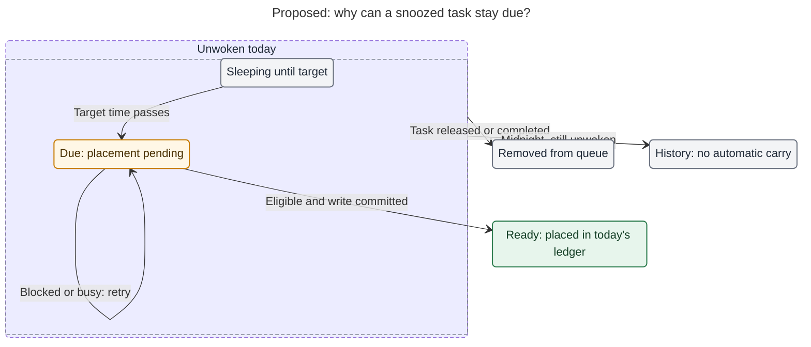
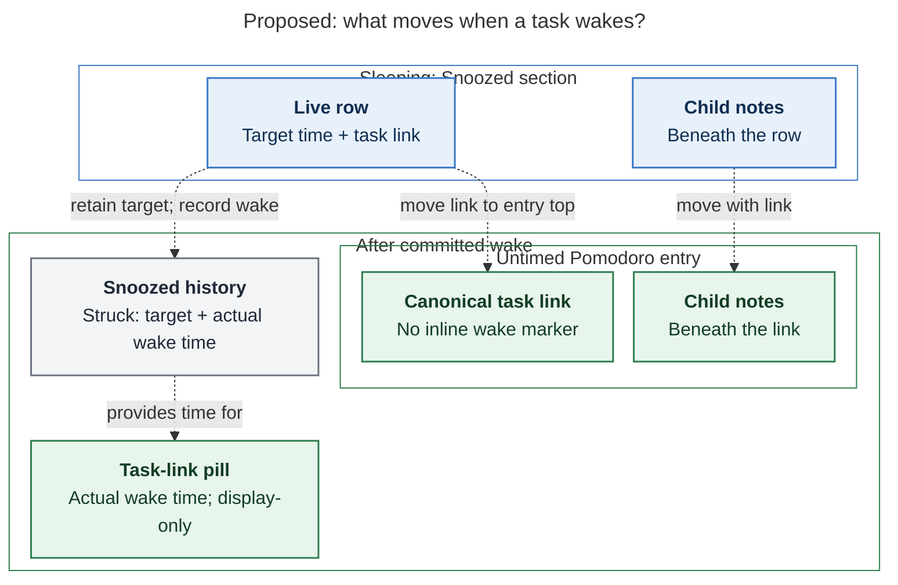
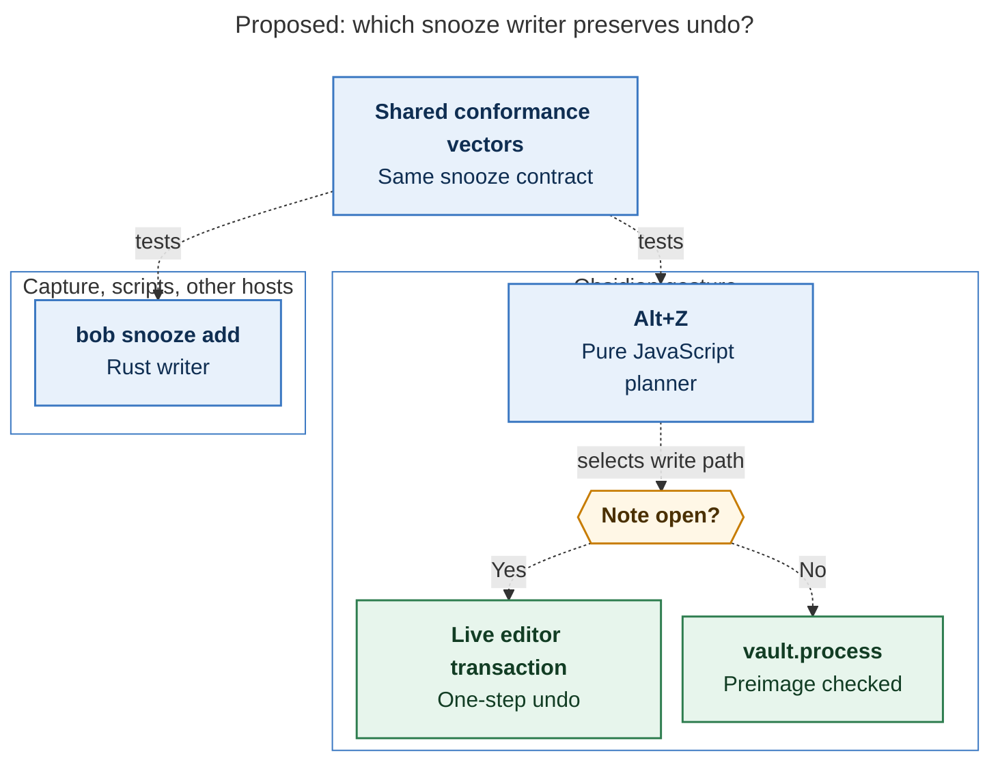

# Diagram proposals: Snoozed Tasks: consolidated design for the modified feature

Proposals for the swarm linker, not a report. Each diagram restates only what the source
report says.

```yaml
source: research:202611/snoozed_tasks/snoozed_tasks__final.md
producer: research.69.image
check: "mmdc 12.0.0 with --no-sandbox and the PDF-mirroring config rendered 3 of 3 Mermaid diagrams"
```

## timed-wake-lifecycle

```yaml
anchor: |-
  Concurrent callers are safe through the vault lock plus idempotency; contention returns
question: |-
  Why can a snoozed task stay due, or never wake today?
illustrates: |-
  A passed target is due until eligible placement commits; blocked or busy wakes retry, released or completed tasks leave the queue, and unwoken rows become history at midnight.
caption: "Timed wakes wait for safe placement; released or completed tasks leave the queue, while unwoken rows become history at midnight."
review: "640.609x619 px, fit 100.0%; question and visual checks passed; 0 revisions"
```



## wake-provenance

```yaml
anchor: |-
  the struck row preserves **both** times — the bold target
question: |-
  What moves at wake, and what retains the wake time?
illustrates: |-
  The link and its child notes move into an untimed entry while the struck Snoozed history retains the target and actual wake time that drives the display-only Task Link pill.
caption: "Wake moves the link and notes into an untimed Pomodoro session entry; retained Snoozed history supplies the display-only wake-time pill."
review: "808.75x902.5 px, fit 80.7%; question and visual checks passed; 1 revision"
```



## snooze-write-ownership

```yaml
anchor: |-
  conformance vectors, writing through the live editor transaction when the note is open
question: |-
  Which snooze write path preserves Obsidian undo while other clients use bob?
illustrates: |-
  Alt+Z uses a pure JavaScript planner with an editor transaction for open notes and preimage-checked vault.process for closed notes, while capture and scripts use bob snooze add against the same conformance vectors.
caption: "Obsidian preserves undo through its JavaScript planner; other clients use bob, with both implementations tested against shared conformance vectors."
review: "761.109x869 px, fit 85.8%; question and visual checks passed; 0 revisions"
```


