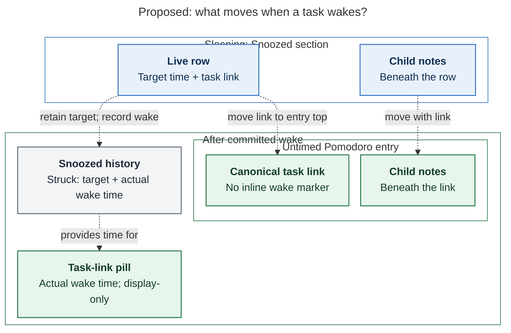
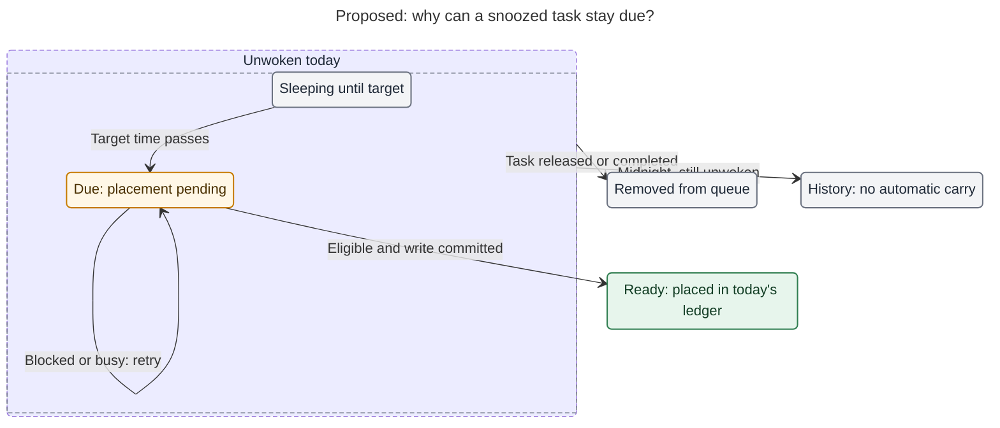
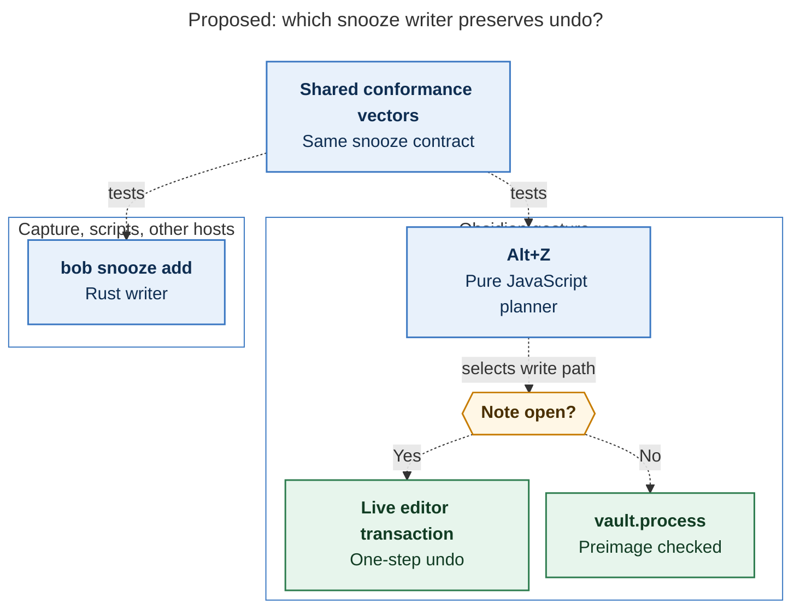

# Snoozed Tasks: consolidated design for the modified feature

> **Research query:** Design the best way to implement a possibly modified version of the
> snoozed-task feature from the earlier `snoozed_task_links.md` research so that it is
> intuitive, reliable, and beautiful: Event Tasks are never snoozed; a task's definition
> clearly distinguishes snoozed-in-today from actively linked (perhaps a clock and the
> snooze time instead of the tomato); a woken Task Link clearly shows it was snoozed and
> is now ready, with its wake or snooze time; snoozed tasks do not count against
> `plan.max_links`; snoozing from a Task Link in the daily file is very easy (perhaps a new
> keymap); a wake notifies the user in a way they are very likely to see but that goes
> away on its own; and a new "snoozed task" glossary term is added. Is this plan a good
> idea, would a different approach be better, which requirement adjustments are
> justified, and what is the recommended solution?


## Bottom line

**Build it — unanimously, and your modifications make the design better, not just
different.** All five researchers independently kept the prior report's core (a same-day
`## Snoozed` section after `## Pomodoros`; a snoozed task is *not* Today until it wakes;
one writer `bob snooze wake`, run by a cheap `bob tick` step; sticky lanes preserved; no
midnight auto-carry; Event Tasks excluded) and all five endorsed every one of your new
requirements. Two of them are nearly free by construction: a separate section is already
invisible to `plan.max_links` (the budget scans only `## Pomodoros`), and Event Tasks
already wait on their own `**HHMM-HHMM**` span.

The consolidated calls, after [adjudicating where the five split](#adjudications):

- **[Budget](#budget-exemption-with-a-forecast-guardrail):** snoozed rows are exempt from
  `plan.max_links` — a deliberate, unanimous **reversal of the prior report's R4** —
  paired with a visible `⏰ N · next HH:MM` chip, a snooze-time forecast lint, and the
  ordinary over-cap lint after wake. Exemption plus visibility, never exemption plus
  silence.
- **[Marks](#definition-mark):** one visual token — a neutral **SVG/outline clock +
  HH:MM** pill (not the red ⏰ emoji, not 💤) in the exact 🍅 Today-mark slot on the task
  definition while sleeping (slate/indigo; amber `due` once the time passes), flipping to
  🍅 on wake.
- **[Woken links](#wake-time-vs-snooze-time-on-the-woken-link):** show the **wake time**
  (decided), as a warm display-only pill (`⏰ woke 15:30`) on the woken Task Link, driven
  by a **[struck history row left in `## Snoozed`](#wake-provenance)** — zero changes to
  Task Link bytes or any of the ~10 dedicated-link parsers.
- **[Keymap](#keymap):** **`Alt+Z`** everywhere (ledger Task Link, task definition,
  Snoozed row), plus Task Card `z`, opening a small Snooze Card whose top suggestions are
  today's remaining event end times.
- **[Notification](#notification):** presence-aware delivery owned by **Bob Mac
  Capture** — one auto-dismissing surface per wake batch, *held while you are away and
  delivered when you return*, backed by a short-lived menu-bar beacon and durable vault
  marks; plain `desktop_notify` only as the fallback.
- **[Wake](#tick-step-position):** `bob tick` gains a `snooze` step **first in the
  catalog** (5m cadence, lock-free no-op); Bob Mac Capture triggers the same
  `bob snooze wake` at the exact minute, so precision is ~1 min when the Mac is awake and
  attended.

The feature is worth building because the gap is real and still unexpressible: *"committed
to today, but not actionable until HH:MM."* The `job#^email-dan-eod` failure is the
proof — linked among ~18 open links all day, visually unactionable until 15:30, with
nothing at 15:30 saying it had become doable, carried into Tuesday, then cancelled.

## Critique of the plan

*Is this a good idea? Would a different approach be better?*

**Yes, and no researcher proposed a different fundamental approach.** The alternatives
were re-examined against the new requirements and all fail the same way they failed in
the prior round: a task-line time field derives Blocked and fights sticky lanes (a
date-valued `[snooze::]` property was already tried and cancelled, commit `21cdc33b`);
inline wake markers on *waiting* ledger links force every Today/budget/lineup reader to
learn a "present but not Today" state; a timed `() — SNOOZED` placeholder *is* Today;
hidden JSONL violates the visible-ledger philosophy; notification-only leaves the agenda
lying. The daily-note `## Snoozed` queue is hand-editable, costs zero task-line schema
change, and degrades safely — old parsers ignore an unknown H2 rather than working the
task early.

Honest risks the design must answer (merged from all five):

1. **A second backlog.** Keep it same-day only, visible counts, no auto-carry, no
   future reminders/recurrence/dependency rules in v1. A snooze is always a real plan
   for today; day-long avoidance turns back into ordinary review tomorrow.
2. **Hidden overcommitment.** The requested budget exemption is right (see
   [the budget adjudication](#budget-exemption-with-a-forecast-guardrail)) but must ship
   with visibility: the chip, the forecast lint, and the honest `14/13` overage after an
   over-cap wake. Never hold, refuse, or evict at wake.
3. **False readiness.** A clock can pass while the task is Blocked or the vault is
   busy. Distinguish **due** (amber, write pending) from **ready** (successfully placed)
   in every surface. Only committed placement may claim "ready" or notify (cdx).
4. **Missed wakes.** The waker runs only while the Mac is awake. If the laptop stays
   shut all evening, nothing wakes and nothing notifies; the task is not lost (sticky
   Next + morning review) but the alert is. Accept and document for v1; a phone channel
   is a possible later phase (cld).
5. **Blast radius.** Three repos and every gesture that removes a Task Link. The
   reliability invariants below exist so a missed cleanup path degrades to a dropped
   row, never a revived task.

Product precedent (cdx): Things separates start planning, deadlines, time-specific
reminders, and a This Evening subdivision of Today — evidence for separating later-today
attention from active work, not a spec to copy.

## Adjudications

*Where the five researchers split.* This is the lead's main value-add. Each resolution is
grounded in verified behavior.

### Wake provenance

*How does the woken link know its wake time?*

Four distinct mechanisms were proposed:

| Proposal | Researcher | Verdict |
| --- | --- | --- |
| **Struck history row stays in `## Snoozed`** (`- ~~**1530** [[note#^id]]~~ · woke 15:30`), pill is display-only | gem (strike), cld (checkbox `[ ]`→`[x]` variant) | **Adopted** |
| `⏰HHMM` token written into the Task Link's 🍅 prefix cluster | grk | Rejected |
| Reserved child-bullet receipt under the woken link (versioned comment grammar) | cdx | Rejected (kept as the escape hatch if history rows prove annoying) |
| Day-scoped JSON sidecar (`woken-YYYYMMDD.json`) | mus | Rejected |

The history-row approach is the exact architectural twin of Event link times — a
same-note section drives pills on ledger links in one document scan, verified in
`docs/event-link-times.md` — and it has **zero parser blast radius**: the Task Link line
in `## Pomodoros` stays byte-identical, so all dedicated-link recognizers in Rust and
their JS copies (`dedicated_task_link`, `list_queued_links`' `tokens.len() != 1` rule,
`todayLinkFromBody`, …) are untouched, and mixed plugin/binary versions cannot disagree
about Today membership. grk's inline token requires teaching one optional marker to
every marker-stripping copy in bob-cli, bob-ledger-tools, and task-status-cycler, and a
single missed copy makes one surface lose the task while another still counts it — cdx
independently warned against exactly this ("keep the active link line canonical"). cdx's
child receipt keeps provenance on the moving subtree (it survives cross-note moves
better) but invents a new reserved child class every reader (drawers, work logs,
requirement summaries) must learn to classify. mus's sidecar is invisible in plain
Markdown and adds out-of-vault state for a display concern.

Form details (gem, refined): the struck row preserves **both** times — the bold target
(`**1530**`) and the actual wake (`· woke 15:30`, or `· woke early 14:15`, or a late
`· woke 16:20` after a lid-shut gap) — so the pill can show actual wake time and the
tooltip can explain lateness honestly. cld's checkbox variant (`[ ]` asleep / `[x]`
woken, with checkbox-click meaning Wake now) is a fine alternative the implementing plan
may pick, but strike is Bob's existing "this ledger row is finished" idiom and avoids
checkbox-semantics questions in a non-task section; it also keeps the asleep row grammar
identical to the prior report's. History rows stay for the day only; the heading is
deleted when no rows (active or struck) remain; midnight makes them history.
[The wake-provenance diagram](#figure-wake-provenance) shows the proposed split at wake:
the link and its child notes move into an untimed entry, while the struck row keeps both
times for the display-only pill.

<div id="figure-wake-provenance">



_Wake moves the link and notes into an untimed Pomodoro session entry; retained Snoozed history supplies the display-only wake-time pill._

</div>

### Definition mark

*Which glyph?*

**A neutral SVG/outline clock (◷) + `HH:MM` in a small pill, themed slate/indigo while
sleeping and amber when due.** Not 💤 (mus): the Reading Board already has a 💤 Snoozed
lane for blocked references, and cld/grk both flagged the collision. Not the ⏰ color
emoji (cld, grk): gem's design catch is decisive — Apple's ⏰ is **bright red**, and at
0.85 em next to the red 🍅 in the same slot, peripheral vision blurs the two states this
feature exists to separate. cdx independently specified an outline clock with a subdued
blue/violet tint. The SVG mask (via `--bob-snooze-clock-glyph`, `::before` content,
`font-variant-numeric: tabular-nums`, time via `::after`/`attr()` so copying a line
never copies the mark) is tintable, works in forced-colors and grayscale, and is
double-coded (shape + color). Display `15:30` with a colon (reads faster than `1530`,
which can look like a year); store `**HHMM**` in the vault, mirroring Event spans.

Mark semantics (unanimous once stated): the clock **replaces** the tomato in the exact
Today-mark slot; a definition never wears both. If a task somehow has both an active
open-Pomodoro link and a live snoozed row, **🍅 wins** and the redundant row is pruned
as `already_linked`. Mod+click on the clock jumps to the Snoozed row, exactly as
Mod+click on 🍅 jumps to the Task Link; on wake the clock swaps to 🍅 with the existing
600 ms entrance pop. Tooltips carry the words: `Snoozed until 15:30 · in 2h 15m`, and in
the due state `Snoozed until 15:30 · due (waking)`. Same host rules as
`docs/today-marks.md` (never inside daily notes, display-only, exact source mapping).

### Keymap

**`Alt+Z`** (3 of 5: cld, mus, gem), with **two independent collision audits** (cld:
`~/bob/.obsidian/hotkeys.json` + plugin grep; gem: those plus `obsidian_vimrc.md` and
Hammerspoon) finding it free. It completes the existing Alt-letter task-answer family —
`Alt+N` release, `Alt+F` keep, `Alt+P` priority — reads as "zzz", and echoes the capture
token `z:`. Also bind `z` inside the Task Card (verified free). Rejected: `Ctrl+Shift+S`
(cdx; no audit, and S is mnemonically overloaded with Split/Schedule) and `Ctrl+Shift+Z`
(grk; gem's audit found it is Redo in the Property Editor and Record Card and on Linux).
Per cdx: never overwrite an existing binding — ship the named command + context action
regardless, and collision-check at install.

### Wake time vs snooze time on the woken link

**Wake time — unanimous.** At 16:00 the question a ledger row answers is "when did this
become workable?"; the moment you pressed snooze that morning is trivia. Show the
*actual* wake time on the pill (in the common case it equals the target, since tick runs
on 5-minute marks and humans pick 5-minute times); when they differ (lid shut 15:00 →
16:20, or a manual early wake), the actual time is strictly truthful about when it
entered Today, and the tooltip explains: `Woken at 16:20 (snoozed until 15:30 · 50m
after target)`. The scheduled target always remains visible in the struck row and the
tooltip. (cdx framed the same rule as "Ready since 14:31, set-for in details".)

### Budget exemption with a forecast guardrail

All five researchers endorsed your exemption, **reversing prior R4**, and the arguments
are better than the prior report's loophole framing: `plan.max_links` measures the
**current working set** — distinct on-clock links under today's *open* Pomodoros — and a
parked row is not in any lineup, not Today, not in a running session. Counting a 19:00
chore against the 08:30 active queue double-penalizes work that never overlaps in time
(gem), and punishing planning pushes you back to `() — LATER` noise or over-linking,
which is the original bug (grk). The 19:00-blowout concern is a **forecast** problem,
answered with visibility rather than counting (merged grk/mus/cld/gem):

- `links.count` / `status: over` ignore `## Snoozed` (true by construction).
- `PlanReport` grows an additive `snoozed: { count, due, next_wake_at }` sibling of
  `links.off_clock`; `bob plan` prints `SNOOZED 2 · next 19:00`.
- The plan chip row shows a quiet `⏰ 2 · 19:00` beside `TODAY 6/13` (indigo/grey, never
  cap-colored; click jumps to `## Snoozed`); the Snooze Card footer shows the forecast
  (`9/13 active · would be 11/13 at 19:00`).
- A snooze-time lint (`snooze_wake_would_exceed_cap`) fires when
  `active + snoozed > cap`; it never flips `status` by itself.
- Wake is **never refused for a full budget** — the task was explicitly planned for that
  clock. After an over-cap wake the ordinary `plan_link_cap_exceeded` lint fires and the
  notification says `plan now 14/13` (cld). No holding, no eviction, no reservation.
- Off-clock snoozed rows stay fully uncapped, matching the existing off-clock exemption.

### Tick step position

**`snooze` runs at position 1**, before `gcal` (cld A4, gem A3; over grk/mus and the
prior report's after-`gcal` placement). Lead-verified in `src/native/tick/catalog.rs`:
steps run in sequence and the hourly `gcal` (10m ceiling) and `gmail` (20m ceiling) and
15-minute `refs` (30m ceiling) all run ahead of `tasks` — at an hour boundary a snooze
step queued behind them could be very late. With Event Tasks permanently excluded,
`snooze` depends on nothing upstream; its lock-free no-op check costs ~nothing on the
~99 % of ticks with nothing due, and `tasks` (reconcile) still validates woken links on
the same pass. Cadence 5m, ceiling 1–2m, `intake = false`, the existing daily-note
readiness gate.

### Minute precision

*Tick guarantees, clients sharpen.*

Tick alone is a 0–5-minute-late guarantee (and the honest amber **due** paint covers the
gap). For the "intuitive minute-specific experience" (cdx) the running clients sharpen
it, all through the **same single writer**:

- **Bob Mac Capture** already runs exact-minute boundary timers (`refresh_at`) and
  background bob commands; it schedules `bob snooze wake -q -f json` at `next_wake_at`
  (cld A5). Bob still does every write (`decisions:mac-capture-is-a-thin-client`).
- Optionally, bob-ledger-tools' existing minute tick shells out when a due snoozed row
  exists (grk A9), covering "Obsidian open, Mac Capture not running" at ~60 s lag.

Concurrent callers are safe through the vault lock plus idempotency; contention returns
a deferred receipt and the next run retries. Never bypass the shared vault mutation and
maintenance locks for speed (cdx).
[The timed-wake lifecycle diagram](#figure-timed-wake-lifecycle) traces the proposed path
of a snoozed row: sleeping, due, then placed, with retries while blocked or busy, exits on
release or completion, and history at midnight.

<div id="figure-timed-wake-lifecycle">



_Timed wakes wait for safe placement; released or completed tasks leave the queue, while unwoken rows become history at midnight._

</div>

### Notification

*Presence-aware, owned by Bob Mac Capture.*

The sharpest consolidated insight (cld + gem converging independently): a fire-and-forget
banner fails your "very likely to see" goal in **exactly the common case** — you are
away from the desk or in the meeting that just ended when the wake fires, macOS never
replays a missed banner, and `osascript` banners are unclickable, Focus-suppressed, and
unwithdrawable. mus's layered banner+sound is directionally right but keeps the blind
spot. The design splits **record** from **nudge** (grk's framing):

**Record (durable, not a notification):** the 🍅 flip on the definition, the
`⏰ woke 15:30` pill on the link, the struck history row, the idle-agenda row. These
survive restarts and make auto-dismissal accessible (cdx's W3C point: transient notices
need equivalent information available elsewhere).

**Nudge (must fire, must vanish, one per wake batch):**

1. `bob snooze wake` writes an atomic receipt (`$XDG_STATE_HOME/bob-cli/snooze/last-wake.json`,
   with `wake_id`, tasks, destinations, times) and posts Darwin
   **`org.bobs.bob.snooze.woken`** (gem's mechanics; mirrors
   `scan_receipt.rs`/`RefsScanReceiptObserver.swift`). Dry runs and no-ops stay silent.
2. **Bob Mac Capture** observes it and gates on presence using zero-permission signals
   (screen lock/display sleep notifications; `CGEventSource` idle time). **Active** →
   show immediately. **Away/locked/idle** → *hold the batch and deliver seconds after
   you return*, after re-verifying the tasks are still open. This one rule is the
   biggest seen-rate multiplier available.
3. The surface: a **12-second, top-center, non-activating glass HUD** (gem; the
   `RefsCopyHUD.swift` precedent is lead-verified — `NSGlassEffectView` and
   non-activating panels already exist in the app) — hover pauses the countdown, click
   opens today's note at the woken link via the existing open-note action, inline
   `Open` / `+15m` / `+30m` / `×` actions, gentle optional chime (default on; **silent
   while a meeting is running**, per cld's meeting-awareness), batching several wakes
   into one card. Alternative acceptable v1: a `UNUserNotificationCenter` banner through
   the existing `NotificationService` with the same presence hold, thread identifier,
   and grouped copy — less chrome, same behavior contract. Either way: **never steal
   focus, never a modal, never a repeat banner.**
4. **Catch-up and Focus net:** a silent `.list`-only Notification Center entry (no
   second banner), and a status-item beacon (`⏰1` beside the "b") that survives Focus
   mode and clears when you touch the task, open the panel, after ~60 minutes, or at
   day end. Delivered notices are withdrawn (`removeDeliveredNotifications`) under the
   same conditions — nothing ever needs a manual dismiss.
5. **Fallbacks:** `desktop_notify` (osascript/notify-send, with a sound name) only when
   Mac Capture is not running or on Linux; an 8-second Obsidian `Notice` only where no
   Capture HUD fired (never a double banner on macOS). Config `snooze.notify:
   auto|desktop|off`.

**Interruption level (dispute resolved conservatively):** grk proposed
`.timeSensitive`; cld doubted the hand-signed app can carry the entitlement; cdx cited
Apple HIG advice to match interruption level to real urgency. **Default to normal
Active-level delivery — the presence hold removes most of the need — and treat
Time Sensitive as a later opt-in, gated on verifying the entitlement is actually
available to the Developer-ID-signed build.** Never Critical.

**Honest limits (cdx):** denied permission, Focus, a stopped app, or a sleeping Mac can
still delay visibility; show notification health in settings and in the first snooze
preview; promise idempotent placement and best-effort deduplicated delivery (stable
`wake_id`, per-host receipts), not exactly-once human notification. Notification failure
never rolls back a wake.

### Plugin write path

*Pure JS planner, not a shell-out.*

The prior report had Obsidian gestures shell out to `bob snooze add`. gem's objection is
lead-endorsed: bob-navigation-hotkeys deliberately keeps disk reloads out of editor undo
history, so a subprocess write breaks one-step `Ctrl+Z` on the open daily note, adds
reload flicker, and fails on mobile — and **every** existing fast ledger gesture
(`Ctrl+Shift+Enter`, `Ctrl+Shift+M`, `Alt+N`) is a pure JS planner pinned to shared Rust
conformance vectors, writing through the live editor transaction when the note is open
and preimage-checked `vault.process` when closed. `Alt+Z` follows that pattern, tested
against the same `tests/fixtures/snooze/vectors.json` the Rust side ships. The CLI
(`bob snooze add`) remains the writer for capture, scripts, and other hosts.
[The snooze write-ownership diagram](#figure-snooze-write-ownership) shows the proposed
split: `Alt+Z` branches on whether the note is open, other clients use `bob snooze add`,
and shared vectors test both writers.

<div id="figure-snooze-write-ownership">



_Obsidian preserves undo through its JavaScript planner; other clients use bob, with both implementations tested against shared conformance vectors._

</div>

### Snoozing a link under the running session

cld and gem allow it (move the link subtree out; the lane is untouched; never delete a
running timed Pomodoro); cdx alone required a close-first flow. **Adopted: allow it** —
moving a link out of a running entry is the same shape as the existing unlink/move
gestures and removes the link *before* any plain-`x` close could classify it, so no
false work is recorded. cdx's underlying concern survives as an implementing-plan check:
confirm the move preserves any struck/worked state and recorded time exactly as
`consumption-keeps-notes-and-recorded-time` requires. The inviolable rule is the
reverse direction (unanimous): **wake never places a link into the running entry**, and
a new `() — TYPE` placeholder lands after it instead.

### Walk and dashboard exclusions

*gem's catch, adopted.*

Because a snoozed task is Next-but-not-Today, it would still appear in the `]w` lane
walk and in `dash.md`'s `NEXT`/`PENDING` backlog sections at 10:00 — exactly the noise
snoozing was meant to remove. Adopted (gem A1): keep `isToday` pure, add a sibling
`isSnoozedToday(task)` predicate, and exclude it from **`]s`, `]w`, and the dash
`NEXT`/`PENDING` sections**, in both the Rust scan and the ledger-tools mirror with
shared vectors. Whole-lane counts (CLI, the Mac `w` mark) still include snoozed tasks,
exactly as they include Today. The exclusion tests only *today's* note, so suppression
cannot outlive the plan day. cdx's guard: invalid/unresolved rows must not suppress
review indefinitely — only valid live rows exclude.

### Smaller consolidated calls

- **No-revival invariant (cld A3, adopted):** wake drops any row whose target has left
  the Next/In Progress lanes (a Ready target means it was released). Belt-and-braces
  under cleanup parity.
- **Blocked tasks:** refuse at snooze time with a teaching notice ("Blocked by ‹X› —
  snooze waits on the clock, not on prerequisites"; cld A6); a task that *becomes*
  Blocked while asleep stays parked at wake and retries (all). Wake never drops
  prerequisites, never stamps `[fresh::]`, never writes `[unblocked::]`, never creates
  successor offers (unanimous; cdx's "automatic wake fulfills an earlier choice, it is
  not a new human override").
- **Woken link placement:** **top** of the destination entry (cld A2 + gem) — "back on
  top of the inbox", so a just-woken task is never buried; destination chain is first
  untimed open exact-type entry → untimed open containing-type → new `() — TYPE`
  placeholder (never running).
- **Row source form:** `- **HHMM** [[note#^id]]`, no emoji in source (4 of 5; the bold
  time *is* the mark, mirroring Event spans; the clock glyph is paint). Accept `HH:MM`
  and hand-written variants; normalize on supported write; writers keep rows
  time-sorted; one live row per task per day — re-snoozing rewrites in place, and
  re-snoozing a woken task replaces its struck row with a new active row (a new cycle).
  Malformed rows, fences, extra links, duplicate sections: skipped and diagnosed, never
  guessed at (cdx).
- **Snoozed-row gestures** (cld): `Ctrl+Enter` completes the task and prunes the row;
  `Alt+N` releases and prunes; `Ctrl+Shift+Enter` (or `@route:id` in capture) is early
  wake; `@route:id!` drops the row without waking; `Alt+Z` on the row re-times or
  offers Wake now.
- **Capture token:** `z:<when>` (`z:1530`, `z:15:30`, `z:+45m` resolved at write;
  verified `s:<digits>` is a day offset and `z:` is free). Teaching refusals: past
  times, cross-midnight ("same-day only — Schedule defers to another day"), mixing with
  `s:<N>` or `=`, Event Task targets. Existing-task items need the one documented
  extra-token exception.
- **CLI:** top-level `bob snooze` noun; bare/`list` read-only; `add`, `wake`, `drop`
  verbs with dry-run/`-f json`/short-option conventions per `cli_rules`.
- **Timezone/DST (cdx, unique and kept):** resolve relative input in the commit
  preview against Bob's configured zone; require a future same-day target; reject
  nonexistent DST times rather than normalizing; disambiguate repeated (fold) times in
  the UI and diagnose them in hand-written rows; inject one clock in tests.

## Requirement adjustments explicitly called out

| # | Adjustment | Kind |
| --- | --- | --- |
| C1 | **Event Tasks are never snoozed** — hard refusal at every route (Alt+Z, Task Card `z`, `z:`, `bob snooze add`); a hand-written row targeting an Event Task is never moved and emits a `snoozed_event_task` lint; gcal, MEET filing, spans, and timed closes are byte-for-byte untouched. Event **end times** are still offered as literal-time suggestions in the Snooze Card and `z:` completions. | Pins your constraint (unanimous) |
| C2 | **Snoozed rows do not count toward `plan.max_links`** — with the chip, forecast lint, and post-wake overage lint of [the budget adjudication](#budget-exemption-with-a-forecast-guardrail). | **Reverses prior R4**; endorses your rule with a guardrail |
| C3 | **Definition mark is a clock + time replacing 🍅** — neutral SVG clock, slate pill `◷ 15:30`, amber `· due` once passed, never both marks at once (🍅 wins). | Pins your request; glyph adjudicated |
| C4 | **Woken links show the wake time** via a display-only pill driven by the struck history row; Task Link bytes never change. | Decides your either/or; adds history-row retention (changes prior R7's delete-when-empty) |
| C5 | **`Alt+Z` + Task Card `z`** is the snooze gesture, implemented as a pure JS planner with shared Rust vectors (not a shell-out). | Pins your keymap request; changes the prior Phase-3 write path |
| C6 | **Wake notification is presence-aware and Mac-Capture-owned**, one auto-dismissing surface per batch with hold-while-away, beacon, silent NC record, and fallbacks; normal interruption level by default. | Replaces the prior "configurable `desktop_notify`" |
| C7 | **`snooze` tick step runs first in the catalog**, and running clients trigger the same writer at the exact minute. | Changes prior R6's after-`gcal` placement |
| C8 | **Snoozed tasks are excluded from `]w` and dash `NEXT`/`PENDING`** in addition to `]s`; whole-lane counts unchanged. | New (gem); prior report covered only `]s` |
| C9 | **Wake never revives a task that left Next/In Progress**, and snoozing a Blocked task is refused in v1. | New invariants (cld) |
| C10 | Kept unchanged from the prior report: same-day only; promote Ready → Next + stamp `[fresh::]` at snooze exactly like Ctrl+Shift+Enter; wake stamps nothing; never wake into the running entry; section after `## Pomodoros`, structural-H2 registered; cleanup parity ships with authoring; no midnight auto-carry. | Unanimously re-endorsed |

## Recommended solution

### Vault form

```markdown
## Pomodoros
- [x] (**1445-1530** [t:: 45m]) — MEET
	- 🍅 ~~[[#^bryan-bugyi-derrick]]~~
- [ ] () — WRITE
	- [[job#^email-dan-eod]]
		- Mention the new interview timeline.
	- [[sase_blog_drafts#^what-came-before]]

## Snoozed
- ~~**1530** [[job#^email-dan-eod]]~~ · woke 15:30
- **1900** [[home#^fix-sink]]
	- grab the wrench from the garage first
```

The woken link's child notes travelled up with it; the struck row is the day's
provenance. `## Snoozed` is created on demand after `## Pomodoros` (zero gcal-anchor
changes; the ledger still ends at the next H2), registered in `is_structural_h2_key`,
and deleted only when no rows remain.

### Visual language

*One token, four states.*

| State | Task definition | `## Snoozed` row paint | Ledger Task Link | Mac agenda |
| --- | --- | --- | --- | --- |
| Asleep | `◷ 15:30` slate pill (in the 🍅 slot) | time pill + countdown `in 6h 18m` | — (not in ledger) | dim "Later today" band row |
| Due (write pending) | `◷ 15:30 · due`, amber | amber `due · waking` | — | amber `due · waking` |
| Woken, fresh | 🍅 (entrance pop) | struck row `· woke 15:30` | warm `⏰ woke 15:30` pill leading the link (`side: -3`, the slot Event pills use — free here because Event Tasks are never snoozed) | row highlighted in its band |
| Woken, settled / closed | 🍅 | struck row | quiet outline pill, dim in closed entries; hidden on post-work carried continuations | ordinary row |

All marks are display-only widgets per the existing mark architecture: zero line-height
shift, non-copyable, reduced-motion and forced-colors safe, tooltips without `::`, each
animation plays once. Communicate state through shape + text, never color alone (cdx).
(Rendered mock-ups: `snoozed_task_implementation__grk_lifecycle.svg` and the budget and
notification figures beside it in this directory.)

### The Snooze Card

*Opened with `Alt+Z` / Task Card `z`.*

Context-sensitive: on a ledger Task Link it parks the subtree; on a task definition it
snooze-links (Ready → Next + `[fresh::]`, like Ctrl+Shift+Enter, moving any live link
into the row); on a Snoozed row it re-times or wakes now; on an Event Task it teaches
("Event Tasks wait on their own clock (19:00–20:30)"); on a Blocked task it teaches.
One focused time field accepting `1530`, `15:30`, `3:30p`, `+45m`, `+2h` (a bare `330`
means the next 3:30 today); ranked suggestions — today's remaining **event end times**
first (`15:30 · after Yogi interview`), then `+30m/+1h/+2h` rounded up to 5-minute
granularity, then times used today (named `snooze.times` later); a consequence footer
(`leaves WRITE · wakes 15:30 into WRITE · in 6h 18m · 9/13 active, 2 snoozed`);
teaching refusals for past and cross-midnight times; `Enter` confirms, `Esc`/`Ctrl+[`
cancel, `q` types (text control). One-step `Ctrl+Z` undo.

### Wake algorithm

*`bob snooze wake`, idempotent, today's note only.*

1. Lock-free read; exit if nothing due or prunable (~99 % of runs).
2. Under the guarded writer, re-reading inside the lock: prune `resolved`
   (done/cancelled/missing/ambiguous), `already_linked`, and `released` (no-revival)
   rows, reporting each; never move an `event_task` row; skip still-`blocked` rows
   (stay parked, retry).
3. Due + eligible: ensure Next for hand-written Ready rows (the one lane write), move
   the link subtree to the **top** of the first untimed open exact-type entry → untimed
   containing-type → new `() — TYPE` placeholder after the running entry. Never the
   running entry. No fresh/keep/schedule/dependency writes.
4. Strike the row with the actual wake time. One atomic snapshot-checked write;
   deferred receipt on contention.
5. Commit, then write `last-wake.json`, post `org.bobs.bob.snooze.woken`, and report
   JSON `woken[]` (with destination and over-cap flag), `dropped[]` (reasoned),
   `pending[]`, `next_wake_at`. Only committed placement says "ready" or notifies.

### Phases

1. **bob-cli core** (useful by hand from day one): `src/native/snooze/` parse/plan/write,
   `bob snooze` CLI, tick step at position 1, structural H2, reconcile carve-out +
   safety-net prune + hand-written-row promotion, freshness/walk exclusion, `bob plan`
   snoozed line + forecast lint, additive `snoozed[]`/`woken`/`next_wake_at` in agenda
   JSON with `refresh_at` folding, `desktop_notify` fallback, `docs/snooze.md` with
   shared conformance vectors, DST/time vectors.
2. **bob-plugins** (same release as authoring): `planDeferredPomodoroLinkCleanup` learns
   `## Snoozed` (release/complete/cancel/unlink/decay/roll/Ctrl+Shift+M); the ◷ mark
   with due state and ring-to-🍅; the woken-link pill (Event-link-times sibling, added
   to `ledgerMarkClass`); Snoozed-row paints and heading chip; `Alt+Z`/Task Card `z`
   Snooze Card as a pure JS planner on shared vectors; snoozed-row gestures;
   `isSnoozedToday` + `]s`/`]w`/dash exclusions; plan chip. Then `bob plugins sync`.
3. **Capture + Mac Capture:** `z:<when>` grammar and completions; decode `snoozed[]`;
   "Later today" band; `SnoozeWakeObserver` + presence-aware HUD/banner with hold,
   beacon, silent NC record, withdrawal; exact-minute `bob snooze wake` timer; macOS CI
   watched on the exact SHA.
4. **After ~2 weeks of real use:** named times (`z:home`), Hammerspoon countdown prefix,
   missed-yesterday lint, Time Sensitive opt-in (entitlement permitting), phone channel
   for the lid-shut evening, event-anchored wakes / `starts after` interplay as their
   own epics.

### Memory follow-through

The implementing plan proposes, through the memory-write flow: the
[glossary strand below](#glossary-term-draft) (default-on; you asked for it) and a
decision record roughly *"Snoozed Tasks wait after the ledger and wake through tick"*
covering not-Today semantics, the budget exemption, Event Task refusal, the ◷/🍅 split,
running-entry avoidance, history-row provenance, and no-revival — amending the
surroundings of `today-is-read-from-the-ledger` without changing Today.

### Glossary term draft

> **Snoozed Task**
> *aka snooze, snoozed link, later-today task*
>
> An open, non-Event task committed to **today but deliberately set aside until a clock
> time**. Its link waits as one row — `- **HHMM** [[note#^id]]`, child notes beneath —
> in the `## Snoozed` section after today's Pomodoro ledger. While asleep it is **not
> Today**: no 🍅, absent from the `=`/`x` lineups, the `]s` and `]w` walks, and the
> `plan.max_links` budget (the plan shows it as a separate ⏰ count), and its definition
> wears a clock-and-time mark (`◷ 15:30`, amber once due) where a Today task wears 🍅.
> Snoozing promotes Ready → Next and stamps freshness, exactly like linking.
>
> At or after HH:MM, `bob snooze wake` — run by `bob tick`'s first step and at the exact
> minute by Bob Mac Capture — re-checks the task and, if eligible, moves its link and
> notes to the top of an untimed open Pomodoro of its type, never the running one. The
> row stays behind struck with the wake time (`- ~~**1530** …~~ · woke 15:30`), which
> drives the `⏰ woke 15:30` pill on the woken Task Link; the task is now Today and
> counts normally. One presence-aware notification announces the return and goes away
> on its own. Waking never starts work, stamps freshness, drops prerequisites, or
> revives a released task; a passed time awaiting a safe write is **due**, not ready.
>
> Same-day only: an unwoken row becomes history at midnight and the sticky Next lane
> resurfaces the task in normal review; multi-day deferral is `[scheduled::]`. Never an
> [[event-task]] (its `**HHMM-HHMM**` span already says when it applies); not the
> Reading Board's 💤 Snoozed lane; not a project-frontmatter `snooze:` hold. See
> `docs/snooze.md`.

### Distilled key acceptance cases

1. A task snoozed to 15:30 is absent from `=`/`x`, TODAY, `]s`, `]w`, and dash
   `NEXT`/`PENDING` at 15:29, keeps its lane and notes, and never increments
   `links.count`; its definition wears `◷ 15:30`, not 🍅.
2. First eligible wake after 15:30 moves it exactly once to the top of an untimed
   matching entry, strikes the row with the actual time, flips the definition to 🍅,
   paints `⏰ woke 15:30` on the link, and fires exactly one auto-dismissing
   notification (held while away, delivered on return, silent during a running
   meeting). A second run is a no-op; a 15:40 run catches a 15:30 row.
3. A running-only destination yields a new placeholder after the running entry — never
   a write into it — and a later plain `x` close cannot record the woken task as worked.
4. Complete/cancel/release/unlink/decay/roll/move before wake prunes the row; wake
   never revives a task that left Next/In Progress; a dependency added while asleep
   keeps it parked; waking over cap succeeds and surfaces `14/13` honestly.
5. Event Tasks are refused through every spelling and route; sync, MEET filing, Gmail
   holds, successor offers, and close numbering are byte-for-byte unaffected.
6. Yesterday's rows never wake today; fences/malformed times/extra links never execute;
   deleting every cache and app preference loses nothing but paint (Markdown is
   authoritative); old binaries and plugins ignore the unknown H2 safely.
7. DST gap/fold, midnight races, clock jumps, and zone mismatches follow the explicit
   rules (reject nonexistent times; disambiguate folds; commit under the old day or
   defer); one injected clock drives the tests.

## Open questions for Bryan

*Defaults shipped if unanswered.*

1. **History-row form:** struck row `- ~~**1530** …~~ · woke 15:30` (default) or cld's
   checkbox rows (`[ ]`→`[x]`, with checkbox-click = Wake now)?
2. **Woken pill copy:** `⏰ woke 15:30` with the word (default) or just the time with
   the warm tint?
3. **Meter copy:** `⏰ 2 · next 19:00` chip (default) vs the word `snoozed 2` (grk
   preferred the word to avoid any Reading-Board 💤 confusion).
4. **Snooze Card empty default:** next 30-minute boundary (default) or empty until
   typed?
5. **Notification chrome:** glass HUD (default; prettier, hover-pause, inline actions)
   or plain `UNUserNotificationCenter` banner with the same presence hold (simpler)?
6. **Beacon lifetime:** 60 minutes (default) — long enough for a return from lunch?

## Corrections and conflicts in the record

- **Prior report error, now triply confirmed:** Bob Mac Capture does **not** observe
  `org.bobs.bob.tick-finished`; its only Darwin receipt observer is
  `org.bobs.bob.ref.scan-finished` (grk, gem, cld independently; **lead re-verified by
  grep this turn**). mus's report repeated the prior claim — its notification layer 2
  ("the tick-finished ping already refreshes the agenda") should be read as "post a
  dedicated `org.bobs.bob.snooze.woken` receipt instead". Agenda refresh today is vault
  events, panel show, wake/unlock, clock change, and `refresh_at`.
- **grk's keymap** (`Ctrl+Shift+Z`) conflicts with Redo in the Property Editor and
  Record Card and on Linux per gem's wider audit; grk's inline `⏰HHMM` link marker was
  rejected for parser blast radius ([the wake-provenance adjudication](#wake-provenance))
  — the rest of grk's report (budget forecast, Darwin receipt correction, wake
  algorithm, phases) is adopted.
- **cdx's close-first running-session flow** was not adopted
  ([the running-session adjudication](#snoozing-a-link-under-the-running-session)), and
  its Ctrl+Shift+S keymap lost to the audited Alt+Z; its reliability spine (due-vs-ready
  honesty, DST rules, delivery receipts, acceptance rigor) is adopted throughout.
- **Budget:** the prior report's R4 (count snoozed toward `max_links`) is formally
  reversed — by your requirement and by better arguments
  ([the budget adjudication](#budget-exemption-with-a-forecast-guardrail)).

## Provenance

### Request and inputs

**Date:** 2026-11-25 · **Lead:** consolidated from five independent researcher reports
(`snoozed_tasks__{cdx,cld,grk,mus,gem}.md`, this directory) plus the lead's own source
verification on bob-cli `8f88a52c` and bob-mac-capture `origin/master`.

The lead restated the request as follows:

> **Restated request:** Design a (possibly modified) version of the snoozed-task feature
> from `research:202611/snoozed_task_links/snoozed_task_links.md`, under new
> requirements: Event Tasks are never snoozed; a task's definition must clearly show
> snoozed-in-today vs actively-linked (clock + time instead of 🍅?); a woken Task Link
> must clearly show it was snoozed and is now ready, with the wake or snooze time
> (researcher's call); snoozed tasks do **not** count against `plan.max_links`; snoozing
> from a Task Link in the daily file must be very easy (new keymap?); a wake must notify
> Bryan so they are very likely to see it, yet go away on its own; add an excellent
> glossary term for "snoozed task". Critique the plan, call out adjusted requirements,
> and end with a recommended solution.

### Researcher contributions

Consolidated from five independent reports, moved beside this file
(`snoozed_tasks__{cdx,cld,grk,mus,gem}.md`; grk's three rendered figures travel with
them under their original `snoozed_task_implementation__grk_*` names):

- **cdx** — reliability and honesty spine: due-vs-ready distinction, canonical-link
  preservation, DST/timezone rules, delivery receipts and idempotency limits,
  accessibility (W3C timing/status), the fullest acceptance matrix; child-receipt
  provenance and Ctrl+Shift+S not adopted.
- **cld** — checkbox-row provenance variant, the no-revival invariant (A3), tick-first
  placement (A4), Mac exact-minute wake (A5), Blocked-task refusal (A6), presence- and
  meeting-aware notification with the menu-bar beacon, top-of-entry placement, deepest
  hotkey/vault archaeology (Z free, `max_links: 13`, `email-dan-eod` forensics).
- **grk** — record-vs-nudge notification framing, budget forecast lint, Darwin
  `snooze.woken` receipt correction, ledger-tools minute-tick sharpening, decision-record
  scoping, rendered lifecycle/budget/notify figures; inline `⏰HHMM` marker and
  Ctrl+Shift+Z not adopted.
- **mus** — projected-budget guardrail copy (`8/13 · +2 → 10/13`), the
  wake-time-not-snooze-time argument, glossary disambiguation of the two other "snoozed"
  meanings, sound-on default; 💤 glyph and sidecar provenance not adopted;
  tick-finished claim corrected.
- **gem** — struck-history-row architecture, the red-⏰-next-to-🍅 design catch, the
  `]w`/dash exclusion discovery, pure-JS-planner write path, presence-aware glass HUD
  with hold-while-AFK, `side: -3` slot reuse, last-wake receipt mechanics, Alt+Z full
  audit; Liquid Glass specifics kept optional against the simpler banner.

### Lead verification

**Lead verification this turn (bob-cli `8f88a52c`, bob-mac-capture `origin/master`):**
tick catalog order, cadences, and ceilings (`src/native/tick/catalog.rs` — gcal 60m/10m,
gmail 60m/20m, gkeep manual, refs 15m/30m, projects 15m/10m, tasks 15m/10m; no snooze
step); `is_structural_h2_key` (Tasks, status groups, Pomodoros, Events, Highlights +
generated catalogs; no Snoozed); bob-mac-capture's only Darwin observer is
`org.bobs.bob.ref.scan-finished` (`RefsScanReceipt.swift`,
`RefsScanReceiptObserver.swift`); `RefsCopyHUD.swift` exists with `NSGlassEffectView` /
non-activating-panel patterns. Facts verified identically by ≥2 researchers (Today
membership, dedicated-link token rule, plain-`x` close outcomes, off-clock exemption,
`s:` day-offset collision, cleanup helper scope, sticky-lane rules) were accepted on
that corroboration; the prior report's lead-verified ground-truth table stands except
for the `tick-finished` row corrected above.
