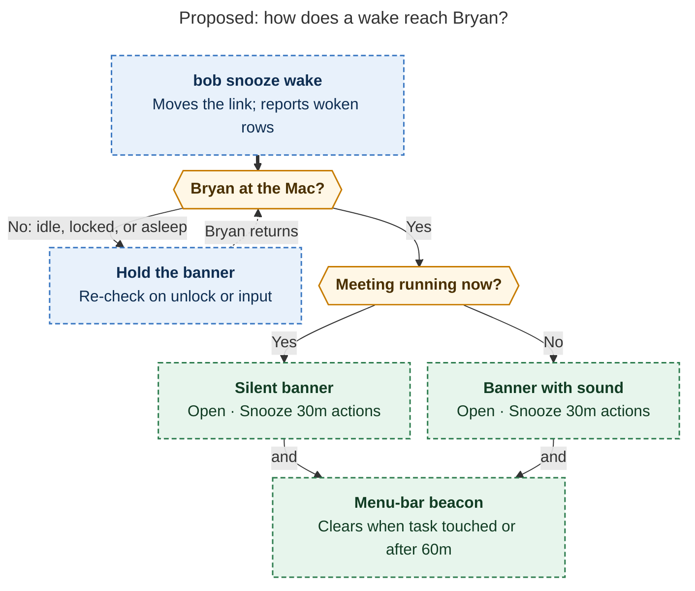

# Snoozed Tasks: a design for later-today Task Links that wake themselves (cld)

> **Research query.** Design a (possibly modified) version of the snoozed task links
> feature from `research:202611/snoozed_task_links/snoozed_task_links.md`, under these
> new requirements:
>
> - Event Tasks are never snoozed tasks.
> - A task's definition must make it very clear whether the task is snoozed in today's
>   daily note or has an active Task Link (maybe a clock plus the snooze time in place
>   of the 🍅).
> - A Task Link must make it very clear that the task was snoozed and has woken, with
>   the wake time (or the snooze time; researcher's call).
> - Snoozed tasks do not count against `plan.max_links`.
> - Snoozing an existing task from its Task Link in the daily note must be very easy
>   (a new keymap?).
> - On wake, notify Bryan so he is very likely to see it, and let the notification go
>   away on its own.
> - Add an excellent glossary term for "snoozed task".
> - Lead the design: intuitive, reliable, beautiful.
>
> Critique the plan, call out any adjusted requirements, and end with a recommended
> solution.

**Date:** 2026-11-25 · **Researcher:** cld · **Code read at:** bob-cli `8f88a52c`,
bob-plugins and bob-mac-capture `origin/master` (fast-forwarded today), and the live vault
(`~/bob/2026/20261123.md`–`20261125.md`, `~/bob/bob.md:114`).

---

## Bottom line

**Build it.** The prior consolidated report got the core right, and I keep it:

- a same-day `## Snoozed` section after `## Pomodoros`;
- a snoozed task is *not* Today until it wakes;
- `bob tick` wakes it;
- Event Tasks are excluded.

Your new requirements fit that core well. Two of them are free. A separate section is
already invisible to `plan.max_links`, because the budget scans only `## Pomodoros`. And
Event Tasks already wait on their own `**HHMM-HHMM**` span.

The new requirements do change **seven details** of the earlier recommendation. These
are the main design calls in this report:

1. **Keep woken rows as checked history.** A row reads `- [ ] **1530** [[job#^email-dan-eod]]`
   while asleep and becomes `- [x] …` when it wakes. It is no longer deleted. That history
   lets the woken ledger link show `⏰ woke 15:30` as a display-only pill. This is the
   same pattern as [Event link times](#verified-ground-truth): it needs no change to the
   ledger link grammar, which tolerates nothing but the link itself.
2. **Use ⏰ HH:MM, not 💤, as the snoozed mark on the task line**, in the slot where 🍅
   shows Today. 💤 already means the Reading Board's date-based Snoozed lane. ⏰ is the
   object that has a snooze button, and it pairs with the 🍅 kitchen timer.
3. **Show the wake time, never the moment you pressed snooze.** It answers "why is this
   here now?" and is the time you chose ("after 3:30"). It also needs no extra stored
   state.
4. **Don't count snoozed tasks toward the budget (your call; I agree).** The cap measures
   what you are juggling *now*. Show them as an informational `⏰ 2 · next 19:00` chip
   instead, so they are never hidden.
5. **One key, `Alt+Z`, everywhere.** It works on a ledger link, on a task line, and on a
   Snoozed row, and it is the same as Task Card `z`. It opens a small Snooze Card that
   suggests today's event end times. On a Snoozed row the card offers "Wake now".
6. **Notifications are owned by Bob Mac Capture and are presence-aware.** You get one
   banner with *Open* and *Snooze 30m* actions. The banner waits while you are away and
   is delivered when you come back. It is silent during a running meeting. A menu-bar
   `⏰1` beacon stays until you touch the task or an hour passes, then everything
   withdraws itself.
7. **Two reliability rules the earlier report lacked.**
   - Wake never revives a task that has left the Next/In Progress lanes. A released task
     cannot come back even if a cleanup path is missed.
   - The tick `snooze` step runs **first**, ahead of gcal/gmail/refs, so slow intake
     can't delay a wake.

The [recommended solution](#recommended-solution) ships this in four phases. Phase 1
already notifies (through bob's existing `osascript` transport), so the feature is useful
from the first release.

---

## Verified ground truth

The facts this design rests on, each checked today:

| Fact | Evidence |
| --- | --- |
| A ledger Task Link counts only when its bullet holds **exactly one** wikilink, after stripping 🍅 and one strikethrough. Any extra token (a field, an emoji, a time) removes it from Today, the `=`/`x` lineups, and the budget. | `src/native/capture_pomodoro_start.rs:92–190` (`list_queued_links` → `list_session_links`, `tokens.len() != 1 → continue`) |
| `plan.max_links` is a meter and lint only. It counts distinct links under **open entries in `## Pomodoros`**, and capture merely warns when a capture grows past it. Nothing refuses a link. | `docs/plan.md` § Links/Status; `src/native/capture/budget.rs:408–436` (`link_warning`) |
| Bryan's caps: `max_links: 13`, `max_next: 13`, `max_pending: 8`. `LATER` is a configured inventory label: storage, not a type. | `~/.config/bob/config.yml` `plan:` |
| The 🍅 Today mark is a display-only widget in the identity slot of open `#task` lines that are in Today. Its glyph comes from `var(--bob-today-mark-glyph, "🍅")`. It is never shown in canonical daily notes. Mod+click jumps to the Task Link. A 600 ms entrance pop plays when a task enters Today. | `docs/today-marks.md`; bob-ledger-tools `src/143-today-marks.js`, `275-plugin-today-marks.js`, `276-…-reading.js` |
| **Event link times**: a ledger link to the same note's Event Task wears that event's time pill. The pill is derived at render time from another section of the same daily note and writes nothing. | `docs/event-link-times.md` |
| Off-clock chips, 🔑 frees, and ⏭ keep-moving marks all *trail* the ledger link. Event pills *lead* it. | `docs/plan.md`, bob-plugins `docs/bob-ledger-tools.md` |
| Tasks plugin `globalFilter` is `#task`, so non-`#task` checkbox rows (like Pomodoro entries) are not tasks. | `~/bob/.obsidian/plugins/obsidian-tasks-plugin/data.json` |
| Text mentions require a `#task` ancestor (rule M1), so links on non-task rows in a daily note never create `💬 mentions` mirrors. | `docs/task-relations.md` §19.2 |
| One plugin helper prunes links for release, close, cancel, decay, roll, and Ctrl+Shift+M, but only inside `## Pomodoros`. | bob-navigation-hotkeys `src/160-pomodoro-reorder.js:538` (`planDeferredPomodoroLinkCleanup`) |
| No vault or plugin hotkey uses **Z** with a modifier. The only Z bindings are Ctrl+Z undo inside card editors. The Task Card's first screen uses `b ⇧B l ⇧L f t x` (Schedule is `Enter`), so **`z` is free**. | `~/bob/.obsidian/hotkeys.json`; bob-plugins `docs/task-card.md:45–52`; grep of plugin sources |
| bob's desktop transport is `osascript display notification` on macOS and `notify-send` on Linux. It is best-effort, has no actions, and can't be withdrawn. | `src/native/desktop_notify.rs` |
| Bob Mac Capture already owns a `UNUserNotificationCenter` service. It has categories, an *open-note* action that jumps into Obsidian, and an authorization flow in Settings. | bob-mac-capture `Sources/BobMacCapture/NotificationService.swift` |
| The Mac app refreshes its agenda on vault file events (2 s trailing delay while visible, 10 s while hidden) and immediately on wake, unlock, and clock change. It schedules exact `refresh_at` boundary refreshes. I found no `tick-finished` observer in the app; that Darwin ping is posted by `tick/receipt.rs:75`. | bob-mac-capture `docs/idle-agenda.md`; `CaptureAgendaBoundaryRefresh.swift`; `RefsScanReceiptObserver.swift` (its only `notify_register_dispatch`) |
| The status item is a code-drawn template "b" glyph with state variants (`ready`, `bobUnresolved`). The menu-bar *Pomodoro countdown* is a separate Hammerspoon item in chezmoi. | `StatusItemGlyph.swift`; glossary `Mac Menu Bar Pomodoro Indicator` |
| `bob tick` runs every 5 min on the Mac (minimum step interval `5m`). Steps run in sequence: gcal 1h → gmail 1h (≤20 m) → gkeep → refs 15m (≤30 m) → projects → tasks. | `docs/tick.md`; `~/.config/bob/config.yml` `tick:` |
| "Snoozed" already names the Reading Board's `💤 Snoozed` lane ("N awake · M snoozed"). `#hide` deliberately avoided a moon/snooze glyph because it "implies time-based snooze". A June 2026 date-valued `[snooze::]` task property was planned and abandoned. | `docs/ref.md:426–442`; `docs/task-tag-marks.md:602`; commit `21cdc33b` |
| **The pain is real.** On Mon 11-23 the Yogi interview ran 15:00–15:30. `[[job#^email-dan-eod]]` sat second of six links under `() — WRITE` all day, with nothing at 15:30 saying it had become doable. | `~/bob/2026/20261123.md` |

---

## Critique: is this a good idea?

**Yes.** It fills the one gap Bob's time model can't express today: *committed to today,
not workable before HH:MM*.

- `[scheduled::]` is date-only and derives Blocked.
- Event spans cover only meetings.
- A `() — LATER` placeholder is Today all day: noise in the lineups and the budget, and
  it never resurfaces on its own.

Your requirements also improve the earlier recommendation in two places:

- **Budget exemption is right.** The earlier report counted snoozed links to close a
  "loophole": five tasks snoozed to 19:00 would let the morning read `8/13` and then turn
  `over` at dinner. But that isn't a loophole. `max_links` is a WIP limit for the plan you
  are working *now*, and by 19:00 most of the morning's links are closed. Counting parked
  work would push you to under-plan your current work just to make room for later work.
  The honest fix is visibility, not counting. Show `⏰ 2 · next 19:00` beside TODAY. And
  when a wake does push the plan over, say so in the notification ("plan now 14/13").
- **Distinct marks are right.** "Snoozed" and "linked" are different commitments, and
  today both would look like the same 🍅 (or like nothing). Putting both in one slot, as
  either 🍅 or ⏰ 15:30, makes the task line answer "is this on today's plan, and when?"
  at a glance.

**Where I'd push back, or warn:**

1. **Notification creep.** "Very likely to see" can turn into nagware. The design below
   allows exactly **one** interruptive banner per wake, plus ambient cues that expire.
   There is no repeat banner unless you were away when it fired.
2. **The waker only runs while the Mac is awake.** This matters most for the "at home
   after 7 PM" case: if the laptop stays shut all evening, nothing wakes and nothing
   notifies. The task isn't lost (it is sticky Next, so the morning walk surfaces it). But
   the alert is. I'd accept this for v1, document it, and leave a phone channel to a
   later phase. There is no ntfy/Pushover integration today.
3. **Snooze can become a procrastination button.** Re-snoozing is one keystroke, and so
   is Wake now. Keep snoozes same-day only, with no "someday". Then a snooze is always a
   real plan for today, and day-long avoidance turns back into ordinary review.
4. **Blast radius.** This touches three repos and every gesture that removes a Task Link.
   The reliability rules below exist so that a missed cleanup path degrades to a dropped
   row, never to a revived task.

**Would I take a different approach?** No. I re-checked the alternatives against the new
requirements, and none survives:

| Alternative | Why not |
| --- | --- |
| `[snooze:: 1530]` field on the task line | Writes task lines for a plan-of-the-day fact. Needs midnight cleanup. A same-day time in a vault where date fields are date-only is a repair flag. Already tried and abandoned once (`21cdc33b`). |
| A marked link left in place in the ledger (`- ⏰1530 [[X]]`) | Fails `list_queued_links` (it drops out of Today, which is good), but *old* readers and every JS copy of the boundary rule would disagree. Each ledger consumer would need to learn a new marker. |
| A time-gated placeholder (`- [ ] (after 1530) — WRITE`) | Every open-entry reader (budget, Today, lineups, names reconcile, homes, Mac agenda) would need to learn "open but not yet"; old binaries would count it as Today. |
| Hidden JSONL queue | Invisible, can't be hand-edited, and breaks Bob's "the Markdown is the ledger" philosophy. |
| Calendar event or macOS Reminder per snooze | gcal is read-only by decision. A reminder lives outside the vault and can't move the link. |

The separate section stays the right shape: old parsers ignore an H2 they don't know, so
the feature degrades safely.

---

## Requirements: as written, as read, and as adjusted

| # | Requirement | Status | What I propose |
| --- | --- | --- | --- |
| Q1 | Event Tasks are never snoozed | **Keep** (unanimous with prior research) | `Alt+Z` on an Event Task (row or link) shows a notice and does nothing: "Event Tasks wait on their own clock (19:00–20:30)". `bob snooze add` refuses. A hand-written row targeting an Event Task is never moved and is reported as `event_task`. |
| Q2 | Task line distinguishes snoozed from linked | **Keep, specified** | One mark slot (the current Today-mark slot) with two states: 🍅 = linked under an open Pomodoro; **⏰ 15:30** = snoozed. While a row is past due but not yet woken, the mark turns amber and reads **⏰ 15:30 · due**. 🍅 wins if both are true. |
| Q3 | Woken link shows it woke, with a time | **Keep; decided: wake time** | A trailing pill **⏰ woke 15:30** on the ledger link. It glows amber for the first hour, then goes quiet. It is derived from the checked `## Snoozed` row and writes nothing. |
| Q4 | Not counted against `max_links` | **Keep** (reverses prior R4) | Free by construction. Add an informational `⏰ N · next HH:MM` chip and `SNOOZED` line, and keep snoozed tasks out of the dash PENDING/NEXT *section* counts, as TODAY is. |
| Q5 | Easy snooze from a Task Link | **Keep, widened** | `Alt+Z`, which is also Task Card `z`. It works on a ledger link, a task line in any note, a Snoozed row (re-time or Wake now), and later on a `]s` walk landing. |
| Q6 | Wake notification, very visible, self-dismissing | **Keep, specified** | Mac Capture banner with actions, held while you are away, silent in meetings. A menu-bar beacon until you touch the task or 60 min pass. Auto-withdrawn. `osascript` fallback. See [§5](#5-the-wake-notification). |
| Q7 | Glossary term "snoozed task" | **Keep** | Draft in [§9](#9-glossary-term-draft). |
| A1 | *Added:* keep woken rows as `[x]` history | **Changes prior R7 ("deleted when empty") and the row grammar** | Q3 needs durable provenance, and the Snoozed section is its visible home. |
| A2 | *Added:* the woken link goes to the **top** of its destination entry | **Changes the prior report (unspecified, implied append)** | Like Gmail snooze ("back on top of the inbox"), a just-woken task is the most time-sensitive one there. Judgment call; see [open questions](#open-questions-for-bryan). |
| A3 | *Added:* wake never revives a task outside Next/In Progress | **New invariant** | A Ready target means it was released, so the row is dropped and reported. Reconcile promotes hand-written rows to Next (as it does ledger links), so this only bites a row written less than 15 min before its wake. |
| A4 | *Added:* the tick `snooze` step runs **first** | **Changes prior R6 (after gcal)** | It depends on nothing, and gmail (≤20 m) or refs (≤30 m) running ahead of it would delay wakes. |
| A5 | *Added:* the Mac app also wakes at the exact minute | **Refines "tick should be responsible"** | Tick stays the guaranteed waker (≤5 min late). Mac Capture, already timing `refresh_at`, runs the same `bob snooze wake` at `next_wake_at`. Bob still does every write. |
| A6 | *Added:* refuse to snooze a Blocked task (v1) | **Pins an unspecified case** | Reconcile consumes links to Blocked tasks, so a snoozed Blocked task would just be dropped. The card says "Blocked by … — snooze waits on the clock, not on prerequisites." |

Still held from the prior report (I agree with all of it):

- same-day only, with no carry at midnight;
- snoozing raises Ready → Next and stamps `[fresh::]` exactly like Ctrl+Shift+Enter;
- wake never stamps fresh;
- wake never lands in the running Pomodoro (a plain `x` close would record the untouched
  task as worked);
- gesture cleanup parity ships in the same release as authoring;
- `Snoozed` is registered as a structural H2.

---

## Design

### 1. Vault form

```markdown
## Pomodoros
- [x] (**1445-1530** [t:: 45m]) — MEET
	- 🍅 ~~[[#^bryan-bugyi-derrick]]~~
- [ ] () — WRITE
	- [[job#^email-dan-eod]]
	- [[sase_blog_drafts#^what-came-before]]

## Snoozed
- [x] **1530** [[job#^email-dan-eod]]
- [ ] **1900** [[home#^fix-sink]]
	- grab the wrench from the garage first
```

**Row grammar** (one authoritative spec in `docs/snooze.md`, shared Rust/JS conformance
vectors):

- **Placement:** column-0 checkbox bullets under `## Snoozed`, which sits immediately
  after `## Pomodoros`. The section is created on demand and removed only when it has no
  rows left.
- **States:**
  - `[ ]` = **asleep**;
  - `[x]` = **woken** (history);
  - any other status (a hand-typed `[-]`) = inert history.
- **Body:** `**HHMM**` (accept `HH:MM` and normalize on rewrite), one space, then exactly
  one block link (`[[note#^id]]`, `[[#^id]]`, or `![[…]]`). Child bullets are the link's
  notes and travel with it on wake.
- **Ordering:** writers keep rows sorted by time, so the section reads as the afternoon's
  timeline: woken rows above, sleeping rows below.
- **One row per task per day.** Re-snoozing rewrites that row's time and status in place.
  An early "Wake now" rewrites the time to the actual wake minute, so the provenance
  stays true.
- **Malformed rows** are skipped and reported, never guessed at.

**Why a checkbox?** It mirrors the ledger's own grammar: an open checkbox is a pending
timer, and a checked one has fired, exactly like Pomodoro entries. It reads correctly as
raw Markdown and on GitHub. Obsidian's default checked style fades woken rows, so the
eye lands on what is still asleep. It is safe: the global filter is `#task`, so these
rows are not tasks, and they are not mention sources (M1). A checkbox **click** on an
asleep row is intercepted as **Wake now**, the same way task-status-cycler already
intercepts Gmail Task checkbox clicks for the Mail Close Card. A raw `x` typed in source
mode is treated as inert history; `bob snooze` reports it as `checked_by_hand`.

### 2. The visual language

One token, **⏰ HH:MM**, means "this task's alarm". Where it appears tells you the state,
and a night-to-sunrise palette makes the state readable at a glance.

| State | Task line (area/project note) | `## Snoozed` row | Ledger link | Mac agenda |
| --- | --- | --- | --- | --- |
| **Asleep** | `⏰ 15:30` capsule, **dusk** (indigo tint), in the 🍅 slot | `☐ ⏰ 15:30 ○ Email Dan…` + trailing `in 6h 18m` | none (not in the ledger) | "Later today" band, dim indigo row |
| **Due** (time passed, write pending) | `⏰ 15:30 · due`, **amber**, one slow 2 s pulse ×3 | amber pill + `waking…` | none | row turns amber, `due · waking` |
| **Woken, fresh** (first 60 min, or until its entry starts) | 🍅, with the existing entrance pop. On a live transition, ⏰ "rings" (±8° wiggle, 450 ms), then cross-fades to 🍅 | `☑` faded row + trailing `→ WRITE` jump chip | trailing **⏰ woke 15:30**, **sunrise** fill (amber) | woken row highlighted in its band with the same amber capsule |
| **Woken, settled** | 🍅 | faded row | quiet outline pill `⏰ woke 15:30` | ordinary row |

Visual details:

- **Glyph:** `⏰` as a colour emoji, through `var(--bob-snooze-mark-glyph, "⏰")`, built
  like the Today mark (`::before` content, so copying a line never copies it).
- **Time:** `font-variant-numeric: tabular-nums`, displayed `HH:MM`, stored `**HHMM**`.
  The colon follows the menu-bar indicator's `→ HH:MM` precedent and reads faster than
  four bare digits.
- **Hues:** taken from theme variables, so light, dark, and forced-colors modes all work:
  - dusk: `color-mix(in srgb, var(--color-purple) 14%, transparent)` behind
    `color-mix(in srgb, var(--color-purple) 70%, var(--text-normal))`;
  - sunrise: the same mix on `--color-orange`;
  - settled: outline only, `--text-muted`.

  Indigo is otherwise unused by Bob's chips (magenta is reserved for "exactly at cap").
- **Motion:** each animation plays once and never loops. Reduced-motion turns off the
  ring and the pulse.
- **Tooltips** follow the Today-mark rules (`aria-label`, no `::`):
  - task line: `Snoozed until 15:30 · in 6h 18m` / `⌘-click to open in today's note`;
  - woken pill: `Was snoozed until 15:30 · woke into WRITE`.
- **Interaction:**
  - Mod+click on ⏰ jumps to the Snoozed row, the way Mod+click on 🍅 jumps to the Task
    Link.
  - "Go to today's Task Link" also lands on the Snoozed row for a snoozed task.
- **The `## Snoozed` row's `**1530**`** is painted as the same ⏰ pill. Events rows
  already get their `**HHMM-HHMM**` painted as time pills, so the two sections share one
  look.
- **Heading chip:** `## Snoozed   ⏰ 1 asleep · next 19:00`.
- **Plan block:** an informational chip after TODAY, e.g.
  `[TODAY 6/13] [⏰ 1 · next 19:00] [PENDING …]`. It is grey/indigo and never coloured by
  a cap, and clicking it jumps to `## Snoozed`. The `bob plan` CLI gets a
  `SNOOZED 1 · next 19:00` line.
- **Where the woken pill goes:** it *trails* the link, beside the off-clock chip and 🔑 /
  ⏭ marks, because it is provenance, not schedule. It shows only under **open** entries,
  where it informs action. Once the work is closed under 🍅, the `[x]` row in
  `## Snoozed` is the history.

**Why the wake time and not the snooze time?** The wake time answers "why is this here
now?". It is the anchor you chose ("after 3:30"), it is identical everywhere without
storing anything new, and it is the same number shown on the task line before the wake.
The moment you pressed snooze is trivia for a same-day feature.

**Why ⏰ and not 💤 or a clock face?**

- 💤 already means the Reading Board's Snoozed lane ("N awake · M snoozed").
- Clock-face emoji (🕞) are 12-hour, half-hour granular, and hard to read at 0.85 em.
- ⏰ is the object the word "snooze" comes from. It follows your own "clock with the time
  next to it" suggestion, and it pairs with the 🍅 kitchen timer as Bob's two time
  objects.

### 3. Gestures

**`Alt+Z` (Option+Z) opens the Snooze Card.** It is also Task Card `z`, the same way
Ctrl+Shift+B is Task Card `b`. Z is free everywhere and reads as "zzz". It sits beside
the other one-key answers, Alt+N (release) and Alt+F (keep).

| Cursor on | `Alt+Z` does |
| --- | --- |
| A ledger Task Link under an open Pomodoro (running included) | Snooze: moves the link and its notes into `## Snoozed` as an asleep row. The lane is unchanged; it is already ≥ Next. |
| An open `#task` line in any note | Snooze-link: like Ctrl+Shift+Enter, but into `## Snoozed`. Ready → Next plus `[fresh::]`. A live ledger link moves into the Snoozed row. |
| An asleep Snoozed row, or the task line of a snoozed task | Card opens with **Wake now** first, then re-time suggestions |
| A woken link | Re-snooze: the row goes back to `[ ]` with the new time |
| An Event Task row or link | Notice only: "Event Tasks wait on their own clock (19:00–20:30)" |
| A Blocked task | Notice: "Blocked by ‹X› — snooze waits on the clock, not on prerequisites" |
| *(phase 4)* the row `]s` just landed on | Snooze-link and advance the walk once, because it takes the row out of today's walk |

**The Snooze Card.** It is a compact card in the Task Card family, with a single time
field and a ranked list:

```text
⏰ Snooze until…                         Email Dan with Yogi-interview updates
┌───────────────┐
│ 15:30▏        │
└───────────────┘
▸ 15:30   after “Bryan Bugyi and Derrick Blakely” (event ends)
  10:15   +1h
  11:15   +2h
  19:00   home
Leaves WRITE · wakes 15:30 into WRITE · in 6h 18m        ↵ snooze   esc cancel
```

- **Suggestions, in order:**
  - today's Event Task end times still ahead (resolved to a literal time; the event
    *title* is the label). This is the "after the meeting" case with no dependency
    machinery;
  - `+30m` / `+1h` / `+2h`, rounded **up to the next 5 minutes**, since tick has 5-minute
    granularity;
  - named times from `snooze.times` (phase 4);
  - times you already used today.
- **Parsing:** `1530`, `15:30`, `3:30p`, `330p`, `+45m`, `+2h`. A bare ambiguous `330`
  means the *next* 3:30 today, so at 09:00 that is 15:30.
- **Consequence line:** like the Type stage's "link moves FIX → BUILD", it states the
  outcome before `Enter`.
- **Inline refusals:**
  - a past time: "15:00 has passed — Ctrl+Shift+Enter links it now";
  - after 23:55: "Snoozes end at midnight — Schedule (Ctrl+Shift+P) defers to another
    day".
- **Keys:** `↵` confirms; `Tab` completes the top match; `Ctrl+N`/`Ctrl+P` move. `Esc` and
  `Ctrl+[` close it. `q` types, because the field is a text control
  (`decisions:q-and-ctrl-bracket-mirror-esc`).

**Other gestures on an asleep Snoozed row** (each a one-line rule in the plugin's
dispatch):

- **Ctrl+Enter** completes the task and prunes the row. This is the same meaning Ctrl+Enter
  has on any Task Link (Dan replied first).
- **Alt+N** releases: the lane goes to Ready and the row is pruned.
- **Ctrl+Shift+Enter** and a **checkbox click** both mean "link it now", i.e. Wake now.
- **Ctrl+Shift+M** does not apply. Rows aren't Pomodoro children; use `Alt+Z` to re-time.

**Capture and CLI** (bob is the single writer; plugins may edit the open editor through
the shared JS mirror, as they do for Ctrl+Shift+Enter):

- **Capture:** `z:<when>` (verified free; `s:1530` already means +1530 days).
  `@job:email-dan-eod z:1530` snoozes an existing task, and `Email Dan z:1530` creates and
  snoozes a new one.
- **CLI,** per `cli_rules`: a top-level noun whose bare form is read-only, with a short
  alias on every long option:
  - `bob snooze` / `bob snooze list` (`-f json`);
  - `bob snooze add <task> <when>` (`-n/--dry-run`);
  - `bob snooze wake [<task>…]` (no args = due rows; with tasks = wake early);
  - `bob snooze drop <task>`.

### 4. Wake: guaranteed by tick, exact when the Mac app is running

`bob snooze wake` (idempotent, today's note only):

1. **Lock-free read.** Exit immediately (no vault lock, no quiet period) unless some
   asleep row is due or prunable. That covers about 99% of runs.
2. **Plan under the guarded writer**, re-reading inside the lock:
   - **Prune:** missing, done, cancelled, or ambiguous target → remove the row
     (`resolved`).
   - **Prune:** a live link already under an open Pomodoro → remove the row
     (`already_linked`; you woke it by hand).
   - **Prune:** a target in **Ready** → remove the row (`released`, invariant A3).
   - **Never move** an Event Task target (`event_task`).
   - **Due and Blocked** (deps, project, future date, `#awaiting_reply`) → stays asleep
     and retries next run (`blocked`).
   - **Due and eligible** → move the link and its child subtree to the **top** of the
     first *untimed* open entry of the task's type, else the first untimed open entry
     containing that type, else a new `() — TYPE` placeholder just after the running
     entry. **Never into the running entry.** Then check the row `[x]`. No lane, fresh,
     keep, or schedule writes.
3. **Write once:** one atomic, snapshot-checked, recovery-manifested write. A busy vault
   returns a deferred receipt, and the next run retries.
4. **Report:** JSON `woken[]` (each with task title, destination entry, wake time, and
   whether the plan is now over its cap), `dropped[]` with reasons, `pending[]`, and
   `next_wake_at`. Then notify ([§5](#5-the-wake-notification)).

**Who runs it:**

- **`bob tick`, step `snooze`.** Cadence `5m`, ceiling 1 min, the existing daily-note
  readiness gate, and **first in the catalog**. Tick is the guarantee: a wake lands 0–5
  minutes late while the Mac is awake.
- **Bob Mac Capture, at `next_wake_at`.** It already runs exact-minute boundary timers.
  It runs `bob snooze wake -q -f json` at the minute and notifies from the result. Bob
  still does every write (`decisions:mac-capture-is-a-thin-client`), and the app already
  runs background bob work (refs scans).
- Any host, by hand.

Concurrent runs are safe through the vault lock plus idempotency. In the 0–5 minute gap,
readers paint the **due** state, so a late write is never silent.

### 5. The wake notification

The goal is that Bryan sees it within moments of becoming available, but it never needs
dismissing. So the question to design around is **where his attention is at 15:30**:

| Attention state | What fails | What reaches him |
| --- | --- | --- |
| At the Mac, in any app | Nothing, if banners show | **Banner** (auto-hides in about 5 s) |
| At the Mac, in a meeting (the Yogi interview ran long) | A chime is rude; screen sharing may suppress banners | **Silent banner**, plus the beacon |
| At the Mac with a Focus mode on | Banners are held by macOS | **Menu-bar beacon** (always drawn) |
| Away: idle, screen locked, or lid shut | A banner fires into the void and is never re-shown. Notification Center is rarely opened. | **Held banner**, delivered seconds after he returns, plus the beacon |
| In Obsidian | Banner seen; the ledger is also open | **Sunrise pill** on the woken link, and ⏰ ringing into 🍅 |

<div id="figure-wake-notification">



_Every wake gets exactly one banner, delivered when Bryan is present (and silently during
a meeting), plus a menu-bar beacon that withdraws itself; if Bob Mac Capture isn't
running, bob falls back to its plain `osascript` banner._

</div>

**Owner: Bob Mac Capture's `NotificationService`.** It is the only Bob surface that can
attach actions, group notifications, *withdraw* them later, and know whether you are
present. `osascript` banners can do none of that, so they stay the fallback (`snooze.notify: auto`
posts them only when the app isn't running).

**The banner:**

- **Title:** `⏰ Ready now · Email Dan with Yogi-interview updates`
- **Body:** `Snoozed until 15:30 · top of WRITE (next up)`, plus `· plan now 14/13` when
  the wake pushed the plan over its cap.
- **Actions:**
  - **Open** (the default click) jumps to the woken link through the existing open-note
    path.
  - **Snooze 30m** re-snoozes from the notification for "not yet".
- **Grouping:** thread `snooze-wakes`. Several wakes in one run become one banner:
  "⏰ 3 snoozed tasks are ready: Fix sink, Call mom, …".
- **Identifier:** `snooze:<date>:<path>#<id>`, so a re-run never duplicates. The app also
  persists a delivered set keyed by date.

**When it fires:**

- **Presence-aware.** If HID input has been idle more than 3 minutes, or the screen is
  locked or asleep, hold the banner. The app already reacts to wake and unlock; while
  holding, it polls idle time every 15 s. On return, deliver it within seconds if the
  link is still untouched. This one rule is the biggest boost to "very likely to see",
  because macOS never replays a missed banner.
- **Meeting-aware.** If the agenda reports a running Event Task, deliver without sound.
  Focus modes are respected as macOS decides; the beacon covers them.

**The beacon:** the status item shows `⏰1` beside the "b" glyph. Clicking it opens the
capture panel with the woken row highlighted. It is the one cue that survives Focus mode,
missed banners, and a return from lunch. It clears when:

- you open the notification or the panel;
- the link starts, closes, moves, or is re-snoozed;
- 60 minutes pass; or
- the day rolls over.

**Self-dismissal:** banners auto-hide. Delivered notifications are removed from
Notification Center (`removeDeliveredNotifications`) under the same conditions that
clear the beacon. Nothing ever needs a manual dismiss.

**Deliberately not added:**

- an Obsidian `Notice`, which would duplicate the banner on the same screen;
- repeat banners;
- Time Sensitive interruption level, which needs an entitlement the hand-signed app
  probably can't carry, so don't depend on it.

**Optional later:**

- prefix the Hammerspoon Pomodoro countdown with `⏰` during the fresh window, if you find
  you watch that item more than the "b";
- a phone push for the Mac-shut evening case.

### 6. Today, budget, lanes, walk, and dash

- **Today:** unchanged. It is still ledger links under open Pomodoros
  (`decisions:today-is-read-from-the-ledger`). A snoozed task joins Today only when it
  wakes.
- **Budget:** snoozed links are outside `## Pomodoros`, so they are never counted; that
  is Q4. The informational `⏰ N` chip, the `SNOOZED` line, and `plan_budget.snoozed`
  JSON keep them visible.
- **Lanes:** snoozing promotes Ready → Next and stamps fresh, like any link
  (`decisions:task-lanes-are-sticky`). Wake writes no lane, except that reconcile's
  normal link promotion covers hand-written rows. Reconcile's daily-note carve-out (R9)
  treats an asleep row as "linked today".
- **Walk:** the `]s` scan excludes tasks with an asleep row in *today's* note, exactly
  parallel to the Today-linked exclusion. This applies in both the Rust freshness scan
  and the ledger-tools mirror, with shared vectors. The exclusion expires at midnight,
  so an unwoken task resurfaces in tomorrow's review.
- **Dash:** add `api.isSnoozed(task)` / `api.snoozeAt(task)` to bob-ledger-tools.
  - A new `⏰ LATER TODAY` section sits under TODAY, sorted by wake time.
  - The PENDING/NEXT sections exclude snoozed tasks, as they already exclude TODAY, so
    snoozing never inflates a section badge.
  - Whole-lane counts (CLI, the `w` mark) still include them, exactly as they include
    Today.

### 7. Event Tasks

Never snoozed, at any layer:

- the gesture refuses;
- `bob snooze add` and capture `z:` refuse;
- wake never moves a hand-written Event row (`event_task`);
- Mac agenda rows for events never offer Snooze.

Event Tasks keep their span, MEET filing, clock-aware closes, and Event link time pills
unchanged. That keeps `synced-meetings-link-by-phase`,
`meet-filing-follows-google-until-edited`, and `past-day-sync-closes-bob-filed-meetings`
closed. The *event's end time* still helps through the Snooze Card's suggestions.

### 8. Reliability invariants (the acceptance spine)

1. **Markdown is authoritative.** Deleting every cache, journal, or app preference loses
   nothing but glow and beacon state.
2. **No revival.** Release, complete, cancel, unlink, decay, roll, and move prune asleep
   rows through the one shared plugin helper and bob's own writers, in the same release
   as authoring. Belt and braces: wake drops any row whose target isn't Next or In
   Progress (A3).
3. **No false work.** Wake never places a link in the running entry.
4. **Exactly once.** A second wake run is a no-op. A 15:40 run catches a 15:30 row
   (`HHMM ≤ now`, not equality).
5. **Visible lateness.** Past due but unwritten is painted **due**, never silent.
6. **Same day.** Yesterday's asleep rows never wake into today; they stay as history.
7. **Event Tasks are byte-for-byte untouched.**
8. **Old clients degrade safely.** Old binaries and plugins see an unknown H2 after the
   ledger and ignore it. Old Mac apps decode `snoozed` with `decodeIfPresent`.

```mermaid
---
title: "Proposed: what does a snoozed task show at each stage?"
accTitle: "Snoozed task lifecycle"
accDescr: "A snoozed row moves from asleep to due to woken to settled; release, completion, or midnight end it without a wake."
---
stateDiagram-v2
  state "Asleep<br/>row [ ] · task line: clock 15:30" as ASLEEP
  state "Due<br/>amber due mark · write pending" as DUE
  state "Woken<br/>row [x] · link pill glows: woke 15:30" as WOKEN
  state "Settled<br/>pill goes quiet · task line: tomato" as SETTLED
  state "Pruned<br/>row removed · never wakes" as PRUNED
  state "History<br/>row left in yesterday's note" as HISTORY
  [*] --> ASLEEP: snooze
  ASLEEP --> DUE: 15:30 passes
  DUE --> WOKEN: bob snooze wake
  ASLEEP --> WOKEN: Wake now
  WOKEN --> SETTLED: started or 60m
  WOKEN --> ASLEEP: re-snooze
  ASLEEP --> PRUNED: release, done, cancel
  ASLEEP --> HISTORY: midnight
```

<div id="figure-snoozed-lifecycle">



_A snoozed task shows its alarm time on the task line while asleep, an amber due mark
between 15:30 and the write, and a glowing "woke 15:30" pill on its ledger link after
waking; anything that ends the plan first prunes the row so it can never wake._

</div>

### 9. Glossary term (draft)

The implementing plan must write this through `/sase_memory_write` (glossary strand
`snoozed-task`). Proposed text:

> **Snoozed Task**
>
> aka snooze, snoozed link, snoozed row, wake, woken link
>
> An open task committed to today's plan but not workable before a clock time. Its
> [[task-link]] waits as one checkbox row, `- [ ] **HHMM** [[note#^id]]`, under the
> `## Snoozed` section after today's Pomodoro ledger, with any child notes beneath it.
> A snoozed task is not Today. It has no 🍅, stays out of `=`/`x` lineups, the `]s`
> walk, and the `plan.max_links` budget, and its task line shows `⏰ HH:MM` where a
> Today task shows 🍅. Snoozing raises Ready to Next and stamps it fresh, like linking.
>
> At or after HH:MM, `bob snooze wake` (run by `bob tick`, and by Bob Mac Capture at
> the minute) *wakes* it. Wake moves the link and its notes to the top of an untimed
> open [[pomodoro]] of the task's type, never the running one, and checks the row
> (`[x]`). The woken link wears `⏰ woke HH:MM`, and Bob Mac Capture announces it once.
> A snooze is same-day only: an unwoken row becomes history at midnight, and
> `[scheduled::]` defers across days. [[event-task]]s are never snoozed; their
> `**HHMM-HHMM**` span already says when they apply.
>
> Not the Reading Board's 💤 Snoozed lane (blocked references) or a project's `snooze:`
> hold. See `docs/snooze.md`.

Why this wording:

- It leads with the *user's* concept ("committed today, not before a time"), then the
  storage, then the two states.
- It names every exclusion a reader might otherwise assume: Today, the budget, the walk,
  Event Tasks.
- It closes with the two existing "snoozed" meanings it must not be confused with.

**Decision record (also through the memory-write flow).** Proposed title: *Snoozed Tasks
Wait After The Ledger And Wake Into Untimed Pomodoros*. It covers:

- not-Today semantics;
- the budget exemption;
- woken rows as history;
- Event exclusion;
- running-entry avoidance;
- no revival.

It amends the *surroundings* of `today-is-read-from-the-ledger` without changing Today
itself.

---

## Recommended solution

**Ship a same-day `## Snoozed` section after the ledger.**

- **States:** asleep `[ ]` rows wake into untimed Pomodoros; woken rows stay `[x]` as
  provenance.
- **Writers:** `bob tick` runs a first-in-catalog `snooze` step, and Bob Mac Capture
  wakes at the exact minute.
- **One gesture:** `Alt+Z` (Task Card `z`), with a Snooze Card that suggests today's
  event end times.
- **One visual token:** `⏰ HH:MM`. On the task line it means snoozed until; as a sunrise
  pill on the ledger link it means woke at.
- **One presence-aware notification:** a Mac Capture banner with Open / Snooze 30m, held
  while you are away and silent in meetings, plus a `⏰1` menu-bar beacon. All of it
  withdraws itself.
- **Not counted** toward `max_links`, but always visible as `⏰ N · next HH:MM`.

### Phases

1. **bob-cli core.** Usable alone: hand-written rows and the CLI work, and it notifies via
   `osascript`.
   - `src/native/snooze/` (row grammar parse/write, wake planner, invariants A3 and
     running-entry avoidance) and the `bob snooze list|add|wake|drop` CLI.
   - Tick `snooze` step first in the catalog, with the fast no-op path.
   - `is_structural_h2_key("Snoozed")`.
   - Reconcile: carve-out, hand-written-row promotion, safety-net prune.
   - Freshness walk exclusion.
   - `bob plan` `SNOOZED` line and JSON.
   - Additive `snoozed[]` plus `next_wake_at` in `capture-pomodoros --tasks`, folded into
     `refresh_at`.
   - The `snooze.notify: auto|desktop|off` fallback.
   - `docs/snooze.md` (the contract, plus conformance vectors), with `docs/tick.md`,
     `docs/plan.md`, and the vault-format reference.
2. **bob-plugins: the daily experience.** Cleanup parity must be in this release.
   - `planDeferredPomodoroLinkCleanup` learns asleep Snoozed rows.
   - The `Alt+Z` / Task Card `z` Snooze Card.
   - Snoozed-row gestures (Wake now, Ctrl+Enter, Alt+N, Ctrl+Shift+Enter, checkbox click).
   - The ⏰ mark in the Today-mark slot, with due state and ring-to-🍅. Amend
     `docs/today-marks.md`.
   - Snoozed row pills, countdowns, and heading chip.
   - The woken-link pill (an Event-link-times sibling).
   - Walk-exclusion JS mirror; `api.isSnoozed`; the plan chip.
   - The dash `⏰ LATER TODAY` section and section exclusions.
   - Then run `bob plugins sync`.
3. **Bob Mac Capture plus capture grammar:**
   - bob: `z:<when>` (spans, completions incl. event ends, the existing-task grammar
     exception).
   - App: decode `snoozed`; the "Later today" band; due/woken highlights; `z:` span
     styling.
   - App: the presence- and meeting-aware `NotificationService` path with Open / Snooze
     30m and withdrawal; the `⏰1` status-item beacon; the exact-minute `bob snooze wake`
     timer.
   - Watch the macOS CI run on the exact SHA.
4. **After about two weeks of real use** (optional):
   - `Alt+Z` on `]s` landings;
   - named times (`snooze.times`);
   - the Hammerspoon countdown prefix;
   - a "N snoozes never woke yesterday" lint;
   - a phone channel for the Mac-shut evening;
   - event-anchored wakes (`after [[#^event]]`) and `starts after` interplay as their
     own epics.

### Key acceptance cases

1. Snoozing `[[job#^email-dan-eod]]` at 09:12 to 15:30:
   - the link leaves WRITE and an asleep row appears;
   - the task line shows `⏰ 15:30` and no 🍅;
   - TODAY drops by one and `max_links` is not counted;
   - the `⏰ 1 · next 15:30` chip appears;
   - the task does not walk in `]s`.
2. At 15:30–15:35 the line turns amber `due`. The first wake run moves the link to the
   **top** of untimed `() — WRITE`, checks the row, and adds `⏰ woke 15:30` to the link.
   🍅 pops in on the task line, and one banner fires (silent if a meeting is running).
   A second run is a no-op.
3. The only WRITE entry is running → a new `() — WRITE` appears after it. The running
   entry is untouched, and a later plain `x` doesn't record the woken task.
4. Alt+N, Ctrl+Enter, cancel, or unlink before 15:30 → the row is gone and nothing wakes.
   A missed cleanup path still can't revive a Ready task (A3).
5. The Mac is locked from 15:00 to 16:10 → the wake lands by about 15:35 and the banner
   is delivered at about 16:10. The beacon is visible throughout, and it all clears at
   about 17:10 or when WRITE starts.
6. `Alt+Z` on `[[#^movie-lion-king]]` shows only a notice, and its bytes are unchanged.
   Events, MEET filing, gcal sync, schedules, Gmail holds, successor offers, and close
   numbering are all byte-for-byte unaffected.
7. Yesterday's asleep row never wakes today. The task comes back through the review walk.
   Deleting the app's preferences and all caches loses nothing in the vault.

---

## Open questions for Bryan

1. **Woken link position:** top of the destination entry (recommended: "back on top",
   like Gmail snooze, and it becomes `x1` when you start it), or appended last to keep
   your hand-ranked order?
2. **Glyph and copy:** `⏰ 15:30` on the task line and `⏰ woke 15:30` on the link. Do you
   want the word "woke", or just the time with the sunrise colour?
3. **Beacon home:** Mac Capture's "b" (recommended, since one app owns the banner and the
   beacon), or the Hammerspoon Pomodoro countdown you may watch more?
4. **Fresh window:** 60 minutes for the glow, beacon, and Notification Center entry. Is
   that long enough for a return from lunch without nagging?
5. **Dash:** add a `⏰ LATER TODAY` section under TODAY, or just exclude snoozed tasks
   from PENDING/NEXT?
6. **Exact-minute wake from the Mac app (A5):** worth the Swift, or is tick's 0–5 minutes
   fine because the due paint is immediate?

---

## Sources

- Prior consolidated research: `research:202611/snoozed_task_links/snoozed_task_links.md`.
  Read for context; its ground-truth table was re-checked where cited.
- bob-cli:
  - `src/native/capture_pomodoro_start.rs`, `src/native/capture_pomodoro_close/links.rs`;
  - `src/native/capture/budget.rs`;
  - `src/native/desktop_notify.rs`, `src/native/darwin_notify.rs`,
    `src/native/notify.rs`;
  - `src/native/tick/receipt.rs`;
  - `docs/plan.md`, `docs/today-marks.md`, `docs/event-link-times.md`,
    `docs/task-relations.md` §19, `docs/tick.md`, `docs/ref.md`,
    `docs/task-tag-marks.md`;
  - commit `21cdc33b`.
- bob-plugins:
  - `plugins/bob-ledger-tools/src/143-today-marks.js`;
  - `plugins/bob-navigation-hotkeys/src/160-pomodoro-reorder.js`;
  - `docs/bob-ledger-tools.md`, `docs/task-card.md`, `docs/task-status-cycler.md`,
    `docs/bob-navigation-hotkeys.md`.
- bob-mac-capture:
  - `Sources/BobMacCapture/NotificationService.swift`, `StatusItemGlyph.swift`;
  - `Sources/CaptureCore/CaptureAgendaBoundaryRefresh.swift`;
  - `docs/idle-agenda.md`.
- Vault and config:
  - `~/bob/bob.md:114`;
  - `~/bob/2026/20261123.md`, `20261125.md`;
  - `~/bob/.obsidian/hotkeys.json`, Tasks `data.json`;
  - `~/.config/bob/config.yml`.
- Memory:
  - `decisions:today-is-read-from-the-ledger`, `decisions:task-lanes-are-sticky`;
  - glossary `Task Link`, `Event Task`, `Successor Offer`,
    `Mac Menu Bar Pomodoro Indicator`;
  - `cli_rules`.
