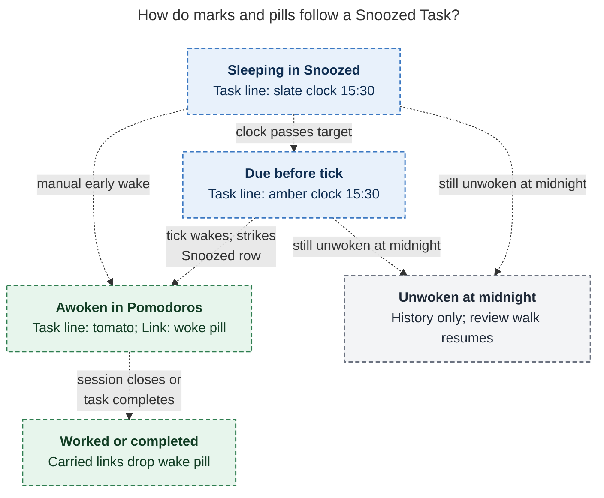
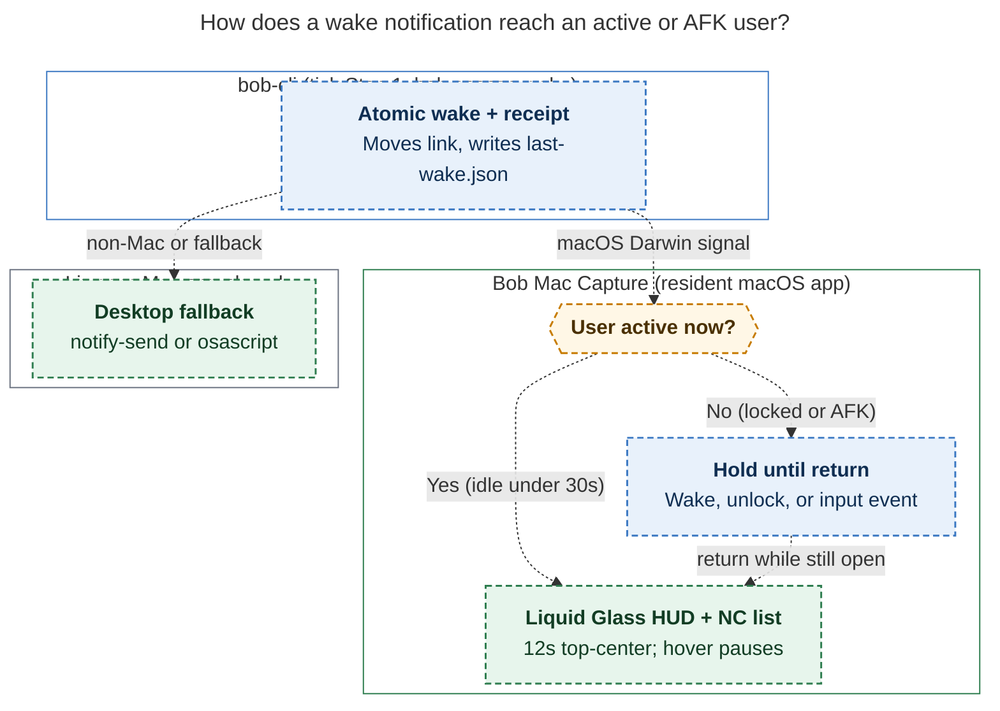

# Snoozed Tasks: Modified Design, Critique, and Implementation Recommendation

> **Research scope:** Evaluate and lead the end-to-end product and technical design for a
> modified **Snoozed Task** feature building on prior research
> (`research:202611/snoozed_task_links/snoozed_task_links.md`), covering Event Task
> exclusion, task-definition marks, awoken Task Link pills, `plan.max_links` exemption,
> daily-note snooze ergonomics, high-visibility auto-dismissing wake notifications, and a
> new **Snoozed Task** glossary entry.

---

## 1. Executive Summary & Verdict

**Build it — this modified design is substantially stronger, cleaner, and more intuitive
than the original proposal.**

The prior `snoozed_task_links.md` report got the core foundation right: a same-day
`## Snoozed` section after `## Pomodoros`, woken by a cheap 5-minute `bob tick` step,
keeping `[scheduled::]` date-only and sticky lanes intact. Your new requirements resolve
the biggest open product tension (`plan.max_links`) and add the three missing human-facing
loops that turn a clever file format into a workflow you actually trust:

1. **At-a-glance state on task definitions:** replace the `🍅` Today mark slot with a cool
   slate **SVG clock + time pill** (`[◷ 15:30]`, turning amber if due pre-tick) so active
   vs. sleeping tasks are distinguishable in one scan.
2. **At-a-glance arrival on awoken Task Links:** retain a compact struck history row in
   `## Snoozed` (`- ~~**1530** [[job#^email-dan-eod]]~~ · woke 15:30`) so `bob-ledger-tools`
   and Bob Mac Capture paint a warm gold **wake pill (`[🔔 15:30]`)** directly on the
   awoken Task Link in `## Pomodoros` — **without breaking a single one of the 10 existing
   dedicated Task Link parsers across `bob-cli` and `bob-plugins`**.
3. **One-chord snoozing (`Alt+Z`):** a conflict-free keymap in the existing `Alt+<letter>`
   task-gesture family (`Alt+N`, `Alt+F`, `Alt+P`, `Alt+Z`) that snoozes directly from a
   Pomodoro Task Link, a task definition, or a `## Snoozed` row via a pure-JS, one-step
   `Ctrl+Z`-undoable Snooze Time Card.
4. **Presence-aware Liquid Glass wake notifications:** instead of naive `osascript`
   banners that vanish in 5 seconds while you are away from your desk or get swallowed by
   Focus Mode, `bob snooze wake` emits an atomic receipt + Darwin signal
   (`org.bobs.bob.snooze.woken`) to **Bob Mac Capture**, which checks user idle/lock state,
   **holds the notification while you are AFK**, and displays a **12-second, top-center,
   hover-pausing, clickable Liquid Glass HUD** the moment you are active — backed by a
   silent Notification Center entry and a brief status-item pulse.

---

## 2. Critique of the Plan & Delta Against `snoozed_task_links.md`

### 2.1 Is this a good idea?

**Yes.** Ordinary tasks still have no way to say *"committed to today, not actionable
until HH:MM."* Multi-day `[scheduled::]` derives Blocked `[?]` and destroys sticky lanes;
a normal Pomodoro Task Link puts the task into Today at 06:00 and clutters every `=`/`x`
lineup; a `() — LATER` placeholder is still Today and never reminds you when 15:30 arrives.

Your modifications improve the prior design in four concrete ways — and also surface two
real trade-offs plus three codebase defects in `snoozed_task_links.md` that need fixing.

### 2.2 Honest critique of the new requirements (risks & mitigations)

1. **Exempting snoozed tasks from `plan.max_links` — right call, with one honest risk.**
   - *The risk:* If your active plan is already `13/13` and 3 on-clock tasks sit in
     `## Snoozed`, waking them at 15:30 or 19:00 can push `TODAY` to `16/13` (`over` red)
     if morning tasks didn't finish first.
   - *Why your call is still better than counting them:* `plan.max_links` measures
     **active concurrent open links**, not total tasks done in a day — closed Pomodoros
     and struck links already drop out of `links.count` (`docs/plan.md:62–105`). Counting a
     19:00 home chore against your 08:30 active queue double-penalizes work that never
     overlaps in time. Keeping `links.count` strictly tied to `## Pomodoros` also preserves
     `decisions:today-is-read-from-the-ledger` verbatim and mirrors the existing off-clock
     exemption (`links.off_clock`).
   - *Mitigation:* Surface snoozed load quietly alongside `TODAY` — e.g., a sibling pill
     `⏰ 2 · 15:30` next to `TODAY 9/13` (and tooltip `· 2 snoozed, next 15:30`) plus a
     subtle capacity line inside the `Alt+Z` picker (`9/13 active · 2 snoozed`). You stay
     informed without distorting `TODAY` or triggering false morning `over` warnings.

2. **Dashboard (`dash.md`) and `]w` lane-walk surprise (unaddressed in `snoozed_task_links.md`).**
   - Code verification of `~/bob/dash.md:67–77` shows `sectionLanes = lanes.filter((t) => !isTodayTask(t))`,
     and `]w` (`bob-navigation-hotkeys.md:508`) walks Pending/Next/Ready tasks *not* in
     Today. Because a Snoozed Task is **not Today**, a `[*]` task snoozed for 15:30 would
     still appear in `dash.md`'s `### NEXT Tasks` and walk in `]w` at 10:00 unless excluded.
   - **Recommended adjustment (A1):** Keep `isToday` pure (`## Pomodoros` only), add a
     sibling predicate `isSnoozedToday(task)`, and exclude `isSnoozedToday` from **both**
     `]s` (review walk) and `]w` (lane walk) as well as `dash.md`'s `PENDING`/`NEXT`
     backlog sections (whole-lane `nextBudget()`/`pendingBudget()` continue counting them,
     just as they already include Today).

3. **Three factual/architectural corrections to `snoozed_task_links.md` found in source:**
   - **`tick-finished` is NOT currently observed by Bob Mac Capture.**
     `snoozed_task_links.md` (§ Smaller calls) stated *"The Darwin `tick-finished` ping
     already refreshes the Mac agenda regardless."* Source verification across all four
     repos shows `bob-cli` posts `org.bobs.bob.tick-finished`
     (`src/native/tick/receipt.rs:75`), while `bob-mac-capture` only observes
     `org.bobs.bob.ref.scan-finished` (`RefsScanReceiptObserver.swift:107`). Adding a
     dedicated `org.bobs.bob.snooze.woken` receipt observer (mirroring `scan_receipt.rs`
     and `RefsScanReceiptObserver.swift`) solves both instant agenda refresh and reliable
     HUD notifications cleanly.
   - **Shelling out to `bob snooze add` from Obsidian breaks undo and mobile.**
     `snoozed_task_links.md` Phase 3 proposed having Obsidian's snooze gesture shell out to
     `bob snooze add`. In Obsidian, `bob-navigation-hotkeys` explicitly keeps disk reloads
     out of editor undo history (`bob-navigation-hotkeys.md:20`), so shelling out breaks
     `Ctrl+Z` on an open daily note, adds ~200–400 ms reload flicker, and fails on mobile.
     Every fast ledger gesture in `bob-plugins` (`Ctrl+Shift+Enter`, `Ctrl+Shift+M`,
     `Ctrl+S`, `Alt+N`) uses a **pure JS planner pinned to shared Rust conformance vectors**
     writing through the live editor transaction when open (instant, 1-step `Ctrl+Z`,
     mobile-compatible) and preimage-checked `vault.process` when closed.
   - **`snooze` belongs at Step 1 of `bob tick`, not after `gcal`.**
     `snoozed_task_links.md` placed `snooze` after `gcal` solely for hypothetical future
     event-anchored wakes. With Event Tasks permanently excluded, `snooze` has zero
     dependency on `gcal`. In `src/native/tick/catalog.rs:115`, `gcal` (10m ceiling),
     `gmail` (20m ceiling), and `refs` (30m ceiling) all run ahead of `tasks`. Putting
     `snooze` **first** means a 15:00 or 19:00 snooze wakes at `:00:01` instead of waiting
     behind hourly Google syncs, while the lock-free no-op check costs <2 ms on ticks with
     nothing due, and `tasks` (`reconcile`) still runs downstream on the same pass.

### 2.3 Explicit Summary of Requirement Adjustments

| ID | Adjustment | Why |
| --- | --- | --- |
| **A1** | Exclude `isSnoozedToday` from `]w` and `dash.md` `NEXT`/`PENDING` sections (in addition to `]s`), while keeping `isToday` strictly `## Pomodoros` and whole-lane caps unchanged. | Prevents a task already planned for 15:30 from cluttering backlog walks at 10:00 without reopening `decisions:today-is-read-from-the-ledger`. |
| **A2** | Retain a struck history row in `## Snoozed` after wake (`- ~~**1530** [[note#^id]]~~ · woke 15:30`) instead of deleting the row and heading immediately. | Drives the awoken Task Link pill with zero syntax changes to `## Pomodoros` Task Links, mirroring `## Events` → `.bob-event-link-time`. Heading is still deleted if all rows are cancelled/unlinked before waking. |
| **A3** | Put the `snooze` tick step at **position 1** (before `gcal`, `gmail`, `refs`, `projects`, `tasks`) with a 5m default cadence. | Event Tasks are out of scope, so `snooze` needs nothing from `gcal` and avoids hourly sync tail latency at `:00`. |
| **A4** | Implement Obsidian's `Alt+Z` snooze/wake write as a **pure JS planner + shared Rust vectors** (not a `bob snooze` subprocess). | Gives <10 ms latency, 1-step `Ctrl+Z` undo in the open daily note, and Obsidian Mobile support, matching `Ctrl+Shift+Enter` and `Ctrl+Shift+M`. |
| **A5** | Deliver Mac wake alerts through **Bob Mac Capture's presence-aware Liquid Glass HUD** (holding while AFK/locked) instead of `osascript` banners, falling back to `desktop_notify` only when Mac Capture is absent or on Linux. | Directly satisfies "very likely to see, still goes away on its own" — solves the AFK-at-15:30 and Focus Mode blind spots. |
| **A6** | Keep Event Tasks strictly excluded from snoozing everywhere, *except* read-only offering of today's upcoming Event Task end times as literal-time suggestions in the snooze picker / `z:` completion. | Zero changes to Event Tasks or `bob gcal sync`, while making "after the 3:30 interview" a 1-keystroke action for ordinary tasks. |

---

## 3. Core Data Model & Event Task Exclusion

### 3.1 Vault Format (`## Snoozed` after `## Pomodoros`)

Keep `## Snoozed` **after `## Pomodoros`** (verified: daily notes currently end at
`## Pomodoros`, `gcal/plan.rs:2313` anchors `## Events` immediately above `## Pomodoros`,
and `pomodoros_section_range` stops at the next `## `). Register `snoozed` in
`is_structural_h2_key` (`src/native/capture_drawers.rs:594`).

```markdown
## Pomodoros
- [x] (**0900-0930** [t:: 30m]) — BUILD
	- 🍅 [[bob#^fix-parser]]
- [ ] () — WRITE
	- [[job#^email-dan-eod]]
		- Mention the candidate feedback on system design
- [ ] () — MEET
	- [[#^movie-lion-king]]

## Snoozed
- ~~**1530** [[job#^email-dan-eod]]~~ · woke 15:30
- **1900** [[home#^fix-sink]]
	- grab the wrench from the garage first
```

**Row grammar:**
- **Active (sleeping or due) row:** column-0 bullet `- **HHMM** [[note#^id]]` (accepts
  `HH:MM` on hand edits; writers normalize to `**HHMM**` and keep active rows sorted
  ascending by time). Optional nested child bullets are link notes that travel as an intact
  subtree on both snooze and wake.
- **Awoken history row:** `- ~~**HHMM** [[note#^id]]~~ · woke HH:MM` (or `· woke early HH:MM`
  on explicit manual early wake). Child notes always move up into `## Pomodoros` with the
  link — never duplicated in `## Snoozed`.
- **One row per task per day:** re-snoozing an already-snoozed or already-awoken task
  replaces its existing row in `## Snoozed` with the new active `- **HHMM** ...` row.
- **Cancelled/unlinked before wake:** deleting or releasing a sleeping task removes its row
  outright (never strikes it as woken). If zero rows (active or woken) remain, delete the
  `## Snoozed` heading.
- **No midnight auto-carry:** `bob snooze wake` inspects today's canonical daily note only.
  Yesterday's unwoken rows stay as plain history; because snoozing promoted Ready → Next
  (sticky), the task resurfaces naturally in `]s` / `]w` the next morning.

### 3.2 Airtight Event Task Exclusion

An Event Task (`src/native/event_task.rs`, `glossary:event-task`) is any checkbox row in a
canonical daily note's `## Events` section starting with `**HHMM-HHMM**`.

- **`bob snooze add` & capture `z:<when>`:** refuse if the target resolves to an Event Task
  (*"Event Tasks follow their `## Events` span and cannot be snoozed"*).
- **Obsidian `Alt+Z` / Task Card `z`:** refuse immediately on an Event Task row in
  `## Events` or on a Pomodoro Task Link targeting an Event Task.
- **Hand-written row in `## Snoozed` targeting an Event Task:** `bob snooze wake` skips it
  without moving it and emits a non-blocking lint (`snoozed_event_task`); `isSnoozedToday`
  and definition/wake marks ignore Event Task targets completely.
- **Zero changes** to `bob gcal sync`, MEET filing, Event Task clock-based close outcomes,
  `.bob-event-link-time`, or Mac Capture's Calendar band.

---

## 4. Visual Design: Task Definitions & Awoken Task Links

Both visual surfaces follow Bob's established mark architecture (`docs/today-marks.md`,
`docs/event-link-times.md`, `docs/off-clock-link-chips.md`, `docs/task-tag-marks.md`):
**display-only, zero-width Live Preview widgets + Reading-view post-processors, zero
line-height shift, non-copyable text, reduced-motion & forced-colors safe, and no `::` in
tooltips.**

<div id="figure-snoozed-lifecycle-marks">



_Snoozing parks a task with a definition clock pill outside Today; waking moves the link to `## Pomodoros` with a wake pill and flips the definition mark to `🍅`, while closing or midnight retires the wake state._

</div>

### 4.1 On the Task's Definition: Active `🍅` vs. Snoozed Clock Pill

**Placement:** The exact `today-marks` slot (`docs/today-marks.md:65–78`) — immediately
after the leading identity slot (`⌗`, `#TYPE`, `📖`, `◎`), before the task title,
`Decoration.widget({ side: -1 })`.

```text
Active in ## Pomodoros:    - [*] ⌗ 🍅 Fix the parser crash  + Nov 22
Snoozed (sleeping):        - [*] ⌗ [◷ 15:30] Email Dan with Yogi updates  + Nov 23
Snoozed (due pre-tick):    - [*] ⌗ [◷ 15:30] Email Dan with Yogi updates  (warm amber)
Not on today's plan:       - [*] ⌗ Finish the E2E suite  + Nov 20
```

**Why an SVG clock-mask pill (`[◷ 15:30]`) beats color emoji `⏰` or `🕒`:**
- Apple's `⏰` alarm clock emoji is **bright red** — right next to red `🍅` at `0.85em`,
  peripheral vision blurs the two! That would defeat the goal of instant separation.
- Static clock emoji (`🕒`) shows hands pointing at 3:00 even when the label says `19:00`.
- An inline **16×16 stroke SVG clock mask** (`--bob-snooze-clock-glyph`) + colon-formatted
  `15:30` (`font-variant-numeric: tabular-nums`, never `1900` which looks like a year!)
  inside a compact capsule creates **double-coded contrast** (works in grayscale too):
  - **Active (`🍅`):** warm color emoji, round silhouette, no pill, no text.
  - **Snoozed sleeping (`span.bob-snooze-mark[data-state="sleeping"]`):** cool slate-indigo
    ink, **dashed** `1px` pill border, faint cool fill, clock glyph + `15:30` — visually
    whispers *"paused, later today"* and mirrors the vault's dashed off-clock / paused idiom.
  - **Snoozed due pre-tick (`data-state="due"`):** shifts to **warm amber** with a solid
    `1px` border — honest feedback when `now ≥ HHMM` before the next tick lands.
- **Copy hygiene:** draw the glyph in `::before` and the time via
  `::after { content: attr(data-snooze-time); }` with `user-select: none` so copying a task
  line never copies the snooze time, matching `bob-today-mark`.
- **Mutual exclusion:** if a task somehow has both an active Pomodoro link and a stale
  `## Snoozed` row, **`🍅` always wins**.
- **Tooltip (`aria-label`, 2 lines):**
  - Sleeping: `Snoozed until 15:30 · in 2h 15m\n⌘-click to open in today's note`
  - Due: `Snoozed until 15:30 · due (waking on next tick)\n⌘-click to open in today's note`
- **Interaction:** plain click places caret at title start; **Mod+click** opens today's
  daily note directly at the task's row in `## Snoozed` (and **Go to today's Task Link**
  jumps there too). When tick wakes the task, the clock pill swaps cleanly to `🍅` with the
  existing `bob-today-mark-in` pop.
- **Secondary definition surfaces:** nav pickers (`410-picker-filter-and-render.js:507`,
  which already show `🍅` / `🍅 running`) show `◷ 15:30` for snoozed rows; the Task Card
  header (`Ctrl+Shift+P`) shows a compact `Snoozed 15:30` chip beside the lane chip.

### 4.2 On the Awoken Task Link in `## Pomodoros`

#### Architecture comparison: how does the Task Link know it was awoken?

| Option | Markdown in `## Pomodoros` | Parser blast radius | Mixed-version safety | Plain-MD / iOS / Undo |
| --- | --- | --- | --- | --- |
| **A. Struck history row in `## Snoozed` + display pill (Recommended)** | `- [[job#^email-dan-eod]]` *(unchanged!)* | **Zero** — all 10 dedicated-link parsers untouched | **100% safe** | Visible in note, works on iOS, `Ctrl+Z` works |
| B. Inline prefix/suffix on Task Link (`⏰ 15:30 [[...]]`) | Mutated | **High** — breaks all 10 Rust + JS parsers (`bare_plain_link`, `todayLinkFromBody`, `DEDICATED_TASK_LINK_PREFIX_RE`, etc.) | **Breaks** older `bob` / plugins (drops from Today & `=x`) | Visible in note, messy carry stripping |
| C. Vault journal (`.bob/snooze/<host>.jsonl`) | Unchanged | Zero | Safe | Invisible in plain MD, new sync/merge surface, no editor undo |

**Option A wins decisively.** It is the exact architectural twin of `docs/event-link-times.md`:
just as `## Events` drives `.bob-event-link-time` pills on `## Pomodoros` links in one
document scan, `## Snoozed`'s struck history rows drive `.bob-woken-link-mark` pills on
`## Pomodoros` links in one document scan — and Rust `capture-pomodoros --tasks` attaches
an additive `woken` object onto `AgendaItem` (beside `event: Option<AgendaItemEvent>` at
`src/native/capture_pomodoros_agenda.rs:139`) so Bob Mac Capture renders the exact same
pill.

#### Decision: Wake Time vs. Snooze Time

**Show the actual wake time on the pill (`woke 15:30` or `[🔔 15:30]`), record BOTH
scheduled target and actual wake time in the `## Snoozed` history row, and show both in
the tooltip.**

- *Why never the "snoozed-at" time (e.g. 08:15)?* Knowing when you pressed snooze in the
  morning tells you nothing useful when the task arrives at 15:30.
- *Why actual wake time over scheduled target on the pill?* Because `bob tick` runs on a
  `*/5` cron at Step 1 (`:00, :05, :10, ..., :30, ...`), and nearly all human snooze times
  land on 5-minute marks (`15:30`, `19:00`, `+15m`, `+30m`), **actual wake time equals
  scheduled target in the common case** (`15:30`). When they *do* differ — e.g., your Mac
  was asleep from 15:00 to 16:20, or you woke it manually early at 14:15 — showing
  **`16:20`** (or **`14:15`**) is strictly truthful about *when it actually entered Today*,
  while the tooltip explains both:
  - Normal wake: `Woken at 15:30 (snoozed until 15:30)\nReady to work`
  - Delayed wake (laptop asleep): `Woken at 16:20 (snoozed until 15:30 · 50m after target)\nReady to work`
  - Manual early wake: `Woken early at 14:15 (was snoozed until 15:30)`

#### Placement, Styling & Retirement Lifecycle

Look at the existing left-to-right widget slots on a dedicated Pomodoro Task Link in
`bob-ledger-tools`:

- **Left of link:** `side: -3` `.bob-event-link-time` (Event Tasks only) → `side: -2`
  `#TYPE` (drift only) → `side: -1` `◐` (In Progress)
- **Right of link:** `side: 1` `🔓` → `side: 2` `🔑` → `side: 3` `⏭` → `side: 4` `⊘off`

Because **Event Tasks are never snoozed**, **`side: -3` is 100% open** on every woken Task
Link! Placing `.bob-woken-link-mark` at `side: -3` gives time-anchored ledger rows one
unified visual grammar:

```text
- [ ] () — WRITE
    - [🔔 15:30] job > ^email-dan-eod        ← top of entry! Warm sunrise-gold pill, bell SVG + 15:30
    - sase_blog_drafts > ^what-came-before   ← ordinary queued link (no pill)
- [ ] () — MEET
    - ⟦1900-2030⟧ ^movie-lion-king           ← Event Task link (calendar span pill, untouched)
```

- **Top-of-entry placement on wake:** `bob snooze wake` inserts woken links at the **top**
  (first child) of their destination untimed open Pomodoro (never a running Pomodoro!), so
  a freshly awoken task is never buried at the bottom of a long list.
- **Visual states (auto-retiring, zero extra writes):**
  1. **Waiting in an untimed open Pomodoro (`data-state="awake"`):** warm sunrise-amber/gold
     capsule, `1px` solid accent border, crisp 16×16 SVG **bell/alarm-check** mask +
     `woke 15:30` (or compact `15:30` — recommend compact **`🔔 15:30`** where `🔔` is an
     SVG mask, matching `⟦1900-2030⟧`'s compact width while the bell icon clearly says
     *woken* rather than *scheduled*).
  2. **Pulled into a running timed Pomodoro (`data-state="active"`):** softens to quiet
     borderless tint — you started working on it, so it informs without shouting.
  3. **Closed Pomodoro / struck link (`data-state="past"`):** dims to quiet muted history
     (`opacity: 0.55`, matching `.bob-calendar-event-time[data-state="past"]`).
  4. **Carried continuation after a closed Pomodoro:** if today's ledger already has a closed
     Pomodoro ending **at or after `woke_at`** that contains this task link, the carried
     link in the new open continuation **hides the wake pill completely** — you already saw
     and worked it!
- **Allow-list integration:** add `bob-woken-link-mark` to `ledgerMarkClass` in
  `269-plugin-progress-marks-reading.js` so Reading view keeps recognizing the row as a
  dedicated ledger link (no stray status ring, `◐`/`🔓`/`🔑`/`⏭`/`⊘off` unaffected).

---

## 5. `plan.max_links` Exemption & Budget Surfaces

Per your requirement, **Snoozed Tasks never count toward `plan.max_links`**:

| Surface | Active Today Budget (`max_links`) | Snoozed Visibility |
| --- | --- | --- |
| `src/native/plan_budget/` & `050-plan-budget.js` | `links.count`, `links.cap`, `links.over`, `status`, `plan_link_cap_exceeded` scan **`## Pomodoros` only** (unchanged). | Additive `snoozed: { count, due, next_wake_at }` sibling object on `PlanReport` (omitted or `0` when empty). |
| `bob plan` CLI | `PLAN 9/13 links` (unchanged). | `TODAY 9 · SNOOZED 2 (next 15:30)` when `count > 0`. |
| Obsidian `bob-plan` & `dash.md` | `TODAY 9/13` chip tone uses active on-clock links only. Tooltip appends `· 2 snoozed (next 15:30)`. | Compact quiet chip `⏰ 2 · 15:30` beside `TODAY` only when `count > 0` (amber if `due > 0`; clicking opens `## Snoozed`). |
| Bob Mac Capture idle agenda | `TODAY 9/13` badge uses `plan_budget.links` unchanged. | Dim **"Later today"** band below `Later` (folds farthest-first), amber `due · waking` state when past wake time. |
| `bob plan` / `]s` / `]w` / `dash.md` lanes | Whole-lane `NEXT` and `PENDING` still count snoozed tasks (sticky lane). | `isSnoozedToday` excluded from `]s`, `]w`, and `dash.md` `NEXT`/`PENDING` sections so planned-later tasks stay out of backlog walks. |

---

## 6. Snoozing from a Task Link (and Everywhere Else): Keymap & Card UX

### 6.1 Keymap Selection: `Alt+Z` (+ Task Card `z`)

Full collision audit against `~/bob/.obsidian/hotkeys.json`, `~/bob/obsidian_vimrc.md`,
all plugins in `bob-plugins`, and `chezmoi/home/dot_hammerspoon/`:

- `Ctrl+Z` (Undo) and `Ctrl+Shift+Z` (Redo in Property Editor, Record Card, Linux) are
  **ruled out**.
- `Ctrl+S` (Split Pomodoro by type) and `Ctrl+Alt+Shift+S` (Hammerspoon) are **taken**.
- **`Alt+Z` is 100% free** across Obsidian, Vimrc, `bob-plugins`, `bob-mac-capture`, and
  Hammerspoon, and completes the existing `Alt+<letter>` task-action family:
  - `Alt+N` — Next / release (`toggle-task-lane`)
  - `Alt+F` — Freshness confirm (`refresh-task-freshness`)
  - `Alt+P` — Quick priority roll (`roll-by-recommendation`)
  - **`Alt+Z`** — **Snooze for later today (`snooze-task`)** — directly echoes capture's
    `z:<when>` token!
- Also bind **`z`** inside the **Task Card (`Ctrl+Shift+P`)** (verified free), and support
  counted **`N<Alt+Z>`** to snooze a task link plus the next N siblings together.

### 6.2 Context-Smart Behavior of `Alt+Z`

| Cursor Location | What `Alt+Z` Does |
| --- | --- |
| **Dedicated Task Link in `## Pomodoros`** *(primary case)* | Refuses Event Tasks and closed targets. Opens Snooze Time Card. On confirm, moves the Task Link **and all nested child notes** out of `## Pomodoros` into `## Snoozed` (sorted by time) in **one `Ctrl+Z`-undoable editor edit**. Deletes an *untimed* `()` placeholder only if this gesture emptied it; never deletes a running timed Pomodoro (`consumption-keeps-notes-and-recorded-time`). Lane stays sticky. |
| **Open `#task` definition** (area, project, ref, inbox note) | Refuses Event Tasks, closed tasks, and Blocked tasks. Runs existing inbox-route and Block ID prompts if needed. Promotes Ready → Next and stamps `[fresh:: today]` (matching `Ctrl+Shift+Enter`). If already linked in `## Pomodoros`, moves that link + notes into `## Snoozed`. Advances a landed `]s` review row once. |
| **Existing row in `## Snoozed`** | Opens Snooze Time Card in **edit mode** showing current target `15:30`: type a new time + `↵` reschedules in place; top row `Wake now` (`↵` on empty query or `w`) wakes immediately into `## Pomodoros` (striking the `## Snoozed` row with `woke early HH:MM`); `Ctrl+D` cancels/removes the snooze cleanly without leaving a woken row (lane stays sticky). |

*(Symmetry bonus: `Ctrl+Shift+Enter` on a `## Snoozed` row cancels/unlinks it cleanly, and
`Ctrl+Enter` completes the linked task and removes the snooze row.)*

### 6.3 The Snooze Time Card

Designed for **2–3 keystrokes** and strictly compliant with `decisions:q-and-ctrl-bracket-mirror-esc`:

- **Header:** cleaned task title, note stem, type chip, and quiet capacity context
  (`9/13 active · 2 snoozed`).
- **Focused smart input:** accepts `+30m` / `30m` / `1h` / `1h30m`, `1530` / `15:30`,
  `3:30p` / `3:30pm` / `7p` (bare `3:30` smartly resolves to the next same-day occurrence
  and previews it live), or configured named times (`snooze.times`, e.g., `home` → `19:00`).
- **Smart default rows (when input is empty, navigable with `↓`/`↑`, `Ctrl+N`/`Ctrl+P`):**
  1. **Remaining today's Event Task end times** (read-only from `## Events`): e.g.
     `15:30 · after Yogi interview (in 2h 10m)` — nails the Dan-email case in one `Enter`.
  2. **Future relative presets:** `+30m (14:15)`, `+1h (14:45)`, `+2h (15:45)`.
  3. **Configured named times** still in the future today (e.g. `home · 19:00`).
- **Live footer preview:** `→ Snooze until 15:30 (in 2h 10m) · leaves WRITE` (or teaching
  refusal for past/cross-midnight times pointing to `Ctrl+Shift+P` for tomorrow).
- **Capture parity (`bob capture`):** `z:<when>` (`z:1530`, `z:15:30`, `z:+45m`, `z:home`),
  with `z:` completions in Bob Mac Capture offering the same upcoming Event end times and
  named presets; plain `@route:id` on a snoozed task wakes it early; `@route:id!` drops the
  snooze cleanly.

---

## 7. High-Visibility, Auto-Dismissing Wake Notifications

### 7.1 Why Standard `osascript` / macOS Banners Fail Here

`snoozed_task_links.md` proposed reusing `desktop_notify.rs` (`osascript display notification`).
In practice, `osascript` banners fail your exact goal (*"very likely to see, still goes
away on its own"*) in four ways:

1. **The AFK / post-meeting blind spot:** `bob tick` wakes `Email Dan` at `15:30:02` while
   you are finishing the meeting or away from your desk. macOS dismisses the banner at
   `15:30:07`. You sit down at `15:34` and **never see it**.
2. **Focus Mode / DND suppression:** unsigned `Script Editor` notifications are silently
   swallowed by macOS Focus filters.
3. **Top-right peripheral blindness:** small Notification Center banners blur into
   low-priority Slack/calendar noise on large displays.
4. **Zero actionability:** clicking an `osascript` banner launches Script Editor instead
   of opening your task or offering a quick re-snooze.

### 7.2 Recommended Architecture: Presence-Aware Liquid Glass Wake HUD

Bob **already** has every building block needed for an extraordinary, native macOS wake
notification inside `bob-mac-capture` — zero new daemons, zero new permissions, zero
changes to Hammerspoon:

- `bob-cli` already posts Darwin notifications after writing atomic receipts
  (`src/native/highlights_ref/scan_receipt.rs` → `org.bobs.bob.ref.scan-finished`).
- `BobMacCapture` is already a signed, resident menu-bar app that observes Darwin pings
  (`RefsScanReceiptObserver.swift`), renders borderless non-activating **macOS 26 Liquid
  Glass (`NSGlassEffectView`) floating HUD panels** (`RefsCopyHUD.swift`), posts
  interactive `UNUserNotificationCenter` notices (`NotificationService.swift`), and animates
  its own menu-bar glyph (`StatusItemController.swift`).

<div id="figure-wake-notification-architecture">



_Step 1 of `bob tick` runs `bob snooze wake`, emits `last-wake.json` and a Darwin signal, and lets Bob Mac Capture hold the 12-second Liquid Glass HUD until you are actually at the Mac, paired with a silent Notification Center (NC) list entry and a desktop fallback when Mac Capture is absent._

</div>

#### Exact delivery mechanics

1. **Atomic Wake Receipt + Darwin Signal (`bob-cli`):**
   - When `bob snooze wake` actually wakes ≥1 row (automatic or manual; dry runs and no-ops
     stay silent), it atomically writes `$XDG_STATE_HOME/bob-cli/snooze/last-wake.json`
     (mode `0600`) with `wake_id`, `date`, `daily_path`, `woken_at`, and `tasks[]`
     (`title`, `note_stem`, `relative_path`, `block_id`, `ledger_line`, `destination_entry`,
     `snoozed_until`, `woke_at`, `type_name`, `type_hue`).
   - On macOS, posts `org.bobs.bob.snooze.woken` via `darwin_notify::post`.
   - On Linux (or on macOS when `BobMacCapture` is not running), falls back to
     `desktop_notify::send_notification` (`notify-send` / `osascript`), gated by
     `snooze.notify` (default `true`) and `BOB_VAULT_SYNC_NOTIFY`.

2. **Presence-Aware Gate (`SnoozeWakeObserver` in `BobMacCapture`):**
   - Reads `last-wake.json` off the main thread, deduplicating by `wake_id` and discarding
     receipts from prior days or older than 4 hours.
   - Checks two **zero-permission** macOS signals:
     - Screen locked or display asleep (`com.apple.screenIsLocked` / `screenIsUnlocked`,
       `NSWorkspace.screensDidSleepNotification` / `screensDidWakeNotification`)
     - Input idle time via `CGEventSource.secondsSinceLastEventType(.combinedSessionState,
       eventType: .anyInputEventType)` (requires **no** Accessibility grant).
   - **Active now** (unlocked and idle < 30s): shows the HUD immediately.
   - **AFK / locked** (locked, display asleep, or idle ≥ 30s): holds the batch in memory
     until wake/unlock or first mouse/keyboard activity; on return, verifies via a quick
     agenda refresh that the woken task(s) are still open and unworked, then slides the HUD
     in right as you sit down!

3. **The Floating Liquid Glass Wake HUD (`SnoozeWakeHUD`):**
   - **Placement:** **Top-center of the active screen** (the display under the mouse or key
     window), ~24 pt below the menu bar — right in your natural upper sightline, across all
     Spaces and full-screen apps (`.canJoinAllSpaces`, `.fullScreenAuxiliary`), never
     buried in the top-right corner.
   - **Focus discipline:** borderless `.nonactivatingPanel` (`canBecomeKey = false`,
     `canBecomeMain = false`) — **never steals focus** from Vim, terminals, or calls.
   - **Look:** `NSGlassEffectView` Liquid Glass capsule (with Reduce Transparency & Reduce
     Motion fallbacks, matching `RefsCopyHUD.swift`), warm sunrise-amber/gold `bell.badge.fill`
     symbol, `Woke at 15:30` + type badge (`WRITE`), cleaned task title (batched cleanly up
     to 3 rows when multiple tasks wake together — never stacking overlapping popups), and
     a subtle bottom countdown hairline.
   - **Auto-dismiss + human control:**
     - **12 seconds** default hold (long enough to notice without hurrying; always leaves on
       its own).
     - **Hover pauses the countdown** so moving your cursor over it gives you time to read
       or act.
     - **Click card** → opens today's daily note at the woken Task Link in Obsidian (via
       `ObsidianOpenURL`) and dismisses immediately.
     - **Inline quick actions on hover:** `Open`, `+15m` / `+30m` (re-snoozes via
       `bob snooze add`), and `×` dismiss.
     - **Subtle optional chime:** gentle system sound (`Glass` / `Tink`, configurable in
       Settings, default on, silent when muted).
   - **Quiet secondary safety net (zero double-popup):**
     - Simultaneously files one `.passive` (`sound = nil`, `.list`-only — **no second
       banner**) `UNUserNotificationCenter` entry so it persists in Notification Center if
       missed.
     - Plays a brief warm gold accent pulse on `StatusItemController` (auto-clears after
       2 minutes or when the capture panel opens).
   - **Obsidian de-duplication:** on macOS, Obsidian relies on `BobMacCapture`'s HUD (no
     duplicate `Notice`, only live-updating the `[🔔 15:30]` pill + `🍅` mark); on Linux
     without `BobMacCapture`, Obsidian shows an 8-second `Notice` if Obsidian is focused.

### 7.3 Alternative Notification Designs Considered (and Why Rejected)

| Alternative | Verdict | Why rejected |
| --- | --- | --- |
| `osascript` only (`desktop_notify.rs`) | Fallback only | Vanishes in 5s while AFK, suppressed by Focus Mode, unclickable. |
| `UNUserNotificationCenter` `.timeSensitive` persistent alert | Optional setting only | Persistent alerts do **not** go away on their own; temporary banners vanish while AFK. |
| Hammerspoon `hs.alert` / menu-bar takeover | Rejected | `hs.alert` is unclickable plain text; hijacking `pomodoro_countdown.lua` clutters the active Pomodoro timer and splits ownership into a 4th repo (`chezmoi`). |
| Obsidian `Notice` alone | Linux fallback only | Invisible whenever Obsidian is behind a browser, terminal, or Zoom call. |

---

## 8. Draft Glossary Term: **Snoozed Task**

Ready to add to `sase/memory/glossary/snoozed-task.md` (via `/sase_memory_write` during
implementation; `aka` aliases ensure `glossary:snoozed-task-link` resolves here too):

```markdown
---
title: Snoozed Task
aliases:
  - snoozed task link
  - snoozed link
  - snooze row
---

An open `#task` planned for later today that waits outside Today in today's canonical
daily note under `## Snoozed` until a chosen local time, written as a column-0 bullet
`- **HHMM** [[note#^id]]` (optional child notes travel as its subtree).

Snoozing a task (`Alt+Z`, Task Card `z`, [[capture]] `z:<when>`, `bob snooze add`, or a
hand-written row) commits it for today without putting it on the active plate yet: it
promotes Ready to Next and stamps [[task-freshness]], moves any existing open-Pomodoro
[[task-link]] and its child notes into `## Snoozed`, and keeps Next and In Progress lanes
sticky. While sleeping, a Snoozed Task is **not** Today (absent from `=`/`x` lineups and
`today_tasks`), does **not** count against `plan.max_links`, stays excluded from the `]s`
review walk, the `]w` lane walk, and dashboard `NEXT`/`PENDING` backlog sections, and
wears a clock-and-time mark (`◷ HH:MM`, turning amber when due) in the Today-mark slot on
its task definition instead of `🍅`.

The `snooze` step of `bob tick` (Step 1, 5-minute cadence, running `bob snooze wake`) —
or an explicit early wake — wakes each due row atomically: it re-checks task guards
(dropping resolved or already-linked rows and leaving still-Blocked tasks parked), moves
the link subtree to the top of the first matching untimed open [[pomodoro]] (never a
running session), and strikes the `## Snoozed` row with its wake time
(`- ~~**HHMM** [[note#^id]]~~ · woke HH:MM`). That struck history row drives the awoken
pill (`🔔 HH:MM`) on the Task Link in `## Pomodoros` without altering Task Link syntax,
flips the task definition mark to `🍅`, and triggers a presence-aware wake notification
(a 12-second, hover-pausing Liquid Glass HUD in [[capture-panel]]'s host app on macOS
that waits if you are away or locked). Completing, cancelling, releasing (`Alt+N`),
unlinking, or blocking a sleeping task prunes its `## Snoozed` row so wake never revives
it. Unwoken rows never auto-carry at midnight; they remain yesterday's history while the
sticky Next lane resurfaces the task in normal review.

Never an [[event-task]] (calendar events keep their `## Events` time spans, MEET filing,
and clock-based closes). Not a multi-day `[scheduled:: YYYY-MM-DD]` hold (which derives
Blocked `[?]`), not the Reading Board's date-based Snoozed lane, not project/area
frontmatter `snooze:` or `#hide`, and not a `() — LATER` placeholder Pomodoro. See
`docs/snooze.md`.
```

---

## 9. Recommended Solution & Implementation Roadmap

Build the feature cleanly in **four cohesive phases** across `bob-cli`, `bob-plugins`, and
`bob-mac-capture` (**zero `chezmoi` changes required**):

### Phase 1 — `bob-cli` Core, Tick Step & Docs *(immediately useful with hand-written rows)*
1. **`src/native/snooze/` module:** parser/planner/writer for `## Snoozed` (after
   `## Pomodoros`), active `- **HHMM** [[note#^id]]` + subtree, struck woken history rows
   `- ~~**HHMM** [[note#^id]]~~ · woke HH:MM`, Event Task refusal + `snoozed_event_task`
   lint, shared JSON conformance test vectors (`tests/fixtures/snooze/vectors.json`).
2. **`bob snooze` CLI:** `bob snooze` / `list`, `add <target> <when>`, `wake`, `drop`
   (supporting `--dry-run`, `-f json`, `--bob-dir`, following `cli_rules`).
   - Fast lock-free no-op check when no `## Snoozed` section or nothing due/prunable.
   - Wake inserts at the **top** of first matching untimed open Pomodoro (never running),
     strikes the `## Snoozed` row with actual wake time, writes atomic
     `$XDG_STATE_HOME/bob-cli/snooze/last-wake.json`, posts `org.bobs.bob.snooze.woken`
     on macOS, and falls back to `desktop_notify` on Linux / when Mac Capture is absent.
3. **`bob tick` catalog (`src/native/tick/catalog.rs`):** add `snooze` at **Step 1**
   (`5m` default cadence, 2m ceiling, daily-note readiness gate).
4. **Structural & reconcile integration:** register `snoozed` in `is_structural_h2_key`;
   update `reconcile` to prune resolved/already-linked `## Snoozed` rows, treat a live
   snoozed row as linked for the R9 daily-note lane exception, and exclude `isSnoozedToday`
   from freshness/walk scans.
5. **Plan budget & agenda contracts:** keep `links.count`/`max_links` strictly
   `## Pomodoros` only; add additive `snoozed: { count, due, next_wake_at }` to
   `PlanReport` and `bob plan` output; add `snoozed[]`, `woken` on `AgendaItem`, and
   `min(wake_at)` folded into `refresh_at` on `bob capture-pomodoros --tasks`.
6. **Capture grammar:** add `z:<when>` token (spans, existing-task exception, teaching
   refusals on Event Tasks / past / cross-midnight / `s:<N>` / `=`, `z:` completions
   including today's remaining Event end times and `snooze.times`, early-wake on plain
   `@route:id`, drop on `@route:id!`).
7. **Docs & Memory:** `docs/snooze.md`, `docs/snooze-marks.md` display contract, updates
   to `docs/tick.md`, `docs/plan.md`, `docs/capture.md`, `docs/today-marks.md`,
   `docs/reference/vault-format.md`, plus the **Snoozed Task** glossary strand and
   accompanying decision record (via `/sase_memory_write`).

### Phase 2 — `bob-plugins` Visual Marks, Cleanup Parity & `Alt+Z` Card
1. **Cleanup parity (must ship BEFORE or WITH authoring):** extend
   `planDeferredPomodoroLinkCleanup` (`160-pomodoro-reorder.js:538`) to prune active
   `## Snoozed` rows on release (`Alt+N`), complete, cancel, unlink, decay, roll, and
   `Ctrl+Shift+M` — preventing timer revival of released/closed tasks.
2. **Snooze state cache & predicates in `bob-ledger-tools`:** scan `## Snoozed` alongside
   `todayCache` (active rows + struck woken rows), expose `api.isSnoozedToday`, exclude
   from `]s`, `]w`, and `dash.md` `NEXT`/`PENDING` sections, and render the quiet
   `⏰ N · HH:MM` sibling chip + `TODAY` tooltip suffix in `bob-plan`.
3. **Task-definition clock mark (`bob-snooze-mark`):** same slot as `bob-today-mark`
   (mutually exclusive; `🍅` wins), slate dashed SVG clock + `HH:MM` (amber when due),
   non-copyable `::before`/`::after`, 2-line tooltip, Mod+click jump to `## Snoozed`,
   plus picker and Task Card header chips.
4. **Awoken Task Link pill (`bob-woken-link-mark`):** `side: -3` leading slot on
   `## Pomodoros` Task Links, SVG bell + actual wake time (`🔔 15:30`), warm sunrise-gold
   when waiting in untimed open Pomodoro → calm in running → dim in closed → dropped on
   post-work carried continuations; added to `ledgerMarkClass`.
5. **`Alt+Z` + Task Card `z` + Snooze Time Card:** pure JS planner tested against
   `tests/fixtures/snooze/vectors.json`, one-step `Ctrl+Z` editor transaction on open daily
   note, supports Task Links in `## Pomodoros`, task definitions, `## Snoozed` rows (edit /
   wake early / `Ctrl+D` cancel), and counted `N<Alt+Z>`. Linux-only Obsidian `Notice`
   when a task wakes while focused.

### Phase 3 — `bob-mac-capture` Presence-Aware HUD & Idle Agenda
1. **`SnoozeWakeObserver` + `SnoozeWakeHUD`:** Darwin observer on
   `org.bobs.bob.snooze.woken` (mirroring `RefsScanReceiptObserver`), zero-permission
   idle/lock presence gate with AFK hold queue, 12-second top-center non-activating Liquid
   Glass `NSPanel` (`hover` pauses countdown, click opens in Obsidian, inline `Open` /
   `+15m` / `+30m` / `×`), optional chime, silent `.list`-only `UNUserNotificationCenter`
   record, and transient `StatusItemController` pulse. Settings toggle for HUD / sound /
   native-banner fallback.
2. **Idle Agenda & Capture UI:** decode additive `snoozed[]` and `AgendaItem.woken` via
   `decodeIfPresent`; render dim **"Later today"** band at the bottom (folds farthest-first)
   and gold wake pill on awoken rows; style `z:` spans and event-end-time completions.
3. Verify exact-SHA macOS CI green per linked-repo rules.

### Phase 4 — Optional Follow-Ups (After ~2 Weeks of Real Use)
- `BobMacCapture` exact-minute `refresh_at` trigger calling `bob snooze wake -q` if
  5-minute tick granularity ever feels noticeable on odd-minute snoozes (e.g., `+12m`).
- Optional `snooze.times` named presets (if not included in Phase 1) and a morning lint for
  yesterday's unwoken rows if missed snoozes become common.

---

## 10. Key Acceptance Criteria

1. **Event Task immunity:** `Alt+Z`, `z:`, and `bob snooze add` refuse Event Tasks with a
   clear message; hand-written Event Task links in `## Snoozed` emit `snoozed_event_task`
   and never duplicate MEET entries or disrupt `bob gcal sync`.
2. **Definition clarity:** a sleeping task wears `[◷ 15:30]` (slate, dashed) in the Today
   slot, never `🍅`; turns amber once `now ≥ 15:30` pre-tick; swaps cleanly to `🍅` on
   wake; copying the task line never copies the mark or time.
3. **Awoken Task Link clarity:** waking moves the link + child notes to the **top** of its
   untimed matching Pomodoro (never a running session), strikes the `## Snoozed` row with
   actual wake time, and paints `[🔔 15:30]` at `side: -3` without changing any `## Pomodoros`
   Task Link bytes; the pill softens when running and disappears on carried links after a
   closed session.
4. **Budget exemption:** snoozing 5 tasks never increases `links.count`, never turns `TODAY`
   over cap, and shows `⏰ 5 · <next>` quietly alongside `TODAY`.
5. **Cleanup & idempotency:** completing, cancelling, releasing (`Alt+N`), unlinking, or
   blocking a snoozed task prunes `## Snoozed`; running `bob snooze wake` twice is a no-op;
   pressing `Ctrl+Z` immediately after `Alt+Z` on an open daily note restores the Task Link
   in `## Pomodoros`.
6. **Presence-aware notification:** waking while active shows the 12s top-center Liquid
   Glass HUD (non-activating, hover pauses, auto-dismisses); waking while locked or idle
   ≥30s holds the HUD and delivers it when you return (if the task is still open); zero
   double-banners on macOS.

---

## 11. Small Confirmations Before Planning

1. **Task-definition & wake pill typography:** confirm you like the **SVG clock + `15:30`**
   (cool slate dashed pill → amber due) on definitions and **SVG bell + `15:30`** (warm
   gold pill at `side: -3`) on awoken Task Links, vs. preferring literal `woke 15:30` text.
2. **HUD duration & chime:** 12 seconds auto-dismiss with hover-pause and a subtle chime by
   default — does 12s feel right, or would you prefer shorter (8s) / longer (15s)?
3. **Keymap:** confirm **`Alt+Z`** (plus Task Card `z`) feels natural beside `Alt+N`,
   `Alt+F`, and `Alt+P`.
4. **Dashboard/walk exclusion (A1):** confirm snoozed tasks should be excluded from `]w`
   and `dash.md`'s `NEXT`/`PENDING` backlog sections (matching `]s`), while remaining in
   whole-lane `NEXT`/`PENDING` counts.

---

## 12. Source Verification Index

- `research:202611/snoozed_task_links/snoozed_task_links.md` — prior consolidated research.
- `bob-cli`: `docs/today-marks.md`, `docs/event-link-times.md`, `docs/off-clock-link-chips.md`,
  `docs/task-link-marks.md`, `docs/task-tag-marks.md`, `docs/date-marks.md`, `docs/plan.md`,
  `docs/tick.md`, `src/native/desktop_notify.rs`, `src/native/tick/{catalog,receipt}.rs`,
  `src/native/highlights_ref/scan_receipt.rs`, `src/native/plan_budget/{mod,today}.rs`,
  `src/native/capture_pomodoro_start.rs`, `src/native/capture_pomodoro_close/{links,ledger}.rs`,
  `src/native/capture_pomodoros_agenda.rs`, `src/native/event_task.rs`.
- `bob-plugins`: `plugins/bob-ledger-tools/src/{050-plan-budget,060-today,137-progress-marks,143-today-marks,148-task-link-marks,149-task-link-mark-live-model,275-plugin-today-marks,291d-event-link-times}.js`,
  `plugins/bob-ledger-tools/styles.css`, `plugins/bob-navigation-hotkeys/src/{160-pomodoro-reorder,490-plugin-lifecycle}.js`,
  `docs/{bob-navigation-hotkeys,task-card,block-id-prompt,task-status-cycler,bob-command-mode}.md`.
- `bob-mac-capture`: `Sources/BobMacCapture/{AppDelegate,NotificationService,StatusItemController,CaptureAgendaStore}.swift`,
  `Sources/BobMacCapture/Refs/{RefsCopyHUD,RefsScanReceiptObserver}.swift`,
  `Sources/CaptureCore/CaptureAgendaBoundaryRefresh.swift`.
- `chezmoi`: `home/dot_hammerspoon/{init,pomodoro_countdown}.lua`.
- Live vault: `~/bob/.obsidian/hotkeys.json`, `~/bob/obsidian_vimrc.md`, `~/bob/dash.md`,
  `~/bob/2026/20261125.md`, `~/.config/bob/config.yml`.
- Mermaid figures verified with `@mermaid-js/mermaid-cli@12.0.0` under the strict PDF config:
  Figure 1 (`718.1 × 742 px`, fit `90.9%`), Figure 2 (`841.8 × 1086.2 px`, fit `77.5%`);
  both rendered PNGs visually inspected.
