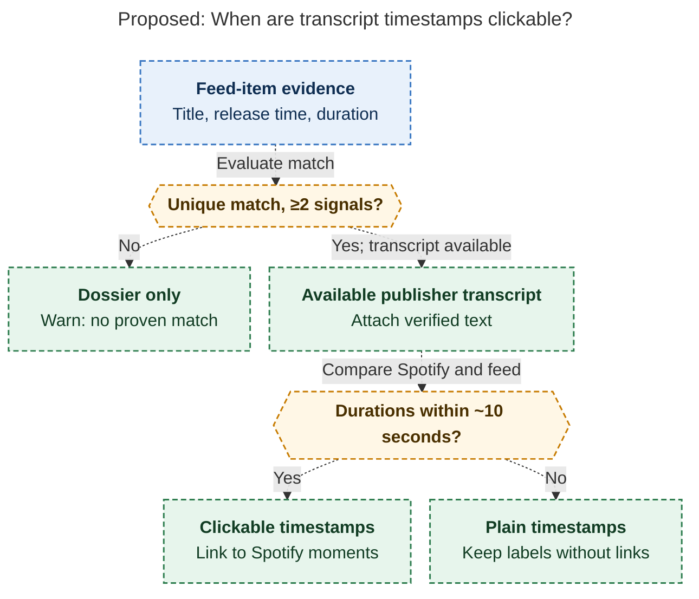
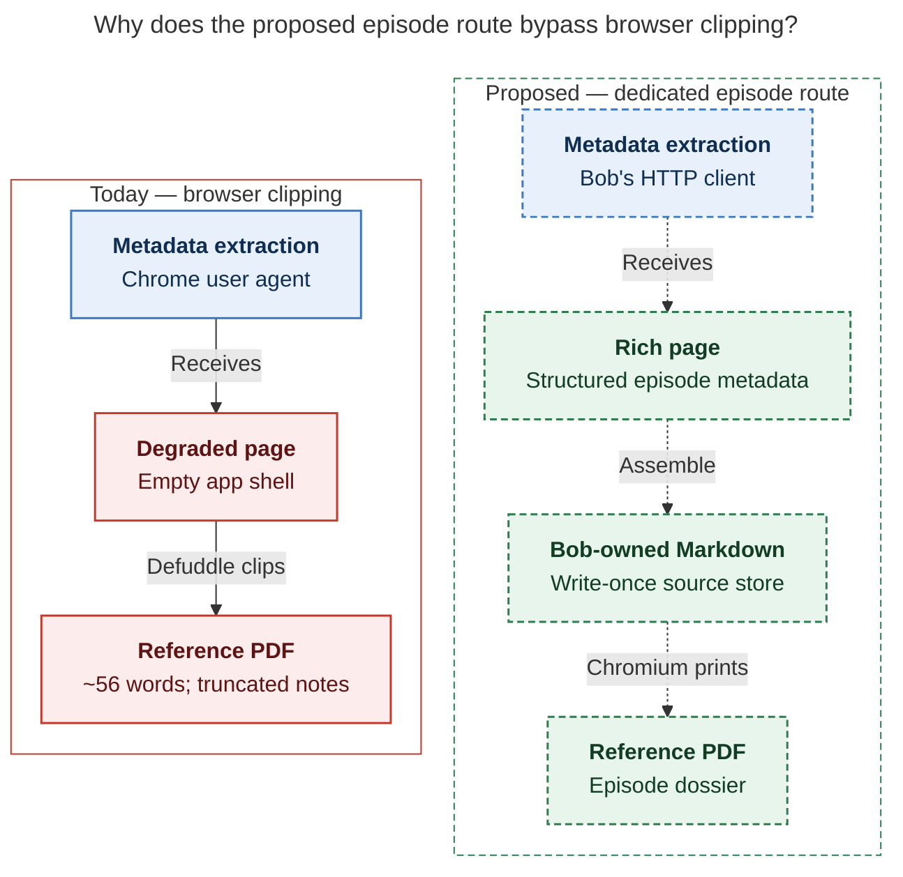

# Diagram proposals: Smarter `bob ref create` for Spotify URLs

Proposals for the swarm linker, not a report. Each diagram restates only what the source
report says.

```yaml
source: research:202611/spotify_episode_capture_route/spotify_episode_capture_route__final.md
producer: research.5r.image
check: "mmdc 12.0.0 with the PDF-mirroring config rendered 2 of 2 Mermaid diagrams; Puppeteer --no-sandbox; deliberate parse failure exited nonzero"
```

## enrichment-gates

```yaml
anchor: |-
  if Spotify and RSS durations agree
question: |-
  Why can a verified transcript still have plain timestamps?
illustrates: |-
  A unique feed-item match agreeing on at least two signals permits publisher-transcript enrichment, while Spotify and RSS duration agreement separately determines whether timestamps become clickable links.
caption: For an available publisher transcript, a proven match permits attachment; a separate duration check decides whether timestamps are clickable.
review: "656.621x986 px, fit 90.5%; question, source trace, labels, arrowheads, crossings and reading direction passed visual checks; 0 revisions"
```



## capture-paths

```yaml
anchor: |-
  Today's broken capture is largely self-inflicted: the headless browser's
question: |-
  Why replace browser clipping with a dedicated episode route?
illustrates: |-
  Bob's own HTTP client retrieves structured episode metadata for Bob-owned Markdown, avoiding the Chrome user-agent shell while retaining the Chromium reader template for the episode dossier PDF.
caption: Browserless metadata fetch avoids Chrome's degraded shell; Bob-owned Markdown still prints through Chromium into the episode dossier PDF.
review: "670.469x673 px, fit 97.4%; question, source trace, labels, arrowheads, crossings and reading direction passed visual checks; 1 revision to place today before proposed"
```


